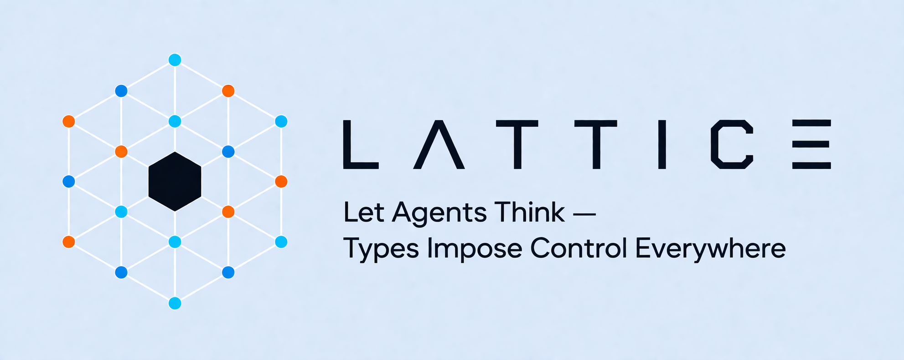

# LATTICE 



A fast, model-centric LLM inference engine. Rust core, Python bindings, micro-agent harness.

**Not** a SaaS. Not a visual workflow builder. Model routing + inference + agent orchestration via TOML-defined pipelines.

## Design

```
LATTICE/ (Cargo workspace)
├── lattice-core/       Pure Rust: resolve + chat + streaming + retry
├── lattice-agent/      Agent struct, conversation state, tool boundary, memory (merged lattice-memory + lattice-token-pool)
├── lattice-bus/        Micro-agent pub/sub + RPC communication bus
├── lattice-harness/    Pipeline orchestrator, TOML rule engine, fork parallelism, hot reload, PluginDagRunner
├── lattice-plugin/     Plugin trait (typed Input → LLM → Output), 9 builtin plugins
├── lattice-cli/        CLI: run, resolve, models, doctor, bus, config, sessions, stats, debug, validate, list, new, tui
├── lattice-tui/        Terminal UI (ratatui)
└── lattice-python/     PyO3 bindings (pip: lattice-core)
```

### Four principles

| <br />        | <br />                                                                  |
| ------------- | ----------------------------------------------------------------------- |
| **Fast**      | Rust hot path, zero-cost abstractions                                   |
| **Minimal**   | No DB required, no external services. Just Rust library + catalog.json. |
| **Pluggable** | Overlay pattern for providers, tools, routing rules                     |
| **Focused**   | One thing well: given model + messages → return response                |

### Plugin model

Every plugin is a typed function: `Input → to_prompt() → LLM.invoke() → from_output() → Output`

The code controls the flow. The LLM is just the inference step — it doesn't decide what to do, when to stop, or where to hand off.

```python
class CodeReviewPlugin(Plugin):
    def build_input(self, ctx): ...     # what to feed the LLM
    def to_prompt(self, input): ...     # format the prompt
    def from_output(self, raw): ...     # parse + validate
    def should_handoff(self, output): ... # deterministic routing
```

### Agent pipeline (harness)

Agents are defined as TOML files in `~/.LATTICE/agents/`. The harness runs them in sequence, using TOML handoff rules to route between agents. Fork targets run multiple agents in parallel:

```toml
[agent]
name = "code-review"
model = "sonnet"

[system]
prompt = "You are a senior code reviewer. Return JSON: {issues: [], confidence: 0.x}"

[handoff]
fallback = "human-review"

[[handoff.rules]]
condition = { field = "issues[any].severity", op = "==", value = "critical" }
target = "fork:security,performance"

[[handoff.rules]]
condition = { field = "confidence", op = ">", value = "0.5" }
target = "refactor"

[[handoff.rules]]
default = true
```

Fork syntax: `target = "fork:security,performance"` runs both agents in parallel, merges outputs as `{security: ..., performance: ...}`, and feeds the merged result to the next agent.

Handoff rule operators: `==`, `!=`, `<`, `>`, `<=`, `>=`, `contains`. Compound rules: `all` (AND), `any` (OR). Array matching: `[any]` iterates all elements. Fork targets: `target = "fork:A,B"` runs A and B in parallel. JSON schema validation with automatic retry.

## Quick start

### Rust

```rust
use lattice_core;

// Resolve a model alias to a specific provider + credentials
let resolved = lattice_core::resolve("sonnet")?;
// -> ResolvedModel { provider: "anthropic", api_model_id: "claude-sonnet-4-6", ... }

// Streaming: get tokens as they arrive
let messages = vec![Message { role: Role::User, content: "Hello".into() }];
let stream = lattice_core::chat(&resolved, &messages, &[])?;
// -> impl Stream<Item = StreamEvent>

// Agent with tools + memory
let mut agent = Agent::new(resolved)
    .with_memory(memory)
    .with_tools(tool_definitions);
let output = agent.send_message("Review this code").await;
```

### CLI

```bash
# Resolve a model alias to provider details
lattice resolve sonnet

# Resolve with JSON output
lattice resolve sonnet --json

# List all available models
lattice models

# Only show models with valid credentials
lattice models --auth

# Run a single prompt (streaming to stdout)
lattice run "Hello, world!" --model sonnet

# Run a pipeline (sequential agents with handoff rules)
lattice run "Review src/router.rs" --pipeline code-review

# Validate agent profiles in ~/.lattice/agents/
lattice validate

# List loaded agents
lattice list agents

# Debug model resolution (optional positional model arg)
lattice debug sonnet --resolve-only

# Debug with a chat prompt
lattice debug deepseek-v4-flash --prompt "Hello"

# Run diagnostics
lattice doctor

# Show bus status (agents, subscriptions, bus configuration)
lattice bus

# Session management
lattice sessions list
lattice sessions show <id>
lattice sessions rm <id>

# Session statistics
lattice stats

# Manage configuration
lattice config init
lattice config get core.default_model
lattice config set core.default_model gpt-4

# Single-turn print mode (pipe-friendly)
lattice -p "Hello" --model sonnet

# Verbose mode (show resolve trace)
lattice run "Hello" -v --model sonnet

# JSON output
lattice resolve sonnet --json
```

### Python

```bash
cd lattice-python && maturin develop
```

```python
import lattice_core

engine = lattice_core.LatticeEngine()
engine.resolve_model("sonnet")
# -> PyResolvedModel(provider="anthropic", api_model_id="claude-sonnet-4-6", ...)

engine.list_authenticated_models()
# -> lists all models with valid credentials in your environment
```

## Current status

LATTICE is in **alpha / dogfooding** stage. What works:

- **Model resolution**: 98 models, 37 aliases, 27 provider defaults (23 with base\_url)
- **Rust inference**: `resolve()` + `chat()` for OpenAI and Anthropic protocols via unified Transport
- **Streaming**: SSE parsers for both protocols, tool call tracking across chunks
- **Thinking mode**: DeepSeek v4-pro (OpenAI reasoning\_content), MiniMax M2.7 (Anthropic thinking\_delta)
- **Agent**: multi-turn conversation, tool execution boundary, memory, token budget
- **Harness**: TOML-defined pipelines, handoff rule engine, fork parallel execution, dry-run validation, hot reload
- **JSON schema validation**: jsonschema crate for LLM output validation with retry loop
- **CLI**: run, resolve, models, debug, doctor, bus, config, sessions, stats, validate, list, new — session auto-save with SHA-256 IDs, `--continue-session`, `--provider` flag
- **HTTPS enforced**: non-localhost HTTP base URLs rejected at the engine level

## Project structure

```
LATTICE/                 Git root (Cargo workspace)
├── lattice-core/        Pure Rust: resolve, chat, streaming, retry
│   ├── src/
│   │   ├── catalog/     Model catalog, aliases, provider defaults
│   │   ├── router.rs    Model resolution, credential resolution
│   │   ├── provider.rs  ChatRequest/ChatResponse types
│   │   ├── transport/   Unified Transport trait, dispatcher, per-protocol adapters
│   │   ├── streaming/   SSE parsers (OpenAI format, Anthropic format)
│   │   ├── retry.rs     Error classification, jittered exponential backoff
│   │   ├── tokens.rs    tiktoken integration + token estimation
│   │   ├── errors.rs    LatticeError enum
│   │   └── types.rs     Role, Message, ToolDefinition, ToolCall, FunctionCall
│   └── tests/e2e/       End-to-end + regression tests
├── lattice-agent/       Agent struct, conversation state, tool boundary, memory (merged lattice-memory + lattice-token-pool)
├── lattice-bus/         Micro-agent pub/sub + RPC communication bus
├── lattice-harness/     Pipeline orchestrator, TOML rule engine, hot reload, PluginDagRunner
│   ├── src/
│   │   ├── pipeline.rs  Pipeline + PipelineRun + DryRunReport (sequential + fork)
│   │   ├── dag_runner.rs PluginDagRunner: intra-agent DAG slot/edge orchestration
│   │   ├── handoff_rule.rs  HandoffTarget (Single/Fork) + TOML rule parsing + evaluation
│   │   ├── profile.rs   AgentProfile + PluginsConfig TOML parsing
│   │   ├── registry.rs  AgentRegistry loading + hot reload
│   │   ├── runner.rs    AgentRunner (wraps Agent + profile)
│   │   ├── tools.rs     ToolRegistry + ToolHandler + merge_tool_definitions()
│   │   └── events.rs    EventBus + PipelineEvent
├── lattice-plugin/      Plugin trait (typed Input → LLM → Output), 9 builtin plugins
├── lattice-cli/         CLI: run, resolve, models, doctor, bus, config, sessions, stats, debug, validate, list, new, tui
├── lattice-tui/         Terminal UI (ratatui)
└── lattice-python/      PyO3 bindings (pip: lattice-core)
```

## Why not X?

- **OpenRouter / LiteLLM**: SaaS/model gateways. LATTICE is a library you embed.
- **LangGraph / CrewAI**: Heavy multi-agent frameworks. LATTICE gives you primitives + lightweight orchestration.
- **n8n / Dify**: Visual workflow builders for non-developers. LATTICE is for developers.
- **MCP**: Model-to-tool protocol. Complementary — plugins reference tools via MCP internally.
- **A2A**: Agent-to-agent protocol. Reference for LATTICE's handoff layer.

## Requirements

- Rust 1.80+
- Python 3.12+ (optional, for Python bindings)
- Credentials in environment variables: `ANTHROPIC_API_KEY`, `OPENAI_API_KEY`, `GEMINI_API_KEY`, etc.

## Configuration

### `.env` file

The LATTICE CLI loads a `.env` file from the working directory on startup (via `dotenvy`). This lets you set provider credentials without polluting your shell profile.

1. Copy the template: `cp .env.example .env`
2. Fill in your API keys

Only variables that are set are used — leave unused providers blank or omit them entirely. Shell environment variables take precedence over `.env` values.

See `.env.example` for the full list of supported variables.

## Development

```bash
cargo build                    # Debug build (all crates)
cargo build --release          # Release build
cargo test                     # Run all Rust unit tests
cargo test -p lattice-core     # Single crate tests
cargo test -p lattice-core <test_name>  # Single test
cargo clippy -- -D warnings    # Lint (warnings as errors)
cargo fmt --check --all        # Format check
cargo fmt --all                # Format code
cargo bench -p lattice-core    # Benchmarks

# Python bindings
cd lattice-python && maturin develop
```

See [CLAUDE.md](CLAUDE.md) for detailed development guide.

## License

Apache 2.0
