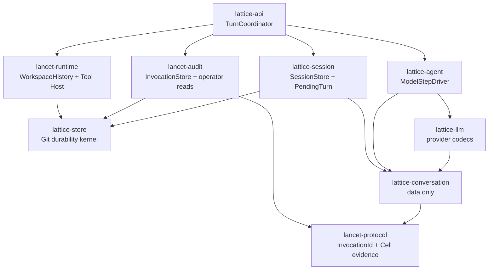
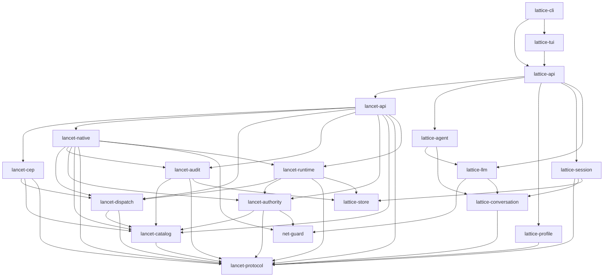

<!-- generated-by: gsd-doc-writer -->
# LATTICE Architecture

> This document is generated from repository verification. Claims that could not
> be directly confirmed from the repo are marked with `<!-- VERIFY: ... -->`.

## 1. System overview

LATTICE is a session-centric LLM runtime written in Rust. Conversation state
lives in a **git-backed session graph**: every turn outcome is persisted as an
immutable commit under `refs/lattice/sessions/**`, so history is durable and
auditable. Public turn execution is exposed through `lattice-api`, whose single
live core is `stream_turn`. Tool execution flows through **LANCET**, a
separately-embeddable runtime that exposes the **Controlled Execution Protocol
(CEP)** — a typed JSON-RPC method protocol with direct policy gating, path
guards (Guard L1), effect checks, and an audit trail. The architecturally
significant property is the strict layering: the workspace is a layered Cargo
workspace where dependencies only ever point from higher layers to lower layers,
with no reverse dependencies, so the LANCET CEP runtime (the `lancet-*` crates)
can be embedded without pulling in the LATTICE session/agent/profile layers.

That dependency property does not imply an accepted standalone product caller.
ADR 0005/#139-B restricts production invocation initiation to
`lattice-api::TurnCoordinator`; lower-level LANCET composition remains
independent for layering and internal tests, not for a Session-less direct CEP
product contract.

The production execution path is **Direct-Local** (ADR 0003): structured
LANCET Tools observe and mutate the canonical Local Workspace directly behind
host-enforced policy, Guard L1 path checks, effect checks, and audit. There is
no sandbox VM, workspace projection, or per-turn provisioning — the
MSB/Upper path and the `lattice-workspace` crate were removed in
#62 (Codeberg #40). The session graph store is git-backed
(`GitSessionGraphStore` over a gix repository rooted at the configured session
store directory); the previous SQLite graph store has been removed.

### 1.1 Accepted durable Turn target (ADR 0005)

ADR 0005 fixes the target architecture that GitHub #141–#144 and #139 deliver.
It is intentionally distinct from the current transition graph below:

- strict `lancet-protocol::InvocationId` and `TurnId` types identify Tool
  execution and accepted Turns; provider Tool Call IDs remain optional provider
  replay metadata;
- data-only `lattice-conversation` owns ordered native messages, bound/unbound
  Tool Calls, ToolResult outcomes, usage, and interruption records;
- domain-neutral `lattice-store` supplies private-Git creation, object/ref CAS,
  Linux flock/fsync/rename durability, retention, and typed store errors;
- `lattice-session`, `lancet-audit`, and `lancet-runtime` retain SessionStore,
  InvocationStore/operator, and WorkspaceHistory semantics in three physical
  repositories and failure domains;
- `lattice-api::TurnCoordinator` becomes the only cross-store Turn saga;
  `lattice-agent` becomes a one-provider-attempt driver with no store or Tool
  execution authority;
- durable PendingTurn stages and a pure reconciliation reducer close interrupted
  work without retrying a provider request or redispatching a Tool.

The kernel is shared, not the transaction. State is rooted below
`$XDG_STATE_HOME/lattice`: one global `sessions.git`, with project-keyed
`invocations.git` and `workspace-history.git`. They have different typed
handles, refs, locks, state machines, and failures. The global order is
SessionExecutionLock, optional project WorkspaceOperationLock, then zero or one
repository write lock; code never holds two repository write locks at once.

The implementation order is #141, #142/#143, #144, #139-A, and #139-B. #139-A
builds and measures a real but non-production InvocationStore. #139-B performs
the one production hard cut and deletes the transitional SQLite identity/path;
there is no dual write, import, legacy reader, or runtime backend switch.

## 2. Component diagram

The workspace has 21 crates grouped into layers. Arrows point from a higher
layer toward the lower-layer crates it depends on. The diagram below shows the
runtime crates; `lattice-tool-prelude` (guest SDK) and
`lattice-system-harness` (black-box tests) sit outside it by contract.
`AGENTS.md` carries the authoritative edge list.

Layer model (verified against each crate's `Cargo.toml` `[dependencies]`):

| Layer | Crate | Depends on |
|---|---|---|
| 0 (leaf) | `lancet-protocol` | — |
| 0 (leaf) | `lattice-store` | — |
| 0 (leaf) | `net-guard` | — |
| 0.5 | `lattice-conversation` | `lancet-protocol` |
| 0.5 | `lattice-llm` | `net-guard`, `lattice-conversation` |
| 1 | `lancet-catalog` | `lancet-protocol` |
| 1 | `lattice-profile` | `lancet-protocol` |
| 1 | `lattice-session` | `lancet-protocol`, `lattice-conversation`, `lattice-store` |
| 1 | `lattice-agent` | `lattice-llm`, `lattice-conversation` |
| 2 | `lancet-dispatch` | `lancet-protocol`, `lancet-catalog` |
| 2 | `lancet-audit` | `lancet-protocol`, `lancet-catalog`, `lattice-store` |
| 2 | `lancet-authority` | `lancet-protocol`, `lancet-catalog`, `net-guard` |
| 2.5 | `lancet-cep` | `lancet-protocol`, `lancet-catalog`, `lancet-dispatch` |
| 2.5 | `lancet-runtime` | `lancet-protocol`, `lancet-dispatch`, `lancet-authority`, `lattice-store` |
| 3 | `lancet-native` | `lancet-protocol`, `lancet-catalog`, `lancet-dispatch`, `lancet-audit`, `lancet-authority`, `net-guard`, `lancet-runtime` |
| 3.5 | `lancet-api` | `lancet-cep`, `lancet-protocol`, `lancet-catalog`, `lancet-dispatch`, `lancet-audit`, `lancet-authority`, `lancet-native`, `lancet-runtime` |
| 4 | `lattice-api` | `lancet-api` + `lattice-agent`, `lattice-profile`, `lattice-session`, `lattice-llm` |
| 5 | `lattice-tui` | `lattice-api` |
| 5 | `lattice-cli` | `lattice-api`, `lattice-tui` |

## 3. Data flow

A single turn, from user keystroke to committed session graph:

1. **User invokes the runtime.**
   - `lattice-cli` parses arguments and, for an interactive session, calls
     `lattice_tui::run`; the TUI is a `rustyline` inline REPL (no alternate
     screen) that reads lines and executes turns through
     `lattice_api::stream_turn`.
     - The TUI spawns a Ctrl-C watcher for the duration of each turn and sets
       `RunTurnRequest::cancel_flag` to cooperatively cancel.
   - Non-interactive paths call `lattice_api::stream_turn` (or `run_turn`)
     directly.

2. **`lattice-api::stream_turn` is the single live execution core.**
   - `stream_turn` (in `crates/lattice-api/src/turn/execute.rs`) builds the
     live turn stream. `run_turn` is a thin wrapper that drains the same stream
     through `RunTurnCollector` (`crates/lattice-api/src/turn/collector.rs`)
     and returns a `RunTurnResult`.

3. **`turn/cep.rs` assembles the LANCET runtime and the executor adapter.**
   - `turn/cep.rs` (`crates/lattice-api/src/turn/cep.rs`) is the
     LATTICE↔LANCET seam. It translates the profile `[lancet]` policy sections
     into LANCET-native config types and delegates runtime composition to
     `lancet_api::LancetRuntime::build` (`crates/lancet-api/src/runtime.rs`),
     which spawns the native CEP server and returns a `CepClient`.
   - The returned `CepClient` is wrapped in a `CepExecutorAdapter`, which
     implements `lattice_agent::ToolCallExecutor` and maps LLM-shape tool
     calls into typed CEP method invocations.
   - The runtime is rooted at the canonical Local Workspace (the project
     root). No sandbox VM, lease, or per-turn workspace provisioning exists;
     the #62 cleanup removed the Upper lifecycle (`prepare_upper`,
     `UpperLease`, `UpperHandle`) with the `lattice-workspace` crate.
4. **`AgentLoop` assembles messages from session state.**
   - `AgentLoop` (`crates/lattice-agent/src/agent_loop/mod.rs`) reads the
     session graph state, assembles the LLM message history
     (`agent_loop/messages.rs`), and drives the turn state machine with
     deadline/cancellation handling.

5. **`LlmClient` streams the model response.**
   - The injected `LlmClient` trait (`crates/lattice-agent/src/agent_loop/
     traits.rs`) is satisfied by a concrete provider adapter from
     `lattice-llm`, which streams `LlmEvent`s back (SSE parsing in
     `lattice-llm/src/sse.rs`).

6. **Tool calls are dispatched via `CepClient`.**
   - When the model emits tool calls, `AgentLoop` sends each through the
     `ToolCallExecutor` (the `CepExecutorAdapter`), which resolves the dotted
     method name against the catalog and calls the typed method on
     `CepClient`.
   - `CepClient` (`crates/lancet-dispatch/src/transport.rs`, re-exported by
     `lancet-native` and `lancet-api`) carries the typed JSON-RPC call over an
     in-process transport to the native CEP server.

7. **Native handlers execute behind policy / Guard L1 / effect / audit.**
   - Native handlers in `lancet-native` execute the remaining typed CEP method
     (`fetch.web`) behind policy decisions (`lancet-authority`), Guard L1 /
     effect-region checks, and audit recording (`lancet-audit`). The other four
     shipped Tools are embedded WASM Components (`observe.workspace`,
     `mutate.create`, `mutate.edit`, `session.todo_write`) admitted by Cell
     capability and executing over WIT Tool Host imports.
   - Filesystem observation and mutation run directly on the guarded Local
     Workspace through Tool Host imports (`workspace` / `workspace-mutate`),
     using typed workspace-relative paths — never shell strings. Mutation
     preconditions, atomic installation, MutationEvidence, and history
     recording are host-enforced.
8. **Turn outcome is committed to the git session graph.**
   - The turn outcome (messages, tool results, usage) is persisted as an
     immutable commit by `GitSessionGraphStore`
     (`crates/lattice-session/src/git_graph/mod.rs`) implementing the
     `SessionGraphStore` trait (`crates/lattice-session/src/graph.rs`).

9. **Events stream back to the caller.**
   - `TurnEvent`s stream live from `stream_turn` back to the caller (CLI/TUI),
     where tokens render to stdout and tool/status lines render to stderr.

## 4. Key abstractions

All file paths verified by reading the source.

| Abstraction | Kind | Location | Notes |
|---|---|---|---|
| `SessionGraphStore` | trait | `crates/lattice-session/src/graph.rs:390` | Backend-neutral session graph contract: commits, branch refs, HEAD, diffs. |
| `GitSessionGraphStore` | struct | `crates/lattice-session/src/git_graph/mod.rs` | Git-backed store over the `lattice-store` kernel in the global `$XDG_STATE_HOME/lattice/sessions.git`. Turn commits under `refs/lattice/sessions/<id>/heads/<branch>`, immutable `SessionState` objects under `refs/lattice/sessions/<id>/state`; no sidecar files since #143, and opening never initializes. |
| `StoreRepo` | struct | `crates/lattice-store/src/repo.rs` | The durability kernel's one repository handle: typed create/open with `refs/lattice/meta` identity, object/tree/commit writes, ref CAS and multi-ref transactions, the per-repository write lock, retention pins, and fsync publication barriers. |
| `WorkspaceHistory` | struct | `crates/lancet-runtime/src/history.rs` | Private durable history of installed Atomic Local Mutations, a project-scoped kernel store at `projects/<ProjectStoreKey>/workspace-history.git`. Owns baseline/mutation/rewind semantics and the per-project `WorkspaceOperationLock`; durability primitives come from `lattice-store`. |
| `AgentLoop` | struct | `crates/lattice-agent/src/agent_loop/mod.rs:99` | Multi-turn loop: turn state machine, message assembly, tool rounds, cancellation, deadlines. `AgentLoopConfig` at line 79. |
| `LlmClient` | trait | `crates/lattice-agent/src/agent_loop/traits.rs:53` | Injectable LLM client for the agent loop (chat + streaming). Concrete adapters live in `lattice-llm`; `ToolCallExecutor` (line 44) is the sibling tool-execution trait. |
| `ToolCallExecutor` | trait | `crates/lattice-agent/src/agent_loop/traits.rs:44` | Injectable tool executor; production impl is `CepExecutorAdapter`. |
| `LancetRuntime` | struct | `crates/lancet-api/src/runtime.rs:112` | Fully-composed LANCET runtime: spawns the native CEP server and hands back a `CepClient` + audit + tool definitions. Built via `LancetRuntime::build` from `LancetRuntimeConfig`. |
| `CepClient` | struct | `crates/lancet-dispatch/src/transport.rs:76` | Typed CEP JSON-RPC client over an in-process transport. Re-exported by `lancet-native` (`src/lib.rs`) and `lancet-api`. |
| `CepExecutorAdapter` | struct | `crates/lattice-api/src/turn/cep.rs:75` | Maps LLM-shape `ToolCall`s into typed CEP method invocations via `CepClient`; implements `ToolCallExecutor`. Holds catalog/enabled name sets. |
| `CATALOG` | static | `crates/lancet-catalog/src/catalog.rs` | `LazyLock<[MethodDescriptor; 1]>` — the remaining native production method (`fetch.web`). The Agent-visible five-Tool set is closed composition of this catalog plus four embedded Components. |
| `LocalWorkspace` | module | `crates/lancet-runtime/src/workspace/` | Concrete guarded Local Workspace host: secure path resolution, bounded observation, Mutation Preconditions, atomic installation. Moved down in #30; not a pluggable seam (ADR 0003). |
| `CepError` | struct | `crates/lancet-protocol/src/error.rs:216` | Typed CEP error with `data` + `Retriability`. Wire codes in reserved JSON-RPC range `-32000..-32099`. |
| `CepErrorCode` | enum | `crates/lancet-protocol/src/error.rs:46` | Closed enum of CEP error codes, segmented by family (Validation/Permission/Execution/State/Guard/Effect). |
| `stream_turn` | fn | `crates/lattice-api/src/turn/execute.rs:259` | `pub async fn stream_turn(...) -> Result<TurnEventStream>` — the single live execution core. |
| `run_turn` | fn | `crates/lattice-api/src/turn/execute.rs:132` | `pub async fn run_turn(...) -> Result<RunTurnResult>` — drains `stream_turn` via `RunTurnCollector`. |
| `RunTurnCollector` | struct | `crates/lattice-api/src/turn/collector.rs:26` | Drains the live `TurnEventStream` into a `RunTurnResult`. |

### Closed Tool distribution — exactly 5 agent-visible Tools

The Agent-visible set is still these five names. `lancet_catalog::CATALOG` now
holds only the remaining native method (`fetch.web`); the other four are
embedded Component Tools whose descriptor authority is `tools/*/manifest.toml`
(#29–#31):

1. `observe.workspace` — Component (`tools/observe-workspace`)
2. `mutate.create` — Component (`tools/mutate-create`)
3. `mutate.edit` — Component (`tools/mutate-edit`)
4. `fetch.web` — native catalog
5. `session.todo_write` — Component (`tools/todo-write`)

**Operator audit (not in `CATALOG`):** query, tail, and turn replay read the
project-keyed CEP audit SQLite store through `lancet-api::{query_audit,
tail_audit, replay_audit}` (`lattice audit` CLI). Agents cannot invoke audit
reads as CEP tools.

GitHub #114 removed Turn/audit PROV, in-toto statements, attestations, and
stored-vs-derived projection. The current operator DTOs materialize every
finalized SQLite audit row; a row without `evidence_id` remains visible with
`evidence: null`, while a valid pointer attaches the existing typed Cell
evidence. Raw `metadata_json` is not an operator wire field. Under ADR 0005 this
whole SQLite surface is transitional: #139-A develops the Git Adapter without
connecting it to production, and #139-B switches operator reads and deletes the
SQLite IDs/backend in one change.

Since GitHub #39 those three `lancet-api` entry points are one-line delegations: the
DTOs, pagination loop, filter construction, typed Cell-evidence materialization,
and contract tests live in `lancet-audit`
(`src/operator.rs`, `src/operator_tests.rs`), and the external project-keyed
path helpers in `lancet-audit/src/store_path.rs` (re-exported by
`lancet-api::config`). The public `lancet_api::*` paths are unchanged. Because
`lancet-audit` sits at layer 2 and depends on none of `lancet-native`,
`lancet-dispatch`, `lancet-cep`, or `lancet-runtime`, "an operator audit read
never composes a CEP server" is a **structural crate-dependency guarantee** —
server, transport, and registry types are not nameable from the read path — not
a source-string-scan assertion. The operator DTOs that previously lived in
`lancet-catalog/src/methods/audit.rs` were deleted with that module; none became
a Tool descriptor, generated catalog entry, or Component.

There is **no** `session.envelope` method. It was removed from the catalog;
`crates/lattice-api/src/turn/cep.rs:1315-1323` contains a test
(`catalog_exposure_omits_unknown_envelope_method`) asserting that enabling
`session.envelope` fails because it is no longer a catalog method.

There is **no** `exec.command_run` method. It and post-mutation verify were
permanently retired from the CEP layer (issue #26); command execution is not an
agent-visible capability. `crates/lancet-catalog/src/catalog.rs` contains a
regression test (`catalog_retires_exec_command_run`) asserting its absence, and
`crates/lancet-api/src/runtime.rs` contains a production-path regression test
(`production_runtime_rejects_retired_exec_command_run_as_method_not_found`)
asserting a raw CEP call to `exec.command_run` returns JSON-RPC `-32601`.

### Removed subsystems (do not describe as active)

- **MSB/Upper sandbox workspace** (`lattice-workspace`, `Workspace` trait,
  `UpperHandle`, `UpperSpec`, `UpperLease`, `prepare_upper`, warm templates,
  guest-Git baseline/candidate flow, credential injection, `[workspace]`
  profile section with egress/image/lifecycle fields) was removed in #62.
  Turns run Direct-Local against the canonical project root; profiles with a
  legacy `[workspace]` section now fail strict parsing.
- **Landlock / netns command isolation** was removed (commit `a29072e2`,
  "refactor(isolation): remove landlock and netns command isolation"). The
  `[lancet.isolation.command]` schema (`LancetIsolationSection`,
  `LancetLandlockBehavior`, etc.) was dropped from `lattice-profile`.
  `crates/lattice-profile/src/schema.rs` has no isolation/landlock/netns
  sections (verified: the `[lancet]` sub-sections are project-root,
  observation, network, policy, workspace-policy, effects).
- **Command execution and post-mutation verify** (`exec.command_run`,
  `[lancet.command]`, `[lancet.verify]`) are retired surface; the profile
  schema has no typed sections for them (untyped tables fall through to
  `extensions`).
- **SQLite session graph store** (`sqlite_graph/`) was removed; the session
  graph is now git-backed only (`git_graph/`).
## 5. Directory structure rationale

The `crates/` directory is split into two families that map onto the layer
model. The `lancet-*` crates form the **LANCET CEP runtime** — the lower
layers that can be embedded independently of any host application. The
`lattice-*` crates form the **LATTICE session/agent/profile/api/tui/cli
runtime** — the upper layers that compose LANCET into a session-centric LLM
agent. Layering matters because it enforces a one-way dependency direction
(higher → lower) with no reverse deps, which keeps the LANCET runtime
embeddable and keeps each crate's concerns from leaking downward.

One sentence per crate:

- **`lancet-protocol`** — Pure CEP wire/data contracts (JSON-RPC frames,
  typed errors, policy hook data, effect types, and versioned Cell-evidence
  types); no I/O
  and no tokio. The bottom contract.
- **`net-guard`** — Neutral URL/DNS safety leaf: base-URL validation,
  public-address resolution, private/reserved IP checks, and
  rebinding-domain checks.
- **`lancet-catalog`** — Typed CEP method contracts, params/results,
  descriptors, and the static native production `CATALOG` (one remaining
  method, `fetch.web`). The five agent-visible Tools are its closed composition
  with four embedded Components. It holds no operator-only contracts
  (`methods/audit.rs` was deleted in GitHub #39) and depends only on protocol.
- **`lancet-dispatch`** — Generic method registry, typed CEP dispatch,
  in-process transport (`CepClient`/`CepTransport`), cancellation, and event
  sinks.
- **`lancet-audit`** — CEP audit persistence, query filters, stage/impact
  labels, versioned Cell evidence (CEP audit SQLite lives here), and — since
  GitHub #39 — the whole operator read path: `query_audit` / `tail_audit` /
  `replay_audit` with typed DTOs, project-keyed store-path resolution, and the
  workspace-wide `ScopedXdgStateHome` test helper behind the `test-support`
  feature. Since #139-A it also owns `src/invocation_store.rs`: the
  **non-production** Git `InvocationStore` on the `lattice-store` kernel —
  project-keyed `invocations.git`, one topology-validated append-only event
  ledger (`refs/lattice/invocations/ledger`) plus an ordered high-water
  witness advanced only after the data ref, all-or-nothing exact ordered
  `reserve_batch`, `DispatchStarted`, atomic typed terminal + Cell evidence,
  and pinned linear-ancestry query/tail views. It is not wired to production
  Tool dispatch, JSON-RPC, or the SQLite audit path; #139-B performs that
  hard cut. Its public surface is audit-domain only — projecting a pinned
  view into `lattice-session` reconciliation facts lives in the
  non-production integration seam
  (`crates/lancet-audit/tests/invocation_qualification.rs`) behind a
  dev-dependency. It must never depend on `lancet-native`, `lancet-dispatch`,
  `lancet-cep`, `lancet-runtime`, or (as a normal dependency)
  `lattice-session`.
- **`lancet-authority`** — Policy semantics, capability matching, Guard L1
  path/scope checks, effect ledger, and effect-region checks.
- **`lancet-cep`** — Public CEP facade over protocol/catalog/dispatch, plus
  catalog-derived `ToolDefinition`/`ToolExposure` and `BaseAuthorityPlan`; no
  native execution, no policy side effects, no audit persistence, no
  `lattice-*` deps.
- **`lancet-native`** — Remaining native `fetch.web` handler, server lifecycle,
  transport/audit integration, rewind adapter, edit/web helpers, and the
  Component/native dispatch split. The concrete guarded Local Workspace moved
  to `lancet-runtime` in #30.
- **`lancet-api`** — Unified LANCET public API: composes `LancetRuntime` /
  `LancetServer` (server lifecycle, `CepClient`, audit, tool definitions)
  from the native crates, taking LANCET-native policy types; independent of
  LATTICE session/agent/profile layers. Its `audit` module is a thin
  delegating facade over `lancet-audit`'s operator read path, not an owner of
  it.
- **`lattice-llm`** — Provider adapters, SSE streaming, model routing,
  tool-call vocabulary, the provider replay/projection seam
  (`provider_projection`, #142), and logging. URL/DNS safety primitives live
  in the shared `net-guard` leaf and are composed here.
- **`lattice-session`** — Session graph contract, immutable turn commits,
  branch refs, HEAD state, and the git-backed `GitSessionGraphStore`. The
  pure-data transcript types (`GraphMessage` family, `TurnUsage`) are
  re-exported from `lattice-conversation` since #142; persistence stays here.
- **`lattice-profile`** — Strict `agent.toml` schema, discovery, defaults, and
  LANCET profile sections (no isolation section).
- **`lattice-agent`** — Multi-turn `AgentLoop`, turn state machine, message
  assembly, and injectable `LlmClient` / `ToolCallExecutor` traits.
- **`lattice-api`** — Thin public facade for session creation/opening and turn
  execution; translates profile `[lancet]` policy into LANCET-native config
  and wires the agent loop over `lancet-api`'s CEP runtime.
- **`lattice-tui`** — `rustyline` inline REPL over `lattice-api` sessions and
  `stream_turn`; owns line editing, history, and inline rendering (no
  alternate screen, no ratatui).
- **`lattice-cli`** — Binary entry point and argument dispatch over
  API/session/model/audit commands, plus the `lattice-tui` presentation crate.

`lattice-conversation` joined the workspace in #142:

- **`lattice-conversation`** — Data-only provider-neutral conversation
  contract: ordered `NativeMessage`/`MessagePart` with `UnboundToolCall` /
  `BoundToolCall` typestates, ToolResult closure, semantic/replay digests,
  per-attempt usage and interruption/rejection records, and the migrated
  `GraphMessage` transcript family; depends only on `lancet-protocol`.

`lattice-store` joined the workspace in #143:

- **`lattice-store`** — Domain-neutral Linux/private-Git durability kernel:
  XDG state topology, `ProjectStoreKey` addressing, typed create/open with a
  recorded store identity, object/ref mechanics, flock/fsync/rename
  durability, retention, and typed store errors. Session,
  invocation/evidence/operator, and workspace-history domain semantics stay in
  their owning crates. `lattice-session` and `lancet-runtime` were migrated
  onto it in the same issue; `lancet-audit` followed in #139-A with the
  non-production `InvocationStore`. That edge is `lancet-audit ->
  lattice-store` only: `lancet-audit` still depends on no LATTICE session,
  agent, or profile crate, so an operator read never pulls the LATTICE session
  layer into LANCET (`cargo tree -p lancet-api -e normal`).
