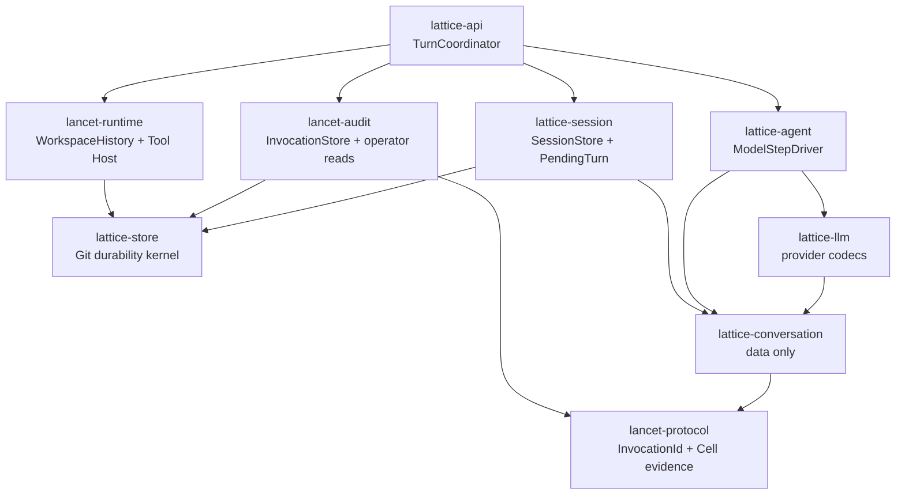
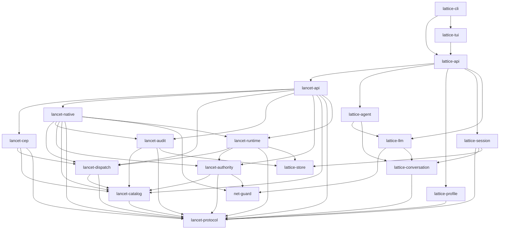

<!-- generated-by: gsd-doc-writer -->
# LATTICE Architecture

> This document is generated from repository verification. Claims that could not
> be directly confirmed from the repo are marked with `<!-- VERIFY: ... -->`.

## 1. System overview

LATTICE is a session-centric LLM runtime written in Rust. Conversation state
lives in a **git-backed session graph**: every turn outcome is persisted as an
immutable commit under `refs/lattice/sessions/**`, so history is durable and
auditable. Public turn execution is exposed through `lattice-api`, whose single
live core is `stream_turn`. Tool execution flows through **LANCET**, a
separately-embeddable runtime that exposes the **Controlled Execution Protocol
(CEP)** — a typed JSON-RPC method protocol with direct policy gating, path
guards (Guard L1), effect checks, and an audit trail. The architecturally
significant property is the strict layering: the workspace is a layered Cargo
workspace where dependencies only ever point from higher layers to lower layers,
with no reverse dependencies, so the LANCET CEP runtime (the `lancet-*` crates)
can be embedded without pulling in the LATTICE session/agent/profile layers.

That dependency property does not imply an accepted standalone product caller.
ADR 0005/#139-B restricts production invocation initiation to
`lattice-api::TurnCoordinator`; lower-level LANCET composition remains
independent for layering and internal tests, not for a Session-less direct CEP
product contract.

The production execution path is **Direct-Local** (ADR 0003): structured
LANCET Tools observe and mutate the canonical Local Workspace directly behind
host-enforced policy, Guard L1 path checks, effect checks, and audit. There is
no sandbox VM, workspace projection, or per-turn provisioning — the
MSB/Upper path and the `lattice-workspace` crate were removed in
#62 (Codeberg #40). The session graph store is git-backed
(`GitSessionGraphStore` over a gix repository rooted at the configured session
store directory); the previous SQLite graph store has been removed.

### 1.1 Accepted durable Turn target (ADR 0005)

ADR 0005's durable architecture is the landed production path:

- strict `lancet-protocol::InvocationId` and `TurnId` types identify Tool
  execution and accepted Turns; provider Tool Call IDs remain optional replay
  metadata;
- data-only `lattice-conversation` owns ordered native messages, bound/unbound
  Tool Calls, ToolResult outcomes, usage, and interruption records;
- domain-neutral `lattice-store` supplies private-Git creation, object/ref CAS,
  Linux flock/fsync/rename durability, retention, and typed store errors;
- `lattice-session`, `lancet-audit`, and `lancet-runtime` retain SessionStore,
  InvocationStore/operator, and WorkspaceHistory semantics in three physical
  repositories and failure domains;
- `lattice-api::TurnCoordinator` is the only cross-store production Turn saga;
  `lattice-agent::ModelStepDriver` performs one provider attempt with no store or
  Tool-execution authority;
- durable PendingTurn stages and a pure reconciliation reducer close interrupted
  work without retrying a provider request or redispatching a Tool.

The kernel is shared, not the transaction. State is rooted below
`$XDG_STATE_HOME/lattice`: one global `sessions.git`, with project-keyed
`invocations.git` and `workspace-history.git`. They have different typed
handles, refs, locks, state machines, and failures. The global order is
SessionExecutionLock, optional project WorkspaceOperationLock, then zero or one
repository write lock; code never holds two repository write locks at once.

The implementation landed in prerequisite order: #141, #142/#143, #144, #139-A,
then #139-B. #139-A introduced and qualified the Git InvocationStore without
wiring production. #139-B performed the one hard cut: the same store is now
invocation/evidence/operator authority and the transitional SQLite identity/path
is deleted. There is no dual write, import, legacy reader, or runtime backend
switch.

## 2. Component diagram

The workspace has 21 crates grouped into layers. Arrows point from a higher
layer toward the lower-layer crates it depends on. The diagram below shows the
runtime crates; `lattice-tool-prelude` (guest SDK) and
`lattice-system-harness` (black-box tests) sit outside it by contract.
`AGENTS.md` carries the authoritative edge list.

Layer model (verified against each crate's `Cargo.toml` `[dependencies]`):

| Layer | Crate | Depends on |
|---|---|---|
| 0 (leaf) | `lancet-protocol` | — |
| 0 (leaf) | `lattice-store` | — |
| 0 (leaf) | `net-guard` | — |
| 0.5 | `lattice-conversation` | `lancet-protocol` |
| 0.5 | `lattice-llm` | `net-guard`, `lattice-conversation` |
| 1 | `lancet-catalog` | `lancet-protocol` |
| 1 | `lattice-profile` | `lancet-protocol` |
| 1 | `lattice-session` | `lancet-protocol`, `lattice-conversation`, `lattice-store` |
| 1 | `lattice-agent` | `lattice-llm`, `lattice-conversation` |
| 2 | `lancet-dispatch` | `lancet-protocol`, `lancet-catalog` |
| 2 | `lancet-audit` | `lancet-protocol`, `lancet-catalog`, `lattice-store` |
| 2 | `lancet-authority` | `lancet-protocol`, `lancet-catalog`, `net-guard` |
| 2.5 | `lancet-cep` | `lancet-protocol`, `lancet-catalog`, `lancet-dispatch` |
| 2.5 | `lancet-runtime` | `lancet-protocol`, `lancet-dispatch`, `lancet-authority`, `lattice-store` |
| 3 | `lancet-native` | `lancet-protocol`, `lancet-catalog`, `lancet-dispatch`, `lancet-audit`, `lancet-authority`, `net-guard`, `lancet-runtime` |
| 3.5 | `lancet-api` | `lancet-cep`, `lancet-protocol`, `lancet-catalog`, `lancet-dispatch`, `lancet-audit`, `lancet-authority`, `lancet-native`, `lancet-runtime` |
| 4 | `lattice-api` | `lancet-api` + `lattice-agent`, `lattice-profile`, `lattice-session`, `lattice-llm` |
| 5 | `lattice-tui` | `lattice-api` |
| 5 | `lattice-cli` | `lattice-api`, `lattice-tui` |

## 3. Data flow

A single Turn, from user input to one immutable Session commit:

1. **The caller enters the single live core.**
   - CLI/TUI callers use `lattice_api::stream_turn`; `run_turn` drains that same
     stream through `RunTurnCollector`. Cancellation is cooperative and still
     produces a durable typed Turn outcome.
2. **`TurnCoordinator` acquires the full-Turn Session execution lock.**
   - The coordinator strictly opens the Session, InvocationStore, and
     WorkspaceHistory domains. If `active-turn` exists, it reconciles only from
     durable PendingTurn/InvocationStore facts; reopen never sends a provider
     request or redispatches a Tool.
3. **`TurnStarted` freezes the accepted request.**
   - Before provider work, the journal records the explicit `TurnId`, parent
     commit, bounded user input, selected provider/model, credential-free effective
     profile/policy, execution limits, and the exact enabled Tool catalog digest.
4. **`ModelStepDriver` performs one provider attempt.**
   - `lattice-agent` receives `NativeMessage<BoundToolCall>` history and returns
     one bounded typed attempt. It owns no Session or invocation store, allocates
     no `InvocationId`, dispatches no Tool, and commits no Turn.
5. **The coordinator binds and reserves requested Tools.**
   - A complete `BindingPlanned` stage carries ordered `InvocationBinding`s.
     `InvocationStore::reserve_batch` publishes the exact all-or-nothing batch,
     after which the journal advances to `Bound`. The bound assistant message is
     durable provider transcript authority; provider Tool Call IDs remain replay
     metadata, not domain identity.
6. **Each binding dispatches sequentially through LANCET.**
   - `CepClient` carries the explicit binding to the native server. Admission
     verifies the exact durable `Reserved` record and atomically publishes
     `DispatchStarted` before executor handoff. Native and Component execution
     share the same `InvocationId`, policy/Guard/effect checks, and content-free
     Cell-evidence contract.
7. **Result closure follows one durable order.**
   - The exact candidate is pinned in `StepClosing`; ResultDraft publication
     follows; then InvocationStore atomically publishes terminal state plus Cell
     evidence; finally the journal advances the ordered ToolResult cursor.
     `StepClosing.messages` preserves the byte-exact assistant/ToolResult delta for
     live continuation and crash recovery. Material unavailability does not rewrite
     the execution outcome.
8. **The coordinator closes the step or starts another model attempt.**
   - Cancellation, deadlines, indeterminate execution, and model-step/attempt
     limits are typed controlling transitions. A `ContinueModel` step returns to
     step 4 only after its closure is durable.
9. **One final Session transaction publishes the Turn.**
   - `TurnClosing` carries the exact candidate with typed `TurnOutcome`,
     `ClosureOrigin`, explicit `TurnId`, aggregate usage, and
     `WorkspaceHistoryCheckpoint`. The Session transaction publishes the immutable
     Turn/state/branch refs and removes `active-turn`; there is no production direct
     `commit_turn` path. `TurnEvent`s then report the same durable terminal facts
     to CLI/TUI callers.

## 4. Key abstractions

All file paths verified by reading the source.

| Abstraction | Kind | Location | Notes |
|---|---|---|---|
| `SessionGraphStore` | trait | `crates/lattice-session/src/graph.rs` | Public Session graph reads/refs plus PendingTurn journal operations. Direct Turn commit helpers exist only under the `test-utils` feature. |
| `GitSessionGraphStore` | struct | `crates/lattice-session/src/git_graph/` | Strict Git-backed SessionStore at `$XDG_STATE_HOME/lattice/sessions.git`; owns immutable Turns, branch/state refs, execution locks, and `active-turn`/`turns/<TurnId>` journal refs. |
| `PendingTurn` | durable sum type | `crates/lattice-session/src/pending/` | Twelve-stage recovery journal with exact transition validation, ResultDraft pins, bound transcript deltas, typed outcomes, and a pure reconciliation reducer. |
| `TurnCoordinator` | struct | `crates/lattice-api/src/turn/coordinator.rs` | Sole production cross-store Turn owner; blocking Session/InvocationStore I/O is behind private adapters and live sequencing is in `turn/saga.rs`. |
| `ModelStepDriver` | struct | `crates/lattice-agent/src/model_step.rs` | Store-free one-provider-attempt driver with bounded assembly, cancellation/deadline polling, and typed attempt outcomes. |
| `NativeMessage<BoundToolCall>` | data contract | `crates/lattice-conversation/src/message.rs` | Durable provider-neutral transcript vocabulary; bound Tool calls carry `InvocationId` and optional provider replay IDs. |
| `InvocationStore` | struct | `crates/lancet-audit/src/invocation_store.rs` | Authoritative project-keyed `invocations.git` ledger: exact batch reservation, `DispatchStarted`, atomic terminal/evidence publication, high-water witness, and pinned views. |
| `OperatorAuditRow` | DTO | `crates/lancet-audit/src/operator.rs` | Content-free typed operator projection used by query/tail/replay/status; OID cursors pin exact Git ledger views. |
| `StoreRepo` | struct | `crates/lattice-store/src/repo.rs` | Domain-neutral typed Git create/open, object/ref CAS and transactions, repository flock, retention, and fsync publication barriers. |
| `WorkspaceHistory` | struct | `crates/lancet-runtime/src/history.rs` | Project-keyed `workspace-history.git` history of installed Atomic Local Mutations plus the project `WorkspaceOperationLock`. |
| `RewindAuditLog` | struct | `crates/lancet-runtime/src/rewind_audit.rs` | Independent append-only `refs/lattice/rewind-audit/log` chain inside `workspace-history.git`; survives history-ref rewind. |
| `LancetRuntime` | struct | `crates/lancet-api/src/runtime.rs` | Composes the native server, strict InvocationStore, WorkspaceHistory, and frozen Tool definitions; production initiation remains in `lattice-api`. |
| `CepClient` | struct | `crates/lancet-dispatch/src/transport.rs` | Typed in-process CEP transport; production calls carry an explicit durable `InvocationBinding`. |
| `CATALOG` | static | `crates/lancet-catalog/src/catalog.rs` | The one remaining native descriptor (`fetch.web`); four embedded Components complete the five-Tool distribution. |
| `LocalWorkspace` | module | `crates/lancet-runtime/src/workspace/` | Concrete guarded host for safe bounded observation, mutation preconditions, atomic installation, and history. Not a pluggable seam. |
| `stream_turn` / `run_turn` | functions | `crates/lattice-api/src/turn/` | One live execution core and its collector-based non-streaming wrapper. |
| `RunTurnCollector` | struct | `crates/lattice-api/src/turn/collector.rs` | Converts streamed events into the same typed terminal facts stored by the Turn. |

### Closed Tool distribution — exactly 5 agent-visible Tools

The Agent-visible set is still these five names. `lancet_catalog::CATALOG` now
holds only the remaining native method (`fetch.web`); the other four are
embedded Component Tools whose descriptor authority is `tools/*/manifest.toml`
(#29–#31):

1. `observe.workspace` — Component (`tools/observe-workspace`)
2. `mutate.create` — Component (`tools/mutate-create`)
3. `mutate.edit` — Component (`tools/mutate-edit`)
4. `fetch.web` — native catalog
5. `session.todo_write` — Component (`tools/todo-write`)

**Operator invocation reads (not in `CATALOG`):** `lattice audit` query, tail,
and turn replay delegate through `lancet-api` to `lancet-audit::operator`. They
strictly open the project-keyed `invocations.git` and pin one immutable ledger
view; they never compose a CEP server or take a WorkspaceOperationLock. Agents
cannot invoke these reads as Tools.

The Git ledger uses typed `InvocationId` throughout. Query returns bounded current
records, including `Reserved` and `DispatchStarted`; replay orders one Turn by
model-step/part ordinals; tail advances with an exclusive reachable commit-OID
cursor and never splits an atomic reservation commit. Status projects the newest
20 current records from one pinned view and returns that view's `ledger_oid`.
Terminal records contain the content-free Cell-evidence triple plus result
digest/length/material-availability metadata. Operator DTOs expose no arguments,
result or fetched content, provider payload/state/IDs, credentials, or internal
metadata blobs.

SQLite audit/evidence modules, numeric call/audit/evidence IDs, metadata pointers,
store-path helpers, importers, and fallback reads were deleted by the #139-B hard
cut. The public `lancet_api::*` operator entry points remain thin error-mapping
facades. Because `lancet-audit` depends on none of `lancet-native`,
`lancet-dispatch`, `lancet-cep`, or `lancet-runtime`, an operator read cannot name
or compose a server, transport, or registry type.

### Explicit Rewind and its audit chain

`lattice session rewind` is an operator workflow, not a Tool. The
`lattice-api::RewindCoordinator` holds one exclusive project
`WorkspaceOperationLock` across workspace/history restoration, Session ref
movement, and the later short audit append. Workspace reversal verifies every
affected path before any write and records no compensation mutation.

The audit record is an independent fast-forward Git chain at
`refs/lattice/rewind-audit/log` inside the existing project
`workspace-history.git`. It records conflict, partial failure, Session-ref failure,
and success after the corresponding action. Because that ref is independent of
the movable workspace-history ref, an explicit Rewind cannot erase its own audit
history. Audit publication failure is a typed partial-state error and never reports
success; no SQLite row, fourth repository, or import path exists.

There is **no** `session.envelope` method. It was removed from the catalog;
`crates/lattice-api/src/turn/cep.rs:1315-1323` contains a test
(`catalog_exposure_omits_unknown_envelope_method`) asserting that enabling
`session.envelope` fails because it is no longer a catalog method.

There is **no** `exec.command_run` method. It and post-mutation verify were
permanently retired from the CEP layer (issue #26); command execution is not an
agent-visible capability. `crates/lancet-catalog/src/catalog.rs` contains a
regression test (`catalog_retires_exec_command_run`) asserting its absence, and
`crates/lancet-api/src/runtime.rs` contains a production-path regression test
(`production_runtime_rejects_retired_exec_command_run_as_method_not_found`)
asserting a raw CEP call to `exec.command_run` returns JSON-RPC `-32601`.

### Removed subsystems (do not describe as active)

- **MSB/Upper sandbox workspace** (`lattice-workspace`, `Workspace` trait,
  `UpperHandle`, `UpperSpec`, `UpperLease`, `prepare_upper`, warm templates,
  guest-Git baseline/candidate flow, credential injection, `[workspace]`
  profile section with egress/image/lifecycle fields) was removed in #62.
  Turns run Direct-Local against the canonical project root; profiles with a
  legacy `[workspace]` section now fail strict parsing.
- **Landlock / netns command isolation** was removed (commit `a29072e2`,
  "refactor(isolation): remove landlock and netns command isolation"). The
  `[lancet.isolation.command]` schema (`LancetIsolationSection`,
  `LancetLandlockBehavior`, etc.) was dropped from `lattice-profile`.
  `crates/lattice-profile/src/schema.rs` has no isolation/landlock/netns
  sections (verified: the `[lancet]` sub-sections are project-root,
  observation, network, policy, workspace-policy, effects).
- **Command execution and post-mutation verify** (`exec.command_run`,
  `[lancet.command]`, `[lancet.verify]`) are retired surface; the profile
  schema has no typed sections for them (untyped tables fall through to
  `extensions`).
- **SQLite session graph store** (`sqlite_graph/`) was removed; the session
  graph is now git-backed only (`git_graph/`).

## 5. Directory structure rationale

The `crates/` directory is split into two families that map onto the layer
model. The `lancet-*` crates form the **LANCET CEP runtime** — the lower
layers that can be embedded independently of any host application. The
`lattice-*` crates form the **LATTICE session/agent/profile/api/tui/cli
runtime** — the upper layers that compose LANCET into a session-centric LLM
agent. Layering matters because it enforces a one-way dependency direction
(higher → lower) with no reverse deps, which keeps the LANCET runtime
embeddable and keeps each crate's concerns from leaking downward.

One sentence per crate:

- **`lancet-protocol`** — Pure CEP wire/data contracts (JSON-RPC frames,
  typed errors, policy hook data, effect types, and versioned Cell-evidence
  types); no I/O
  and no tokio. The bottom contract.
- **`net-guard`** — Neutral URL/DNS safety leaf: base-URL validation,
  public-address resolution, private/reserved IP checks, and
  rebinding-domain checks.
- **`lancet-catalog`** — Typed CEP method contracts, params/results,
  descriptors, and the static native production `CATALOG` (one remaining
  method, `fetch.web`). The five agent-visible Tools are its closed composition
  with four embedded Components. It holds no operator-only contracts
  (`methods/audit.rs` was deleted in GitHub #39) and depends only on protocol.
- **`lancet-dispatch`** — Generic method registry, typed CEP dispatch,
  in-process transport (`CepClient`/`CepTransport`), cancellation, and event
  sinks.
- **`lancet-audit`** — Authoritative InvocationStore/evidence/operator domain on
  `lattice-store`: project-keyed `invocations.git`, exact ordered reservation,
  `DispatchStarted`, atomic typed terminal plus Cell evidence, high-water witness,
  and pinned query/tail/replay views. Its public surface is audit-domain only; the
  `lattice-api` integration layer projects pinned facts into Session reconciliation.
  It depends on none of `lancet-native`, `lancet-dispatch`, `lancet-cep`,
  `lancet-runtime`, or (normally) `lattice-session`.
- **`lancet-authority`** — Policy semantics, capability matching, Guard L1
  path/scope checks, effect ledger, and effect-region checks.
- **`lancet-cep`** — Public CEP facade over protocol/catalog/dispatch plus
  catalog-derived Tool exposure and base-authority planning. No persistence or
  LATTICE dependencies.
- **`lancet-native`** — Remaining native `fetch.web` handler, reservation-gated
  server/transport lifecycle, typed InvocationId events, and the Component/native
  dispatch split. Execution returns Cell evidence; terminal durability belongs to
  the coordinator and InvocationStore. The guarded Local Workspace lives in
  `lancet-runtime`.
- **`lancet-api`** — Unified LANCET facade composing `LancetRuntime`/
  `LancetServer`, strict InvocationStore, WorkspaceHistory, and Tool definitions
  from LANCET-native policy. Its audit/status modules are thin facades over one
  pinned Git operator view; it remains independent of LATTICE session/agent/profile
  layers and is not a Standalone production invocation product.
- **`lattice-llm`** — Provider adapters, SSE streaming, model routing,
  tool-call vocabulary, provider replay/projection (`provider_projection`, #142),
  and logging. URL/DNS safety primitives live
  in the shared `net-guard` leaf and are composed here.
- **`lattice-session`** — Git-backed Session graph, branch/HEAD state, typed
  immutable Turns, full-Turn execution lock, and durable PendingTurn journal.
  Final publication runs only through the journal transaction; persistence of
  the typed `HeadTranscript` stays here.
- **`lattice-profile`** — Strict `agent.toml` schema, discovery, defaults, and
  LANCET profile sections (no isolation section).
- **`lattice-agent`** — One-attempt `ModelStepDriver`, frozen request assembly,
  provider streaming, protocol metering, and typed attempt outcomes.
- **`lattice-api`** — Public Session/Turn facade and production
  `TurnCoordinator` saga over the Session journal and InvocationStore.
- **`lattice-tui`** — Full-screen `ratatui`/`crossterm` TUI over
  `lattice-api` sessions and `stream_turn`; owns the terminal lifecycle,
  multi-line input, history, viewport, and transcript rendering.
- **`lattice-cli`** — Binary entry point and argument dispatch over
  API/session/model/audit commands, plus the `lattice-tui` presentation crate.

`lattice-conversation` joined the workspace in #142:

- **`lattice-conversation`** — Data-only provider-neutral conversation
  contract: typed `NativeMessage`/`MessagePart`, bound Tool calls/results,
  `HeadTranscript`, semantic/replay digests, and per-attempt outcome/usage;
  depends only on `lancet-protocol`.

`lattice-store` joined the workspace in #143:

- **`lattice-store`** — Domain-neutral Linux/private-Git durability kernel:
  XDG state topology, `ProjectStoreKey` addressing, typed create/open with a
  recorded store identity, object/ref mechanics, flock/fsync/rename
  durability, retention, and typed store errors. Session,
  invocation/evidence/operator, and workspace-history domain semantics stay in
  their owning crates. `lattice-session` and `lancet-runtime` were migrated
  onto it in the same issue; `lancet-audit` added InvocationStore in #139-A and
  #139-B made it production invocation/evidence/operator authority. The dependency
  edge is `lancet-audit -> lattice-store` only: `lancet-audit` still depends on no
  LATTICE session,
  agent, or profile crate, so an operator read never pulls the LATTICE session
  layer into LANCET (`cargo tree -p lancet-api -e normal`).
