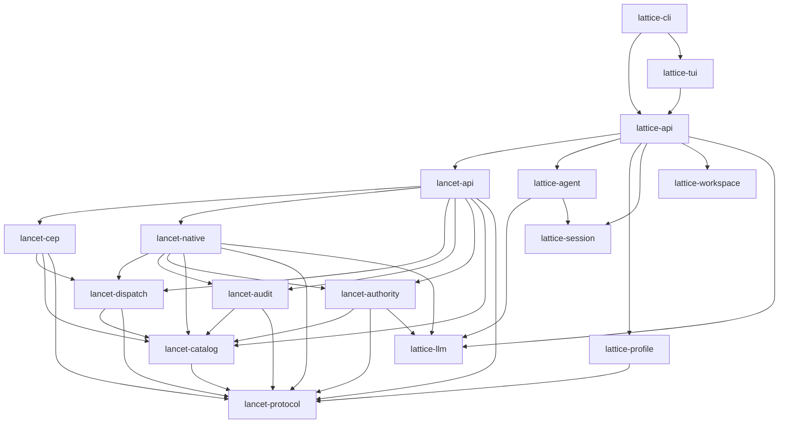

<!-- generated-by: gsd-doc-writer -->
# LATTICE Architecture

> This document is generated from repository verification. Claims that could not
> be directly confirmed from the repo are marked with `<!-- VERIFY: ... -->`.

## 1. System overview

LATTICE is a session-centric LLM runtime written in Rust. Conversation state
lives in a **git-backed session graph**: every turn outcome is persisted as an
immutable commit under `refs/lattice/sessions/**`, so history is durable and
auditable. Public turn execution is exposed through `lattice-api`, whose single
live core is `stream_turn`. Tool execution flows through **LANCET**, a
separately-embeddable runtime that exposes the **Controlled Execution Protocol
(CEP)** — a typed JSON-RPC method protocol with direct policy gating, path
guards (Guard L1), effect checks, and an audit trail. The architecturally
significant property is the strict layering: the workspace is a layered Cargo
workspace where dependencies only ever point from higher layers to lower layers,
with no reverse dependencies, so the LANCET CEP runtime (the `lancet-*` crates)
can be embedded without pulling in the LATTICE session/agent/profile layers.

The production execution path is **MSB/Upper** based: an Upper sandbox
workspace (microsandbox-backed) is provisioned per turn via the `Workspace`
trait, and commands run inside it through typed argv. The session graph store is
git-backed (`GitSessionGraphStore` over the project's `git2` object database);
the previous SQLite graph store has been removed.

<!-- VERIFY: production path is MSB/Upper; direct-mode naming was retired and
     host-verify was deleted. Confirmed UpperHandle/UpperLease/UpperSpec exist
     in lattice-workspace and lattice-api/src/turn/{lifecycle,upper,mod}.rs. -->
<!-- VERIFY: sqlite_graph/ was removed; confirmed crates/lattice-session/src/
     contains only git_graph/, graph.rs, migrate/, promotion.rs, lib.rs. -->

## 2. Component diagram

The workspace has 16 crates grouped into layers. Arrows point from a higher
layer toward the lower-layer crates it depends on.

Layer model (verified against each crate's `Cargo.toml` `[dependencies]`):

| Layer | Crate | Depends on |
|---|---|---|
| 0 (leaf) | `lancet-protocol` | — |
| 0 (leaf) | `lattice-llm` | — |
| 0 (leaf) | `lattice-session` | — |
| 0 (leaf) | `lattice-workspace` | — |
| 1 | `lancet-catalog` | `lancet-protocol` |
| 1 | `lattice-profile` | `lancet-protocol` |
| 1 | `lattice-agent` | `lattice-llm`, `lattice-session` |
| 2 | `lancet-dispatch` | `lancet-protocol`, `lancet-catalog` |
| 2 | `lancet-audit` | `lancet-protocol`, `lancet-catalog` |
| 2 | `lancet-authority` | `lancet-protocol`, `lancet-catalog`, `lattice-llm` |
| 2.5 | `lancet-cep` | `lancet-protocol`, `lancet-catalog`, `lancet-dispatch` |
| 3 | `lancet-native` | `lancet-protocol`, `lancet-catalog`, `lancet-dispatch`, `lancet-audit`, `lancet-authority`, `lattice-llm` |
| 3.5 | `lancet-api` | `lancet-cep`, `lancet-protocol`, `lancet-catalog`, `lancet-dispatch`, `lancet-audit`, `lancet-authority`, `lancet-native` |
| 4 | `lattice-api` | `lancet-api` + `lattice-agent`, `lattice-profile`, `lattice-session`, `lattice-workspace`, `lattice-llm` |
| 5 | `lattice-tui` | `lattice-api` |
| 5 | `lattice-cli` | `lattice-api`, `lattice-tui` |

## 3. Data flow

A single turn, from user keystroke to committed session graph:

1. **User invokes the runtime.**
   - `lattice-cli` parses arguments and, for an interactive session, calls
     `lattice_tui::run`; the TUI is a `rustyline` inline REPL (no alternate
     screen) that reads lines and executes turns through
     `lattice_api::stream_turn`.
     - The TUI spawns a Ctrl-C watcher for the duration of each turn and sets
       `RunTurnRequest::cancel_flag` to cooperatively cancel.
   - Non-interactive paths call `lattice_api::stream_turn` (or `run_turn`)
     directly.

2. **`lattice-api::stream_turn` is the single live execution core.**
   - `stream_turn` (in `crates/lattice-api/src/turn/execute.rs`) builds the
     live turn stream. `run_turn` is a thin wrapper that drains the same stream
     through `RunTurnCollector` (`crates/lattice-api/src/turn/collector.rs`)
     and returns a `RunTurnResult`.

3. **`turn/cep.rs` assembles the LANCET runtime and the executor adapter.**
   - `turn/cep.rs` (`crates/lattice-api/src/turn/cep.rs`) is the
     LATTICE↔LANCET seam. It translates the profile `[lancet]` policy sections
     into LANCET-native config types and delegates runtime composition to
     `lancet_api::LancetRuntime::build` (`crates/lancet-api/src/runtime.rs`),
     which spawns the native CEP server and returns a `CepClient`.
   - The returned `CepClient` is wrapped in a `CepExecutorAdapter`, which
     implements `lattice_agent::ToolCallExecutor` and maps LLM-shape tool
     calls into typed CEP method invocations.
   - An Upper workspace is prepared via `prepare_upper` /
     `resolve_upper_config` (`crates/lattice-api/src/turn/upper.rs`), yielding
     an `UpperLease` that owns the `UpperHandle` for the turn.

4. **`AgentLoop` assembles messages from session state.**
   - `AgentLoop` (`crates/lattice-agent/src/agent_loop/mod.rs`) reads the
     session graph state, assembles the LLM message history
     (`agent_loop/messages.rs`), and drives the turn state machine with
     deadline/cancellation handling.

5. **`LlmClient` streams the model response.**
   - The injected `LlmClient` trait (`crates/lattice-agent/src/agent_loop/
     traits.rs`) is satisfied by a concrete provider adapter from
     `lattice-llm`, which streams `LlmEvent`s back (SSE parsing in
     `lattice-llm/src/sse.rs`).

6. **Tool calls are dispatched via `CepClient`.**
   - When the model emits tool calls, `AgentLoop` sends each through the
     `ToolCallExecutor` (the `CepExecutorAdapter`), which resolves the dotted
     method name against the catalog and calls the typed method on
     `CepClient`.
   - `CepClient` (`crates/lancet-dispatch/src/transport.rs`, re-exported by
     `lancet-native` and `lancet-api`) carries the typed JSON-RPC call over an
     in-process transport to the native CEP server.

7. **Native handlers execute behind policy / Guard L1 / effect / audit / verify.**
   - Native handlers in `lancet-native` execute the typed CEP method
     (`mutate.create`, `exec.command_run`, `fetch.web`, etc.) behind policy
     decisions (`lancet-authority`), Guard L1 path/scope checks, effect-region
     checks, audit recording (`lancet-audit`), and optional verification.
   - Filesystem and command operations run inside the Upper workspace via the
     `Workspace` trait (`lattice-workspace`), using typed argv and
     workspace-relative paths — never shell strings.

8. **Turn outcome is committed to the git session graph.**
   - The turn outcome (messages, tool results, usage) is persisted as an
     immutable commit by `GitSessionGraphStore`
     (`crates/lattice-session/src/git_graph/mod.rs`) implementing the
     `SessionGraphStore` trait (`crates/lattice-session/src/graph.rs`).

9. **Events stream back to the caller.**
   - `TurnEvent`s stream live from `stream_turn` back to the caller (CLI/TUI),
     where tokens render to stdout and tool/status lines render to stderr.

## 4. Key abstractions

All file paths verified by reading the source.

| Abstraction | Kind | Location | Notes |
|---|---|---|---|
| `SessionGraphStore` | trait | `crates/lattice-session/src/graph.rs:390` | Backend-neutral session graph contract: commits, branch refs, HEAD, diffs. |
| `GitSessionGraphStore` | struct | `crates/lattice-session/src/git_graph/mod.rs:37` | Git-backed store over the project's `git2` object database; commits live under `refs/lattice/sessions/**`, mutable metadata in sidecar files. Replaces the removed SQLite store. |
| `AgentLoop` | struct | `crates/lattice-agent/src/agent_loop/mod.rs:99` | Multi-turn loop: turn state machine, message assembly, tool rounds, cancellation, deadlines. `AgentLoopConfig` at line 79. |
| `LlmClient` | trait | `crates/lattice-agent/src/agent_loop/traits.rs:53` | Injectable LLM client for the agent loop (chat + streaming). Concrete adapters live in `lattice-llm`; `ToolCallExecutor` (line 44) is the sibling tool-execution trait. |
| `ToolCallExecutor` | trait | `crates/lattice-agent/src/agent_loop/traits.rs:44` | Injectable tool executor; production impl is `CepExecutorAdapter`. |
| `LancetRuntime` | struct | `crates/lancet-api/src/runtime.rs:112` | Fully-composed LANCET runtime: spawns the native CEP server and hands back a `CepClient` + audit + tool definitions. Built via `LancetRuntime::build` from `LancetRuntimeConfig`. |
| `CepClient` | struct | `crates/lancet-dispatch/src/transport.rs:76` | Typed CEP JSON-RPC client over an in-process transport. Re-exported by `lancet-native` (`src/lib.rs`) and `lancet-api`. |
| `CepExecutorAdapter` | struct | `crates/lattice-api/src/turn/cep.rs:75` | Maps LLM-shape `ToolCall`s into typed CEP method invocations via `CepClient`; implements `ToolCallExecutor`. Holds catalog/enabled name sets. |
| `CATALOG` | static | `crates/lancet-catalog/src/catalog.rs:13` | `LazyLock<[MethodDescriptor; 9]>` — the authoritative production method catalog (exactly 9 methods, see below). |
| `Workspace` | trait | `crates/lattice-workspace/src/lib.rs:498` | Backend-neutral Upper workspace boundary: `create_upper`, `exec_upper` (typed argv), status, snapshot, template, restore, destroy. |
| `UpperHandle` | struct | `crates/lattice-workspace/src/lib.rs:238` | Opaque handle to a live Upper (`id` + `backend` only — no host paths, no live SDK objects). |
| `UpperSpec` | struct | `crates/lattice-workspace/src/lib.rs:206` | Provisioning spec: image/template, baseline OID, host repo path, egress, credentials, resource limits. |
| `UpperLease` | struct | `crates/lattice-api/src/turn/upper.rs:34` | RAII ownership of an `UpperHandle` for a turn; retain/destroy lifecycle. |
| `CepError` | struct | `crates/lancet-protocol/src/error.rs:216` | Typed CEP error with `data` + `Retriability`. Wire codes in reserved JSON-RPC range `-32000..-32099`. |
| `CepErrorCode` | enum | `crates/lancet-protocol/src/error.rs:46` | Closed enum of CEP error codes, segmented by family (Validation/Permission/Execution/State/Guard/Effect). |
| `stream_turn` | fn | `crates/lattice-api/src/turn/execute.rs:259` | `pub async fn stream_turn(...) -> Result<TurnEventStream>` — the single live execution core. |
| `run_turn` | fn | `crates/lattice-api/src/turn/execute.rs:132` | `pub async fn run_turn(...) -> Result<RunTurnResult>` — drains `stream_turn` via `RunTurnCollector`. |
| `RunTurnCollector` | struct | `crates/lattice-api/src/turn/collector.rs:26` | Drains the live `TurnEventStream` into a `RunTurnResult`. |

### CEP catalog — exactly 9 methods

The `CATALOG` static declares exactly these methods (verified at
`crates/lancet-catalog/src/catalog.rs:62-70`):

1. `observe.workspace`
2. `mutate.create`
3. `mutate.edit`
4. `mutate.batch`
5. `exec.command_run`
6. `fetch.web`
7. `session.todo_write`
8. `observe.audit`
9. `observe.audit_replay`

There is **no** `session.envelope` method. It was removed from the catalog;
`crates/lattice-api/src/turn/cep.rs:1315-1323` contains a test
(`catalog_exposure_omits_unknown_envelope_method`) asserting that enabling
`session.envelope` fails because it is no longer a catalog method.

### Removed subsystems (do not describe as active)

- **Landlock / netns command isolation** was removed (commit `a29072e2`,
  "refactor(isolation): remove landlock and netns command isolation"). The
  `[lancet.isolation.command]` schema (`LancetIsolationSection`,
  `LancetLandlockBehavior`, etc.) was dropped from `lattice-profile`.
  `crates/lattice-profile/src/schema.rs` has no isolation/landlock/netns
  sections (verified: the `[lancet]` sub-sections are project-root,
  observation, network, command, policy, workspace-policy, verify, effects).
<!-- VERIFY: landlock/netns removal confirmed via git log a29072e2 and absence
     of LancetIsolationSection in crates/lattice-profile/src/schema.rs. -->
- **SQLite session graph store** (`sqlite_graph/`) was removed; the session
  graph is now git-backed only (`git_graph/`).

## 5. Directory structure rationale

The `crates/` directory is split into two families that map onto the layer
model. The `lancet-*` crates form the **LANCET CEP runtime** — the lower
layers that can be embedded independently of any host application. The
`lattice-*` crates form the **LATTICE session/agent/profile/api/tui/cli
runtime** — the upper layers that compose LANCET into a session-centric LLM
agent. Layering matters because it enforces a one-way dependency direction
(higher → lower) with no reverse deps, which keeps the LANCET runtime
embeddable and keeps each crate's concerns from leaking downward.

One sentence per crate:

- **`lancet-protocol`** — Pure CEP wire/data contracts (JSON-RPC frames,
  typed errors, policy hook data, effect types, provenance wire types); no I/O
  and no tokio. The bottom contract.
- **`lancet-catalog`** — Typed CEP method contracts, params/results,
  descriptors, and the static production `CATALOG` (9 methods); depends only
  on protocol.
- **`lancet-dispatch`** — Generic method registry, typed CEP dispatch,
  in-process transport (`CepClient`/`CepTransport`), cancellation, and event
  sinks.
- **`lancet-audit`** — CEP audit persistence, query filters, stage/impact
  labels, provenance projection, and attestation persistence (CEP audit
  SQLite lives here).
- **`lancet-authority`** — Policy semantics, capability matching, Guard L1
  path/scope checks, effect ledger, and effect-region checks.
- **`lancet-cep`** — Public CEP facade over protocol/catalog/dispatch, plus
  catalog-derived `ToolDefinition`/`ToolExposure` and `BaseAuthorityPlan`; no
  native execution, no policy side effects, no audit persistence, no
  `lattice-*` deps.
- **`lancet-native`** — Production native handlers, server lifecycle, verify,
  edit/shell/web helpers, audit integration, and effect-contract enforcement.
- **`lancet-api`** — Unified LANCET public API: composes `LancetRuntime` /
  `LancetServer` (server lifecycle, `CepClient`, audit, tool definitions)
  from the native crates, taking LANCET-native policy types; independent of
  LATTICE session/agent/profile layers.
- **`lattice-llm`** — Provider adapters, SSE streaming, model routing,
  tool-call vocabulary, URL/DNS security (SSRF defenses), and logging.
- **`lattice-session`** — Session graph contract, immutable turn commits,
  branch refs, HEAD state, and the git-backed `GitSessionGraphStore`.
- **`lattice-profile`** — Strict `agent.toml` schema, discovery, defaults, and
  LANCET profile sections (no isolation section).
- **`lattice-agent`** — Multi-turn `AgentLoop`, turn state machine, message
  assembly, and injectable `LlmClient` / `ToolCallExecutor` traits.
- **`lattice-workspace`** — Backend-neutral Upper workspace boundary
  (`Workspace` trait, `UpperHandle`, `UpperSpec`), sandbox lifecycle, typed
  filesystem/command primitives, and the production microsandbox adapter.
- **`lattice-api`** — Thin public facade for session creation/opening and turn
  execution; translates profile `[lancet]` policy into LANCET-native config
  and wires the agent loop over `lancet-api`'s CEP runtime.
- **`lattice-tui`** — `rustyline` inline REPL over `lattice-api` sessions and
  `stream_turn`; owns line editing, history, and inline rendering (no
  alternate screen, no ratatui).
- **`lattice-cli`** — Binary entry point and argument dispatch over
  API/session/model/audit commands, plus the `lattice-tui` presentation crate.
