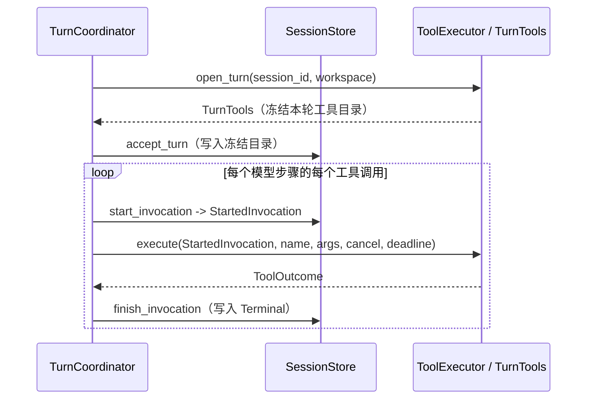

# ADR 0009：从 LATTICE 剥离旧 LANCET，工具执行收窄为 `ToolExecutor`

## 背景

### 现状

LATTICE 与旧 LANCET 同处一个仓库，依赖双向交叉（按 `main` 的 `4842b13a` 核对）：

| 耦合面 | 现状 | 出处 |
| --- | --- | --- |
| 身份与摘要原语 | `SessionId`、`TurnId`、`InvocationId`、`ModelAttemptKey`、两种地址类型、`InvocationBinding`、`canonical_json` 与 `arguments_digest` 定义在 `lancet-protocol`；LATTICE 侧 30 多个文件直接引用 | [ADR 0005 第 1 节](0005-durable-turn-invocation-and-private-git-stores.md#1-canonical-identities-and-addresses)；`crates/lattice-conversation/src/lib.rs:30-42` |
| 反向依赖 | `lancet-api` 依赖 `lattice-session`，取 `StartedInvocation` 分发调用并转发审计查询；`lancet-runtime` 依赖 `lattice-store` 的 `StoreRepo` 写 `workspace-history.git` | `crates/lancet-api/Cargo.toml:11`、`crates/lancet-runtime/Cargo.toml:48` |
| 会话库持久化 | 槽位终态强制携带 `CellEvidenceTriple`；失败载荷为 `CepError`；profile 副本保存 LANCET 的 capability 上限与工作区、网络、观察策略；工具目录身份要求为 64 位十六进制描述符摘要 | `crates/lattice-session/src/store/write.rs:767-779`、`profile_copy.rs:32-80`、`validate.rs:42-55`；`crates/lattice-conversation/src/result.rs:52` |
| 模型可见载荷 | provider 投影把工具失败编码为 `{"error":{"code":-320xx,"message":...}}`，模型直接收到 CEP 错误码 | `crates/lattice-llm/src/protocol/projection/mod.rs:381-388` |
| 纯对话依赖 | 每一轮都构建 `LancetRuntime`，新建会话创建 `workspace-history.git`；已有会话缺少该库时提交被拒绝 | `crates/lattice-api/src/turn/execute.rs:387-412`、`live_tests.rs:195-221` |
| 审计与操作员接口 | 查询、回放、状态投影与调用变更日志表位于 `lattice-session`；IPC 变体在 `lattice-api`，`audit` 命令在 `lattice-cli`；`lancet-api` 仅做转发 | `crates/lattice-session/src/store/read.rs:1006-1177`；`crates/lattice-api/src/local/server.rs:858-905` |
| 构建与门禁负担 | `lancet-*` 四个 crate 共 20,387 行，`tools/*` 7 个包与 6 个已提交的 `.component.wasm`，xtask 工具链 4,468 行；`wasmtime`、`cranelift`、`wit-bindgen`、`wasmparser`、`jsonschema`、`inventory`、`schemars` 只服务 LANCET；CI 额外安装 `wasm32-unknown-unknown` 与固定版本的 `wasm-tools` | `Cargo.toml:99-118`、`:139-160`；`xtask/src/ci.rs:80-88`、`:135-232` |

### 问题

1. **新工具架构与旧栈没有共享演进路径。** `#309` 计划把模型可见的工具面收敛为单一 `act`（Starlark 脚本、WIT resource、父子槽位与 receipt），现有的 6 个 CEP 工具、Cell 准入与单层证据全部退役。若在本仓库内按原计划 A0～A6 逐步替换，每个阶段都要同时维护新旧两套工具面与持久格式。
2. **耦合波及纯会话与后台拆分。** 纯对话轮次受工作区历史库与 WASM 运行时拖累；后台托管与 crate 拆分（`#332` / PR `#333`）为了绕开 `gix` 与 `lancet-protocol`，不得不设计特性开关、依赖豁免与 `LancetDoctor` IPC；会话设置重设计（`#377` / PR `#387`）若先落地，也要被迫搬运工具目录与工作区历史创建逻辑。
3. **工具执行缺少 deadline 约束。** 现有 `LancetRuntime::dispatch` 不接收 Turn deadline，协调层的 `join` 也只等待取消与停机信号（`crates/lattice-api/src/turn/saga.rs:133-136`）。

### 维护者已确定的事项

2026-11-06 至 11-08 确定：

- 旧 LANCET 整体移出本仓库；新 LANCET 在独立仓库中从零重写为独立进程 `lancet-node`，对外提供 `act`，其设计记为新仓库的 ADR 0001。
- LATTICE 只保留会话树、模型循环、多步工具循环骨架与单一窄接口 `ToolExecutor`；生产默认无工具，测试经专用 cargo feature 内置确定性假工具。
- `lattice audit`、`lattice lancet`、审计/操作员 IPC 与调用变更日志表全部删除；保留 `invocation_index`。
- `agent.toml` 删除 `[lancet]` 与 `[tools]` 两节，遇到残留配置时明确报错拒绝。
- 四份旧 LANCET 合同移入 `docs/archive/` 标明 `superseded`，供新仓库参考。
- 全局实施顺序：本 ADR（0009）→ ADR 0012（`#387`，会话设置）→ ADR 0011（`#333`，后台托管与 IM）。

## 决策

### 1. 删除旧 LANCET 与相关入口

从本仓库删除以下组件与构建步骤：

| 类别 | 删除内容 |
| --- | --- |
| Workspace 包 | `crates/lancet-protocol`、`lancet-authority`、`lancet-api`、`lancet-runtime`、`lattice-tool-prelude`、`tools/*`（7 个包、6 个 `.component.wasm` 与 `tool-host.wit`） |
| 协调与前端入口 | `crates/lattice-api/src/turn/cep.rs`；`TurnEvent::CepCall*`；IPC 的 `Audit*` 与 `OperatorStatus` 请求/响应；CLI 的 `lattice lancet` 与 `lattice audit` |
| xtask 与 CI | `tool-codegen`、`tool-build`、`lancet-boundary`；`rust-toolchain.toml` 的 `wasm32-unknown-unknown`；CI 与 `rollout` 中的 `wasm-tools` 探测、组件构建与 `release_operator` 矩阵 |
| 外部依赖与编译特判 | `wasmtime`、`inventory`、`jsonschema`、`wit-bindgen`、`wasmparser`、`schemars`，以及 `Cargo.toml` 中针对 `cranelift` 的 `[profile.dev.package.*]` |

- 删除后，LATTICE 进程不加载 WASM，不读写工作区业务文件，也不维护工作区历史库。
- `xtask/src/lancet_boundary/check.rs` 中的 `production_test_feature_hits`（阻止测试特性进入生产依赖图）与 LANCET 无关，迁入保留的边界检查命令继续执行。

### 2. 工具执行收窄为 `ToolExecutor`

协调层只经 `ToolExecutor` 与工具侧交互：



```text
ToolSpec    = { name, description, input_schema, identity: 不透明字符串 }
ToolError   = { code: 字符串机器码, message: 字符串 }
ToolOutcome = Succeeded(Value)
            | Failed(ToolError)
            | Cancelled      # 映射为槽位 Indeterminate(Cancelled)
            | Indeterminate  # 映射为槽位 Indeterminate(Reported)
```

- **一轮开始前**：`open_turn` 返回本轮的 `TurnTools` 及其 `ToolSpec` 列表，随配置表冻结；模型回复请求目录之外的工具名时，协调层照旧以 `InvalidBatch` 停止该步（`crates/lattice-api/src/turn/coordinator.rs:239-249`）。
- **单次调用执行**：协调层先提交 `start_invocation` 取得不可伪造的 `StartedInvocation` 令牌，再调用 `execute`，显式传入取消标志与本轮 `deadline`。
- **执行器契约**：执行器不向会话库持久化任何记录，也不自行重试；收到取消或到达 `deadline` 后尽快返回。协调层的等待分支同时检查 `deadline`。
- **槽位状态机保持不变**：`Registered`、`Started`、`Terminal` 三阶段、有序批次停止规则，以及进程退出后按阶段投影为 `NotExecuted` 或 `Indeterminate(NoResult)` 的规则（[调用槽位](../architecture/session/steps.md#调用槽位)）原样保留。
- **生产默认**：注入 `NoTools`，目录为空，模型请求不携带工具定义。

### 3. 测试专用执行器

为系统测试保留真实的多步工具循环、取消交接与崩溃屏障覆盖，新增仅测试使用的 cargo feature（做法同 `test-crash-barriers`），在被测二进制内提供确定性执行器：

| 假工具能力 | 验证目标 |
| --- | --- |
| 只读返回固定内容 | 各协议适配器的工具调用与结果投影往返 |
| 向测试目录追加 marker 文件 | 崩溃或取消后不重放已开始的调用 |
| 阻塞等待并响应取消 / deadline | 取消交接、停机排空与超时收敛 |
| 返回超过 64 KiB 的输出 | `OutputTooLarge` 载荷上限保护 |
| 返回 `Failed(ToolError)` | 错误投影与后续步骤推进 |
| 返回 `Indeterminate` | 停止后续槽位分发并以 `InvocationIndeterminate` 收尾 |

- 依赖工具循环的 harness 场景（`direct_crash_barriers`、`direct_background`、`direct_providers`、`pty_tui_smoke` 等）迁到上述假工具，断言改为读取 `session turn --json` 的槽位详情。
- 只验证旧 LANCET 自身行为的场景（`direct_tools`、`direct_mutation`、`direct_observation`、`direct_workspace_history`、`direct_secrets`、`direct_operator`、`release_operator`、`fast_lancet_cli`、`fast_audit_cli`）随被测功能一并删除。

### 4. 会话库升版与存储收敛

会话库格式版本从 `7` 升为 `8`，旧库按[身份、版本与打开](../architecture/storage.md#身份版本与打开)直接拒绝打开：

| 表或记录 | 变化 |
| --- | --- |
| `nodes`（槽位 `Terminal`） | 删除 `InvocationEvidence` / `CellEvidenceTriple`；只保留 `ToolResult` |
| `ResultPayload::Failed` | `Box<CepError>` 改为 `ToolError { code, message }`；provider 投影改为发出 `{"error":{"code":...,"message":...}}` |
| `configs` 与 `InvocationBinding` | 目录去掉 `runtime_build_id`；`descriptor_identity` 改为不透明字符串 `identity`，取消 64 位十六进制格式限制 |
| `profile_copies` | 删除 `enabled_tools`、`capabilities`（`Trust`）与 `policy`（工作区、网络、观察策略） |
| `invocation_changes` 与 `meta.last_change_seq` | 删除；`crash_barrier` 的序号改用步骤/槽位自身标识 |
| `invocation_index` | 保留，供 `register_calls` 查重与 `finish_invocation` 定位使用 |

`lattice-store` 删除无调用方的 Git 内核与工作区锁：

- 删除 `repo.rs`（`StoreRepo`、tree、ref CAS）、`meta.rs`、Git 对象/引用屏障、`workspace-history.git` 路径辅助与工作区操作锁；
- 删除 `probe_location` 中的 `gix` 最小仓库往返探测（`crates/lattice-store/src/probe.rs:178-215`），生产构建不再依赖 `gix`；
- 保留状态根布局、`ProjectStoreKey`（供会话项目绑定核对）、实例锁、文件/目录 `fsync` 与文件系统基础能力探测；磁盘上已有的 `projects/<key>/workspace-history.git` 不读取、不自动清理。

### 5. 身份与规范 JSON 归 `lattice-conversation`

`SessionId`、`TurnId`、`InvocationId`、`ModelMessageAddress`、`ToolCallAddress`、`ModelAttemptKey`、`canonical_json` 与 `arguments_digest` 迁入 `lattice-conversation`；槽位绑定 `InvocationBinding` 归 `lattice-session`。

- 解析规则、显示格式、`serde` 表示与 `canonical_json` 输出字节保持逐字节一致，并用迁移测试锁定。
- 随机身份仍由 `lattice-api::TurnCoordinator` 经可注入的 UUID v4 源生成，`lattice-conversation` 保持纯数据职责。

### 6. Profile 删除 `[lancet]` 与 `[tools]`

- `lattice-profile` 从 schema 中移除 `[lancet]`（含全部子表）与 `[tools]`。
- `agent.toml` 出现 `[lancet]` 或 `[tools]` 时加载失败，诊断写明该节已移除、须从配置文件中删除。
- 默认模板 `default_agent_template` 删除 `[lancet.workspace]` 与 `[tools]` 段。

### 7. 新 LANCET 的接回边界

新 LANCET 在独立仓库中实现为独立进程 `lancet-node`，未来通过本地进程间协议实现 `ToolExecutor` 接回 LATTICE。父子槽位、receipt 持久化、新工具配置节与对应的会话库升版在接回前另立 ADR 决定，本 ADR 不预建扩展结构。

## 归属

| 概念 | 状态持有者 | 规则执行者 | 只使用结果的组件 |
| --- | --- | --- | --- |
| 身份类型与规范 JSON | 无状态值类型（定义在 `lattice-conversation`） | `lattice-conversation` 的解析与摘要函数；`TurnCoordinator` 生成随机 ID | `lattice-session`、`lattice-llm`、`lattice-agent`、`lattice-api`、前端 |
| 本轮工具目录与单次执行 | 外部执行器（生产为无状态 `NoTools`） | 实现 `ToolExecutor` 的组件；协调层执行目录准入与 deadline | `lattice-agent`（向模型透传 schema）、`SessionStore`（保存冻结目录） |
| 调用槽位与终态 | 会话库 `nodes` 表与 `invocation_index` 表 | `SessionStore` 的登记、开始、完成事务与阶段结论投影 | `TurnCoordinator`、`lattice-llm` 投影、视图与 `session turn` |
| 会话的项目绑定 | 会话库 `sessions` 表的 `ProjectStoreKey` | 后台准入与 `rewind` 的路径核对 | `list`、`head` |

## 否决的方案

| 方案 | 否决理由 |
| --- | --- |
| 在本仓库内按 `#309` 的 A0～A6 逐步替换 | 每个阶段都要同时维护旧 CEP 工具与新 `act`，并迁就旧耦合设计过渡边界 |
| 同仓切断 crate 反向依赖，LANCET 仍编进后台进程 | `wasmtime` 构建成本与工作区文件访问仍留在 LATTICE 进程中，未达成进程与仓库隔离 |
| 先把旧 LANCET 适配为 `ToolExecutor` 的一个实现再删除 | Cell evidence 与 `CepError` 会渗入新接口，为即将删除的代码多做一轮适配 |
| 连同调用槽位一起删除，退回纯单步对话 | 多步循环、取消交接与崩溃屏障的语义独立于 CEP，删掉后接回 `act` 时还要重写 |
| 提前在会话库中预建父子槽位与 receipt 字段 | `act` 的协议与 receipt 结构尚未在新仓库定稿，预建字段违反按需演进原则 |
| 保留 `lattice audit` 作为通用槽位查询 | `session turn --json` 已提供完整槽位详情；保留 `audit` 需要继续维护变更日志表与专用 IPC |
| 静默忽略 `agent.toml` 中的 `[lancet]` 与 `[tools]` | 用户无法得知既有权限与策略配置已失效，且会与未来新工具配置节混淆 |
| 直接删除旧 LANCET 的四份合同 | 新仓库重写 `act` 时仍需参考路径安全、宿主边界等历史取舍；归档并标明 `superseded` 更稳妥 |

## 影响

### 代码

| 组件 | 变化 |
| --- | --- |
| `lancet-*`、`lattice-tool-prelude`、`tools/*` | 全部删除 |
| `lattice-conversation` | 承接身份类型、地址类型、`canonical_json`、`arguments_digest`；新增 `ToolError` 取代 `CepError` |
| `lattice-session` | 版本升为 8；槽位删除 evidence，profile 副本删除 LANCET 字段，目录身份改为不透明字符串；删除 `invocation_changes` 表与审计/操作员读取 |
| `lattice-store` | 删除 `repo.rs`、`meta.rs`、Git 屏障、工作区锁与 `gix` 仓库探测；生产移除 `gix` 依赖 |
| `lattice-profile` | 删除 `[lancet]` 与 `[tools]` schema，改为显式移除报错；更新默认模板 |
| `lattice-llm` | 工具错误投影改为输出 `ToolError { code, message }` |
| `lattice-api` | 删除 `turn/cep.rs` 与 `WorkspaceHistory` 创建；引入 `ToolExecutor`、`NoTools`、执行期 `deadline` 检查与测试专用执行器；删除审计/操作员 IPC 并升魔数 |
| `lattice-cli` / `lattice-tui` | CLI 删除 `lancet` 与 `audit` 子命令；TUI 工具块改为读取 `ToolError.message` |
| `xtask` / CI / `lattice-system-harness` | 删除 WASM 工具生成、构建与边界检查，保留测试特性泄漏检查；迁移工具循环场景，删除纯 LANCET 场景 |

### 数据与接口

- 会话库格式版本 `7` → `8`，旧库拒绝打开（若与 ADR 0012 紧邻落地，两次升版均直接拒绝旧库，不写迁移）。
- IPC 删除 `AuditQuery`、`AuditTail`、`AuditReplay`、`OperatorStatus` 及对应响应，移除 `SlotDetail.evidence`，魔数升一位。
- CLI 删除 `lattice audit` 与 `lattice lancet`；`agent.toml` 包含 `[lancet]` 或 `[tools]` 时拒绝加载。

### 行为

- 新 LANCET 接回前，生产构建不暴露任何模型工具，所有会话以纯对话运行。
- 工具调用执行受本轮 `deadline` 约束。
- 磁盘上历史遗留的 `projects/<key>/workspace-history.git` 保持不动，不再访问。

### 合同与文档（随实施修订或归档）

| 文档 | 处理 |
| --- | --- |
| `architecture/lancet.md`、`architecture/cell.md`、`architecture/workspace.md`、`development/tool-development.md` | 移入 `docs/archive/`，顶部标 `status: superseded` 并注明历史参考身份 |
| `architecture/platform.md` | 删除 `openat2` 内核前提与 `wasm32-unknown-unknown` guest 目标说明 |
| `architecture/storage.md` | 删除“工作区历史库与 Git 内核”整节、工作区锁与 `gix` 最小仓库探测 |
| `architecture/session/{README,acceptance,concurrency,flow,operations,recovery,settings,steps}.md` | 工具执行方改为 `ToolExecutor`；删除 Cell 证据、`CepError` 错误族、工作区历史关联、操作员/审计查询与工作区操作锁 |
| `architecture/tui/{README,transcript}.md` | 工具错误显示来源改为 `ToolError` |
| `development/{testing,validation-guide}.md`、`development/scenarios/**` | 删除 `wasm-tools`、`lancet doctor`、`audit` 与 `release_operator` 说明；相关场景卡片更新为测试执行器或纯对话 |
| `reference/glossary.md`、`docs/README.md`、`README.md`、各 crate `AGENTS.md` | 删除旧 LANCET 专属词条与入口，同步模块职责与验证命令 |

### 与其他 ADR 的关系

| ADR | 关系 |
| --- | --- |
| [ADR 0003](0003-lancet-operates-directly-on-local-workspace.md) | 取代：`status` 改为 `superseded`，正文保留作历史记录 |
| [ADR 0004](0004-build-closed-wasm-tool-catalog.md) | 取代：`status` 改为 `superseded`，正文保留 |
| [ADR 0005](0005-durable-turn-invocation-and-private-git-stores.md) | 部分取代：[第 1 节](0005-durable-turn-invocation-and-private-git-stores.md#1-canonical-identities-and-addresses)身份语义保留、归属迁至 `lattice-conversation`；[第 2](0005-durable-turn-invocation-and-private-git-stores.md#2-project-storage-addressing-is-path-addressing-not-project-recognition)、[4](0005-durable-turn-invocation-and-private-git-stores.md#4-lattice-store-is-a-generic-durability-kernel)、[16 节](0005-durable-turn-invocation-and-private-git-stores.md#16-workspacehistory-records-association-not-terminal-authority)取代；[第 5](0005-durable-turn-invocation-and-private-git-stores.md#5-operation-locks-are-outside-repository-locks)、[18](0005-durable-turn-invocation-and-private-git-stores.md#18-filesystem-support-is-capability-qualified-per-target-location)、[19 节](0005-durable-turn-invocation-and-private-git-stores.md#19-ownership-and-dependency-graph)删除工作区锁、最小仓库探测与 LANCET 依赖边 |
| [ADR 0006](0006-tree-session-and-global-redb-store.md) | 部分取代：[第 1 节](0006-tree-session-and-global-redb-store.md#1-存储作用域与布局)删除 `workspace-history.git`、操作员查询与变更序号；[第 7 节](0006-tree-session-and-global-redb-store.md#7-调用槽位)保留四种结局结构，执行方改为 `ToolExecutor`，删除 Cell evidence，`Failed` 载荷改为 `ToolError` |
| [ADR 0007](0007-session-tree-as-single-authority.md) | 沿用：[第 4 节](0007-session-tree-as-single-authority.md#4-progress-给出结论)槽位 `progress` 结论表去掉 `evidence` 字段，其余不变 |
| [ADR 0008](0008-backend-api-commands-view-queries.md) | 部分取代：[第 1 节](0008-backend-api-commands-view-queries.md#1-api-分为命令视图与查询)查询表删除 `audit` |
| [ADR 0010](0010-protocol-adapters-and-configured-providers.md) | 不受影响 |
| ADR 0012 草案（PR `#387`）与 ADR 0011 草案（PR `#333`） | 在本 ADR 实施之后落地：ADR 0012 的 `configure` 不再处理工具目录与工作区历史库；ADR 0011 删除 `gix` 特性门禁、`lancet-protocol` 豁免与 `LancetDoctor` IPC |
