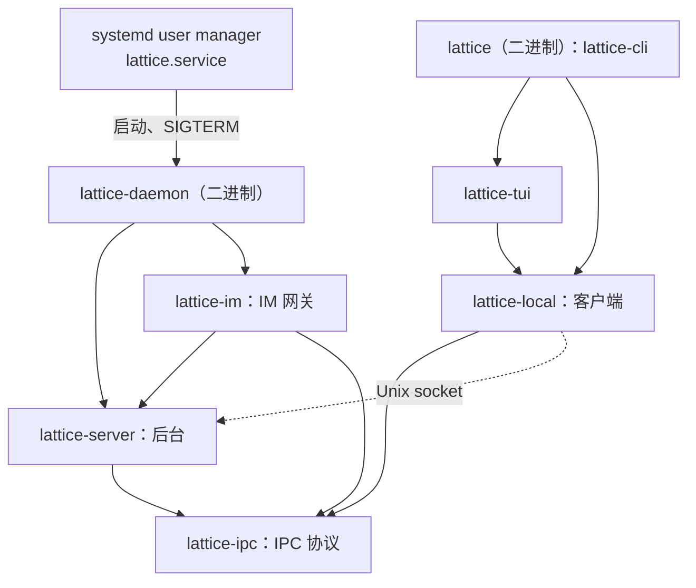
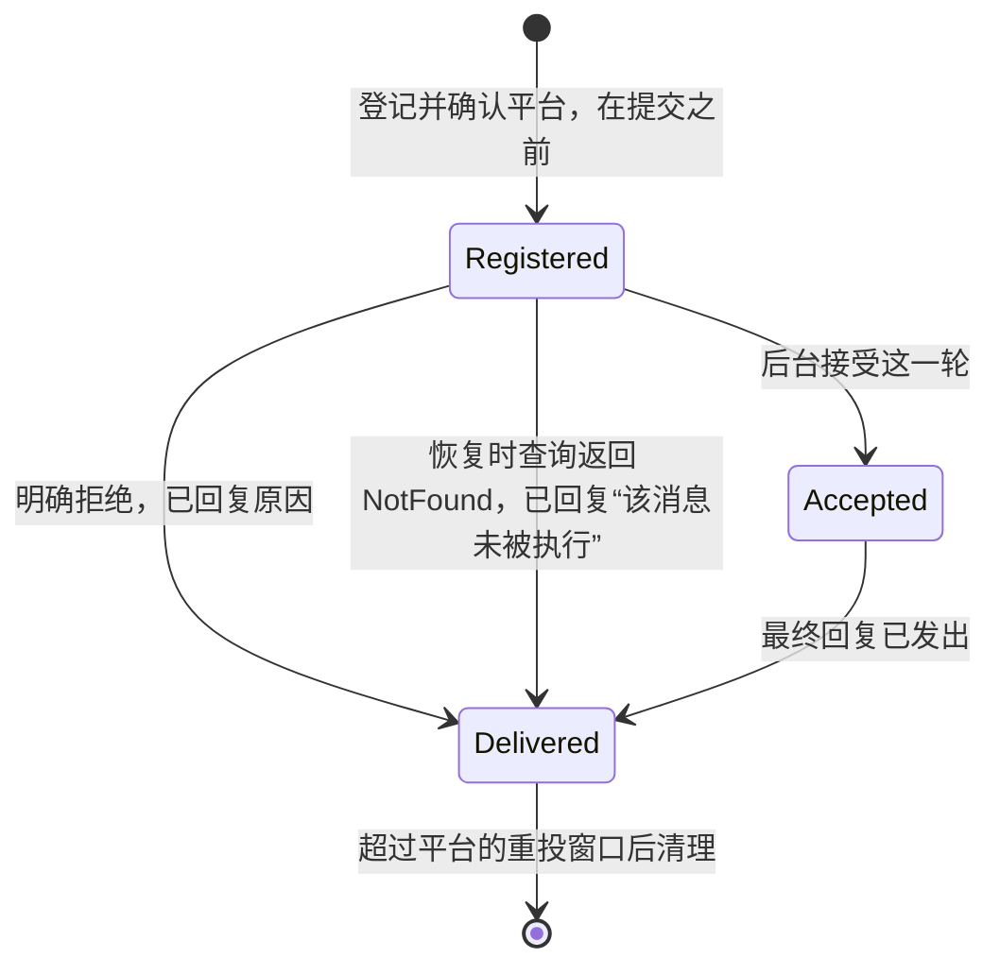

# ADR 0011：IM 网关作为本地后台的可选组件，首个平台为 Telegram

## 背景

### 现状

以下按 `main` 的 `deccc7cf` 核对。

| 方面 | 现状 | 出处 |
| --- | --- | --- |
| 前端 | 只有本机终端：`lattice` 二进制中的 CLI 与 TUI | `crates/lattice-cli`、`crates/lattice-tui` |
| 后台入口 | 后台主体在 `lattice-api`，由 `lattice daemon serve` 运行；没有独立的后台二进制 | `crates/lattice-cli/src/commands/daemon.rs:12-24`、`crates/lattice-api/src/local/server.rs:1435-1515` |
| 启动 | 除 `daemon status`、`daemon stop` 外，用到后台的命令与 TUI 都经 `ensure_running` 启动后台：以 `current_exe()` 加 `daemon serve --state-root` 拉起子进程，`setsid` 后脱离终端 | `crates/lattice-api/src/local/client.rs:325-379`；调用处 `crates/lattice-cli/src/commands/session.rs:42`、`models.rs:25`、`auth.rs:44-95`，`crates/lattice-tui/src/lib.rs:31` |
| 环境 | 后台使用启动它的进程的环境，自动启动的后台继承拉起它的前端的环境 | [配置来源与后台启动](../architecture/session/acceptance.md#配置来源与后台启动) |
| 停止 | 只有 IPC `stop`：后台关闭准入并停止元数据调度，等元数据刷新、已接管的操作与草稿会话清理收尾，再等认证收尾、全部连接结束，最后撤下 socket、释放实例锁，每一段都没有上限。后台不处理信号，进程入口是 `#[tokio::main]` | `server.rs:1045-1056`、`:1462-1515`；`crates/lattice-cli/src/main.rs:121` |
| `stop` 的返回 | 回执之后在 30 秒内等 socket 撤下、`owner.lock` 可取得，不等进程退出 | `client.rs:9`、`:49-72`；[停止后台](../architecture/session/recovery.md#停止后台) |
| crate | `lattice-api` 同时包含客户端 `LocalClient`、IPC 协议与后台。`lattice-tui` 只依赖它，`lattice-cli` 另依赖 `lattice-session` 取 `StateLayout`；前端因此编译 `lattice-llm`、`lattice-profile`、`lattice-agent` 等全部后台依赖 | `crates/lattice-api/Cargo.toml`、`crates/lattice-cli/src/commands/session.rs:32-33` |
| 私有文件 | 模型凭据 `auth.json` 的属主与权限检查、不跟随符号链接的打开与原子替换，写在 `lattice-llm` 内部 | `crates/lattice-llm/src/auth/file.rs:28-179` |
| 工具 | 生产注入 `NoTools`，模型请求不带工具定义；`agent.toml` 没有工具配置 | [ADR 0009 第 2 节](0009-remove-legacy-lancet-tool-executor.md#2-工具执行收窄为-toolexecutor)、[第 6 节](0009-remove-legacy-lancet-tool-executor.md#6-profile-删除-lancet-与-tools) |
| IPC 协议版本 | 魔数为 `LTLOCAL` 加一个版本字节，当前为 63 | `crates/lattice-api/src/local/ipc.rs:23-30` |

### 问题

1. **离开终端就无法驱动会话。** 会话只能在本机的 CLI 与 TUI 中使用，人不在电脑前时既看不到进度，也停不了正在执行的一轮。
2. **后台没有统一的管理者。** 后台由第一个用到它的前端拉起，继承那个前端的环境；开机之后、崩溃之后，没有谁再启动它。要在没有终端时接收 IM 消息，后台需要常驻，并由同一个管理者启停。
3. **后台停不干净。** 后台不处理 SIGTERM，排空与收尾的每一段都可能无限等待。进程管理器停止它时只能等到超时后发 SIGKILL，收尾一步都不执行。
4. **后台没有给进程内组件用的接口，前后台在同一个 crate。** 准入、Owner 与观察者只经 IPC 处理代码使用；前端编译并链接后台的全部依赖，依赖方向也无从检查。

### 约束

| 约束 | 出处 |
| --- | --- |
| SessionId 与 TurnId 由客户端生成；`submit` 只接受新请求，结果不明时按 TurnId 查询找回；同一会话的 Busy 由后台准入判定 | [ADR 0008 第 6 节](0008-backend-api-commands-view-queries.md#6-请求身份由客户端生成后台校验)、[第 7 节](0008-backend-api-commands-view-queries.md#7-submit-只接受新请求找回改为查询)；[请求身份与找回](../architecture/session/recovery.md#请求身份与找回) |
| 会话只经 `configure(New)` 创建，`configure` 幂等，执行中返回 Busy；草稿会话 24 小时没有改动、也没有观察者时由后台删除；IM 在 `/new` 之后的下一条消息先 `configure(New)` 再提交，v1 不修改设置 | [ADR 0012 第 2 节](0012-backend-owns-session-settings.md#2-configure-是修改设置的唯一命令)、[第 3 节](0012-backend-owns-session-settings.md#3-configure-的并发与找回)、[第 6 节](0012-backend-owns-session-settings.md#6-会话的状态)、[第 7 节](0012-backend-owns-session-settings.md#7-前端) |
| 配置、凭据与 profile 由后台读取，项目目录与环境变量不提供 endpoint 或 key | [ADR 0010 第 4 节](0010-protocol-adapters-and-configured-providers.md#4-全局配置与凭据) |
| 一个状态根上只有一个后台，所有权由 `owner.lock` 的 flock 决定；不按 PID 抢占，也不终止已有后台 | [本地后台与访问边界](../architecture/storage.md#本地后台与访问边界) |
| 生产后台不执行工具；接回新 LANCET 另立 ADR | [ADR 0009 第 7 节](0009-remove-legacy-lancet-tool-executor.md#7-新-lancet-的接回边界) |
| Telegram Bot API（10.4，2026-11-11 核对）：`getUpdates` 长轮询与 webhook 互斥，以大于 `update_id` 的 offset 确认，未取走的更新最多保留 24 小时；`sendMessage` 正文 1–4096 字符，单个 chat 每秒不宜超过一条；`sendMessageDraft` 只用于私聊，推送约 30 秒有效的临时草稿，正文 0–4096 字符，`draft_id` 非零；带 `can_stop` 时草稿显示停止按钮，用户按下后 bot 收到 `stopped_message_generation`，其中只有 `chat`、`message_thread_id` 与 `draft_id`，没有发送者 | <https://core.telegram.org/bots/api>、<https://core.telegram.org/bots/faq> |

### 维护者已确定的事项

- 2026-10-27 至 11-01，#332 与本 PR 的讨论中确定：IM 网关在后台进程内运行，取代“IM 作为后台的前端”的前稿；首个平台为 Telegram 私聊。后台由 systemd user service 托管、前端不再启动后台、`lattice-api` 拆为客户端、后台与 IPC 协议，随同提出。
- 2026-11-08：实施顺序为 ADR 0009、ADR 0012、本 ADR（[ADR 0012 第 9 节](0012-backend-owns-session-settings.md#9-实施顺序)）。
- 2026-11-11，本 ADR 按 ADR 0009、ADR 0012 实施后的代码改写时确定：
  - 实施分为停机、拆分、托管、IM 四个阶段；
  - `lattice daemon stop` 仍以 socket 撤下、`owner.lock` 可取得为返回条件，不等后台进程退出；
  - IM 发起的轮次不设专用的工具门禁。

## 决策

### 1. 总体结构



- 后台是 `lattice-daemon` 进程，由 systemd user service `lattice.service` 启停。`lattice` 二进制只含 CLI 与 TUI，连接已经在运行的后台。
- IM 网关是后台进程内的可选组件，经后台的进程内服务 API 访问会话，与后台同一生命周期。会话可以在 IM、TUI 与 CLI 之间接续。
- `lattice-server` 只汇报组件的状态；`lattice-daemon` 构造 IM 并交给后台挂载。

### 2. 后台的停机

SIGTERM、SIGINT 与 IPC `stop` 走同一个停机顺序：

```text
1. 关闭准入: 置 stopping, 停止元数据调度与 SIWC 登录, 通知各组件停止取新工作
2. 排空: 等已接管的操作与进行中的草稿会话清理收尾, 至多 drain_timeout
         到时停写会话库, 每个尚未退休的操作计入一次 unconfirmed_operations, 本次停机记为排空超时
         IPC stop 在这一步结束后回执 DaemonStatus
3. 组件收尾, 至多 10 秒
4. 元数据刷新与认证收尾, 至多 5 秒
5. 连接收尾, 至多 5 秒
6. 撤下 socket; 关闭 runtime, 至多 5 秒
7. 退出进程, 内核随之释放 owner.lock: 排空完成为 0, 排空超时为 4
```

- **排空上限**是后台参数 `--drain-timeout <时长>`：非负整数加单位 `ms`、`s` 或 `m`，不带单位按秒，默认 `60s`，格式不对时以 `2` 退出。期限从进入停机算起，停机路径上所有等待在途工作的地方共用它。
- **停写。** 排空超时后，后台置位会话库租约的 `shutdown` 标志与会话库的写闸 `write_disabled`，并让会话库管理器进入不再重开的终态。写闸取的是每次写入从开始到提交一直持有的健康锁，所以停写要等正在进行的那次提交结束；之后任何写入都报 `WriteDisabled`，在途 turn 即使自己跑完也写不出结局，下次启动时成为[执行者消失后的 Turn](../architecture/session/recovery.md#执行者消失后的-turn)。会话库下次按 redb 的崩溃恢复打开，与被 SIGKILL 走同一条路径。
- **各段上限**到时只是不再等待，没等完的任务在关闭 runtime 时丢弃。第 3 至 6 步合计至多 25 秒，没有组件时至多 15 秒，都在 `stop` 等锁释放的 30 秒之内。组件相关的部分（第 1 步的通知与第 3 步）随 IM 阶段加入。
- **硬期限。** 停写对那次提交的等待只受存储约束，所以停机的硬期限由 systemd 执行。托管时，后台进入停机就经 `$NOTIFY_SOCKET` 发出 `STOPPING=1`，systemd 随即按 `TimeoutStopSec` 计时，到时发 SIGKILL；由 IPC `stop` 或直接发给进程的信号发起的停机，同样受它约束。`TimeoutStopSec` 取排空上限加 30 秒：尾段 25 秒，另加 5 秒余量，余量包括停写时等的那次提交。手动运行时（包括停机阶段的 `lattice daemon serve`）没有这个硬期限。
- **锁随进程退出释放。** 进程入口显式构建 runtime，以 `shutdown_timeout` 关闭之后直接退出进程；实例锁一直持有到进程退出，由内核在关闭最后一个文件描述符时释放。进程退出时所有线程都已离开用户态，关闭 runtime 时还在运行的阻塞任务随之结束。所以 `stop` 见到锁可取得时，旧后台已不再执行应用层代码，新后台与旧后台不会同时写同一个文件；进程何时完全退出，由 systemd 与 harness 各自确认。
- **信号**在绑定 socket 之前装好：后台能接受连接时，信号处理一定已就绪。就绪之前收到的信号同样进入停机（没有在途 turn，退出 `0`）。排空期间再收到 SIGTERM 或 SIGINT 时，立即按排空超时处理。
- **排空超时时的 `stop`。** 回执仍是 `DaemonStatus`，线上形状不变。`unconfirmed_operations` 按现有定义是本进程未完成收尾的操作计数，排空超时时放弃的操作正属此类：每个尚未退休的操作在这时计入一次（一次草稿会话清理按一个操作计，不论它正在删除哪个会话），之后它们退休时不再重复计数。`lattice daemon stop` 照常等锁释放后返回，按现有规则在 `unconfirmed_operations` 不为 0 时退出 `1`，标准错误提示有操作没有确认收尾、其中的在途 turn 重启后显示为执行者消失。

### 3. 后台由 systemd user service 托管

- 新增二进制 crate `lattice-daemon`，入口即现在的 `daemon serve`：`lattice-daemon --state-root <绝对路径> [--drain-timeout <时长>]`。`lattice daemon serve` 删除，`lattice daemon status` 与 `lattice daemon stop` 保留为客户端命令。
- `lattice daemon install [--drain-timeout <时长>]` 写入 `$XDG_CONFIG_HOME/systemd/user/lattice.service`（未设置时为 `~/.config/systemd/user/lattice.service`），再执行 `systemctl --user daemon-reload` 与 `systemctl --user enable --now lattice`：

  ```ini
  [Unit]
  StartLimitIntervalSec=120
  StartLimitBurst=5

  [Service]
  ExecStart=<lattice 同目录下 lattice-daemon 的绝对路径> --state-root <安装时解析出的状态根> --drain-timeout <时长>
  TimeoutStopSec=<排空上限加 30 秒>
  NotifyAccess=main
  Restart=on-failure
  RestartSec=5
  RestartPreventExitStatus=2 3 4

  [Install]
  WantedBy=default.target
  ```

  `TimeoutStopSec` 是整秒时写秒（默认 `90s`，与 systemd 的默认值相同），否则写毫秒（排空上限 `300ms` 时为 `30300ms`）；SIGKILL 只作兜底。`NotifyAccess=main` 让 systemd 接收后台发出的 `STOPPING=1`（第 2 节）。同目录下没有可执行的 `lattice-daemon` 时，`install` 以 BadRequest 退出 `2`，不写 unit，也不调用 `systemctl`。开机后无人登录时也要运行，由用户执行 `loginctl enable-linger`。
- `lattice-daemon` 的退出码：

  | 退出码 | 含义 | systemd 的处理 |
  | --- | --- | --- |
  | `0` | 正常停机，在途 turn 全部排空；就绪前收到停机信号也是 `0` | 不重启 |
  | `1` | 运行期错误，例如状态根不可用、listener 失败 | 重启；120 秒内连续失败 5 次后停止重启，unit 进入 failed |
  | `2` | 参数错误 | 不重启 |
  | `3` | 状态根已被另一个后台占用（取不到 `owner.lock`）；socket 能连上时附对端 pid，只用于显示 | 不重启 |
  | `4` | 排空超时，或排空中又收到停机信号；在途 turn 成为执行者消失 | 不重启，unit 进入 failed，在 `systemctl --user status` 与 journal 中可见 |

- **环境。** 后台的环境来自 systemd user manager 与 unit：`HOME` 由 user manager 给出，`XDG_STATE_HOME`、`SSL_CERT_FILE`、`SSL_CERT_DIR` 写进 unit 或 user manager 的环境才生效。配置目录仍是后台环境中的 `$HOME/.lattice`，TLS 根证书仍在启动时按后台环境载入一次。
- **一个用户一个后台。** 同一用户的 CLI、TUI 与 IM 连同一个后台，只有一个 unit `lattice.service`。`owner.lock` 排除同一状态根上的第二个后台；同一用户在另一个状态根上再运行后台，不在支持范围内。unit 固定 `--state-root`，前端按自己的 `HOME` 与 `XDG_STATE_HOME` 定位 socket。
- **启停。** 启动与重启用 `systemctl --user start|restart lattice`，停止用 `systemctl --user stop lattice` 或 `lattice daemon stop`。宿主需要 systemd user session；没有时手动运行 `lattice-daemon`。测试不经 systemd：harness 把 `lattice-daemon` 作为直接子进程启动。

### 4. 前端连接已经运行的后台

- `ensure_running` 删除。前端连不上后台时报 `not_running`，退出码 `1`，提示用 `systemctl --user start lattice` 启动或用 `lattice daemon install` 安装，并说明前端与后台的状态根可能不一致。
- **升级。** 第一次从自动启动升级时，旧版本拉起的后台仍占着 `owner.lock`，systemd 拉起的 `lattice-daemon` 以 `3` 退出；用户用旧二进制执行 `lattice daemon stop`，再启动 unit。之后的升级用 `systemctl --user restart lattice`。前端遇到版本不兼容的后台时给出这两种处理，并附对端 pid（经 `SO_PEERCRED` 取得，只用于显示）。

### 5. crate 拆分与依赖规则

`lattice-api` 拆为三个 crate：

| crate | 内容 |
| --- | --- |
| `lattice-ipc` | IPC 的请求、响应与错误类型，分帧、对端 UID 核验与 `PROTOCOL_VERSION`，线上形状快照；只有类型与编解码 |
| `lattice-local` | `LocalClient`、`LocalTurn`、`LocalWatch`，观察 idle 的判定，规范化当前目录的工作区解析；前端需要的类型由它重新导出 |
| `lattice-server` | 后台：准入、Owner、观察者、停机、IPC 处理与 Turn 协调；`ConfigRejection` |

共享类型的去处：

- 会话视图类型（`Node`、`SessionRecord`、`TurnDetail`、`SessionUsage` 等）既是会话库的持久化格式，又是线上格式，留在 `lattice-session`；`lattice-ipc` 只重新导出它们，不导出写入接口。
- 上线的模型目录与凭据状态，在 `lattice-ipc` 中定义只用于展示的类型，由后台从 `lattice-llm` 的类型转换。线上格式因此不随 `lattice-llm` 的内部字段变化。
- 模型引用、推理档位与用量类型已在 `lattice-conversation`，原样使用。
- `ConfigRejection` 不可序列化，构造时要用凭据脱敏，上线时只以 BadRequest 的文案出现，归 `lattice-server`。
- 拆分不改变任何命令的输出与退出码。前端现在用到的 `ApiError` 与 `ConfigRejection` 改为 `LocalError` 的对应种类，本地校验失败仍是 BadRequest、退出 `2`；日志初始化由 `lattice-local` 提供。

**线上形状快照**存放在 `lattice-ipc`，与 `PROTOCOL_VERSION` 写在同一个快照文件里：形状变了而版本没变时测试失败，升版本之后才允许重新生成。拆分开始时先在拆分前的代码上生成基线，拆分完成后的快照必须与基线逐字相同。

**依赖规则**写在依赖边界合同 `docs/architecture/crates.md`，由 `cargo xtask` 检查，每条规则带负测试：

| 规则 | 加入的阶段 |
| --- | --- |
| `lattice-tui` 只依赖 `lattice-local`；`lattice-local` 只依赖 `lattice-ipc`、`lattice-conversation`、`lattice-store`；`lattice-ipc` 只依赖 `lattice-session`、`lattice-conversation`、`lattice-store`；`lattice-server` 不依赖 `lattice-local` | 拆分 |
| `lattice-cli` 只依赖 `lattice-local` 与 `lattice-tui`；`lattice-daemon` 依赖 `lattice-server` 及组装所需 | 托管 |
| 只有 `lattice-daemon` 依赖 `lattice-im`，dev 依赖同样适用；`lattice-im` 只依赖 `lattice-server`、`lattice-ipc`、`lattice-store` 与 `net-guard` | IM |
| `lattice-tui`、`lattice-local` 与 `lattice-cli` 的普通依赖闭包中没有 `lattice-server`、`lattice-llm`、`lattice-profile`、`lattice-agent` 与 `lattice-im` | 拆分（`lattice-cli` 随托管加入） |

前三条是直接依赖白名单，按 `cargo metadata` 判定 `[dependencies]` 与 `[build-dependencies]`，包括 target 专属与改名的依赖；内部 crate 按 `workspace_members` 判定。前端闭包中的 `lattice-session` 与 `redb` 来自会话视图类型，予以保留。

### 6. 进程内服务 API 与组件挂载

```text
configure(ConfigureRequest)      -> ConfigureReply | LocalError    # 同 IPC configure
submit(TurnRequest)              -> 进程内的轮次句柄 | LocalError     # 同 IPC submit；句柄给出生成中文字与这一轮的结局
cancel(TurnId)                   -> owned: bool                    # 同 IPC cancel
head(SessionId) · turn(TurnId) · usage(SessionId)                     # 同 IPC 查询
stopping()                       -> 停机通知
```

- IPC 处理代码调用同一套函数，进程内与 IPC 只有一套语义。
- `lattice-server` 的 `serve` 接受一组组件。组件有名字，后台就绪后作为独立任务启动，收到停机通知后收尾（第 2 节第 1、3 步）。
- `DaemonStatus` 增加 `components`，按名字排序列出每个组件已挂载，或未挂载及原因；`lattice daemon status` 显示这一项。组件起不来的原因由此直接可见，不必翻 journal。
- **故障隔离。** 组件内部的错误（网络、限流、token 无效）由组件记录并退避重试。组件 panic 时，后台在等待它的任务处捕获，把它标为未挂载（原因为 panic），本次运行内不再启动它，后台其余部分照常服务；恢复组件需要重启后台。

### 7. IM 网关

- **启用。** 默认关闭。配置目录下的 `im/config.toml` 中有 `[telegram]` 表时，`lattice-daemon` 读取配置与凭据、规范化 `workspace`，都成功后挂载 IM；任何一项失败时 IM 列为未挂载及原因，后台照常运行。没有这张表时，`lattice-daemon` 不构造 IM，`components` 中也没有 IM 一项。修改 IM 配置后，重启后台生效。
- **配置。** `im/config.toml` 位于配置目录（后台环境中的 `$HOME/.lattice`），由后台读取；项目目录中的同名文件不读取。`[telegram]` 表的键：`allowed_senders`（数值发送者 id 的数组）、`workspace`（绝对路径）、`agent`（agent 名）。
- **凭据。** IM 平台的密钥集中在配置目录下的 `im/auth.json`，按平台名分段（Telegram 为 `telegram`），由 `lattice-server` 的 `im_auth` 模块按“平台名 → 不透明密钥”读写，`lattice-im` 经它取得 token。`lattice im auth set telegram` 从终端或标准输入读入 token 并关闭回显，经 IPC 交给后台写入；另有 `lattice im auth remove telegram` 与 `lattice im auth status`。token 只存在于 `im/auth.json` 与后台内存中。Telegram 把 token 放在 URL 路径里，所以传输错误先去掉 URL，再按已知值替换 token，然后才进入日志、诊断或回复。
- **私有文件机制。** 属主与 0600 权限检查、不跟随符号链接、拒绝特殊文件，以及“写临时文件、fsync、改名替换、fsync 目录”的原子写入，从 `lattice-llm` 移到 `lattice-store` 新增的私有文件模块，由模型凭据 `auth.json`、`im/auth.json` 与台账共用。
- **传输。** 用 `getUpdates` 长轮询，只需要出站 HTTPS；`allowed_updates` 只订阅 `message` 与 `stopped_message_generation`。端点固定为 `https://api.telegram.org`，经 `net_guard::validate_base_url` 校验、`resolve_public_socket_addrs` 解析并固定地址，reqwest 设 `no_proxy()`。
- **内部结构。** `lattice-im` 按职责平铺模块：身份键与命令解析、台账、Telegram 收发、回复切分、配置。唯一的 trait 是 Telegram 收发的测试替身 `TelegramIo`；后台一侧用真实的进程内服务 API 与临时状态根测试。

### 8. 身份键与台账

- **身份键**：`SenderKey`（谁发的，只用于白名单）、`ChatKey`（哪段对话：会话绑定、回复目标与并行的粒度）、`InboundId`（哪条入站事件：去重键）。三者序列化为带平台前缀的字符串，例如 `tg:123`。Telegram 的 `from.id`、`chat.id` 与 `update_id` 只在 Telegram 模块内出现，进入网关前换成身份键，台账因此不依赖平台的整数形态。
- **台账**是私有文件 `<state-root>/lattice/im/ledger`，由后台进程独占写入，不含凭据，保存两类记录：
  - chat 绑定 `ChatKey → SessionId`：每个 chat 同时只有一个当前会话。会话库不记录平台标识。
  - 入站事件 `InboundId → (ChatKey, SessionId, TurnId, 相位)`。`/new` 也记为入站事件，没有 TurnId，相位直接为 `Delivered`，与清除绑定在同一次写入中完成。
- **写入台账之后就确认平台。** 此后的恢复以台账为准，与平台是否重投无关。



| 相位 | 含义 |
| --- | --- |
| `Registered` | 已持久登记、已确认平台，还没有准入结果 |
| `Accepted` | 后台已接受这一轮，等它结束后发最终回复 |
| `Delivered` | 给用户的最后一条回复已发出 |

- **清理。** 只清理超过平台最长重投窗口的 `Delivered` 条目（Telegram 取略大于 24 小时，由 Telegram 模块给出），在 IM 挂载时进行；窗口之内重投的事件由这些条目识别。chat 绑定保留。

### 9. 一条消息的处理

网关按到达顺序逐条处理同一个 chat 的普通消息与 `/new`，每条处理到得出准入结果为止；不同 chat 并行。同一 InboundId 再次到达时，正在处理的跳过，台账中已有的只确认。

```text
收到白名单内的私聊消息 m:
    new = 这个 chat 没有绑定
    s = new ? 新的 SessionId : 绑定的会话
    t = 新的 TurnId
    写台账: m.inbound_id → (chat, s, t, Registered); new 时同时写绑定 chat → s
    确认 m
    r = new ? 建会话后提交() : submit(s, t, m.text)
    if r 为 NotFound and not new:                  # 绑定的草稿会话已被后台清理
        r = 建会话后提交()
    按 r:
        已接受                       → 记 Accepted; 推送草稿, 观察到这一轮结束, 发最终回复, 记 Delivered
        Stopping, 或错误带找回需求     → 停在 Registered, 按恢复规则处理
        其他错误                     → 回复原因（Busy 时为“正在忙，可发 /cancel”）, 记 Delivered

建会话后提交():
    c = configure(New(s), workspace, agent)       # workspace 与 agent 取 [telegram] 表
    if c 成功, 或为“会话已存在”:                   # configure 幂等
        return submit(s, t, m.text)
    return c                                      # 按上面同一张表处理
```

- **先登记，再提交。** TurnId 照常随机生成。台账先持久记下 `InboundId → TurnId` 再提交，所以平台重投与后台崩溃都只会找回同一个 Turn。逐条处理也保证同一个 chat 不会同时新建两个会话。
- **Busy 以后台准入为准**，包括 TUI 或 CLI 正在同一会话上执行一轮的情况；IM 回复“正在忙，可发 /cancel”，由用户决定何时重发。观察与回复在准入之后并行进行，所以执行中到达的下一条消息会得到这个回复。
- **恢复。** IM 挂载时、开始轮询之前，对台账中每个 `Registered` 与 `Accepted` 条目按相位恢复；运行中停在 `Registered` 的条目，由处理它的任务稍后按同一规则恢复：
  - `Registered`：按 TurnId 查询。已接受时转 `Accepted`；在途时稍后再查；返回 NotFound 时确定没有被接受（[请求身份与找回](../architecture/session/recovery.md#请求身份与找回)），回复“该消息未被执行”并记 `Delivered`，由用户决定是否重发。
  - `Accepted`：观察这一轮到结束（已结束就直接取结局），发最终回复，记 `Delivered`。停机时没来得及发出的回复由此补发。
  - 查询、读取或观察返回其他错误（例如会话库暂不可用）时，条目保留原相位，稍后重试；IM 停机时仍未完成的，下次挂载时继续。
- **会话设置。** IM 只在新建会话时调用 `configure(New)`，提交不带 `expected_settings`。在 TUI 或 CLI 中修改的设置，对 IM 的下一条消息同样生效。

### 10. Telegram 的确认与 offset

- offset 只保存在 Telegram 模块的内存中。重启后第一次调用 `getUpdates` 不带 offset，Telegram 从最早未确认的更新开始重投，重复的由台账识别。
- 网关对每条事件确认一次：写入台账的事件（普通消息与 `/new`）在写入之后确认，其余命令在回复之后确认，被拒的消息在计数之后确认。
- Telegram 模块只在从当前 offset 起形成连续的已确认前缀时推进 offset，中间有未确认的事件就等待。未确认的更新会在下一次 `getUpdates` 中再次返回，网关跳过其中正在处理的那些。
- IM 停机超过 24 小时，尚未写入台账的更新会被 Telegram 丢弃。

### 11. 授权

- 白名单只用数值发送者 id（`from.id`）。名单为空时拒绝全部。只接受私聊。
- 名单之外的发送者与非私聊的消息只计数并静默确认，以免堵住 offset 的连续前缀。
- `stopped_message_generation` 不带发送者。草稿只发往白名单内的私聊，停止事件须对上内存中一个进行中轮次的 `draft_id`；对不上的只确认。

### 12. 命令

| 命令 | 行为 |
| --- | --- |
| `/new` | 清除这个 chat 的绑定；下一条消息按第 9 节新建会话。旧会话中进行中的一轮照常推送草稿与最终回复 |
| `/cancel` | 对当前绑定会话中进行中的一轮调用 `cancel(turn_id)`。接管时回复“已取消，等待这一轮结束”；未接管时回复“这一轮已结束或不在执行中”；服务 API 报错时回复“取消结果未知，可发 /status 查看”；没有进行中的轮时回复“没有进行中的轮”。取消不回滚已经发生的效果 |
| `/status` | 绑定的会话（没有绑定或会话已不存在时报告没有会话），会话头的 `owner` 与 `turn_id` 给出的执行状态，以及会话设置中的 agent、模型与推理档位 |
| `/usage` | 绑定会话的用量摘要 |

- 命令只对白名单内的发送者生效，执行中也可以使用。`/new` 记下自己的 InboundId，重投时只确认，所以不会清掉之后才建立的绑定；`/cancel`、`/status` 与 `/usage` 不写台账，重投时再回复一次。
- 网关在内存中按 TurnId 持有每个进行中轮次的句柄与 `draft_id`，这一轮结束时只删除它自己的句柄。`/new` 之后，同一个 chat 可能同时有旧会话与当前会话各一轮在执行：`/cancel` 只取当前绑定会话的那一轮，旧会话的那一轮用它草稿上的停止按钮取消。句柄只用来选定目标，能否提交仍以后台准入为准。
- `/usage` 取后台的会话用量查询，与 `lattice session usage` 同源，回复四行：SessionId 与当前路径的轮数；当前路径上用过的 `<provider>/<model>`，按首次出现的顺序去重，只列名称；当前路径合计 `path_total`；全会话合计 `session_total`，含 `rewind` 后不在当前路径上的分支。合计取会话库从原始尝试算出的值，IM 不把各轮相加。
- 两个合计行列出输入、缓存写入、缓存读取、输出、缓存命中率与费用：
  - 计数的显示与 [`lattice session usage`](../architecture/session/operations.md#当前路径的用量查询) 相同（没有任何尝试报告时为 `-`，已知零为 `0`，溢出附 `(overflow)`）；
  - 缓存命中率的显示条件与 [TUI 的 statusline](../architecture/tui/layout.md#statusline) 相同；
  - 金额按[费用估算](../architecture/llm/usage.md#费用估算)显示，费用未知时与 statusline 一样显示 `$?`，因为聊天回复里没有解释 `-` 的帮助；
  - 合计不完整时，在行末注明“（不完整）”。

### 13. 回复

- **执行中**用 `sendMessageDraft` 推送助手正文的纯文本草稿。每轮取一个非零 `draft_id`，`draft_id → 轮次句柄` 只在内存中。正文不变时也在草稿失效之前刷新，刷新遵守单个 chat 每秒一条。草稿正文超过 4096 字符时，只预览末尾的 4096 字符。
- **停止按钮。** 草稿带 `can_stop`。收到 `stopped_message_generation` 时，按 `chat` 与 `draft_id` 找到这一轮，调用 `cancel(turn_id)`，按 `/cancel` 的规则回复；找不到时（这一轮已结束，或后台重启过）只确认。
- **最终回复。** 这一轮结束后，用 `sendMessage` 发送最后一步的助手正文，纯文本，不设 `parse_mode`。超过 4096 字符时按段落、其次按行、最后硬切成多条，按顺序发送。结局不是 Completed 时附一行说明，诊断经过脱敏。最终回复不附用量，用量看 `/usage`。

### 14. 工具

IM 发起的轮次与其他前端的轮次一样，由后台注入的 `ToolExecutor` 执行；生产注入 `NoTools`，所以这些轮次都是纯对话。接回新 LANCET 的 ADR 同时决定 IM 发起的轮次能用哪些工具，以及是否按发送者区分权限。

### 15. 实施顺序

四个阶段依次在 `main` 上完成。每个阶段完成后的状态本身完整，可以发版；阶段内的 PR 拆分与验收清单记在 #332。

| 阶段 | 完成后的状态 | 用户可见的变化 |
| --- | --- | --- |
| 停机 | `lattice daemon serve` 处理 SIGTERM 与 SIGINT，按第 2 节停机，带 `--drain-timeout`、停写、各段上限与退出码 `4`；harness 能向后台发 SIGTERM，并按选项识别后台的参数 | `daemon serve` 的新参数与退出码 `4`；排空超时时 `daemon stop` 退出 `1` |
| 拆分 | `lattice-ipc`、`lattice-local`、`lattice-server` 取代 `lattice-api`，线上形状快照与拆分前的基线逐字相同；依赖边界合同与对应的检查；清理无用依赖与只供测试的公开入口；IPC 的系统调用统一改用 rustix（`crates/lattice-api/src/local/ipc.rs:72-74` 的注释把它留给了这次拆分） | 无；命令的输出、退出码与线上格式都不变，可以单独回滚 |
| 托管 | `lattice-daemon` 及其退出码，停机时向 systemd 发 `STOPPING=1`，`lattice daemon install`；`daemon serve` 与 `ensure_running` 删除；harness 的每个场景显式启动后台 | 后台改由 systemd 托管；不提供降级 |
| IM | 进程内服务 API、组件挂载与 `components`，`im_auth` 与 `lattice im auth`，私有文件模块下沉，`lattice-im` 与 IM 合同；协议版本加一 | 默认关闭，配置后启用 |

停机、拆分与托管三个阶段不改线上形状，协议版本只在 IM 阶段加一。

### 16. 范围之外

v1 的 IM 是 Telegram 私聊中的纯文本对话。以下事项需要时另行决定：

- 代理、webhook 与 Telegram 以外的平台；
- 群组、频道与话题，多用户之间隔离工作区；
- 图片、文件、语音输入与附件回复；
- 在聊天中修改会话设置、`rewind`、翻看历史与排队提交；
- 不重启后台就启停 IM 或改 IM 配置；
- 脱敏实现的归属，随 #283 的裁决而定。

## 归属

| 概念 | 状态持有者 | 规则执行者 | 只使用结果的组件 |
| --- | --- | --- | --- |
| 后台进程的启停与环境 | systemd user manager 与 unit `lattice.service` | systemd；`lattice daemon install` 写入 unit | `lattice daemon status`、`lattice daemon stop`、前端 |
| 停机顺序、排空上限与停写 | 后台的停机状态 | `lattice-server`；`lattice-daemon` 接收信号后交给它 | IPC `stop` 的回执、组件、退出码 |
| 停机的硬期限 | unit 的 `TimeoutStopSec` | systemd，自收到 SIGTERM 或 `STOPPING=1` 起计时 | 后台 |
| crate 依赖边界 | 依赖边界合同 `architecture/crates.md` | `cargo xtask` 的分层检查 | 各 crate |
| IPC 线上形状与协议版本 | `lattice-ipc` 的类型与 `PROTOCOL_VERSION` | 线上形状快照测试 | `lattice-local`、`lattice-server` |
| 组件是否挂载 | `lattice-server` 的组件状态 | `lattice-daemon` 决定是否构造；`lattice-server` 隔离故障 | `DaemonStatus.components`、`lattice daemon status` |
| IM 配置 | 配置目录下的 `im/config.toml` | `lattice-im` 的配置解析 | `lattice-daemon` 的挂载 |
| IM 凭据 | 配置目录下的 `im/auth.json` | `lattice-server` 的 `im_auth` | `lattice-im`、`lattice im auth` |
| 私有文件的权限与原子替换 | 无状态 | `lattice-store` 的私有文件模块 | `lattice-llm`、`lattice-server`、`lattice-im` |
| chat 绑定与入站消息相位 | 台账 `<state-root>/lattice/im/ledger` | `lattice-im` 的网关 | `/status`、`/usage` |
| Telegram offset | `lattice-im` Telegram 模块的内存 | 同左 | 无 |
| 进行中轮次的句柄与 `draft_id` | `lattice-im` 的内存，按 TurnId | `lattice-im` 的网关 | `/cancel`、停止按钮 |
| 会话、会话设置与 Busy | 会话库与后台准入 | 后台，见 ADR 0008、ADR 0012 | IM、TUI、CLI |

## 否决的方案

| 方案 | 否决理由 |
| --- | --- |
| IM 作为独立前端进程，经本地客户端访问后台 | 要处理后台离线、版本不一致与重连；IM 重启后停止按钮失效；IM 拉起的后台会继承 IM 的环境 |
| `lattice-server` 依赖 `lattice-im`，在后台里编排 IM | 依赖方向倒置，后台要认识组件 |
| 后台仍是 `lattice` 的 `daemon serve` 子命令 | 前后台的依赖闭包分不开，IM 只能组装进 `lattice-cli` |
| 前端连不上时自动启动后台 | 后台成为前端的子进程并继承它的环境，常驻与重启没有统一的管理者 |
| 新二进制按 pid 向旧后台发 SIGTERM | 违反[本地访问与所有权边界](../architecture/storage.md#本地访问与所有权边界) |
| `lattice daemon stop` 等后台进程退出（`SO_PEERCRED` 加 `pidfd_open`，或 `SO_PEERPIDFD`） | 锁随进程退出由内核释放，`stop` 见到锁可取得时旧后台已不再执行应用层代码；进程何时完全退出由 systemd 与 harness 各自确认；它也消除不了 `stop` 之后立刻 `systemctl --user start` 在 systemd 一侧的竞争，重启用 `systemctl --user restart`。维护者 2026-11-11 确定 |
| 入口在关闭 runtime 之后主动释放实例锁 | 关闭 runtime 超时后阻塞任务仍可能在写文件，锁一放开，新后台就可能与它们同时写；锁随进程退出释放时，这些任务已随进程结束 |
| 只把 `TimeoutStopSec` 调大或设为 `infinity` | 停机可能无限期挂住，长 turn 的时长又没有上限 |
| 排空超时后 abort 在途 turn，再正常关闭会话库 | abort 只在 await 点生效，挡不住已在阻塞任务里的写入；关库还要等所有持有者放手。停写直接保证不再写入 |
| 加 `SuccessExitStatus=4` | 排空超时丢弃了在途 turn，unit 进入 failed 才会被用户看到 |
| 组件 panic 后在同一次运行内自动重启 | panic 是缺陷，自动重启可能反复崩溃、反复处理同一批更新；已接受而未回复的轮在重启后台后由台账补发 |
| 拆分阶段预建进程内服务 API 与组件挂载 | 只有 IM 使用；随 IM 阶段直接写在 `lattice-server` 中 |
| 拆分与托管合为一个阶段 | 一次变更过大；拆分不改行为与线上格式，本身是可发布、可回滚的完整状态 |
| 支持从托管阶段降级 | 要同时撤销 unit、恢复自动启动与 `daemon serve`，并为这条路径写测试；出问题时修复向前 |
| 共享类型放进 `lattice-local` 或 `lattice-conversation` | 前者让后台反向依赖客户端；后者职责不符，它只管对话消息与用量 |
| `lattice-llm` 的类型原样上线 | `lattice-llm` 内部改字段就要升协议版本 |
| 会话视图类型另复制一份 DTO | 它们既是持久化格式又是线上格式，复制会让两边漂移 |
| 拆出只读的会话视图 crate，把 `lattice-session` 与 `redb` 移出前端闭包 | 生产构建已不依赖 `gix`，收益只剩少编译 `redb`；需要时另行决定 |
| v1 用 webhook | 需要公网入站端点与证书，`net-guard` 不覆盖入站 |
| IM 直接读写会话库 | 绕过后台的实例锁与准入 |
| 平台无关的 IM trait 与插件机制；为后台、存储与时钟设 trait | 只有一个平台，每个 trait 只有一个实现，见[工程规范](../development/engineering.md#可读性)；后台用真实的进程内服务 API 测试 |
| 由 `InboundId` 派生 TurnId | TurnId 是 UUID v4；派生会把平台身份带进会话树 |
| 去重放进 `lattice.redb` | 要改后台提交接口与会话库格式；IM 自己的台账即可 |
| offset 写入台账或落盘 | 平台私有状态混进通用台账；Telegram 服务端已记录确认位置 |
| 后台接受或明确拒绝之后才确认平台 | 处理期间这条更新会在每次 `getUpdates` 中返回，重投与原处理并发；崩溃后的恢复还要依赖 Telegram 在 24 小时内重投。写入台账之后就确认，恢复只看台账 |
| 排空超时用 `owners` 或新增字段告知 `stop` | `owners` 统计的是 Owner 槽，草稿会话清理卡住时可能为 0；新增字段要在停机阶段升协议版本。`unconfirmed_operations` 的现有定义已涵盖被放弃的操作 |
| 提交前先查会话头判断 Busy，或在 IM 本地拦截 | 查询与提交之间别的前端可能抢先，最终仍要处理后台的 Busy；本地判定会成为第二条 Busy 规则 |
| IM 专用的工具门禁（提交时约束，或按冻结目录拒绝） | 生产只有 `NoTools`，门禁没有检查对象；IM 能用的工具由接回新 LANCET 的 ADR 决定。维护者 2026-11-11 确定 |
| 挂载时检查 agent profile | 需要只读的 profile 查询，ADR 0012 已否决；配置错误在第一条消息的 `configure(New)` 时回复 |
| 用 `editMessageText` 流式编辑 | 受单个 chat 的速率限制，长输出要换消息，容易触发 429；私聊改用 `sendMessageDraft` |
| 用用户名做白名单 | 用户名可以修改或转让 |
| bot token 放在环境变量或命令行参数中 | 环境变量进入 `/proc` 与子进程，命令行参数进入进程列表 |
| IM 配置写进 `providers.toml`，IM 凭据并入 `auth.json` | 这两个文件归模型接入（ADR 0010）；IM 另设 `im/` 目录，只共用私有文件机制 |
| IM 复制一份权限检查与原子写入 | 安全敏感的代码要在两处维护；下沉到 `lattice-store` 后由三处共用 |

## 影响

### 代码

| 组件 | 变化 | 阶段 |
| --- | --- | --- |
| `lattice-api` | 停机顺序、排空上限、停写与各段上限；之后由三个新 crate 取代 | 停机、拆分 |
| `lattice-ipc`、`lattice-local`、`lattice-server`（新） | 见第 5 节；`lattice-local` 删除 `ensure_running`；`lattice-server` 加进程内服务 API、组件挂载、`components` 与 `im_auth` | 拆分、托管、IM |
| `lattice-daemon`（新） | 参数、显式构建的 runtime、信号与退出码；挂载 IM | 托管、IM |
| `lattice-im`（新） | 第 7 至 13 节 | IM |
| `lattice-session` | 会话库的停写入口 | 停机 |
| `lattice-store` | 私有文件模块 | IM |
| `lattice-llm` | 凭据文件改用 `lattice-store` 的私有文件模块 | IM |
| `lattice-cli` | `daemon serve` 加 `--drain-timeout`，托管阶段删除；新增 `daemon install`、`im auth`；连不上后台时的提示 | 各阶段 |
| `lattice-tui` | 依赖改为 `lattice-local`；不再启动后台 | 拆分、托管 |
| `lattice-system-harness` | `terminate()` 与按选项识别后台；`LATTICE_DAEMON_BIN`，每个场景显式启动后台，删除依赖自动启动的测试 | 停机、托管 |
| `xtask`、CI | 分层检查；构建 `lattice-daemon` | 拆分、托管 |

### 数据与接口

- 会话库格式不变。
- 新文件：unit `lattice.service`；配置目录下的 `im/config.toml` 与 `im/auth.json`；`<state-root>/lattice/im/ledger`。
- IPC：IM 阶段新增 `ImAuthSet`、`ImAuthRemove`、`ImAuthStatus`，`DaemonStatus` 增加 `components`，协议版本加一；新旧客户端与后台按现有的版本校验互相拒绝。
- 命令：`lattice daemon serve` 由 `lattice-daemon` 取代；新增 `lattice daemon install` 与 `lattice im auth set|remove|status`；前端连不上后台时报 `not_running`、退出 `1`；排空超时时 `lattice daemon stop` 退出 `1`。

### 行为

- 后台由 systemd 托管，不再随前端启动；第一次使用前执行 `lattice daemon install`。
- 后台的环境来自 unit，不再继承前端。
- 托管时，停机最长等待排空上限加 30 秒，之后由 systemd 发 SIGKILL；排空超时后在途 turn 成为执行者消失，unit 以 failed 结束。
- 一个用户只运行一个后台。
- 配置 IM 后，可以在 Telegram 私聊中驱动会话，会话可在 IM、TUI 与 CLI 之间接续。
- 托管阶段以后不提供降级。

### 合同（随实施修订）

| 文档 | 修订 | 阶段 |
| --- | --- | --- |
| `architecture/session/recovery.md` | 停止后台：信号、排空上限、停写、各段上限与退出码 | 停机 |
| `architecture/crates.md`（新建） | crate 的职责、依赖白名单与闭包检查，登记进 `docs/README.md` 的架构索引 | 拆分；托管与 IM 补充各自的规则 |
| `architecture/session/` 各文件、`architecture/tui/README.md`、`architecture/llm/README.md`、`architecture/storage.md` | 指向 `lattice-api` 的模块路径改为新 crate | 拆分 |
| `architecture/storage.md` | 本地后台由 systemd 托管、一个用户一个后台；私有状态根加 `im/ledger`；`lattice-store` 的职责加私有文件模块 | 托管、IM |
| `architecture/session/acceptance.md` | 配置来源与后台启动：后台环境来自 unit；配置目录的内容加 `im/` | 托管、IM |
| `architecture/platform.md` | 宿主需要 systemd user session | 托管 |
| `architecture/im.md`（新建） | IM 的启用、配置与凭据、台账、消息处理、命令、回复与故障隔离，登记进架构索引 | IM |
| `architecture/llm/credentials.md` | 凭据文件的权限与原子替换由 `lattice-store` 提供 | IM |
| `development/testing.md`、`development/validation-guide.md`、`development/scenarios/` | 被测产物、后台的启动与停止、退出码与升级 | 各阶段 |
| `reference/glossary.md` | 新增“IM 网关”与“台账”，“IM 网关”与 `lattice-llm` 的“请求网关”区分 | IM |
| `README.md` | 安装、启动与升级 | 托管、IM |
| 各 crate 的 `AGENTS.md` | 新 crate 新建，`lattice-cli`、`lattice-tui`、`lattice-store`、`lattice-llm` 与 `lattice-system-harness` 改写 | 各阶段 |

### 与其他 ADR 的关系

| ADR | 关系 |
| --- | --- |
| [ADR 0005 第 19 节](0005-durable-turn-invocation-and-private-git-stores.md#19-ownership-and-dependency-graph) | 部分取代：crate 依赖图改由依赖边界合同维护 |
| [ADR 0007](0007-session-tree-as-single-authority.md) | 沿用：排空超时后的在途 turn 按执行者消失处理 |
| [ADR 0008 第 10 节](0008-backend-api-commands-view-queries.md#10-客户端保留的部分) | 部分取代：“连接后台，后台未运行时启动它”改为连接已运行的后台，连不上时报 `not_running` |
| [ADR 0008 第 11 节](0008-backend-api-commands-view-queries.md#11-协议版本) | 沿用：协议变化即升版本，不做兼容层 |
| [ADR 0009 第 7 节](0009-remove-legacy-lancet-tool-executor.md#7-新-lancet-的接回边界) | 补充：接回新 LANCET 的 ADR 同时决定 IM 发起的轮次能用哪些工具 |
| [ADR 0010 第 4 节](0010-protocol-adapters-and-configured-providers.md#4-全局配置与凭据) | 部分取代：后台的环境由 systemd unit 提供，不再继承拉起它的前端；“启动时读一次、请求不带配置来源”沿用 |
| [ADR 0012 第 7 节](0012-backend-owns-session-settings.md#7-前端) | 落实其中 IM 一行：会话的创建、台账相位与 chat 绑定见第 8、9 节 |
