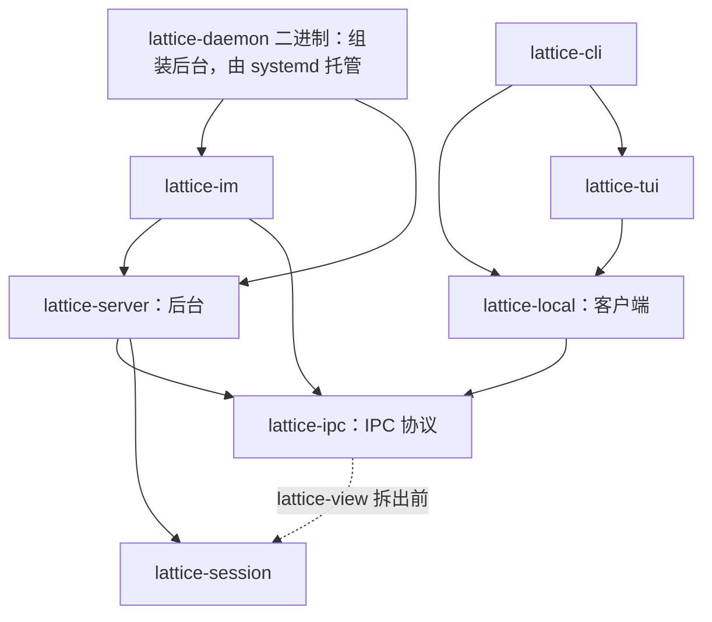

# ADR 0011：IM 网关作为本地后台的可选组件，首个平台为 Telegram

- 状态：Proposed（尚未获维护者批准）
- 日期：2026-10-27
- 修订：部分取代 ADR 0005 第 19 节（现状依赖图，由依赖边界合同取代）、ADR 0008 第 10 节（后台未运行时由客户端启动）与 ADR 0010 第 4 节（后台继承拉起它的前端的环境），以及 ADR 0010「与 ADR 0005、ADR 0006、ADR 0007、ADR 0008 的关系」节中“未运行时启动它”不变的表述，范围见[与其他 ADR 的关系](#与其他-adr-的关系)
- 依赖：[ADR 0007](0007-session-tree-as-single-authority.md)（执行者消失后的 Turn）、[ADR 0008](0008-backend-api-commands-view-queries.md)（命令、视图与查询）、[ADR 0010](0010-protocol-adapters-and-configured-providers.md)（配置与凭据由后台读取）
- 实施跟踪：GitHub #332

## 背景

以下代码与文档事实按 `main` 的 `60dd2d68`（#357，2026-10-31 19:33 UTC+8）核对，行号均指该提交。

**前端与后台。**

- 仓库没有 IM 模块。前端只有 `lattice-cli` 与 `lattice-tui`，经 `lattice-api` 的本地后台客户端访问会话。后台主体也在 `lattice-api`（`serve()` 在 `crates/lattice-api/src/local/server.rs:1017`），以 `lattice daemon serve` 运行，入口是 `crates/lattice-cli/src/commands/daemon.rs` 的 `DaemonAction::Serve`；没有独立的后台二进制。
- ADR 0008 把本地后台 API 分为命令（`submit`、`cancel`、`rewind`）、视图（`watch`）与查询（`history`、`turn`、`list`/`log`/`audit` 等）。SessionId 与 TurnId 由客户端生成，`submit` 只接受新请求，接受结果未知时按 TurnId 查询找回；重复使用已用过的 TurnId 得到 `TurnIdUsed` 冲突。
- 客户端公开类型在 `crates/lattice-api/src/local/`：
  - `client.rs`：`LocalClient`（`status`、`stop`、`ensure_running`、`submit`、`cancel`、`cancel_session`、`session_head`、`watch`、`turn`、`wait_for_turn`、`usage` 等）与 `LocalWatch`。`ensure_running`（`:331`）用 `current_exe()` 加 `daemon serve --state-root` 拉起后台（`:346-348`），子进程 stdio 接 `/dev/null`（`:351-353`），fork 后 `setsid`（`:357`）。
  - `operation.rs`：`LocalTurn`（`start_turn`、`follow_turn`、`observe`、`cancel`、`reconnect`、`next`、`detach`）。`lattice run` 用 `start_turn` 提交、用 `follow_turn` 找回后继续观察（`crates/lattice-cli/src/commands/run.rs`）。
  - `types.rs`：`TurnRequest`（`:383`）、`SubmitSession::{New, Existing}`（`:412`）、`TurnLookup::{Accepted, InFlight}`（`:55`）、`SessionHead`（`:61`，含 `turn_id` 与 `owner`）、`CancelStatus`（`:100`）、`LocalErrorKind::Busy`（`:246`）、`LocalErrorKind::NotRunning`（`:250`）、`DaemonStatus`（`:438`，字段为 `epoch`、`stopping`、`owners`、`unconfirmed_operations`）等。
  - `mod.rs`：`new_session_id`（`:20`）、`new_turn_id`（`:27`），TurnId 是严格的 UUID v4。
- 会话库是状态根下的 `lattice.redb`，由后台独占（`crates/lattice-api/src/stores.rs`）。CLI、TUI 连接同一后台，同一会话上的并发由后台准入拒绝为 Busy。
- 除 `daemon status`、`daemon stop` 外，所有用到后台的命令都经 `ensure_running` 自动拉起后台：`commands/session.rs:40-42` 的 `local_client()`（被 `session::run`（`:101`）、`audit.rs:98`、`lancet.rs:42` 调用），`models.rs:25`，`auth.rs:34`、`:48`、`:60`，以及 TUI 的 `lattice-tui/src/lib.rs:29`。`lattice lancet doctor` 不连后台，在 CLI 本地运行（`commands/lancet.rs:74-76` 调 `lancet_api::run_doctor_checks`）。
- ADR 0010 已落地（#315 的 L2，含 #330、#334）：后台启动时按自己的环境读取配置，请求不带配置来源（`docs/architecture/session.md:280` 起“配置来源与后台启动”）。#315 的 L3 也已合并（#346–#349、#355、#356）：尝试计量统一为 input、cache_read、cache_write、output、reasoning 五项，费用按价格表分确切、估算、未知三种状态（`docs/architecture/llm.md:352` 起“费用估算”）。#315 仍为 open，其第 14 项“会话持有 profile 副本”在 L4 实现。会话库格式为 6（`crates/lattice-session/src/store/codec.rs:17`），本地 IPC 魔数为 `LTLOCAL:`（`local/ipc.rs:23`；`docs/development/validation-guide.md:179`）。
- 会话用量已有查询：`LocalClient::usage`（`client.rs:151`，IPC `Request::Usage`，`types.rs:479`）返回 `SessionUsage`（`crates/lattice-session/src/store/types.rs:487`）。其中 `turns` 是当前路径上逐轮的 `TurnUsageRow`（`:496`，含该轮 UserMessage 节点上的 `provider`、`model` 与本轮 `UsageSummary`），另有 `path_total` 与 `session_total`（`:491`、`:492`）。`path_total` 只累计当前路径上 Step 的尝试，`session_total` 累计该会话全部 Step 的尝试，含 rewind 后不在当前路径上的分支；两者都由 `UsageSummary::from_attempts` 从原始尝试直接算出（`lattice-session/src/store/read.rs:436`、`:460`），不是逐轮相加（`session.md:222` 起“当前路径的用量查询”，`:226`）。后台在 `server.rs:692` 处理该请求。CLI 以 `lattice session usage` 展示，逐轮明细之后是“当前路径合计”“全会话合计”两行（`lattice-cli/src/commands/session.rs:343-344`；`session.md:230`）。

**后台的停止。**

- 后台没有任何信号处理：`crates/lattice-api/src` 中没有 `tokio::signal` 或 `sigaction`。仓库中的信号处理只在 CLI：`commands/run.rs:263`、`:325` 的 SIGINT，`commands/auth/terminal.rs` 的终端恢复。进程入口是 `#[tokio::main]`（`lattice-cli/src/main.rs:128`）。
- #342（`daemon stop` 与 `ensure_running` 重新拉起之间的竞争）已由 #345 关闭，只修了 stop 一侧。现在的 stop：
  - `daemon stop` 发 `Stop`，后台置 `stopping`、停元数据刷新，等 `owners` 归零后回 `Status` 回执（`server.rs:653-661`）。排空没有上限，客户端读回执也没有上限（`client.rs:61-72` 的 `request_stop`）。
  - 收到回执后，`Departure::wait`（`ipc.rs:227`、`:237`）在 `STOP_RELEASE_TIMEOUT`（`client.rs:9`，30 秒）内只等 `owner.lock` 可取得：对它加共享非阻塞 flock 探测（`ipc.rs:269`），不检查 socket，超时报 Stopping。后台退出前先撤 socket、最后放锁（`server.rs:1079-1083`），所以锁可取得时 socket 已撤下。恰好在这一刻启动的新后台以 `AlreadyRunning` 退出（`ipc.rs:137-138`），有报错，不会悄悄失败。
  - stop 不等后台进程退出（`session.md:663` 起“停止后台”）。harness 在 stop 干净返回时立即核验 socket 已撤下、`owner.lock` 可取得，再在 `DEPARTURE_EXIT_WINDOW`（`crates/lattice-system-harness/src/daemon.rs:20`，5 秒）内按自己记录的进程组等待退空，超时判失败（`docs/development/testing.md:122`）。
  - 锁文件里不写 pid（`ipc.rs:121-134` 只打开并加锁）；所有权不按 PID 判定或抢占（`docs/architecture/storage.md:63`）。`ensure_running` 没有启动重试。
- 停机路径上的等待：`serve` 主循环在 `stopping` 且 `owners` 为 0 时退出（`server.rs:1052-1053`），之后等元数据任务（`:1066-1067`），再次等 `owners` 归零（`:1068-1070`），等所有连接任务结束（`:1075`），撤 socket（`:1080`），最后释放实例锁（`:1083`）。连接上读请求帧有 10 秒超时（`:984-989`），已发出提交的连接在 `wait_reply`（`:1005`）上等结局，没有上限。
- 会话库的停写已有两处机制，现在都只由库代故障置位（`StoreManager::fail`，`stores.rs:190-212`）：
  - 会话库租约的 `shutdown` 标志（`StoreLease.shutdown`，`lattice-api/src/stores.rs:36-41`），经 `SessionApi::shutdown()`（`session.rs:97-101`）在 `server.rs:482`、`:494` 交给每个 turn，即 `turn/saga.rs:103` 的 `LiveExecution.shutdown`。saga 在每个写步骤前的 `healthy()`（`saga.rs:109-115`）见到它就报 `WriteDisabled`，`join()`（`:128-147`）让工作线程取消。
  - 会话库的写闸 `write_disabled`（`lattice-session/src/store/mod.rs:34`），现在只在提交失败时置位（`write.rs:299`）。每次写入在 `begin_write` 之前取得、直到提交结束才放开的健康锁就是它（`write.rs:251-253`、`mod.rs:87-102`）。

**工具、网络与凭据。**

- 工具由 agent profile 的 `[tools].enabled` 选择（`crates/lattice-profile/src/schema.rs:274` 的 `ToolsSection`，默认空列表；`docs/development/tool-development.md`）。空列表合法：`capability_admission_policy_without_enabled_tools_admits_nothing`（`schema.rs:842`）断言此时不准入任何工具。默认模板启用了 `session__todo_write`（`lattice-profile/src/defaults.rs:44`）。
- 现在后台每次接受提交都从 `agent.toml` 重新加载 profile：`server.rs:444-466` 取 agent 名后调用 `profile::load_for_turn`（`lattice-api/src/profile.rs:17`），`turn/execute.rs:259` 用它的 `tools.enabled` 作为这一轮的工具集。#315 第 14 项裁决的目标是会话持有 profile 副本（`session.md:87`）：会话建立时由后台从当时的 `agent.toml` 生成副本，此后只用副本，`--agent` 换 agent 时重新生成。
- 后台的工具授权（按调用方或发送者区分、交互确认）尚未建立；`docs/governance/agent-permissions.md` 只约束开发用 Code Agent，不定义产品运行时权限。
- `net-guard` 提供 `validate_base_url`（`crates/net-guard/src/lib.rs:283`）与 `resolve_public_socket_addrs`（`:144`）；`lattice-llm` 先校验、再固定地址，并对 reqwest 显式 `no_proxy()`。
- #283（open）登记了产品内各自实现的脱敏。Telegram Bot API 把 token 放在 URL 路径里，reqwest 的 `Error::without_url` 可以去掉错误里的 URL。
- `lattice-llm` 的凭据文件是 `~/.lattice/auth.json`，权限检查与原子替换在 `crates/lattice-llm/src/auth/file.rs`（`check_metadata` `:28`、`open_checked` `:64`、`write` `:136`，`renameat` 替换在 `:151`），属 `lattice-llm` 私有。`lattice-store` 已有状态布局、`acquire_flock`（`lock.rs:137`）与 `fsync_file`/`fsync_dir`（`durability.rs:18`、`:34`），但没有“校验属主与权限后原子替换一个私有文件”的接口。

**仓库约定。**

- 根 [`AGENTS.md`](../../AGENTS.md) 要求 KISS/YAGNI 与深模块，不为拆分制造透传层和只有一个实现却没有实际用途的抽象。现有 crate 都按职责平铺模块。测试 TUI 时用真实 `LocalClient` 连接测试内的假 IPC 后台（`crates/lattice-tui/src/app_loop_tests.rs:1054` 的 `Peer`），没有后台 trait；后台有测试用的进程内入口 `serve_for_test`（`server.rs:1024`，`test-utils`）。
- 仓库只支持 Linux 主机，内核下限 5.6，不提供降级路径（`docs/architecture/platform.md:17`、`:20`）。

**Telegram Bot API。** 按 2026-10-27 的 <https://core.telegram.org/bots/api>（10.3）与 <https://core.telegram.org/bots/faq> 核对：

- `getUpdates` 长轮询与 webhook 互斥；未取走的更新最多保留 24 小时。
- `getUpdates` 以 `offset` 确认：用大于某条 `update_id` 的 offset 再次调用，才算确认它及之前的更新。
- `sendMessage` 正文为实体解析后 1–4096 字符；FAQ 建议单个 chat 每秒不超过一条消息。
- `sendMessageDraft` 只用于私聊，在生成过程中向用户推送草稿。草稿是约 30 秒的临时预览，定稿须另用 `sendMessage` 发送。正文 0–4096 字符，`draft_id` 非零。
- 带 `can_stop` 时草稿显示停止按钮；用户按下后 bot 收到 `stopped_message_generation` 更新（`MessageGenerationStopped`，含 `chat` 与 `draft_id`，不含发送者）。

## 决策

### 1. 总体结构

IM 是本地后台进程内的可选组件，不是与 CLI、TUI 同层的前端进程。后台独立成二进制 `lattice-daemon`，由 systemd user service 托管；`lattice-api` 拆为客户端 `lattice-local` 与后台 `lattice-server`，前后台只经 `lattice-ipc` 共享类型。各名称见第 27 节。



- `lattice-server` 不依赖 `lattice-local`，`lattice-local` 不依赖 `lattice-server`。`lattice-ipc` 在 P5 新建；`lattice-view` 推迟到前端需要去掉 `gix` 依赖时（图中虚线是拆出之前的边），见第 23 节。
- `lattice-im` 的内部依赖只有 `lattice-server`（公开 API）、`lattice-ipc`（类型，含它重新导出的 SessionId、TurnId）、`lattice-store`（私有文件模块，不开 `git`）与 `net-guard`；不依赖 `lattice-local`、`lattice-session`、`lattice-llm`，也不直接依赖 `lancet-protocol`。完整白名单见第 24 节。
- 后台（`lattice-server`）不依赖、也不认识 `lattice-im`；只有 `lattice-daemon` 依赖 `lattice-im`，负责把 IM 挂到后台上。
- `lattice-cli` 与 `lattice-tui` 是纯前端，按需连接后台，不再自动拉起后台。后台的常驻与启停交给 systemd user service。
- 后台托管、crate 拆分与 IM 都在本 ADR 中决定，分阶段实施：P0 → P1 → P2 → P3 → P4 → P5（拆分）→ P6（后台与托管）→ IM。每个阶段（含 IM）一步到位，见“实施阶段”。IM 开始时 crate 拆分、systemd 托管、前端白名单与 IPC 新命令都已落地，IM 直接依赖最终的 crate 边界。

### 2. IM 是后台内的可选组件

- 新增库 crate `crates/lattice-im`。IM 运行在 CLI、TUI 所连接的同一后台里，与后台同一进程、同一生命周期：后台起来时按配置挂上，后台停机时随之停止。会话在 IM、CLI、TUI 之间共享。
- IM 只通过后台的进程内服务 API（第 4 节）访问会话，不经 IPC，不读写会话库。
- 默认关闭：没有 `~/.lattice/im/config.toml`，或其中没有 `[telegram]` 表时，后台不启动 IM，行为与现在一致。有 `[telegram]` 表而 `im/auth.json` 中没有 `telegram` 段时，IM 不挂载，后台照常运行，`lattice daemon status` 给出原因。
- 同一会话的 Busy 只由后台准入判定，IM、CLI、TUI 共用，IM 不另建一套。IM 本地只记“该 chat 是否持有未结束的轮次句柄”，用于选定 `/cancel` 的目标与提交前的先行拦截，不作为准入依据（第 12 节）。
- 首个平台是 Telegram。v1 不支持代理：端点固定为 `https://api.telegram.org`，reqwest 显式 `no_proxy()`，不读代理环境变量，也不提供代理配置。

### 3. `lattice-im` 的内部结构

- 单个 crate，按职责平铺模块：`policy`（身份键、白名单、命令解析、本 chat 的本地忙判定）、`ledger`（去重台账与会话绑定）、`reply`（回复切分）、`gateway`（最小闭环与重启恢复）、`telegram`（Bot API）、`backend`（对后台进程内服务 API 的用法封装）、`config`（解析 `im/config.toml`）。IM 凭据的读写不在 `lattice-im`，见第 14 节。
- 纯逻辑模块（`policy`、`reply`，以及 `ledger` 的规则部分）不依赖 tokio、reqwest、`net-guard` 或 `lattice-server`，直接单元测试。`policy` 只依赖 `std`，不含 SessionId、TurnId 等协议身份；这些只出现在 `gateway`、`ledger`、`backend`。
- 只有 `TelegramIo` 一个 trait，作为测试替身：没有真实 bot 时用它测试最小闭环与确认时机。不设平台、后台、存储、时钟或身份生成的 trait。后台用真实的服务 API 加临时状态根测试，起点是现有的 `serve_for_test`（`server.rs:1024`）；P5 一并提供测试用的进程内构造入口。
- v1 不预建“平台”trait 或插件点。第二个平台出现时，再从两份实现中提取共同部分。

### 4. 后台的进程内服务 API

把 `local/server.rs` 中的准入、每轮 `Owner`、按会话缓存的观察者与停机信号提升为 `lattice-server` 对外的公开 API，随 P5 落地：

- 提交一轮：语义同 ADR 0008 的 `submit`，调用方生成 SessionId、TurnId，重复 TurnId 返回 `TurnIdUsed`，Busy 明确拒绝；
- 观察一轮：增量正文与结局；
- 进程内的轮次句柄与停止通知；
- `cancel(turn_id)` 与按会话取消；
- 查询会话头（`owner`、`turn_id`）、`TurnDetail` 与会话用量（同 IPC 的 `Request::Usage`，原样返回 `SessionUsage`）；
- 后台存活或停机信号，供 IM 优雅退出。

IPC 处理代码也调用同一套 API，不出现两套语义。

IM 阶段再加两项，只有 IM 使用，P5 不预建（第 10 节）：

- 提交时的调用方约束 `forbid_tools`：后台在这一轮解析配置之后、接受之前检查这一轮实际使用的有效 profile，它启用了任何工具就以配置拒绝（BadRequest）拒绝这一轮。现在这一 profile 是本次提交从 `agent.toml` 加载的；按 #315 第 14 项，会话持有 profile 副本之后，是该会话副本中的有效 profile（`--agent` 换 agent 时为重新生成的副本）。IPC 的 `TurnRequest` 不变，CLI、TUI 的提交不受影响。
- 查询 agent 启用的工具 `agent_tools(workspace, agent)`：按每次提交加载 profile 的同一路径（`profile::load_for_turn`，`lattice-api/src/profile.rs:17`）读取该 agent 的 profile，返回 `[tools].enabled`。

### 5. 挂载点与停机顺序

- 后台的 `serve()` 接受一组在后台就绪后启动、停机时收尾的附加组件，后台本身不知道组件是什么；没有组件时行为与现在一致。唯一与 IM 有关的后台代码是 IM 凭据文件：`lattice-server` 的 `im_auth` 按平台名读写不透明密钥（第 14 节），不涉及 IM 的行为。
- `lattice-daemon` 的 `main` 读取 IM 是否启用，构造 IM 网关并交给 `serve()`。
- 故障隔离：IM 出错（网络、Telegram 429、token 无效）只记录、退避重试，不让后台退出。IM 跑在独立 task 里，挂载点在等待该 task 处捕获 panic。panic 之后本次后台运行内不重启 IM：`DaemonStatus.components` 报“IM 未挂载”及原因（panic），后台其余部分照常服务，CLI 与 TUI 不受影响；要恢复 IM 须重启后台。不自动重启，因为 panic 是缺陷而不是暂时故障，自动重启可能反复崩溃、反复处理同一批更新。已接受而未发出的回复在台账中仍是 `Accepted`，重启后台后按第 12 节补发；未确认的入站消息由 Telegram 重新投递（第 8 节）。
- 停机顺序，SIGTERM、SIGINT 与 IPC `Stop` 相同：
  1. 置 `stopping`，不再接受新准入，同时通知各组件停止取新工作（IM 停止 poll）；
  2. 排空在途 turn，受排空上限约束（第 21 节）；
  3. 通知组件收尾（IM 发完已结束轮次的最终回复）。全部组件共用一个期限 `COMPONENT_STOP_TIMEOUT`（10 秒），到时放弃剩余回复并结束组件 task；没发出的回复在台账中仍是 `Accepted`，下次启动按第 12 节补发；
  4. 等元数据刷新与连接收尾，各有上限，到时不再等待（第 21 节）；
  5. 撤 socket，在有上限的 runtime 关闭之后释放 `owner.lock`，退出（第 21 节）。

  第 1、2、4、5 步随 P0 落地；第 3 步与 `COMPONENT_STOP_TIMEOUT` 随 P5 的挂载点定义，没有组件时不耗时。组件收尾的 10 秒计入停机预算（第 21 节）。

### 6. 平台无关的身份键

- `SenderKey`（谁发的，只用于白名单）、`ChatKey`（哪段对话：会话绑定、回复目标、Busy 粒度）、`InboundId`（哪条入站事件：去重键）是不透明新类型，序列化为带平台前缀的字符串，例如 `tg:123`。
- Telegram 的 `update_id`、`chat.id`、`from.id` 只出现在 `telegram` 模块，在边界换成上述键。纯逻辑模块与磁盘上的台账都不依赖整数形态，以后加平台不需要迁移数据。
- `gateway` 与 `ledger` 对 `InboundId` 只问：见过没有、对应哪个 TurnId、处于哪一相位。它怎样生成、何时怎样向平台确认，全归平台模块。

### 7. 最小闭环与幂等

```text
poll ──► 白名单 ──► 命令解析 ──► 台账分类(InboundId)
                                   │ 新消息
                                   ▼
               生成随机 TurnId，台账登记 InboundId → (ChatKey, SessionId, TurnId)
                                   ▼
               后台服务 API 提交 ──► Accepted / 明确拒绝 ──► commit(InboundId)
                                   ▼
               观察到这一轮结束 ──► sendMessage（按 4096 切分）
```

- **先登记，再提交。** TurnId 照常随机生成，不从 `InboundId` 派生（TurnId 是严格 UUID v4）。台账先持久记下 `InboundId → TurnId`，再提交。
- **接受或明确拒绝之后才确认平台。** `gateway` 在后台 Accepted 或明确拒绝后，对这条事件调用一次 `TelegramIo::commit`，不必等回复投递完。进程内提交基本不会出现接受结果未知，但后台崩溃后重启时仍会遇到：此时不确认、不换 TurnId 重发，用后台服务 API 按原 TurnId 查询找回。
- **台账相位。** 每条入站消息的台账条目只有三个相位，只向前推进：
  - `Registered`：已持久登记 `InboundId → (ChatKey, SessionId, TurnId)`，还没有得到准入结果，不确认平台。
  - `Accepted`：后台已接受这一轮，已确认平台，等待结束后发最终回复。
  - `Delivered`：给用户的最后一条回复已发出，即最终回复、明确拒绝（Busy、配置拒绝等）的说明，或重启后查不到时的“该消息未被执行”。明确拒绝时先发说明，再从 `Registered` 直接写 `Delivered`，然后确认平台；中途崩溃时重投的事件按 `Registered` 恢复，查不到即回复“未被执行”。
  - 重启恢复：`Registered` 按 TurnId 查询，查到已接受转 `Accepted`，`InFlight` 稍后重查，查不到回复“该消息未被执行”并转 `Delivered`，不重新提交；`Accepted` 继续观察到结束再回复；`Delivered` 只用于去重。只有 `Delivered` 会被清理（第 17 节）。
  - `/status`、`/usage`、白名单拒绝与 `stopped_message_generation` 不建条目。台账与这三个相位整体随 IM 落地，P0–P6 不涉及。
- **重复投递。** 已登记的 `InboundId` 再次到达时，按其相位找回或继续观察（`Delivered` 直接确认），不新提交。
- **台账位置。** 跨平台通用，存放在状态根下的 `im/ledger`，不进 `lattice.redb`，由后台进程独占写入，不含凭据。写入用 `lattice-store` 的私有文件模块（第 14 节）：权限 0600，不跟随符号链接，先写临时文件并 fsync 再改名替换。它是私有状态的第三类存储，`storage.md` 相应修改（第 14 节）。
- 后续备选：在后台提交接口上加客户端幂等键，由会话树去重。等出现第二个需要幂等提交的调用方再议，v1 不做。

### 8. Telegram 的确认与 offset

- offset 是 Telegram 的私有状态，只在 `telegram` 模块内；v1 只在内存，不落盘，也不进台账。重启后不带 offset 调用 `getUpdates`，Telegram 从最早未确认的更新重投，重复的由台账识别。
- `commit` 只标记该事件已确认。只有从当前 offset 起形成连续的已确认前缀时，才推进 offset；中间有尚未确认的事件就等待。
- 限制：IM 停机超过 24 小时，未确认的更新会被 Telegram 丢弃。
- 其他投递形态：需要快速应答、可能重投的推送型平台在收到时即确认，去重完全靠台账；没有确认机制的平台只靠台账。台账与恢复逻辑不随平台变化。

### 9. 授权

- 白名单只用 `SenderKey`（Telegram 为数值 `from.id`，不用用户名）。名单为空时拒绝全部。v1 只接受私聊。
- 被拒的消息（不在名单、非私聊）不提交、不回复、只计数，并静默确认；不确认会在 offset 的连续前缀上形成堵塞。
- `stopped_message_generation` 不带发送者，只有 `chat` 与 `draft_id`，白名单在此间接成立：草稿只发往白名单内的私聊，停止事件须对上内存中一个进行中轮次的 `draft_id`（第 13 节），对不上的只确认。

### 10. 工具：v1 不执行任何工具

- v1 的 IM 不执行任何工具，由后台按轮强制。IM 经服务 API 提交时带 `forbid_tools`（第 4 节）；后台在这一轮解析配置之后、接受之前发现所用 profile 的 `[tools].enabled` 非空，就以配置拒绝（BadRequest）拒绝这一轮，不接受、不执行，不产生 Turn。检查点与“启用了目录外工具”在接受前被拒相同（`session.md:305`），代码在 `turn/execute.rs:259` 取 `loaded.profile.tools.enabled` 处。IM 把它当明确拒绝：回复“该 agent 启用了工具，IM 不能使用”，台账写 `Delivered` 并确认平台。
- 只在挂载时检查不够，挂载时的一次检查管不住挂载之后的会话。现在后台每次接受提交都从 `agent.toml` 重新加载 profile（背景），挂载之后改了 `agent.toml`，IM 的下一条消息就会带上工具。#315 第 14 项裁决的目标（在其 L4 阶段实现）是会话持有 profile 副本，那时挂载之后新建的会话、换了 agent 的会话，副本都来自挂载之后的 `agent.toml`，同样可能启用工具。两种情况下挂载时的检查都不够，所以由后台在每次提交时按这一轮实际使用的有效 profile 强制检查，按轮强制才是约束本身。本 ADR 不改变 profile 的读取与副本语义。
- 挂载时另做一次提前检查：用 `agent_tools(workspace, agent)` 查询 `im/config.toml` 的 `[telegram]` 表中 agent 启用的工具，非空时不挂载 IM，在 `components` 中报原因，后台照常运行。它只为尽早报错，不替代按轮强制。
- 这是有意保留的空白：后台工具授权建立之前，从手机发起的消息不能执行任何工具，包括只读工具。哪些工具可用、是否按发送者区分权限、IM 上的确认交互，由后续的工具授权 ADR 决定（见“不在本文决定的事项”）。

### 11. 命令

| 命令 | 行为 |
| --- | --- |
| `/new` | 清除该 chat 的会话绑定，下一条消息新建会话 |
| `/cancel` | 用服务 API 的 `cancel(turn_id)` 取消该 chat 持有句柄的轮。服务 API 与 IPC 一样只返回是否接管（`Response::Cancelled { owned }`，`local/types.rs:547`）；`CancelStatus`（`:100`，含 Pending、Moot）是 `LocalTurn` 在客户端的显示状态（`session.md:627`），IM 不用。回复：接管 →“已取消，等待这一轮结束”；未接管 →“这一轮已结束或不在执行中”；服务 API 报错（如后台正在停止）→“取消结果未知，可发 /status 查看”；该 chat 没有未结束的轮 →“没有进行中的轮”。取消不回滚已发生的效果 |
| `/status` | 只读，见下 |
| `/usage` | 只读，该 chat 当前绑定会话的用量合计，见下 |

`/status`：

- IM 能回复就说明后台在线，不报“离线”。
- 会话取台账中该 chat 的绑定，没有则报 none；有绑定时进程内查询会话头，`owner` 为真报运行中并附 TurnId，否则报空闲。
- 须通过白名单；不受 Busy 限制，执行中也可以查；不提交、不写台账条目；回复后立即确认这条事件。重投时再答一次即可。

`/usage`：

- 只统计该 chat 当前绑定的会话，没有绑定则报 none；不跨会话汇总。
- 取数用后台服务 API 的会话用量查询（与 `LocalClient::usage` 同源，返回 `SessionUsage`），不新增 IPC 命令或服务 API。
- 回复只有摘要，不列逐轮、逐次尝试或逐请求的明细，也不按模型分行。按纯文本发送，依次为：
  1. 会话行：SessionId 与当前路径的轮数（`turns` 的条数）。
  2. 模型行：当前路径上用过的 `<provider>/<model>`，按首次出现的顺序去重列出，只列名称，不带数字；`turns` 为空时省略。
  3. “当前路径合计”行：取 `path_total`。
  4. “全会话合计”行：取 `session_total`，含 rewind 后不在当前路径上的分支，所以可能大于当前路径合计。
- 两个合计行各列：输入、缓存写入、缓存读取、输出、缓存命中率、费用。`TurnUsageRow` 只用于模型行，IM 不自行把各轮 `usage` 相加：`UsageSummary` 没有合并接口（`lattice-conversation/src/usage.rs:103-104` 只有 `from_attempts`），按模型分行就要在 IM 里另写一套完整性、溢出与费用确切性的合并规则；两个合计由会话库从原始尝试算出，口径与 CLI 相同。
- 两个合计都保留：rewind 之后两者不同，只给全会话合计会把已丢弃分支混进“当前对话”的花费，只给当前路径合计又看不到全会话花了多少。当前位置为根时当前路径合计是空和，全会话合计仍含已有分支（`session.md:226`）。
- 显示规则与 CLI、TUI 相同：
  - 计数：没有任何尝试报告时显示 `-`，已知零显示 `0`，溢出的小计附 `(overflow)`（`session.md:230`）；token 显示原值，不缩写。
  - 缓存命中率：只在 input 与 cache_read 的 `complete` 都为 true 且 input 大于 0 时显示，cache_read/input 四舍五入为整数百分比，可超过 100%（`tui.md:199`；`lattice-tui/src/view/statusline.rs` 的 `format_turn`）；不满足时省略这一项。
  - 费用（`llm.md:369`）：确切金额为 0 显示 `$0.00`，大于 0 且不到一美分显示 `<$0.01`，其余为 `$x.xx`；估算金额前加 `≈`（如 `≈<$0.01`）；未知显示 `$?`，与 TUI statusline 相同（`statusline.rs:184`）。不用 CLI 金额格的 `-`，因为聊天回复没有说明 `-` 的帮助文本。
  - `kind` 为 `Partial` 时在该行末注明“（不完整）”，不附在金额上。
- 示例（数值仅示意）：

  ```text
  会话 0193c2…（当前路径 3 轮）
  模型：openai/gpt-5.1、anthropic/claude-sonnet-4.5
  当前路径合计：输入 12034 · 缓存写入 0 · 缓存读取 8000 · 输出 1520 · 缓存命中 66% · 费用 ≈$0.04
  全会话合计：输入 20480 · 缓存写入 - · 缓存读取 8000 · 输出 2210 · 费用 ≈$0.06（不完整）
  ```

- 其余规则同 `/status`：须通过白名单，不受 Busy 限制，不提交、不写台账条目，回复后立即确认。

### 12. 会话映射、观察与 Busy

- 每个 `ChatKey` 同时只有一个当前会话，绑定 `ChatKey → SessionId` 存在 IM 台账中，会话库不记录任何平台标识。`workspace` 与 `agent` 取 `im/config.toml` 的 `[telegram]` 表中固定的值，v1 不能从聊天中切换。
- 新消息用后台服务 API 提交，持有进程内的轮次句柄观察到结束。后台重启后按台账相位恢复（第 7 节）：`Accepted` 按 TurnId 继续观察到结束；`Registered` 按 TurnId 查询，`InFlight` 稍后重查，查不到则视为未被接受，回复“该消息未被执行”，不重新提交。
- Busy 按 `ChatKey` 判定，多个 chat 可以并行。IM 本地的忙判定是“该 chat 仍持有未结束的轮次句柄”，只用于选定 `/cancel` 的目标与本地先行拦截，不是准入依据。能否提交以后台准入为准：进程内提交直接返回准入结果，为 Busy（含 TUI 或 CLI 在同一会话上的操作）时回复“正在忙，可发 /cancel”，不排队、不自动重试。不在提交前先查 `owner`，因为查询与提交之间别的前端可能抢先。
- v1 不为每个 chat 常驻观察来预判忙闲。

### 13. 回复

- **流式预览。** 执行中用 `sendMessageDraft` 推送助手正文的草稿，按纯文本发送。v1 只接受私聊（第 9 节），满足它只用于私聊的限制。
  - 每轮取一个非零 `draft_id`，IM 在内存中记 `draft_id → 轮次句柄`，不落盘、不进台账，后台重启后失效。
  - 草稿约 30 秒失效：正文没有变化时也在失效前刷新。刷新有节流，遵守单 chat 约每秒一条。
  - 发送时带 `can_stop`。收到 `stopped_message_generation` 时按 `chat` 与 `draft_id` 找到这一轮，用 `cancel(turn_id)` 取消，按 `/cancel` 的同一映射回复。找不到对应的轮（已结束或后台重启过）时不取消，只确认。这条更新不提交、不写台账条目，处理后立即确认。
  - 草稿正文超过 4096 字符时只预览末尾 4096 字符，即最新生成的部分。
- **最终回复。** 这一轮结束后用 `sendMessage` 发送，草稿不作为定稿。取最后一步的助手正文与 `TurnSummary` 结局，按纯文本发送（不设 `parse_mode`）。超过 4096 字符时按段落、其次按行、最后硬切成多条，按顺序发送并遵守单 chat 约每秒一条。上限作为参数交给切分逻辑。
- 结局不是 Completed 时附一行说明（Cancelled/Failed 与诊断摘要），诊断经过脱敏。最终回复不附本轮用量（看 `/usage`）；v1 不执行工具，也就没有工具摘要。
- 不用 `editMessageText` 流式编辑（见“否决的方案”）。

### 14. 传输与凭据

- v1 用 `getUpdates` 长轮询，不用 webhook：只需要出站 HTTPS，不引入公网入站端点。用 `net_guard::validate_base_url` 校验、`resolve_public_socket_addrs` 解析并固定地址；`allowed_updates` 只订阅 `message` 与 `stopped_message_generation`。
- **凭据集中存放。** 所有 IM 平台的密钥都在一个文件 `~/.lattice/im/auth.json` 中，按平台分段（键如 `telegram`），由 `lattice-server` 的通用 IM 凭据模块 `im_auth` 管理：它只知道“按平台名分段的不透明密钥”，不知道 IM 的行为。放在 `lattice-server`，是因为 `ImAuthSet` 等 IPC 命令由后台处理，且随 P6 落地，早于 `lattice-im`；`lattice-server` 又不得依赖 `lattice-im`。`lattice-im` 经它读取 token。加平台只加一个键，不写按平台的存储代码。后台只在 IM 启用、挂载 IM 时读取它。
- 该文件不并入 `lattice-llm` 的 `~/.lattice/auth.json`：文件与格式各归其领域，两者只共用下述文件机制。
- token 不作为命令行参数（会进入进程列表），不放进环境变量（会进入 `/proc` 与子进程，unit 文件的 `Environment=` 也可读），不从工作区 `.env` 或项目 `.lattice/` 读取，不进入台账、日志、诊断或任何回复。录入方式仿照 `lattice auth set`：`lattice im auth set <平台>` 经 IPC 交给后台，由后台写入 `im/auth.json` 的对应平台段。
- 每个传输错误先 `without_url()`，再按已知值替换 token，然后才能进入日志或诊断。脱敏实现的归属随 #283 的裁决而定。
- **私有文件机制下沉到 `lattice-store`。** 权限检查（属主、0600、不跟随符号链接、拒绝特殊文件）与原子写入（临时文件、fsync、改名替换、目录 fsync）从 `lattice-llm/src/auth/file.rs`（`check_metadata` `:28`、`open_checked` `:64`、`write` `:136`，`renameat` 替换在 `:151`）移到 `lattice-store` 新增的私有文件模块，`lattice-llm` 随 P5 同时改用它：
  - 准入依据是 `crates/lattice-store/AGENTS.md:23`“新机制只有在两个无关领域能相同使用时才进入内核”。使用方是模型凭据（`~/.lattice/auth.json`）与 IM（`im/auth.json`、`im/ledger`），以相同方式使用；约 150 行安全敏感代码只维护一份。只有 IM 使用时不满足这条，所以 `lattice-llm` 必须同时改用。
  - `lattice-store` 的职责随之扩大：`storage.md:139` 与 `crates/lattice-store/AGENTS.md:5` 把它定为 Git 机制与工作区历史的内核，改为“Git 机制（`git` feature）加私有文件、锁、状态布局”。
  - `storage.md:13`、`:15` 的“私有状态只有两类存储”改为三类：`im/ledger` 是按 IM 平台事件去重与会话绑定的小文件，不用 Git、不用 redb，由 `lattice-im` 维护，经私有文件模块写入。`:28-33` 的状态根表加 `im/ledger` 一行。`im/config.toml` 与 `im/auth.json` 在配置目录，进 `session.md` 的配置目录表。
  - 新依赖 `lattice-llm → lattice-store` 方向向下、无环，必须在 `git` feature 关闭的前提下成立（第 23 节），不把 `gix` 带进 `lattice-llm`、`lattice-agent` 的闭包；`sha2` 等仍会进来，PR 里列出。`file.rs` 用 `rustix`（`:15`），`lattice-store` 用 `libc`（`Cargo.toml:16`）；私有文件模块下沉后沿用 `rustix`，与 P5 的 rustix 统一一致。
  - 测试随机制走：通用机制测试挪到 `lattice-store`（现为 `auth/file.rs:219`、`:243`；`auth/tests.rs:193`、`:329`、`:424`），不两边各留一份。`lattice-llm` 只留领域测试（`auth/tests.rs:48`、`:58`、`:86`、`:234`、`:263` 等），并加一条错误映射为 `AuthError` 的测试。

### 15. IM 配置

IM 的配置是用户全局的 `~/.lattice/im/config.toml`，与凭据 `im/auth.json` 同在 `im` 目录，由后台读取；不读取项目目录中的同名文件，也不另设由客户端读取配置的路径。现有主线没有通用的后台配置文件（ADR 0010 只有 `providers.toml`、`auth.json` 与 agent profile），IM 不往 `providers.toml` 里加段。文件内一个平台一张表，Telegram 为 `[telegram]`，键为 `allowed_senders`、`workspace`、`agent`；凭据不写在这里，另存同目录的 `auth.json`。格式写进 `docs/architecture/im.md`。

### 16. IM 入口

- 没有运行 IM 的前台子命令，IM 随 `lattice-daemon` 启动。systemd 常驻只需要后台一个 unit。
- CLI 只保留管理用命令：`lattice im auth set telegram` 录入 token（仿照 `lattice auth set`，不回显读入），`lattice im auth remove telegram` 删除，`lattice im auth status` 查看各平台是否已配置；`lattice daemon status` 显示 IM 是否已挂载。对应的 IPC 命令见第 25 节。

### 17. 台账清理

- 只清理 `Delivered` 条目，且只清已超过平台最长重投窗口的条目。Telegram 取略大于 24 小时；该时长是 `telegram` 模块提供的平台常量，`ledger` 不认识 Telegram。
- `Registered`、`Accepted` 一律保留。不在确认后立刻删除：Telegram 要到下一次带 offset 的 `getUpdates` 才真正确认，其间崩溃会重投。
- `ChatKey → SessionId` 绑定不属去重数据，不清理。v1 只在 IM 挂载时清理一次。

### 18. 后台由 systemd 托管，前端按需连接

本节改变现有的后台启动方式，影响面超出 IM，随 P6 落地。

- **后台独立成二进制。** 新增 bin crate `lattice-daemon`，依赖 `lattice-server`，IM 落地时再加 `lattice-im`；入口即现在的 `DaemonAction::Serve`。`lattice daemon serve` 删除，`lattice` 二进制（CLI 与 TUI）不再包含后台代码；`lattice daemon status`、`lattice daemon stop` 作为 IPC 客户端命令保留。`commands/daemon.rs:13` 的帮助文本“just like automatic startup”随 `daemon serve` 一起删去。
- **systemd user service 托管。** 后台以 `$XDG_CONFIG_HOME/systemd/user/lattice.service`（未设时为 `~/.config/systemd/user/lattice.service`）常驻；停机时 systemd 发 SIGTERM，后台按第 5 节的顺序收尾。重启策略：`[Service]` 中 `Restart=on-failure`、`RestartSec=5`、`RestartPreventExitStatus=2 3 4`，`[Unit]` 中 `StartLimitIntervalSec=120`、`StartLimitBurst=5`；`systemctl --user stop`、`restart` 由用户发起，systemd 不因其退出码再拉起。“宿主有 systemd user session”是新的平台前提，写进 `platform.md` 的平台边界（`:14` 起），并说明没有它时只能手动运行 `lattice-daemon`。
- **后台退出码。** `lattice-daemon` 的退出码固定如下，与 `lattice` 的退出码分开列进 `validation-guide.md:189-193` 的退出码表（同一数字在两个二进制中含义不同）：
  - `0`：正常停止，在途 turn 全部排空；就绪前收到停机信号也是 `0`。
  - `1`：运行期错误（状态根不可用、listener 失败等）。可能是暂时的，systemd 重启；永久性错误在 120 秒内连续失败 5 次后由 `StartLimitBurst` 停止重启，unit 进入 failed，不无限循环。
  - `2`：参数错误（`--drain-timeout` 格式不对、`--state-root` 缺失或不是绝对路径等）。永久性，不重启。
  - `3`：状态根已被别的后台占用（`owner.lock` 取不到），见下文。不重启。
  - `4`：排空超时退出，或排空中又收到 SIGTERM、SIGINT 而立即退出（第 21 节）；在途 turn 按 ADR 0007 成为执行者消失。不重启：由 IPC `Stop` 触发时 unit 以 failed 结束，用户用 `systemctl --user start lattice` 再启动，避免 stop 之后被 systemd 立刻拉回；由 `systemctl --user stop` 触发时 unit 同样以 failed 结束，`restart` 照常再启动。不加 `SuccessExitStatus=4`：排空超时丢弃了在途 turn，本就是异常，unit 进入 failed 才会在 `systemctl --user status` 与 journal 中被看到；下次 `start` 或 `reset-failed` 即清除。IPC `Stop` 正常排空时退出 `0`，unit 为 inactive。

  P0 先在 `lattice daemon serve` 上使用 `4`（`lattice` 现有的 `0`、`1`、`2` 不变，`3` 不用）；P6 起由 `lattice-daemon` 使用全部五个。
- **删除自动拉起。** 删除 `LocalClient::ensure_running`（`client.rs:331`）。前端连不上后台时报“后台未运行”（`LocalErrorKind::NotRunning`，`local/types.rs:250`），JSON `kind` 为 `not_running`，退出码 `1`：沿用 `commands/run.rs:524` 的映射（BadRequest、NotFound、Conflict 为 `2`，其余为 `1`），不另设退出码，脚本按 `kind` 区分；harness 的 `already_stopped`（`lattice-system-harness/src/daemon.rs:498-502`）已按“退出 1 且 `not_running`”判定。提示 `systemctl --user start lattice` 或 `lattice daemon install`，并指出“可能是状态根不一致”（第 20 节），不自动启动。这一行写进 `validation-guide.md:189-193` 的退出码表（现有文档没有写它）。影响面见 P6。
- **安装命令。** `lattice daemon install [--drain-timeout <时长>]` 生成并写入 unit 文件，然后执行 `systemctl --user daemon-reload` 与 `systemctl --user enable --now lattice`。`ExecStart` 用 `current_exe()` 同目录下 `lattice-daemon` 的绝对路径；该文件不存在或不可执行时报 BadRequest、退出 `2`，不写 unit、不调用 `systemctl`。unit 中的 `--state-root`、`--drain-timeout` 与 `TimeoutStopSec` 见第 20、21 节。
- **旧后台仍占着锁。** 升级时自动拉起的旧后台可能还持有 `owner.lock`。systemd 拉起的 `lattice-daemon` 取不到锁时以退出码 `3` 退出并说明原因；此时 socket 能连上就附对端 pid（连接上的 `peer_cred()`，`ipc.rs:219`），只用于显示。unit 的 `RestartPreventExitStatus` 排除 `3`，不反复重启。用户按提示用旧二进制执行 `lattice daemon stop`，或手动结束旧后台进程；产品不发信号（`validation-guide.md:179`）。
- **信号只由用户或 systemd 发出。** 新二进制不按 pid 停旧后台，客户端也不终止不兼容的后台，与 `storage.md:63`（不按 PID 抢占、不终止不兼容的已有后台）和 `validation-guide.md:179`（不自动终止已有后台）一致，两份合同不改。`local/ipc.rs:133` 的注释“不按 PID、mtime 或客户端连接数释放或抢占”说的是所有权由 flock 决定，与是否写 pid 无关。
- **测试与开发。** 测试不依赖 systemd：harness 把 `lattice-daemon` 当直接子进程启动。开发时可以手动运行 `lattice-daemon` 前台进程。
- **版本不一致时的提示分两种。** `local/ipc.rs:26`（`INCOMPATIBLE_BACKEND`）与 `:28`（`SILENT_CLOSE`）现在都提示“用旧二进制执行 `lattice daemon stop`”，P6 起按情况给提示：
  - 旧后台是自动拉起的（首次从自动拉起模式升级）：重启 unit 拿不到锁，保留现有提示“用旧二进制执行 `lattice daemon stop` 或手动结束旧后台进程”，再启动 unit。
  - 旧后台由 systemd 托管（以后的升级）：提示 `systemctl --user restart lattice`。
  - 客户端分不清是哪种时，两条提示一起给。`validation-guide.md:179` 的现有提示保留，补第二种情况；`local/ipc.rs:27`（`NEWER_BACKEND`）同步检查。
  - 提示都附对端后台的 pid（`peer_cred()`，`ipc.rs:219`），方便用户找到旧进程；pid 只用于显示，不发信号。

### 19. 前端只依赖客户端 crate

- **`lattice-tui` 的 workspace 内部依赖只能是 `lattice-local`；`lattice-cli` 只能是 `lattice-local` 与 `lattice-tui`。** `lattice-tui` 一条随 P5 生效；`lattice-cli` 一条随 P6 生效，因为 P5 时 `lattice` 二进制仍含 `daemon serve`，`lattice-cli` 仍依赖 `lattice-server`（见 P5）。后台独立成二进制以后，`lattice-cli` 不再组装后台，也就没有理由直接依赖后台 crate。前端需要的协议类型由 `lattice-local` 重新导出，前端不直接依赖 `lattice-ipc` 或 `lancet-protocol`。SessionId、TurnId 定义在 `lancet-protocol/src/identity.rs`，现在经 `local/types.rs:6` 重新导出。
- 前端不依赖 `net-guard`：网络请求都由后台发出，前端只连本地 socket。
- 前端不依赖 `lattice-profile` 与 `lancet-api`：按 ADR 0010，配置与 profile 由后台读取。诊断经新增 IPC 命令 `LancetDoctor { workspace }` 向后台查询（第 25 节）：`workspace` 与 `OperatorStatus { workspace }`（`local/types.rs:524-526`）相同，由 CLI 取当前目录并规范化后发送，后台只校验（`server.rs:957-969` 的 `canonical_workspace` 对非规范路径报 BadRequest），再诊断该工作区。CLI 规范化当前目录用 `lattice-local` 新增的 `resolve_workspace_path()`（见下表）。前端现在没有 agent 列表或 profile 名补全，不预建这类查询命令。
- 代价：后台未运行时 `lattice lancet doctor` 只报“后台未运行”（`not_running`，退出码 `1`，附第 18 节的启动提示），不做本地降级检查，也不自动拉起后台。现在 doctor 完全在 CLI 本地运行、不连后台（`commands/lancet.rs:74-76`），`lancet status` 经 `local_client()` 会自动拉起（`:42`）；P6 起两者都不拉起。

现有代码中需要调整的边：

| 位置 | 现状 | 调整 |
| --- | --- | --- |
| `lattice-tui/Cargo.toml` | 内部依赖只有 `lattice-api`；`src/lib.rs:28` 用 `lattice_api::StateLayout`，`:29` 调 `ensure_running`；`connection.rs:149` 用 `STREAM_IDLE_TIMEOUT_SECS`；正式代码在 `app.rs:828` 调 `UsageSummary::from_attempts`（`view/statusline.rs` 中的调用在测试模块里） | P5 改依赖 `lattice-local`；P6 删除 `ensure_running` 调用；`UsageSummary` 仍来自 `lattice-conversation`，经 `lattice-local` 重新导出 |
| `lattice-cli/src/commands/session.rs:32-33` | 直接用 `lattice-session` 的 `StateLayout::resolve` | P1 改用 `lattice_api::StateLayout`；拆分后由 `lattice-local` 提供 |
| `lattice-cli/src/commands/lancet.rs:12` | 直接调用 `lancet_api::run_doctor_checks` | P6：诊断挪到后台（`LancetDoctor`），CLI 只展示结果；后台未运行时报 `not_running`，不另设离线诊断入口 |
| CLI 正式代码用的 `ApiError`、`ConfigRejection`、`resolve_local_workspace_root`、`init_logging` | 见第 23 节 | P5 一次改到最终形态：`ApiError::BadRequest` 改为 `LocalError` 的 BadRequest，不用 `anyhow`（`error_record`（`run.rs:516`）认不出 `anyhow` 的字符串错误，退出码会从 2 变成 1）；`From<ApiError> for LocalError` 放 `lattice-server`；`commands/auth.rs:93` 的本地 UTF-8 校验改为 `LocalError` 的 BadRequest，退出码仍为 2；`LocalWorkspaceRoot`（`lattice-api/src/root.rs:22`，带 `ProjectStoreKey`）与 `resolve_local_workspace_root`（`root.rs:65`）归 `lattice-server`，后台照旧用它；CLI 只用其规范路径（`run.rs:265-269`、`session.rs:169-170`），改用 `lattice-local` 新增的 `resolve_workspace_path() -> Result<PathBuf, LocalError>`（规范化当前目录，失败为 BadRequest）。现有代码中没有可供前端复用的同类函数：`resolve_local_workspace_root` 与 `LocalWorkspaceRoot::from_path`（`root.rs:38`）都带 `ProjectStoreKey`、归后台，TUI 在 `app.rs:1553` 直接调用 `std::fs::canonicalize`。P6 的 `LancetDoctor` 也用它取 `workspace`；`lattice-local` 另提供轻量日志初始化 |
| `lattice-cli/Cargo.toml` 的普通依赖 | `lattice-api`、`lattice-session`、`lattice-tui`、`lancet-api` | `lattice-session` 在 P1 删除；P5 把 `lattice-api` 换成 `lattice-local` 与 `lattice-server`（后者只供 `daemon serve` 与 `test-crash-barriers`）；P6 删除 `lattice-server`，`lancet-api` 随 doctor 挪走删除 |

`lattice-cli` 的 dev 依赖不受白名单限制：`lattice-agent`、`lattice-profile`、`async-trait` 未被引用，P1 删除；`lattice-llm` 被 `commands/session.rs` 的测试使用（`:502`），保留。

### 20. 后台的环境与状态根

- 后台的环境来自 systemd user manager 与 unit，不再继承前端：`HOME` 由 user manager 给出；`XDG_STATE_HOME`、`SSL_CERT_FILE`、`SSL_CERT_DIR` 只有写进 unit 或 user manager 环境才生效。
- 配置目录仍是后台环境中的 `$HOME/.lattice`；TLS 根证书仍按 `rustls-native-certs` 从后台环境加载，启动时读一次，不随请求变化。
- **一个用户同时只运行一个后台。** 约束的范围是用户（机器上的同一有效用户），不是状态根：同一用户的 CLI、TUI 与 IM 都连这一个后台，只有一个 unit `lattice.service`，不提供按状态根实例化的 `lattice@.service`。`owner.lock` 在状态根下（`storage.md:45`），只排除同一状态根上的第二个后台；同一用户换一个状态根再起一个后台，不在支持范围内，产品不另做检测。harness 每个场景用独立的 `HOME`（`world.rs:113`）与状态根，等同于互不相干的用户环境。`storage.md:41`“同一有效用户在同一规范状态根下共用一个本地后台”按此改为用户范围，并写明锁的实际作用域。
- 状态根：unit 固定 `--state-root`。前端按自己的 `HOME`/`XDG_STATE_HOME` 定位 socket（`session.md:293`），两者可能不同，前端就会连不到后台。安装命令把当时算出的状态根写进 unit；前端连不上时的提示要指出“可能是状态根不一致”。
- 工作区 `.env` 本来就不加载（ADR 0010），前端的环境变量对后台不起作用。

### 21. 停机：排空上限、停写与各段上限

排空现在没有上限：`server.rs:657` 的 `while self.status().owners != 0` 一直等。systemd 默认 `TimeoutStopSec=90s`，到时发 SIGKILL；长 turn 加一次 `systemctl --user restart`，后台会在排空途中被杀，收尾各步都不执行。为此后台自己控制停机的每一段，随 P0 落地：

- **排空上限。** 上限是用户可见的后台参数 `--drain-timeout <时长>`：时长为非负整数加单位 `ms`、`s` 或 `m`（如 `300ms`、`60s`、`2m`），不带单位按秒，默认 `60s`；格式不对以退出码 `2` 退出。测试直接用同一参数传 `300ms`，不另设只供测试的开关。同一个排空期限覆盖停机路径上所有等 `owners` 归零的地方：`Request::Stop` 处理中的等待（`server.rs:657`）、`serve` 主循环的退出条件（`:1052-1053`）与退出前的再次等待（`:1068-1070`）。期限从第一次进入停机算起，各处共用。
- **到时先停写。** 置位当前会话库租约已有的 `shutdown` 标志与会话库已有的写闸 `write_disabled`（两者见背景）。现在两者都只由库代故障置位，P0 只加停机时的置位入口：`StoreManager` 新增停写方法，在状态锁内置位当前代的 `shutdown`，调用 `SessionStore` 新增的 `disable_writes()`，并把 `StoreState`（`stores.rs:22`，现有 `Unopened`、`Ready`、`Quiescing`、`Unavailable`）转入新增的终态，使之后的 `acquire`（`:97`）报 `WriteDisabled`、`fail()` 不再触发重开。`healthy()` 是先查后写，已通过检查的写仍可能提交；`disable_writes()` 取的是每次写入在 `begin_write` 之前就要持有、直到提交结束的健康锁，所以它返回时正在进行的提交已经结束，之后任何写入都报 `WriteDisabled`。覆盖的写路径因此是全部：turn 的各个写步骤，包括 `saga.rs:441-443` 写 `completed` 结局的 `close_step(CloseStep::Finish(..))`，以及经私有的 `write`（`lattice-session/src/store/write.rs:245`）与 `with_execution_start`（`mod.rs:81-85`）的接受、取消、`rewind` 等写入。停写之后，在途 turn 即使自己跑完也写不出结局。
- **不 abort、不关库。** 停写之后不跟踪、不 abort 在途 turn 的任务，也不主动关闭会话库：进程随后退出，下次启动按 redb 已有的崩溃恢复打开，与被 SIGKILL 是同一条路径。在途 turn 按 ADR 0007 由下次启动的后台当作执行者消失处理。之后照常走第 5 节第 3–5 步，以退出码 `4` 退出。后台自己控制退出比被 SIGKILL 打断更可控，测试也不用等 systemd。
- **排空之后的等待各设上限**，到时只是不再等待，不 abort：`metadata_task.await`（`:1067`）最多 5 秒（`METADATA_STOP_TIMEOUT`），连接任务的 join（`:1075`）最多 5 秒（`CONNECTION_DRAIN_TIMEOUT`）。连接的上限不能省：排空超时后，在途 turn 的提交连接在 `wait_reply`（`:1005`）上一直等，没有上限就永不结束；读请求帧的 10 秒超时（`:984-989`）只管还没发出请求的连接。没等完的任务留给 runtime 关闭时丢弃。之后撤 socket（`:1080`）。
- **runtime 关闭有上限，之后才释放锁。** 进程入口现在是 `#[tokio::main]`（`lattice-cli/src/main.rs:128` 的 `async_main`），返回时 runtime 的析构会无限期等待 `spawn_blocking` 任务。P0 改为显式构建 runtime：`main` 用 `tokio::runtime::Builder::new_multi_thread().enable_all().build()` 建 runtime，以 `block_on` 运行原来的 `async_main`；`serve` 撤下 socket 后不再自己释放 `owner.lock`（现在由 `:1083` 的 `drop(instance)` 释放），而是把实例锁守卫随停机结果交回入口；入口调用 `runtime.shutdown_timeout(RUNTIME_SHUTDOWN_TIMEOUT)`（5 秒，不等仍在运行的 `spawn_blocking`），然后释放实例锁，按停机结果返回退出码 `0` 或 `4`。其余命令在 `block_on` 返回后照旧析构 runtime，行为不变。P6 的 `lattice-daemon` 入口从一开始就这样写。锁在 runtime 关闭之后才释放，所以 `daemon stop` 见到锁可取得时，后台的 task 都已结束或被丢弃；被丢弃的 `spawn_blocking` 因已停写，也提交不了任何写入。
- **信号。** 信号处理在绑定 socket 之前装好，所以“报告就绪”蕴含“信号处理已装好”；就绪前收到的信号同样进入停机（没有在途 turn，退出 `0`）。排空期间再收到 SIGTERM 或 SIGINT 时不再等待，立即按排空超时处理（停写，走同样的尾段，退出 `4`）。systemd 只发一次 SIGTERM，第二个信号来自用户，如前台运行时连按两次 Ctrl-C。
- **停机预算。** 排空上限之后是尾段：组件收尾 10 秒（`COMPONENT_STOP_TIMEOUT`，第 5 节）、元数据收尾 5 秒（`METADATA_STOP_TIMEOUT`）、连接收尾 5 秒（`CONNECTION_DRAIN_TIMEOUT`）、runtime 关闭 5 秒（`RUNTIME_SHUTDOWN_TIMEOUT`），尾段合计至多 25 秒；没有组件时（P0 至 P5，以及未挂载 IM 时）至多 15 秒。再加 5 秒余量（含停写时等正在进行的一次提交），即 `TimeoutStopSec` = 排空上限 + 30 秒，SIGKILL 只作兜底。安装命令把排空上限写进 unit 的 `ExecStart`，同时写 `TimeoutStopSec` 为该值加 30 秒：整秒写成秒（默认 `60s` 时为 `90s`，与 systemd 的默认值相同），否则写毫秒（`300ms` 时为 `30300ms`）。
- **两个期限先后衔接，不重叠。** 先排空（有上限），回执在排空结束或停写完成时发出；之后的尾段至多 25 秒，在 `daemon stop` 等锁释放的 30 秒（`STOP_RELEASE_TIMEOUT`，`client.rs:9`）之内；锁在 runtime 关闭之后才释放，P6 起再等进程退出（第 22 节）也在同一期限内。
- **排空超时的 IPC 回执。** IPC `Stop` 的回执在停写完成之后才发出，仍是现有的 `Response::Status(DaemonStatus)`，只是 `owners` 大于 0（正常排空时为 0）。线上形状不变、不升魔数，与 P5“不改线上格式”和 P6 的魔数升级都无关；客户端与后台须来自相符的构建（`validation-guide.md:179`），P0 之前的客户端看到的只是 `owners` 非零的状态行。`lattice daemon stop` 见到 `owners > 0` 时照常在 `STOP_RELEASE_TIMEOUT` 内等 `owner.lock` 可取得（P6 起再等后台进程退出）之后才返回：标准输出照常打印状态行（`--json` 时为一行 `DaemonStatus` JSON，`owners` 为 N），标准错误提示“排空超时：N 个在途 turn 未完成，重启后显示为执行者消失”，退出码 `1`；后台以 `4` 退出。
- 参数、退出码 `4` 及其与 `TimeoutStopSec` 的对应写进 `session.md:663` 起的“停止后台”；`platform.md` 只写 systemd user session 这个宿主前提。

### 22. `daemon stop` 等后台进程退出

现在 stop 不等后台进程退出（背景），锁放开后进程仍可能短暂存在。P6 起：

- stop 连上后台后用现有的 `peer_cred()`（`ipc.rs:219`，即 `SO_PEERCRED`）取对端 pid，在发送 `Stop` 之前对它 `pidfd_open`；收到回执后在同一个 30 秒期限内先等 `owner.lock` 可取得，再等 pidfd 可读（进程已退出），超时仍报 Stopping。
- pid 复用的窗口按顺序排除：`SO_PEERCRED` 的 pid 是建立连接时的后台进程；`pidfd_open` 之后再从这条连接读到回执，就证明 `pidfd_open` 时该 pid 仍是后台本身，因为连接一直开到回执之后，后台不把 listener 或连接的 fd 交给别的进程（Rust 标准库与 tokio 创建的 fd 都带 `CLOEXEC`），回执只可能来自它。若 `pidfd_open` 时原后台已死、pid 被复用，连接上就不会有回执，stop 报连接错误，不会去等别的进程。
- 不用 `SO_PEERPIDFD`：它要 Linux 6.5，平台下限是 5.6（`platform.md:17`），平台合同又不允许降级路径（`:20`）。
- `rustix` 自 P5 的统一起已是普通依赖；`pidfd_open` 要的 `process` feature 只在用到它的 `lattice-local` 的 `Cargo.toml` 中按 crate 开启（`rustix = { workspace = true, features = ["process"] }`），不改工作区 `Cargo.toml:84` 的统一声明，免得其他 crate 一并带上。
- 等 pidfd 可读用 tokio 的 `AsyncFd`：`Departure::wait`（`ipc.rs:237`）本就是 async，工作区的 `tokio` 已开 `full`（`Cargo.toml:71`），不开 rustix 的 `event` feature，也不自己写 poll 循环。
- pid 只在本次 stop 中用于等待与显示，不写进 `owner.lock`，不用于判定所有权或发信号，`storage.md:63` 与锁文件约定不改。

### 23. 前后台共享类型的去处

拆分时客户端与后台共用的类型：

- IPC 协议本身：`Request`/`Response`（`local/types.rs:453` 起）、`LocalError`/`LocalErrorKind`、帧与 `MAGIC`（`local/ipc.rs:23`）。`server.rs:4` 现在 `use super::{ipc, types::*}`，不写清楚协议放哪，拆分后后台只能反向依赖客户端 crate。
- `lattice-api` 自己的类型：`TurnRef`、`TextSegment`（`turn/types.rs:143`、`:156`）、`RequestConflict`（`session.rs:11`）、`AuthKey`（`local/auth.rs:25`）、`SessionListRow`（`local/types.rs:91-95`，以 `#[serde(flatten)]` 展开 `lattice_session::store::SessionListRow`，再加 `owner`）、`ConfigRejection`（`config_rejection.rs:8`）、`STREAM_IDLE_TIMEOUT_SECS`（`turn/execute.rs:23`）。
- `lattice-llm` 的类型：`ModelCandidate`/`ModelPrice`/`ModelWarning`/`ModelCandidates`（`lattice-llm/src/models.rs:12-37`，经 `lattice-api/src/models.rs:4`、`local/types.rs:4` 导出，`Response::Models` 直接用），以及 auth 状态类型 `AuthState`/`AuthStatus`/`ProviderAuthStatus`（`local/types.rs:11`）。
- `lattice-conversation` 的用量类型：`CostEstimate`、`TokenSummary`、`CostSummary`、`UsageCompleteness`、`UsageSummary`（`lattice-conversation/src/usage.rs:37-91`；前四个经 `local/types.rs:7-10` 导出，`UsageSummary` 经 `lattice_session::store` 在 `:17` 导出；另见 `lib.rs:27`）。`UsageSummary::from_attempts`（`:104`）是逻辑，TUI 正式代码在 `app.rs:828` 直接调用。
- 会话视图类型：`lattice-session::store` 中的 `Node`、`SessionRecord`、`TurnDetail`、`SessionUsage`、`TurnUsageRow` 等（`local/types.rs:12-17` 的重新导出）。它们同时是 redb 的持久化格式与线上格式。`Node::step_content()`（CLI `run.rs:150` 用）内部调 `lattice-session/src/store/close.rs:81` 的 `resolve_slot`，是逻辑，要跟 `Node` 放在一起。
- CLI 正式代码还用到 `ApiError`（见 P2）、`ConfigRejection`（`commands/auth.rs:93`）、`resolve_local_workspace_root`（`run.rs:265`、`session.rs:169`；`lattice-api/src/root.rs:65`）、`init_logging`（`main.rs:131`；实际在 `lattice-llm/src/logging.rs:25`）。
- `StateLayout`（`lattice-store/src/layout.rs:58`）与 `ProjectStoreKey`（`key.rs:27`）在 `lattice-store`，而 `lattice-store` 依赖 `gix`（`Cargo.toml:15`）。`LocalClient` 持有 `StateLayout`（`client.rs:14`），`SessionRecord` 带 `ProjectStoreKey`。

共享类型分两步拆出：第一步在 P5，第二步在前端需要去掉 `gix` 依赖时。

**第一步（P5）：`lattice-ipc`。**

- 只放类型与编解码，不放逻辑：`Request`、`Response`、`LocalError`、帧格式、`MAGIC`；`TurnRef`、`TextSegment`、`RequestConflict`、`AuthKey`、`SessionListRow` 直接搬入。
- `ConfigRejection` 归 `lattice-server`，不进 `lattice-ipc`：它不可序列化（`config_rejection.rs:7-8` 只派生 `Clone`、`Debug`），构造时要用 `lattice_llm::auth::AuthStore` 脱敏（`:11`），上线时只以 `LocalError` 的 BadRequest 文案出现（`local/types.rs:286`）；后台的配置、profile、turn 各处都在用它。CLI 唯一的正式用法是 `commands/auth.rs:93` 对本地输入的 UTF-8 校验（不带 `AuthStore`），改为直接构造 `LocalError` 的 BadRequest；`config_error_tests.rs` 期望的 `bad_request` 与退出码 2 不变，`crates/lattice-cli/AGENTS.md:27` 同步。
- `STREAM_IDLE_TIMEOUT_SECS` 归 `lattice-local`：它虽定义在后台执行代码里（`turn/execute.rs:23`），后台并不使用；用到它的只有客户端（`local/operation.rs:218`、`:256`、`:351`、`:542`）与 TUI（`connection.rs:149`、`app_loop_tests.rs:2079`、`:2095`），合同也写明“观察 idle 由客户端判定”（`tui.md:133`）。`tui.md:133` 与 `session.md:734` 的路径随之改写。
- `lattice-llm` 的模型与 auth 状态类型不搬：`lattice-ipc` 定义只用于展示的 DTO，由后台从 `lattice-llm` 类型转换。`lattice-llm` 的依赖不变；线上格式与 llm 内部类型解耦，只有协议真的变化时才升魔数。
- `lattice-conversation` 的用量类型与 `UsageSummary::from_attempts` 留在原处：`lattice-ipc` 与 `lattice-local` 可以依赖 `lattice-conversation`，由 `lattice-local` 重新导出给前端。
- 会话视图类型暂留 `lattice-session`，`lattice-ipc` 依赖 `lattice-session` 并只重新导出这些类型，不导出写入侧接口。`Node::step_content` 等逻辑留在 `lattice-session`。
- `lattice-local` 与 `lattice-server` 都依赖 `lattice-ipc`；`lattice-server` 禁止依赖 `lattice-local`。
- **线上形状快照**放在 `lattice-ipc`，与 `MAGIC` 绑定（P5 建立时绑定现有的 `LTLOCAL:`，P5 不改形状）：快照文件把魔数和形状存在一起，测试先检查“形状变了而魔数没变”，是就直接失败，之后才允许重新生成快照。只比形状不够，改类型的人顺手重新生成快照就能过，照样会忘了升魔数。P5 的快照还要证明拆库没有改线上形状：P5 开始时先在拆分前的代码上生成基线快照并入库（覆盖 `Request`、`Response` 及其引用的全部类型，魔数 `LTLOCAL:`），拆分完成后 `lattice-ipc` 生成的快照必须与基线逐字相同，之后基线即为 `lattice-ipc` 的快照文件。快照内容排序确定：类型按完整路径排序，字段与枚举变体保持声明顺序（即 serde 的输出顺序），不受生成时哈希表迭代顺序影响。
- 这条快照也覆盖从 `lattice-session` 重新导出的会话视图类型，但 `cargo test -p lattice-session` 跑不到它。改 `lattice-session` 中这些类型的 PR，CI 还要跑一次 `cargo test -p lattice-ipc`。

**第二步之前的代价。** `lattice-session` 依赖 `redb`（`lattice-session/Cargo.toml:11`）与 `lattice-store`（`:15`），打开会话库时调 `lattice_store::probe::probe_location`（`store/open.rs:9`、`:183`），后者做一次 gix 仓库往返（`lattice-store/src/probe.rs:181`），所以 `lattice-session` 必须打开 `lattice-store` 的 `git` feature。`lattice-ipc` 依赖 `lattice-session`，前端（`lattice-local`、`lattice-tui`、`lattice-cli`）的普通依赖闭包里就有 `lattice-session`、`redb` 与 `gix`：

- “前端闭包不含 `lattice-session`、不编译 `gix`”在第二步之前做不到。现在前端经 `lattice-api` 已经带着这三者，不是退步。
- P4 的闭包检查在 P5、P6 只查 `lattice-server`、`lattice-llm`、`lattice-im`、`lancet-runtime` 四项；`lattice-session` 一项和 `gix` 检查在第二步加入。规则写明“前端去掉 `gix` 依赖时加入”，不写成例外白名单，免得第二步之后忘了收紧。
- 直接依赖白名单不受影响：`lattice-session` 只是 `lattice-ipc` 的直接依赖，前端仍不直接依赖它。

**第二步：`lattice-view`。** 前端需要去掉 `gix` 依赖时再拆。这一步的收益只在前端：把 `lattice-session`、`redb` 与 `gix` 移出前端闭包。IM 在后台进程内，经 `lattice-server` 的服务 API 读 `TurnDetail` 与用量，读会话不需要这一步。

- 从 `lattice-session` 拆出，只读，只放会话视图类型的定义与纯查询逻辑（`resolve_slot`、`Node::step_content` 等），不知道 redb，也不知道格式版本。写入类型、redb、codec、格式版本 `VERSION`（`codec.rs:17`）、`StoreError` 都留在 `lattice-session`。`lattice-ipc` 改为依赖它，不再依赖 `lattice-session`。
- 难点在 `resolve_slot`（`close.rs:81`）与 `Node::step_content`：搬出去时不能把写入侧依赖带过去。
- 会话视图类型整体下沉，不另复制一棵 DTO 树：它们既是持久化格式又是线上格式，复制会让两边漂移。
- **格式归属不变。** 会话库格式仍由 `lattice-session` 拥有（`storage.md:111`、`session.md:675`、`lattice-session/AGENTS.md:19`），三处各加一句：“格式中用到的类型定义在 `lattice-view`；改这些类型的字段时，由 `lattice-session` 升 `VERSION`。”
- **格式版本与第二条快照。** 会话视图类型同时出现在持久化格式（现为版本 6）和线上格式里。改它们的字段，涉及持久化的升 `VERSION`，涉及线上暴露的升 IPC 魔数，两者可能都要升。这一步加持久化形状快照，放在 `lattice-session`，与 `VERSION` 绑定，规则同线上快照。`cargo test -p lattice-view` 跑不到两条快照，凡改动 `lattice-view` 的 PR，CI 还要对 `lattice-ipc` 与 `lattice-session` 各跑一次 `cargo test -p`。
- 规则写进合同：`storage.md:111` 写明“改 `lattice-view` 中用于格式的类型的字段，由 `lattice-session` 升 `VERSION`；涉及线上暴露的字段，同时升 IPC 魔数”；`validation-guide.md:179` 在当前标识处引用这一条。本 ADR 与 `lattice-view`、`lattice-ipc` 的 AGENTS.md 只引用 `storage.md:111`。
- 同一步把 `lattice-session` 与 `gix` 加进 P4 的前端闭包检查，前端闭包从此不含 `redb`、`gix`。

**`lattice-store` 的 `git` feature。**

- `lattice-store` 加 `git` feature，默认关闭，只有需要 Git 机制的后台一侧 crate（`lattice-session`、`lancet-runtime` 等）显式打开。默认打开的话，某个 crate 漏写 `default-features = false` 就会悄悄把 `gix` 拉回来，只看 crate 名的白名单查不出来。
- `git` 关闭时保留状态布局、`ProjectStoreKey`、锁，以及第 14 节的私有文件模块。`durability.rs` 里 `fsync_file`（`:18`）、`fsync_dir`（`:34`）不用 `gix`，用 `gix` 的是 `loose_object_path`（`:49`）与 `fsync_publication`（`:144`）；把后两个放到 `git` feature 下（或移进 `repo`），私有文件模块才能在 `git` 关闭时用。
- 第二步之前，`lattice-session` 打开 `git`，`lattice-ipc` 与前端经它带上 `gix`。`git` feature 在此之前仍有用：`lattice-llm → lattice-store`（第 14 节）要在无 `git` 下成立。
- feature 合并：`cargo build/test --workspace` 时前端也会编进 `gix`，所以“前端不编译 gix”只对按包构建成立。第二步之后，xtask 用 `cargo tree -p lattice-cli -e features`（及 `-p lattice-tui`）检查前端闭包里没有 `gix`，并配负测试。CI 对必须在无 `git` 下构建的 crate 各单独跑 `cargo test -p`：现在是 `lattice-llm`；第二步之后加 `lattice-ipc`、`lattice-view`、`lattice-local`。`cargo test -p lattice-store`（`storage.md:302`）现在无条件编译 `gix`；加 feature 后，默认（无 `git`）跑一次，测 Git 机制时再带 `--features git` 跑一次。

新建 crate 的理由：协议与会话视图是前后台唯一的共享面，放在任何现有 crate 里都会造成反向依赖或职责不符。

### 24. 依赖分层规则

直接依赖白名单按 `cargo metadata --no-deps` 判定，只看 `[dependencies]` 与 `[build-dependencies]`（含 target 专属与改名依赖）；`[dev-dependencies]` 不受白名单限制，只受“`lattice-im`”那一条约束。“内部依赖”指 `workspace_members`。白名单之外的内部依赖一律报错；外部 crate 不在白名单范围内，`gix` 由闭包检查负责。

各条目标明加入的阶段；标“后续”的条目在前端需要去掉 `gix` 依赖、拆出 `lattice-view` 时生效，P5、P6 时不加。

- `lattice-tui`（P5）：`lattice-local`。
- `lattice-cli`（P6）：`lattice-local`、`lattice-tui`。P5 时不加白名单，它仍依赖 `lattice-server`（`daemon serve`）与 `lancet-api`（doctor）。
- `lattice-local`（P5）：`lattice-ipc`（必要时 `lancet-protocol`、`lattice-conversation`、`lattice-store`）。
- `lattice-ipc`（P5）：`lattice-session`（只用其会话视图类型）、`lancet-protocol`、`lattice-conversation`、`lattice-store`。
- `lattice-ipc`（后续）：`lattice-session` 换成 `lattice-view`；`lattice-store` 不开 `git`。
- `lattice-view`（后续）：`lancet-protocol`、`lattice-conversation`、`lattice-store`（不开 `git`）。
- `lattice-server`（P5）：`lattice-ipc` 及后台领域 crate；不得依赖 `lattice-local`、`lattice-im`。
- `lattice-im`（IM）：`lattice-server`、`lattice-ipc`、`lattice-store`（不开 `git`）、`net-guard`。SessionId、TurnId 用 `lattice-ipc` 的重新导出，不直接依赖 `lancet-protocol`。
- `lattice-daemon`（P6）：`lattice-server`（IM 时加 `lattice-im`），及日志等组装所需。
- `lattice-im` 不在任何 crate 的依赖中出现（含 dev），`lattice-daemon` 除外（IM）。
- 闭包检查（P5 查 `lattice-tui`、`lattice-local`，P6 加 `lattice-cli`）：普通依赖闭包里没有 `lattice-server`、`lattice-llm`、`lattice-im`、`lancet-runtime`。
- 闭包检查（后续）：上述闭包里也没有 `lattice-session`；`cargo tree -p lattice-cli -e features` 与 `-p lattice-tui` 中没有 `gix`。

### 25. IPC 新命令与魔数升级

随 P6 落地。命名仿照现有 `Request`/`Response` 变体（`local/types.rs:453`、`:530`）：

- `Request::LancetDoctor { workspace }` → `Response::LancetDoctor(..)`：替代现在 CLI 直接调用的 `run_doctor_checks`（`commands/lancet.rs:76`），由 `lattice lancet doctor` 发出；`workspace` 的取法与校验见第 19 节；后台未运行时 CLI 只报 `not_running`（退出码 `1`），不做本地降级检查，不自动拉起；返回 `lattice-ipc` 中的展示用 DTO，不直接上线 `lancet-api` 的 `LancetDoctorOutput`。
- `Request::ImAuthSet { platform, token }`、`ImAuthRemove { platform }`、`ImAuthStatus {}` → `Response::ImAuthUpdated`、`ImAuthRemoved`、`ImAuthStatus(..)`：供 `lattice im auth set|remove|status` 使用，仿照 `AuthSet`/`AuthRemove`/`AuthStatus {}`；`token` 沿用 `AuthKey` 的不回显、不打印处理。
- 查询 IM 是否已挂载：`DaemonStatus`（`local/types.rs:438`，现在只有 `epoch`、`stopping`、`owners`、`unconfirmed_operations`）加字段 `components`，按组件名排序，列出“已挂载 / 未挂载及原因”，`lattice daemon status` 显示 IM 一项。字段名不叫 `im`：`lattice-server` 不知道 IM，只汇报可选组件。IM 起不来或挂载被拒的原因原本只在 systemd 的 journal 里，CLI 要能直接看到。

魔数升级：

- 新命令要在 `Request`/`Response` 加变体，旧后台只能报笼统的协议错误（`local/ipc.rs:355`、`:359`）。仓库的做法是协议变化即升级魔数、不做兼容层（ADR 0008 第 11 节 `:150` 的先例；`validation-guide.md:179`）。
- P5 只搬类型、不改形状，不升魔数（由 P5 建立的线上形状快照证明）。P0 的排空超时回执不改形状，也不升魔数（第 21 节）。
- P6 的全部线上变化（上述新命令、`DaemonStatus.components`）只升一次魔数，`LTLOCAL:`（`ipc.rs:23`）按 `ipc.rs:43` 的规则升为 `LTLOCAL;`，同时：
  - 更新 `lattice-system-harness/tests/support/mod.rs:382` 的 `FRAME_MAGIC`（由 `ipc.rs:654` 的 `harness_frame_magic_tracks_the_current_magic` 检查；它用 `include_str!` 相对路径读 harness 文件，路径已随 P5 搬家改过）；
  - 重写 `frame_tests`（`ipc.rs:533` 起至 `:815`）中写死魔数的单元测试；`ipc.rs:571`、`:627` 与 `client_tests.rs:1498` 把 `LTLOCAL;` 当“更新的后台”，升级后改用 `LTLOCAL<`；
  - 文案测试现在拿常量比对，改为独立检查文案；
  - harness 里用 `LTLOCAL:` 的假旧后台测 CLI 的报错与处理建议；
  - 更新 `validation-guide.md:179` 的当前标识。
- IM 在进程内，不经 IPC；它需要的 IPC 变更只有凭据命令与挂载查询，已放进 P6 与 `LancetDoctor` 一起升魔数，IM 阶段不改 IPC。IM 阶段加的 `forbid_tools` 与 `agent_tools` 只在进程内服务 API 上（第 4 节），不上线。
- 会话视图类型的字段变化涉及线上格式时也升魔数。P5 起由 `lattice-ipc` 的线上形状快照守住（`lattice-view` 拆出之前这些类型仍在 `lattice-session`，快照照样覆盖）；写进 `storage.md:111`、由 `validation-guide.md:179` 引用的规则随 `lattice-view` 拆分落地（第 23 节第二步）。

### 26. v1 不做的事

- 代理。
- 工具执行。
- 群组、频道、话题分会话；多用户隔离工作区。
- Telegram 以外的平台；webhook。
- 图片、文件、语音输入与附件回复。
- 聊天内切换工作区或 agent、`rewind`、历史翻页、排队提交。
- 不重启后台就启停 IM（改 IM 配置要重启后台）；把 IM 台账并入 `lattice.redb`（见“否决的方案”）。

### 27. 命名

| 对象 | 名称 | 理由（只列不显然的） |
| --- | --- | --- |
| 后台二进制 | `lattice-daemon`（crate 同名） | 与现有子命令 `lattice daemon` 对应 |
| systemd unit | `lattice.service` | 一个用户只有一个后台，不用模板 unit |
| 客户端 crate | `lattice-local` | 沿用现有 `local` 模块与 `LocalClient`、`LocalError` |
| 后台 crate | `lattice-server` | |
| IPC 协议 crate | `lattice-ipc` | 不叫 `protocol`：避免与 `lancet-protocol` 及 ADR 0010 的 LLM 协议适配器混淆 |
| 会话视图 crate | `lattice-view` | 新 crate 名统一为 `lattice-` 加一个词 |
| IM crate | `lattice-im` | |
| 新 IPC 命令 | `LancetDoctor { workspace }`、`ImAuthSet`/`ImAuthRemove`/`ImAuthStatus {}`；`DaemonStatus.components` | 仿照 `OperatorStatus { workspace }`、`AuthSet`/`AuthRemove`/`AuthStatus {}`；见第 25 节 |
| IM 凭据模块 | `lattice-server` 的 `im_auth` | 由后台处理 IPC 且早于 `lattice-im` 落地，见第 14 节 |
| IM 管理命令 | `lattice im auth set telegram`、`lattice im auth remove telegram`、`lattice im auth status` | 仿照 `lattice auth`；平台名即 `im/auth.json` 的段名 |
| 安装命令 | `lattice daemon install` | |
| 排空上限参数 | `lattice-daemon --drain-timeout <时长>`（`ms`、`s`、`m`，默认 `60s`） | 测试要用亚秒值 |
| `lattice-daemon` 退出码 | `0` 正常、`1` 运行期错误、`2` 参数错误、`3` 状态根已被占用、`4` 排空超时 | `RestartPreventExitStatus=2 3 4`；见第 18 节 |
| 组件收尾上限 | `COMPONENT_STOP_TIMEOUT`（10 秒） | 计入 `TimeoutStopSec`，见第 5、21 节 |
| 尾段其余上限 | `METADATA_STOP_TIMEOUT`、`CONNECTION_DRAIN_TIMEOUT`、`RUNTIME_SHUTDOWN_TIMEOUT`（各 5 秒） | 见第 21 节 |
| harness 产物变量 | `LATTICE_DAEMON_BIN` | 与 `LATTICE_BIN` 并列 |
| 依赖边界合同 | `docs/architecture/crates.md` | 慢文档按主题命名（`document-lifecycle.md:40-41`） |
| 本 ADR 文件 | `docs/adr/0011-im-gateway-inside-backend.md` | ADR 文件名描述决策；IM 不是前端，`telegram-im-frontend` 这样的名字与正文矛盾。编号取 0011，0009 预留不用 |

### 28. 现行合同的归属

- **依赖边界合同。** ADR 不与合同竞争权威（`docs/governance/document-lifecycle.md:24`、`:31`），白名单不能只写在本 ADR；共享规则只有一个维护出处，其他合同引用它（`architecture-contracts.md:21`）。白名单涉及所有 crate，不属于会话领域，不放 `session.md`。`testing.md` 没有依赖边界节（只有 `:53`“外部 harness 的边界”），`storage.md:304`、`lancet.md:203` 各自列检查命令。新建一份依赖边界合同 `docs/architecture/crates.md`，写前后台各 crate 的职责、依赖白名单、闭包与 `gix` 规则以及对应的 `cargo xtask` 入口，加进 `docs/README.md` 的“架构”索引（`:19` 起）。`session.md`（`:177` 起的实现模块）、`storage.md:304`、`lancet.md:203`、`testing.md:57` 只引用它。
- **IM 合同。** ADR 只回答“为什么”（`document-lifecycle.md:31`），IM 的现行规范（启用条件、配置文件 `im/config.toml` 的格式、凭据与台账位置、命令、白名单、故障隔离、停机顺序）另立合同：新建 `docs/architecture/im.md`，加进 `docs/README.md` 的“架构”索引。

## 实施阶段

IM 以 P0–P6 为前置，按编号顺序做完，各项都在当前 `main` 上进行。每个阶段一步到位：阶段中间不合并、不发版，只保证阶段完成后的状态可用，不为阶段内的中间状态设计兼容或过渡；阶段之间可以发版，所以每个阶段完成后的状态本身要完整。不提前做后续阶段才需要的工作。各阶段的测试见“验证方式”。

### P0 后台接住 SIGTERM 并走 `Stop` 排空

systemd 托管的前提，第一项。

- 后台收到 SIGTERM（及 SIGINT）时走与 IPC `Stop` 相同的停机顺序（第 5 节第 1、2、4、5 步；`server.rs:653-661` 的 `Request::Stop`：置 `stopping`、停元数据刷新、等 `owners` 归零），再撤 socket，在有上限的 runtime 关闭之后释放 `owner.lock`，以 `0` 退出。信号处理在绑定 socket 之前装好。进程入口由 `#[tokio::main]`（`lattice-cli/src/main.rs:128`）改为显式构建 runtime，以便调用 `shutdown_timeout`。
- 同时加排空上限、排空超时后的停写与停机路径各段的上限（第 21 节；`lattice-api` 的 `StoreManager` 停写方法与 `lattice-session` 的 `SessionStore::disable_writes()`）：参数 `--drain-timeout <时长>`，默认 `60s`；排空超时以退出码 `4` 退出，排空中的第二个信号立即以 `4` 退出；IPC `Stop` 超时的回执为 `owners > 0` 的 `DaemonStatus`，`lattice daemon stop` 据此提示并退出 `1`。P0 时参数与退出码加在 `lattice daemon serve` 上，P6 随后台入口挪到 `lattice-daemon`。`validation-guide.md:189-193` 的退出码表随 P0 加 `daemon serve` 的 `4`。
- harness 识别后台的 argv 随 P0 适配：`src/daemon.rs:175-178` 只认精确的 `<lattice> daemon serve --state-root <根>`，测试一加 `--drain-timeout` 就认不出自己的后台。P0 改为：前两段参数为 `daemon serve`，其后按“选项 值”成对解析，必须恰好有一个 `--state-root` 且等于本场景状态根，允许至多一个 `--drain-timeout <时长>`，出现其他参数或重复的选项则不认。P6 只把前缀换成 `lattice-daemon` 产物（见 P6 的 harness 表）。
- harness 的 `RunningCommand` 加 `terminate()`：与 `interrupt()`（`src/driver.rs:305`）相同，经 `signal_process_group`（`:675`）向进程组发 SIGTERM。

### P1 删除无用依赖

纯清理。

| crate | 删除项 |
| --- | --- |
| `lattice-api` | `reqwest`、`unicode-width`、`tokio-stream`（`tokio-stream` 在 `[dependencies]`（`Cargo.toml:29`）与 `[dev-dependencies]`（`:48`）都删除，仓库中没有 `tokio_stream` 引用） |
| `lancet-authority` | `tokio`、`blake3`、`serde_json`、`tracing`；dev：`tempfile`、`toml` |
| `lancet-runtime` | `libc` |
| `lancet-api` | `serde`、`tracing` |
| `lattice-profile` | `serde_json` |
| `lattice-agent` | `unicode-width` |
| `lattice-cli` | `futures`；dev：`async-trait`、`lattice-agent`、`lattice-profile`；普通依赖 `lattice-session` 改用 `lattice-api` 的重新导出后删除 |
| 根 workspace | 无成员引用的 `indexmap`、`base64`、`rustls-platform-verifier` |

- `lattice-cli` 对 `lattice-session` 的普通依赖只用于 `commands/session.rs:32-33` 的 `lattice_session::StateLayout::resolve`；`lattice-api` 已重新导出 `StateLayout`（`lib.rs:28`），改为 `lattice_api::StateLayout` 后删这条边。dev 依赖 `lattice-session` 保留，`run_ipc_tests.rs` 用到 `lattice_session::test_helpers` 与 `store::TurnExecutionLimits`；dev 依赖 `lattice-llm` 保留，`commands/session.rs:502` 的测试用到 `lattice_llm::TokenUsage`。
- PR 附删除前后的 `cargo machete`（或同类工具）输出，受影响的 crate 各跑一次 `cargo test -p`。

### P2 收紧绕过准入的公开入口

纯清理。

- `lattice_api::start_turn`（`lib.rs:35-38` 的 `pub use`）加 `#[cfg(any(test, feature = "test-utils"))]`，与 `run_turn`（`:33-34`）一致。生产中没有 crate 外调用方（`commands/run.rs:304` 的 `api.start_turn` 是 `LocalClient` 的方法）。
- `SessionApi`（`lib.rs:32`）的 `pub use` 同样收进 `test-utils`；crate 外只有 `tests/session_create_open.rs` 引用。`ApiError` 不收：CLI 正式代码在 `commands/auth.rs:93`、`daemon.rs:30`、`audit.rs:22`、`:102`、`:104`、`:143`、`:149`、`run.rs:519` 用它。
- 测试守不住这道门控：`lattice-api/Cargo.toml:37` 与 `lattice-cli/Cargo.toml:30` 的 dev 依赖都打开 `test-utils`，`cargo test --workspace` 时它总是开着。能发现回退的只有 `.github/workflows/ci.yml:58` 那步不带 test-utils 的 `cargo build -p lattice-cli --bin lattice`。
- 更正 `crates/lattice-api/AGENTS.md:15` 为“start_turn、run_turn/stream_turn 仅供测试复用执行核心；生产提交经后台准入”，同步 `src/lib.rs:7` 与 `src/turn/mod.rs:6`。

### P3 jsonschema 关闭 `resolve-http`

行为变更，单独 PR。

- `jsonschema` 设 `default-features = false`，不再把 `reqwest` blocking 拉进依赖图。
- `lancet-runtime/src/composition.rs:218`（`params_schema`）、`:220`（`result_schema`）两处 `validator_for` 会拒绝远程 `$ref`，各附测试。现有写法在无网络环境下改动前也会失败，所以测试用本地 listener 提供 schema，断言没有发生连接、报“scheme 不支持”，并加一条 `file://` 的 `$ref`（可以以后补）。

### P4 xtask 分层检查

单独 PR。

- 现有 `harness_boundary`（`xtask/src/harness_boundary.rs`）与 `lancet_boundary`（`xtask/src/lancet_boundary/`）违规时会让 CI 失败，但没有分层规则（`lancet_boundary` 只有 session→runtime 一条边与 test feature 泄漏）。分层白名单是新规则，复用这两项的 `cargo metadata` 读取与报错框架。
- 是否内部 crate 按 `workspace_members` 判定，不按名字前缀。
- 两类检查：直接依赖白名单与闭包检查（规则见第 24 节）。只看直接依赖验证不了前后台依赖闭包分开。
- 每条新规则都有负测试，照 `xtask/src/lancet_boundary/check.rs:159-290` 的临时 workspace 写法，覆盖普通、build、dev 依赖，改名依赖（`package = "..."`），target 专属依赖，以及“只有 `lattice-daemon` 能依赖 `lattice-im`”。
- 先只编码现有分层；P5 加入 `lattice-tui`、`lattice-local`、`lattice-ipc`、`lattice-server` 的规则，P6 加入 `lattice-cli` 与 `lattice-daemon` 的规则，IM 加入“只有 `lattice-daemon` 能依赖 `lattice-im`”与 `lattice-im` 的白名单。
- ADR 0005 第 19 节加部分被取代的注记（见“与其他 ADR 的关系”）。

### P5 拆分

行为不变，不改线上格式，不改启动方式。下表只是工作分解，不是 PR 顺序；各项共同构成 P5 完成后的状态：

| 工作项 | 内容 | 同步文档 |
| --- | --- | --- |
| 拆分 | 拆 `lattice-api` 为 `lattice-local` 与 `lattice-server`，新建 `lattice-ipc`（第 23 节第一步）与线上形状快照（绑定现有魔数 `LTLOCAL:`）；`ConfigRejection` 进 `lattice-server`，`STREAM_IDLE_TIMEOUT_SECS` 进 `lattice-local`；`ipc.rs:66-68` 留到拆分时的 rustix 统一在此做；前端正式代码对 `lattice-api` 的引用按第 19 节一次改到最终形态（含新增 `lattice-local::resolve_workspace_path()`）；harness 中 `FRAME_MAGIC` 检查的 `include_str!` 相对路径随 `ipc.rs` 搬家改；`lattice_api::local::test_support::FRAME_MAGIC`（`local/mod.rs:33-37`，被 `lattice-cli` 的 `run_ipc_tests.rs:45`、`:67` 与 `lattice-tui` 的 `app_loop_tests.rs:1082`、`:1161` 使用）搬为 `lattice_local::test_support::FRAME_MAGIC`，值取 `lattice_ipc::MAGIC`，harness `tests/support/mod.rs:380` 的注释同步；`xtask/src/rollout.rs:377-378` 的 `-p lattice-api` 改为 `-p lattice-local`、`-p lattice-server`、`-p lattice-ipc` | `session.md:177`、`:181-185`、`:220`、`:278`、`:307`、`:573`、`:730-734`；`lancet.md:15`、`:38`；`workspace.md:36`、`:163`、`:174`；`tui.md:81`、`:133`；`storage.md:64`、`:145`；`llm.md:47`；`testing.md:26`、`:64`；`validation-guide.md:215`；`lattice-cli/AGENTS.md:27`；各 crate AGENTS.md |
| 服务 API | 第 4 节：进程内服务 API 直接写在 `lattice-server`，IPC 处理改为调用它；一并提供测试用的进程内构造入口（第 3 节） | 同上 |
| 挂载点 | 第 5 节：`lattice-server` 的 `serve()` 接受一组附加组件，停机第 3 步的 `COMPONENT_STOP_TIMEOUT`（10 秒）随之定义；没有组件时行为与现在一致 | 同上 |
| 私有文件模块 | 第 14 节的私有文件机制下沉到 `lattice-store`（`git` feature 见第 23 节），`lattice-llm` 同时改用 | `storage.md:139`；`lattice-store/AGENTS.md:5`；`lattice-llm/AGENTS.md:14`、`:18`；`llm.md:417`、`:506` |
| 依赖规则 | `lattice-tui`、`lattice-local`、`lattice-ipc`、`lattice-server` 的白名单与 `lattice-tui`、`lattice-local` 的闭包检查加入 P4 的检查 | 依赖边界合同（新建） |

P5 完成后的状态：

- 后台仍由 `lattice daemon serve` 运行，`ensure_running` 照旧拉起 `current_exe()` 加 `daemon serve`，用户无感。
- 所以 `lattice-cli` 仍依赖 `lattice-server`，只用于 `daemon serve` 入口与 `test-crash-barriers`（`lattice-cli/Cargo.toml:40` 改为转到 `lattice-server`）；`lancet-api` 仍供 `lattice lancet doctor`。这两条边随 P6 删除，`lattice-cli` 的白名单与闭包检查也随 P6 加入。这是 P5 本身的完整状态：P5 不建后台二进制，`lattice-cli` 就得保留后台入口。
- 线上格式不变：类型只搬家、形状不变，P5 不升魔数，P5 前后的前端与后台可以互连。

### P6 后台与托管

用户可见的启动方式在此改变，线上格式在此变化、升一次魔数：

| 工作项 | 内容 | 同步文档 |
| --- | --- | --- |
| 后台二进制 | 新增 bin crate `lattice-daemon`（依赖 `lattice-server`），入口即现在的 `DaemonAction::Serve`；删除 `lattice daemon serve`，`lattice-cli` 删去 `lattice-server` 依赖；`test-crash-barriers` 挪到 `lattice-daemon` | `validation-guide.md:27-28`、`:175`、`:246`、`:264`；`testing.md:45`、`:57`、`:232`；`README.md:29`；`lattice-cli/AGENTS.md:11` |
| 托管 | systemd unit 与安装命令（`lattice daemon install`），第 20、21 节的环境、状态根与排空上限参数，`lattice-daemon` 的退出码与 unit 重启策略（第 18 节）；`daemon stop` 等后台进程退出（第 22 节）；升级提示附对端 pid | `session.md:206`、`:280-293`、`:663` 起；`platform.md`；`validation-guide.md:171`、`:179`、`:189-193`；`testing.md:201-208`；`README.md:119`、`:121`、`:158` |
| 删除自动拉起 | 删除 `ensure_running`，前端连不上报“后台未运行”；harness 每个场景显式起后台 | `storage.md:52`；`testing.md:81`、`:87`、`:120`、`:122`、`:225`；`validation-guide.md:48`、`:189-193`；`lattice-system-harness/AGENTS.md:16`、`:30` |
| IPC 新命令 | 第 25 节：`LancetDoctor { workspace }`（诊断挪到后台，`lattice-cli` 删去 `lancet-api`；后台未运行时只报 `not_running`）；`ImAuthSet`/`ImAuthRemove`/`ImAuthStatus` 与 `lattice-server` 的 `im_auth` 模块（用 P5 的私有文件模块）、`lattice im auth` 子命令；`DaemonStatus.components`（按组件名排序）；魔数升一次 | `validation-guide.md:179`、`:287`；`session.md:759`；`tool-development.md:82-86`；`lancet.md:207`；`README.md:176` |
| 依赖规则 | `lattice-cli`（只剩 `lattice-local`、`lattice-tui`）与 `lattice-daemon` 的白名单、`lattice-cli` 的闭包检查加入 P4 的检查 | 依赖边界合同 |

`lattice-im` 的规则随 IM 加入（见 P4）；闭包里的 `lattice-session` 与 `gix` 两项在前端需要去掉 `gix` 依赖、拆出 `lattice-view` 时加入。`lattice-view` 不在 P5、P6 内，也不在 IM 的前置里。

删除 `ensure_running` 的影响面：

| 位置 | 现状 | 调整 |
| --- | --- | --- |
| `lattice-api/src/local/client.rs:331` | `ensure_running` 定义：`current_exe()` 加 `daemon serve --state-root`（`:346-348`），`setsid`（`:357`），子进程 stdio 全部接 `/dev/null`（`:351-353`） | 删除 |
| `lattice-cli/src/commands/session.rs:40-42` | 共用的 `local_client()` 调 `ensure_running`；被 `session::run`（`:101`）、`audit.rs:98`、`lancet.rs:42` 调用 | 改为直接连接，连不上报 `not_running` |
| `lattice-cli/src/commands/models.rs:25`；`auth.rs:34`、`:48`、`:60` | 直接调 `ensure_running` | 同上 |
| `lattice-tui/src/lib.rs:29` | 同上 | 同上 |

所以现在除 `daemon status`、`daemon stop` 外，所有用到后台的命令都会自动拉起后台。每个原本会自动拉起的命令（session/run、models、auth、audit、lancet status、TUI）各加一条测试：没有后台时报 `not_running` 并给出提示，退出码 `1`，没有拉起任何后台进程。`lancet doctor` 现在不连后台，P6 起经后台诊断，同样加一条这样的测试。

harness 的调整（路径相对 `crates/lattice-system-harness/`）：

| 位置 | 现状 | 调整 |
| --- | --- | --- |
| `src/driver.rs:20`、`:418` | 只从 `LATTICE_BIN` 读一个产物 | 加第二个变量 `LATTICE_DAEMON_BIN`；缺失时与 `LATTICE_BIN` 缺失一样报错（新增 `DriverError::MissingLatticeDaemonBin`，同 `driver.rs:32` 的 `MissingLatticeBin`），不跳过测试 |
| `src/daemon.rs:117-126`（`register`）；`driver.rs:437`、`:458`，`pty_tui.rs:110` 注册 | 一个场景只允许一个产品二进制 | 允许登记两个产物：`lattice`（前端；收尾的 `daemon stop` 仍用它执行）与 `lattice-daemon`（用于识别后台） |
| `.github/workflows/ci.yml:58`、`:73` | 只构建 `lattice`；crash barrier 版本用 `lattice-cli` 的 `test-crash-barriers`（`lattice-cli/Cargo.toml:40` 转到 `lattice-api/Cargo.toml:54`，P5 起转到 `lattice-server`） | 加构建 `lattice-daemon` 的步骤，`test-crash-barriers` 挪到 `lattice-daemon` |
| `xtask/src/ci.rs:73`、`xtask/src/rollout.rs:11`、`:344`、`xtask/src/tui_mock.rs:55` | 只构建 `lattice-cli` 的 `lattice` | 同步构建 `lattice-daemon` |
| `src/daemon.rs:175-178`（P0 已改为按选项解析）；测试内的假后台 `:512`、`:545` | 按 `lattice` 产物加 `daemon serve` 识别后台、运行假后台 | 改为 `lattice-daemon` 产物，argv 从第二段起即 `--state-root <根> [--drain-timeout <时长>]` |
| `tests/direct_background.rs:893`、`:1891`；`tests/support/crash.rs:42`；`tests/fast_auth_cli.rs:70`；`tests/fast_config_cli.rs:35` | 用 `lattice daemon serve` 启动后台 | 改为启动 `lattice-daemon` |
| 场景（`src/world.rs:151` 为每个场景建 `ScenarioDaemon`） | 几乎都靠自动拉起得到后台 | 每个场景显式启动后台，在有截止时间的轮询里等就绪（参照 `tests/support/crash.rs:56-69`） |
| 所有在 `stop_daemon()` 之后还用后台的调用点（现为 `direct_background.rs:344`、`:542`、`:971`、`:1155`、`:1260`、`:1356`；`direct_workspace_history.rs:453`；`fast_session_cli.rs:40`；`fast_env_boundary.rs:248`；`pty_tui_smoke.rs:370`、`:541`） | 场景中途 `stop_daemon()`，再靠自动拉起恢复 | 加 `restart_daemon()` helper，这些调用点都改用它 |
| `fast_env_boundary.rs:215`、`:260`；`direct_background.rs:1274` | 依赖后台继承前端环境 | 改写为“后台环境来自启动方，前端 `.env` 不起作用” |
| `direct_background.rs:192`（`detached_cli_finishes_and_world_owns_daemon_cleanup`） | 测自动拉起的后台由 world 收尾 | 删除 |
| `direct_background.rs:556`（`concurrent_autostart_has_one_owner_and_midway_watch_matches_history`） | 并发自动拉起 | 改为并发启动多个 `lattice-daemon`，恰好一个取得状态根并报告就绪，其余的 `exit_code()` 都为 `Some(3)`；“只有一个 owner”与中途 watch 与历史一致两部分保留 |
| `src/daemon.rs:635-872` 的 7 个单元测试 | 测接管 setsid 出来的后台进程组 | harness 改为把 `lattice-daemon` 当直接子进程后可删；“场景结束后没有残留后台”的检查保留，它也防止自动拉起被加回来 |

### 阶段顺序与 IM

- 顺序：P0 → … → P4 → P5 → P6 → IM。P1–P4 是小清理，P0 之后按顺序很快做完。
- **P5 用户无感，P6 用户可见。** P5 只改 crate 结构，不改线上格式与启动方式；P6 改启动方式（systemd 托管、不再自动拉起）并升魔数。两者可以分别审查；P5 不改线上与状态格式，可以单独回滚；P6 不支持降级（见“后果”）。
- **IM 的依赖。** IM 依赖 `lattice-server`（进程内服务 API 与挂载点，P5 直接写在其中）与 `lattice-ipc`（会话身份、`TurnDetail`、`SessionUsage` 等类型）。“只用服务 API、不用 `LocalClient`”由 crate 边界与 P4 检查保证。
- **魔数只在 P6 升一次**（第 25 节）。
- **IM 起步时的环境。** 自动拉起已在 P6 删除，IM 只在 systemd 托管或手动运行的 `lattice-daemon` 里运行；`lattice daemon status` 能看到挂载状态。
- 升级时被挤掉的场景只剩一种：升级前的旧后台仍占着锁（第 18 节）。

## 验证方式

**P0**（不装信号处理时必须失败）。后台由测试以直接子进程 `lattice daemon serve --state-root <根> [--drain-timeout <时长>]` 启动（同 `tests/direct_background.rs:893`）：

- 正常排空：用现有 gated fake LLM（`lattice-system-harness/tests/support/mod.rs:246` 的 `wire_gated_fake_llm`，用法见 `tests/direct_background.rs:1883`）卡住一个 turn，用 `daemon status` 轮询到 `owners` 为 1，`terminate()`；再轮询到 `stopping` 为 true，断言 `has_exited()` 为 false；放行 gate；断言 turn 结果为 `completed`，后台 `signal()` 为 `None`、`exit_code()` 为 `Some(0)`，`owner.lock` 可取得、socket 已不存在。
- 就绪后立刻停机：后台报告就绪后立刻 `terminate()`，断言 `exit_code()` 为 `Some(0)`。信号处理装在绑定之前，报告就绪时一定已装好，所以这条必须通过；反过来，装晚了它只是很可能失败（取决于信号与安装的先后），装的位置由代码审查保证。
- 排空超时：`--drain-timeout 300ms`，gate 不放行，`terminate()`；断言后台在 20.3 秒内退出（排空 300 毫秒，加没有组件时的尾段 15 秒：元数据 5 秒、连接 5 秒、runtime 关闭 5 秒，再加 5 秒余量），`signal()` 为 `None`、`exit_code()` 为 `Some(4)`；`owner.lock` 可取得、socket 已不存在；重新起后台后 `session_head` 的 `owner` 为 false、`session turn --follow` 的结果为 `failed`（与 `tests/direct_background.rs:1878` 起的 `vanished_owner_is_reported_by_the_session_head` 同样的断言）。改动前后台一直等排空，在途 turn 的提交连接也不结束，这条必然超时失败。
- 停写：排空超时后尾段中 turn 自己跑完也不写结局。进程内测试，放在 `lattice-api` 的 `server_cancel_tests.rs`，沿用 `serve_gated`（`:1949`）以进程内 `serve_with_backend` 起后台，模型用该文件已有的假端点并让它挂起应答：排空上限 300 毫秒，卡住一个 turn，经客户端 `request_stop()` 取得回执（回执在停写完成后才发出），断言 `owners` 为 1；随后放行模型应答，让 turn 自己跑到 `close_step(CloseStep::Finish(..))`；等 `serve` 返回后在同一状态根上重新打开会话库，断言该 turn 没有结局、不是 `completed`，会话头 `owner` 为 false，即按 ADR 0007 为执行者消失。只停止等待而不停写时这条会读到 `completed`。
- IPC `Stop` 超时：`--drain-timeout 300ms`，同样卡住一个 turn，运行 `lattice --json daemon stop`。回执 `owners` 为 1，客户端收到后仍等 `owner.lock` 可取得才返回：断言 stop 在 20.3 秒内返回、退出码 `1`，标准输出恰好一行 `DaemonStatus` JSON，其中 `stopping` 为 true、`owners` 为 1，标准错误含排空超时提示；stop 返回时 `owner.lock` 可取得、socket 已不存在；后台子进程随后 5 秒内退出，`exit_code()` 为 `Some(4)`。
- 第二个信号：`--drain-timeout 60s`，卡住一个 turn，`terminate()`；在有截止时间（10 秒）的轮询里等 `daemon status` 报 `stopping` 为 true，此时第一个信号已经处理完，第二个不会与它合并；再 `terminate()`，断言从第二次起 20 秒内退出（不计排空：尾段 15 秒加 5 秒余量，远小于 60 秒的排空上限），`exit_code()` 为 `Some(4)`。
- 尾段上限：进程内 `start_paused` 的 tokio 测试，同样用 `serve_gated` 起后台；暂停的时钟只在所有任务空闲时推进，断言可以精确到上限本身，不必为调度抖动放宽。(a) 一个不发请求也不关闭的连接占着 socket，发起停机后断言 `serve` 在虚拟时间 5 秒起、10 秒前返回且为正常停机。改动前它由读请求帧的 10 秒超时（`server.rs:984-989`）结束，返回时刻为 10 秒，所以这条能区分改动前后。(b) 在 `Gates` 新加元数据收尾 gate 并一直不放行，断言 `serve` 在虚拟时间 5 秒起继续收尾、最终返回。卡住的提交连接在“排空超时”一条里覆盖。
- `--drain-timeout` 解析的单元测试：`300ms`、`60s`、`2m`、`60` 接受；`-1`、`1h`、`1.5s`、空值以退出码 `2` 拒绝。
- harness argv 识别的单元测试：“带 `--drain-timeout`”“带未知参数”“`--state-root` 重复”各一条。
- harness 收尾时，stop 未干净返回就在 `STOP_DRAIN_WINDOW`（`src/daemon.rs:18`，2 秒）后强制清理，强杀后再等 `FORCED_CLEANUP_GRACE`（`:15`）。这会盖住“后台根本不处理 SIGTERM”，所以上述测试自己检查退出状态，被 harness 强制清理算失败。

**P1–P4**：P1、P3 见各阶段；P4 的白名单与闭包检查及其负测试，P5、P6 加入的规则各带负测试。

**P5**：

- 现有 `server_cancel_tests.rs`、`client_tests.rs` 与 harness 不改断言全部通过。
- 线上形状快照测试通过（`lattice-ipc` 绑 `MAGIC`，覆盖从 `lattice-session` 重新导出的会话视图类型），且拆分后生成的快照与 P5 开始时从拆分前代码生成并入库的基线逐字相同（第 23 节）。
- `commands/auth.rs` 的非 UTF-8 输入仍报 `bad_request`、退出 2；`lattice-llm` 改用私有文件模块后原有凭据测试通过。
- 私有文件模块（`lattice-store`）：权限与属主检查、拒绝符号链接与特殊文件、原子替换、临时文件失败时保留原文件。

**P6**：

- “没有后台时报 `not_running`、退出码 `1`、不拉起进程”的测试，覆盖各前端命令与 `lancet doctor`（见 P6 的影响面表）。
- `Departure` 单元测试（`lattice-local`）：测试自己起一个子进程（如 `sleep`）当对端，对它 `pidfd_open` 后构造 `Departure`，锁可取得；子进程未退出时 `wait` 不返回，结束子进程后 `wait` 返回 `Ok`；子进程一直不退出时到期报 `Stopping`。
- `daemon stop` 返回时后台进程已退出（接线冒烟，等待语义由上一条覆盖）：排空中的 turn 放行后 stop 返回，断言后台子进程的 `has_exited()` 为 true（不查 pid 是否存在，避免僵尸进程误判；不靠 harness 的 `DEPARTURE_EXIT_WINDOW`）。
- `lattice daemon install`：PATH 前置一个记录参数的假 `systemctl`（`world.set_env`），`XDG_CONFIG_HOME` 指向临时目录；断言依次调用 `--user daemon-reload` 与 `--user enable --now lattice`，unit 文件含 `ExecStart=<同目录 lattice-daemon> --state-root <根> --drain-timeout 60s`、`TimeoutStopSec=90s`、`Restart=on-failure`、`RestartPreventExitStatus=2 3 4`、`StartLimitIntervalSec=120`、`StartLimitBurst=5`；`--drain-timeout 300ms` 时为 `TimeoutStopSec=30300ms`；同目录没有 `lattice-daemon` 时退出码 `2`、不写 unit、不调用 `systemctl`。
- 魔数测试与升级场景：测试自己对 `owner.lock` 加 flock 占住状态根，`lattice-daemon` 的 `exit_code()` 为 `Some(3)`、输出说明状态根已被占用（另起后台占锁时附对端 pid）；“不反复重启”由上面 unit 内容含 `RestartPreventExitStatus=2 3 4` 的断言保证，不在测试里跑 systemd；两种升级提示各一条（附对端 pid）。
- `lattice lancet doctor` 经 IPC 返回诊断；`lattice im auth set|remove|status` 经 IPC 读写 `im/auth.json`（token 不回显、不进日志与回复）；`im_auth`（`lattice-server`）的单元测试只测按平台键读写与错误映射；`daemon status` 的 `components` 在没有组件时为空。并发启动见 P6 harness 表中 `concurrent_autostart_has_one_owner_and_midway_watch_matches_history` 一行。

**IM**：

- 单元测试（`lattice-im`）：
  - `im/config.toml` 解析：文件缺失或没有 `[telegram]` 表时 IM 不启用；
  - 白名单为空拒绝、非私聊拒绝、命令解析（含 `/status`、`/usage`、`/cancel`）、本地忙判定（只用于 `/cancel` 目标与先行拦截）；
  - 台账相位分类，清理只删超过窗口的 `Delivered`；
  - 4096 字符切分；
  - `/usage` 的回复只有会话行、模型行（去重、无数字）与两个合计行，没有逐轮或逐次明细；合计行取 `path_total`、`session_total` 原值，不由各轮相加；计数未知显示 `-`、已知零显示 `0`、溢出附 `(overflow)`；缓存命中率只在 input、cache_read 都完整且 input 大于 0 时显示；费用 `$0.00`、`<$0.01`、`$x.xx`、`≈` 前缀与未知 `$?`；`Partial` 时行末注明；`turns` 为空时省略模型行；
  - Telegram 更新到身份键的转换（带 `tg:` 前缀）；乱序 `commit` 只推进连续前缀的 offset；
  - token 脱敏：传输错误去掉 URL 后不含 token；
  - 草稿刷新：正文不变时也在 30 秒内刷新，节流不超过单 chat 约每秒一条。
- 挂载检查：agent 启用了任何工具时不挂载 IM、记录原因、后台照常运行。
- 按轮强制：IM 已挂载后把 profile 改为启用工具，下一条消息的提交带 `forbid_tools`，后台在接受前以 BadRequest 拒绝，不产生 Turn，IM 回复原因（`lattice-server` 的服务 API 测试与 IM 集成测试各一条）。
- 集成测试：假 `TelegramIo` 加真实后台服务 API 与临时状态根，覆盖：
  - 普通消息 → Accepted → commit → 最终回复；
  - 授权与 offset：先来一条不在名单的消息、后来一条名单内的私聊消息，前者不提交、不回复，后者正常提交；两条都确认后 offset 越过这两条（第 9 节、第 8 节）；
  - 重复 `InboundId` 不重复提交；接受结果未知时不 commit、不重发，按 TurnId 找回；
  - 后台重启后恢复：已接受的轮继续观察到结束，查不到回复“未被执行”；
  - Busy 时的回复（含 CLI 或 TUI 占用同一会话，以后台准入的 Busy 为准）；`/cancel` 按 `owned` 回复“已取消，等待这一轮结束”与“这一轮已结束或不在执行中”，服务 API 报错（如后台正在停止时调用 `cancel`）时回复“取消结果未知，可发 /status 查看”，该 chat 没有未结束的轮时回复“没有进行中的轮”；
  - `/status` 不提交、执行中可查、回复后 commit；`/usage` 只统计当前绑定会话；rewind 之后全会话合计包含被丢弃的分支、大于当前路径合计；
  - 流式：草稿带 `can_stop`，结束后另发 `sendMessage` 定稿；`stopped_message_generation` 映射为 `cancel(turn_id)` 并 commit，`draft_id` 找不到时不取消；
  - 挂载点：IM 出错时后台继续服务；IM panic 时不重启，`daemon status` 的 `components` 报 IM 未挂载及原因（panic），同一后台上 CLI 的 `lattice run` 仍为 `completed`；后台 stop 或 SIGTERM 时 IM 先停 poll 再收尾；IM 收尾超过 `COMPONENT_STOP_TIMEOUT`（10 秒）时被放弃：用暂停的 tokio 时钟在进程内运行，断言 `serve` 在虚拟时间 10 秒起、20 秒（组件 10 秒加元数据 5 秒、连接 5 秒）内返回，未发出的回复在台账中仍是 `Accepted`，再起后台后补发。
- 挂载状态：配置了 IM 时 `daemon status` 报“IM 已挂载”；有 `[telegram]` 表而凭据缺失或无效时报“IM 未挂载”及原因，后台继续服务；没有 `im/config.toml` 时不列 IM。
- 依赖白名单：`lattice-im` 只依赖 `lattice-server`、`lattice-ipc`、`lattice-store`（不开 `git`）与 `net-guard`，加一条负测试。

**随 `lattice-view` 拆分**（前端需要去掉 `gix` 依赖时）：`lattice-session` 绑 `VERSION` 的持久化形状快照；前端闭包不含 `lattice-session`、`gix` 的检查及其负测试。

**可以以后补**：P3 的本地 listener 与 `file://` 测试；直接测 P5 的进程内 API（IPC 测试只留帧格式、peer uid 与序列化）；用假组件测 P5 挂载点的生命周期与故障隔离；CI 跑 `systemd-analyze --user verify` 检查 unit；可选把 `cargo machete` 放进 CI。不支持从 P6 降级，因此没有降级测试。

## 与其他 ADR 的关系

ADR 保留历史正文，只加修订或修正注记（`document-lifecycle.md:80`）；现行规范由合同承载。

- **ADR 0008。** IM 走进程内服务 API，不经 IPC，语义与 0008 的命令、视图、查询一一对应；第 7、11、12、13 节依赖它的“客户端生成身份、按 TurnId 找回与取消”。本 ADR 部分取代 0008 第 10 节（`:134` 起）中 `:138`“连接后台，后台未运行时启动它”：前端连不上后台时报错，不启动后台（第 18 节）。在 0008 第 10 节加一条修订注记，格式同 `:136`；0008 头部 `:12` 已有“部分被取代：ADR 0010（…）”一行，在该行末尾追加“；ADR 0011（第 10 节中“后台未运行时启动它”；范围见 ADR 0011 的[与其他 ADR 的关系](0011-im-gateway-inside-backend.md#与其他-adr-的关系)）”，不另起一行。IPC 新命令沿用 0008 第 11 节（`:150`）协议变化即升魔数的做法（第 25 节）。
- **ADR 0010。** IM 配置另设 `~/.lattice/im/config.toml`，与 `providers.toml` 同样由后台读取、不读项目目录。本 ADR 部分取代 0010 第 4 节（`:87` 起）中 `:130`“后台使用启动它的进程的环境……自动启动的后台继承拉起它的前端的环境”：后台由 systemd 启动，环境来自 unit，不再继承前端的 `SSL_CERT_FILE`、`SSL_CERT_DIR`、`HOME`、`XDG_STATE_HOME`；前端按自己的环境算出的状态根可能与 unit 的 `--state-root` 不同（第 20 节）。“启动时读一次、不清空不替换、请求不带配置来源”保留。IM 凭据不是模型凭据，另存 `~/.lattice/im/auth.json`；两者的文件机制都改用 `lattice-store` 的私有文件模块。0010 头部现在没有“部分被取代”一行，在“实施跟踪”（`:11`）之后新加“部分被取代：ADR 0011（第 4 节中后台继承前端环境的规则，及“与 ADR 0005、ADR 0006、ADR 0007、ADR 0008 的关系”节中 ADR 0008 第 10 节“未运行时启动它”不变的表述；范围见 ADR 0011 的[与其他 ADR 的关系](0011-im-gateway-inside-backend.md#与其他-adr-的关系)）”。0010「与 ADR 0005、ADR 0006、ADR 0007、ADR 0008 的关系」节中“ADR 0008 第 10 节”一条（`:285`）说“该节其余各项（连接后台、未运行时启动它，提交与取消，连接中断提示，分帧）不变”，其中“未运行时启动它”被本 ADR 推翻（第 18 节），其余各项不变；在该条后加注记说明这一点，并说明后台环境的来源又由 ADR 0011 改为 unit。
- **ADR 0007。** 重连语义取 ADR 0008 的视图与 ADR 0007 的“执行者消失后的 Turn”，不采用已被取代的 ADR 0006 第 8、10 节。排空超时后的在途 turn 按 0007 处理（第 21 节）。
- **ADR 0005。** 第 19 节（`docs/adr/0005-durable-turn-invocation-and-private-git-stores.md:871` 起）的现状依赖图仍列出已删除的 `lancet-audit`（`:927`），也缺少现有的 `lancet-api → lattice-session` 边（`:931`；`crates/lancet-api/Cargo.toml:11`）。本 ADR 的分层规则与依赖边界合同取代该节的 crate 依赖图，0005 第 19 节部分被取代（P4）：该节加注记，指明依赖图过时、现行依赖边界见依赖边界合同，不改原图；0005 头部 `:12` 的 “Superseded in part by” 一行末尾追加 “; ADR 0011 (the crate dependency graph in decision 19; see ADR 0011 “与其他 ADR 的关系”)”（0005 头部为英文，沿用）。
- `docs/README.md` 只列已接受的 ADR：本 ADR 接受后再加 0011 条目，并在 `:48`、`:51`、`:52` 的 0005、0008、0010 摘要补“部分由 ADR 0011 取代”。

## 后果

**收益**

- IM 与后台同生同死，没有后台离线、版本不一致、IM 成为 `ensure_running` 父进程这些问题；停止按钮、`/cancel`、`/status` 都不依赖重连逻辑。
- IM 复用找回、取消与 Busy 准入的既有语义；会话可在 IM、TUI、CLI 之间接续。
- 先登记再确认，Telegram 重投与后台崩溃都不会产生重复 Turn；台账与平台确认解耦，加平台不改台账与恢复逻辑。
- 长轮询只需要出站，不引入公网入站面。
- 长任务在手机端可看到流式预览，并可用草稿上的停止按钮取消；`/usage` 可看当前会话用过的模型，以及当前路径与全会话两级合计的用量、缓存命中率与费用。
- IM 凭据集中在一个文件，加平台不加存储代码；私有文件机制只维护一份。
- 白名单为空即全拒，且 v1 不执行任何工具，手机上的消息不能修改工作区，也不能访问网络或读取工作区。
- TUI 与 `lattice-local` 的依赖闭包不受 IM 影响；按包构建时前端不编译 wasmtime 与 IM。`gix` 要等前端需要去掉它、拆出 `lattice-view` 后才离开前端闭包。
- 前端只有 `lattice-local` 一个入口，规则可以用白名单与闭包检查。
- 启停只有 systemd 一个来源，后台不再继承前端环境。

**代价**

- 后台多一份职责：长轮询、IM 凭据、台账。默认关闭把影响限制在启用的用户上。
- 新增 `lattice-im`、`lattice-daemon`、`lattice-local`、`lattice-server` 与 `lattice-ipc`，一份 IM 台账和一个 IM 凭据文件（`~/.lattice/im/auth.json`）。
- 后台要维护进程内服务 API 与 `serve()` 的挂载点；IM 的故障要在挂载点隔离。
- 修改 IM 配置需要重启后台。
- v1 的 IM 只能对话，不能用工具，实用性明显低于 TUI，要等后台工具授权补上。
- 不支持代理，在无法直连 Telegram 的网络中 IM 不可用。
- offset 不落盘，停机超过 24 小时会丢失未确认消息。
- 草稿须在约 30 秒内刷新，长任务的请求量随之增加。
- 后台未运行时，`lattice lancet doctor` 只报“后台未运行”（退出码 `1`），不做本地检查。
- IPC 新增命令，魔数在 P6 升级一次。
- 发布两个二进制；首次使用多一步安装或启动后台；依赖 systemd user session，没有它的环境只能手动运行后台。
- 前端与后台的环境、状态根可能不一致，要靠安装命令与报错提示处理。
- 排空超时（默认 60 秒）后在途 turn 成为执行者消失，unit 以 failed 结束（无论由 `systemctl --user stop` 还是 IPC `Stop` 触发；不加 `SuccessExitStatus=4`）；由 IPC `Stop` 触发时需要用户手动启动。
- 不支持从 P6 降级：P6 升了魔数并改为 systemd 托管，旧版本的前端与后台不能和新版本混用，降级要用户自己停掉并删除 unit、换回旧二进制，产品不提供也不测试这条路径。
- `lattice-store` 职责扩大，加 `git` feature；`lattice-llm` 新增 `lattice-store` 依赖。
- `lattice-view` 推迟到前端需要去掉 `gix` 依赖时，拆出之前前端闭包里仍有 `lattice-session`、`redb` 与 `gix`，P4 闭包检查里 `lattice-session`、`gix` 两项也随之推迟。
- 每个阶段一步到位，审查与回滚都以整个阶段为单位，不为中间状态写过渡代码与测试。P5 是行为不变的结构变更，可单独审查、发版与回滚；P6 是用户可见的启动方式变化与唯一一次魔数升级，发布后不回退（见上一条），出问题按修复向前处理。P5 的完整状态里 `lattice-cli` 仍依赖 `lattice-server` 与 `lancet-api`，前端白名单到 P6 才覆盖 `lattice-cli`。

## 落地后需同步的文档与代码

各项随所属阶段一并修改（见 P5、P6 表“同步文档”列），IM 涉及的各项（`im.md`、`im/config.toml`、`im/ledger`、`lattice-im` 的 AGENTS.md）随 IM 一并修改，不按阶段内的中间状态分批。下文未注明阶段的条目按内容归属：拆分与私有文件随 P5，二进制、托管、自动拉起与魔数随 P6。

- `README.md`：`:29` 安装加 `lattice-daemon`；`:119`、`:121` 自动启动与 `daemon serve`；`:158` 升级提示改为两种并附对端 pid（同第 18 节）；`:176` `lancet doctor` 需要后台（P6）。
- 新合同：依赖边界合同 `docs/architecture/crates.md`（P5 新建，P6 补 `lattice-cli`、`lattice-daemon`，IM 补 `lattice-im`）与 `docs/architecture/im.md`（IM），登记进 `docs/README.md` 的“架构”合同索引（`:19-28`）。
- `docs/governance/architecture-contracts.md:21`：加一句，crate 依赖边界的唯一出处是 `crates.md`。
- `docs/architecture/platform.md`：平台边界加 systemd user session 前提。
- `docs/README.md`（只列已接受的 ADR，本 ADR 接受后改）：`:48`、`:51`、`:52` 的 0005、0008、0010 摘要；在 0010 之后加 0011 条目（0009 预留，不补）：`[ADR 0011](adr/0011-im-gateway-inside-backend.md)`，摘要为“IM 网关作为本地后台的可选组件，首个平台为 Telegram；后台独立为 systemd 托管的 `lattice-daemon`，前端不再自动拉起后台，`lattice-api` 拆为 `lattice-local`、`lattice-server` 与 `lattice-ipc`；部分取代 ADR 0005 第 19 节、ADR 0008 第 10 节与 ADR 0010 第 4 节”。
- `docs/architecture/storage.md`：`:41` 改为一个用户同时只运行一个后台，`owner.lock`（`:45`）只排除同一状态根上的第二个后台（第 20 节）；`:111` 格式归属不变，加“格式中用到的类型定义在 `lattice-view`、改字段由 `lattice-session` 升 `VERSION`”（随 `lattice-view` 拆分）；`:300-304` 验证表：`cargo test -p lattice-store` 加无 `git` 的检查与新 xtask 入口，`:304` 改为引用依赖边界合同；`:13`、`:15` 两类改三类；`:28-33` 状态根表加 `im/ledger`；`:52` 客户端自动启动；`:64` `ipc.rs` 链接；`:139` `lattice-store` 职责段，写明 `git` 关闭时只剩状态布局、`ProjectStoreKey`、锁与私有文件模块；`:145` 起 mermaid 中的 `lattice-api`。`:63` 不改。
- `docs/architecture/session.md`：`:177` “`lattice-api` 负责跨领域协调”按拆分改写；`:181-185` 模块表；`:220` 模块链接；`:280` 起“配置来源与后台启动”（含 `:282`、`:293`）按第 20 节重写；`:663` 起“停止后台”加排空上限（`--drain-timeout`，默认 `60s`）、排空超时退出码 `4` 及其与 `TimeoutStopSec`（默认 `90s`）的对应（P0），“stop 不等待后台进程退出”改为 stop 返回时后台进程已退出（P6），`:206` 同步（P6）；`:278`、`:307`、`:573` 的 `lattice-api` 按拆分改写（P5）；`:675` 格式归属加同一句（随 `lattice-view` 拆分）；`:730-734` 的 `lattice-api` 路径；`:759` 格式修改的检查项加“同步升魔数、更新线上快照”（P5 加快照，P6 起照此升魔数），`lattice-view` 拆分时再加“升 `VERSION`、更新持久化快照”；配置目录表加 `im/config.toml` 与 `im/auth.json`（IM）；依赖白名单只引用依赖边界合同。
- 指向 `lattice-api` 的行（P5）：`tui.md:81`、`:133`（`STREAM_IDLE_TIMEOUT_SECS` 路径）；`llm.md:47`“后台（`lattice-api`）”；`lancet.md:15`、`:38`；`workspace.md:36`、`:163`、`:174`。
- `llm.md`：`:417` 权限规定与 `:506` `auth.json` 验证行，改为机制在 `lattice-store`、`lattice-llm` 只测领域部分。
- `lancet.md:203`：依赖与执行边界的检查入口加引用依赖边界合同；`:207` doctor 改为经后台运行、后台未运行时只报 `not_running`（P6）。
- `docs/development/tool-development.md:82-86`：`lattice lancet doctor` 需要后台在运行（P6）。
- `docs/reference/glossary.md`：加“IM 网关”（后台内的可选组件，把 IM 平台消息转为会话 turn）与“台账”（IM 记录入站消息相位与 chat 绑定的私有文件）两条，指向 `im.md`（IM）；“IM 网关”一条注明它不是 `:174` 的“请求网关”（`lattice-llm` 的模型请求入口）。
- `docs/development/validation-guide.md`：`:27-28` 构建产物与 `LATTICE_BIN`；`:48` 按需自启；`:175` `daemon serve` 改为 `lattice-daemon`；`:179` 当前标识、两种升级提示（“不自动终止”保留）、“改线上类型升魔数”；`:171` stop 返回时后台进程已退出（P6）；`:189-193` 退出码表加 `not_running`（`1`），另列 `lattice-daemon` 的退出码 `0`–`4`（P0 先加 `daemon serve` 的 `4`）；`:287` `lancet doctor` 需要后台（P6）；`:215` `cargo test -p lattice-api`；`:246` crash barrier 构建改为 `lattice-daemon`；`:264` 普通 CI 的构建步骤。
- `docs/development/testing.md`：`:26`、`:64` `lattice-api` 局部测试与后台；`:45` `test-crash-barriers` 挪到 `lattice-daemon`；`:57` 只一个产物、引用依赖边界合同；`:81`、`:87` `LATTICE_BIN` 只一个产物；`:120`、`:122` 自动启动与自启前登记；`:201-208` stop 等后台进程退出（P6）；`:225` 停后台后由新前端自动启动；`:232` crash barrier 目标的产物。
- ADR：0005 第 19 节、0008 第 10 节、0010 第 4 节的注记，0010「与 ADR 0005、ADR 0006、ADR 0007、ADR 0008 的关系」节中“ADR 0008 第 10 节”一条（`:285`）后的注记；0005 头部 `:12` 的 “Superseded in part by” 行末追加，0008 头部 `:12` 的“部分被取代”行末追加，0010 头部新加“部分被取代”一行（措辞见“与其他 ADR 的关系”）。
- `crates/lattice-store/AGENTS.md`：`:5-7` 定位；`:15` layout/key 与 `:16` repo/durability 按 `git` feature 重分；`:27-28` 验证命令加无 `git` 的 `cargo test` 与 `cargo tree`。
- `crates/lattice-session/AGENTS.md`：P5 时 `:31` `lancet-boundary` 之外引用依赖边界合同，并写明会话视图类型经 `lattice-ipc` 上线、改字段要跑 `lattice-ipc` 的线上快照；`lattice-view` 拆分时改 `:5` 范围、`:7` `types.rs`、`:9` `read.rs`/`close.rs`（视图类型与纯逻辑移出）、`:19` 格式归属不变加同一句、`:25` DTO 规则。
- `crates/lattice-llm/AGENTS.md`：`:14` `auth/` 凭据库、`:18` 凭据读写改用 `lattice-store` 的私有文件模块。
- `crates/lattice-cli/AGENTS.md:27`：配置拒绝的来源随 `ConfigRejection` 归 `lattice-server` 改写，本地输入校验直接报 BadRequest。
- `crates/lattice-cli/AGENTS.md:11`：`lattice` 不再含后台入口（P6）。
- `crates/lattice-system-harness/AGENTS.md:16`：“`ScenarioWorld` 在首次可能自启前登记后台归属”改为每个场景显式启动后台、启动时登记（同 P6 表“删除自动拉起”行）；`:30` 被测二进制改为两个（P6）。
- `crates/*/AGENTS.md`：`lattice-api` 按拆分改写；`lattice-tui`、`lancet-api`、`lattice-agent` 中相关行；新建 `lattice-local`、`lattice-server`、`lattice-ipc` 的 AGENTS.md（P5）、`lattice-daemon` 的（P6）与 `lattice-im` 的（IM）。`lattice-ipc` 的 AGENTS.md 写“只放类型与编解码”、线上快照绑 `MAGIC`、`lattice-view` 拆出之前依赖 `lattice-session` 只为会话视图类型。`lattice-view` 拆分时新建其 AGENTS.md，它与 `lattice-ipc` 的 AGENTS.md 引用 `storage.md:111`、`validation-guide.md:179` 的升版规则与两条快照，并写明改 `lattice-view` 时要同时测 `lattice-ipc` 与 `lattice-session`。
- 代码配套：`xtask/src/ci.rs:73`、`xtask/src/rollout.rs:11`、`:344`、`xtask/src/tui_mock.rs:55`（见 P6 harness 表）；`xtask/src/rollout.rs:377-378` 的 `-p lattice-api`（P5）；harness `tests/support/mod.rs:380` 的注释（P5）；`local/ipc.rs:26-28` 文案；`commands/daemon.rs:13` 帮助文本。

## 否决的方案

| 方案 | 否决理由 |
| --- | --- |
| IM 作为独立前端进程，经本地客户端访问后台 | 要处理后台离线、版本不一致与重连；停止按钮在 IM 重启后失效；环境变量会被 IM 拉起的后台继承 |
| `lattice-api` 依赖 `lattice-im`，编排放在 `lattice-api/src/local/im.rs` | 依赖方向倒置，后台认识了组件 |
| 后台仍是 `lattice` 的 `daemon serve` 子命令 | 前后台依赖闭包无法分开，IM 只能在 `lattice-cli` 里组装 |
| 前端连不上时自动拉起后台（现有 `ensure_running`） | 后台成为前端子进程并继承其环境，常驻和重启没有统一管理者 |
| 新二进制按 pid 向旧后台发 SIGTERM | 违反 `storage.md:63` 与 `validation-guide.md:179` |
| 后台把 pid 写进 `owner.lock`，stop 按它等进程退出 | 改变锁文件约定，残留的 pid 可能已被复用；`SO_PEERCRED` 加 `pidfd_open` 从活连接取得 pid，不留持久状态 |
| 只把 unit 的 `TimeoutStopSec` 调大或设为 `infinity` | 重启可能无限期挂住，长 turn 的时长又没有上限 |
| v1 用 webhook | 需要公网 HTTPS 入站端点与证书，仓库没有入站安全合同，`net-guard` 也不覆盖入站 |
| 直接依赖 `lattice-session` 读写会话库 | 绕过后台的实例锁与准入 |
| 按领域层、应用层、适配层分目录，并为后台、存储、时钟、身份生成设 trait | 每个 trait 只有一个实现，违反根 `AGENTS.md`；仓库按职责平铺模块，后台已有进程内测试入口 |
| 平台无关的 IM trait 与插件机制 | 只有一个平台，没有第二个实例可以验证 |
| 由 `InboundId` 派生 TurnId | TurnId 是严格 UUID v4；派生规则会把平台身份带进会话树 |
| 把去重放进 `lattice.redb` | 需要修改后台提交接口与会话库 schema；v1 用 IM 自己的台账即可，后台幂等键留作后续备选 |
| offset 写入台账或落盘 | 平台私有状态混入通用台账；Telegram 服务端已记录确认位置 |
| 提交前先查 `owner` 判断 Busy | 查询与提交之间别的前端可能抢先，最终仍要处理后台的 Busy |
| v1 只启用只读工具 | 后台工具授权尚未建立，客户端过滤会形成第二套权限真相 |
| 用 `editMessageText` 流式编辑 | 受单 chat 速率限制，长输出要换消息，容易触发 429；私聊流式改用 `sendMessageDraft` |
| 用用户名做白名单 | 用户名可以修改或转让 |
| bot token 用环境变量或命令行参数 | 环境变量会进入 `/proc` 与子进程，命令行参数会进入进程列表 |
| IM 配置写进 `providers.toml` 的一段 | `providers.toml` 归 ADR 0010 的 provider 配置；IM 配置另设 `im/config.toml`，与 IM 凭据同目录 |
| IM 凭据并入 `lattice-llm` 的 `auth.json` | 该文件是 `lattice-llm` 私有的；两者只共用 `lattice-store` 的文件机制，文件与格式各归其领域 |
| 每个平台一个凭据文件或一套存储代码 | 加平台就要加存储代码；按平台分段的单文件即可 |
| IM 复制一份权限检查与原子写入 | 安全敏感代码两处维护，修改时须同步；下沉到 `lattice-store` 满足两个无关领域相同使用的准入条件 |
| 共享类型全放进一个 `lattice-wire` | 一个 crate 有四种变化原因（IPC 协议、会话持久化格式、模型目录、凭据状态）；逻辑（`resolve_slot`、`retry_notices` 等）进了类型 crate；`lattice-llm` 的类型原样上线，llm 内部改字段就要升魔数 |
| 共享类型放进 `lattice-local` | `lattice-session`、`lattice-llm` 或后台要反向依赖客户端 crate |
| 共享类型放进 `lattice-conversation` | 职责不符，它只管对话消息与用量 |
| 共享类型放进 `lancet-protocol` | 那是 LANCET 领域的协议 |
| `ConfigRejection` 放进 `lattice-ipc` | 它不可序列化，构造依赖 `lattice-llm` 的 `AuthStore`，上线时已是 `LocalError` 文案 |
| 会话视图类型另复制一棵 DTO 树 | 它们既是持久化格式又是线上格式，复制会让两边漂移 |
| `lattice-store` 的 `git` feature 默认打开 | 漏写 `default-features = false` 就会悄悄带回 `gix`，只看 crate 名的白名单查不出来 |
| 支持代理 | 已裁决 v1 不做（第 26 节） |
| 拆分与后台托管作为一个阶段 | 一次变更过大，审查与回滚粒度过粗；拆分行为不变、不改线上格式，本身就是可发布的完整状态，不需要等后台托管 |
| 服务 API 与挂载点先在 `lattice-api` 里写，拆分时再搬进 `lattice-server` | 同一段代码写两遍、搬两次，搬家的 diff 掩盖逻辑改动；拆分阶段本来就要改这些代码 |
| 拆分阶段就建 `lattice-daemon` | 自动拉起要么仍跑 `daemon serve`（两个后台入口并存），要么改为拉起同目录的 `lattice-daemon`（一条只为下一阶段存在的规定）；后台二进制与删除自动拉起同在 P6 就都不需要 |
| 拆分阶段就加 `LancetDoctor` 并升魔数 | P5 时 `lattice-cli` 仍因 `daemon serve` 依赖 `lattice-server`，CLI 白名单反正到 P6 才收紧；提前加只会多升一次魔数 |
| 凭据命令与 `components` 挪到 IM 阶段 | IM 阶段就要再改 IPC、再升一次魔数；放在 P6 与 `LancetDoctor` 同一次升级，IM 不改 IPC |
| 支持从 P6 回滚到 P5 | 要同时撤销魔数、删除 unit、恢复自动拉起与 `daemon serve`，还要为这些写测试；P6 发布后修复向前更稳，不为降级维护代码 |
| 用 `SO_PEERPIDFD` 取对端 pidfd | 需要 Linux 6.5，平台下限 5.6（`platform.md:17`），又不允许降级路径；`SO_PEERCRED` 加 `pidfd_open` 再读回执已排除 pid 复用 |
| 后台未运行时 `lancet doctor` 在本地降级检查 | 一个命令两套实现，结果可能与后台看到的不同；只报“后台未运行” |
| `Request::Agents {}`（列出 agent 与 profile 名，供补全） | 前端现在没有 agent 列表或 profile 名补全，没有使用方；需要时再加 |
| 排空超时后跟踪在途 turn 的 `JoinHandle` 并 abort，再正常关闭会话库 | abort 只在 await 点生效，挡不住已在 `spawn_blocking` 里的写；关库要等所有持有者放手，又多一段等待。停写（置位现有的 `shutdown` 标志与写闸）直接保证不再写入，进程退出后按 redb 的崩溃恢复打开，与 SIGKILL 是同一条路径 |
| 加 `SuccessExitStatus=4`，让排空超时的停止也算成功 | 排空超时丢弃了在途 turn，是用户需要知道的异常；unit 进入 failed 才会在 `systemctl --user status` 中显示 |
| IM panic 后在同一次后台运行内自动重启 IM | panic 是缺陷，自动重启可能反复崩溃、反复处理同一批更新；已接受未回复的轮靠台账在重启后台后补发，不会丢 |

## 不在本文决定的事项

- **IM 的工具授权。** 允许哪些工具、是否按 `SenderKey` 区分权限、IM 上怎样确认或拒绝，随后台工具授权的 ADR 一并决定。在此之前 IM 拒绝一切工具（第 10 节），agent 启用了任何工具时不挂载 IM。
- **profile 的读取与副本语义。** 由 #315 第 14 项决定，本 ADR 不改变（第 10 节）。
- **脱敏实现的归属。** 随 #283 的裁决而定（第 14 节）。

## 参考

- 实施跟踪：GitHub #332。
- #315（ADR 0010 的 L2、L3 已合并；第 14 项“会话持有 profile 副本”）、#342 与 #345（`daemon stop` 与自动拉起的竞争）、#283（脱敏）。
- Telegram Bot API（10.3，2026-10-27 核对）：<https://core.telegram.org/bots/api>，其中 `getUpdates`、`sendMessage`、`sendMessageDraft`、`editMessageText` 与 `stopped_message_generation`；<https://core.telegram.org/bots/faq>。
- ADR 0005、0007、0008、0010；`docs/governance/document-lifecycle.md`、`docs/governance/architecture-contracts.md`。
