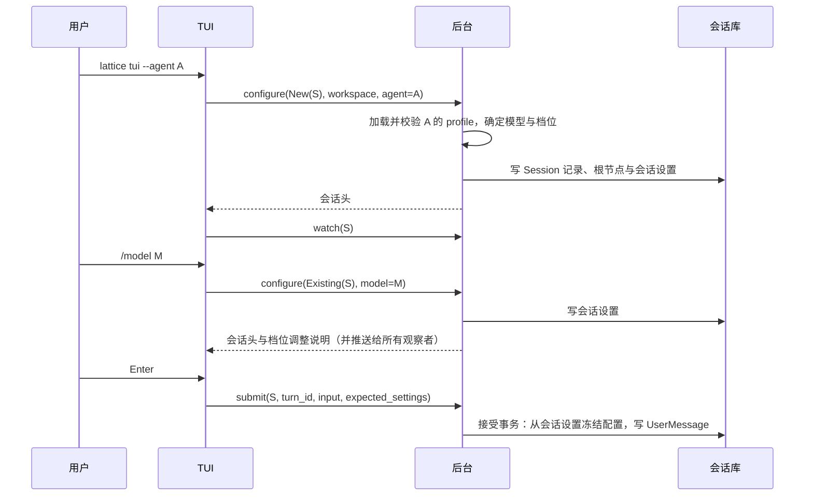

# ADR 0012：会话设置由后台持有，会话显式创建

## 背景

### 现状

下一轮用什么配置，现在由三处共同决定，后台在接受提交时才算出结果：

| 来源 | 持有者 | 依据 |
| --- | --- | --- |
| profile 副本：最后一次被接受的提交所用的 agent、模型与档位 | 会话库 | [会话的 profile 副本](../architecture/session/settings.md) |
| 尚未提交的选择：`--agent`、`/model`、`/effort` | 前端进程 | [选择面板](../architecture/tui/dock.md#选择面板)的“作用范围” |
| 档位策略：换模型时回退，显式选择时严格校验 | 后台准入 | `crates/lattice-api/src/turn/execute.rs:96-162`、`crates/lattice-llm/src/reasoning.rs:44-64` |

会话在首次提交被接受时创建：提交写明 `New(SessionId)`，Session 记录、根节点与 profile 副本在同一个接受事务中写入（[请求身份与找回](../architecture/session/recovery.md#请求身份与找回)；`crates/lattice-session/src/store/write.rs:335-352`）。

### 问题

1. 前端要在提交前显示下一轮的配置，只能自己预测。TUI 的 `preview_effort`（`crates/lattice-tui/src/selection.rs:53-70`）复制了后台的回退规则。带 `--agent` 打开已有会话、或新会话首次提交之前，前端拿不到 profile，预测不出来（#377，[选择面板](../architecture/tui/dock.md#选择面板)末尾的已知缺口）。
2. 前端为“选择随提交生效”维护一组状态：选择的代次与发送记录、待生效的 agent、新会话的 `New`/`Existing` 切换与“会话已存在”找回、首次接受后才开始观察（`crates/lattice-tui/src/app.rs:145-146`、`:194`、`:776`、`:1573`；[启动、提交与运行](../architecture/tui/README.md#启动提交与运行)）。
3. profile 写错、档位与模型不匹配，要到发出第一条消息时才报出。
4. IM 网关（ADR 0011 草案，PR #333）没有前端进程持有选择，为挂载检查另加了读取 profile 的 `agent_tools` 查询。

### 约束

| 约束 | 出处 |
| --- | --- |
| 会话库打开与读写时，校验每个会话的 profile 副本等于该会话最后一轮的冻结配置；只有根节点的会话通不过校验，整个库拒绝打开 | `crates/lattice-session/src/store/validate.rs:465-501`、`:615-640`；`crates/lattice-session/src/store/open.rs:162` |
| 会话库的写入持有该会话的 SessionExecutionLock，一轮执行期间锁一直被占用 | `crates/lattice-session/src/store/open.rs:276-301`；[操作锁](../architecture/session/concurrency.md#操作锁) |
| ADR 0006 否决了 `session new`：首次 `send` 可以在接受事务中同时创建 Session | [ADR 0006 否决的方案](0006-tree-session-and-global-redb-store.md#否决的方案) |
| ADR 0010 否决了“选择后立即写回副本”：需要新增后台命令，且副本可能与最后一轮实际使用的模型不同 | [ADR 0010 否决的方案](0010-protocol-adapters-and-configured-providers.md#否决的方案) |
| 提交只接受新请求，结果不明时按查询找回 | [ADR 0008 第 7 节](0008-backend-api-commands-view-queries.md#7-submit-只接受新请求找回改为查询) |

### 维护者已确定的事项

2026-11-08，#377 的讨论中确定：

- 一轮执行期间不能修改设置。
- `send` 被拒绝时，已经创建的会话与已经修改的设置保留；没有发过消息的会话照常出现在 `list` 中。
- 实施顺序：ADR 0009（从 LATTICE 剥离 LANCET）在前，本 ADR 其次，ADR 0011（#333）随后按本 ADR 修订。

## 决策

### 1. 会话设置是下一轮配置的唯一权威

会话设置（session settings）是会话的一条记录，表示这个会话下一轮将使用的配置：

| 字段 | 内容 |
| --- | --- |
| agent 快照 | agent 名与它的有效 profile，含系统提示 |
| 模型 | `ModelRef`，可以为空 |
| 推理档位 | `Effort`，可以为空；为空时不发送档位参数 |

- 后台持有并持久化会话设置。前端显示它，经 `configure` 修改它。
- 接受一轮时，后台从会话设置冻结这一轮的配置；这一轮实际使用的 agent、模型、provider、档位与执行限制照旧记在 UserMessage 节点上。
- 最后一轮之后修改过设置时，会话设置就是修改后的值，与最后一轮的配置不同。
- 当前 agent 是会话设置中的 agent。`rewind` 保持会话设置不变。
- 会话设置取代 profile 副本。

### 2. `configure` 是修改设置的唯一命令

```text
configure {
    session:   New(SessionId) | Existing(SessionId),
    workspace: 规范工作区路径,
    agent:     Option<AgentName>,
    model:     Option<ModelRef>,
    effort:    Option<Effort>,
}
成功: 新的会话头，以及档位是否被调整
失败: 配置拒绝（带 profile 路径、字段与档位来源）| Busy | NotFound | Conflict
```

| 情形 | 后台动作 |
| --- | --- |
| `New(S)` | 必须给 agent。后台按需创建会话库，在一个事务中写入 Session 记录、根节点与会话设置。S 已存在时返回 Conflict：会话已存在。这是创建会话的唯一路径 |
| `Existing(S)` | 按 `rewind` 的方式核对项目绑定（`crates/lattice-api/src/local/server.rs:357-363`），写入新的会话设置 |
| 给出 agent | 按 workspace 查找并加载该 agent 的 profile（`crates/lattice-api/src/profile.rs:149-172`），生成 agent 快照 |
| 校验 | profile 的查找、权限、解析与字段构造，以及档位与模型是否匹配，都在 configure 中完成，失败时立即返回配置拒绝 |

configure 必须带 workspace：profile 从项目根开始查找，外部策略文件按工作区解析，而会话只保存项目路径的哈希（`crates/lattice-store/src/key.rs:27-35`）。provider 的凭据与可用性随时间变化，在提交时检查，所以会话设置可以选用凭据尚未就绪的 provider。

档位按下面的规则确定。这是这条规则在系统中唯一的执行位置，前端只显示结果：

```text
输入: 当前设置 cur（New 时没有）, 本次命令 cmd

if cmd.agent 给出:
    base_model, base_effort = 该 agent 的 [agent].model, [agent].effort
    default = 该 agent 的 [agent].effort
else:
    base_model, base_effort = cur.model, cur.effort
    default = cur 的 agent 快照中的 [agent].effort

model = cmd.model 或 base_model

if model 为空:
    cmd.effort 给出时拒绝: 先选择模型
    effort = base_effort
elif cmd.effort 给出:
    effort = cmd.effort, 模型不支持时拒绝, 来源为显式选择
elif model == base_model:
    effort = base_effort, 模型不支持时拒绝,
             来源为 [agent].effort（给出 agent 时）或会话设置
else:
    effort = [base_effort, default] 中模型支持的第一个, 都不支持时为空
    effort 与 base_effort 不同时, 在结果中说明调整
```

档位是否被支持取自模型元数据与 provider features，不需要凭据。lattice-llm 提供一个返回 `Result` 的档位能力查询，把档位配置错误如实返回；现有的 `model_candidates` 在 provider 未就绪时把这类错误当作空列表（`crates/lattice-llm/src/models.rs:206-209`），configure 改用新的查询。

### 3. configure 的并发与找回

- configure 按 `rewind` 的方式执行：占用会话的 Owner 槽，取 SessionExecutionLock，经带锁的写入完成（`crates/lattice-api/src/local/server.rs:220-269`；`crates/lattice-session/src/store/write.rs:247`）。会话正在准入或执行一轮时，configure 返回 Busy。
- 执行中排队的消息沿用当前设置。要让排队的消息换模型，先删掉这条排队，等这一轮结束、修改设置后再发送。
- configure 是幂等的：`New(S)` 重复执行得到“会话已存在”，`Existing(S)` 以相同参数重复执行得到相同的设置。结果不明时，客户端以同一参数重发：
  - `New(S)` 得到“会话已存在”，说明上一次已经创建，取 `head(S)` 继续；
  - 得到 Busy，说明上一次仍在执行，稍后再发。

### 4. 提交只使用会话设置

```text
submit {
    session:           SessionId,
    turn_id:           TurnId,
    input:             用户输入,
    workspace:         规范工作区路径,
    expected_settings: Option<设置版本>,
}
```

- 提交只面向已有会话；会话不存在时返回 NotFound。
- 准入读取会话设置，按其中的模型与档位准备这一轮，档位按设置严格使用。设置中的模型为空时，以配置拒绝提示先选择模型。
- 给出 `expected_settings` 时，后台核对会话设置的当前版本；不一致时以 Conflict：设置已变化拒绝，前端保留输入。这个冲突原因与“TurnId 已被使用”分开（现在会话库的冲突一律映射为后者，`crates/lattice-api/src/local/types.rs:363-366`）。TUI 每次提交都带上它显示的版本，排队消息因此只在用户看到的设置下发送；CLI 不带。
- 提交时的配置拒绝来自随时间或执行环境变化的检查：凭据与可用性，元数据变化后档位不再被支持（来源为会话设置），没有可用根证书时的 https 端点，以及 ADR 0009 落地之前依赖工具目录的检查。

### 5. 会话头给出会话设置

- 会话头给出会话设置中的 agent、模型、provider、档位与设置版本；模型与 provider 可以为空。会话头不再带 `profile_default_effort`。
- 设置版本是会话设置内容的摘要：内容相同，版本相同。设置改了又改回原值时，按原版本提交的消息照常接受，因为它使用的正是用户看到的设置。
- configure 成功后，后台向该会话的所有观察者推送新的会话头。

### 6. 前端

| 前端 | 开始 | 修改设置 | 提交 |
| --- | --- | --- | --- |
| TUI | `lattice tui --agent A`：`configure(New(S), A)`，失败时退出并显示原因。`lattice tui S --agent A`：`configure(Existing(S), A)`，Busy 或失败时退出并显示原因。随后 `watch` | `/model`、`/effort` 选定后发 `configure`；回复到达之前按 Enter，输入进入排队；Busy 显示为 Warn，档位调整显示为 Info | 带 `expected_settings` |
| CLI | `session send` 不带 `--session`：先 `configure(New)`，再提交 | 带 `--session` 且给了 `--agent`、`--model` 或 `--effort`：先 `configure(Existing)`，再提交 | `--json` 新增 `configure` 记录 |
| IM | `/new` 之后的下一条消息：先 `configure(New)`，agent 取 IM 配置中的值，再提交 | v1 不修改设置 | 台账与会话绑定的时机随之修订 |

TUI 的 statusline 与 `/effort` 面板只看会话头；`/effort` 的候选档位仍以会话头中的模型发 `Target` 查询（[选择面板](../architecture/tui/dock.md#选择面板)）。LocalClient 的每个操作各用一个连接，所以 TUI 等 configure 的回复到达后再发提交，保证提交使用新的设置。



### 7. 存储

- 会话库的 profile 副本表改为会话设置表，键为 SessionId。
- 会话可以只有根节点。打开与读写时的校验要求会话设置自身有效、它引用的系统提示存在；会话设置与最后一轮的配置各自成立。
- 系统提示随会话设置保存，与每一轮的配置条目分开。现在的配置条目是一轮的系统提示加工具目录（`crates/lattice-session/src/store/config.rs:225-230`），创建会话时还没有这一轮。保存方式在实施时确定：内联在会话设置中并用投影读取，或按内容摘要单独存放。
- 会话库格式版本从 7 升到 8。旧库按[身份、版本与打开](../architecture/storage.md#身份版本与打开)拒绝打开。

### 8. 实施顺序

1. ADR 0009：从 LATTICE 剥离 LANCET。工作区历史库、Component 工具目录与 profile 中的 LANCET 策略随之移出，configure 只处理 agent、系统提示、模型与档位等字段。
2. 本 ADR。会话库的两次格式变化时间相近时合并为一次。若本 ADR 先于 ADR 0009 实施，`configure(New)` 还要创建项目的工作区历史库（`crates/lattice-api/src/turn/execute.rs:387-397`）。
3. ADR 0011（#333）按本 ADR 修订 IM 的会话创建、台账与工具检查。

### 9. 沿用的规则

- 会话树、节点、TurnId 索引，以及按 TurnId 找回提交。
- `rewind` 只移动当前位置。
- SessionId 与 TurnId 由客户端生成；新建会话显式写明 `New`。
- provider 配置、模型元数据与凭据由请求网关每次请求时取得。

## 归属

| 概念 | 状态持有者 | 规则执行者 | 只使用结果的组件 |
| --- | --- | --- | --- |
| 会话设置 | 会话库的会话设置表 | 后台的 `configure`，含档位规则 | 准入、会话头与视图、TUI、CLI、IM |
| 会话的创建 | 会话库的 Session 记录 | `configure(New)` | 提交与各项查询 |
| 一轮实际使用的配置 | UserMessage 节点与配置表 | 接受事务 | `log`、视图、用量 |
| 档位能力 | 模型元数据与 provider features | lattice-llm 的档位能力查询 | `configure`、`/effort` 面板 |
| 排队消息 | TUI 进程内存 | TUI | 无 |

## 否决的方案

| 方案 | 否决理由 |
| --- | --- |
| 后台提供只读的 profile 查询，前端在查询结果与会话头之间切换显示基准 | 前端的状态与逻辑更多，维护者否决 |
| 前端只显示会话头与已选的值，不做预测 | 首次提交之前仍看不到配置，配置错误仍到提交时才报 |
| 后台在内存中保存草稿会话，首次接受时写入会话库 | 会话状态分在内存与会话库两处，后台重启即丢失 |
| 后台按连接保存选择 | 状态同样分在两处，提交的语义还取决于连接 |
| 前端读取 profile | 配置是后台的全局状态，见 ADR 0010 |
| 提交附带设置修改，在接受事务中原子写入 | 修改设置会有两条路径；`send` 被拒绝时保留已改的设置，维护者已接受 |
| 执行中允许修改设置：按会话加一道设置门，使 configure 与准入串行 | 维护者确定执行中不能修改设置 |
| 没有发过消息的会话在退出时删除，或在 `list` 中隐藏 | 已写入的节点只追加（[范围与禁止事项](../architecture/session/concurrency.md#范围与禁止事项)）；隐藏会让 `list` 与 `log`、`head` 的结果不一致 |

## 影响

### 代码

| crate | 变化 |
| --- | --- |
| lattice-session | 会话设置表取代 profile 副本表；允许只有根节点的会话；校验改为会话设置自身有效；新增创建会话与修改设置的事务；格式版本 8 |
| lattice-api | 新增 `configure`，按 `rewind` 的方式占 Owner 槽与执行锁；准入只读会话设置；会话头字段与推送；`expected_settings` 的核对与独立冲突原因；IPC 魔数升级 |
| lattice-llm | 新增不需要凭据、返回 `Result` 的档位能力查询；档位规则由 `configure` 调用 |
| lattice-tui | 删除随提交生效的选择状态（`selection.rs`、待生效的 agent）、`preview_effort`、新会话的 `New`/`Existing` 切换与“会话已存在”找回、首次接受后才观察的特例；启动时调用 `configure`；`/model`、`/effort` 改为 `configure` |
| lattice-cli | `session send` 先 `configure` 再提交；`--json` 新增 `configure` 记录 |
| lattice-system-harness | 新会话与选择相关的场景改经 `configure` |

### 数据与接口

- 会话库格式 7 → 8，旧库拒绝打开。
- IPC 新增 `configure`，`submit` 与会话头的字段改变，魔数升级。
- CLI `--json` 的 `head` 记录去掉 `profile_default_effort`，模型与 provider 可以为空；新增 `configure` 记录。

### 行为

- 选择立即生效并持久保存，各前端共享同一份设置。
- `send` 被拒绝时，已经创建的会话与已经修改的设置保留。
- 没有发过消息的会话照常出现在 `list` 中。
- 带 `--agent` 打开已有会话，即修改它的设置。
- 一轮执行期间不能修改设置。
- 过去各轮的有效策略中 UserMessage 未记录的部分，例如重试退避，不再能从会话设置读出。依据 [ADR 0007 第 6 节](0007-session-tree-as-single-authority.md#6-接受时确定的事实记在-usermessage-节点上)：冻结配置不保存策略快照，因为它们没有读者。

### 合同（随实施修订）

| 文档 | 修订 |
| --- | --- |
| `architecture/session/settings.md` | 改写为会话设置：内容、`configure`、档位规则 |
| `architecture/session/operations.md` | 操作表新增 `configure`，改写 `submit` 与 `head`；CLI `send` 与 `--json` 记录 |
| `architecture/session/recovery.md` | 请求身份表只保留已有会话的提交；`configure` 的找回 |
| `architecture/session/acceptance.md` | 接受事务不再写设置；冻结配置的来源改为会话设置；配置拒绝按时点分为 `configure` 与提交两处 |
| `architecture/session/concurrency.md` | 操作锁表加入 `configure` |
| `architecture/session/README.md` | Session 记录与会话设置、记录表中的 profile 副本行、当前 agent |
| `architecture/tui/README.md` | 启动、提交与运行 |
| `architecture/tui/dock.md` | 选择面板的作用范围与换模型时的档位；删除已知缺口 |
| `architecture/tui/layout.md` | statusline 的 session、agent、模型与档位的来源 |
| `architecture/tui/interaction.md` | 排队与设置变化 |
| `architecture/storage.md` | 会话库的首次创建路径与格式版本 |
| `reference/glossary.md` | “profile 副本”改为“会话设置”；会话视图词条 |

### 与其他 ADR 的关系

| ADR | 关系 |
| --- | --- |
| [ADR 0006 第 4 节](0006-tree-session-and-global-redb-store.md#4-会话操作) | 部分取代：会话改由 `configure(New)` 创建。ADR 0006 否决 `session new` 时，会话还没有独立于轮次的配置；ADR 0010 引入 profile 副本后，配置需要在第一轮之前存在、可以校验和显示 |
| [ADR 0008 第 6 节](0008-backend-api-commands-view-queries.md#6-请求身份由客户端生成后台校验) | 部分取代：提交不再写明 `New`/`Existing`；SessionId 仍由客户端生成，新建在 `configure` 中显式写明 |
| [ADR 0008 第 7 节](0008-backend-api-commands-view-queries.md#7-submit-只接受新请求找回改为查询)、[第 9 节](0008-backend-api-commands-view-queries.md#9-cli) | 补充：`configure` 幂等，结果不明时以同一参数重发；CLI 在身份记录之后先输出 `configure` 记录 |
| [ADR 0010 第 13 节](0010-protocol-adapters-and-configured-providers.md#13-会话持有-profile-副本)、[第 14 节](0010-protocol-adapters-and-configured-providers.md#14-tui-的-model-与-effort) | 部分取代：profile 副本改为会话设置，选择经 `configure` 立即生效。ADR 0010 否决“选择后立即写回副本”的两条理由：新增后台命令，正是本 ADR 让后台成为设置唯一权威的方式；副本与最后一轮不同，是会话设置表示下一轮配置的应有结果，最后一轮实际使用的配置记在它的 UserMessage 节点上 |
| ADR 0011 草案（PR #333） | 按本 ADR 修订第 4、7、10、12 节：IM 的会话创建、台账相位、工具检查与会话映射 |
