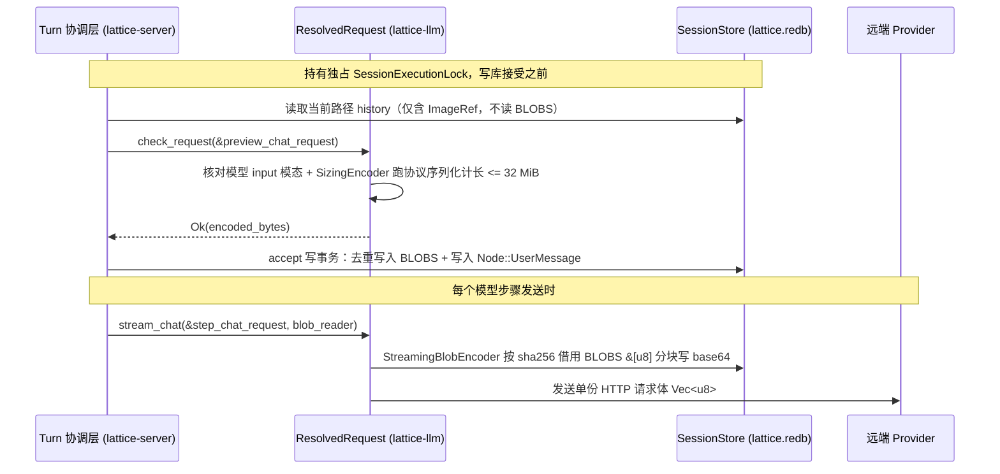

# ADR 0013：用户图片输入支持

## 背景

### 现状

以下按 `main` 的 `ad78d748` 核对。

| 方面 | 现状 | 出处 |
| --- | --- | --- |
| 对话消息原语 | `MessageSemantic` 只有 `Text`、`Reasoning`、`ToolCall` 三个变体；用户消息在会话树中固定存为单个 `Text` 片段 | `crates/lattice-conversation/src/message.rs:174-190`；[有序消息与 ToolCall](../architecture/session/conversation.md#有序消息与-toolcall) |
| 模型输入元数据 | `models.dev` 快照反序列化了 `modalities.input: Option<Vec<String>>`，但合并模型候选时未读取，`providers.toml` 的 `ModelMetadata` 也没有输入能力字段 | `crates/lattice-llm/src/metadata/mod.rs:41-45`、`:96-115`；`crates/lattice-llm/src/provider/config.rs`；[元数据的来源与合并](../architecture/llm/models.md#元数据的来源与合并) |
| 协议请求编码 | 五种协议适配器先构造整棵 `serde_json::Value`，再序列化为请求字节；用户消息只投影 `Text` 片段 | `crates/lattice-llm/src/client.rs:108-161`、`crates/lattice-llm/src/protocol/`；[适配器的职责](../architecture/llm/protocols.md#适配器的职责) |
| 会话库与幂等找回 | `lattice.redb` 格式版本为 `9`，包含 7 张表，打开时经 `load_read` 全表读入内存核验；`turn_input` 只读取 `UserMessage` 首段 `Text` 比对 `TurnId` 冲突 | `crates/lattice-session/src/store/codec.rs:10-18`、`open.rs:159-163`、`write.rs:99-124` |
| 本地 IPC 提交 | `TurnRequest.input` 为 `String`；IPC 单帧上限 `MAX_FRAME` 为 `16 MiB`，`PROTOCOL_VERSION` 为 `63`，由线上形状快照门禁保护 | `crates/lattice-ipc/src/types.rs:446-453`、`ipc.rs:22-31`、`:282-300`、`wire_shape/gate.rs:18-78`；[线上形状快照门禁](../architecture/crates.md#线上形状快照门禁) |
| CLI 发送 | `lattice run` 与 `lattice session send` 只接受文本消息；新建会话时先调用 `configure(New)` 创建草稿会话，再调用 `submit` | `crates/lattice-cli/src/commands/run.rs:345-390`；[ADR 0012 第 7 节](0012-backend-owns-session-settings.md#7-前端) |
| TUI 输入、历史与恢复 | `InputBuffer` 为 `Vec<String>` 纯文本行，`History` 按行读写 `repl_history.txt`；提交被拒时若输入区为空则写回文本，若已有新草稿或自动排队遇 `Unknown` 则依赖文本历史找回 | `crates/lattice-tui/src/input.rs:10-29`、`:122-140`，`crates/lattice-tui/src/app.rs:805-818`、`:1181-1210`；[输入区](../architecture/tui/dock.md#输入区) |

### 问题

1. **对话与存储缺少图片表示。** 用户在排查界面问题、核对截图或架构图时，无法向视觉模型提交图片。若把图片直接做 base64 内联进 `NODES` 表的 `Node::UserMessage`，每次打开会话库、读取会话日志和通过 IPC 推送 `ConversationEntry` 都会反复搬运整包图片字节。
2. **模型能力与跨轮请求体积缺少前置拦截。** LATTICE 不使用服务端会话状态，每一步模型请求都要重放当前路径上的全部历史消息（[ADR 0010 第 9 节](0010-protocol-adapters-and-configured-providers.md#9-不使用服务端会话状态)）。即使单轮图片不超限，多轮累积重放或中途用 `configure` 切换到纯文本模型时，若不在写库接受前拦截，就会把无法继续执行的节点写进会话树，或在内存中拼出数倍于原始字节的 `serde_json::Value` 树。
3. **IPC 单帧上限与单项输入上限不是简单相加关系。** JSON 字符串中的引号、换行与控制字符会触发转义膨胀（例如三张图片共 `10 MiB` 加 `2 MiB` 双引号文本，编码后约 `17.33 MiB`，超过 `16 MiB` 的 `MAX_FRAME`）。前端若先把图片全部读进内存、甚至先创建了草稿会话，再在写出 IPC 帧时失败，既浪费内存又留下无用草稿会话。
4. **终端前端不能常驻图片字节，也不引入重型依赖。** 前端依赖闭包受 `cargo xtask crate-boundary` 约束，且 TUI 同时持有当前输入与排队消息；剪贴板粘贴与路径粘贴需要轻量引用与明确的生命周期边界。

### 约束

| 约束 | 出处 |
| --- | --- |
| 宿主平台仅限 Linux；不引入跨平台图像解码或剪贴板重型依赖 | [宿主平台](../architecture/platform.md)、[工程规范](../development/engineering.md#范围) |
| 会话树是会话事实的唯一权威，`ConversationEntry` 直接传递持久节点；每次模型请求从根到当前节点重放完整历史，不使用服务端会话 ID | [ADR 0007 第 1 节](0007-session-tree-as-single-authority.md#1-树是会话事实的唯一权威)、[ADR 0008 第 2 节](0008-backend-api-commands-view-queries.md#2-对话条目就是节点)、[ADR 0010 第 9 节](0010-protocol-adapters-and-configured-providers.md#9-不使用服务端会话状态) |
| `lattice-tui` 只依赖 `lattice-local`；前端普通依赖闭包不含 `lattice-server`、`lattice-llm`、`lattice-profile`、`lattice-agent` | [ADR 0011 第 5 节](0011-im-gateway-inside-backend.md#5-crate-拆分与依赖规则)、[依赖边界门禁](../architecture/crates.md#依赖边界门禁) |
| IPC 单帧硬上限 `MAX_FRAME = 16 MiB`；线上形状变化必须同步递增 `PROTOCOL_VERSION`，不做兼容层 | `crates/lattice-ipc/src/ipc.rs:30`、`wire_shape/gate.rs:73-120`；[ADR 0008 第 5 节](0008-backend-api-commands-view-queries.md#5-大小交给连接层)、[第 11 节](0008-backend-api-commands-view-queries.md#11-协议版本) |
| 会话库格式变更直接递增 `VERSION`，旧库以 `UnsupportedVersion` 拒绝打开，不做旧数据迁移；按内容摘要存放的表在删除草稿时不回收 | [身份、版本与打开](../architecture/storage.md#身份版本与打开)、[保留、索引与演化](../architecture/storage.md#保留索引与演化)、[ADR 0012 第 6 节](0012-backend-owns-session-settings.md#6-会话的状态) |
| 各在线服务对图片与整包请求大小的限制差异悬殊，同一协议的第三方兼容服务也未必采用相同上限：Anthropic Messages API 限制单张图片 base64 字符串 `5 MB`、整包请求 `128 MB`；OpenAI Responses / Chat Completions 文档列出图片请求最高 `512 MB`；Google Gemini `generateContent` inline 请求上限 `20 MB`（2026-11-14 核对） | <https://docs.claude.com/en/docs/build-with-claude/vision>、<https://docs.claude.com/en/api/messages>、<https://platform.openai.com/docs/guides/images-vision>、<https://ai.google.dev/gemini-api/docs/image-understanding> |

### 维护者已确定的事项

2026-11-14，在 #415 对应的规划与审查讨论中确定：

- 支持格式为 `png`、`jpeg`、`webp`、`gif` 四种，仅按文件头魔数识别，不看扩展名；
- 单张原始图片上限取 `3.75 MiB`（`3_932_160 B`，base64 编码后恰好 `5 MiB`），单轮最多 `8` 张、单轮原始图片总计上限 `10 MiB`（`10_485_760 B`）；
- 用户输入保留 `[Text, Image, Text, ...]` 交错顺序；
- `providers.toml` 手写模型输入能力配置使用 `input = ["text", "image", "audio", "video"]`，音频模态统一写作 `audio`，不用 `voice`；
- 后台模型请求采用 LATTICE 自身的本地内存预算，与远端服务返回 `HTTP 413` 的原因及诊断分开；
- TUI 不设 `/image` 斜杠命令，不做图片输入历史与提交失败后的独立图片找回槽（文本历史照旧）；剪贴板临时图片放在 `/tmp` 下每个 TUI 独立的私有目录，正常退出时清理；当前输入与排队支持图片，校验失败时保留当前输入；已接受的图片存入会话库以保证多轮对话与重启后重放。

## 决策

### 1. 图片原语、格式识别与单轮上限

在 `lattice-conversation` 定义与平台和存储解耦的图片原语及单轮上限：

```rust
pub enum ImageMediaType {
    Png,   // 89 50 4E 47 0D 0A 1A 0A -> "image/png", 扩展名标签 "png"
    Jpeg,  // FF D8 FF                 -> "image/jpeg", 扩展名标签 "jpg"
    Webp,  // "RIFF" + [4B] + "WEBP"   -> "image/webp", 扩展名标签 "webp"
    Gif,   // "GIF87a" | "GIF89a"      -> "image/gif",  扩展名标签 "gif"
}

pub struct ImageRef {
    pub sha256: [u8; 32],
    pub media_type: ImageMediaType,
    pub byte_length: u64,
}

pub enum InputModality {
    Text,
    Image,
    Audio,
    Video,
}
```

- **魔数识别。** `ImageMediaType::sniff(bytes: &[u8]) -> Option<Self>` 只读取前 12 字节判定媒体类型，忽略文件路径扩展名。`RIFF` 容器必须同时核验偏移 `8..12` 为 `WEBP`，拒绝 WAV、AVI 等其他 RIFF 文件；SVG、BMP、TIFF、HEIC、AVIF、PDF 与空文件一律拒绝。
- **有序用户消息。** `MessageSemantic<S>` 新增变体 `Image { image: ImageRef }`。它只允许出现在 `MessageRole::User` 的消息中，且 `replay_state` 固定为 `None`；助手消息、系统消息与工具消息出现 `Image` 时按非法记录拒绝。
- **规范化保序规则。** 用户输入按片段顺序规范化：合并相邻的非空 `Text` 片段，剔除空 `Text` 片段（不含空白裁剪，仅剔除 `text.is_empty()`），原样保留每个 `Image` 片段的相对位置；规范化后 `parts` 不能为空（允许纯图片、纯文本或任意交错混排）。
- **单轮上限常量：**

  | 常量 | 数值 | 说明 |
  | --- | --- | --- |
  | `MAX_IMAGE_BYTES` | `3_932_160`（`3.75 MiB`） | 单张原始图片最大字节数，且必须大于 `0`；base64 编码后至多 `5_242_880 B`（`5 MiB`），落在 Anthropic Messages API 单图 `5 MB` base64 限制之内 |
  | `MAX_USER_IMAGES_PER_TURN` | `8` | 单轮用户消息最多包含的图片张数 |
  | `MAX_USER_IMAGE_TOTAL_BYTES` | `10_485_760`（`10 MiB`） | 单轮用户消息原始图片字节总和上限 |
  | `MAX_USER_TEXT_BYTES` | `2_097_152`（`2 MiB`） | 单轮用户消息全部 `Text` 片段 UTF-8 字节总和上限（沿用现有上限） |

- 上述单项上限与第 3 节的 IPC 单帧上限 `MAX_FRAME`（`16 MiB`）取交集生效：文本含大量需要 JSON 转义的字符时，不保证图片 `10 MiB` 与文本 `2 MiB` 能同时取满。

### 2. 会话库 v10 内容寻址 `blobs` 表

```mermaid
flowchart LR
    Node["NODES 表<br/>Node::UserMessage"] -->|ImageRef.sha256| Blobs["BLOBS 表<br/>hex(sha256) -> 4B VERSION + 原始图片字节"]
    Open["SessionStore::open"] -->|流式逐条校验，只留 BlobMeta| Records["内存 Records<br/>BTreeMap&lt;[u8; 32], BlobMeta&gt;"]
    Send["模型请求发送"] -->|SessionRead 按需借用 &[u8]| Blobs
```

- **表定义与升版。** `lattice-session` 新增第 8 张 redb 表 `BLOBS: TableDefinition<&str, &[u8]> = TableDefinition::new("blobs")`。键为 64 字符小写十六进制 SHA-256，值为 4 字节大端 `VERSION` 头加原始图片字节（不做二次 JSON 包装）。会话库 `VERSION` 从 `9` 升至 `10`，旧版本会话库按现有规则返回 `StoreError::UnsupportedVersion`。
- **零常驻字节与流式打开校验。** 内存中的 `Records` 只保存 `BTreeMap<[u8; 32], BlobMeta { media_type: ImageMediaType, byte_length: u64 }>`，不驻留图片 `Vec<u8>`。`SessionStore::open` 遍历 `BLOBS` 表时，借用 redb 的只读切片逐条核验版本头、键格式、实际字节 SHA-256 与键一致、`0 < len <= MAX_IMAGE_BYTES` 且 `ImageMediaType::sniff` 通过，随后立即释放切片；节点校验确认所有 `Node::UserMessage` 中 `ImageRef` 的 `(sha256, media_type, byte_length)` 在 `BlobMeta` 表中均存在且完全一致。
- **接受写入与幂等找回。** 接受事务在同一写事务中按 `sha256` 去重写入缺失的 `BLOBS` 条目，再写入只含 `ImageRef` 的 `Node::UserMessage`。因此 `ConversationEntry` 视图推送、会话分页读取与 `session log` 都不读取 `BLOBS` 表。`turn_input` 与重复 `TurnId` 的冲突判定改为比较规范化后的完整有序 `Vec<MessagePart>`：同一 `TurnId` 若文本或图片序列（顺序、数量、摘要）不一致，返回 `Conflict`。
- **保留策略。** 与 `CONFIGS` 表相同，`BLOBS` 为内容寻址只追加表，`delete_draft` 与 `rewind` 不回收其中的条目。

### 3. IPC 保序提交与读取前帧预算校验

`lattice-ipc` 将提交请求泛化，使“读取图片字节前的帧长度预检”与“携带图片字节的实际发送”共用同一结构定义：

```rust
pub enum UserInputPart<I = Vec<u8>> {
    Text { text: String },
    Image { image: I },
}

pub struct TurnRequest<I = Vec<u8>> {
    pub turn_id: TurnId,
    pub session: SessionId,
    #[serde(with = "path_bytes")]
    pub workspace: PathBuf,
    pub parts: Vec<UserInputPart<I>>,
    pub expected_settings: Option<SettingsVersion>,
}

/// 读取图片原始字节前的待发请求，图片段仅持 ImageRef 元数据。
pub type PlannedTurnRequest = TurnRequest<ImageRef>;
```

- **线上编码。** 实发请求 `Request::Submit(TurnRequest<Vec<u8>>)` 中，`Image.image` 在线上序列化为标准无换行 base64 字符串，反序列化回 `Vec<u8>`；接收端立即核验单图上限、单轮张数、单轮总字节与魔数，算出 `ImageRef`。
- **零载荷精确计长。** `lattice-ipc` 提供 `pub fn encoded_submit_len(plan: &PlannedTurnRequest) -> usize`。它使用与 `Request::Submit(TurnRequest<Vec<u8>>)` 同构的内部序列化包装器向零分配字节计数器写出 JSON，其中文本、`workspace`、`session`、`turn_id` 与 `expected_settings` 走真实 JSON 转义计长，图片字段直接计入首尾双引号 `2` 字节加 `image.byte_length.div_ceil(3) * 4` 字节。
- **前端拦截顺序。** 前端在扫描图片头得到 `ImageRef` 后，先校验第 1 节的单轮上限并构造 `PlannedTurnRequest`，核对 `encoded_submit_len(&plan) <= MAX_FRAME`（`16 MiB`）。未通过时在本地以 `LocalErrorKind::BadRequest` 拒绝，既不将整批图片同时载入内存，也不向后台发起请求。

### 4. 模型输入能力元数据与配置

- **目录解析。** `lattice-llm` 解析 `models.dev` 目录条目的 `modalities.input`：将 `"text"`、`"image"`、`"audio"`、`"video"` 映射为去重保序的 `Vec<InputModality>`，忽略 `"pdf"` 等本阶段未纳入的字符串。目录未给出 `modalities.input` 时记为 `None`。
- **手写覆盖。** `providers.toml` 的 `[providers.<id>.models."<model_id>"]` 新增可选字段 `input`：

  ```toml
  [providers.my_gateway.models."vision-model"]
  input = ["text", "image"]
  ```

  元素仅允许 `"text"`、`"image"`、`"audio"`、`"video"`（未知值、空数组或非字符串数组在解析 `providers.toml` 时按配置错误拒绝，带文件位置）。手写 `input` 存在时整表覆盖目录的输入模态列表。
- **候选展示与拦截规则：**
  - `lattice-llm` 与 `lattice-ipc` 的 `ModelCandidate` 新增 `pub input: Option<Vec<InputModality>>`；
  - 当待发 `ChatRequest`（含当前路径重放的历史消息与本轮输入）包含至少一个 `Image` 片段时：若目标模型的 `input` 为 `Some(list)` 且不含 `InputModality::Image`，拒绝本次请求并指出该模型不支持图片输入；若 `input` 为 `None`（例如未写元数据的自定义模型），放行交由远端判定。
- **`configure` 阶段允许切换模型。** 在已有含图历史的会话上执行 `configure` 切换到纯文本模型时，`configure` 本身照常成功，因为用户可能紧接着执行 `rewind` 退回到不含图片的节点分叉；若未退回直接提交，后台在准入预检时以配置拒绝拦截。

### 5. 五种协议同源流式编码、本地预算与远端 `413`

#### 5.1 五种协议的用户消息线格式

当一条 `MessageRole::User` 消息仅含单个 `Text` 片段时，五种协议输出与现行实现完全相同的 JSON，不改变纯文本请求格式；当包含 `Image` 片段（因此可能含多个有序片段）时，按 `parts` 顺序输出内容块数组：

| 协议 | 文本片段 | 图片片段 |
| --- | --- | --- |
| `chat-completions` | `{"type": "text", "text": "..."}` | `{"type": "image_url", "image_url": {"url": "data:<mime>;base64,<b64>"}}` |
| `responses`（含 `chatgpt`） | `{"type": "input_text", "text": "..."}` | `{"type": "input_image", "image_url": "data:<mime>;base64,<b64>", "detail": "auto"}` |
| `anthropic-messages` | `{"type": "text", "text": "..."}` | `{"type": "image", "source": {"type": "base64", "media_type": "<mime>", "data": "<b64>"}}` |
| `generate-content` | `{"text": "..."}` | `{"inlineData": {"mimeType": "<mime>", "data": "<b64>"}}` |
| `interactions` | `{"type": "text", "text": "..."}`（位于 `"type": "user_input"` 的 `"content"` 数组内） | `{"type": "image", "mime_type": "<mime>", "data": "<b64>"}`（同左） |

跨 provider 或跨协议切换时，`ImageRef` 是厂商中立语义载荷，按目标协议直接投影重放。

#### 5.2 同源计长与流式写出



- **单一协议序列化实现。** `lattice-llm` 将五种协议的请求构造从“拼装 `serde_json::Value`”改为参数化 `ImageEncoder` 的 `serde::Serialize` 流式写出，完整覆盖 `system_prompt`、`history`（含 `Text`、`Image`、`Reasoning` 回放状态、`ToolCall`、`ToolResult`）、`tools` 定义、`output_limit`、`reasoning` 参数与协议 `features`：
  - `SizingEncoder`：不访问会话库，对每个 `ImageRef` 直接向有界字节计数器累加对应协议的前缀长度（`chat-completions` 与 `responses` 含 `"data:<mime>;base64,"`）及 `byte_length.div_ceil(3) * 4`；
  - `StreamingBlobEncoder`：在实际发送时经只读回调借用 `SessionRead` 打开的 redb `BLOBS` 切片，按固定块流式编码为 base64 写入目标 `Vec<u8>`。
- **协调层不自写计长公式。** `ResolvedRequest::check_request(&self, request: &ChatRequest) -> Result<usize, LlmError>` 由 `lattice-llm` 提供，协调层在两个时点调用它：
  1. **准入写库前**（已持 `SessionExecutionLock`，完成 `PreparedModel::resolve` 与工具目录冻结之后、`accept` 之前）：构造本轮首步 `ChatRequest` 预检，失败时直接拒绝提交，不写入会话树；
  2. **多步执行每步发送前**：工具结果追加后再次核对，防止步骤推进使请求体越过本地预算。

#### 5.3 本地请求体预算与远端 `HTTP 413` 分离

| 情形 | 判定位置与条件 | 性质与依据 | 错误分类与面向用户的说明 |
| --- | --- | --- | --- |
| 超过本地请求体预算 | `ResolvedRequest::check_request` 算出编码后 HTTP 请求体 `> MAX_MODEL_REQUEST_BYTES`（`32 MiB`，即 `33_554_432 B`） | LATTICE 后台单次 HTTP 请求序列化缓冲的本地并发内存上限，五种协议统一适用，不代表远端服务的协议上限 | 准入前返回 `BadRequest`，步骤执行中返回不可重试错误；说明“编码后的模型请求超过 LATTICE 本地请求体预算（32 MiB），请减少图片、执行 `lattice session rewind` 退回较早节点或新建会话” |
| 目标服务拒绝请求大小 | 本地预算内放行发出后，远端返回 `HTTP 413` | 具体目标服务或网关的载荷上限（如 Gemini inline `20 MB` 限制） | `transport::status_error` 固定标为不可重试（忽略 `x-should-retry: true`），保留远端脱敏摘要并附说明：“目标服务拒绝了本次请求大小（HTTP 413），请减少图片、执行 `lattice session rewind` 退回较早节点或新建会话” |

### 6. CLI 图片输入与显示

- **参数。** `lattice run` 与 `lattice session send` 新增可重复参数 `--image <PATH>`，按命令行出现顺序排列；同时给出文本消息与 `--image` 时，顺序为 `[Text(message), Image(path_1), Image(path_2), ...]`；允许只传 `--image` 省略文本消息，文本与 `--image` 均未提供时按参数错误拒绝（退出码 `2`）。
- **在创建草稿会话之前完成本地预检。** 新建会话时，CLI 按以下顺序执行，避免图片无效或超帧上限时留下空草稿会话：
  1. 流式读取每个 `<PATH>`（核验为常规文件、非空且不超过 `MAX_IMAGE_BYTES`、前 12 字节通过 `ImageMediaType::sniff`，同时算出 SHA-256 得到 `ImageRef`，此时不保留全量字节）；
  2. 核验单轮张数、单轮图片总字节、文本字节，并用 `PlannedTurnRequest` 核验 `encoded_submit_len(&plan) <= MAX_FRAME`；
  3. 需要 `configure` 时调用 `configure(New | Existing)`；
  4. 读取图片字节构造 `TurnRequest<Vec<u8>>`（重读时核对 `byte_length` 与 `sha256` 未变）并发起 `submit`。
- **查询输出。** `lattice session log` 与 `lattice session turn` 的面向人输出对 `UserMessage` 中的每个图片片段渲染 `[IMAGE n · <ext> · <size>]`（`n` 为该消息内从 `1` 开始的图片序号，`<size>` 采用 `B` / `KiB` / 一位小数 `MiB` 二进制单位）；`--json` 输出结构化 `MessageSemantic::Image { image: ImageRef }`。

### 7. TUI 内联图片输入、`/tmp` 私有暂存与失败保留

- **内联图片原子。** TUI 不设 `/image` 斜杠命令。`InputBuffer` 的每一行改为文本与图片原子的有序序列，每个图片原子持有 `PendingImage { meta: ImageRef, source: ImageSource }`（常驻图片字节为 `0`），在输入区、排队区与对话历史中统一渲染为不可拆分的 `[IMAGE n · <ext> · <size>]`：
  - 在编辑器中占 `1` 个逻辑光标位：`←` / `→` 整块跨过，`Backspace`（光标在原子右侧）与 `Delete`（光标在原子左侧）整块删除，软折行按整体显示宽度计算。
- **两种输入通道：**
  1. **`Ctrl+V` 读取剪贴板：** 优先检查 `WAYLAND_DISPLAY`，存在时调用 `wl-paste --list-types` 选择受支持的图片 MIME（按 `image/png`、`image/webp`、`image/jpeg`、`image/gif` 优先级），再调用 `wl-paste --no-newline --type <mime>` 流式读取；否则在 `DISPLAY` 存在时调用 `xclip -selection clipboard -t TARGETS -o` 与对应图片读取命令。子进程均设 `1s` 超时与 `MAX_IMAGE_BYTES + 1` 流式截断：
     - 剪贴板含受支持图片且未超限时，写入本 TUI 进程的 `/tmp` 私有临时目录（见下），在光标处插入 `ImageSource::Temp(path)` 原子；
     - 剪贴板图片超过 `3.75 MiB` 或数据损坏时，推 `Error` 状态消息，不插入；
     - 剪贴板不含图片类型时，回退读取纯文本并按粘贴文本插入；
     - 无图形会话环境变量或未安装 `wl-paste` / `xclip` 时，推 `Warn` 状态消息提示安装对应工具或直接粘贴本地图片路径。
  2. **路径与 `file://` 粘贴识别：** 终端上报 `Event::Paste(raw)` 时，对去掉首尾空白后的单段内容尝试解析本地路径（兼容 `file://` / `file://localhost/` URI 百分号解码、拖拽常见的单引号包裹以及反斜杠转义空格）。若目标路径是本地常规文件且前 12 字节经 `ImageMediaType::sniff` 识别为受支持图片：
     - 大小合法且加入后不超单轮张数与 `10 MiB` 总量时，流式算出 `ImageRef`，在光标处插入 `ImageSource::File(path)` 原子（零磁盘拷贝）；
     - 图片超限时推 `Error` 状态消息，不插入纯文本路径；
     - 其余情况（路径不存在、是目录、或是代码/普通文本文件）一律原样按普通文本插入。
- **`/tmp` 独立私有临时目录。** 每个 TUI 进程首次暂存剪贴板图片时，在 `/tmp` 下以 `O_CREAT | O_EXCL` 创建模式为 `0700` 的独立目录（如 `/tmp/lattice-tui-<uid>-<pid>-<rand>/`），不跟随符号链接并核验目录属主为当前有效 UID；剪贴板图片按 `<sha256>` 文件名以 `0600` 写入。图片原子从输入区删除且不在排队或待回执提交中引用时可即时删除对应临时文件；TUI 正常退出时删除整个私有临时目录。发送 `ImageSource::File(path)` 时重读原文件并复核 `byte_length` 与 `sha256`，若期间文件被修改或删除，当场报 `Error` 状态消息并保留当前输入（自动排队则暂停队列并保留队首）。
- **提交、排队与失败保留（不做图片找回）：**
  - 按 `Enter` 提交或运行中入队前，先对目标消息运行单轮上限与 `encoded_submit_len(&plan) <= MAX_FRAME` 预检；未通过时推 `Error` 状态消息，原样保留输入区内容，不清空也不入队；
  - `History` 与 `<session_dir>/repl_history.txt` 保持现有纯文本行机制不变，只记录消息中的非空文本部分，不新增图片历史或独立图片恢复槽；
  - 提交发往后台后收到 `Rejected` 或未发出的 `NotAccepted`：自动排队触发的放回队首；手动触发的在输入区为空时将完整图文原样放回输入区，在输入区已有用户新草稿时不覆盖草稿，仅保留已写入的文本历史（纯图片消息不写文本历史，状态消息也不提示按 `Ctrl+↑` 找回）；自动排队收到 `Unknown` 释放队首时同样只保留文本历史并暂停队列。

### 8. 实施顺序

四个阶段依次在 `main` 上交付，每阶段自身编译、门禁与测试完整通过：

| 阶段 | 内容 | 线上协议版本与存储版本变化 |
| --- | --- | --- |
| 1. 原语、能力与协议投影 | `lattice-conversation` 图片原语与上限；`lattice-llm` 输入模态解析/配置、五协议同源流式编码、`ResolvedRequest::check_request`、`32 MiB` 本地预算与 `413` 诊断；`lattice-session` 拒绝助手图片、`lattice-tui` 历史图片标记显示、`lattice-ipc` 同步 `MessageSemantic::Image` 与 `ModelCandidate.input` 快照 | `PROTOCOL_VERSION` 加一；会话库仍为 v9 |
| 2. 会话库 v10 与准入预检 | `lattice-session` 新增 `BLOBS` 表、流式打开校验、保序 `UserMessage` 与 `TurnId` 幂等比对；`lattice-server` 在写库前与每步前调用 `check_request`，发送时流式读取 `BLOBS` | `PROTOCOL_VERSION` 不变；会话库升至 v10 |
| 3. IPC 提交、CLI 与端到端验证 | `lattice-ipc` 与 `lattice-local` 切换保序 `TurnRequest<I>` / `PlannedTurnRequest` 与 `encoded_submit_len`；`lattice-tui` 适配纯文本提交；`lattice-cli` 增加 `--image` 及 `configure(New)` 前预检；`lattice-system-harness` 覆盖五协议、多轮预算与 `413` | `PROTOCOL_VERSION` 加一；会话库保持 v10 |
| 4. TUI 内联图片交互 | `lattice-tui` 内联图片原子、`Ctrl+V` 剪贴板 `/tmp` 私有暂存、路径与 `file://` 粘贴识别、失败保留，以及 TUI 合同与术语表更新 | 均不变 |

### 9. 范围之外

以下事项不在本 ADR 中处理：

- IM 网关（[ADR 0011 第 16 节](0011-im-gateway-inside-backend.md#16-范围之外)）的图片接收与附件回复；
- 工具执行结果（`MessageRole::Tool`）返回图片，以及模型或助手输出图片；
- 远程 `http://` / `https://` 图片 URL 输入或由后台抓取远程图片；
- 客户端或后台对图片做缩放、有损压缩、格式转换、EXIF 剥离或 OCR；
- 终端像素级图形协议（Kitty graphics、Sixel、iTerm2 OSC 1337）渲染；
- TUI 跨重启图片输入历史、输入区已有新草稿时的独立图片找回槽，以及 TUI 被 `SIGKILL` 后 `/tmp` 残留目录的主动清扫（交系统 `/tmp` 清理策略处理）。

## 归属

| 概念 | 状态持有者 | 规则执行者 | 只使用结果的组件 |
| --- | --- | --- | --- |
| 图片媒体类型、引用与单轮上限 | `MessageSemantic::Image` 中的 `ImageRef` | `lattice-conversation`（`ImageMediaType::sniff`、上限与保序规范化） | 会话库、IPC、协议层、前端 |
| 已接受图片的原始字节 | 会话库 `lattice.redb` 的 `BLOBS` 表（按 SHA-256 内容寻址） | `lattice-session`（流式打开校验、去重写入、只读切片借用） | `lattice-server` 发送步骤 |
| IPC 提交帧编码长度 | 无状态 | `lattice-ipc::encoded_submit_len(&PlannedTurnRequest)` | `lattice-local`、`lattice-cli`、`lattice-tui` |
| 模型输入模态能力 | `models.dev` 快照与 `providers.toml` 的 `input` 配置 | `lattice-llm`（元数据合并与 `ResolvedRequest::check_request`） | `lattice-server`、`lattice models`、TUI `/model` 列表 |
| 模型请求协议编码与 `32 MiB` 本地预算 | 无状态 | `lattice-llm` 的同源流式协议编码器与 `ResolvedRequest::check_request` | `lattice-server` 准入与每步发送 |
| 远端请求大小拒绝（`HTTP 413`） | 无状态 | `lattice-llm::transport::status_error` | `lattice-agent`、`lattice-server`、前端诊断显示 |
| TUI 待发图片与剪贴板暂存 | TUI 进程内存（`PendingImage`）与 `/tmp` 下该 TUI 独立的 `0700` 私有目录 | `lattice-tui` | `LocalClient::submit` |

## 否决的方案

| 方案 | 否决理由 |
| --- | --- |
| 图片字节直接内联在 `NODES` 表的 `Node::UserMessage` 中 | 打开会话库、读取 `session log`、按轮分页与推送 `ConversationEntry` 时都会解码并复制整包图片字节；拆入内容寻址 `BLOBS` 表后，视图与节点只传 48 字节量级的 `ImageRef` |
| `SessionStore::open` 把 `BLOBS` 表全部读入内存 `Records` | 随历史会话增长，后台启动内存随历史图片总和线性膨胀；改为打开时逐条流式核验、只驻留 `BlobMeta` |
| IPC 提交拆成 `text: String` 加 `images: Vec<...>` 两个平行字段 | 丢失“文字 A → 图 1 → 文字 B → 图 2”的交错位置关系，模型无法按位置对应上下文 |
| 只按图片 base64 长度加文本原始字节估算 `16 MiB` IPC 帧上限 | 漏算文本的 JSON 转义（例如 `10 MiB` 图片加 `2 MiB` 双引号文本编码后约 `17.33 MiB`），单项合法却在写帧时失败；改为对 `PlannedTurnRequest` 做同构 JSON 精确计长 |
| 在协调层另写一套累计文本与图片长度的公式预检模型请求大小 | 会漏算 `tools` schema、`ToolCall`、`ToolResult`、`Reasoning` 不透明回放状态与协议 `features`；改为复用 `lattice-llm` 同一套流式协议序列化器配合 `SizingEncoder` 计长 |
| 按协议硬编码“官方请求上限”（如 Messages `32 MiB`、Responses `50 MiB`） | 与当前官方文档（Messages `128 MB`、OpenAI `512 MB`）不符，且同一协议下的兼容网关各自限制不同；改为统一的 `32 MiB` LATTICE 本地内存预算，远端超限由 `HTTP 413` 独立表达 |
| 模型配置使用布尔量 `image_input = true` 或用 `"voice"` 表示音频输入 | 布尔量无法对齐 `models.dev` 的 `modalities.input` 列表；音频在 `models.dev` 中名为 `"audio"`，维护者确定统一使用 `input = ["text", "image", "audio", "video"]` |
| TUI 增加 `/image <path>` 斜杠命令或 `Alt+V` 快捷键 | 多一套命令语法与非直觉键位；直接粘贴路径/`file://` 与 `Ctrl+V` 粘贴剪贴板已覆盖终端习惯 |
| TUI 在输入历史或独立恢复槽中保存图片，或在 `<state-root>` 下用 `flock` 管理跨崩溃暂存目录 | 增加状态与生命周期复杂度；维护者确定不做图片输入历史与恢复槽，剪贴板临时文件放 `/tmp` 独立私有目录并在正常退出时清理 |
| 引入 `image`、`arboard`、`wl-clipboard-rs` 等第三方库 | 增加编译体积、系统库链接或跨平台冗余分支；4 种格式的 12 字节文件头魔数与 Linux 下 `wl-paste` / `xclip` 子进程调用即可覆盖需求 |

## 影响

### 代码

| crate | 变化 | 阶段 |
| --- | --- | --- |
| `lattice-conversation` | 新增 `ImageMediaType`、`ImageRef`、`InputModality`、`MessageSemantic::Image`，以及用户侧图片/文本上限常量与保序规范化函数 | 1 |
| `lattice-llm` | 解析与合并 `input` 输入模态；五种协议改为参数化 `ImageEncoder` 的流式请求编码；`ResolvedRequest::check_request` 执行模态校验与 `32 MiB` 本地预算校验；`HTTP 413` 不可重试诊断 | 1 |
| `lattice-agent` | 适配流式请求发送接口与图片读取回调传递 | 1、2 |
| `lattice-session` | 拒绝助手图片；格式升至 v10，新增 `BLOBS` 表、流式打开校验、`BlobMeta` 索引、保序 `UserMessage` 接受与 `TurnId` 幂等比对、按需只读切片读取 | 1、2 |
| `lattice-server` | 准入写库前与每步发送前调用 `ResolvedRequest::check_request`；发送时在只读事务内借用 `BLOBS` 流式编码 | 2 |
| `lattice-ipc` | `ModelCandidate.input`；`UserInputPart<I>`、`TurnRequest<I>`、`PlannedTurnRequest` 与 `encoded_submit_len`；线上形状快照更新，`PROTOCOL_VERSION` 在阶段 1 与阶段 3 各加一 | 1、3 |
| `lattice-local` | `LocalClient::submit` 支持有序图文输入，并在发送前执行单轮上限与 `encoded_submit_len <= MAX_FRAME` 校验 | 3 |
| `lattice-cli` | `run` 与 `session send` 新增 `--image <PATH>`，在 `configure(New)` 前完成本地预检；`session log` 与 `session turn` 渲染图片标记 | 3 |
| `lattice-tui` | 历史消息渲染图片标记；`InputBuffer` 与 `Queue` 内联图片原子、`Ctrl+V` 剪贴板 `/tmp` 私有目录暂存、路径与 `file://` 粘贴识别、失败保留规则 | 1、3、4 |
| `lattice-system-harness` | 假 provider 解析并断言五种协议含图请求体，支持注入 `HTTP 413` 响应 | 3 |

### 数据与接口

- 会话库格式版本从 `9` 升至 `10`，新增 `blobs` 表；v9 及更早会话库按现有规则拒绝打开。
- IPC `TurnRequest.input: String` 改为 `TurnRequest.parts: Vec<UserInputPart>`，`ModelCandidate` 增加 `input`，`MessageSemantic` 增加 `Image`；`PROTOCOL_VERSION` 随阶段 1、阶段 3 递增。
- `providers.toml` 的模型元数据表支持可选 `input = ["text", "image", "audio", "video"]`。
- CLI `lattice run` 与 `lattice session send` 新增可重复 `--image <PATH>`，允许仅传图片省略文本参数。

### 行为

- 用户可通过 CLI `--image`、TUI `Ctrl+V` 剪贴板或粘贴本地图片路径向支持图片输入的模型发送单张或多张图片，并在多轮对话与重启后台后继续基于历史图片提问。
- 向明确不支持图片输入的模型发送含图请求（或会话当前路径含历史图片时）在写库前被拒绝，会话树不被污染；先用 `configure` 切换到纯文本模型再用 `rewind` 退回无图节点照常可行。
- 编码后超过 `16 MiB` IPC 单帧上限的提交在前端本地被拒绝（退出码 `2`），不会在后台留下空草稿会话。
- 历史累计使模型 HTTP 请求超过 `32 MiB` 本地预算，或被远端以 `HTTP 413` 拒绝时，不再盲目重试，并明确区分本地预算与远端限制，提示减少图片、`rewind` 或新建会话。
- TUI 输入历史保持纯文本；提交被拒且输入区已有新草稿时，不再找回旧提交中的图片。

### 合同（随实施修订）

| 文档 | 修订 | 阶段 |
| --- | --- | --- |
| `architecture/session/conversation.md` | `MessageSemantic::Image`、有序用户消息规范化与跨 provider 图片投影 | 1 |
| `architecture/llm/models.md`、`providers.md`、`protocols.md` | `InputModality` 元数据合并与 `providers.toml` `input` 字段；五种协议的含图编码与流式计长/写出 | 1 |
| `architecture/storage.md` | 会话库版本 10、`BLOBS` 表、流式打开校验与只追加保留策略 | 2 |
| `architecture/session/README.md`、`acceptance.md`、`concurrency.md` | 接受前输入能力与 `32 MiB` 本地请求体预算预检、单轮图片上限、`TurnId` 保序幂等比对 | 2 |
| `architecture/crates.md`、`architecture/session/operations.md`、`README.md` | `PlannedTurnRequest` 帧预检、CLI `--image` 参数与输出显示 | 3 |
| `architecture/tui/README.md`、`dock.md`、`interaction.md`、`transcript.md` | 内联图片原子、`Ctrl+V` 与路径粘贴、`/tmp` 私有暂存、排队与无图片历史规则 | 4 |
| `reference/glossary.md` | 补充图片引用与输入模态相关说明 | 4 |

### 与其他 ADR 的关系

| ADR | 关系 |
| --- | --- |
| [ADR 0007 第 1 节](0007-session-tree-as-single-authority.md#1-树是会话事实的唯一权威)、[第 6 节](0007-session-tree-as-single-authority.md#6-接受时确定的事实记在-usermessage-节点上) | 补充：会话树上的 `Node::UserMessage` 保存有序 `ImageRef`，原始图片字节按 SHA-256 存入同库的只追加 `BLOBS` 表 |
| [ADR 0008 第 2 节](0008-backend-api-commands-view-queries.md#2-对话条目就是节点)、[第 5 节](0008-backend-api-commands-view-queries.md#5-大小交给连接层)、[第 7 节](0008-backend-api-commands-view-queries.md#7-submit-只接受新请求找回改为查询) | 沿用并补充：`ConversationEntry` 仍原样传递节点（不含原始图片字节）；IPC 帧上限保持 `16 MiB`，前端经 `PlannedTurnRequest` 在读入全量字节前精确核对；重复 `TurnId` 按完整有序 `parts` 核对冲突 |
| [ADR 0010 第 1 节](0010-protocol-adapters-and-configured-providers.md#1-适配按协议划分)、[第 6 节](0010-protocol-adapters-and-configured-providers.md#6-模型元数据取自-modelsdev)、[第 9 节](0010-protocol-adapters-and-configured-providers.md#9-不使用服务端会话状态) | 补充：接入 `models.dev` 的 `modalities.input` 与手写 `input` 覆盖；五种协议适配器以同源流式编码重放完整含图历史，并受 `32 MiB` 本地请求体预算约束 |
| [ADR 0011 第 5 节](0011-im-gateway-inside-backend.md#5-crate-拆分与依赖规则)、[第 16 节](0011-im-gateway-inside-backend.md#16-范围之外) | 沿用：保持全部 crate 依赖白名单与普通闭包边界不变；IM 网关图片输入仍留待后续单独决定 |
| [ADR 0012 第 4 节](0012-backend-owns-session-settings.md#4-提交只使用会话设置)、[第 6 节](0012-backend-owns-session-settings.md#6-会话的状态)、[第 8 节](0012-backend-owns-session-settings.md#8-存储) | 补充：CLI 在 `configure(New)` 创建草稿会话前完成图片与帧长度本地预检；草稿清理不回收 `BLOBS` 表；会话库格式从 9 升至 10 |
