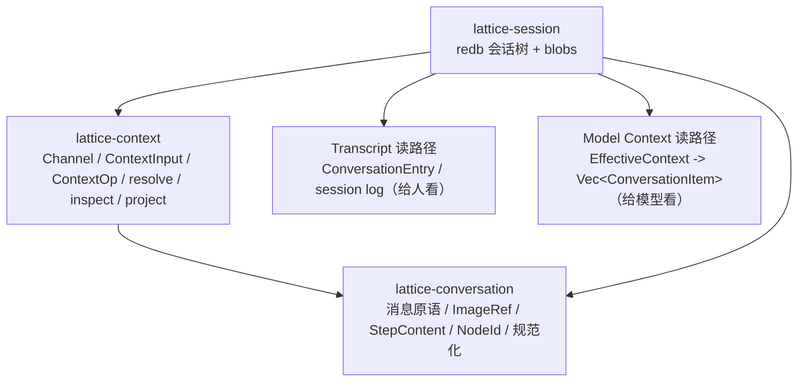

# ADR 0014：模型上下文领域层与双读路径分离

## 背景

### 现状

以下按 `main` 的 `d3f2f3b6` 核对。

| 方面 | 现状 | 出处 |
| --- | --- | --- |
| 模型上下文组装 | 会话合同规定模型上下文与视图读取的对话只有一种范围——根到当前位置的路径；实际组装为后台 `while` 循环逐节点收集 `UserMessage` 与已有回复的 `Step`，再由 `ModelStepRequest::chat_request` 在头部拼接 `system_prompt` | [表、读取范围与 rewind](../architecture/session/README.md#表读取范围与-rewind)；`crates/lattice-server/src/turn/request.rs:11-47`、`crates/lattice-agent/src/model_step.rs:169-198` |
| 会话树节点与 Turn 绑定 | `Node` 只有 `Root`、`UserMessage` 与 `Step` 三种；`UserMessage` 同时承担“输入上下文内容”和“启动一轮 Turn（携带 `turn_id`、冻结配置摘要并预留 `Step 0`）”两项职责，无法在不启动模型推理的前提下向会话写入上下文 | `crates/lattice-session/src/store/types.rs:47-72`；[会话、Turn 与会话树](../architecture/session/README.md#会话turn-与会话树) |
| 上下文来源标识 | `UserMessage` 只保存匿名 `NativeMessage`（`MessageRole::User`），树上不区分输入来自 TUI、CLI、IM 还是其他外部入口；TUI 批注只能经私有字符串格式 `<lattice-comment>` 拼入用户正文 | `crates/lattice-tui/src/comment.rs:83-171` |
| 上下文操作能力 | 会话层只有 `rewind N`（移动当前位置指针）一种控制手段；触发 `32 MiB` 本地请求体预算、远端 `HTTP 413` 或切换到不支持图片的纯文本模型时，只能回退历史分支或新建会话 | `crates/lattice-llm/src/gateway.rs:337-363`、`crates/lattice-llm/src/protocol/encoding.rs:20`、`crates/lattice-llm/src/transport.rs:54-85`；[表、读取范围与 rewind](../architecture/session/README.md#表读取范围与-rewind) |
| 多端协调与基线 | `TurnRequest` 仅核对 `expected_settings`，不核对当前位置基线；后台在执行中对并发 `submit`、`configure` 与 `rewind` 一律返回 `Busy` | `crates/lattice-ipc/src/types.rs:534-541`；[操作锁](../architecture/session/concurrency.md#操作锁) |
| 前端锚点校验 | TUI 评论将锚点绑定到屏幕当前加载的显示块集合，重连回放（#426）与按轮分页（#291）期间频繁出现假阳性丢失与跨端不一致 | `crates/lattice-tui/src/app.rs:1327-1335`、`crates/lattice-tui/src/comment.rs:7-26` |

### 问题

1. **持久对话历史（Transcript）与有效模型上下文（Model Context）被焊死为同一视图。** 人类需要完整、不可篡改的会话事实记录，而模型只需要当前有效工作集；二者合一导致无法在不破坏历史、也不靠 `rewind` 丢弃后续进展的前提下，移出中间走偏步骤、缩减超大工具输出、剥离长推理或替换历史图片。
2. **上下文写入与模型推理强绑定，无法承接非输入框多源输入。** 截屏投放、文档或网页选区批注、外部拉取 Issue/评论等场景本质上是“向会话投喂上下文材料，按需再触发推理”，而现行 `UserMessage` 要求每次输入都立即发起一轮 Turn。
3. **缺少上下文来源与确定性操作原语。** 树上记录没有来源通道标识，前端只能把结构化信息拍扁为私有字符串；同时系统缺少纯领域层对上下文归约、工具调用成对约束与回放签名剥离的单一权威实现。
4. **前端越权承担上下文完整性校验，且缺少位置基线保护。** 多端共享同一会话时，前端屏幕只持有窗口视图，无法保证上下文完整性；提交仅核对设置版本而不核对当前位置，并发 `rewind` 或他端提交会静默挂错父节点。

### 约束

| 约束 | 出处 |
| --- | --- |
| 会话树是会话事实的唯一权威；`Step` 预留、由 `progress` 推导结论、仅末端未关闭 `Step` 可改写，崩溃后无自动关闭或自动重跑恢复路径 | [ADR 0007 第 1 节](0007-session-tree-as-single-authority.md#1-树是会话事实的唯一权威)、[第 4 节](0007-session-tree-as-single-authority.md#4-progress-给出结论)、[第 5 节](0007-session-tree-as-single-authority.md#5-取消自动关闭和进行中-turn标记) |
| 会话设置（含 `system_prompt`）由后台持有，`configure` 为唯一修改入口，`rewind` 不改变会话设置；草稿会话定义为整棵树只有根节点 `0` | [ADR 0012 第 1 节](0012-backend-owns-session-settings.md#1-会话设置是下一轮配置的唯一权威)、[第 6 节](0012-backend-owns-session-settings.md#6-会话的状态)；[会话设置](../architecture/session/settings.md#设置与一轮的配置) |
| 每个概念只有一个状态持有者和一个规则执行者；用类型消灭非法状态；不引入无第二真实用途的扩展点 | [工程规范](../development/engineering.md#归属)、[范围](../development/engineering.md#范围)、[可读性](../development/engineering.md#可读性) |
| 前端普通依赖闭包禁止包含 `lattice-server`、`lattice-llm`、`lattice-profile`、`lattice-agent`、`lattice-im`；本地 IPC 单帧上限 `16 MiB` 并受 `wire_shape.json` 门禁保护 | [依赖边界门禁](../architecture/crates.md#依赖边界门禁)、[线上形状快照门禁](../architecture/crates.md#线上形状快照门禁) |
| 会话库格式变更直接递增 `VERSION` 并以 `UnsupportedVersion` 拒绝旧库，不做旧数据迁移；`blobs` 只追加不回收 | [身份、版本与打开](../architecture/storage.md#身份版本与打开) |

### 维护者已确定的事项

2026-11-21 至 2026-11-22 架构讨论中确定（2026-11-22 维护者批准本 ADR，并确定先执行阶段 0 前置清理移除 TUI 前端排队）：

1. **先做纯领域层与机制基础设施（Mechanism），不内置自动裁剪/摘要策略（Policy），也不在基础设施层写死前缀缓存策略承诺。**
2. **不做有损自动压缩摘要**，只做确定性、可追溯的树上操作；上下文操作作为不可变节点落在会话树上，沿根到当前位置单遍扫描归约。
3. **Transcript 与 Model Context 彻底解耦**，作为同一棵会话树上的两条独立读路径；模型上下文归约、校验、检视与投影抽离为独立纯同步零 I/O crate `lattice-context`，由 `lattice-session` 向下依赖。
4. **单向解耦与单一来源标识 `Channel`**：上下文内容形态（引文、文档/网页批注、Issue 排版）归外围入口自决；投喂记录不认识 `NodeId`，不设自动覆盖 `slot`，不设 `TrustLevel`（待真实外部不可信接入时由后台准入策略承接）。
5. **`system_prompt` 留在 `SessionSettings`**，不迁入会话树，不改动 ADR 0012 的 `rewind` 与草稿语义。
6. **投喂上下文与触发推理（Turn）解耦，暂不引入后台 `inbox` 与运行中 `Steer`，并移除 TUI 前端排队**：当前尚无异步外部触发器，保持既有 `SessionExecutionLock` 串行与运行中返回 `Busy` 的并发模型；移除 TUI 进程内消息排队与自动续发逻辑（原 `queue.rs` 中的排队消息、`QueuedSettings`、`paused`/`awaiting` 与 `auto_submit`），不留一套脱离后台权威的脆弱前端队列。
7. **类型层收敛**：砍掉易漂移的 `part: usize` 下标寻址与 `Target × Replacement` 两张皮枚举，改用强类型操作变体；第一版不做中段原地 `Restore`；`inspect()` 只产出客观统计，不重复 `lattice-llm` 的 `32 MiB` 预算与模态判定；复用 `lattice-conversation::normalize_user_message`；不设空壳 `Trigger` 结构体。

## 决策

### 1. 双读路径与 Crate 依赖边界

持久会话树继续作为会话事实的唯一权威，并在同一棵树上分离为两条独立读路径：



- **新建纯领域 crate `lattice-context`**：纯同步、零 I/O、零 `async`、零存储、`#![forbid(unsafe_code)]`，唯一内部依赖为 `lattice-conversation`。
- **`NodeId(u64)` 上移至 `lattice-conversation`**：与 `SessionId`、`TurnId`、`InvocationId` 同处身份模块，由 `lattice-session` 重导出，避免 `lattice-context` 反向依赖存储 crate。
- **读路径严格隔离**：
  - `lattice-session` 负责持久化事实与人类 Transcript 读取（`ConversationEntry`、`history`、`log`），忠实保留原始输入、原始 `Step` 与 `ContextOp` 记录，不因对模型 `Omit` 而从历史中消失；
  - `lattice-context` 负责沿根到当前位置单遍扫描归约 `EffectiveContext`，产出模型历史 `Vec<ConversationItem>` 与客观统计；
  - `lattice-agent` 与 `lattice-llm` 继续只消费 `Vec<ConversationItem>` 与 `system_prompt`，不感知 `Channel` 或 `ContextOp`。
- **依赖门禁**：`xtask/src/crate_boundary.rs` 允许 `lattice-session`、`lattice-ipc`、`lattice-local` 与 `lattice-server` 依赖 `lattice-context`；`lattice-context` 属于纯数据前端安全依赖，不破坏普通依赖闭包禁令。

### 2. `Channel`、`ContextInput` 与 `UserMessage` 的关系

- **`Channel`（唯一来源标识）**：开放受检字符串新类型 `Channel(String)`，不写死渠道枚举（对齐 `ProviderId` 与 `AgentName`）。
  - 语法约束：非空、UTF-8 长度 `<= 256` 字节、不含控制字符与换行、首尾无空白字符。
  - 示例：`tui`、`tui/comment`、`cli`、`im/telegram:<chat_id>`、`screenshot`、`doc:<path>`、`web:<url>`、`github:<owner/repo#num>`。
- **`ContextInput`（通用多模态上下文输入）**：
  ```rust
  pub struct ContextInput {
      pub channel: Channel,
      pub message: NativeMessage<BoundToolCall>, // 经 normalize_user_message 构造，Role 恒为 User
  }
  ```
  - 复用 `lattice_conversation::normalize_user_message` 执行单条文本（`2 MiB`）、单图（`3.75 MiB`）、张数（`8`）与图片总量（`10 MiB`）上限核验及保序规范化；不定义平行的 `ContextPart` 规范化逻辑。
  - **单向解耦**：业务内容格式（如 TUI 划词引文、文档/网页选区、Issue 摘要）由各外围入口自行组织为 `Text` / `Image` 片段；`ContextInput` 不包含树上 `NodeId` 引用，也不带自动覆盖键 `slot`。
- **`ContextInput` 与既有 `UserMessage` 的关系**：
  - **会话树层面：完全取代，不并存。** 原有 `Node::UserMessage` 同时捆绑了“用户输入内容”与“Turn 启动元数据”；本次将其拆解，输入内容由 `Node::Input`（承载 `ContextInput`）统一表达，轮次冻结元数据迁至 `Step 0` 的 `TurnStartMeta`。来自 TUI、CLI、IM 的普通聊天输入与截屏、批注、外部拉取内容在树上均为 `Node::Input`，仅通过 `Channel` 区分来源。
  - **模型协议层面：领域对象到线协议角色的投影。** `lattice-conversation` 中的 `MessageRole::User` 属于底层 LLM API 的协议角色（与 `System`、`Assistant`、`Tool` 并列）。`ContextInput` 内部复用 `MessageRole::User` 的规范化图文消息，在 `project()` 阶段统一投影为带 `Channel` 标识的 `MessageRole::User` 消息交给协议适配器。

### 3. 强类型 `ContextOp` 与确定性编辑原语

上下文操作以不可变节点写入会话树，支持单次节点批量携带多条编辑，便于上层策略按需一次原子落树结算：

```rust
pub struct ContextOp {
    pub channel: Channel,
    pub edits: Vec<ContextEdit>, // 非空，按顺序生效
}

pub enum ContextEdit {
    /// 将整条 ContextInput 或整步 Step（回复与全部工具调用/结果同进同退）移出模型上下文。
    OmitNode { node: NodeId },
    /// 将整条 ContextInput 替换为新的规范化图文消息（仅作用于 ContextInput 节点）。
    ReplaceInput { node: NodeId, message: NativeMessage<BoundToolCall> },
    /// 将整步 Step 替换为一段非空纯助手结论文本，丢弃中间工具调用与推理（仅作用于已有回复的 Step 节点）。
    ReplaceStep { node: NodeId, text: String },
    /// 成对移出单次工具调用（ToolCall 片段与对应 ToolResult 同时移出，不留悬空调用）。
    OmitInvocation { invocation: InvocationId },
    /// 仅替换单次工具调用的 ToolResult 载荷为精简文本（保留 ToolCall 配对）。
    ReplaceToolResult { invocation: InvocationId, text: String },
    /// 移出指定 Step 回复中的全部 Reasoning 片段（保留正文与 ToolCall）。
    StripReasoning { node: NodeId },
    /// 将指定 ContextInput 中匹配 ImageRef 的图片片段移出（None）或替换为短文本占位（Some）。
    ReplaceImage { node: NodeId, image: ImageRef, text: Option<String> },
}
```

- **结构消灭非法组合**：每个变体直接绑定其合法目标与替换载荷，消除 `part: usize` 下标漂移与目标/替换类型错配；不存在允许单独删除 `ToolCall` 或单独删除 `ToolResult` 的构造入口。
- **替换载荷边界**：`ReplaceInput.message` 须经 `normalize_user_message` 核验（新增 `ImageRef` 随写事务去重写入 `blobs`）；`ReplaceStep.text`、`ReplaceToolResult.text` 与 `ReplaceImage.text`（`Some` 时）非空且受既有文本/工具载荷上限约束（`ReplaceToolResult.text` 上限对齐 `MAX_TOOL_CONTENT_BYTES = 65,536` 字节；其余文本上限对齐 `MAX_USER_TEXT_BYTES`）。
- **无中段原地 `Restore`**：需要撤销近期上下文操作时使用 `rewind` 回退到操作节点之前；后期需要重看已 `Omit` 的原文时，由上层按 `NodeId` 从不可变树读取原文并作为新 `ContextInput` 追加，第一版不引入中段原地恢复以保持最小内核。

### 4. 单遍扫描归约 `resolve()`、不变量与三个纯出口

`lattice-context` 对沿 `Root -> current` 收集的顺序路径节点执行单遍归约：

```rust
pub enum PathRecord<'a> {
    Input { id: NodeId, input: &'a ContextInput },
    Step  { id: NodeId, content: StepContent }, // 仅已有完整回复的 Step 参与
    Op    { id: NodeId, op: &'a ContextOp },
}

pub fn resolve(path: &[PathRecord<'_>]) -> Result<EffectiveContext, ContextError>
```

归约与校验由 `lattice-context` 单一执行并死守四条机制不变量：

1. **纯函数确定性**：给定相同的路径节点序列，`resolve()` 与 `project()` 每次产出完全一致的 `EffectiveContext` 与 `Vec<ConversationItem>`，不依赖当前时钟、随机数或外部环境状态。是否追求前缀逐字节不变、何时批量落 `ContextOp` 以复用 Prompt Cache，均属上层策略（Policy），基础设施不做硬性承诺。
2. **协议成对铁律**：`OmitNode` 对 `Step` 整步同进同退；`OmitInvocation` 同时移出对应的 `ToolCall` 与 `ToolResult`；若 `ReplaceImage { text: None }` 使整条 `ContextInput` 片段清空，或 `OmitInvocation` / `StripReasoning` 使某 `Step` 既无剩余回复片段也无工具调用，归约结果自动跳过该空条目。
3. **回放签名铁律**：凡被 `ReplaceStep`、`OmitInvocation`、`ReplaceToolResult` 或 `StripReasoning` 修改过的 `Step`，归约时自动清除其 `provider_origin` 与逐片段 `replay_state`（见[回放与跨 provider 投影](../architecture/session/conversation.md#回放与跨-provider-投影)），避免原 provider 验签拒绝；未经修改的 `Step` 完整保留同源回放状态。
4. **同路径引用铁律**：`ContextOp` 中每条 `ContextEdit` 引用的 `NodeId` 或 `InvocationId` 必须存在于该 `Op` 之前的同一路径上，节点类型与操作变体严格匹配（`ReplaceImage` 还须核验目标 `ContextInput` 确含该 `ImageRef`），且 `Op` 在同一 `ContextOp` 内部或跨 `ContextOp` 叠加时目标仍处于可操作状态（已整节点 `OmitNode` 的节点拒绝再施加局部改写）。

`EffectiveContext` 对外只暴露三个纯只读接口：

| 接口 | 输入与输出 | 职责边界 |
| --- | --- | --- |
| `validate_op(&self, op: &ContextOp) -> Result<(), ContextError>` | 校验待落树的 `ContextOp` 是否对当前有效上下文合法 | 写事务落盘前与 `open()` 全库校验共用 |
| `inspect(&self) -> ContextInspection` | 返回有效条目摘要、已被操作节点清单、各 `Channel` 计数、有效文本总字节、有效 `ImageRef` 列表与图片字节总和 | **只做客观统计**；`32 MiB` wire 预算与模型 `InputModality::Image` 检查继续归 `lattice-llm::ResolvedRequest::check_request` |
| `project(&self) -> Vec<ConversationItem>` | 产出 provider 中立的历史序列供 `ModelStepRequest.history` 消费 | 为每条 `ContextInput` 附带简洁、确定性的 `Channel` 标识并对正文内冲突边界标记做转义；不拼接 `system_prompt`（由 `ModelStepRequest::chat_request` 置顶拼接） |

### 5. 会话树演化：上下文输入与 Turn 启动解耦

为使“投喂上下文”与“触发一轮模型推理”彻底分离，会话库 `nodes` 表节点演进为四种：

| 节点变体 | 字段要点 | 说明 |
| --- | --- | --- |
| `Node::Root` | 无内容，序号 `0` | 与 ADR 0007 / 0012 一致；整棵树仅含节点 `0` 即草稿会话 |
| `Node::Input` | `parent`、`accepted_at`、`input: ContextInput` | 一次上下文投喂；写入后不可变，不强制开启 Turn |
| `Node::ContextOp` | `parent`、`accepted_at`、`op: ContextOp` | 一次批量上下文操作；写入后不可变，不开启 Turn |
| `Node::Step` | `parent`、`turn_id`、`step_ordinal`、`turn_start: Option<TurnStartMeta>`、`progress`、`attempts`、`reply`、`slots`、`updated_at` | `step_ordinal == 0` 必须携带 `Some(TurnStartMeta)`，`step_ordinal > 0` 恒为 `None` |

- **`TurnStartMeta`** 承载原 `UserMessage` 上的轮次冻结事实：`accepted_at`、`trigger_channel: Channel`、`agent_name`、`model`、`provider`、`effort`、`limits`、`config_digest`（指向 `configs` 表中的 `system_prompt` 与 `ToolCatalogSnapshot`）。
- **`Turn` 边界与 `turn_index` 索引**：`Node::UserMessage` 移除后，一个 `Turn` 由一次触发产生的连续 `Step 0..k` 序列构成（`turn_id` 仅归属 `Step` 节点，`usage` 按 `Step 0` 分组；`Node::Input` 与 `Node::ContextOp` 作为独立上下文节点存在，不再绑定单个 `Turn`）；`turn_index` 由 `TurnId` 指向本轮的 `Step 0` 节点（`(SessionId, seq)`），不新增易被误 `rewind` 的空 `TurnStart` 节点。历史分页边界随之调整为以轮次起点（`Step 0` 及其紧邻前置上下文块）为界，不再假设每轮必以单一 `UserMessage` 开头。
- **原子组合**：
  - **纯投喂（Feed-only）**：单事务写 `Node::Input`（及去重写 `blobs`）并前移 `Session.current`；
  - **显式操作（Apply Op）**：单事务核验 `validate_op` 后写 `Node::ContextOp`（若含 `ReplaceInput` 图片则同事务写 `blobs`）并前移 `Session.current`；
  - **独立触发（Trigger-only）**：不新增 `Node::Input`，单事务冻结设置与工具目录、写 `configs`、`turn_index` 与预留 `Step 0`（要求当前有效上下文非空，否则拒绝）；
  - **投喂并触发（Submit）**：单事务原子写入 `Node::Input` + 预留 `Step 0`（对外保持现行 `submit` 的单次原子语义与 `TurnId` 幂等找回）。
- **ADR 0007 全部运行期不变量保持不变**：`Step` 开始前预留、`progress` 推导结论、仅末端未关闭 `Step` 可改写、`TurnSummary` 从末步派生、`rewind` 只移动 `Session.current` 不改 `SessionSettings`。

### 6. 并发约束与上下文基线

- **沿用现有操作锁模型**：不拆分 `SessionExecutionLock` 边界，也不新增后台收件箱表。会话存在活跃 Turn Owner 时，纯投喂、显式 `ContextOp`、独立触发与 `submit` 均照旧返回 `Busy`（见[操作锁](../architecture/session/concurrency.md#操作锁)）。
- **上下文位置基线**：所有推进或修改会话树路径的写命令（纯投喂、显式 `ContextOp`、独立触发与 `submit`）均支持可选的 `expected_position: Option<NodeId>`（与 ADR 0012 的 `expected_settings` 并列）。写事务前与写事务内均核对 `Session.current == expected_position`，不一致时返回类型化 `Conflict`（`position_changed`），防止并发 `rewind` 或他端写入导致新节点挂错父节点。

### 7. 前端收敛与 #426 / #291 解决路径

- **TUI**：
  - 评论不再绑定屏幕显示块与 `(turn, step, part, range)` 外键，也不在重连或分页时按屏幕 `blocks` 猜测锚点存活（根治 #426 与 #291）；TUI 自行将引文与批注组装为 `Channel("tui/comment")` 的 `ContextInput`，提交时携带 `expected_position` 与 `expected_settings` 防范并发 `rewind` 挂错分支；
  - 移除前端消息排队功能（删除 `QueuedMessage`、`QueuedSettings`、队列暂停/恢复、队首自动续发、排队消息编辑与 `Enter 排队`/`排队已满` 交互，剥离原 `queue.rs` 混存的排队状态，仅保留独立的评论草稿编辑）；Turn 运行中或 `configure` 在途时用户可继续在输入区起草内容，但按 `Enter` 不再入队（显示 `Warn` 提示忙碌或设置修改中，保留输入与评论草稿），彻底消除前端私自排队引发的设置代次漂移、乱序发送与 #426 回放交互冲突。
- **CLI**：默认通道 `Channel("cli")`，保留 `submit` 原子提交，并逐步提供上下文投喂、操作与检视命令。
- **IM 网关**：默认通道 `Channel("im/telegram:<chat_id>")`，沿用既有台账与准入机制。

### 8. 实施顺序

| 阶段 | 范围与交付 | 验证入口 |
| --- | --- | --- |
| 0（前置清理） | 移除 TUI 前端消息排队功能（删除 `queue.rs`，拆出独立评论草稿模块 `drafts.rs`），同步修订 TUI 架构合同与测试 | `cargo test -p lattice-tui`、`cargo test -p lattice-cli`、`cargo xtask docs-check`、E2E `pty_tui_smoke` |
| 1 | `NodeId` 上移 `lattice-conversation`（`lattice-session` 重导出）；新建零 I/O 纯领域 crate `lattice-context`（`Channel`、`ContextInput`、`ContextOp`/`ContextEdit`、`resolve`、`validate_op`、`inspect`、`project`）及完备单元测试；更新 `xtask/src/crate_boundary.rs` 与 `crates.md` | `cargo test -p lattice-conversation -p lattice-context`、`cargo xtask crate-boundary` |
| 2 | `lattice-session` 格式升至 v11，引入 `Node::Input`、`Node::ContextOp`、`Step 0` 的 `TurnStartMeta`、写入与 `open()` 全库校验，以及 `SessionRead` 双读路径；`lattice-server` 移除 `turn/request.rs::history` 改调 `resolve()` + `project()` | `cargo test -p lattice-session -p lattice-server`、E2E `direct_tree_session` 与 `direct_crash_barriers` |
| 3 | `lattice-server`、`lattice-ipc`、`lattice-local` 落地 Feed-only、显式 `ContextOp`、独立触发、`expected_position` 基线校验及 `inspect` 查询；递增 `PROTOCOL_VERSION` 并更新 `wire_shape.json` | `cargo test -p lattice-ipc -p lattice-local -p lattice-server` |
| 4 | CLI、TUI 与 IM 接入新协议与位置基线；TUI 移除基于 `blocks` 的评论锚点核对（关闭 #426 / #291），同步修订剩余合同与 `docs/reference/glossary.md` | `cargo test -p lattice-tui -p lattice-cli -p lattice-im`、`TMPDIR=/tmp cargo xtask ci` |

## 归属

| 概念 | 状态持有者 | 规则执行者 | 只使用结果的组件 |
| --- | --- | --- | --- |
| `NodeId` | 会话树节点键 `(SessionId, NodeId)` | `lattice-conversation`（值类型）与 `lattice-session`（单调分配） | `lattice-context`、`lattice-ipc`、`lattice-local`、各前端 |
| `Channel`、`ContextInput` 与 `ContextOp` | `lattice.redb` 的 `nodes` 表 | `lattice-context`（语法、目标合法性、单遍归约、回放签名剥离与模型投影） | `lattice-session`、`lattice-server`、`lattice-ipc`、各前端 |
| 持久对话历史（Transcript） | `lattice.redb` 的 `nodes` 表 | `lattice-session`（`ConversationEntry`、按轮分页与 `log` 投影） | `lattice-server` 视图推送、CLI、TUI |
| 有效模型上下文（`EffectiveContext`） | 无单独持久化（由路径单遍归约得出） | `lattice-context::resolve`、`inspect`、`project` | `lattice-server`、`lattice-agent`、`lattice-llm`、检视查询 |
| 模型请求 `32 MiB` 预算与输入模态检查 | 无状态（模型能力取自 `models.dev` 与 `providers.toml`） | `lattice-llm::ResolvedRequest::check_request` | `lattice-server` 准入与每步发送 |
| 系统提示（`system_prompt`）与会话设置 | `lattice.redb` 的 `session_settings` 表与 `configs` 表 | `lattice-server::configure`、`lattice-session` 冻结配置、`ModelStepRequest::chat_request` 置顶拼接 | 视图头、各前端、`lattice-llm` |
| 上下文位置基线（`expected_position`） | `lattice.redb` 的 `Session.current` | `lattice-server` 准入与 `lattice-session` 写事务核对 | 视图头、CLI、TUI、IM |
| 业务上下文排版（引文、选区、外部格式） | 各外围入口自持 | TUI、CLI、IM 与未来外部 `ContextGate` 各自负责 | `lattice-context`（仅按通用图文载荷处理） |

## 否决的方案

| 方案 | 否决理由 |
| --- | --- |
| 内置基于 LLM 的自动压缩摘要（Auto-Compaction） | 摘要天然有损，易丢弃边界约束、文件路径与失败负反馈，且多层递归摘要产生代际退化；系统先提供无损确定性操作原语，不把有损自动摘要写死在内核中 |
| 在会话树之外另建可变的“上下文叠加规则表” | 破坏 ADR 0007“会话树为唯一权威”；`rewind` 切换分支时叠加规则指向的节点容易悬空，且无法仅凭路径复现历史某轮实际看到的上下文 |
| 将上下文规则全部下沉进 `lattice-session` 而不建独立 crate | 会让 `redb` 存储层混入模型侧投影、来源标记转义与回放签名剥离等规则，模糊 Transcript（给人看）与 Context（给模型看）的职责分离；改为 `lattice-session` 向下依赖零 I/O 的 `lattice-context` 既保单事务核验又保职责正交 |
| 为 `ContextInput` 保留自动覆盖逻辑键 `slot` | 自动同键覆盖属于隐式历史改写，不仅增加核心语义分支，还会绕过显式 `ContextOp` 在热路径上制造难以预期的缓存与回溯副作用；第一版砍掉，全部覆盖/移出均经显式 `ContextOp` 完成 |
| 在 `Channel` 上附带 `TrustLevel`（`Operator` / `External`）枚举 | 当前尚无外部不可信拉取器，提前加入迫使现有入口填充无消费者字段，且信任分级属于后台准入边界策略而非调用方自声明数据 |
| 拆分为 `entry` + `channel` 两层来源字段 | 实际入口（如 `screenshot`、`im/telegram`、`tui/comment`）难以正交划分到两套固定桶中且与“条目”语义冲突；收敛为单一开放受检 `Channel` 更清晰 |
| `ContextInput` 内携带指向历史树节点的 `NodeId` 锚点外键 | 造成外部入口反向耦合树内部结构，并迫使内核区分会话内/外两套批注与“引用已被 `Omit` 节点”的复杂规则；引文内容自包含、防 `rewind` 误发统一交 `expected_position` 基线保护 |
| 在会话树上并存 `Node::UserMessage` 与 `Node::Input` | 聊天消息、划词批注、带字截图与纯图触发之间没有稳定分界，并存会导致两套平行输入节点与重复校验路径；统一为 `Node::Input` 并以 `Channel` 区分来源更简洁 |
| 使用 `part: usize` 下标寻址与 `ContextTarget × Replacement` 独立双枚举 | 笛卡尔积中大量非法组合只能拖到运行时报错，且 `usize` 下标在文本合并与多轮编辑后极易漂移；改用强类型 `ContextEdit` 在类型层消灭非法状态 |
| 第一版支持中段原地 `Restore` | 与 `rewind` 撤销近期操作及“按 `NodeId` 读取原文追加为新上下文”重叠，且引入额外的状态反转分支；第一版不加入以保持最小机制内核 |
| 在 `lattice-context::inspect()` 内计算 `32 MiB` 预算与模型图片模态 | 重复 `lattice-llm` 已有同源流式精确计长与模型目录权威，且纯上下文层无法获知五种协议的真实 JSON 转义与工具 schema 膨胀 |
| 将 `system_prompt` 从 `SessionSettings` 迁入会话树节点 | 破坏 ADR 0012“`rewind 0` 保留当前 agent 与设置”及草稿会话“仅含根节点 `0`”语义，且 `lattice-llm` 会将所有 `MessageRole::System` 抽离拼接至顶层 `system` 字段，与树顺序解耦 |
| 在 `lattice-context` 中定义空壳 `Trigger` 结构体 | 归约引擎不消费 `Trigger`；投喂与触发解耦属于存储、IPC 与协调层的命令语义，树上只需在 `Step 0` 记录 `trigger_channel: Channel` |
| 在本 ADR 中提前引入后台持久 `inbox` 表与执行中入队 | 当前尚无异步外部触发器（Trigger），提前新增表结构、拆分 `SessionExecutionLock` 锁边界并维护重启留置收件箱状态机属于超前设计；留待后续引入异步 `ContextGate` 与 `Trigger` 时单立 ADR，且不造成现有树结构返工 |
| 第一版引入运行中 mid-turn `Steer` | 业界实践表明运行中 `steer` 与多步工具批次、取消及状态变更存在高危竞态；第一版先收稳 Feed-only、显式 `ContextOp`、基线校验与 Interrupt |

## 影响

### 代码

| crate | 变化 | 阶段 |
| --- | --- | --- |
| `lattice-tui`（前置清理） | 移除前端消息排队功能与 `queue.rs`，拆出独立评论草稿模块 `drafts.rs` | 0 |
| `lattice-conversation` | 承接纯值类型 `NodeId` | 1 |
| `lattice-context`（新建） | 定义 `Channel`、`ContextInput`、`ContextOp`、`ContextEdit`、`PathRecord`、`EffectiveContext`、`ContextInspection`，实现单遍 `resolve()`、`validate_op()`、`inspect()` 与 `project()` | 1 |
| `xtask` | `crate_boundary.rs` 将 `lattice-context` 纳入与 `lattice-conversation` 同级的纯领域白名单 | 1 |
| `lattice-session` | 重导出 `NodeId`；格式升至 v11，调整 `Node` 变体、`TurnStartMeta` 迁至 `Step 0`，在 `SessionRead` 上分离 Transcript 与 Model Context 读路径 | 2 |
| `lattice-server` | 移除 `turn/request.rs::history` 改经 `lattice-context` 投影；落地 Feed-only、显式 `ContextOp`、独立触发与 `expected_position` 核对 | 2、3 |
| `lattice-ipc`、`lattice-local` | 新增上下文投喂、操作、触发与 `inspect` 协议消息及位置基线字段；递增 `PROTOCOL_VERSION` 并更新 `wire_shape.json` | 3 |
| `lattice-cli`、`lattice-tui`、`lattice-im` | 接入新协议与位置基线；TUI 移除基于屏幕 `blocks` 的评论锚点核对 | 4 |

### 数据与接口

- 会话库 `lattice.redb` 格式版本在阶段 2 从 `10` 升至 `11`，变更 `nodes` 变体与 `turn_index` 目标（表集合与锁边界不变）；v10 及更早库按现行规则拒绝打开。
- 本地 IPC 协议在阶段 3 递增 `PROTOCOL_VERSION` 并刷新 `wire_shape.json`。
- `SessionSettings`、配置表 `configs`、`blobs` 表与 `configure` 命令保持不变。

### 行为

- 用户与外部入口可在会话空闲时、不启动 LLM 的情况下向会话投喂上下文，或在不破坏 Transcript 历史与不丢失后续进展的前提下确定性移出/替换旧节点、旧图片、冗长工具输出与推理块。
- 写操作具备位置基线保护，TUI 重连回放（#426）与按轮分页（#291）不再误删评论；运行中写操作照旧返回 `Busy`，TUI 不再提供进程内自动排队发送。

### 合同（随实施修订）

| 文档 | 修订 | 阶段 |
| --- | --- | --- |
| `architecture/tui/README.md`、`dock.md`、`interaction.md`、`transcript.md`、`palette.md` | 移除 TUI 前端排队条款，更新运行中与 `configure` 在途按 `Enter` 的行为 | 0 |
| `architecture/crates.md` | 新增 `lattice-context` 职责与依赖边界白名单 | 1 |
| `architecture/storage.md` | 会话库版本 11 与节点记录格式更新 | 2 |
| `architecture/session/README.md`、`flow.md`、`steps.md`、`acceptance.md`、`concurrency.md`、`operations.md`、`recovery.md` | 双读路径分离、节点变体与 `Step 0` 元数据、Feed/Trigger 解耦与 `expected_position` | 2、3 |
| `architecture/tui/README.md`、`interaction.md`、`transcript.md`、`layout.md` 与 `architecture/im.md` | TUI 评论改为自包含表达、轮次序号与 statusline 本轮计量改以 `Step 0` 为界并接入位置基线；IM 对接 `Channel` 与位置基线 | 4 |
| `reference/glossary.md` | 补充模型上下文、Channel、ContextInput、ContextOp 与有效模型上下文等词条（批准后按 `domain-modeling` 规范写入） | 4 |

### 与其他 ADR 的关系

| ADR | 关系 |
| --- | --- |
| [ADR 0007 第 1 节](0007-session-tree-as-single-authority.md#1-树是会话事实的唯一权威)、[第 4 节](0007-session-tree-as-single-authority.md#4-progress-给出结论)、[第 5 节](0007-session-tree-as-single-authority.md#5-取消自动关闭和进行中-turn标记)、[第 6 节](0007-session-tree-as-single-authority.md#6-接受时确定的事实记在-usermessage-节点上) | 沿用并部分取代：树仍是会话事实唯一权威，`Step` 预留、`progress` 结论与崩溃免自动恢复完全保留；第 6 节中“接受时确定的事实记在 `UserMessage` 节点上”改为记在 `Step 0` 的 `TurnStartMeta`，原 `UserMessage` 内容拆为独立的 `Node::Input` |
| [ADR 0008 第 2 节](0008-backend-api-commands-view-queries.md#2-对话条目就是节点)、[第 4 节](0008-backend-api-commands-view-queries.md#4-长会话按轮分页)、[第 7 节](0008-backend-api-commands-view-queries.md#7-submit-只接受新请求找回改为查询)、[第 10 节](0008-backend-api-commands-view-queries.md#10-客户端保留的部分) | 补充并部分取代：Transcript 视图仍以节点为单位交付；新增上下文投喂、操作与检视命令，并增加 `expected_position` 乐观基线；第 4 节以 `UserMessage` 为分页边界与轮次序号计数依据的规则随 `Node::UserMessage` 拆解改为以 `Step 0` 及其前置上下文块为界；第 10 节中前端保留的排队状态在阶段 0 随排队移除而取消 |
| [ADR 0011 第 5 节](0011-im-gateway-inside-backend.md#5-crate-拆分与依赖规则) | 补充：将纯领域 crate `lattice-context` 纳入前端安全依赖白名单，其余边界与独占消费规则不变 |
| [ADR 0012 第 1 节](0012-backend-owns-session-settings.md#1-会话设置是下一轮配置的唯一权威)、[第 4 节](0012-backend-owns-session-settings.md#4-提交只使用会话设置)、[第 6 节](0012-backend-owns-session-settings.md#6-会话的状态) | 沿用并小幅修订：`SessionSettings`（含 `system_prompt`）、`configure`、`expected_settings` 与草稿会话定义保持不变；第 3 节与第 7 节中 TUI “执行中排队的消息沿用当前设置 / `configure` 在途按 Enter 入队”随前端排队移除而取消 |
| [ADR 0013 第 1 节](0013-user-image-input.md#1-图片原语格式识别与单轮上限) | 沿用并复用：`ContextInput` 与 `ReplaceInput` 直接复用 `ImageRef` 与 `normalize_user_message`，`ReplaceImage` 补充按 `ImageRef` 移出或替换历史图片的能力 |

## 不在本文决定的事项

- 执行中到达上下文的后台持久化缓冲（`inbox`）与异步 `Trigger` 调度。
- 具体的自动化上下文整理策略（Policy）：例如窗口利用率阈值触发、旧工具结果保留轮次、按 Prompt Cache TTL 延迟批量结算规则等。
- 将 `ContextOp`、`inspect` 与按 `NodeId` 回查原文封装为 `ToolExecutor` 内置工具交由模型自管理的交互与权限规则。
- 未来非本机/外部不可信 `ContextGate`（网页扩展、文档批注、GitHub Issue 拉取器）的具体接入协议、认证与准入信任策略。
- 运行中 mid-turn `Steer` 语义、中段原地 `Restore` 以及尾段动态状态槽位。
- 具体 `Channel` 投影给模型的精确标记格式与转义细则（在阶段 1 实施 `lattice-context` 时以 golden 测试锁定并经审查确认）。
