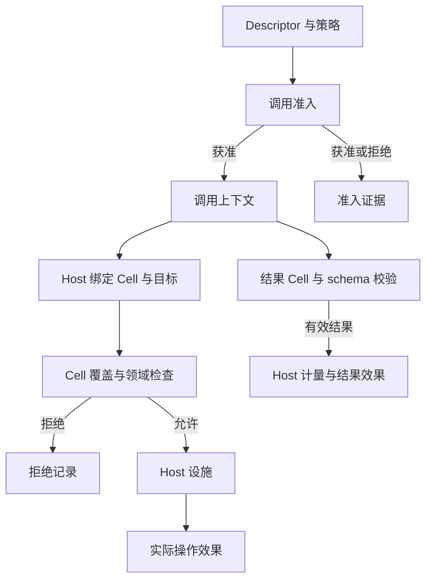

# Cell 权限与证据

> 类型：架构合同
> 上位依据：[项目宪章](../governance/charter.md)

## 目的与范围

本合同规定 Tool 的 Cell 模型、能力准入、Host 操作授权、结果计量和证据语义。`lancet-protocol` 维护数据契约，`lancet-runtime` 执行准入、授权与记录，`lancet-authority` 提供领域策略，`lattice-session` 把证据持久保存在调用槽位中并提供操作员读取。

[LANCET 合同](lancet.md#构建与封闭组成)维护工具构建与组成，并负责[执行及终态写入](lancet.md#调用身份与执行流程)；[会话合同](session.md#step-执行与结果保存)维护调用槽位与 Step 关闭；[工作区合同](workspace.md#文件变更)维护文件安装效果。

## 模型与声明

### Cell、scope 与 capability

| 概念 | 含义与关系 |
| --- | --- |
| `CtxOp` | 对 Agent 上下文的操作：`alloc`、`free`、`mutate` |
| `ExtImpact` | 外部影响：`none`、`read`、`write` |
| `Cell` | `ctx_op × ext_impact × scope`，其中 scope 是 Tool 声明的名称 |
| `ScopeDecl` | 将 scope 名称绑定到 `workspace`、`network` 或 `session` 通道及 `in`、`ex` 信任边界 |
| `Capability` | 命名一个 Cell；多个能力名称可以指向同一 Cell |
| `ObservedScope` | Host 从 Descriptor 解析得到的 scope 名称、trust 与通道 |
| `ObservedTarget` | Host 核验的具体目标，如项目相对路径、规范主机名或当前 Turn |

`alloc` 表示结果进入上下文，`free` 表示上下文释放，`mutate` 表示修改上下文状态。外部文件写入由 `ExtImpact::Write` 表达，不能仅凭 `CtxOp::Mutate` 判断外部效果。
`free` 是保留词汇，不意味着已提供释放上下文的 Tool Host 接口，也不自动产生预算返还。

`in` 表示受 Tool Host 管理的领域边界，`ex` 表示跨向外部世界。trust 缺省为 `ex`；未声明 scope 的信任查询也按 `ex` 处理，但有效 Descriptor 仍必须声明能力引用的 scope。

### 声明来源与校验

Descriptor 的 manifest 来源和生成链见 [LANCET 的概念与契约来源](lancet.md#概念与契约来源)及[生成与校验](lancet.md#生成与校验)。其 Cell 声明须满足：scope 名称、能力名称各自唯一，每个能力引用已声明的 scope。
能力名称采用至少两段的小写点分形式，各段允许小写字母、数字、下划线和连字符；语法为 `^[a-z0-9_-]+(\.[a-z0-9_-]+)+$`。跨 Tool 的同名能力必须对应相同 Cell。
每个能力的验证顺序固定为名称 grammar、重复名称、未声明 scope，诊断不得因重排而改变。

CellRef 使用 `ctx:ext:scope` 三段形式。guest 返回的 CellRef 不包含 trust；Host 根据 Descriptor 补全证据中的信任边界。带第四段 trust 的 guest CellRef 应被拒绝。scope 名称不能包含会改变分段的冒号。

模型的序列化类型由 [`cell.rs`](../../crates/lancet-protocol/src/cell.rs) 维护，版本化证据由 [`evidence.rs`](../../crates/lancet-protocol/src/evidence.rs) 维护。字段与编码修改须同时核对生产者、读取者和持久兼容性。

## 准入与操作授权

### 调用准入

准入读取本次调用的 Descriptor 和已解析策略，按固定顺序处理：

1. 工具必须在启用集合中，以其声明能力作为初始候选。
2. 按 `[lancet.capabilities] deny` 去除命名能力。
3. 按 `max_boundary` 去除越界能力。`in` 排除 scope 信任为 `ex` 的能力，`ex` 不作该项排除。
4. 剩余能力为空时拒绝调用，否则形成包含 Descriptor、准入能力和准入证据的调用上下文。

`max_boundary` 默认是 `in`。没有独立于启用工具声明的能力授权列表。未知启用工具名或未知被拒绝能力名在运行时构造时拒绝，不静默忽略。Cell 准入始终执行，不受 warn/off 模式放宽。

准入证据保留获准、按名称拒绝和按边界排除的能力列表，各列表排序并去重。名称拒绝先于边界判断，同一能力不同时归入这两个排除列表；未启用与无剩余能力的拒绝也保留准入证据。

能力按名称准入，操作按完整 Cell 精确匹配。若两个能力名称映射同一 Cell，拒绝其中一个名称后，另一个仍可提供该 Cell。不存在由 `write` 推出 `read`、或跨 scope 自动覆盖的偏序规则。

### Host 操作授权

每个有效果的 Host import 从宿主绑定取得操作 Cell，并解析具体目标，核验准入集合覆盖和领域策略后才调用对应设施。guest 可以提供请求参数，不能自行指定用于授权的通道、trust 或已解析目标。

| 目标 | 核验职责 |
| --- | --- |
| 项目路径 | Cell 的 scope 属于工作区通道；目标符合项目相对路径形式。安全逐段解析、系统排除和读写策略由工作区 Host 继续核验 |
| 网络主机 | Cell 的 scope 属于网络通道；Host 核验规范主机名，并执行允许主机、协议、DNS、连接及重定向策略 |
| 会话 | 目标绑定当前调用的 Turn；会话 import 负责取得相应的会话 scope |
| 无具体目标或不支持的目标 | 操作授权拒绝 |

路径形式检查不替代文件系统包含关系核验；主机名形式检查不替代网络策略。工作区 Host 继续执行[路径与观察](workspace.md#路径与观察)及[文件变更](workspace.md#文件变更)规则，网络 Host 继续执行 [LANCET 的网络获取规则](lancet.md#网络获取)。

`host-control.emit-event` 使用会话通道上的 `mutate:none:<scope>` 和当前 Turn 目标。无法唯一确定会话 scope 时拒绝该操作；取消状态查询是无效果控制探测，不要求效果授权。

操作拒绝不调用对应设施，记录 `DeniedOperation`。调用可继续，具体 import 可向 guest 返回错误或拒绝结果。

下图表示授权与证据流向，领域检查与 Cell 检查共同约束设施调用：

## 结果校验与计量

guest 返回一个结果 CellRef 和结构化结果。Host 解析后，要求结果 Cell 同时属于 Descriptor 声明集合与本次准入集合，再校验结果 schema。
单个结果 Cell 描述结果效果；一次调用的多个 Host 操作效果由证据列表分别记录。

越出 Descriptor 的结果 Cell 或不在准入集合中的结果被拒绝，不记录为有效结果效果。此前已经发生的操作效果保留，不能因结果不合法而抹去。格式或 schema 不匹配由运行时返回相应类型化错误。

有效结果的 `context_measure` 为 `len(canonical_json(result_value))`，单位是字节，由 Host 计算。所有结果效果均计量，不因声明 `alloc`、`free` 或 `mutate` 而省略。
canonical JSON 由 [`canonical.rs`](../../crates/lancet-protocol/src/canonical.rs) 的单一实现生成：显式排序对象键，不依赖 `serde_json::Map` 内部结构或 `preserve_order` 是否启用；不输出空白，数字沿用 serde_json 格式，数组顺序保持不变。
有界领域操作返回数据时按对应 Host 定义记录交付量；无返回值的操作可不带该度量。操作返回量与最终结果表示是不同测量对象，不能直接相加视为唯一预算消耗。

计量提供事实，预算执行由对应 Host 与 Turn 预算负责。`free` 标签本身不证明上下文已释放，guest 自报用量也不能取代 Host 度量。此处结果值的字节计量与会话层[调用槽位的内容保存上限](session.md#调用槽位)分别约束各自对象，不互作替代。

## 证据模型与失败语义

### 记录与顺序

| 记录 | 表达内容 |
| --- | --- |
| `AdmissionEvidence` | 本次调用为何获得或失去能力，记录能力名称与策略边界 |
| `ObservedEffectsRecord` | Host 操作或有效结果产生的效果，记录真实 Cell、Host 解析 scope、具体目标与来源 |
| `DeniedOperationsRecord` | 对应设施运行前的操作拒绝，记录被核验的 Cell、scope、目标和原因 |

效果不使用能力别名代替 Cell。操作效果和拒绝共享调用内的 `seq` 顺序，各列表按该顺序保存；准入列表的排序不表示执行顺序。
`ObservedTarget::None` 可以作为数据词汇存在，但不能据此授权一个无目标的 Host 操作。

领域证据按需要携带截断、可见性、变更前提与安装事实、网络逐跳事实等信息。缺省值与明确的否定结论区分，例如未提供 `truncated` 不等于明确声明未截断。
内容身份、安装效果和持久性之间的关系见[工作区效果报告](workspace.md#效果报告与辅助资源清理)；Cell 记录不能替代该领域报告。

### 失败中的事实保留

| 情形 | 证据要求 |
| --- | --- |
| 调用准入拒绝 | 返回准入阶段的拒绝原因和证据，不伪造操作效果 |
| Host 设施运行前拒绝 | 记录操作拒绝；该次设施未执行不代表同一调用内其他操作未执行 |
| 设施开始执行后失败 | 保留 Host 已观察的效果及所属阶段，不将已发生 I/O 改记为预执行拒绝 |
| 结果校验失败、trap、超限或取消 | 已记录的操作效果与拒绝继续保留，结果效果依实际校验结果产生 |
| 没有可靠的完整执行证据 | 由调用协调依据持久事实处理，不从结果材料反推或补造执行证据 |

`CellEvidenceTriple` 将三类版本化记录交给协调层，构成内部 receipt 的证据部分，不是 provider 结果字段。[LANCET](lancet.md#结果证据与失败处理)维护终态与完整证据在调用槽位中的一次写入边界；[会话合同](session.md#重开取消与未完成状态)维护自动关闭及不能持久关闭时的处理。
调用事件、内存证据快照和操作员投影不构成持久化确认。

### 内容与版本边界

证据保存权限判断与效果事实，不保存工具参数正文、结果正文、文件或响应内容、凭据及宿主绝对路径。项目相对路径、内容摘要、大小和经过脱敏的网络信息按所属字段保存。网络端点去除 userinfo、query 和 fragment。

持久读取根必须是 `AdmissionEvidence`、`ObservedEffectsRecord`、`DeniedOperationsRecord` 三个版本化记录之一，裸效果或拒绝数组不是可读取的记录根。读取者先核对支持的版本，再解释内容。上述记录及 `ObservedTarget`、`ObservedScope`、`ObservedEffect`、`DeniedOperation` 证据结构允许未知字段，不加 `deny_unknown_fields`；这一兼容约定不扩展到其中引用的闭合 Cell 模型、未知版本或未知枚举值。旧记录缺少可选领域信息时，不补成当前已经核验的事实。具体编码由协议类型维护，版本兼容检查由持久读取路径执行。
新增证据字段应同时核对生产、版本校验、持久存储和操作员投影。当前结果材料及其他领域存储的内容策略由各自合同规定。

## 验证与承接

### 验证入口

| 检查对象 | 入口 |
| --- | --- |
| CellRef、Descriptor、证据编码与版本 | `cargo test -p lancet-protocol` |
| 准入顺序、能力别名与目标覆盖 | `cargo test -p lancet-runtime --lib admission::` |
| 效果与拒绝顺序 | `cargo test -p lancet-runtime --lib evidence::` |
| 结果覆盖、schema 与计量 | `cargo test -p lancet-runtime --lib runtime::` |
| 领域拒绝与执行后效果 | 对应 `host_workspace::`、`host_mutate::`、`host_network::` 测试 |
| 持久证据及操作员接口 | `cargo test -p lattice-session`、`cargo test -p lancet-api` |

按实际修改选用验证入口。文档修改检查语义、引用、状态及图示。

### 来源与迁移边界

- [ADR 0004](../adr/0004-build-closed-wasm-tool-catalog.md)：Cell 词汇、scope/trust 与 Host 权限边界。
- 本文承接能力准入、精确集合覆盖、结果计量、canonical JSON 和版本化证据读取，遵循 forward-compatible 的持久读取约定，不恢复 native 双路径、SQLite、Turn/audit provenance 或 attestation。
- [ADR 0005](../adr/0005-durable-turn-invocation-and-private-git-stores.md)与原 LANCET 入口的 InvocationId 归属、终态与证据持久化、Host 通道规则由本文及 [LANCET 合同](lancet.md)承接；证据的持久位置按 [ADR 0006](../adr/0006-tree-session-and-global-redb-store.md) 改为全局会话库的调用槽位，记录内容与版本化读取规则不变。
- [协议局部指引](../../crates/lancet-protocol/AGENTS.md)、[策略局部指引](../../crates/lancet-authority/AGENTS.md)及[运行时局部指引](../../crates/lancet-runtime/AGENTS.md)：数据契约、领域策略与运行时执行的职责划分。

旧设计中“Path/Host 目标尚不可授权”“操作效果均无计量”等阶段性表述已由领域 Host 接口扩展，不能作为当前通道限制。现行规则以本文及对应合同为准，原文保留为历史，局部入口另行整理。
工作区合同新增的辅助资源清理与完整效果报告尚未完成实现；相关证据字段、版本与持久读取衔接需在该设计实施时核验。
