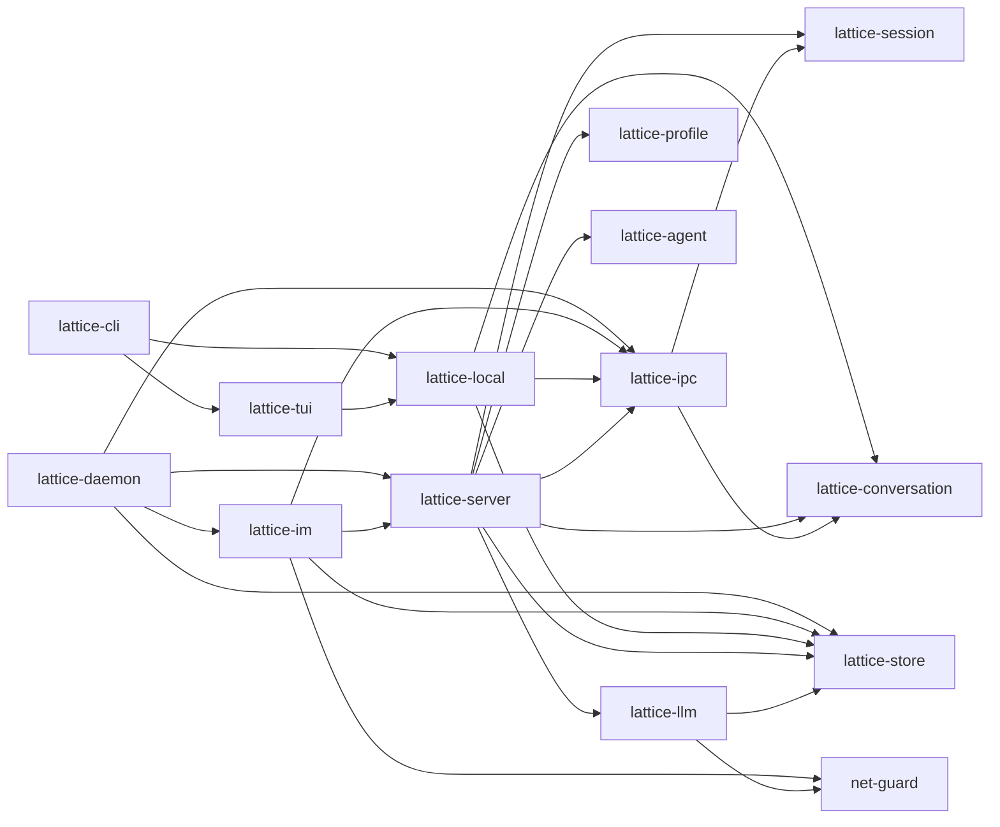

# Crate 职责与依赖边界

> 类型：架构合同
> 上位依据：[项目宪章](../governance/charter.md)、[工程规范](../development/engineering.md)
> 决策记录：[ADR 0011](../adr/0011-im-gateway-inside-backend.md)

本合同规定本地 IPC 协议（`lattice-ipc`）、本地前端客户端门面（`lattice-local`）、后台协调服务（`lattice-server`）、进程内 IM 网关库（`lattice-im`）、独立后台宿主（`lattice-daemon`）与前端（`lattice-cli`、`lattice-tui`）的职责切分、类型归属、依赖边界门禁与线上形状快照门禁。

## 组件与依赖关系

| Crate | 持有的状态与类型 | 执行的规则 | 对外接口 |
| --- | --- | --- | --- |
| [`lattice-ipc`](../../crates/lattice-ipc/src/lib.rs) | 本地 IPC 请求/响应/登录帧（`Request`、`Response`、`LoginAction`、`LoginResponse`，含 IM 凭据与重载消息；提交载荷含 `UserInputPart` 与 `TurnRequest<I>`，图片为标准 base64）、`LocalError` 与冲突/恢复诊断、模型查询与模型/凭据展示类型（含带后台 `diagnostic` 字段的 `ProviderAuthStatus`）、IM 与后台组件状态类型（`ImMountResult`、`ImAuthSetReply`、`ImAuthRemoveReply`、`ImCredentialStatus`、`ImPlatformAuthStatus`、`ImAuthStatus`、`ComponentState`、`ComponentStatus`）、`AuthKey`、共用的非上线排空时长 `DrainTimeout`、`PROTOCOL_VERSION`（当前为 `66`）及 `wire_shape.json` 基线 | 16 MiB 单帧魔数校验与分片拼回（版本不兼容时在持有连接期间经 `SO_PEERCRED` 附带对端进程号）、零载荷提交帧计长（`ipc::encoded_submit_len`，输入为读取图片字节前的 `PlannedTurnRequest`）、响应帧敏感缓冲清零、基于 `rustix` 的本进程有效 UID 读取与 Unix socket 对端 UID/PID 核验、本地目录所有者与权限核验（`ipc::check_dir`）、`--drain-timeout` 时长解析（`parse_drain_timeout`）、SIWC 登录 provider 参数校验（`require_chatgpt`）及线上形状逐字节快照比对 | 根模块显式重导出的协议类型（含 `UserInputPart`、`TurnRequest`、`PlannedTurnRequest`）、展示类型、`DrainTimeout`、`parse_drain_timeout`、`require_chatgpt` 与领域只读值类型（含图片与输入模态原语 `ImageMediaType`、`ImageRef`、`InputModality`，以及用户侧图文上限常量 `MAX_IMAGE_BYTES`、`MAX_USER_IMAGES_PER_TURN`、`MAX_USER_IMAGE_TOTAL_BYTES`、`MAX_USER_TEXT_BYTES`；`auth`、`drain_timeout`、`models`、`types` 为私有模块，其他 crate 用不到的条目保持私有），以及唯一公开子模块 `ipc` 的帧读写、`encoded_submit_len`、`MAX_FRAME`、目录权限与 UID/对端核验入口（`PROTOCOL_VERSION`、`MAGIC`、`magic_for_version` 与 `read` 仅在 `test` 或 `test-utils` 下导出） |
| [`lattice-local`](../../crates/lattice-local/src/lib.rs) | 客户端句柄（`LocalClient`、`LocalWatch`、`LocalTurn`）、不可序列化的客户端结果（`DetachReport`、`ConfigureOutcome`）、登录客户端句柄与授权链接包装（`LocalAuthLogin`、`AuthLoginEvent`、`SensitiveLoginUrl`）、退场等待句柄 `Departure`（测试与 `test-utils` 导出）及观察空闲阈值 `STREAM_IDLE_TIMEOUT_SECS` | 客户端 Unix socket 寻址与连接已运行的本地后台（未运行时返回中文 `not_running` 错误，不自动拉起后台）、请求（含 `im_auth_set`、`im_auth_remove`、`im_auth_status`、`im_reload`）与观察流驱动、客户端观察 idle 判定、提交/取消回执交接与 `detach` 退出收尾、`stop` 回执后的 socket 撤下与 `owner.lock` 释放等待（`Departure`）、同连接 SIWC 登录事件流读取与 Drop 清零中止、`SessionId` / `TurnId` 生成、图片字节与文件读取、粘贴探测核验与重读核对（`image_bytes_ref`、`image_file_ref`、`probe_image_file`、`read_verified_image`）、提交前本地预检（`check_turn_plan`）、面向人阅读的图片标记格式化（`format_image_marker`），以及基于 stderr 与 `NO_COLOR` 的日志初始化（`init_logging`） | 根模块扁平显式重导出门面（内部模块全部私有：对外提供 `LocalClient`、`LocalTurn`、`LocalAuthLogin`、`SensitiveLoginUrl`、`check_turn_plan`、`format_image_marker`、`image_bytes_ref`、`image_file_ref`、`probe_image_file`、`read_verified_image`、`init_logging`、`new_session_id`、`new_turn_id` 及前端所需的公开协议（含 `PlannedTurnRequest`）、组件/IM 回执、排空时长、对话与图片/输入模态原语（含 `MAX_IMAGE_BYTES`）、`PrivateDirectory`、`StateLayout` 类型；其他 crate 用不到的自有条目不公开，仅供测试复用的 `LocalWatch`、`Departure`、`test_support` 及底层客户端/重连方法收窄在 `test` 或 `test-utils` 下；前端经 `LocalTurn` 观察会话） |
| [`lattice-server`](../../crates/lattice-server/src/lib.rs) | 本地后台实例锁与监听端点（`InstanceLock`、`Instance`、`SocketEndpoint`）、`Backend` 与 `Owner` 运行态、进程内可选组件托管器与注册类型（`ComponentManager`、`ComponentRegistration`、`ComponentBuildOutcome`、`PreparedComponent`、`ComponentStop`、`ComponentRemountHandle`、`ScopedComponentFuture`）、进程内服务门面与只读轮次观察句柄（`Service`、`InProcessTurn`、`InProcessTurnOutcome`、`StopNotification`）、IM 平台凭据文件存储（`ImAuthStore`、`ImToken`、`ImPlatformCredentialState`、`ImAuthError`）、`ServeExit` / `DrainOutcome` / `HostLifecycle`、内部会话门面 `SessionApi`、`TurnCoordinator` 及 `ToolExecutor` 接缝 | 基于 `rustix::fs::flock` 的实例锁持有与残留 socket 核验、连接存活非阻塞 `PEEK` 探测、IPC 与进程内共用的 `Service` 操作分发及启动期根证书只读暴露（`Service::tls_roots_der`）、托管组件就绪后异步初始挂载/合并重新挂载/旧实例保留回退/组件作用域 panic 载荷抑制与故障隔离及停机第 3 步严格 10 秒上限收尾（[`local/components.rs`](../../crates/lattice-server/src/local/components.rs)）、`<config_dir>/im/auth.json` 的 `PrivateDirectory` 权限核验与严格零泄露读写（[`im_auth.rs`](../../crates/lattice-server/src/im_auth.rs)）及 IM IPC 分发、后台准入与独立 `Owner` 监督、就绪与停机开始时的宿主生命周期回调及状态感知停机通知、信号与 IPC `stop` 共用的有界停机顺序、会话与 Turn 协调、工作区规范路径解析与项目绑定核对（[`root.rs`](../../crates/lattice-server/src/root.rs)）、`ApiError` 到 `LocalError` 的映射（[`local/error.rs`](../../crates/lattice-server/src/local/error.rs)）、`lattice-llm` 类型与 IPC 展示类型的逐字段转换及后台供应商可用性诊断填充（[`local/presentation.rs`](../../crates/lattice-server/src/local/presentation.rs)） | 内部模块全部私有；生产公开面由根模块导出后台宿主入口、组件注册与 panic 作用域接口、进程内 `Service` 接口与 `im_auth` 凭据存储接口，测试专用导出按条件单独列出 |
| [`lattice-im`](../../crates/lattice-im/src/lib.rs) | 只读挂载构造结果 `ImBuildOutcome`、已就绪网关实例 `PreparedImGateway`、平台前缀身份键（`SenderKey`、`ChatKey`、`InboundId`）、相册收集状态机 `AlbumCollector`、私有台账 `Ledger`（v2，含 `Merged` 相位）、连续确认游标 `OffsetTracker`、活跃草稿登记与单对话节流表、无长度门槛脱敏器 `ImRedactor` 及唯一的测试替身接口 `TelegramIo` | 只读检查 `im/config.toml` 与 `ImAuthStore`、维护 `<state-root>/lattice/im/ledger` v2 相位（整组原子登记 `Registered` 与 `Merged`）与窗口清理、启动期遗留 `Registered` 同对话准入屏障与并行恢复、Telegram 私聊白名单与文本/单图/`media_group_id` 多图相册接入及六项内置命令处理、固定公网地址与后台启动期根证书的 HTTPS 长轮询/受控 `getFile` 流式下载与魔数核验/消息发送、后台图片模态与请求体大小拒绝引导、单对话 1 秒草稿节流与 25 秒保活、草稿停止按钮取消、4096 字符三级切分及停止时的子任务排空（见[IM 网关](im.md)） | 内部子模块全部私有；根模块仅导出 `prepare_im_gateway`、`ImBuildOutcome`、`PreparedImGateway` 与 `ImGatewayError` 四项，仅供 `lattice-daemon` 消费 |
| [`lattice-daemon`](../../crates/lattice-daemon/src/main.rs) | 中文命令行参数 `Cli`（`--state-root`、`--drain-timeout`）、宿主回调实现 `DaemonLifecycle`、私有的 `$NOTIFY_SOCKET` 通知器 `Notifier`（[`notify.rs`](../../crates/lattice-daemon/src/notify.rs)）以及 IM 组件宿主 `ImHost` 与异步 `inotify` 监视器（[`im.rs`](../../crates/lattice-daemon/src/im.rs)、[`im_watch.rs`](../../crates/lattice-daemon/src/im_watch.rs)） | 校验必填绝对路径 `--state-root`、直接配置 `tracing-subscriber` 日志与显式 Tokio runtime、监听 `SIGTERM` 与 `SIGINT`、安装受托管组件 panic hook、注册 `"im"` 组件（启动准备 `0700` `~/.lattice/im`、按目录 inode 建立与恢复 `rustix::fs::inotify` 配置监视、桥接 `lattice_im::prepare_im_gateway`）、经 `rustix::net` 非阻塞数据报发送 `READY=1` 与 `STOPPING=1`、状态根被占用时经 `SO_PEERCRED` 探测对端进程号并退出 `3`、将 `ServeExit` 映射为 `0`/`1`/`2`/`3`/`4` 退出码并持有 `InstanceLock` 直至进程退出 | 纯二进制 crate（`lattice-daemon`），不提供库目标，不公开内部模块，不定义测试转发 feature |

### `lattice-server` 公开面

`lattice-server` 的内部子模块（`local`、`im_auth`、`turn`、`root`、`session`、`configure`、`profile`、`config_rejection`、`redact`、`stores`）全部私有，不重导出其他 crate 的领域类型：

| 公开层级 | 导出条件 | 根模块导出项 |
| --- | --- | --- |
| 生产公开面 | 无条件导出 | `serve`、`ServeExit`（公开 `drain`、`failure`、`instance`、`shutdown_deadline` 字段）、`DrainOutcome`、`HostLifecycle`（`on_ready`、`on_stopping`）、`InstanceLock`（不透明句柄，内部字段私有）、`ComponentRegistration`、`ComponentBuildOutcome`、`PreparedComponent`、`ComponentStop`、`ComponentRemountHandle`、`ScopedComponentFuture`、`install_component_panic_hook`、`scoped_component_future`、`with_component_panic_scope`、`Service`（含 `tls_roots_der`）、`InProcessTurn`、`InProcessTurnOutcome`、`StopNotification`、`ImAuthStore`、`ImAuthError`、`ImToken`、`ImPlatformCredentialState`、`TELEGRAM_PLATFORM` |
| 测试专用导出 | `#[cfg(any(test, feature = "test-utils"))]` | `serve_for_test`、`serve_for_test_with_service`、`serve_for_test_with_components`、`SessionApi`（`from_store`、`resolve_session`、`usage`）、`ApiError`、`ConfigRejection`、`LocalWorkspaceRoot`（`from_path`、`canonical_path`、`project_path`）、`start_turn`、`RunTurnRequest`、`TurnAcceptance`、`TurnCompletion`、`TurnExecution`、`ToolExecutor`、`TurnTools`、`ToolSpec`、`ToolOutcome` |

- `SessionApi`、`ToolExecutor` 等类型在生产构建中作为内部实现参与后台协调，但只向测试与 `test-utils` 导出；同进程阻塞式辅助函数 `run_turn` 仅在 `#[cfg(test)]` 下供本 crate 单元测试使用，不对外导出。

## 类型归属与门面传递

| 类型类别 | 定义与持有者 | 跨边界传递规则 |
| --- | --- | --- |
| IPC 请求、响应、登录帧与传输材料 | `lattice-ipc`（[`types.rs`](../../crates/lattice-ipc/src/types.rs)、[`auth.rs`](../../crates/lattice-ipc/src/auth.rs)，经根模块导出） | `lattice-local` 与 `lattice-server` 在各自内部使用 `Request`、`Response`、`AuthLoggedOut`、`LoginAction`、`LoginResponse` 与 `AuthKey`，均不将它们重导出到公开门面 |
| 登录授权 URL 包装 | `lattice-local`（[`login.rs`](../../crates/lattice-local/src/login.rs)）与 `lattice-llm`（[`auth/siwc/mod.rs`](../../crates/lattice-llm/src/auth/siwc/mod.rs)） | 后台持有 `lattice_llm::auth::SensitiveLoginUrl`，前端持有独立的 `lattice_local::SensitiveLoginUrl`（只提供 `new` 与 `expose`，不实现 `Debug`、`Display`、`Serialize`、`Deref` 或隐式转换），两端仅通过 IPC 的 `AuthKey` 交换 |
| IM 平台凭据、组件托管与进程内服务句柄 | `lattice-server`（[`im_auth.rs`](../../crates/lattice-server/src/im_auth.rs)、[`local/components.rs`](../../crates/lattice-server/src/local/components.rs)、[`local/service.rs`](../../crates/lattice-server/src/local/service.rs)，经根模块导出） | `ImAuthStore` 与零化包装 `ImToken`（不实现 `Debug` 或 `Display`）由 `lattice-server` 持有并供进程内组件（如 `lattice-im`）只读访问；`ComponentRegistration` 与 `ComponentRemountHandle` 供 `lattice-daemon` 挂载与重新挂载进程内组件；`Service` 额外只读暴露后台启动期信任根字节 `tls_roots_der()`，使 `lattice-im` 与 `lattice-daemon` 无需依赖 `lattice-llm` |
| 模型查询与模型/凭据展示类型 | `lattice-ipc`（[`models.rs`](../../crates/lattice-ipc/src/models.rs)、[`auth.rs`](../../crates/lattice-ipc/src/auth.rs)，经根模块导出） | 后台在调用 `lattice-llm` 前将 IPC `ModelCandidateQuery` 转为 `lattice-llm` 查询，在脱敏完成后将 `lattice-llm` 的模型候选与凭据状态逐字段转为 `lattice-ipc` 展示类型；不经 JSON 往返，也不重新计算可用性、价格、档位或告警，转换测试直接针对手写契约值断言枚举全分支及结构体 `full`/`minimal` 形态（仅测试使用的反向转换保持 `#[cfg(test)]`） |
| 供应商可用性诊断文案 | `lattice-llm`（[`availability.rs`](../../crates/lattice-llm/src/availability.rs)） | 诊断文案由 `lattice-llm::Availability::diagnostic` 单一持有，后台在 [`local/presentation.rs`](../../crates/lattice-server/src/local/presentation.rs) 结合自身配置目录下的 `<config_dir>/providers.toml` 生成 `ProviderAuthStatus.diagnostic: Option<String>`（`Ready` 为 `None`）并随 `AuthStatus` 与 `AuthLoginResult::SignedIn` 经 IPC 下发；`lattice-ipc` 与前端不再重复维护诊断文案或本地拼接配置路径 |
| 会话与对话领域值类型 | `lattice-session`、`lattice-conversation` | 持久格式、校验与存储事务归原 crate 持有；`lattice-ipc` 仅按线上消息所需显式选择性重导出领域只读值类型，再由 `lattice-local` 扁平重导出给前端，不重导出 `SessionStore` 或写入接口 |
| 共用的 `--drain-timeout` 时长解析 | [`lattice-ipc`](../../crates/lattice-ipc/src/lib.rs)（私有模块 [`drain_timeout.rs`](../../crates/lattice-ipc/src/drain_timeout.rs)，经根模块显式导出） | `DrainTimeout` 与 `parse_drain_timeout` 只用于命令行参数解析，不实现 `serde`、不进入线上快照；`lattice-daemon` 直接使用 `lattice-ipc` 的导出，`lattice-local` 为 CLI 重导出所需条目 |
| 前端与后台托管消费路径 | `lattice-tui`、`lattice-cli`、`lattice-im`、`lattice-daemon` | `lattice-tui` 只依赖 `lattice-local`；`lattice-cli` 只依赖 `lattice-local` 与 `lattice-tui`，不再依赖 `lattice-server`；`lattice-im` 只依赖 `lattice-server`、`lattice-ipc`、`lattice-store` 与 `net-guard`，且整个工作区中只有 `lattice-daemon` 允许依赖 `lattice-im`；后台守护进程由独立的 `lattice-daemon` 二进制承担 |

## 依赖边界门禁

[`xtask/src/crate_boundary.rs`](../../xtask/src/crate_boundary.rs) 同时执行七条内部直接依赖检查（`RULES`）、一条内部独占消费限制检查（`EXCLUSIVE_CONSUMER_RULES`）与三条普通依赖闭包检查（`CLOSURE_RULES`）；门禁在本地 `cargo xtask ci` 与 GitHub Actions（`ci.yml`、`full-gate.yml`）中一并运行，并以中文输出总结、分组标签与违规/异常诊断（包名、依赖段名、`target` 表达式、依赖改名与 Cargo 原始错误保持原文）。

### 内部直接依赖规则

检查 `cargo metadata --no-deps` 中受检包的 `dependencies` 与 `build-dependencies`（含 `optional`、改名 `package = "..."` 与全部 `target.'cfg(...)'` 声明；外部第三方 crate、workspace 外的 path crate 与 `dev-dependencies` 不计入）：

| 受检包 | 内部直接依赖规则 |
| --- | --- |
| `lattice-ipc` | 只允许依赖 `lattice-session`、`lattice-conversation`、`lattice-store` |
| `lattice-tui` | 只允许依赖 `lattice-local` |
| `lattice-local` | 只允许依赖 `lattice-ipc`、`lattice-conversation`、`lattice-store` |
| `lattice-cli` | 只允许依赖 `lattice-local`、`lattice-tui` |
| `lattice-daemon` | 只允许依赖 `lattice-server`、`lattice-ipc`、`lattice-store`、`lattice-im` |
| `lattice-im` | 只允许依赖 `lattice-server`、`lattice-ipc`、`lattice-store`、`net-guard` |
| `lattice-server` | 禁止依赖 `lattice-local`（`dev-dependencies` 用于协议与后台测试除外） |

### 内部独占消费限制

遍历 `cargo metadata --no-deps` 中的**全部** workspace 成员（跳过被保护目标自身），同时检查 `dependencies`、`build-dependencies` **与 `dev-dependencies`**（含 `optional`、改名 `package = "..."` 与全部 `target.'cfg(...)'` 声明）：

| 被保护内部包 | 唯一允许声明依赖的 workspace 成员 |
| --- | --- |
| `lattice-im` | `lattice-daemon`（其余全部成员连 `dev-dependencies` 亦禁止依赖 `lattice-im`） |

### 普通依赖闭包规则

读取启用全部 workspace feature 的完整 `cargo metadata --all-features`，按 `PackageId` 建图，只沿 `dep_kinds` 中含 `normal` 的边遍历（穿透外部中间包，忽略只含 `dev` 与只含 `build` 的边），用 `visited` 集合防环；命中禁止包时以中文报告完整依赖路径，缺少 `resolve`、缺少受检包或出现悬空节点时直接以中文报错失败：

| 闭包根包 | 禁止出现在普通依赖闭包中的包 |
| --- | --- |
| `lattice-tui` | `lattice-server`、`lattice-llm`、`lattice-profile`、`lattice-agent`、`lattice-im` |
| `lattice-local` | `lattice-server`、`lattice-llm`、`lattice-profile`、`lattice-agent`、`lattice-im` |
| `lattice-cli` | `lattice-server`、`lattice-llm`、`lattice-profile`、`lattice-agent`、`lattice-im` |

- `lattice-session` 与 `redb` 允许出现在 `lattice-local`、`lattice-tui` 与 `lattice-cli` 的普通依赖闭包中：`lattice-ipc` 的线上类型复用 `lattice-session` 的会话视图类型，而 `lattice-session` 同时持有 `redb` 会话库实现。

## 线上形状快照门禁

[`crates/lattice-ipc/src/wire_shape/`](../../crates/lattice-ipc/src/wire_shape/mod.rs) 对本地 IPC 协议闭包内的枚举变体、结构体 `full`/`minimal` 形态与场景帧维护逐字节 JSON 快照基线 [`wire_shape.json`](../../crates/lattice-ipc/src/wire_shape.json)，并与 `PROTOCOL_VERSION` 绑定：

- 快照夹具直接构造 `lattice-ipc`、会话与对话类型，不调用后台转换函数生成输入。
- 默认测试下，任何字段顺序、标签、空值省略或版本字节差异均直接失败；故意调整线上格式时须先递增 `PROTOCOL_VERSION`，再显式设置 `LATTICE_UPDATE_WIRE_SHAPE=1` 更新基线。

## 范围之外

- 实例锁（`owner.lock`）、socket 绑定与清理时序、后台任务监督、工作区规范路径解析、配置脱敏与凭据文件读写由 `lattice-server` 与 `lattice-llm` 承担，`lattice-ipc` 与 `lattice-local` 不持有后台运行态或会话库写句柄。
- `lattice-system-harness` 的零产品 crate 依赖与生产 `test-*` feature 隔离由 [`xtask/src/harness_boundary.rs`](../../xtask/src/harness_boundary.rs) 独立检查，见[测试工程](../development/testing.md)。

## 验证

| 检查项 | 命令 |
| --- | --- |
| 内部直接依赖、独占消费与普通依赖闭包门禁 | `cargo xtask crate-boundary` |
| 本地前端客户端句柄、观察流与登录状态机 | `cargo test -p lattice-local` |
| 本地 IPC 线上形状快照与分帧测试 | `env -u LATTICE_UPDATE_WIRE_SHAPE cargo test -p lattice-ipc` |
| 后台展示类型转换、IM 凭据存储与端到端接线 | `cargo test -p lattice-server` |
| IM 网关配置、台账、命令、草稿与真实 `Service` 集成 | `cargo test -p lattice-im` |
| 后台宿主参数、目录准备与 `inotify` 监视恢复 | `cargo test -p lattice-daemon` |
| 全量门禁 | `TMPDIR=/tmp cargo xtask ci` |
