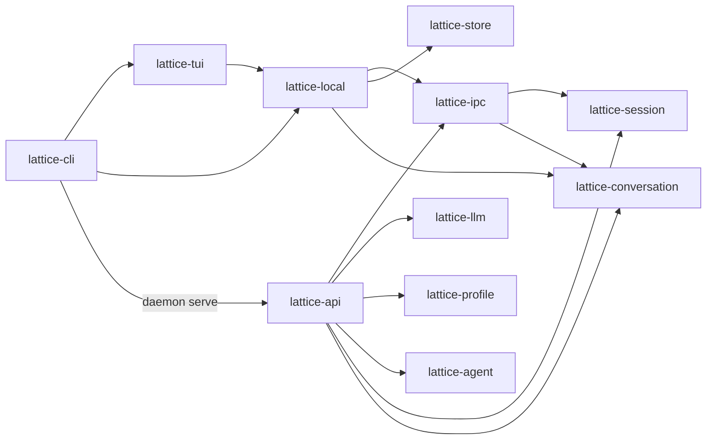

# Crate 职责与依赖边界

> 类型：架构合同
> 上位依据：[项目宪章](../governance/charter.md)、[工程规范](../development/engineering.md)
> 决策记录：[ADR 0011](../adr/0011-im-gateway-inside-backend.md)

本合同规定本地 IPC 协议（`lattice-ipc`）、本地前端客户端门面（`lattice-local`）、后台协调服务（`lattice-api`）与前端（`lattice-cli`、`lattice-tui`）的职责切分、类型归属、依赖边界门禁与线上形状快照门禁。

## 组件与依赖关系

| Crate | 持有的状态与类型 | 执行的规则 | 对外接口 |
| --- | --- | --- | --- |
| [`lattice-ipc`](../../crates/lattice-ipc/src/lib.rs) | 本地 IPC 请求/响应/登录帧（`Request`、`Response`、`LoginAction`、`LoginResponse`）、`LocalError` 与冲突/恢复诊断、模型查询与模型/凭据展示类型（含 `Availability`）、`AuthKey`、`PROTOCOL_VERSION`（当前为 `63`）及 `wire_shape.json` 基线 | 16 MiB 单帧魔数校验与分片拼回、响应帧敏感缓冲清零、基于 `rustix` 的本进程有效 UID 读取与 Unix socket 对端 UID 核验、本地目录所有者与权限核验（`ipc::check_dir`）、SIWC 登录 provider 参数校验（`require_chatgpt`）、展示侧供应商可用性诊断文案（`Availability::diagnostic`）及线上形状逐字节快照比对 | 根模块显式重导出的协议类型、展示类型、`require_chatgpt` 与领域只读值类型（`auth`、`models`、`types` 为私有模块，其他 crate 用不到的条目保持私有），以及唯一公开子模块 `ipc` 的帧读写、目录权限与 UID/对端核验入口（`PROTOCOL_VERSION`、`MAGIC`、`MAX_FRAME`、`magic_for_version` 与 `read` 仅在 `test` 或 `test-utils` 下导出） |
| [`lattice-local`](../../crates/lattice-local/src/lib.rs) | 客户端句柄（`LocalClient`、`LocalWatch`、`LocalTurn`）、不可序列化的客户端结果（`DetachReport`、`ConfigureOutcome`）、登录客户端句柄与授权链接包装（`LocalAuthLogin`、`AuthLoginEvent`、`SensitiveLoginUrl`）、退场等待句柄 `Departure`（测试与 `test-utils` 导出）及观察空闲阈值 `STREAM_IDLE_TIMEOUT_SECS` | 客户端 Unix socket 寻址、按需拉起后台与连接重试、请求与观察流驱动、客户端观察 idle 判定、提交/取消回执交接与 `detach` 退出收尾、`stop` 回执后的 socket 撤下与 `owner.lock` 释放等待（`Departure`）、同连接 SIWC 登录事件流读取与 Drop 清零中止、`SessionId` / `TurnId` 生成，以及基于 stderr 与 `NO_COLOR` 的日志初始化（`init_logging`） | 根模块扁平显式重导出门面（内部模块全部私有：对外提供 `LocalClient`、`LocalTurn`、`LocalAuthLogin`、`SensitiveLoginUrl`、`init_logging`、`new_session_id`、`new_turn_id` 及前端所需的公开协议、对话与 `StateLayout` 类型；其他 crate 用不到的自有条目不公开，仅供测试复用的 `LocalWatch`、`Departure`、`test_support` 及底层客户端/重连方法收窄在 `test` 或 `test-utils` 下；前端经 `LocalTurn` 观察会话） |
| [`lattice-api`](../../crates/lattice-api/src/lib.rs) | 本地后台实例锁与监听端点（`InstanceLock`、`Instance`、`SocketEndpoint`）、`Backend` 与 `Owner` 运行态、`ServeExit` / `DrainOutcome`、`SessionApi`、`TurnCoordinator` 及 `ToolExecutor` 接缝 | 实例锁持有与残留 socket 核验、后台会话与 Turn 协调、工作区规范路径解析与项目绑定核对（[`root.rs`](../../crates/lattice-api/src/root.rs)）、`ApiError` 到 `LocalError` 的映射（[`local/error.rs`](../../crates/lattice-api/src/local/error.rs)）、`lattice-llm` 类型与 IPC 展示类型的逐字段转换（[`local/presentation.rs`](../../crates/lattice-api/src/local/presentation.rs)） | `local::serve`、`local::InstanceLock`、`local::ServeExit`、`local::DrainOutcome`、`SessionApi`、`start_turn` 与工具执行接缝 |

## 类型归属与门面传递

| 类型类别 | 定义与持有者 | 跨边界传递规则 |
| --- | --- | --- |
| IPC 请求、响应、登录帧与传输材料 | `lattice-ipc`（[`types.rs`](../../crates/lattice-ipc/src/types.rs)、[`auth.rs`](../../crates/lattice-ipc/src/auth.rs)，经根模块导出） | `lattice-local` 与 `lattice-api` 在各自内部使用 `Request`、`Response`、`AuthLoggedOut`、`LoginAction`、`LoginResponse` 与 `AuthKey`，均不将它们重导出到公开门面 |
| 登录授权 URL 包装 | `lattice-local`（[`login.rs`](../../crates/lattice-local/src/login.rs)）与 `lattice-llm`（[`auth/siwc/mod.rs`](../../crates/lattice-llm/src/auth/siwc/mod.rs)） | 后台继续持有 `lattice_llm::auth::SensitiveLoginUrl`，前端持有独立的 `lattice_local::SensitiveLoginUrl`（只提供 `new` 与 `expose`，不实现 `Debug`、`Display`、`Serialize`、`Deref` 或隐式转换），两端仅通过 IPC 的 `AuthKey` 交换 |
| 模型查询与模型/凭据展示类型 | `lattice-ipc`（[`models.rs`](../../crates/lattice-ipc/src/models.rs)、[`auth.rs`](../../crates/lattice-ipc/src/auth.rs)，经根模块导出） | 后台在调用 `lattice-llm` 前将 IPC `ModelCandidateQuery` 转为 `lattice-llm` 查询，在脱敏完成后将 `lattice-llm` 的模型候选与凭据状态逐字段转为 `lattice-ipc` 展示类型；不经 JSON 往返，也不重新计算可用性、价格、档位或告警，转换测试直接针对手写契约值断言枚举全分支及结构体 `full`/`minimal` 形态（仅测试使用的反向转换保持 `#[cfg(test)]`） |
| 供应商可用性诊断文案 | `lattice-llm`（[`availability.rs`](../../crates/lattice-llm/src/availability.rs)）与 `lattice-ipc`（[`models.rs`](../../crates/lattice-ipc/src/models.rs)） | 同一份英文文案在两处各有一份：后台使用 `lattice-llm` 的，前端调用 `lattice_ipc::Availability::diagnostic`；`lattice-api`（[`local/presentation.rs`](../../crates/lattice-api/src/local/presentation.rs)）的逐变体对照测试两侧都用无通配符匹配，保证两份逐字一致 |
| 会话与对话领域值类型 | `lattice-session`、`lattice-conversation` | 持久格式、校验与存储事务归原 crate 持有；`lattice-ipc` 仅按线上消息所需显式选择性重导出领域只读值类型，再由 `lattice-local` 扁平重导出给前端，不重导出 `SessionStore` 或写入接口 |
| 前端与后台托管消费路径 | `lattice-tui`、`lattice-cli` | `lattice-tui` 只依赖 `lattice-local`；`lattice-cli` 的客户端命令与日志初始化全部经 `lattice-local` 完成，只有 `daemon serve` 子命令经 `lattice-api`（`lattice_api::local::serve`）运行本地后台 |

## 依赖边界门禁

[`xtask/src/crate_boundary.rs`](../../xtask/src/crate_boundary.rs) 同时执行四条内部直接依赖检查（`RULES`）与两条普通依赖闭包检查（`CLOSURE_RULES`），`dev-dependencies` 均不计入；门禁在本地 `cargo xtask ci` 与 GitHub Actions（`ci.yml`、`full-gate.yml`）中一并运行，并以中文输出总结、分组标签与违规/异常诊断（包名、依赖段名、`target` 表达式、依赖改名与 Cargo 原始错误保持原文）。

### 内部直接依赖规则

检查 `cargo metadata --no-deps` 中受检包的 `dependencies` 与 `build-dependencies`（含 `optional`、改名 `package = "..."` 与全部 `target.'cfg(...)'` 声明；外部第三方 crate、workspace 外的 path crate 与 `dev-dependencies` 不计入）：

| 受检包 | 内部直接依赖规则 |
| --- | --- |
| `lattice-ipc` | 只允许依赖 `lattice-session`、`lattice-conversation`、`lattice-store` |
| `lattice-tui` | 只允许依赖 `lattice-local` |
| `lattice-local` | 只允许依赖 `lattice-ipc`、`lattice-conversation`、`lattice-store` |
| `lattice-api` | 禁止依赖 `lattice-local`（`dev-dependencies` 用于协议与后台测试除外） |

### 普通依赖闭包规则

读取启用全部 workspace feature 的完整 `cargo metadata --all-features`，按 `PackageId` 建图，只沿 `dep_kinds` 中含 `normal` 的边遍历（穿透外部中间包，忽略纯 `dev` 与纯 `build` 边），用 `visited` 集合防环；命中禁止包时以中文报告完整依赖路径，缺少 `resolve`、缺少受检包或出现悬空节点时直接以中文报错失败：

| 闭包根包 | 禁止出现在普通依赖闭包中的包 |
| --- | --- |
| `lattice-tui` | `lattice-api`、`lattice-llm`、`lattice-profile`、`lattice-agent` |
| `lattice-local` | `lattice-api`、`lattice-llm`、`lattice-profile`、`lattice-agent` |

- `lattice-cli` 经 `lattice-api` 运行 `daemon serve`，不在普通依赖闭包规则之列。
- `lattice-session` 与 `redb` 允许出现在 `lattice-local` 与 `lattice-tui` 的普通依赖闭包中：`lattice-ipc` 的线上类型复用 `lattice-session` 的会话视图类型，而 `lattice-session` 同时持有 `redb` 会话库实现。

## 线上形状快照门禁

[`crates/lattice-ipc/src/wire_shape/`](../../crates/lattice-ipc/src/wire_shape/mod.rs) 对本地 IPC 协议闭包内的枚举变体、结构体 `full`/`minimal` 形态与场景帧维护逐字节 JSON 快照基线 [`wire_shape.json`](../../crates/lattice-ipc/src/wire_shape.json)，并与 `PROTOCOL_VERSION` 绑定：

- 快照夹具直接构造 `lattice-ipc`、会话与对话类型，不调用后台转换函数生成输入。
- 默认测试下，任何字段顺序、标签、空值省略或版本字节差异均直接失败；故意调整线上格式时须先递增 `PROTOCOL_VERSION`，再显式设置 `LATTICE_UPDATE_WIRE_SHAPE=1` 更新基线。

## 范围之外

- 实例锁（`owner.lock`）、socket 绑定与清理时序、后台任务监督、工作区规范路径解析、配置脱敏与凭据文件读写由 `lattice-api` 与 `lattice-llm` 承担，`lattice-ipc` 与 `lattice-local` 不持有后台运行态或会话库写句柄。
- `lattice-system-harness` 的零产品 crate 依赖与生产 `test-*` feature 隔离由 [`xtask/src/harness_boundary.rs`](../../xtask/src/harness_boundary.rs) 独立检查，见[测试工程](../development/testing.md)。

## 验证

| 检查项 | 命令 |
| --- | --- |
| 内部直接依赖与普通依赖闭包门禁 | `cargo xtask crate-boundary` |
| 本地前端客户端句柄、观察流与登录状态机 | `cargo test -p lattice-local` |
| 本地 IPC 线上形状快照与分帧测试 | `env -u LATTICE_UPDATE_WIRE_SHAPE cargo test -p lattice-ipc` |
| 后台展示类型转换与端到端接线 | `cargo test -p lattice-api` |
| 全量门禁 | `TMPDIR=/tmp cargo xtask ci` |
