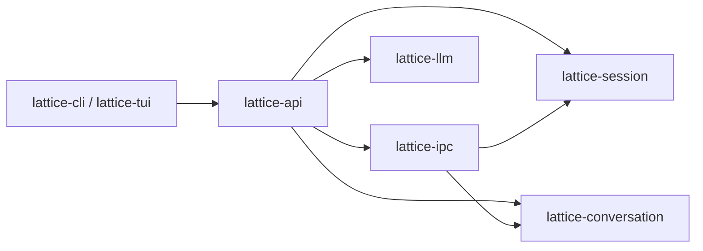

# Crate 职责与依赖边界

> 类型：架构合同
> 上位依据：[项目宪章](../governance/charter.md)、[工程规范](../development/engineering.md)
> 决策记录：[ADR 0011](../adr/0011-im-gateway-inside-backend.md)

本合同规定本地 IPC 协议 crate 与应用协调门面 crate 的职责切分、线上类型归属、内部直接依赖白名单与线上形状快照门禁。

## 组件与依赖关系

| Crate | 持有的状态与类型 | 执行的规则 | 对外接口 |
| --- | --- | --- | --- |
| [`lattice-ipc`](../../crates/lattice-ipc/src/lib.rs) | 本地 IPC 请求/响应/登录帧（`Request`、`Response`、`LoginAction`、`LoginResponse`）、`LocalError` 与冲突/恢复诊断、模型查询与模型/凭据展示类型、`AuthKey`、`PROTOCOL_VERSION`（当前为 `63`）及 `wire_shape.json` 基线 | 16 MiB 单帧魔数校验与分片拼回、响应帧敏感缓冲清零、基于 `rustix` 的本进程有效 UID 读取与 Unix socket 对端 UID 核验、线上形状逐字节快照比对 | 根模块显式重导出的协议类型、展示类型与领域只读值类型（`auth`、`models`、`types` 为私有模块），以及 `ipc` 模块的读写与 UID/对端核验入口（`PROTOCOL_VERSION`、`MAGIC`、`MAX_FRAME`、`magic_for_version` 与 `read` 仅在 `test-utils` 下导出） |
| [`lattice-api`](../../crates/lattice-api/src/lib.rs) | 本地后台实例锁与 socket 端点（`InstanceLock`、`Instance`、`SocketEndpoint`、`Departure`）、`Backend` 与 `Owner` 运行态、`LocalClient` / `LocalTurn` / `LocalAuthLogin` 客户端句柄、不可序列化的客户端结果（`DetachReport`、`ConfigureOutcome`） | 实例锁持有与残留 socket 核验、后台会话与 Turn 协调、`ApiError` 到 `LocalError` 的映射（[`local/error.rs`](../../crates/lattice-api/src/local/error.rs)）、`lattice-llm` 类型与 IPC 展示类型的双向逐字段转换（[`local/presentation.rs`](../../crates/lattice-api/src/local/presentation.rs)） | `SessionApi`、`local::LocalClient`、`local::serve`、`availability_diagnostic`，以及面向前端显式重导出的公开类型 |

## 类型归属与门面传递

| 类型类别 | 定义与持有者 | 跨边界传递规则 |
| --- | --- | --- |
| IPC 请求、响应、登录帧与传输材料 | `lattice-ipc`（[`types.rs`](../../crates/lattice-ipc/src/types.rs)、[`auth.rs`](../../crates/lattice-ipc/src/auth.rs)，经根模块导出） | `lattice-api` 在模块内部使用 `Request`、`Response`、`AuthLoggedOut`、`LoginAction`、`LoginResponse` 与 `AuthKey`，不将它们重导出到公开门面 |
| 模型查询与模型/凭据展示类型 | `lattice-ipc`（[`models.rs`](../../crates/lattice-ipc/src/models.rs)、[`auth.rs`](../../crates/lattice-ipc/src/auth.rs)，经根模块导出） | 后台在调用 `lattice-llm` 前将 IPC `ModelCandidateQuery` 转为 `lattice-llm` 查询，在脱敏完成后将 `lattice-llm` 的模型候选与凭据状态逐字段转为 `lattice-ipc` 展示类型；不经 JSON 往返，也不重新计算可用性、价格、档位或告警，转换测试直接针对手写契约值断言枚举全分支及结构体 `full`/`minimal` 形态 |
| 供应商可用性诊断文案 | `lattice-llm`（[`availability.rs`](../../crates/lattice-llm/src/availability.rs)） | 文案规则只保留在 `lattice-llm::Availability::diagnostic` 一处；前端通过 `lattice_api::availability_diagnostic` 传入 IPC `Availability`，由 `lattice-api` 穷尽还原后调用 |
| 会话与对话领域值类型 | `lattice-session`、`lattice-conversation` | 持久格式、校验与存储事务归原 crate 持有；`lattice-ipc` 仅按线上消息所需显式选择性重导出领域值类型，不重导出 `SessionStore` 或写入接口 |
| 前端消费路径 | `lattice-cli`、`lattice-tui` | 当前经 `lattice-api`（含 `lattice_api::local`）显式重导出路径使用公开协议类型与展示类型 |

## 依赖白名单门禁

当前受 `xtask` 分层门禁约束的内部直接依赖规则只有一条：

| 受检包 | 检查的依赖段 | 允许的 workspace 成员白名单 | 不受限范围 |
| --- | --- | --- | --- |
| `lattice-ipc` | `dependencies`、`build-dependencies`（含 `optional`、改名 `package = "..."` 与全部 `target.'cfg(...)'` 声明） | `lattice-session`、`lattice-conversation`、`lattice-store` | 外部第三方 crate、workspace 外的 path crate，以及 `dev-dependencies` |

判定规则（实现于 [`xtask/src/crate_boundary.rs`](../../xtask/src/crate_boundary.rs)）：

1. 读取 `cargo metadata --no-deps`，以 `workspace_members` 识别内部成员，不按包名前缀推断。
2. 遍历受检包 `packages[].dependencies` 的全部 `normal` 与 `build` 声明；改名依赖按真实包名判定，违规诊断同时报告真实包名与别名。
3. 读不到受检包或无法识别依赖身份时直接报错失败，不当作通过。

## 线上形状快照门禁

[`crates/lattice-ipc/src/wire_shape/`](../../crates/lattice-ipc/src/wire_shape/mod.rs) 对本地 IPC 协议闭包内的枚举变体、结构体 `full`/`minimal` 形态与场景帧维护逐字节 JSON 快照基线 [`wire_shape.json`](../../crates/lattice-ipc/src/wire_shape.json)，并与 `PROTOCOL_VERSION` 绑定：

- 快照夹具直接构造 `lattice-ipc`、会话与对话类型，不调用后台转换函数生成输入。
- 默认测试下，任何字段顺序、标签、空值省略或版本字节差异均直接失败；故意调整线上格式时须先递增 `PROTOCOL_VERSION`，再显式设置 `LATTICE_UPDATE_WIRE_SHAPE=1` 更新基线。

## 范围之外

- 实例锁（`owner.lock`）、socket 绑定与清理时序、后台任务监督、配置脱敏与凭据文件读写由 `lattice-api` 与 `lattice-llm` 承担，`lattice-ipc` 不接触文件系统锁或运行时后台状态。
- `lattice-system-harness` 的零产品 crate 依赖与生产 `test-*` feature 隔离由 [`xtask/src/harness_boundary.rs`](../../xtask/src/harness_boundary.rs) 独立检查，见[测试工程](../development/testing.md)。

## 验证

| 检查项 | 命令 |
| --- | --- |
| `lattice-ipc` 内部直接依赖白名单 | `cargo xtask crate-boundary` |
| 本地 IPC 线上形状快照与分帧测试 | `env -u LATTICE_UPDATE_WIRE_SHAPE cargo test -p lattice-ipc` |
| 后台展示类型转换与端到端接线 | `cargo test -p lattice-api` |
| 全量门禁 | `TMPDIR=/tmp cargo xtask ci` |
