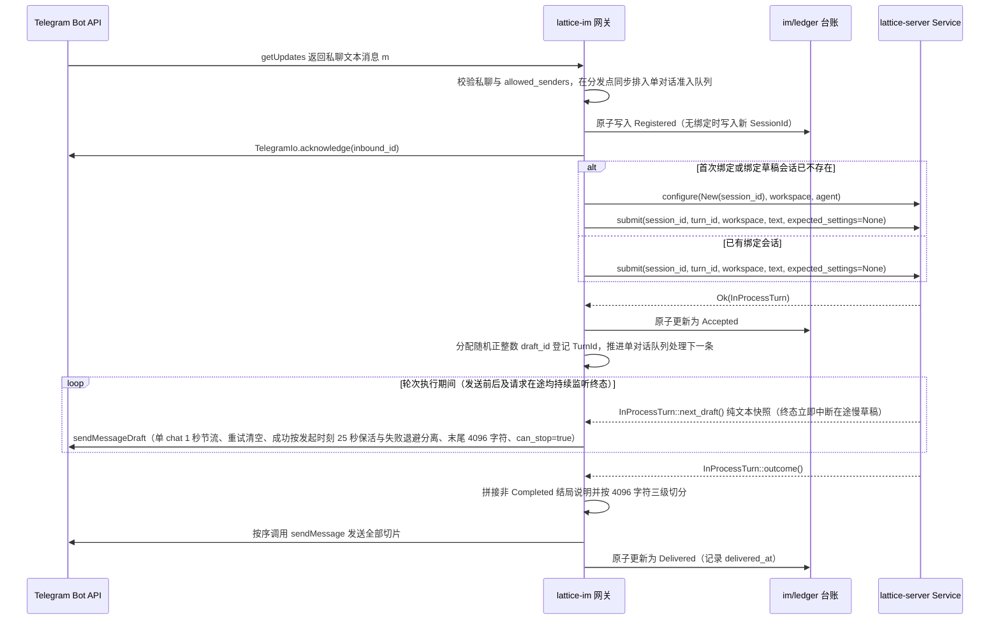

# IM 网关

> 类型：架构合同
> 上位依据：[项目宪章](../governance/charter.md)、[工程规范](../development/engineering.md)
> 决策记录：[ADR 0011](../adr/0011-im-gateway-inside-backend.md)

本合同规定本地后台进程内 [IM 网关](../reference/glossary.md)组件从宿主托管（`lattice-daemon` 与 `lattice-server`）、平台凭据存储（[`im_auth`](../../crates/lattice-server/src/im_auth.rs)）、IPC 与 CLI 管理（`lattice im`、`lattice daemon status`）到外部消息平台私聊纯文本对话接入（[`lattice-im`](../../crates/lattice-im/src/lib.rs)）、[台账](../reference/glossary.md)相位、并行恢复、命令语义、流式草稿与回复切分的完整规则。当前首个支持平台为 Telegram。

## 概念

| 概念 | 含义 | 状态持有者 | 生命周期 |
| --- | --- | --- | --- |
| 托管组件槽位 | 后台按组件名（`"im"`）维护的挂载状态、运行实例句柄、停止通知与合并重新挂载协调器 | `lattice-server`（`local/components.rs`） | 随 `lattice_server::serve` 启动完成初始挂载，运行期响应 IPC 或 `inotify` 重新挂载，停机第 3 步统一收尾 |
| IM 网关实例 | 经只读配置与凭据检查后构造并运行的平台接入循环（`PreparedImGateway`） | `lattice-im`（`gateway.rs`） | 构造阶段只读本地文件；运行阶段驱动轮询、恢复与回复，收到停止通知或后台进入停机时排空全部子任务后退出 |
| IM 配置目录监视 | 针对 `<config_dir>/im` 目录的异步 `inotify` 监视器与递增代次状态 | `lattice-daemon`（`im.rs`、`im_watch.rs`） | 每次 `ImHost::prepare` 成功确认私有目录后建立新代次监视并替换旧描述符；目录被删除或移走时按代次标记失效，待下次重新挂载恢复 |
| IM 配置文件 | 配置目录下的 `im/config.toml`，声明平台启用表、白名单、默认工作区与默认 agent | 用户维护，`prepare_im_gateway` 只读解析 | 在构造 `PreparedImGateway` 时读取并校验，运行实例内部保持不变 |
| 平台凭据存储 | 配置目录下的私有文件 `im/auth.json`，保存各平台访问密钥（`ImToken`） | `lattice-server`（`ImAuthStore`） | 按需打开读取、进程内串行写锁加 `0600` 原子替换更新；内存缓冲用后清零 |
| 身份键 | 带小写平台前缀的强类型标识：`SenderKey`、`ChatKey`、`InboundId`（如 `tg:12345`） | `lattice-im`（`identity.rs`） | 平台原始数值标识在平台模块边界转换为身份键，贯穿授权、绑定、台账与草稿映射 |
| 台账 | `<state-root>/lattice/im/ledger` 私有 JSON 文件，记录 chat 当前绑定的 `SessionId` 与入站事件相位 | `lattice-im`（`Ledger`） | 实例启动 `run` 时打开并清理超过重投窗口的 `Delivered` 条目；运行中每次状态变化经同目录临时文件原子替换落盘 |
| 平台确认游标 | 已接收 `update_id` 的有序状态与连续已确认前缀推进器（`OffsetTracker`） | `lattice-im`（`telegram.rs`） | 仅驻留当前实例内存；新实例首次 `getUpdates` 不传 offset，交由台账与内存去重吸收重投 |
| 活跃草稿映射 | 当前实例提交的在途轮次 `(ChatKey, draft_id) -> TurnId` 登记表与单 chat 草稿节流表 | `lattice-im`（`reply.rs`） | 仅驻留当前实例内存；随单轮收尾自动移除，重新挂载或重启后的旧轮次不再推送流式草稿 |

## 组件与职责

| 组件 | 持有的状态 | 执行的规则 | 对外接口 |
| --- | --- | --- | --- |
| [`components.rs`](../../crates/lattice-server/src/local/components.rs)（`lattice-server`） | 已注册组件的运行句柄、当前公开状态（`Disabled` / `Mounted` / `Unmounted`）、正在进行与排队的重新挂载槽位 | 在后台就绪后并发启动初始挂载并与后续合并重新挂载串行；旧实例未退出前不启动新实例，单实例收尾上限 10 秒（超时 `abort`）；配置无效且旧实例仍存活时保留旧实例并报告 `UsingPreviousConfiguration`；以线程局部组件 panic 作用域抑制原始 panic 载荷进入 `stderr` 日志并经监督任务隔离错误与 panic；与 `Backend::begin_stop` 共享准入停机锁边界，停机第 1 步原子阻断新实例启动并唤醒在途重新挂载返回 `Stopping`，第 3 步在严格共享 10 秒上限内并行等待全部组件任务退出 | `ComponentRegistration`、`ComponentBuildOutcome`、`PreparedComponent`、`ComponentStop`、`ComponentRemountHandle`、`ScopedComponentFuture`、`install_component_panic_hook`、`scoped_component_future`、`with_component_panic_scope`；IPC `ImAuthSet`、`ImAuthRemove`、`ImAuthStatus`、`ImReload` 及 `DaemonStatus.components` |
| [`im.rs`](../../crates/lattice-daemon/src/im.rs)、[`im_watch.rs`](../../crates/lattice-daemon/src/im_watch.rs)（`lattice-daemon`） | `ImHost`（`StateLayout`、启动期 `HOME` 快照、当前 `inotify` 监视状态与递增代次） | `prepare` 核验 `HOME` 为绝对路径，经 `PrivateDirectory` 以 `0700` 创建缺失的 `~/.lattice` 与 `~/.lattice/im`（已有路径权限或类型不合规绝不自动修改），每次成功准备时建立新代次的 `rustix::fs::inotify` 异步监视并复核目录 `(st_dev, st_ino)` 身份以替换旧描述符；仅当 `config.toml` 触发 `CLOSE_WRITE` 或 `MOVED_TO` 时调用 `ComponentRemountHandle::remount`；收到 `DELETE_SELF` / `MOVE_SELF` / `IGNORED` 时按代次标记当前监视失效，不自动重建被删目录 | 向 `lattice_server::serve` 注册 `"im"` 组件 |
| [`im_auth.rs`](../../crates/lattice-server/src/im_auth.rs)（`lattice-server`） | 配置目录路径句柄 `ImAuthStore`、零化秘密包装 `ImToken` 与平台状态 `ImPlatformCredentialState` | 经 `PrivateDirectory` 核验配置目录、`im/`（`0700`）与 `auth.json`（`0600`、1 MiB 上限）；严格解析 `version == 1`、拒绝未知字段/重复键/尾随字节；校验 `"telegram"` 平台名与 `1..=16_384` 字节无控制字符密钥；进程内写锁保护重读与原子替换；错误消息零秘密回显 | `ImAuthStore`（`new`、`get`、`status`、`set`、`remove`）、`ImToken`（`as_str`，不实现 `Debug` 或 `Display`）、`ImPlatformCredentialState`、`ImAuthError`、`TELEGRAM_PLATFORM` |
| [`commands/im.rs`](../../crates/lattice-cli/src/commands/im.rs)、[`commands/daemon.rs`](../../crates/lattice-cli/src/commands/daemon.rs)（`lattice-cli`） | 无持久状态 | 提供全中文 `lattice im` 命令组（`auth set <平台>`、`auth remove <平台>`、`auth status`、`reload`）与 `lattice daemon status` 组件区块；`im auth set` 先本地校验平台名（不回显非法值）再经无回显终端或限长管道读取凭据；在 `main.rs` 拦截 `im` 命令解析错误，杜绝命令行误传秘密被回显 | CLI `lattice im ...`、`lattice daemon status`（文本与 `--json`） |
| [`config.rs`](../../crates/lattice-im/src/config.rs) | 已校验的 `TelegramGatewayConfig`（白名单集合、规范化工作区路径、`AgentName`、`ImToken`） | 只读读取 `im/config.toml` 与 `ImAuthStore`，区分未启用（`Disabled`）、缺凭据（`Unavailable`）、配置或文件违规（`InvalidConfiguration`）与就绪实例（`Prepared`）；构造阶段不启动任务、不解析 DNS、不联网、不访问台账 | `prepare_im_gateway`、`ImBuildOutcome` |
| [`identity.rs`](../../crates/lattice-im/src/identity.rs)、[`ledger.rs`](../../crates/lattice-im/src/ledger.rs) | `SenderKey`、`ChatKey`、`InboundId` 及进程内异步互斥的 `Ledger`（`bindings` 与 `inbound` 有序映射） | 平台前缀身份键编解码校验；`<state-root>/lattice/im/ledger` 的 `0700`/`0600` 严格读取与原子替换；损坏或版本不符直接报错而不覆盖；启动期及运行期逼近 16 MiB 上限时清理早于当前时间超过 24 小时加 5 分钟的 `Delivered` 条目，并在经 `PrivateDirectory::replace_guarded` 持实例发布门闩（`LedgerPublicationLatch`）原子替换前强制校验写出体积不超过读取上限 | 模块内向网关公开，根模块导出 `ImGatewayError` |
| [`command.rs`](../../crates/lattice-im/src/command.rs)、[`usage.rs`](../../crates/lattice-im/src/usage.rs)、[`redact.rs`](../../crates/lattice-im/src/redact.rs) | 无持久状态；`ImRedactor` 持有按长度降序排列的已知非空密钥列表 | 私聊加 `allowed_senders` 白名单判定；精确识别 `/new`、`/cancel`、`/status`、`/usage`、`/help` 与 `/start`；直出 `SessionUsage` 的 `path_total` 与 `session_total` 生成四行用量摘要；`reqwest::Error` 先调用 `without_url()` 再替换任意长度非空密钥为 `[REDACTED]` 并折叠为单行诊断 | 模块内向网关与平台客户端公开 |
| [`telegram.rs`](../../crates/lattice-im/src/telegram.rs)、[`telegram_http.rs`](../../crates/lattice-im/src/telegram_http.rs) | `OffsetTracker` 与缓存的已固定公网地址 `reqwest::Client` | 仅订阅 `["message", "stopped_message_generation"]`；将 `message.text`（忽略媒体 `caption`）与停止生成事件转为内部载荷；运行期在阻塞线程池执行 `net_guard::validate_base_url` 与 `resolve_public_socket_addrs` 固定连接 `https://api.telegram.org`，仅信任 `Service::tls_roots_der()` 提供的根证书，禁用代理与重定向；分类处理 `429`、`5xx` 与 `400`/`403` | 模块内通过唯一的测试替身接口 `TelegramIo` 供网关调用 |
| [`reply.rs`](../../crates/lattice-im/src/reply.rs)、[`gateway.rs`](../../crates/lattice-im/src/gateway.rs) | 随机正整数草稿登记表 `ActiveDrafts`、`ChatDraftThrottleMap`、分发点同步定序的 `ChatAdmissionQueues` 与受监督子任务集合 | 启动期同步建立遗留 `Registered` 的同 chat 计数屏障并逐条并行恢复（准入判定与回复投递解耦）；在分发点同步锁定同 chat 到达顺序；驱动单 chat 每秒 1 条草稿节流与 25 秒保活、末尾 4096 字符草稿截取、不丢换行的 4096 字符三级切分、收发器阻塞任务排空及子任务异常向宿主传播 | `PreparedImGateway::run` |

### 宿主托管、重新挂载与 CLI 接口

1. **启动目录准备与 `inotify` 监视**：
   - 守护进程绑定监听并宣告就绪后，同步占位并并发启动已注册组件的初始挂载驱动（不阻塞 `api.sock` 连接接受与停机信号处理；初始挂载进行期间到达的重新挂载请求排入同一槽位合并队列）。`ImHost::prepare` 检查 `HOME` 为绝对路径后，确保 `<config_dir>`（`$HOME/.lattice`）与 `<config_dir>/im` 存在（缺失新建为 `0700`；已存在但属主、非符号链接真实目录或 `mode & 0o077 == 0` 不满足时拒绝自动修改权限并返回安全中文原因，使 `"im"` 列为 `Unmounted`）。
   - 目录核验通过后，`ImHost::prepare` 每次均建立新代次的基于 `rustix::fs::inotify`（`NONBLOCK | CLOEXEC`）与 `AsyncFd` 的目录监视（建立后复核目录 `(st_dev, st_ino)` 与 `0700` 私有属性，并替换旧代次监视，防止同 inode 移走移回后旧描述符队列中迟到的失效事件撤销新监视）。
   - 仅当文件名恰好为 `config.toml` 且事件包含 `CLOSE_WRITE` 或 `MOVED_TO` 时自动请求重新挂载 `"im"`；`auth.json`、临时文件、尚未关闭的写入以及删除 `config.toml`（`DELETE` / `MOVED_FROM`）均不触发自动重新挂载。若 `<config_dir>/im` 被删除或移走（收到 `DELETE_SELF` / `MOVE_SELF` / `IGNORED`），按代次标记当前监视失效，不自动重建目录；后续执行 `lattice im reload` 或 `lattice im auth set|remove` 调用 `prepare` 时重建 `0700` 目录并恢复监视。
2. **合并重新挂载、保留旧实例与故障隔离**：
   - 每次挂载先在阻塞池调用 `prepare`（失败直接按 `InvalidConfiguration` 处理），再调用只读 `build`（`prepare_im_gateway`）。
   - 若 `build` 返回 `InvalidConfiguration` 且当前已有仍在运行的网关实例，保留该实例继续运行，组件状态记为 `Mounted { configuration_error: Some(reason) }`，回执返回 `ImMountResult::UsingPreviousConfiguration { reason }`；若当前无存活实例，则状态记为 `Unmounted { reason }`，回执返回 `ImMountResult::Unmounted { reason }`。
   - 若 `build` 返回 `Disabled` 或 `Unavailable`（如删除了 `config.toml` 或移除了平台凭据），或返回新的 `Prepared` 实例，而当前存在运行实例，则先发送组件级停止信号并等待旧实例任务完全退出（至多 10 秒，超时调用 `abort()`），旧实例退出后才按新结果更新为不展示（`Disabled`）、`Unmounted` 或启动新实例并标记 `Mounted`。运行中的后台会话轮次归 `Service` 所有，重新挂载期间后台 `epoch` 不变、在途轮次不中断，新实例启动后通过台账接手未投递轮次的终态观察与最终回复。
   - 同一组件重新挂载进行期间到达的后续重新挂载请求不会并发执行，而是合并为当前轮结束后的同一次重新挂载，共享那一次重新读取磁盘配置与凭据后的回执。
   - 组件构造阶段或运行中的网关及其子任务若返回 `Err(reason)` 或发生 panic，宿主通过组件 panic 作用域抑制原始 panic 载荷进入 `stderr` 日志，并由监督任务捕获异常将组件状态原子切换为 `Unmounted { reason }`（绝不拼入原始 panic 载荷），后台进程继续正常服务；此后经 `lattice im reload` 或配置修复即可重新挂载。
3. **后台停机收尾**：
   - 后台进入停机第 1 步时在 `Backend::admission` 同一锁临界区内同步推进组件管理器停机转换（先于 `HostLifecycle::on_stopping` 与对外停机通知）：向所有运行中组件发出停止信号，唤醒正在等待旧实例退出的重新挂载及合并等待者立即返回 `Stopping` 错误，并与组件最终启动/状态提交共享该锁边界，确保停机生效后绝不再启动任何新实例。
   - 在途轮次排空（第 2 步）结束后，停机第 3 步在单一共享 10 秒截止时间内并行等待所有仍在运行或退场中的组件任务结束（无活跃组件任务时零等待），超时对剩余任务调用 `abort()` 后不再额外计时等待。
4. **IPC、状态展示与 `lattice im` 退出码**：
   - `DaemonStatus.components` 按 `name` 字典序返回非 `Disabled` 组件列表；IM 未启用（`Disabled`）时不包含 `"im"` 条目，`lattice daemon status` 文本模式在无活跃/未挂载组件时输出 `组件：无`，非空时逐行缩进渲染 `im：已挂载`、`im：已挂载；仍按上一份配置运行；<原因>` 或 `im：未挂载；<原因>`。
   - `lattice im` 命令语义与退出码：

| 命令 | 行为与文本输出 | `--json` 输出类型 | 退出码 |
| --- | --- | --- | --- |
| `lattice im auth set <平台>` | 先校验 `<平台>`（仅支持 `telegram`，非法不回显），再从无回显终端或管道读取密钥写入 `im/auth.json` 并重新挂载；输出 `<平台> 凭据已保存` 与 `IM：<挂载结果>`（停机期间已完成落盘时挂载结果为说明未重挂原因的 `Unmounted`） | `ImAuthSetReply` | 保存成功 `0`；非法平台/密钥/参数 `2`；后台未运行/写入失败/传输错误 `1` |
| `lattice im auth remove <平台>` | 校验 `<平台>` 后从 `im/auth.json` 移除凭据并重新挂载；输出 `<平台> 凭据已删除`（或 `凭据未配置`）与 `IM：<挂载结果>`（停机期间已完成更新时挂载结果为说明未重挂原因的 `Unmounted`） | `ImAuthRemoveReply` | 执行成功 `0`；非法平台/参数 `2`；后台未运行/写入失败/传输错误 `1` |
| `lattice im auth status` | 查询各支持平台在 `im/auth.json` 中的凭据状态，逐行输出 `telegram：已配置`、`telegram：未配置` 或 `telegram：无效；<原因>` | `ImAuthStatus` | 查询成功 `0`；参数错误 `2`；后台未运行/传输错误 `1` |
| `lattice im reload` | 触发 `"im"` 重新挂载并输出 `IM：<挂载结果>` | `ImMountResult` | `Mounted` 或 `Disabled` 为 `0`；`UsingPreviousConfiguration` 或 `Unmounted` 为 `1`；参数错误 `2` |

### 配置与凭据核验

`prepare_im_gateway(config_dir, layout, service)` 按以下顺序只读检查本地文件：

```text
读取 <config_dir>/im/config.toml（经 PrivateDirectory，上限 1 MiB）:
    if 配置目录、im/ 或 config.toml 不存在:
        return Disabled
    if 目录或文件属主不符、为符号链接、非普通文件、权限含组或其他用户位（mode & 0o077 != 0）、超限或 UTF-8/TOML 无效:
        return InvalidConfiguration
    if TOML 顶层含 [telegram] 之外的未知表，或 [telegram] 含未知字段:
        return InvalidConfiguration
    if 未定义 [telegram] 表:
        return Disabled
    核验 [telegram]:
        allowed_senders: Vec<i64>（允许为空数组，空数组拒绝全部发送者）
        workspace: 绝对路径，经 canonicalize 解析且目标必须为真实目录
        agent: 经 AgentName::parse 校验名称语法（不在构造期检查 profile 文件是否存在）
        任一项不满足 -> return InvalidConfiguration
    经 ImAuthStore::get("telegram") 读取 <config_dir>/im/auth.json:
        Ok(None) -> return Unavailable（缺少 Telegram 平台凭据）
        Err(_)   -> return InvalidConfiguration
        Ok(Some(token)) -> return Prepared(PreparedImGateway)
```

`im/auth.json` 采用固定 JSON 结构 `{"version": 1, "platforms": {"telegram": "<密钥>"}}`：

- 读取缺失目录或文件返回空结果且不创建任何路径；写入时若配置目录或 `im/` 不存在则以 `0700` 创建，已有目录只核验不自动修改权限，凭据文件以 `0600` 同目录临时文件加 `fsync` 原子替换。
- 反序列化拒绝未知字段、重复平台键、尾随字节与非 `1` 版本号；密钥须为 `1..=16_384` 字节且不含控制字符；解析错误与平台名校验错误均不回显输入原文或文件片段。

### 授权与内置命令

- **授权过滤**：仅处理私聊（Telegram `chat.type == "private"`）且 `SenderKey` 命中 `allowed_senders` 的消息。非私聊、缺少发送者字段或不在白名单内的消息不写台账、不建会话、不发回复，收到后立即向 `OffsetTracker` 确认以免阻塞后续 offset 推进。
- **非文本消息**：私聊白名单用户发来不含 `text` 字段的消息（图片、贴纸、语音、文件等，含带 `caption` 说明文字的媒体消息）不写台账、不建会话，立即确认后回复 `只支持文本消息`。
- **命令识别**：`/new`、`/cancel`、`/status`、`/usage`、`/help` 仅在整条文本精确匹配时识别为命令；`/start` 在整条文本为 `/start` 或 `/start` 后跟空白与参数时识别为命令并忽略参数。除上述六项外的全部文本（含 `/unknown`、`/model` 等其他斜杠文本）均作为普通用户消息提交给模型。

| 命令 | 是否写台账 | 行为与回复规则 |
| --- | --- | --- |
| `/help`、`/start` | 否 | 立即确认，回复固定的六行中文命令说明，不创建会话、不修改绑定 |
| `/new` | 是（`DeliveredReset`） | 在同一次台账原子写入中移除当前 `ChatKey` 的会话绑定并登记该 `InboundId` 为已投递，随后确认平台并回复已清除绑定；在途旧会话轮次若有草稿继续按其 `draft_id` 独立收尾 |
| `/cancel` | 否 | 立即确认；查询当前绑定会话的 `Service::head`：无绑定、会话不存在（含会话库未初始化）或 `owner == false` 回复 `没有进行中的轮`；有活跃 `turn_id` 时调用 `Service::cancel(turn_id)`（无论该轮由 IM、CLI 或 TUI 发起），按返回 `Ok(true)`、`Ok(false)`、`Err(_)` 分别回复 `已取消，等待这一轮结束`、`这一轮已结束或不在执行中`、`取消结果未知，可发 /status 查看` |
| `/status` | 否 | 立即确认；查询当前绑定会话的 `Service::head`，无绑定或不存在时回复 `当前没有绑定的会话`，存在时分行展示会话身份、执行状态、agent、模型与推理档位 |
| `/usage` | 否 | 立即确认；查询当前绑定会话的 `Service::usage`，无绑定或不存在时回复 `当前没有绑定的会话`，存在时直出 `path_total` 与 `session_total` 原值生成严格四行摘要（会话与当前路径轮数、按首次出现顺序去重的 `<provider>/<model>` 列表、当前路径合计、全会话合计；计数未知为 `-`、溢出附 ` (overflow)`，缓存命中率仅在有尝试且输入与缓存读取均完整未溢出且输入大于 `0` 时按四舍五入百分比显示且不钳制 100%，费用未知显示 `$?`、小于 `$0.01` 的正数显示 `<$0.01`、估算前缀 `≈`，不完整合计行末附 `（不完整）`） |

## 流程



关键分支处理：

1. **草稿会话被清理后的重建**：已有绑定的 chat 调用 `Service::submit` 返回 `NotFound`（或会话库尚未初始化）时，网关复用已写入台账的同一个 `SessionId` 与 `TurnId` 执行 `configure(New)`（幂等忽略 `SessionExists`）加 `submit`。
2. **同对话准入与并发忙拒绝**：同一 `ChatKey` 的普通消息与 `/new` 按到达顺序串行推进到得出准入结果为止，不同 `ChatKey` 并行。在分发点同步排入单对话 FIFO 队列锁定到达顺序（台账登记若遇临时 I/O 失败则守住队首退避重试，绝不放行后续事件越过未落账队首）；前一条消息得出准入结果后立即放行单对话队列处理下一条，观察与回复在独立受跟踪子任务中进行；执行期间到达的下一条普通消息立即进入 `Service::submit`，收到 `Busy` 时回复 `正在忙，可发 /cancel` 并将该条入站记录推进为 `Delivered`。
3. **准入结果不明与启动期并行恢复**：
   - `configure` 或 `submit` 返回 `Stopping` 或携带 `recovery` 时，保留台账 `Registered` 相位并继续持有该 chat 准入锁，转入按 `TurnId` 轮询 `Service::turn(turn_id)` 的找回循环。
   - 实例启动 `run` 时，先打开台账并清理过期 `Delivered` 条目，再同步为每条遗留 `Registered` 条目累增所属 `ChatKey` 的未决启动屏障计数，并为每条遗留 `Registered` 与 `Accepted` 各自派生独立的并行恢复任务，随后**不等待恢复完成立即开始 `getUpdates` 轮询**，保证旧轮次未结束时 `/cancel`、`/status`、`/usage` 等命令与其他 chat 的消息照常响应。
   - `Registered` 找回：`TurnLookup::Accepted` 转 `Accepted` 后立即释放该条目的启动屏障并在独立任务中观察补发最终回复；`TurnLookup::InFlight` 或临时存储错误保留 `Registered` 退避重试；`NotFound`（含会话库未初始化）立即释放启动屏障，并在独立任务中回复 `该消息未被执行`、发送成功后记 `Delivered`（不因单条回复网络阻塞卡住后续条目或新消息准入）。
   - `Accepted` 找回：调用 `Service::observe(session_id, turn_id)` 等待 `outcome()`（不补发流式草稿），发送最终回复后记 `Delivered`；临时错误保留 `Accepted` 退避重试。
4. **草稿停止按钮**：收到私聊 `stopped_message_generation` 时立即确认更新，在内存 `ActiveDrafts` 中按 `(ChatKey, draft_id)` 查找在途 `TurnId`；命中则调用 `Service::cancel(turn_id)` 并按 `/cancel` 同一文案回复，未命中（轮次已收尾或跨实例重挂）不发多余消息。
5. **回复切分与发送错误处理**：
   - 最终回复取 `InProcessTurnOutcome.assistant_text`；若终态不是 `Completed`，在末尾附一行脱敏后的中文结局说明（正文与结局均为空时用简短兜底文本避免空消息）。总长度超过 4096 个 Unicode 字符时，优先按段落边界（保留 `\n\n`）、次按行边界（保留 `\n`）、最后按 4096 字符边界无损切分为多条消息按序发送（拼接严格还原原文），不切碎多字节字符。
   - `sendMessage` 与 `getUpdates` 遇到 HTTP `429` 时完整遵守服务端 `retry_after`（本地指数退避上限仅约束无 `retry_after` 或 `5xx`/网络传输错误）并带停止监听退避重试；遇到 HTTP `400` 或 `403` 视为平台拒收终态，记录告警日志、不再重试，并将关联台账条目标记为 `Delivered`。
6. **确认游标与优雅收尾**：
   - 写台账事件（普通消息、`/new`）在台账落盘后确认；其余事件收到即确认。`OffsetTracker` 仅弹出队首连续已确认前缀并将下一轮 offset 设为最后弹出 `update_id + 1`；若前序入站事件仍在排队未确认而挡住 offset，`getUpdates` 在分发前直接过滤本实例 `OffsetTracker` 已确认的重投更新（防止 `/help`、`/cancel` 等不写台账命令被重复执行或误取消后续新轮次），未确认的在途 `InboundId` 则由在途去重集合跳过、跨实例重启后的重投由台账去重确认。
   - 收到外部 `stop` 或 `Service::stopping()` 通知时，广播内部停止信号中断所有长轮询与退避等待，等待轮询循环、`JoinSet` 中全部恢复/准入/草稿/台账写入子任务以及 `TelegramIo::drain` 中的在途阻塞解析任务完全退出后 `run` 才返回；即使 `run` 被宿主强制中止，生命周期守卫 `LedgerPublicationGuard` 也会在丢弃时同步封闭发布门闩，阻止阻塞线程池中滞留的旧台账写入覆盖新实例数据。若轮询或任一受监督子任务发生 panic，先广播停止并排空同代子任务，再向宿主重新抛出 panic 供组件层隔离。

## 状态

```mermaid
stateDiagram-v2
    [*] --> Registered: 普通消息原子写入台账（首次同时绑定 SessionId）
    [*] --> DeliveredReset: /new 原子清除绑定并写入台账
    Registered --> Accepted: submit 成功或恢复查询 TurnLookup::Accepted
    Registered --> DeliveredTurn: submit 明确拒绝，或恢复查询 NotFound 并回复未执行（或 400/403 拒收）
    Accepted --> DeliveredTurn: 最终回复全部切片发送成功，或遭遇 400/403 平台拒收
    DeliveredTurn --> [*]: 启动期清理（delivered_at 早于当前时间超过 24h + 5m）
    DeliveredReset --> [*]: 启动期清理（delivered_at 早于当前时间超过 24h + 5m）
```

台账文件只保存协议版本号、`bindings`（`ChatKey -> SessionId`）与 `inbound`（`InboundId -> InboundRecord`），不保存用户消息正文、助手回复正文、平台密钥、Telegram offset 或 `draft_id`。

## 保证

| 保证 | 适用范围 | 成立条件 | 依据或验证 |
| --- | --- | --- | --- |
| 配置改坏或组件崩溃不中断后台会话与已有可用网关 | 守护进程运行期全部重新挂载与组件异常 | `InvalidConfiguration` 且旧实例存活时保留旧实例继续运行；组件返回错误或 panic 时由监督任务捕获并转为 `Unmounted`（不泄露原始 panic 载荷），旧实例未退出前绝不并行启动新实例 | `local::components_tests`、`gateway_tests::gateway_panic_is_isolated_in_daemon_status_and_recovers_on_im_reload`、`gateway_tests::hosted_gateway_subtask_panic_never_leaks_payload_to_stderr` |
| 平台重投不重复提交轮次，旧 `/new` 重投不清掉后续新会话绑定 | Telegram 24 小时重投窗口（含 5 分钟裕量）内的全部普通消息与 `/new` | 普通消息与 `/new` 先原子写入台账再确认平台，启动清理保留窗口内 `Delivered` 及全部 `Registered`/`Accepted` | `ledger::tests`、`gateway_tests::deduplicates_inbound_id_preserves_single_session_and_handles_new_and_non_ledger_events` |
| 崩溃或重挂后不丢失已接受轮次的最终回复，也不阻塞新命令轮询 | 遗留 `Registered` 与 `Accepted` 条目及在途重新挂载 | 启动时同步建立同 chat 准入屏障后异步恢复并立即启动 `getUpdates`；重新挂载保持后台 `epoch` 不变，新实例接手未投递轮次 | `gateway_tests::recovers_all_ledger_phases_without_blocking_polling_and_orders_same_chat_after_registered`、`gateway_tests::reload_mid_turn_preserves_epoch_and_new_gateway_delivers_final_reply`、`gateway_tests::step3_10s_timeout_abandons_hung_gateway_and_restart_delivers_final_reply` |
| 机器人凭据与非法平台输入不出现在任何错误、日志、CLI 回显或用户回复中 | `im_auth`、`lattice-cli` 与 `lattice-im` 全路径 | CLI 先本地拒绝非法平台并拦截参数解析错误，终端秘密输入关闭回显；`ImToken` 无 `Debug`/`Display` 且释放清零，`reqwest::Error` 先 `without_url()` 再经无长度门槛的 `ImRedactor` 替换 | `im_auth::tests`、`commands::im::tests`、`redact::tests`、`fast_im_cli` |
| 流式草稿不含隐藏推理且同一 chat 每秒至多发送 1 条草稿 | 当前实例提交的在途轮次 | `InProcessTurn` 只提取纯文本语义段，`ChatDraftThrottleMap` 按 `ChatKey` 共享 1 秒节流与 25 秒保活并截取末尾 4096 字符 | `reply::tests`、`gateway_tests::full_turn_lifecycle_streams_clean_draft_and_stop_button_cancels_active_turn` |
| 出站 HTTPS 请求不走代理、不跟随重定向且固定连接已校验公网地址 | `TelegramHttpClient` 全部请求 | 运行期每次建连经 `net_guard` 校验 `https://api.telegram.org` 并 `resolve_to_addrs` 固定公网地址，仅注入后台启动期根证书 | `telegram_http.rs` 实现与 `telegram_http::tests` |

## 范围之外

- 会话树、Step 节点、调用槽位与会话设置的持久权威由 `lattice-session` 与 `lattice-server` 维护（见[会话与 Turn](session/README.md)）；台账不复制对话内容。
- 模型协议适配、供应商凭据与用量计费规则由 `lattice-llm` 维护（见[模型接入](llm/README.md)）；`lattice-im` 不直接依赖 `lattice-llm`。
- 工具目录冻结与调用执行由 `lattice-server` 注入的 `ToolExecutor` 负责。
- systemd user service 安装、后台实例单例锁与 TUI 交互分别由 `lattice-cli`、`lattice-server` 与 `lattice-tui` 维护（见 [Crate 职责与依赖边界](crates.md) 与 [TUI 交互与视觉](tui/README.md)）。

## 验证

| 检查项 | 命令 |
| --- | --- |
| IM 凭据存储、组件托管状态机与 IPC 测试 | `cargo test -p lattice-server --lib im_auth`、`cargo test -p lattice-server --lib components` |
| IM 网关配置、台账、命令、草稿、切分与宿主重新挂载集成测试 | `cargo test -p lattice-im` |
| 守护进程启动 `0700` 目录准备与 `inotify` 监视恢复测试 | `cargo test -p lattice-daemon` |
| CLI 中文 `lattice im` 与 `daemon status` 渲染及秘密零回显测试 | `TMPDIR=/tmp cargo test -p lattice-cli` |
| 黑盒端到端闭环（[IM 组件与 CLI 场景卡](../development/scenarios/harness/im-component-and-cli.md)） | `TMPDIR=/tmp cargo test -p lattice-system-harness --test fast_im_cli` |
| 依赖边界、线上形状快照与文档门禁 | `env -u LATTICE_UPDATE_WIRE_SHAPE cargo test -p lattice-ipc wire_shape`、`cargo xtask crate-boundary`、`cargo xtask docs-check` |
