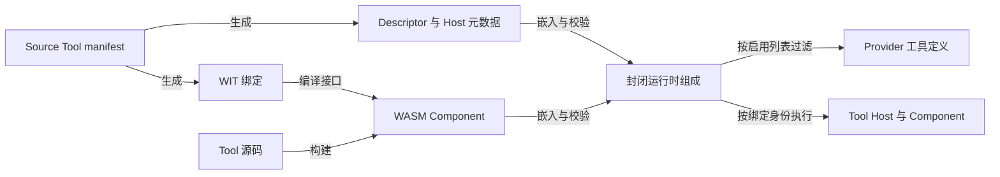
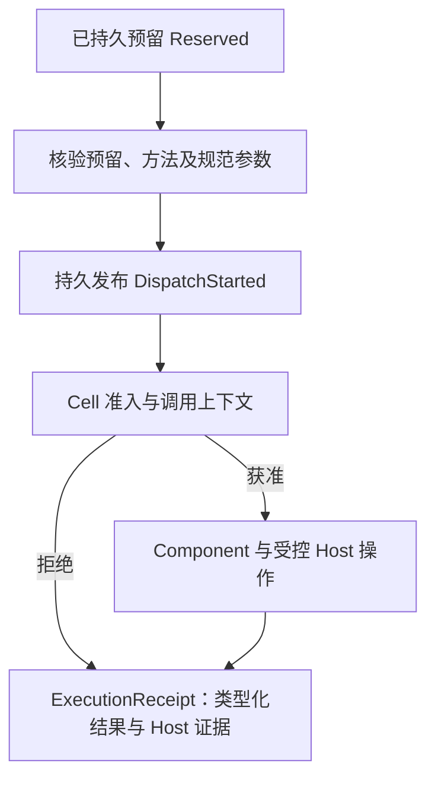

# LANCET 工具执行

> 类型：架构合同
> 上位依据：[项目宪章](../governance/charter.md)、[宿主平台](platform.md)
> 修订状态：仅“网络获取”中的提交端冻结 TLS 根引用待人类批准；生效前该部分仍适用[原有效版本](https://github.com/Skyline10124/lattice/blob/0e20dc090dce79330e06276da8255e9f4fb8cc39/docs/architecture/lancet.md)，其余合同保持 active。

## 目的与范围

本合同规定 LANCET 的工具组成、Tool Host 边界、调用执行及证据与持久事实的衔接。维护归属为 `lancet-runtime`、`lancet-authority`、`lancet-protocol`、`lancet-audit` 和 `lancet-api` 各自负责的部分。

产品调用由 `lattice-api::TurnCoordinator` 发起和协调。[会话合同](session.md#pendingturn-与结果关闭)维护完整 Turn 日志与结果关闭，[存储合同](storage.md#对象引用与持久化)维护通用发布与持久化机制，[工作区合同](workspace.md)维护文件操作。

## 工具模型与职责

### 概念与契约来源

- **Tool** 是具有结构化参数和结果的能力，由 Agent 在模型步骤中选择调用。
- **Tool Descriptor** 定义方法名、版本、说明、参数与结果契约、能力、作用域及效果。每个 Source Tool 的 manifest 是其唯一维护源，生成物与 provider 投影从该来源产生。
- **Source Tool** 独立维护源代码，以隔离的 WASM Component 参与受批准的运行时组成。
- **Tool Bundle** 包含规范 manifest、预编译 Component、产物哈希与来源信息。
- **Closed Tool Catalog** 是一个构建产物内固定的 Tool 集合。
- **Tool Host** 提供受控工作区、网络、会话及调用控制接口，负责核验权限和记录实际效果。

术语与易混淆称呼由[领域术语表](../reference/glossary.md)维护。manifest 的维护与批准遵循治理规则。

### 组件职责

| 组件 | 职责 |
| --- | --- |
| `lancet-protocol` | 调用身份、Descriptor、Cell、错误、事件及证据的数据契约 |
| `lancet-authority` | Guard、网络与工作区可见性策略及观察预算策略 |
| `lancet-runtime` | 封闭组成、Component 执行、准入执行、Host 操作授权、资源限制、事件和效果记录 |
| `lancet-audit` | 项目级 InvocationStore、终态与证据发布、固定视图上的操作员查询 |
| `lancet-api` | 向产品协调层提供运行时及操作员接口，核验预留与分发边界 |
| `lattice-api` | 生成和绑定调用身份，协调预留、执行、结果材料和 Turn 持久状态 |
| `lattice-store` | 为领域存储提供 Git 对象、引用事务、锁和持久化机制 |

LANCET 的产品执行入口依赖已绑定的 Session 与 Turn，不提供独立工具执行产品、调用方自组目录或通用执行后端。

## 构建与封闭组成

### 生成与校验

构建工具从 Source Tool manifest 生成 Descriptor、WIT 绑定、Host 元数据、provider 投影所需信息、预期身份及注册信息。运行时只组合构建时纳入的生成注册，不接收调用方提供的 Descriptor 或可执行实现。

下图表示构建产物与运行时使用关系，箭头不表示运行时加载入口：

组成校验拒绝缺失、重复、未经批准的注册，以及 Descriptor、产物摘要、实际 imports、ABI 或预期身份不一致。能力名称与 Cell 的一致性遵循 [Cell 声明校验](cell.md#声明来源与校验)。

默认发行包含 `observe.workspace`、`mutate.create`、`mutate.edit`、`fetch.web` 和 `session.todo_write`。增加 Source Tool 需要在新运行时构建前完成准入；每个运行进程保持原有目录，不能动态加载更多代码。
启用列表仅过滤固定目录；未知工具名和未知被拒绝能力名导致构造失败。

### Bundle 安装设计

当前已实现仓库内 Source Tool 的生成、构建、校验和静态嵌入；外部预编译 Bundle 的安装，以及安装后的宿主自动重建与活动版本切换尚未实现。

ADR 0004 已接受的安装设计要求如下：

- 操作员安装预编译 Bundle，安装过程验证完整性、来源及 Descriptor/import 一致性，不执行第三方构建脚本、过程宏或原生程序。
- 受信构建流程为批准的 Bundle 生成嵌入与注册代码，构建版本化 Linux 宿主二进制，通过 Descriptor、产物和精确目录检查后，原子切换供后续调用使用的活动版本。已运行进程继续使用原组成。

## 运行时与 Host 边界

### 生命周期与资源所有权

| 范围 | 持有的状态 |
| --- | --- |
| 构建运行时的进程实例 | 共享 Engine、已编译 Component、封闭目录与 linker |
| Turn | 固定的 profile/策略、启用目录视图、工作区权限、观察预算和执行上下文 |
| Tool 调用 | 独立 Store、准入结果、取消身份、事件归属、执行限制及 Cell 证据 |

Component 不获得环境中的 WASI 文件系统、网络或进程权限，只能使用 manifest 声明并由组成校验固定的 Tool Host imports。工作区、网络和会话操作分别进入对应 Host，不能取得绕过策略的底层句柄。

执行限制覆盖内存等 Store 资源、fuel、deadline、操作计数及记录上限。Host 根据实际操作核验限制并计算观察预算；guest 自报数值不作为计量依据。

取消信号与事件归属按 `InvocationId` 隔离。一个调用的取消或调用方释放不能取消另一个调用。Host 发送事件时使用绑定身份，覆盖输入中的调用 ID；事件不构成持久终态。

### Cell 准入与操作授权

运行时按 [Cell 合同](cell.md#准入与操作授权)执行调用准入与逐次 Host 操作授权，并在返回前完成[结果校验与计量](cell.md#结果校验与计量)。Tool 可见性、能力准入和领域操作许可分别核验。
Cell 模型、能力匹配、scope/trust 解析及拒绝证据由该合同集中维护。

### 领域通道

| 通道 | Host 承担的边界 |
| --- | --- |
| 工作区观察 | 路径与可见性、读取和遍历上限、截断、内容身份及预算 |
| 工作区变更 | 路径与写权限、Mutation Precondition、安装、历史关联与实际效果 |
| 网络获取 | URL、主机与地址策略、连接、重定向、TLS、流量与时间限制 |
| 会话与控制 | 绑定当前调用的会话操作及结构化事件；取消查询是无效果的控制探测 |

工作区通道遵循[工作区合同](workspace.md)。工具 enablement 不替代领域通道的授权检查。

### 网络获取

`fetch.web` 仅通过 `network-fetch` Host 发出 GET 请求，供 Tool 在获准目标上取得受限响应。每次请求及重定向由 Host 核验允许主机、协议和地址策略，解析 DNS，固定连接地址，再完成 TLS 验证与读取。
Tool Host 接收[提交端冻结配置](session.md#执行配置冻结)中的实际 TLS 根证书内容，以 Turn 专属信任配置验证 HTTPS 连接；本 Turn 的 provider 连接使用同一份冻结根内容。材料的来源、冻结时点与持久化边界由会话合同维护。Host 在每一跳继续执行本节的目标授权、地址固定和证据记录。
公网访问采用 HTTPS；显式 localhost 策略作为受控例外处理，其余私有、保留和特殊地址拒绝。跨源重定向移除调用方请求头，响应头、响应体、重定向次数和 deadline 均受限制，取消与 Turn 观察预算参与执行。
调用须同时通过 `ex` 能力边界和非空 `allowed_hosts` 目标策略；空允许列表拒绝全部网络，`allow_public_https` 只是公网 HTTPS 开关。localhost 还须显式启用并列入允许主机。每次调用最多一次网络 import，Host 内部处理重定向，不由 guest 发起第二条独立网络操作。最多跟随 5 次重定向，初始请求计数为 0；DNS、连接、TLS、各跳与 body 共用一次调用 deadline 和取消身份，不逐跳重置。

初始请求拒绝 Host、Connection、Content-Length、Transfer-Encoding、Upgrade、Proxy-Authorization 等连接控制字段。origin 的 scheme、host 或 port 改变时丢弃全部调用者 headers，同源才可保留允许的字段。Host 每跳重建请求并强制 `Accept-Encoding: identity`，不提供 Cookie jar、认证挑战登录或凭证委派。

网络元数据按字节施加固定 Host 上限，不允许 Tool 参数或 profile 放宽：原始及每跳规范 URL 8 KiB、调用者 request headers 32 个、单 name 128 bytes、单 value 8 KiB、request headers 合计 16 KiB、response headers 64 个及合计 64 KiB。request 合计包含 Host 自动字段，response 重复字段分别计数。各跳重核 URL 和 headers；HTTP 库默认限制不替代这些边界。body 使用 profile 的响应上限，超限返回显式 `truncated=true`；HTTP non-2xx 保留实际 status 与受限 body，不伪装为空成功。

guest 只接收最小成功投影与无 payload 的粗错误标签，结构化分类由 Host 保留并优先返回。参数 schema、结果字段与 Host wire 分别见 [fetch manifest](../../tools/fetch-web/manifest.toml)和[生成 WIT](../../tools/fetch-web/generated/tool-host.wit)，不独立维护第二份 schema。网络不可用、拒绝、元数据超限、deadline 与取消分别保留类型化错误；trap 或执行资源耗尽不伪装成网络失败，重试属性不授权重放调用。

网络证据按 [Cell 的内容边界](cell.md#内容与版本边界)保存脱敏端点，分别记录 Host 已接收与已交付 guest 的字节量。I/O 已发生后的超限、取消或其他失败保留为实际效果，不能记作设施调用前的拒绝。
网络证据逐 hop 保留排序去重的 DNS candidates、实际连接 peer、协商 TLS 状态和明确的 failure phase；不能从 URL 或错误字符串推断 transport 事实。不另存 URL digest、重复 origin、certificate、cipher、SNI、原始 TLS 错误或 header values。读取量与交付量分别计量，不能把整形后的 body 长度当作全部接收字节。

## 调用身份与执行流程

### 绑定与持久边界

一个 `InvocationId` 贯穿会话绑定、预留、分发、Host 上下文、事件、取消、工作区变更关联、结果关闭和证据。provider Tool Call ID 仅用于对应 provider 的协议材料，不参与 LANCET 授权或持久身份判断。

协调层以 `PlanKey` 和精确有序绑定预留一批调用（一次“工具调用批次”）。`PlanKey` 完整身份为 Session + Turn + 模型步骤，与绑定中的 Session/Turn/消息/片段地址、方法、Descriptor 身份和规范参数摘要逐项对应。同一预留的重复请求须逐项一致；键的 Session 与绑定不符、跨 Session 混批或部分预留不能作为可执行批次接受。

InvocationStore 的执行路径为 `Reserved → DispatchStarted → Terminal`；未分发的预留也可直接关闭为 `NotExecuted` 终态。`Absent` 是查询结果，不是记录。Terminal 同时保存执行 outcome、结果材料状态和完整 Cell 证据。
下图展开已预留调用的分发与运行时返回路径。协调层先按[逐调用关闭顺序](session.md#绑定与逐调用关闭)持久进入初始 StepClosing，才进入图中流程；receipt 返回后的候选固定、材料发布、终态发布与游标推进也由该节衔接。

`DispatchStarted` 在执行器接管前必须持久化，是“可能已执行”的保守边界，不证明 guest 已开始或外部效果已发生。调用在此前停止时按未执行关闭；越过该边界后不能仅凭没有返回值推定未执行。

同一模型消息的调用全部预留后按片段顺序执行。确定且持久的 `Succeeded`、`Failed` 或 `Rejected` 允许继续下一绑定；取消、未执行、不确定或终态/证据持久性不确定时停止后续分发。

### 结果、证据与失败处理

运行时返回 `ExecutionReceipt`，包含类型化结果和 Host 生成的 `CellEvidenceTriple`。终态由 InvocationStore 中的持久事实确定，receipt、结果草稿、事件和工作区历史各自不能代替终态发布。

| 边界或情形 | 结果与后续责任 |
| --- | --- |
| 组成、启用列表或策略无效 | 拒绝构造运行时，不进入调用执行 |
| 预留或请求与绑定不一致 | 拒绝分发，不通过重建身份或改参数继续 |
| Cell 准入拒绝 | 不把控制权交给 Component，返回类型化拒绝与准入证据 |
| Host 操作前拒绝 | 不调用对应设施，记录拒绝；与调用整体终态分别处理 |
| trap、资源耗尽、超时或取消 | 返回有界、脱敏的类型化错误，保留已经观察到的效果 |
| 执行已返回，终态与证据发布未确认成功 | 协调层停止后续分发，按会话合同的 [FinalizeBudget](session.md#resultdraft-与关闭材料)处理；未能持久关闭时保持 Turn pending |

执行 outcome 为 `Succeeded`、`Failed`、`Rejected`、`Cancelled`、`NotExecuted` 或 `Indeterminate`，与结果材料可用性分别记录。例如，调用已成功但 ToolContent 超过保存上限时，仍保留 Succeeded，供模型使用的 ToolResult 标明材料不可用；具体材料关闭由[会话合同](session.md#resultdraft-与关闭材料)维护。
观察事件用于显示调用进度。缺少 finished 事件时，读者通过持久 Invocation 终态和 Session 结果核验执行与材料，不能从未配对显示块推断调用失败。固定读取、Gap 与重载由[会话观察协议](session.md#观察与重连)维护。
终态和完整 Cell 证据在 InvocationStore 内作为一次 ledger commit/ref 原子发布，按[存储屏障](storage.md#屏障覆盖)确认持久性；这一范围不扩展为文件、SessionStore 和 InvocationStore 的跨库事务。

`CepError` 的 retriability 描述错误属性，不授权重新执行已越过分发边界的调用。重开时 LANCET 提供固定持久事实，不重新执行 Tool；协调层按[会话重开规则](session.md#重开取消与未完成状态)关闭调用与 Turn，包括未分发关闭、不确定终态和存储不可写时保留 pending。

## 证据与操作员读取

### 证据归属

`CellEvidenceTriple` 的准入、效果与拒绝记录，以及顺序、内容和版本要求见 [Cell 合同](cell.md#证据模型与失败语义)。运行时将 Host 生成的证据交给协调层，持久结果材料由对应领域保存。
运行时错误采用类型化 `CepError`、有界消息及脱敏数据，不暴露 guest backtrace、秘密或宿主路径。

### InvocationStore 与操作员接口

`lancet-audit` 拥有[私有状态布局](storage.md#私有状态根)中的项目级 `invocations.git`，负责有序批量预留、持久分发标记、终态与证据以及固定视图读取。通用 Git 机制由 `lattice-store` 提供；操作员投影、派生索引和事件通知不成为第二套生命周期权威。

ledger 是唯一数据权威，`refs/lattice/invocations/high-water` 仅为单调 high-water witness，不存第二份生命周期状态。首次创建写入领域 genesis；每次预留、分发与终态更新以原 ledger tip 的直接子 commit 通过 CAS 追加。必须先持久推进 `refs/lattice/invocations/ledger`，再推进 witness。崩溃可使 witness 落后并仍为 ledger 祖先，读取接受该顺序状态，后续写入修复 witness；witness 缺失、分叉或 ledger 落后于 witness 时拒绝读取。不得 rebase、merge、截断、重写或删除 ledger，既有游标必须保持为当前 tip 的祖先。

周期性 anchor 的认证 `state_digest` checkpoint 将冷读和首写重建限制为 O(state bytes) 加有界 delta replay，与累计历史深度解耦；这不是 O(1)。普通 transition 的临界区为 O(event bytes)。派生缓存或投影不替代 ledger 与 witness 核验。

操作员查询经 `lancet-api` 调用 `lancet-audit`，不组合 Tool runtime，也不取得 Session 或 Workspace 操作锁：

| 接口 | 读取语义 |
| --- | --- |
| `lattice audit` | 固定 ledger tip，返回每个调用的状态，包括尚未终结的记录 |
| `lattice audit --tail` | 从可达的独占 OID 游标之后读取有序生命周期变更 |
| `lattice audit replay --session <SessionId> --turn <TurnId>` | 按模型步骤与片段顺序读取 Turn 调用事实，不重新执行工具 |
| `lattice lancet status` | 返回固定视图的 OID 与有界状态投影 |

读取可能观察到跨库流程的中间状态。公开关联使用 `InvocationId`；Git OID 用于存储寻址和游标。上述操作员接口不是 Agent Tool。

## 验证与承接

### 验证入口

按修改范围选用检查；纯文档修订核对契约来源、引用、状态、图示与正文即可。

| 检查对象 | 入口 |
| --- | --- |
| manifest 与生成物一致性 | `cargo xtask tool-codegen --check` |
| Component 构建产物校验 | `cargo xtask tool-build --verify` |
| 依赖与执行边界 | `cargo xtask lancet-boundary` |
| 组成、准入、Host 与运行时结果 | `cargo test -p lancet-runtime` |
| 调用入口与操作员接口 | `cargo test -p lancet-api`、`cargo test -p lancet-audit` |

`lattice lancet doctor` 检查工作区规范化与生成目录的组成；它不验证完整执行、持久终态或 Bundle 安装。外部场景遵循测试工程的[被测二进制要求](../development/testing.md#被测二进制)，构建与运行配方见[验证操作指南](../development/validation-guide.md)。

### 来源与承接范围

- 原 `docs/LANCET.md` 的执行入口、目录、通道、证据与操作员规则由本文及相邻合同承接，操作资料见[工具开发指南](../development/tool-development.md)。
- [ADR 0004](../adr/0004-build-closed-wasm-tool-catalog.md)：封闭构建、manifest 来源、WASM 隔离、Bundle 设计和三层生命周期。
- [ADR 0005](../adr/0005-durable-turn-invocation-and-private-git-stores.md)：身份、预留、分发、终态与证据、ledger/witness、冷读成本、顺序执行及重开边界。完整 PendingTurn 和存储内核分别归会话、存储合同，资格化操作见[诊断指南](../development/invocation-store-diagnostics.md)。
- 准入、操作授权、结果计量和证据分离由 [Cell 合同](cell.md)维护；native 双路径、SQLite、Turn/audit provenance 与 attestation 不恢复。
- 已确认的网络 Host、安全、限制、投影与证据要求由本文承接。
- [运行时局部指引](../../crates/lancet-runtime/AGENTS.md)及[审计局部指引](../../crates/lancet-audit/AGENTS.md)：组件归属与执行边界。

### 待明确与待核验边界

- Bundle 安装、重建及活动版本切换失败的完整语义仍待明确，由 [#35](https://github.com/Skyline10124/lattice/issues/35)承接。
- reserved Descriptor 到实际编译 Component 的 exact identity gate、model-visible/executable 启用集一致性，仍须在 Bundle 安装前核验；目录权威保持单一。
- DNS 后未连接的分类、body 编码与 header 规则仍有未决核验项；本节“网络获取”的有效限制继续适用，未决项不作为已经验证的保证。

合同效力及 TLS 修订范围依文件头限定。历史与已退役实现不作为默认执行入口；术语表的读写入口见[领域文档指引](../agents/domain.md)，未迁入的局部细则继续由相应入口承接。
