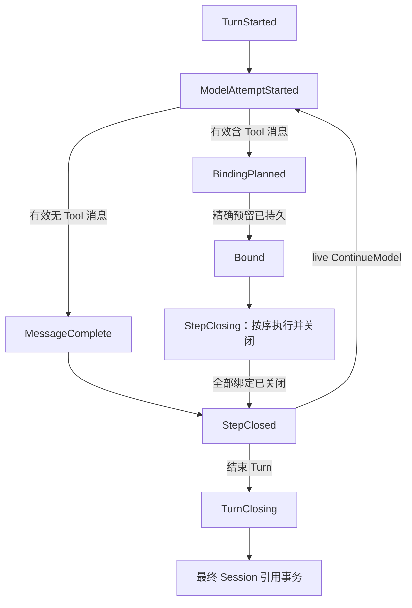
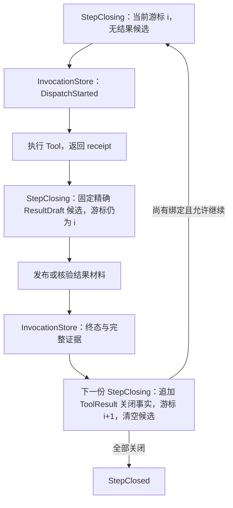
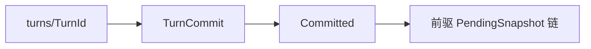

# 会话与 Turn

> 类型：架构合同
> 上位依据：[项目宪章](../governance/charter.md)、[宿主平台](platform.md)

## 目的与范围

本合同规定会话历史、provider-neutral 对话、Turn 请求接受、持久阶段、结果关闭和重开协调。`lattice-conversation` 维护对话数据，`lattice-session` 维护会话图与 PendingTurn，`lattice-api` 负责产品接口及跨存储协调，`lattice-agent` 驱动一次模型请求。

本文为承接草案，现行依据仍由 [ADR 0005](../adr/0005-durable-turn-invocation-and-private-git-stores.md)及相关局部指引维护，旧入口尚未切换。相邻领域分别维护 [LANCET 的调用身份与执行流程](lancet.md#调用身份与执行流程)、[工作区 checkpoint](workspace.md#turn-checkpoint)与[显式 Rewind](workspace.md#显式-rewind)、[通用存储发布](storage.md#对象引用与持久化)和[锁机制](storage.md#锁与并发语义)。本合同维护这些领域事实如何进入 Turn 日志与重开协调。

## 模型与职责

### 会话、Turn 与历史

Session 永久绑定一个由产品组合层提供的 `ProjectStoreKey`。会话存储不从进程 cwd 自行推导绑定；执行请求的工作区必须与既有绑定一致。

Session History 是对话 Turn 与 Tool transcript 的 Git 风格图。分支指向对话历史，当前 head 可以附着在分支或处于 detached 状态。checkout、branch、reset 操作会话引用，不修改本地文件；同时恢复文件须走显式 Rewind。

Turn 是一次已接受用户请求的执行与关闭单元，可以包含多个模型步骤。每步可有多次模型请求尝试，但最多接受一个完整有效的模型消息。已接受且未完成的 Turn 由 PendingTurn 表示，最终通过不可变 TurnCommit 进入会话历史。

| 身份或地址 | 含义 |
| --- | --- |
| `SessionId` | 会话身份，展示缩写不改变其规范身份 |
| `TurnId` | 已接受请求的显式身份，与 TurnCommit 的 Git OID 分开 |
| `ModelAttemptKey` | 某 Turn 的模型步骤与尝试序号 |
| `ModelMessageAddress`、`ToolCallAddress` | 会话内模型消息与有序片段位置 |
| `PlanKey` | 一批精确调用绑定的所有者 |
| `InvocationId` | 绑定、执行、关闭和审计共同使用的调用身份 |

provider Tool Call ID 属于 provider 协议材料，不参与会话绑定或执行身份分配。

### 组件与接口

| 组件 | 责任与接口边界 |
| --- | --- |
| `lattice-conversation` | 有序消息、ToolCall typestate、结果关闭、语义与回放摘要、尝试诊断及 usage；不持有存储、运行时、HTTP 客户端或身份生成器 |
| `lattice-session` | 会话状态、分支图、TurnCommit、PendingTurn、ResultDraft 与纯协调决策；不读取 InvocationStore |
| `lattice-api::SessionApi` | 创建、打开、列表、状态、日志、分支、checkout、reset 和 diff 的公开入口 |
| `lattice-api::TurnCoordinator` | 全 Turn 锁、配置冻结、模型循环与重试、调用绑定与执行、跨库事实投影、结果关闭和最终发布 |
| `lattice-agent::ModelStepDriver` | 消费冻结请求和对话历史，驱动一次 provider 请求并返回类型化尝试结果 |
| `lattice-llm` | provider wire 协议、流事件适配及对话投影 |

`stream_turn` 是公开实时执行核心，`run_turn` 通过收集它的事件得到结果。事件投递是观察通道，观察者背压或释放不能取代执行排空、持久关闭及错误处理。持久化未完成时不以流结束代替 TurnCommit。

显式 `RewindCoordinator` 与 TurnCoordinator 分别维护自己的流程，PendingTurn 不充当 Rewind 的崩溃日志。

## 对话数据与模型投影

### 有序消息与 ToolCall

消息使用 `NativeMessage<ToolCallState>` 和有序 `MessagePart` 表达。`UnboundToolCall` 与 `BoundToolCall` 区分模型输出和已由协调层分配身份的调用，绑定时保留原消息片段顺序。

Tool 参数必须为一个 JSON 对象，通过协议的 canonical JSON 规则生成规范参数和摘要。空串、数组、标量、畸形 JSON、重复或不完整 ToolCall 均不能作为有效调用。单次完整响应最多包含 32 个 ToolCall；任一个无效或数量超限时拒绝整个尝试，不保留其中的助手正文作为成功消息，也不截断批次。

有效的完整 reasoning 参与持久对话及语义摘要。中断尝试的部分文本、reasoning 和调用数据作为有界诊断保存，不进入已提交对话。拒绝尝试同样不产生可执行绑定或 InvocationId。

### 语义与回放

- `semantic_digest` 覆盖 provider-neutral 文本、完整 reasoning、规范 Tool 语义及顺序，供绑定使用。
- `replay_state_digest` 覆盖 provider 来源、真实 provider call ID 和片段级不透明回放状态。

同 provider 可使用原回放材料；跨 provider 使用中立语义投影，不回放来源 reasoning，不伪造目标 provider 的身份材料。绑定摘要从实际存储的原消息计算，不从跨 provider 投影计算。

不透明回放材料逐片段原样保留，单片段上限 64 KiB；片段正文为空也不自动丢弃回放状态。类型和编码由 [`lattice-conversation`](../../crates/lattice-conversation/src/lib.rs) 维护，持久载荷不能由会话层的重导出另立序列化形状。

## 会话存储与并发

### 权威引用

会话事实位于全局 `sessions.git` 的会话命名空间：

| 引用 | 权威事实 |
| --- | --- |
| `refs/lattice/sessions/<SessionId>/state` | 不可变 SessionState：项目绑定、标签、活动 Agent、创建信息及 head 选择器 |
| `refs/lattice/sessions/<SessionId>/heads/<BranchName>` | 可移动的对话分支 |
| `refs/lattice/sessions/<SessionId>/active-turn` | 当前 PendingTurn 的唯一可变入口，目标载荷包含 TurnId |
| `refs/lattice/sessions/<SessionId>/turns/<TurnId>` | 已提交 Turn 的一次创建、永久保留的 pin |

SessionState 不重复保存活动 Turn；仓库顶层 `HEAD` 和可变 sidecar 不参与会话权威。移动分支或 reset 不使已确认的 Turn 依赖 reflog 保留。图读取应保留可达父链的对话，包括 merge 侧消息。

创建与打开分开：打开严格核验既有存储及会话事实，不因缺失或损坏而初始化。首次创建仅通过获准的会话创建路径执行。会话对外读取使用固定引用或对象视图，不从不同时间的读取拼出未经核验的状态。

已有 `refs/lattice/session-validation/<SessionId>` 是派生校验投影，与当前会话 ref 集合认证对应。投影不匹配或不可用时完整验证该会话对象后才能返回句柄；打开不写投影，会话变更通过同一存储事务更新投影。

### 操作锁与发布锁

`SessionExecutionLock` 独占持有覆盖整个 live Turn、重开协调及会话状态或引用变更。status 为一致读取取得非阻塞共享锁，独占者存在时返回 `SessionBusy`。open、list、log、diff 等快照读取可固定已提交引用；strict open 在存储锁内验证跨引用关系后释放，不把繁忙状态报成损坏。

锁的获取顺序、重入与释放遵循[存储锁机制](storage.md#锁与并发语义)。不同 Session 的执行锁彼此独立，共享项目上的工作区操作按[工作区操作锁](workspace.md#操作锁)协调；协调层分别遵守两种操作锁的持有期限。

## Turn 的接受与模型步骤

### 请求接受

协调层持有 SessionExecutionLock 后，核对项目绑定，严格打开项目存储，验证用户输入和对象大小，并冻结当前 Agent、profile、策略、模型、system prompt、启用工具目录及执行限制。

`TurnStarted` 持久发布用户消息、TurnId、父对话 tip、配置快照与目录摘要，是请求接受边界。之前的失败不建立持久 Turn，也不发送 provider 请求；发布后发生的失败、取消或崩溃必须关闭原 Turn，不能删除已接受请求再当作未发生。

冻结配置不保存凭据。目录快照包含有序工具名、Descriptor 身份、描述、规范输入 schema 与运行时构建身份，不保存 provider wire 投影。用户输入上限 2 MiB，目录规范快照上限 1 MiB，均在发布前核验。

### 模型请求与执行预算

每次 provider 请求之前持久发布 `ModelAttemptStarted`。尚未收到任何流事件且适配器将 opening 错误判为可重试时，先写 `ModelAttemptFailed`，再按冻结策略退避并进入新的尝试序号。收到任何流事件后发生错误、取消、超时或进程中断，记录为 `ModelAttemptInterrupted`，不自动重试。

模型步骤上限为 32，不由 profile 放宽；重试不额外消耗模型步骤。每步尝试数由 profile 冻结，受最多 11 次尝试的协议上限约束。达到步骤上限时保留此前关闭的消息与 ToolResult，Turn 以类型化失败关闭。

流组装按 UTF-8 字节持续计量，不能先无限组装再检查：

| 对象 | 上限 |
| --- | --- |
| 单 ToolCall 参数 | 8 MiB |
| 助手正文 | 2 MiB |
| reasoning | 2 MiB |
| 一次 ModelAttempt 总量 | 16 MiB |

超过上限即停止消费，保存有界诊断并记录 `OutputLimitExceeded`。完整输出的批次校验失败记录为 `ModelAttemptRejected`。

Turn 的单调时钟 deadline 在 `TurnStarted` 发布后开始，限制后续 provider 请求与 Tool 分发，不中断必须完成的终态、Step 和 Turn 持久化。超时秒数被冻结，单调时钟 deadline 不持久化；重开只关闭，不重建剩余执行时间。

每次尝试分别保存 provider 给出的 `Option<TokenUsage>`，缺失表示未知。失败、中断和重试尝试的已知 usage 保留，Turn 汇总为从这些事实派生的 Complete 或 Partial 统计。

## PendingTurn 与结果关闭

### 日志与阶段

每个 PendingSnapshot 为不可变对象，包含身份、前驱、累积 `post_user_transcript` 和当前阶段，通过 CAS 推进 `active-turn`。载荷前驱必须与 Git 父关系一致，链根连接冻结的父对话 tip。

`post_user_transcript` 是已接受用户消息之后的唯一累积对话来源；每条日志边推导并校验其精确变化。StepClosing 只保存有序绑定、关闭游标、关闭事实和当前候选，不维护第二份消息正文。live 与 reopen 使用同一日志推导的 TurnCommit 候选基础。

| 阶段 | 保存的进展 |
| --- | --- |
| `TurnStarted` | 已接受请求及冻结事实 |
| `ModelAttemptStarted` | 即将发送的模型请求身份 |
| `ModelAttemptFailed`、`ModelAttemptInterrupted`、`ModelAttemptRejected` | 请求失败、中断或完整输出拒绝及尝试事实 |
| `MessageComplete` | 完整有效且不含 ToolCall 的消息 |
| `BindingPlanned` | 含 ToolCall 的完整消息与精确候选绑定计划，一起发布 |
| `Bound` | 整个精确计划已在 InvocationStore 持久预留 |
| `StepClosing` | 逐个绑定的结果关闭进度 |
| `StepClosed` | 步骤已关闭，记录继续模型或 Turn 关闭决定 |
| `TurnClosing` | 精确 TurnCommit 与最终日志候选，包括 checkpoint 和时间字段 |
| `Committed` | 最终不可变日志对象，由最终 TurnCommit 引用 |

下图表示 live 成功路径上的阶段先后，省略模型重试、候选修订及失败分支。工具分发与结果持久化发生在 StepClosing 内。

### 绑定与逐调用关闭

协调层为完整有效的 Tool 消息分配候选 InvocationId，持久记录精确计划后调用预留接口。只有整个计划确认持久后才进入 Bound，不存在含 ToolCall 的 MessageComplete 与绑定计划分开的窗口。

候选冲突只在 BindingPlanned 且可证明原精确计划未预留时允许受约束的 CAS 修订。修订保持消息、方法、Descriptor、参数与顺序，只替换候选身份及派生绑定摘要；发布不确定时复核原候选，不重新分配。Bound 阶段发现不同计划或身份冲突按损坏处理。

所有绑定预留后，先持久进入 `closure_cursor = 0`、尚无关闭事实或结果候选的 StepClosing，再分发第一个调用。每次只处理最低未关闭序号。下图展开 live 正常路径中一个绑定的关闭顺序：固定候选与推进游标是两次独立日志迁移，图中的持久发布均须确认成功后才能进入后续节点。

结果材料超限或发布失败按下一节处理，不改变执行 outcome。当前调用的终态与证据、随后推进游标的快照都确认持久后，才允许分发下一调用；停止分发及重开时的关闭规则见[重开、取消与未完成状态](#重开取消与未完成状态)。

InvocationStore 的预留、分发、终态和停止条件由 [LANCET 的调用流程](lancet.md#调用身份与执行流程)承接。协调层将其固定 ledger 视图投影为会话 reducer 所需的 InvocationFactsSnapshot，保留 PlanKey 所有者及精确候选集合；缺失、额外或归属不一致的记录不能通过过滤掩盖。

### ResultDraft 与关闭材料

Tool 返回后，协调层规范化 ToolContent，计算长度、摘要及精确 ResultDraft 候选，先将候选记入 StepClosing，再尝试发布材料。ResultDraft 保存内容与绑定关系，不包含执行 outcome。候选一经固定，发布重试沿用其精确规范字节及对象身份。

| 材料状态 | 处理 |
| --- | --- |
| Durable | 校验与持久终态中的摘要、长度一致后，生成含正文的 ToolResult |
| CleanAbsent | 保留真实执行 outcome，结果材料标为 `Unavailable(DraftPublicationFailed)` |
| Uncertain | 在有限预算内重核精确候选；身份或摘要不符时报损坏 |
| 内容超过 65,536 字节 | 不写 draft、不截断；保留完整摘要与长度，材料标为 `OutputTooLarge` |

关闭结果分别保存执行 outcome 和材料可用性。执行成功可以伴随材料不可用，不能为填补正文而推翻持久终态。需要大输出的 Tool 应通过自身接口提供分页、游标或摘要。

FinalizeBudget 从执行器返回后开始，覆盖锁等待、不确定 draft 复核、终态与证据发布和重试等待，与 Turn deadline 分开。当前预算为 60 秒，首次立即尝试，可重试的持久化失败按 25 毫秒起步、上限 1 秒的指数退避处理；预算到期不再发起新尝试。损坏及身份或摘要不匹配不重试。性能资格化证据和阈值由对应验证材料维护。

若终态与证据未能在预算内确认持久，Turn 保持在当前 StepClosing，后续绑定不分发，不发布 StepClosed、TurnCommit 或永久 Turn pin。对调用方报告持久性失败和恢复需求。

## Turn 最终发布

StepClosed 的决定为 FinishTurn、ContinueModel、FailTurn、CancelTurn 或 InterruptTurn。只有 live 所有者可由 ContinueModel 发起下一模型请求。TurnOutcome 为 Completed、Failed、Cancelled 或 Interrupted，原因类型化；ClosureOrigin 区分 Live 与 Reconciled。

协调层从已验证日志生成候选基础，取得共享 WorkspaceOperationLock 后读取[项目全局 checkpoint](workspace.md#turn-checkpoint)，并持锁通过 TurnClosing 发布及最终会话事务。每个完成的 Turn 都采样该值，包括未写文件的 Turn；读取或身份校验失败时停止关闭，不构造空 checkpoint。

TurnClosing 固定精确候选及全部时间字段。最终在一次 `sessions.git` 引用事务中推进当前分支或 detached state、创建 `turns/<TurnId>` pin、按需更新 SessionState，并删除 active-turn。事务遵循[存储发布与失败分类](storage.md#对象引用与持久化)：前提失败时整组不发布，其他发布错误须核验实际引用；发布后持久性不确定时重试同一候选，不重新读取时钟构造另一提交。

最终对象引用方向如下。箭头表示对象引用，Committed 不单独发布到 active-turn，也不反向包含 TurnCommit OID。

重开到已固定的 TurnClosing 时，当前权威 checkpoint 必须与候选匹配；不匹配时报错，不重新采样替换已固定候选。会话事务只提供会话库内的原子发布，不将工作区、InvocationStore 与 SessionStore 合并为一笔事务。

## 重开、取消与未完成状态

协调 reducer 只读取已验证 PendingSnapshot 与固定的 Invocation 事实，返回关闭计划或候选修订请求。候选修订不是 TurnOutcome；跨库 I/O 由协调层执行。重开不请求 provider，也不重新执行 Tool。

| 重开时的持久状态 | 关闭方向 |
| --- | --- |
| TurnStarted，尚无模型尝试 | 以开始尝试前中断关闭 |
| ModelAttemptStarted 未完成，或可重试失败停在重试间隙 | 以对应进程中断关闭，不恢复重试 |
| 不可重试的 ModelAttemptFailed | 按模型请求失败关闭 |
| ModelAttemptInterrupted 或 ModelAttemptRejected | 按持久类型化原因关闭 |
| 无 Tool 的 MessageComplete | 使用已持久完整消息关闭步骤并完成 Turn |
| BindingPlanned，精确计划未预留 | 用相同候选进行仅关闭用途的预留；新确认的身份冲突须由受约束的修订决策处理 |
| BindingPlanned，计划已精确预留 | 发布 Bound 并继续关闭；部分或不同预留按损坏拒绝 |
| Reserved，尚无 DispatchStarted | 发布 `NotExecuted(BeforeDispatch)` 并生成关闭结果 |
| DispatchStarted，无可靠终态 | 可写时保守关闭为 `Indeterminate(MayHaveOccurred)` |
| 已有终态或处于 StepClosing | 保留终态，从最低未关闭序号继续，不跳过或修改已关闭项 |
| StepClosed(ContinueModel) | 以中断关闭 Turn，不进入下一模型步骤 |
| StepClosed 已决定结束 | 使用所记录的 outcome 进入 TurnClosing |
| TurnClosing 或精确最终候选已存在 | 核验候选及前提，幂等完成最终会话事务 |

重开获得新的有限发布预算。存储仍不可写或预算耗尽时继续保留 pending，返回 `RecoveryRequired`。存在 active-turn 时，新 prompt 命令只协调并报告旧 Turn，不同时接受新 prompt；恢复后由用户重新发送。不提供强制丢弃已接受 Turn 的入口。

取消按每个调用的持久事实分类，已有终态不改写；未分发、确认取消和执行不确定分别处理。Turn 以取消为主因时关闭为 Cancelled，已关闭的消息和调用事实仍保留。超时、取消或 observer 断开均不能推定文件效果未发生。

恢复后的 Turn 可以以有序 ToolResult 结束，不补造助手消息。后续 provider 投影若需要关闭框架，由适配层明确生成，不将其存为模型原话。

## 验证与承接

| 检查对象 | 入口 |
| --- | --- |
| 对话顺序、批次校验、语义与回放摘要 | `cargo test -p lattice-conversation` |
| 单次尝试、流中断和资源计量 | `cargo test -p lattice-agent` |
| 会话图、CAS 日志、候选与重开 reducer | `cargo test -p lattice-session` |
| live/reopen 协调、checkpoint、取消和事件收集 | `cargo test -p lattice-api` |
| 真实二进制的失败与恢复路径 | 按[测试工程草案](../contract/testing.md)选择相关 Direct-Local 及显式崩溃场景 |

Schema、摘要或阶段迁移修改须检查已存记录、完整前驱链、调用方与恢复路径，不能仅更新当前写者。版本化载荷与类型分别由 [PendingTurn 合同类型](../../crates/lattice-session/src/pending/contract.rs)、[绑定](../../crates/lattice-session/src/pending/binding.rs)、[结果材料](../../crates/lattice-session/src/pending/draft.rs)和[关闭类型](../../crates/lattice-session/src/pending/outcome.rs)维护。

主要承接来源为 ADR 0005 的会话权威、对话、请求接受、PendingTurn、模型尝试、ResultDraft、重开和最终发布部分，以及[会话局部指引](../../crates/lattice-session/AGENTS.md)、[API 局部指引](../../crates/lattice-api/AGENTS.md)、[对话局部指引](../../crates/lattice-conversation/AGENTS.md)和[Agent 局部指引](../../crates/lattice-agent/AGENTS.md)中的有效边界。

后续已落地的累积 transcript、统一候选基础、派生 strict-open 校验投影和候选修订细节按现行协议承接。旧性能活动、任务状态及已删除组件的实施步骤保留在历史材料中。合同批准时协调相邻草案、术语表和局部入口的替代范围；当前不切换旧文档读写流程。
