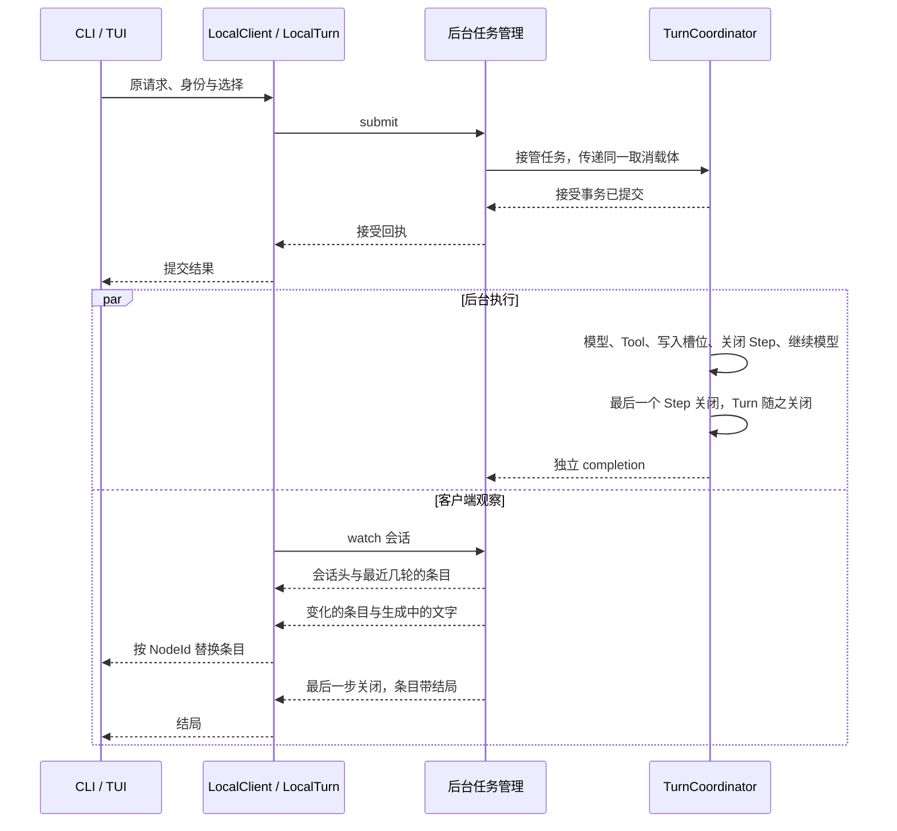
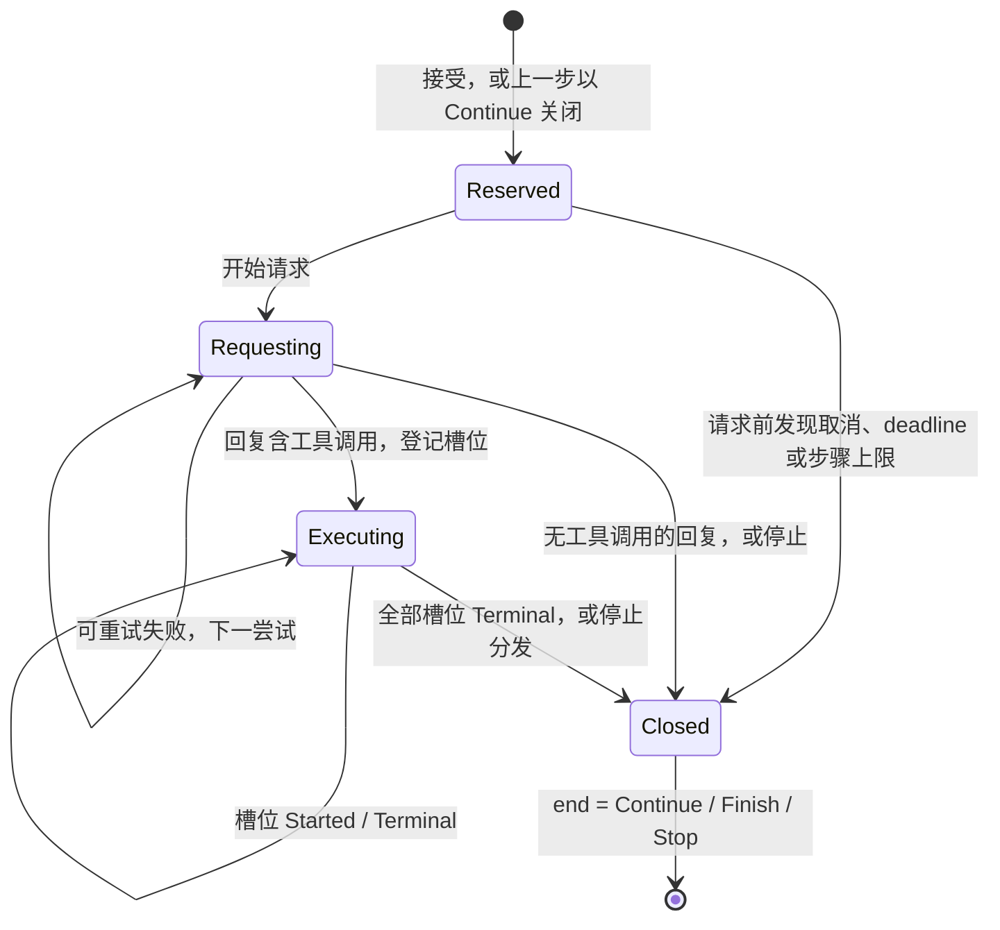

# 会话与 Turn

> 类型：架构合同
> 上位依据：[项目宪章](../governance/charter.md)、[宿主平台](platform.md)
> 决策记录：[ADR 0006](../adr/0006-tree-session-and-global-redb-store.md)、[ADR 0007](../adr/0007-session-tree-as-single-authority.md)、[ADR 0008](../adr/0008-backend-api-commands-view-queries.md)、[ADR 0010](../adr/0010-protocol-adapters-and-configured-providers.md)

## 目的与范围

用户向一个会话提交任务，后台接受后驱动模型、执行模型选择的 Tool、保存调用结果，再把结果交给模型继续回答。用户可以同时观察进度，也可以关闭终端，稍后重新连接查询状态和读取已保存的对话；需要从较早的位置换一种说法继续时，把会话退回树上的某个节点再发送。

本合同说明一次任务如何被接受、执行和保存，会话历史如何组织成树，会话如何持有配置，以及用户中途离开、取消任务或后台重启后如何继续处理。模型请求怎样发出、发到哪里、带什么凭据，由[模型接入合同](llm.md)维护。

以下以“读取工作区文件并解释内容”为贯穿场景：用户提出问题，模型选择 `observe__workspace` 读取文件，然后依据返回内容给出解释。工具的具体能力由 [LANCET 合同](lancet.md)和[工作区观察接口](workspace.md#观察接口与边界)说明。

## 模型与职责

### 会话、Turn 与会话树

Session（会话）保存用户的一段持续对话，以 `SessionId` 标识，永久绑定用户工作的项目。Session 记录只保存身份、项目绑定、当前位置与时间；会话的配置是另一条记录，即 profile 副本，见[会话的 profile 副本](#会话的-profile-副本)。

后台接受一次用户任务后，形成一个 Turn。本文场景中的用户问题、读取文件的工具调用和最终解释都属于同一 Turn。客户端在提交前生成 `TurnId`（UUID v4）；向新会话提交时，`SessionId` 也由客户端生成。接受结果不明时，按 TurnId 查询找回这一次请求。

会话历史是一棵树。一个会话里发生过什么，以树上的节点为唯一权威：后台为这个会话提交的每一件事都写在节点上，其他表是节点的一部分、指针，或从节点得出的索引。节点有两种：

- **UserMessage**：一条用户输入。一个 Turn 从它的 UserMessage 开始。接受这一轮时确定的事实也记在这个节点上：`turn_id`、接受时间、agent 名、模型、provider、推理档位和执行限制。体积大的系统提示与工具目录放在配置表，节点只记它们的内容摘要，见[表、读取范围与 rewind](#表读取范围与-rewind)。
- **Step**：这一轮的一个模型步骤。它记录这一步的各次模型请求（称为尝试）、得到的模型回复、回复发出的各个工具调用及其结果（每个调用一个槽位）、这一步怎么结束，以及最后一次推进的时间。

每个 Session 建立时写入根节点 `0`：它没有内容、不属于任何 Turn，代表空对话，树始终只有这一个根。其他节点记录父节点和所属 `turn_id`，Step 节点另记它是这一轮的第几步。节点身份 NodeId 是每个 Session 内单调递增的 `u64`，写入节点时分配，第一条 UserMessage 为 `1`，父节点序号恒小于子节点；跨 Session 引用写作 `(SessionId, seq)`，用户可以直接输入序号。**当前位置**是 Session 记录中的一个 NodeId：新节点以当前位置为父，写入后当前位置前移到新节点。

父子关系只表示先后：子节点接在父节点之后。节点属于哪个 Turn、是第几步，由节点上的 `turn_id` 和步骤序号表达，不由树形表达。所以一个 Turn 在树上是相连的一段：它的 UserMessage，后面依次是它的各个 Step，节点序号连续。树上的分叉只由 `rewind` 产生，表示同一位置之后的另一种后续。

消息内容由有序片段组成：文字、模型推理内容（reasoning）、工具调用请求（ToolCall）或调用结果（ToolResult）。ToolCall 说明要使用哪个工具和参数；ToolResult 记录执行结果与返回内容。一次工具调用以 `InvocationId` 标识，一个 Step 可以包含多次调用，一个 Turn 可以包含多个 Step。

#### 预留、progress 与结论

Step 节点在这一步开始之前预留。接受一轮的事务写入 UserMessage，同时预留第 0 步；一个 Step 决定继续请求模型时，关闭它的事务同时预留下一步。预留的 Step 没有尝试，也没有回复。Turn 以完成或停止结束时不再预留。

Step、尝试和调用槽位都会经历几个阶段。节点为它们各保存一项 `progress`，即最后到达的阶段：它到达时写入，只前进，此后不因关闭、取消或进程退出而改动。最后一个阶段带着实际结果；停在其他阶段时，结论由阶段本身确定，不另设字段：

| 对象 | `progress` | 停在这里时的结论 |
| --- | --- | --- |
| Step | `Reserved`、`Requesting` | 停止，原因为进程退出 |
| Step | `Executing` | 停止，原因由各槽位的结果推出，推不出时为进程退出 |
| Step | `Closed { end }` | `end`：继续、完成，或停止及实际原因 |
| 尝试 | `Sent` | 停止，原因为进程退出 |
| 尝试 | `Ended { end, diagnostic }` | `end`：完成，或停止及实际原因 |
| 调用槽位 | `Registered` | NotExecuted |
| 调用槽位 | `Started` | Indeterminate，没有取得结果 |
| 调用槽位 | `Terminal { result, evidence }` | `result`：LANCET 给出的结局与载荷 |

这张表是结论的唯一来源。会话库读取时按它给出每个对象的结论，所有读者经同一处取得。所以树上没有空缺：任何时刻，每个调用槽位都有结果，每次尝试都有终态，每个 Step 都有结束方式。执行者在任何时刻消失，树上已有的内容就是这一轮的结局，不需要事后补写。各阶段的事务和推导规则见 [Step 执行与结果保存](#step-执行与结果保存)。

树只追加节点。已写入的节点里只有一个可以改写：Session 中序号最大的节点，且它是尚未到达 `Closed` 的 Step。改写由执行这一轮的协调层在 `progress` 前进时提交。UserMessage、已关闭的 Step，以及之后已经写入新节点的 Step 不再改变。

`progress` 没有到达 `Closed` 的 Step，可能仍在执行，也可能执行者已经消失、它就停在那一步。两种情况在树上没有区别，区别在于后台是否仍持有这一轮的 Owner，见[执行者消失后的 Turn](#执行者消失后的-turn)。不是 Session 最后接受的那一轮，一定不在执行。

Turn 没有单独保存的结局，也没有单独的结束节点。它的结局由最后一个 Step 的结论决定；最后一个 Step 以完成或停止到达 `Closed` 时，这一轮关闭。对外的读取投影见[关闭 Step 与 Turn](#关闭-step-与-turn)。

#### 表、读取范围与 rewind

会话库中的记录：

| 记录 | 键 | 内容 | 写入与修改 |
| --- | --- | --- | --- |
| 节点 | `(SessionId, seq)` | 根节点、UserMessage 与 Step，如上 | 追加；只有末端未关闭的 Step 可改写 |
| 配置 | 内容摘要 | 一轮所用的系统提示与工具目录，由 UserMessage 节点按摘要引用；内容相同的只存一份 | 接受时尚无同一摘要才写入，不再修改 |
| TurnId 索引 | `TurnId` | 这一轮 UserMessage 节点的位置 `(SessionId, seq)`，用于按 TurnId 找回请求、取消和查看详情 | 与 UserMessage 节点同事务写入 |
| Session 记录 | `SessionId` | 身份、项目绑定、创建与更新时间；当前位置这个指针 | 建立时写入；当前位置随节点写入和 `rewind` 移动 |
| profile 副本 | `SessionId` | 会话的有效 profile、当前的 provider `id`、模型 `id` 与推理档位，见[会话的 profile 副本](#会话的-profile-副本) | 首次接受时写入；之后由接受事务按提交的选择改写；`rewind` 不改 |
| InvocationId 索引 | `InvocationId` | 调用所在的 Step 与片段位置 | 登记调用时写入 |
| 调用变更日志 | 全局单调变更序号 | 每次槽位 `progress` 前进后的一行，只记 InvocationId 与到达的阶段，不复制槽位内容。`audit --tail` 按序读取，`Terminal` 的内容经 InvocationId 索引从节点读取 | 只追加 |

一轮的结局、notice、usage 汇总和结束时间都从它的 Step 节点得出，见[关闭 Step 与 Turn](#关闭-step-与-turn)。配置表以内容摘要为键，键由内容算出，不会与引用它的节点不一致。TurnId 索引、InvocationId 索引与调用变更日志是派生记录，与节点在同一事务中更新。

模型上下文与视图读取的对话只有一种范围：从根到 Session 当前位置的路径。发给模型的上下文取这条路径上的 UserMessage 和已有回复的 Step；没有回复的 Step 不发给 provider，对话条目照常给出。根节点 `0` 不含内容，不发给 provider。要让模型上下文与当前视图换到其他分叉上的对话，先 `rewind` 到那里；历史查询按 `before` 的父链读取，不受当前位置限制，见[观察与重连](#观察与重连)。

`rewind N` 只有一种语义：把当前位置移到节点 N 本身，下一次提交的新节点以 N 为父。它只移动这个指针，不在树上写入节点：对树的操作不进入树的记录。改写某条用户消息就是退回到它的父节点再发送，改写第一条消息就是 `rewind 0`。退回到一个没有回复的 Step，与退回到它的父节点，发给模型的上下文相同。会话层不提供“编辑消息”等第二种入口；前端可以把选中消息并改写的交互翻译为这两步。

当前 agent 是会话 profile 副本中的 agent；每一轮实际使用的 agent 记在它的 UserMessage 节点上。`rewind` 不改变副本，所以退回旧节点后当前 agent 不变，也包括退回根节点 `0`。提交时指定 agent 会用该 agent 的 profile 重新生成副本。

#### 会话的 profile 副本

会话持有一份 profile 副本，此后只用副本，不再读取原 `agent.toml`。这样已有会话的行为不随 profile 文件的修改而变化，重新打开会话时也能确定接下来用什么配置。

- **内容。** 有效 profile（外部策略文件解析所得的工作区、网络和观察限制填回具体字段）；系统提示，按内容摘要引用配置表；当前的 provider `id`、模型 `id` 与推理档位。副本不含 provider 配置、模型元数据与凭据，它们由请求网关每次请求时取得，见[模型接入合同](llm.md#组成与归属)。
- **创建。** 新会话首次被接受时，后台读取提交所指定 agent 的 profile，核对所选的 provider 与模型可用，在接受事务中写入副本。
- **使用。** 之后的提交只用副本。
- **修改。** 提交带有模型或推理档位的选择时，选择在这一轮的接受事务中写回副本。提交指定了 agent 时，用该 agent 的 profile 重新生成副本，提交没有选择模型或档位时取该 profile 的值。
- **选择随提交生效。** 选择没有随提交发出就不保留。所以副本中的模型与档位总是最后一次被接受的提交所用的值，重新打开会话时沿用它们。
- **`rewind` 不改变副本。** 副本属于会话，不属于节点。每一轮实际使用的 agent、模型、provider 与档位仍记在它的 UserMessage 节点上。
- **原 profile 的修改只对新会话生效。** 包括收紧的 LANCET 策略（写权限、网络白名单）；要让已有会话使用新的 profile，开新会话或提交时重新指定 agent。provider 配置、元数据与凭据不在副本中，它们的修改从下一次请求起对所有会话生效。
- **新会话必须指定 agent。** 副本在会话第一次被接受时写入，此后每个会话都有副本。

一轮的模型与推理档位按以下顺序取得：

- **模型。** 提交选择的模型，其次是副本中的模型，再次是 profile 的 `[agent].model`。都没有时在接受前按配置错误拒绝。
- **推理档位。** 提交选择的档位，其次是副本中的档位，再次是 profile 的 `[agent].effort`。提交选择了新模型而没有选择档位时，副本中的档位新模型不支持，就改用 `[agent].effort`；它也不支持时不发送推理参数。提交明确选择了模型不支持的档位时，在接受前按配置错误拒绝。可用档位见[模型接入合同](llm.md#推理档位)。

### 组件与接口

后台 API 分为三类：命令改变会话或执行（`submit`、`cancel`、`rewind`），视图推送会话现在的样子（`watch`），查询读取已写入的事实（`head`、`history`、`turn`、`list`、`log`、`audit`）。LocalClient 把它们交给前端。一次提交经 `LocalTurn` 进行：它是这次提交的具体句柄，保留原请求身份，处理接受回执、取消意图与退出交接；它不是第二个持久 Turn，也不拥有后台执行。前端持有句柄、消费视图，后台的 Owner 与 TurnCoordinator 分别监督操作和推进持久执行。

| 场景中的角色 | 负责的工作与交接 |
| --- | --- |
| 前端 CLI / TUI | 接收输入、选择操作，生成请求身份，交出 agent、模型与推理档位的选择；发起提交、退回或取消，观察会话视图并决定何时退出 |
| 客户端库 LocalClient / LocalTurn | 交付原请求，处理接受回执、取消意图与退出交接；转交视图与查询，超过单帧的消息由连接层分帧与拼回 |
| 后台入口 serve | 接收本地连接，维护后台实例及连接资源，将请求交给 Backend |
| 后台任务管理 Backend / Owner | Backend 管理准入、视图、查询及本进程诊断，为每个观察者保存视图的推送状态；准入时读取配置与凭据，见[执行配置冻结](#执行配置冻结)。Owner 监督已接管操作，并为正在执行的 Turn 保留当前尝试的段列表。提交从准备起持有同一取消载体，直至执行核心独立收尾或给出明确诊断，前端退出不改变其责任 |
| 执行协调 TurnCoordinator | 推进一次 Turn：请求模型、组织工具调用、把每一步进度写入会话库，最后关闭 Step 与 Turn |
| 模型驱动 ModelStepDriver / LLM | 接收对话和本次配置，请求模型，将响应交回 TurnCoordinator |
| 工具执行 LANCET | 接收已登记的工具调用，按权限执行，向 TurnCoordinator 返回执行结果、返回内容及证据 |
| 会话库 `lattice-session` | 保存 Session 记录、会话树、配置表、TurnId 索引与 InvocationId 索引；每次推进是一个事务 |

前端负责用户交互，LocalClient 负责操作交付与连接，后台负责任务生命周期与视图，TurnCoordinator 负责持久执行流程，会话库负责事实的保存与一致性。[实现模块与公开操作](#实现模块与公开操作)进一步说明各 crate 和操作接口。

## 从提交到结果可见

1. **提交任务。** CLI/TUI 收到“读取文件并解释”的输入，生成 TurnId，保留原始输入和工作区；向已有 Session 提交时写明追加（`Existing(SessionId)`），新会话则生成 SessionId 并写明新建（`New(SessionId)`）。前端带上用户的选择（agent、模型、推理档位，都可以不选）经 LocalClient 提交一次，持有返回的 LocalTurn。身份规则、忙时处理与接受结果不明时的找回见[请求身份与找回](#请求身份与找回)。
2. **解析配置。** Backend 实际接管提交时建立贯穿准备与执行的取消载体，从会话的 profile 副本（新会话或指定了 agent 时从 agent 的 profile）得出这一轮的配置，核对 provider、模型、档位与凭据可用，交给执行核心。字段和来源见[执行配置冻结](#执行配置冻结)。
3. **确认接受。** 执行核心核对请求身份、项目绑定和输入，在一个事务中写入 UserMessage 节点、TurnId 索引和预留的第 0 步（配置表中还没有这份配置时一并写入），写入或改写 profile 副本，并把 Session 的当前位置移到预留的 Step；新会话的 Session 记录也在这个事务中创建。事务提交后，后台返回接受回执，由 LocalTurn 交给前端显示；后台承担后续执行与关闭责任。精确接受条件见[请求接受](#请求接受)。
4. **同时观察进度。** 前端以 `watch` 观察这个会话：先得到会话头与最近几轮的对话条目，之后接收变化的条目与生成中的文字；前端按 NodeId 替换条目并渲染，后台同时继续执行。见[观察与重连](#观察与重连)。
5. **请求模型。** TurnCoordinator 把预留的 Step 推进到 `Requesting` 并记下第一次尝试，再把当前位置的对话、本次模型参数和启用工具交给 ModelStepDriver。驱动器通过 LLM 连接请求模型；在本例中，模型返回读取文件的工具调用。
6. **登记并执行工具。** TurnCoordinator 核验完整回复，在一个事务中把回复写入这个 Step 节点、为每个调用建立槽位并分配 InvocationId，槽位停在 `Registered`，此时的结论是 NotExecuted。执行某个调用前，先把该槽位推进到 `Started` 并提交；LANCET 随后按权限读取文件，返回执行结果、内容和证据。详细顺序见[调用槽位](#调用槽位)。
7. **保存调用结果。** TurnCoordinator 把该槽位推进到 `Terminal`，同时写入 LANCET 给出的结果、载荷和证据。
8. **关闭 Step 并继续。** 全部槽位都已返回后，TurnCoordinator 在一个事务中以 `Continue` 关闭这个 Step、预留下一个 Step，并把当前位置前移到它，然后开始下一步骤。ModelStepDriver 接收带有 ToolResult 的对话，模型据文件内容生成解释。
9. **关闭 Turn。** 模型给出不含工具调用的完整回答后，协调层在一个事务中把回复写入 Step 节点并以 `Finish` 关闭它。这个 Step 之后不再预留，Turn 随之关闭。见[关闭 Step 与 Turn](#关闭-step-与-turn)。
10. **取得结果。** 最后一个 Step 关闭后，视图推送它的新值，条目带有这一轮的 `TurnSummary`，前端显示结局；此前离开的用户也可以重新打开会话，从同一批节点读到同一结局。

下图只表示接管后的执行与观察可以重叠，持久步骤的精确顺序由后文定义：



### 用户读到的几种事实

在上述文件读取场景中，以下数据分别回答不同问题：

| 数据 | 具体用途与依据 |
| --- | --- |
| 会话树 | 用户消息、各次模型请求、完整模型回复及其调用结果，供重连读取及下一次模型请求使用；来自会话库中已写入的节点 |
| 当前尝试的段列表 | 模型正在生成的正文与 reasoning，经视图作为生成中的文字推送，用于即时显示；只保存在后台内存，完整回复写入 Step 节点后由节点取代，不进入历史 |
| 调用 outcome | 文件读取调用是 Succeeded、Failed、NotExecuted 还是 Indeterminate，由调用槽位中的结果确定 |
| 结果载荷 | 调用的返回内容，例如读取到的文件内容；供模型使用的文字由 provider 投影从载荷派生，详见[调用槽位](#调用槽位) |
| Turn 结局 | 整次请求是 Completed、Failed 还是 Cancelled，连同面向用户的说明 notice，由最后一个 Step 的结束方式得出；完成关闭不限定为业务成功 |

已关闭的 Step 能读到，就已经持久，不另有“完成确认”。例如 Tool 已执行成功而返回内容超过保存上限时，outcome 仍为 Succeeded，模型得到的是内容不可用的结果；前端读取历史失败时，保留已经取得的结局，单独报告内容未能加载。

## 实现模块与公开操作

以下将前面的角色对应到代码模块，展开调用入口和内部协作。`lattice-api` 负责跨领域协调，把 LANCET 执行结果和会话库写入接入 Turn；适用边界见[范围与禁止事项](#范围与禁止事项)。

| 模块 | 具体职责 |
| --- | --- |
| `lattice-api::local::LocalClient` / `LocalTurn` | `client.rs` 封装连接与分帧，转交视图与查询；`operation.rs` 的具体 LocalTurn 管理提交、取消回执与退出交接 |
| `lattice-api::local::serve` | 持有实例锁和 socket、接收并核验连接、管理连接任务；实例退出时释放资源 |
| `Backend` / `Owner` | Backend 管理准入、会话库句柄、视图及本进程诊断，为每个观察者保存视图的推送状态；Owner 持有已接管操作的内存身份、取消标志、回执、监督信息和当前尝试的段列表。任务脱离请求连接运行，监督者等待执行核心收尾后才移除 Owner |
| `lattice-api::SessionApi` | 列表、日志、退回、对话条目与历史查询的领域入口，向后台返回会话事实和对话内容 |
| `lattice-api::TurnCoordinator` 及执行核心 | 唯一持久 Turn 协调者，持有全 Turn 执行锁，核验冻结输入，推进模型循环、调用执行、Step 与 Turn 关闭；会话库写入经 `lattice-session` 的领域接口完成 |
| `lattice-agent::ModelStepDriver` | 接收冻结请求和对话历史，驱动一次 provider 请求，向协调层返回类型化尝试结果，并发送非阻塞观察回调 |
| `lattice-llm` | 请求网关：按 provider `id` 与模型 `id` 解析配置、取得凭据，完成 provider wire 请求、流事件适配和对话投影 |
| `lattice-conversation` | 维护有序消息、ToolCall typestate、调用结果、双摘要、尝试诊断和 usage 等纯数据 |
| `lattice-session` | 拥有全局会话库 `lattice.redb`：Session 记录、会话树、配置表、TurnId 索引、InvocationId 索引与调用变更日志；提供带类型的事务操作、由阶段给出结论、读取校验，以及操作员只读查询 |

公开操作按用户要完成的工作划分：

| 用途与操作 | 输入及前提 | 输出与效果 |
| --- | --- | --- |
| 查看会话：`list`、`log` | 无，或 SessionId | `list` 每行给出 SessionId、项目绑定、当前节点序号、节点数、更新时间，以及最后一轮未关闭时它的 TurnId 和后台是否正在执行它；`log` 先给出当前位置、当前 agent 与未关闭的最后一轮，再以树形列出全部节点（含不在当前分叉上的节点），标出当前位置，并在每个 Turn 的首节点注明 TurnId 与 `TurnSummary` |
| 观察会话：`watch` | SessionId | 推送会话头、当前路径上最近几轮的对话条目、之后变化的条目与生成中的文字，见[观察与重连](#观察与重连)；当前位置为根节点时只有会话头，会话不存在时返回 NotFound |
| 查看会话头：`head` | SessionId | 返回与视图开头相同的会话头：当前位置、当前 agent、profile 副本中的模型、provider、推理档位与 profile 的默认档位、当前位置所属的那一轮及其有没有 Owner，以及后台已知的执行诊断；不读条目，不占观察许可。会话不存在时返回 NotFound |
| 查看一个 Turn：`turn` | TurnId | 返回这一轮的 `TurnSummary` 与全部 Step 节点；请求仍在准入时返回在途，没有这个请求时返回 NotFound。接受结果不明时用它找回 |
| 提交：`submit` | TurnId，`New(SessionId)` 或 `Existing(SessionId)`，输入、规范工作区，以及可选的 agent、模型与推理档位；新会话必须指定 agent，见[会话的 profile 副本](#会话的-profile-副本) | 接受一轮并返回 LocalTurn；TurnId 已被使用返回 Conflict，同 Session 有不同请求在执行时返回 Busy，见[请求身份与找回](#请求身份与找回) |
| 查看用量：`usage` | SessionId | 当前路径上逐轮的用量与费用估算，以及合计；用量口径与费用规则见[模型接入合同](llm.md#用量缓存与费用) |
| 模型候选：`models` | 无，或 provider | 可用的 `<provider>/<model>` 及各自的上下文窗口、输出上限、可用档位、价格与凭据是否就绪，见[模型候选](llm.md#模型候选) |
| 凭据与元数据：`auth` 与 `models_refresh` 各命令 | 见[凭据命令](llm.md#凭据命令) | 录入与删除 key、SIWC 登录与登出、凭据状态；立即刷新模型元数据与账号模型列表 |
| 读取更早的对话：`history` | SessionId、节点 `before` 与轮数（1 到 100，超出返回 BadRequest） | 沿 `before` 的父链往回取完整的若干轮，条目与视图中的相同，见[观察与重连](#观察与重连) |
| 退回：`rewind` | SessionId 与目标 NodeId | 把当前位置移到树上任意已有节点；之后的提交从那里分叉，原分支保留在树上。不修改工作区文件 |
| 请求取消：`LocalTurn::cancel`，或独立命令的 `LocalClient::cancel` | TurnId | 句柄同步登记意图并管理在途回执；独立命令返回后台接管结果，持久结局另行查询 |
| 停止后台：`stop` | 当前本地后台 | 关闭新准入并等待已接管操作收尾，返回停止时已知状态 |

CLI 的 `lattice session` 子命令为 `send`、`rewind`、`list`、`log`、`turn`、`usage` 和 `cancel`，顶层 `lattice run` 是 `session send` 的别名；凭据与模型的命令 `lattice auth`、`lattice models` 见[模型接入合同](llm.md#凭据命令)。`session send` 不带 `--session` 时创建新 Session：CLI 生成 SessionId，项目绑定从当前目录解析，`--agent` 必填；带 `--session` 时向已有 Session 提交，`--agent` 可选。`--model <provider>/<model>` 与 `--effort <档位>` 选择这一轮的模型与推理档位，随提交写回 profile 副本。`session usage <SESSION_ID>` 逐轮列出用量与费用估算并给出合计，支持 `--json`。CLI 在发出请求前生成身份并先输出，所以进程无论在哪一步中断，都能按第一条记录中的 TurnId 查询结果；中断在发出请求之前时，查询返回 NotFound。`session turn` 查看单个 Turn 的详情，请求仍在准入时报告在途，接受结果不明时用它找回；`--follow` 遇到请求仍在准入时等准入结束，不在途中退出，已接受则继续观察这一轮直至结束，没有这个请求则报告 NotFound，退出 2。`session cancel <SESSION_ID>` 取消该会话当前正在执行的一轮：CLI 用 `head` 查出会话头所示那一轮的 TurnId，再按 TurnId 取消，并输出该 TurnId；没有正在执行的一轮时报告无可取消。已接管、未接管或没有可取消的一轮时退出 0；取消回复丢失、结果不明时，输出带原 TurnId 的取消记录，状态为 `unknown`，退出 1；会话不存在退出 2。TUI 不带 Session 启动时，在首次提交时生成 SessionId 并新建 Session。

`session send` 与 `session turn --follow` 的 `--json` 输出 JSONL，只含所提交或所跟的那一轮，记录只有七种：`submit`（发出请求前一条写明 TurnId 与 SessionId，收到回执后一条写明结果）、`cancel`（取消回执）、`head`（会话头）、`entry`（对话条目，读者按 `node` 覆盖）、`text`（生成中的文字）、`connection` 与 `error`。结局在本轮最后一个 Step 条目的 `TurnSummary` 中，不另设结束记录。

输出写明身份的 `submit` 之后，这次提交以一条回执结束（进程被杀除外）。回执的 `result` 为 `accepted`（带接受的这一轮）、`rejected`（带拒绝的错误）、`not_accepted` 或 `unknown`（结果不明，可带错误）；`recovered` 表示结果来自按 TurnId 查询。后台的拒绝（包括配置错误）是 `rejected`。`not_accepted` 表示确定未被接受，有两种来源：按 TurnId 查询为 NotFound，或取消发生在请求写出之前、请求没有发出。`error` 记录只用于不属于这次提交的错误，例如生成身份之前的使用错误、观察时后台回复的错误；`sending` 要写完整的 SessionId，`--session` 的前缀在生成身份之前解析，解析失败也是 `error` 记录。回执为 `not_accepted` 或 `unknown` 时退出 1。

`session turn` 的详情（含 `--json`）给出 `TurnSummary`，并按步骤序号列出该 Turn 的全部 Step 节点：节点序号、`progress` 及其给出的结束方式与原因，每次尝试的 `progress` 及其给出的终态与原因，以及各槽位的 `progress` 及其给出的结果。它不按路径读取对话。命令行按 TurnId 读取一个 Turn 的全部 Step 只有这一个入口；观察中的 Step 节点随视图推送，见[观察与重连](#观察与重连)。输出不含冻结配置中的秘密。不带 `--follow` 而请求仍在准入时，`session turn` 输出一行在途说明，`--json` 时输出 `{"status":"in_flight","turn_id":…}`，都退出 0。

`session turn --follow` 所跟的一轮有 Owner 执行时一定在当前位置（执行中 `rewind` 与同会话的新提交都返回 Busy），视图开头就给得到它的条目。这一轮已结束（已关闭，或未关闭而没有 Owner）时，若视图开头给出的条目里有它带 `TurnSummary` 的最后一步，照常输出这一轮的记录；否则（之后又跑了 10 轮以上，退回到这一轮中途，或最后一步已不在当前路径上）只给结局，不给回复正文：按 `session turn` 的详情输出（`--json` 时是同样的一行），退出码按最新结局。

LocalTurn 交付提交与取消的回执。普通退出使用 `detach` 取得最后已知的提交、取消与诊断，或由 Drop 停止本地后续工作；两者都不新增取消。`LocalTurn::turn_id` 给出提交与取消共用的身份。

公开类型与方法见[本地连接与读取](../../crates/lattice-api/src/local/client.rs)、[LocalTurn](../../crates/lattice-api/src/local/operation.rs)和[结果类型](../../crates/lattice-api/src/local/types.rs)，命令用法见[验证操作指南](../development/validation-guide.md#后台与重连操作)。

## Turn 的接受与模型步骤

### 请求接受

执行核心持有 SessionExecutionLock 后核对身份、项目绑定与输入；新接受还验证用户消息、工具目录及执行限制。接受事务写入以下事实：

- UserMessage 节点，父节点为 Session 当前位置；新会话先写入根节点 `0`，第一条 UserMessage 为 `1`、父节点为 `0`。
- UserMessage 节点同时记下 `turn_id`、接受时间、agent 名、模型、provider、推理档位、执行限制和配置摘要。系统提示与工具目录按摘要写入配置表，已有同一摘要时不再写。项目绑定取自 Session 记录，不另存。
- TurnId 索引：TurnId 指向这个 UserMessage 节点。
- 预留的第 0 步，父节点为 UserMessage：没有尝试和回复，停在 `Reserved`。
- Session 记录的当前位置指向预留的 Step；新会话的 Session 记录与根节点在同一事务创建。
- profile 副本：新会话、提交指定了 agent，或这一轮的模型与档位和副本中的不同时，写入这一轮所用的副本，规则见[会话的 profile 副本](#会话的-profile-副本)。

这个事务提交是请求接受的持久边界。用户消息为 User 角色的 text parts，大小规则见[输入与传输限制](#输入与传输限制)。

| 接受时停在哪里 | 已知事实 | 后台责任与用户下一步 |
| --- | --- | --- |
| 输入、绑定、配置等在事务前被拒绝 | 尚未建立 Turn，也未发送 provider 请求 | 返回类型化拒绝；前端保留输入供用户修正。配置类拒绝给出的说明见[配置拒绝的原因](#配置拒绝的原因) |
| 事务 `commit` 返回错误 | 接受结果未知：事务要么完整生效，要么完全未生效 | 后台按[事务失败](#事务与一致性)关闭并重开会话库，不启动 provider；LocalTurn 按原 TurnId 查询找回，见[请求身份与找回](#请求身份与找回) |
| 事务已提交 | 请求已接受，原用户消息及冻结事实已保存 | 后台执行并关闭原 Turn；读回这一轮或转交回执失败时回复接受结果未知，LocalTurn 按原 TurnId 查询找回；之后的失败与取消走相应关闭路径，进程退出时 Turn 停在已写入的进度 |

### 执行配置冻结

后台在准入时读取 profile，冻结进这一轮。冻结把“以后再读某个文件”变成“这次 Turn 使用的确定值”，使执行中的一轮不受 profile 文件修改的影响。provider 配置、模型元数据与凭据是后台持有的全局状态，不冻结：请求网关每次请求时按当前值解析，见[模型接入合同](llm.md#组成与归属)。前端只交出选择，不读取 profile、provider 配置、元数据或凭据。

配置的来源：

- **profile。** 会话的 profile 副本；新会话或提交指定了 agent 时，读取该 agent 的 profile：先查项目内的 `.lattice/agents/<名字>/agent.toml`，再查配置目录下的 agents 目录，解析外部策略文件并加载系统提示。
- **provider 与模型。** 提交的选择或副本中的 provider `id` 与模型 `id`；接受时核对 provider 存在，规则见[模型接入合同](llm.md#provider-配置)。
- **模型元数据。** 接受时用来核对推理档位；输出上限与推理预算由网关每次请求时取，见[元数据的来源与合并](llm.md#元数据的来源与合并)。
- **凭据。** 接受时核对已录入或已登录；由网关每次请求时取得，见[凭据](llm.md#凭据)。
- **TLS 根证书。** 后台启动时载入，见[配置来源与后台启动](#配置来源与后台启动)。

`FrozenTurnConfig` 是协调层在接受时构造的非秘密执行事实，供执行、结果投影、`log` 显示使用：agent 名、模型、provider、推理档位和执行限制记在 UserMessage 节点上，其余按内容摘要写入配置表。

| 字段类别 | 来源 | 冻结时点 | 接收/持有者 | 是否持久化 | 用途 |
| --- | --- | --- | --- | --- | --- |
| 提交的选择 | 前端：agent、模型、推理档位，都可以不选 | 提交时 | 后台准入 | 不单独保存；生效的值写入副本与 UserMessage 节点 | 用户在本次提交中的选择 |
| 有效 profile | profile 副本，或 agent 的 profile；策略文件解析所得有效工作区、网络和观察限制填回具体字段 | 接受事务前 | 执行核心 | 是，在 profile 副本中 | 固定 agent、LLM 重试与超时、启用工具及能力策略 |
| 凭据 | `auth.json` | 不冻结；请求网关每次请求时取得，SIWC 的 access token 按需刷新，见[刷新](llm.md#刷新) | 请求网关，只在内存中 | 否 | 认证 provider 请求 |
| TLS 根证书 | 后台启动时载入的内容 | 后台启动时 | provider 连接与本 Turn 的 Tool Host 信任配置 | 否 | 验证 TLS 连接 |
| `FrozenTurnConfig.agent_name/model/provider/effort` | 有效 profile、模型解析与档位选择的结果 | 接受事务前 | TurnCoordinator、UserMessage 节点及投影 | 是 | 标明此次执行身份、模型与推理档位 |
| `FrozenTurnConfig.system_prompt` | 有效 profile 加载的系统提示 | 同上 | 模型请求、配置表 | 是 | 固定本 Turn 的系统指令 |
| `FrozenTurnConfig.catalog` | 本次运行时的启用工具目录 | 同上 | 模型投影、调用登记验证、配置表 | 是 | 保存运行时构建身份、按工具名排序的 entries 及摘要；entry 含名称、Descriptor 身份、描述、规范输入 schema |
| `FrozenTurnConfig.limits` | profile 超时、每步尝试数及代码定义的步骤上限 | 同上 | 执行核心、UserMessage 节点 | 秒数与计数持久化，单调时钟 deadline 不持久化 | 限制后续 provider/Tool 启动，并解释尝试预算 |

持久冻结事实的类型由 `lattice-session` 维护，接受接线见[接受接线](../../crates/lattice-api/src/turn/live.rs)。目录保存中立契约，provider wire 投影由 LLM 层按请求生成。

#### 配置来源与后台启动

后台使用启动它的进程的环境，在启动时读一次，此后不随提交变化，连接到同一后台的前端共用这份配置。显式运行 `lattice daemon serve` 与前端自动启动的后台行为相同，自动启动的后台继承拉起它的前端的环境。

| 项 | 来源 |
| --- | --- |
| 配置目录 | 后台环境中的 `$HOME/.lattice`；其中有 `providers.toml`、`auth.json`、`cache/` 与 `agents/` |
| agents 目录 | 项目内的 `.lattice/agents` 与配置目录下的 `agents`，查找顺序见[执行配置冻结](#执行配置冻结)；没有其他覆盖方式 |
| TLS 根证书 | 平台根证书，按 `rustls-native-certs` 的规则从后台环境加载，所以 `SSL_CERT_FILE`、`SSL_CERT_DIR` 有效 |

- 后台启动时载入 TLS 根证书，保存在内存中直到退出。一张可用的根证书都没有时算载入失败；个别证书文件读不出时只记 WARN，其余照常使用。载入失败时后台照常启动、照常回答查询，但在每次接受前按配置错误拒绝并说明原因，不区分所选 provider 是否使用 TLS；不回退到平台根。
- 请求不带配置来源。后台运行期间，前端环境的变化不影响它；要让新的环境生效，用 `lattice daemon stop` 停止后台后重新启动。前端的 `HOME` 或 `XDG_STATE_HOME` 不同时通常解析出另一个状态根，连到的是另一个后台。
- 后台不清空、也不替换启动环境。所以后台创建或打开 Git 库时一律使用隔离方式，不读用户与全局的 Git 配置。
- 工作区 `.env` 不再加载；环境变量不提供 key、endpoint 或模型，见[endpoint 的来源](llm.md#endpoint-的来源)。

#### 配置安全边界

后台按 Turn 冻结 profile，执行中不重读它，不切换共享环境或 cwd。provider 配置与凭据由请求网关每次请求时取得，SIWC 的 access token 在请求前按需刷新，见[模型接入合同](llm.md#刷新)。凭据只在 `auth.json` 与后台内存中，不进入会话库、profile 副本、公开 DTO、Debug、错误回显或日志。

provider 与 Tool Host 共享后台启动时载入的 TLS 根内容，各 Turn 独立构造信任配置。Tool 网络继续遵守 [LANCET 逐跳授权与地址固定](lancet.md#网络获取)。

#### 配置拒绝的原因

新执行的配置在接受前被拒绝时，用户需要知道该改哪里。配置由后台读取，报错面向的是配置的主人，所以后台把原始诊断经脱敏后带回前端，包括 profile 的查找与解析、`agent.name` 与所选不一致、`providers.toml` 与 `auth.json` 的解析、模型引用与推理档位、缺少凭据与 TLS 根证书载入失败。后台在接受前发现启用了目录外的工具时，同样把说明带回前端。`session send`、`run` 与 TUI 内提交对同一问题给出同一句说明，`kind` 为 `bad_request`，CLI 退出 2。

说明由 [`ConfigRejection`](../../crates/lattice-api/src/config_rejection.rs) 承载。它只有一个构造入口，文字在其中经 [`redact`](../../crates/lattice-api/src/redact.rs) 处理，被替换处写作 `[REDACTED]`。脱敏按以下顺序执行：

| 顺序 | 替换什么 |
| --- | --- |
| 1 | 已知值：`auth.json` 中的全部凭据值；长度不足 8 个字符的跳过 |
| 2 | URL 中的用户名与密码 |
| 3 | `Bearer`、`Basic`、`Token` 之后的值 |
| 4 | 凭据类查询参数的值，例如 `api_key`、`token`、`password`、`secret`、`sig` |
| 5 | 带已知前缀、长度不少于 20 个字符的密钥，例如 `sk-`、`sk-ant-`、`AIza`、`ghp_`、`glpat-`、`AKIA` |
| 6 | 连续 40 个以上、同时含字母和数字的 `[A-Za-z0-9_-]` 串 |

规则参考 `rtb-redact` 的规则集并按本项目调整。第 6 条的字符集不含 `/`、`+`、`=`，文件路径因此保留；SessionId 与 UUID 不足 40 个字符，纯字母的长标识符不含数字，都不受影响。脱敏按值、位置与形状识别，是尽力而为：既不在 `auth.json` 中、形状又不在上表内的短秘密会原样显示。凭据只保存在 `auth.json`，profile 与 `providers.toml` 都不存放凭据。

TOML 解析错误给出路径、行号与解析器的错误描述，不附源码行。说明是单行文字：控制字符换成空格，空白折叠，最多 1024 个字符，超出时以 `…` 截断。

以下拒绝保持固定文本：外部策略文件的解析与校验、提交输入超限或无法解析、持久配置校验，以及后台其余的 `ApiError::BadRequest(String)`。

### 模型请求与执行预算

一次 provider 请求以 `ModelAttemptKey` 标识，包含 TurnId、步骤序号和该步骤的尝试序号。一次尝试对应一个被 provider 接收的请求：HTTP 库对 provider 明确没有处理的请求的重发（复用的空闲连接在请求发出前已被服务端关闭；HTTP/2 `GOAWAY(NO_ERROR)` 或 `REFUSED_STREAM`，RFC 9113 §8.7）计入同一次尝试，不另记尝试，只在日志中留下记录，见 [`lattice-llm`](../../crates/lattice-llm/AGENTS.md)。协调层每次先在 Step 节点新增这次尝试并提交，此时它是 `Sent`，停在这里的结论为 `Stopped { ProcessExit }`；再让 ModelStepDriver 打开和消费流。请求结束时，把这次尝试推进到 `Ended`，带上实际终态：

```text
AttemptEnd = Completed { step }
           | Stopped { cause, diagnostic }

cause = ProviderError { retryable }
      | Cancelled
      | Deadline
      | OutputLimit
      | InvalidBatch
      | ProcessExit
```

| 尝试结果 | 保存什么及下一动作 |
| --- | --- |
| `Stopped { ProviderError { retryable: true } }`，该步骤尝试预算未尽 | 同一事务写入终态与等待时长，等待后以下一尝试序号请求。等待时间取冻结的指数退避与 provider 建议等待（`retry-after-ms` 或 `retry-after`）中较长者；`max_delay_ms` 只限制指数退避，不限制建议等待。已收到多少流内容不影响重试资格，流在结束事件之前中断也可重试。事务提交后，视图推送这个 Step 的新值，条目中这次尝试带有重试提示，表示重试已经安排；下一次尝试开始时，条目中出现新的 `Sent` 尝试。等待期间收到取消或 Turn deadline 已到时不再请求，按[关闭 Step 与 Turn](#关闭-step-与-turn)以相应原因停止 |
| `Stopped`，原因不可重试，或可重试但该步骤尝试预算已尽 | 写入终态，同一事务以 `Stop` 关闭 Step，Turn 随之关闭，`cause` 取自该尝试。这次失败没有重试提示，由 `TurnSummary` 的 notice 说明，同一次失败只有一条面向用户的说明 |
| provider 建议等待超过 60 秒，或不短于 Turn 剩余时间 | 该尝试记为 `Stopped { ProviderError { retryable: false } }`，立即以 `Stop` 关闭，不等到 deadline，也不截短等待后重发；诊断保留 provider 的原因与建议等待，用户看到的是限流而不是超时 |
| `Completed`，回复无工具调用 | 尝试终态、回复与 Step 的 `Finish` 关闭在同一事务写入，见[关闭 Step 与 Turn](#关闭-step-与-turn) |
| `Completed`，回复含工具调用 | 尝试终态与完整回复、调用槽位在同一事务写入，进入[调用槽位](#调用槽位)的执行 |
| 完整输出的批次校验失败 | 写入 `Stopped { InvalidBatch }`，整批拒绝、不重试，以 `Stop` 关闭 |
| 进程突然退出，实际结果未保存 | 这次尝试停在 `Sent`，结论为 `Stopped { ProcessExit }`；Step 停在 `Requesting`，结论同为进程退出，此后没有写入，见[执行者消失后的 Turn](#执行者消失后的-turn) |

被重试取代的失败尝试留在 Step 节点里，连同为它安排的等待时长。带有等待时长的尝试就是安排过重试的尝试：Step 条目为每个这样的尝试带一条重试提示，Warn 级，文字取该尝试的诊断，并带上等待时长。视图与历史查询给出同一种条目，所以重新打开会话后看到的重试提示与实时一致。导致 Step 停止的那次尝试没有等待时长，不另给提示，由 Turn 结局的 notice 说明。

流式阶段没有副作用，工具只在完整回复后执行，所以重发一段半截回复只花费 token 与时间；半截文字不保存。实时观察者可能先看到一段部分文字，随后看到新尝试从头开始，前端按尝试边界处理。`Deadline`（Turn 墙钟上限）与 `OutputLimit`（单次回复字节上限）沿用现有门禁，只作为原因记录；它们的数值与粒度由 [#222](https://github.com/Skyline10124/lattice/issues/222) 另行裁决。

模型步骤上限为 32，profile 不能放宽。每步尝试数由 profile 冻结，最多 11 次，重试不额外消耗模型步骤。达到步骤上限时保留此前已写入的节点，以步骤级原因 `Stop` 关闭 Turn。

流组装按 UTF-8 字节持续计量：

| 对象 | 协议上限 |
| --- | --- |
| 单 ToolCall 参数 | 1 MiB |
| 助手正文 | 2 MiB |
| reasoning | 2 MiB |
| 一次尝试总量：正文、reasoning、各调用的参数、工具名与 provider call ID，以及各片段的回放状态之和 | 16 MiB |

参数在流式阶段按收到的原文计量；回复结束、参数解析为规范对象后，规范形式比原文长的部分补入总量。同一元数据重复给出相同的值时不重复计入。超限立即停止消费，记录 `OutputLimit`。写入会话库时按同一算法、同一组常量对完整回复独立核对一次，参数按规范形式计量；这是持久边界上的检查，超限的回复不写入。这些是对话协议与组装器的限制，计量类型在 [`lattice-conversation`](../../crates/lattice-conversation/src/lib.rs)，不能解释为容量或延迟的测量结论。单 ToolCall 参数上限与 LANCET 单文件工作区写入上限 `MAX_WORKSPACE_WRITE_BYTES`（1 MiB）一致：写入内容随参数传入，超过该大小的调用无法成功执行。

Turn 的单调时钟 deadline 在接受事务提交后开始，限制后续 provider 请求与 Tool 分发。槽位结果与 Step 关闭等必要写入不受 Turn deadline 约束；后台重启后不继续执行未关闭的 Turn，也不重建剩余执行时间。每次尝试分别保存按[用量换算](llm.md#用量换算)得出的用量：输入、缓存读、缓存写、输出与其中的推理，各项都可以缺失，缺失表示未知；失败与重试尝试的已知用量也保留，Turn 汇总派生为 Complete 或 Partial。每次尝试同时保存请求网关给出的费用估算，可以缺失，规则见[费用估算](llm.md#费用估算)。

## 对话数据与模型投影

### 有序消息与 ToolCall

`NativeMessage<ToolCallState>` 用有序 `MessagePart` 保存消息。`UnboundToolCall` 表示模型生成、待登记的调用，`BoundToolCall` 表示协调层已经分配 InvocationId 的调用；登记保留原片段顺序。

助手消息的 parts 按到达顺序保存正文、reasoning 与工具调用的交错：相邻同类内容合并为一段，工具调用排在它首次出现的位置。各协议解析器把部件增量交给同一个回复累积器，由它按此生成 parts 并投影显示增量。Chat Completions 这类只有一个正文字段和一个 reasoning 字段的请求格式，由 provider 投影在发请求时合并同类内容，同一 provider 的回放不受影响。

Tool 参数通过协议 canonical JSON 生成规范对象和摘要。有效调用要求参数为一个 JSON 对象，ToolCall 完整且无重复；单次完整响应最多 32 个 ToolCall。任一个调用无效或数量超限时拒绝整个尝试。完整 reasoning 进入持久对话；停止的尝试只记原因与诊断（provider 错误或批次校验结果），不保存已收到的部分文本、reasoning 和调用数据。

#### 对话与投影边界

空串、数组、标量、畸形 JSON 不能作为 Tool 参数对象。拒绝尝试不产生可执行调用或 InvocationId，也不把该尝试的助手正文作为成功消息；停止尝试的部分内容不保存，不成为回复，也不发给 provider。超限批次不截断为可执行批次。这些限制让每个调用槽位始终对应一条完整有效回复。

### 回放与跨 provider 投影
每次尝试记录来源：协议与 provider `id`。来源相同时可使用原回放材料；来源不同时由适配层生成中立语义投影，去除来源 reasoning、provider call ID 和回放状态，切回原来源时使用树中保存的原消息。不透明回放材料逐片段原样保留，单片段上限 64 KiB；即使片段正文为空，也保留其回放状态。连续两个 UserMessage 由投影按适配器要求合并或原样传递。

类型和编码由 [`lattice-conversation`](../../crates/lattice-conversation/src/lib.rs) 维护。provider Tool Call ID 仅是 provider 协议材料，不参与会话登记或执行身份分配；跨 provider 投影不伪造目标 provider 身份材料。发给模型的对话是当前位置从根到该节点的路径，provider 投影是纯函数，不在请求时扫描或补齐缺失结果。

## Step 执行与结果保存

### Step 节点与事务序列

Step 节点保存这一步的全部内容：

| 部分 | 内容 |
| --- | --- |
| `progress` | 这一步最后到达的阶段；`Closed` 带结束方式 `end` |
| 尝试 | 按尝试序号排列的各次模型请求：来源（协议与 provider `id`）、用量、费用估算与 `progress`，`Ended` 带终态与诊断；失败后安排了重试的尝试另有等待时长 |
| 回复 | 完整模型回复；还没有完整回复时为空 |
| 槽位 | 回复中每个工具调用一个，顺序与回复一致：调用的身份与 `progress`，`Terminal` 带结局、载荷与证据 |
| 推进时间 | 最后一次推进这一步的时间 |

```text
StepEnd = Continue | Finish | Stop { cause }
```

每次推进是一个会话库事务，事务内不等待模型、Tool 或网络。事务写入到达的阶段，最后一个阶段连同实际结果一起写入，并更新推进时间：

| 事务 | 写入内容 | 之后的状态 |
| --- | --- | --- |
| 接受 | UserMessage 节点、TurnId 索引、配置表中尚无的配置、预留的第 0 步 | Step `Reserved` |
| 开始请求 | Step 推进到 `Requesting`；新增一次尝试，`Sent` | 等待 provider |
| 尝试停止 | 该尝试推进到 `Ended`，带实际终态与诊断；安排重试时同一事务写入等待时长，不再重试时同一事务关闭 Step | 重试或关闭 |
| 登记调用 | 该尝试推进到 `Ended`，终态为 `Completed`；写入完整回复；每个调用一个槽位，`Registered`；写入 InvocationId 索引；Step 推进到 `Executing` | `Executing` |
| 调用开始 | 一个槽位推进到 `Started` | 等待 LANCET 返回 |
| 调用返回 | 一个槽位推进到 `Terminal`，带 LANCET 给出的结局、载荷与证据 | 下一调用或关闭 Step |
| 关闭 Step | Step 推进到 `Closed`，带实际的结束方式 `end`；无工具调用的回复同时写入 `Completed` 与回复；`end` 为 `Continue` 时同一事务预留下一个 Step 并前移当前位置 | 下一 Step 或 Turn 结束 |

`Completed` 不单独提交：它总与登记调用或关闭 Step 在同一事务写入，所以不存在“完整回复已保存、尚未登记也未关闭”的持久状态。



图中 `Closed` 之前的每个状态，都可能是执行者消失时 Step 停下的位置；Step 此后留在该状态。

不变量：

- 同一 Turn 的节点序号连续：UserMessage 之后依次是第 0 步、第 1 步，以此类推。执行这一轮的协调层独占该 Session 的执行锁，期间没有其他操作向这个 Session 写入节点。
- 一个 Turn 中，除最后一个 Step 外，每个 Step 都以 `Continue` 关闭，且之后有同一事务预留的下一个 Step。
- 一个 Session 中可改写的节点至多一个，即序号最大的节点，且它是未关闭的 Step。

读取校验按这些关系核对节点。结论由 `progress` 给出，只有这一份，读取直接使用。未关闭的 Step 是合法状态，校验不把它当作损坏，也不修改它。

### 调用槽位

模型回复含工具调用时，登记事务为每个调用建立槽位并分配 InvocationId。该身份随后贯穿执行、取消、结果保存和审计。InvocationId 在同一事务插入全局索引；键冲突时放弃该事务，重新生成后重试。登记记录每个调用的 Session/Turn/步骤/片段地址、方法、Descriptor 身份和规范参数摘要，顺序与原回复一致。

同一回复的调用按片段顺序逐个执行，每次只处理最低序号的未返回槽位：

1. 把该槽位推进到 `Started` 并提交。从这时起，它停下时的结论是 `Indeterminate(NoResult)`。这是“可能已执行”的保守边界：它不证明 Tool 已开始或外部效果已发生，但越过它之后不能仅凭没有结果推定未执行。
2. 把调用交给 LANCET 执行，取得执行结果、载荷与 Cell 证据。
3. 把该槽位推进到 `Terminal` 并提交，同时写入 LANCET 给出的结局、载荷与证据。

每个槽位任何时刻都有 `ToolResultOutcome` 的一种结局，以及按结局确定形状的载荷：`Terminal` 的槽位保存它们，其他阶段由阶段确定。结局与[模型尝试](#模型请求与执行预算)一样分两维：结局是结束形状，只说明 LANCET 给出了什么；原因放在载荷的 `CepError` 或 `IndeterminateCause` 里。判定只看两件事：槽位到达了哪个阶段，以及 LANCET 返回了什么。

| 结局 | 槽位的阶段 | 判定依据 | 载荷 | 外部效果 |
| --- | --- | --- | --- | --- |
| Succeeded | `Terminal` | LANCET 返回 JSON | 完整 JSON value | 可能已发生 |
| Failed | `Terminal` | LANCET 返回 `CepError`，且不是 `CallCancelled` 或 `OutcomeIndeterminate`；策略或校验拒绝也在其中 | 结构化 CepError，错误码与可重试性原样保存 | 可能已发生 |
| NotExecuted | `Registered` | 调用还没有交给 LANCET；Step 在它开始之前停止时，它一直停在这里 | 无 | 保证没有 |
| Indeterminate | `Started`，或 `Terminal` | 越过 `Started` 后没有取得确定结果 | `IndeterminateCause`，见下文 | 未知 |

错误族由 [`CepErrorCode::family`](../../crates/lancet-protocol/src/error.rs) 定义，映射由 [`prepare_terminal`](../../crates/lattice-session/src/store/close.rs) 执行：返回 JSON 为 Succeeded，返回 `CallCancelled` 为 `Indeterminate(Cancelled)`，返回 `OutcomeIndeterminate` 为 `Indeterminate(Reported)`，其余任何 `CepError` 为 Failed。

拒绝是 Failed 中 Validation（参数或结果校验）、Permission（权限与准入）和 Guard（策略守卫）错误族的错误，不是单独的结局，因为被拒绝不等于没有执行。拒绝可能发生在准入阶段，此时 Component 未运行（如 `CapabilityNotGranted`）；也可能发生在 Component 执行途中，某次宿主操作被拒（如 `PathContainment`、`ReplanRequired`，运行时优先采用宿主记录的拒绝），或返回结果未通过校验，这时此前的宿主操作可能已经生效。读者按错误码及其错误族区分拒绝。

Indeterminate 的原因 `IndeterminateCause` 有三种：

- `NoResult`：槽位停在 `Started`，还没有取得结果。它是这个阶段的结论；Step 停止或进程退出时仍在这个阶段的槽位，结果就是它。`Started` 已提交、交给 LANCET 之前发现取消或 Deadline 也属于这种情况：越过 `Started` 后不能再证明未执行。
- `Cancelled`：LANCET 返回 `CallCancelled`，即交出后被取消。
- `Reported`：LANCET 返回 `OutcomeIndeterminate`，由执行方报告效果不确定。

NotExecuted 不带原因。停止原因沿 Turn → Step → 槽位的嵌套只从下往上传：为什么停只在 Step 的 `end.cause` 中记录一次，不抄到每个未执行的槽位，推导规则见[执行中 Step 的停止原因](#执行中-step-的停止原因)。

`Terminal` 中的 Succeeded 与 Failed 是 LANCET 给出的确定结果，允许继续下一调用；`Terminal` 中的 Indeterminate 停止后续分发（[`stops_batch`](../../crates/lattice-session/src/store/close.rs)），之后的槽位留在 `Registered`，结果为 NotExecuted。所以一个槽位越过 `Registered` 时，它之前的槽位都已返回 Succeeded 或 Failed。批次控制只由有序的槽位结果得出，执行者在哪个时刻消失不改变 Turn 结局。Failed 中拒绝类错误之后是否继续请求模型、混合批次如何执行，由 [#220](https://github.com/Skyline10124/lattice/issues/220) 另行裁决，不改变槽位形态。

载荷还遵循：

- Succeeded 载荷的规范 JSON 超过 65,536 字节时，不保存正文、不截断，保留完整摘要与长度，ToolResult 标明内容不可用（OutputTooLarge）；outcome 仍为 Succeeded。需要大输出的 Tool 通过自身接口提供分页、游标或摘要。
- 发给模型的结果文字不存储，由 provider 投影从载荷派生。Failed 给出有界的错误码与 message，模型可据此修正参数；NotExecuted 与 Indeterminate 使用固定的最小文案 `{"outcome":"not_executed"}` 与 `{"outcome":"indeterminate","cause":"no_result|cancelled|reported"}`。provider 的错误标记（Anthropic `is_error`、Gemini `error`）只用于 Failed。#220 定下统一反馈后对齐。
- result Cell 不另存。它是槽位证据中来源为 `Result` 的那一条效果，由 LANCET 在返回成功结果时记录；对话条目给出它的形态由 [#117](https://github.com/Skyline10124/lattice/issues/117) 确定。

停止与收尾的写入：

- 停止分发或关闭 Step 时不为槽位补写。没有返回的槽位，结果由所在阶段确定：`Registered` 为 NotExecuted，证据为 `Unavailable { NotDispatched }`；`Started` 为 `Indeterminate(NoResult)`，证据为 `Unavailable { NoResult }`。已返回的结果保持原值，不伪造成功输出，也不依据缺少结果推定文件未改变。
- Tool 执行返回后，写入它的结果属于必要收尾，不受 Turn deadline 约束。写入失败按[事务失败](#事务与一致性)处理，后续调用不分发。

LANCET 的执行、准入与证据由 [LANCET 调用流程](lancet.md#调用身份与执行流程)维护。

### 关闭 Step 与 Turn

全部槽位已返回，或协调器决定停止后，协调层在一个事务中把 Step 推进到 `Closed`，带上实际的结束方式 `end`：

- `Continue`：协调器决定继续请求模型。同一事务预留下一个 Step，并把当前位置前移到它。
- `Finish`：模型给出无工具调用的完整回答。
- `Stop { cause }`：因取消、错误、调用效果不确定（`InvocationIndeterminate`）、Deadline 或步骤上限停止。`cause` 是实际导致停止的原因：
  - 没有完整回复、因某次尝试不再重试而停止：取该尝试的原因。
  - 没有完整回复、在尝试之前或两次尝试之间（重试退避中）收到取消或 Turn deadline 已到：取 Cancelled 或 Deadline，不开始新尝试，也不沿用先前尝试的原因。
  - 有完整回复、执行调用期间停止：按[执行中 Step 的停止原因](#执行中-step-的停止原因)推导。
  - 预留的 Step 的序号达到模型步骤上限：步骤上限，不开始请求。

Step 没有到达 `Closed` 时，它的结束方式是所在阶段的结论：`Stop`，原因为 ProcessExit 或由槽位结果推出。它说明执行者此刻消失时这一步如何结束。

以 `Finish` 或 `Stop` 关闭的 Step 是 Turn 的最后一个 Step，Turn 随它关闭，不另写记录。Turn 的结局从最后一个 Step 的结束方式得出；最后一个 Step 尚未关闭时，用它所在阶段的结论：

```text
TurnOutcome = Completed | Failed { reason } | Cancelled
```

- `Finish` 得到 Completed；`Stop { cause: Cancelled }` 得到 Cancelled；其他 `Stop` 得到 Failed。
- `notice = Option<{ level, text }>` 按结局定级：Failed 为 Error，Cancelled 为 Info，Completed 无 notice。`text` 由最后一个 Step 的 `Stop` 原因决定：`ProviderError` 取产生该原因的那次尝试的诊断，先经现有脱敏。HTTP 错误的诊断是一行文字：状态码，加上从 Anthropic、OpenAI、Gemini 错误信封解析出的类型或代码与消息，例如 `HTTP 429 rate_limit_exceeded: …`；正文不是这些格式时取开头一段；类型、代码与消息中的控制字符和空白都折成单个空格，流内错误事件的诊断同样处理；有建议等待时在末尾注明。生成时整行最多 `MAX_DIAGNOSTIC_CHARS`（256 字符），超长以 `…` 截断；provider 请求 ID 只写日志。其他原因（含 Cancelled、ProcessExit、Deadline、调用效果不确定、模型步骤上限）使用按原因固定、由代码定义的文案。尝试诊断的存储上限是 `MAX_PROVIDER_ERROR_CHARS`（2048 字符）。先前已被重试取代的失败尝试不作为 Turn 结局 notice 的来源。notice 不另存，每次读取用同一规则从节点得出，最后一个 Step 条目的 `TurnSummary` 带同一对象；实时观察与重新打开会话看到的是同一种条目，所以显示同一句。
- `level` 取 Info、Warn 或 Error，由后端给出，前端按它呈现，不从其他字段推断等级。Turn 结局的 notice 只取 Info 或 Error；Warn 只用于[重试提示](#模型请求与执行预算)。
- 公开读取投影为 `TurnSummary { outcome, notice, progress }`，其中不含内部 `reason`。`progress` 取最后一个 Step 的 `progress`，读者据此解读 `outcome`：
  - `Closed`：这一轮已经结束，`outcome` 是最终结局。
  - 未关闭，后台持有这一轮的 Owner：仍在执行，`outcome` 只说明此刻停下会得到什么，前端按进行中显示。
  - 未关闭，没有 Owner：执行者已消失，这一轮停在这一步，`outcome` 就是它的结局，见[执行者消失后的 Turn](#执行者消失后的-turn)。
- Step 节点保留各次尝试与 `end` 的原因，随视图、历史查询和 `session turn` 提供，供诊断与操作员查询使用；前端的对话显示只依据 `TurnSummary` 与后端给出的 notice 给出文字和等级，不从 `end` 或尝试的原因推导。
- Turn 的 usage 汇总由各次尝试的 usage 得出。Turn 的结束时间是最后一个 Step 关闭时的推进时间；未关闭时，最后一个 Step 的推进时间说明它最后一次有进展是什么时候。

关闭 Step 只写会话库，不读取工作区历史，也不取得工作区操作锁。Turn 与文件变更的关联由工作区历史中每条变更记录的 `TurnId` 与 `InvocationId` 承载，见[私有存储与数据关系](workspace.md#私有存储与数据关系)。

会话库事务提供本库的原子提交；工作区历史与会话库各自提交，所以读取可能见到跨库中间状态，例如文件已记入工作区历史而 Turn 尚未关闭。已发生的文件效果由工作区合同处理。

#### 执行中 Step 的停止原因

停在 `Executing` 的 Step，结束方式是 `Stop { cause }`，`cause` 由槽位结果和外部停止共同决定（[`step_stop_cause`](../../crates/lattice-session/src/store/close.rs)）。外部停止是协调层在两次分发之间发现的取消或 Turn deadline，只随关闭事务写入；Step 仍在 `Executing` 时没有外部停止，按 ProcessExit 计。推导顺序：

1. 按片段顺序找第一个由槽位自身决定停止的结果：`Indeterminate(Cancelled)` 得到 `Cancelled`，`Indeterminate(Reported)` 得到 `InvocationIndeterminate { invocation_id }`。
2. 找不到时，取外部停止：`Cancelled`、`Deadline` 或 `ProcessExit`。NotExecuted 与 `Indeterminate(NoResult)` 自身不带原因，由这一步说明它们为什么停下。
3. 所有槽位都已返回确定结果（均为 Succeeded 或 Failed）时，`Stop` 的原因只能是 ProcessExit；正常情况下关闭事务随后以 `Continue` 关闭该 Step。这时发现的取消、Deadline 或步骤上限，先以 `Continue` 关闭该 Step，再把同一事务预留的下一个 Step 以 `Stop { cause }` 关闭。

这条规则用在两处：读取 `Executing` 的 Step 时，由它得出这一步的结论；关闭事务因槽位或外部停止而关闭 Step 时，由它得出写入的 `cause`。已关闭的 Step 带着关闭时写下的结束方式，读取直接使用。所以执行者何时消失不改变结局：进程在某个槽位推进到 `Started` 之前或之后退出，该槽位分别停在 NotExecuted 或 `Indeterminate(NoResult)`，Step 原因都是 ProcessExit。

## 重开、取消与未完成状态

### 请求身份与找回

客户端在提交前生成 TurnId；向新会话提交时还生成 SessionId，并写明新建（`New(SessionId)`），向已有会话提交时写明追加（`Existing(SessionId)`）。新 TurnId 表示独立请求，即使文本相同。会话不存在时不会自动新建：打错的会话 ID 得到 NotFound，不会建出新会话。

`submit` 只接受新请求。后台按严格解析校验身份的形状，不合格的在 IPC 解码时拒绝，再按下表自上而下核对身份与库中事实，先符合的一行决定结果，所以 TurnId 先于会话核对；Conflict 带上原因，前端据此区分：

| 提交时找到的事实 | 后台与前端动作 |
| --- | --- |
| TurnId 已在 TurnId 索引中，或另一个在途请求正在使用它 | 返回 Conflict：TurnId 已被使用 |
| `Existing(S)`，S 不存在或项目绑定不一致 | 返回 NotFound，或 Conflict：项目绑定不一致 |
| `New(S)`，S 已存在 | 返回 Conflict：会话已存在 |
| 同 Session 有不同请求由 Owner 执行，或另一个在途请求已在准入阶段占住 `New(S)` 的 S | 非阻塞返回 Busy；前端保留未提交输入，由用户稍后发送。占住 S 的请求被拒绝时 S 没有建立，重试可以成功 |
| Session 最后一轮未关闭，且没有 Owner | 旧 Turn 停在已写入的进度，不需要处理；直接接受本次新输入，见[执行者消失后的 Turn](#执行者消失后的-turn) |
| 以上都不是 | 接受；`New(S)` 时 Session 与第一轮在同一接受事务中建立 |

“接受结果未知”有三种来源：提交连接在回执到达前断开；后台报告接受事务的 `commit` 结果不明；接受事务已提交，后台却没能给出接受回执（读回这一轮失败，或转交回执时出错）。后两种由后台立即回复结果不明，不等这一轮执行完。这时 LocalTurn 按 TurnId 查询这一轮（`turn`），结果是三种之一：

| 查询结果 | 含义与动作 |
| --- | --- |
| 已接受 | 返回这一轮；后台仍在执行它时继续观察 |
| 在途 | 后台仍在准入这个请求；稍后再查，准入结束后变为另外两种之一 |
| NotFound | 确定未被接受；前端保留输入，由用户决定是否重发 |

后台读到提交请求时先登记在途的 TurnId，上表第一行的 Conflict 用的也是这份登记；随后确认提交连接仍在，连接已断开的请求不再准入。所以连接断开后查到的 NotFound 是终局，找回不需要以同一身份重新提交。后台也可能在连接断开之后才读到请求：它照样先登记为在途，随即因连接已断开而不准入，所以 NotFound 之后的查询可能短暂为在途，但这个请求不会再被接受。提交连接仍在且尚无回执时，LocalTurn 继续等回执，不查询。视图中出现该 TurnId 的 UserMessage，同样说明已接受。退回操作不释放已用的 TurnId。请求找回保证不扩展为 Tool exactly-once。

执行核心分别给出接受结果、完成结果与推进通知；`stream_turn`、`run_turn` 复用该核心，仍须取得独立 completion。Backend 在 Owner 退场后保存本进程已知的执行诊断，例如因会话库写入失败未能关闭 Turn，由视图的会话头给出；未经核验的请求冲突不覆盖原 Turn 的诊断。

### 观察与重连

普通退出释放客户端和观察连接，后台继续执行。前端以 `watch` 观察一个会话，重新连接就是重新开始 `watch`。视图、历史查询和后台启动都不写会话库。

视图按会话推送这个会话现在的样子，没有“所选 Turn”。它依次给出：

1. **会话头**：当前位置、当前 agent、profile 副本中的模型、provider、推理档位与 profile 的默认档位、当前位置所属的那一轮有没有 Owner，以及后台已知的这一轮执行诊断。
2. **最近几轮**：当前路径上最近 10 轮（[`WATCH_TURNS`](../../crates/lattice-api/src/local/types.rs)）的对话条目，按路径顺序排列；更早的用历史查询取。
3. **之后的变化**：变化的条目整条重推。当前位置沿路径前进时，只推新条目与会话头；当前位置移到别处（`rewind`）时，会话头标明路径已替换，随后给出新路径上最近 10 轮，前端丢弃此前的条目。
4. **生成中的文字**：当前尝试正在生成的正文与 reasoning，见下文。

**对话条目。** 一个条目对应一个节点，以 NodeId 标识；视图与历史查询给出同一种条目，同一节点的新值整条替换旧值。

- UserMessage 条目带这一轮的轮次序号：它的祖先中 UserMessage 的个数加一。序号只取决于固定的父链，读取时计算，不存入节点。agent 名、模型、provider、推理档位与执行限制在节点上。
- Step 条目带会话库从它得出的读取投影：各尝试（含用量与保存的费用估算）、槽位与这一步的结论（见[预留、progress 与结论](#预留progress-与结论)），以及安排过重试的尝试的重试提示。这一步不以 `Continue` 关闭时就是本轮最后一步，条目另带这一轮的 `TurnSummary`。前面的步骤以 `Continue` 关闭后不再变化，结局只随最后一步给出；以 `Continue` 关闭并预留下一步的事务改了两个节点，两个条目都会推送。

**生成中的文字。** 每个正在执行的 Turn 在 Owner 的内存中保留当前尝试的段列表：当前模型尝试已发出的正文与 reasoning delta，按到达顺序记为 `(类型, 文字)` 段，相邻同类合并。新尝试开始时清空，完整回复写入 Step 节点后由节点取代，Turn 关闭后释放。视图把它作为生成中的文字推送，标明所属节点与尝试序号；后台记录已发给每个观察者的位置，只发后面的部分。条目显示该尝试已 `Ended` 时，这些文字被条目取代：尝试完成时节点带有同一份完整回复，尝试停止时半截文字作废。前端保留已显示的临时文字，直到对应 Step 条目的回复实际装入显示，再原位替换。

一致性要求：当前尝试的段列表与最终 Step 节点的正文/reasoning parts，合并相邻同类后序列相同，回复由节点取代时显示不跳变。段列表只用于显示，不进历史、不发给 provider。

**推送。**

- 后台为每个观察者记下哪些条目在上次推送之后变了，轮到推送时从会话库读出最新值发出。观察者变慢时只少收中间版本：同一节点收到的值只会更新、不会回退；赶上之后，它持有已收到的每个条目的最新值与最新的会话头。读得慢不会丢内容，也不需要重新同步。
- 只有生成中的文字变化时，推送只含文字。会话头只在视图开头、路径替换之后、有变化的条目要推，或会话头本身变化（例如 Owner 退场、出现执行诊断）时推出。
- 后台每推一条会话头，同一次推送里接着给出当前位置的条目（当前位置是根节点时除外），即使它没有变化。视图没有批次结束标记，读者无从知道一次推送的条目是否已给完；会话头与随后的当前位置条目出自同一个读事务，所以读者判断这一轮是否结束（尤其是未关闭而没有 Owner）时，以收到最新会话头之后的当前位置条目为准，不拿新会话头配旧条目。
- Owner 先提交会话库事务，再在观察锁内更新段列表并标记变化的条目，例如新尝试开始时清空段列表。推送在观察锁内只复制段列表中尚未发给这个观察者的部分，再开启会话库读事务读出条目，所以文字所属的尝试一定已在条目中。读事务还可能多含一次刚提交、尚未标记的提交，之后对同一节点的推送给出同一个值，前端替换后显示不变。

**这一轮是否结束。** 最后一步的 `progress` 为 `Closed`，或者它未关闭且会话头说明没有 Owner，见[执行者消失后的 Turn](#执行者消失后的-turn)。会话头所示当前位置属于别的轮时，所跟的这一轮也已不在执行，按已结束处理：同一会话同时只执行一轮，执行中 `rewind` 与新提交都返回 Busy，所以正在执行的那一轮一定在当前位置。视图本身不结束，由前端决定何时停止观察；CLI 跟随一轮时，这一轮结束即停止。会话空闲时没有推送是正常的。

**后台重启。** 段列表与观察者的推送状态随进程消失，未关闭的 Turn 停在已写入的进度。客户端重连后重新开始 `watch`：会话头说明没有 Owner，条目说明它停在哪个阶段和结局。丢失的只有当时正在生成的半截文字，它本就不保存。

**读取更早的对话。** 历史查询 `history { session_id, before, turns }` 取节点 `before` 之前的若干轮：后台沿 `before` 的父链往回收集节点，收到第 `turns` 条 UserMessage 为止。页的边界只落在 UserMessage 之前，每页是完整的 Turn，不切节点。“完整”指所选父链上这一轮的内容：退回到一轮中途的 Step 再追加时，新分支上那一轮只有退回点之前的部分，分页不再把它切开。没有游标：路径上已关闭的节点不再改变，一个节点之前的路径就是它的父链，当前位置改变后同一请求仍然有效。前端往上翻到已装入的最早一轮时，以它的 UserMessage 为 `before` 继续取，默认每次取 10 轮（[`HISTORY_TURNS`](../../crates/lattice-api/src/local/types.rs)），每次最多 100 轮（[`MAX_HISTORY_TURNS`](../../crates/lattice-api/src/local/types.rs)）。

CLI 的人类可读输出在一轮结束时打印一次结局摘要；`--json` 的记录见[实现模块与公开操作](#实现模块与公开操作)。CLI 按最终结局与执行诊断选择退出码；最终仍读不到内容或核验发现数据损坏时退出 1，不因已知 Completed 而忽略失败。工具按 InvocationId 配对显示，规则见 [TUI 对话记录与工具显示](tui.md#对话记录与工具显示)。

#### 观察边界

视图推送非阻塞，慢读、断连及 idle timeout 只结束或降级观察，不中止执行和必要持久收尾。视图与历史查询只读：不写会话库、不请求模型、不分发 Tool、不公开冻结配置中的秘密。

单个 IPC 帧有界。超过单帧的消息由连接层分帧发送，收齐后交给上层，API 与前端看不到分片；传输上限不能拒绝原本合法的整个 Turn 的内容。有界帧不代表固定内存：单个节点在读取时整体解码。拼回的整条消息不设总量上限：一轮最多 32 个 Step（模型步骤上限），每次回复最多 16 MiB，单是回复就可达 512 MiB，一次 `history` 又最多取 100 轮。能容纳全部合法内容的总量上限要以数十 GiB 计，超出客户端可用内存，起不到保护作用。

### 取消与退出

取消按 TurnId 进行：取消的是请求方看到的那一轮，而不是此刻恰好在执行的那一轮。请求方看着 T1 时，T1 可能刚结束，另一个客户端又在同一会话提交了 T2；按 TurnId 取消，后台发现 T1 已结束，返回未接管，不会取消 T2。

用户选择取消后，前端调用 LocalTurn 的 `cancel`，同步登记原 TurnId 的意图。LocalTurn 独立处理在途提交与取消回执；视图的读取和 UI 更新队列不承担控制状态。独立的 `session cancel <SESSION_ID>` 先从会话头查出该会话正在执行的那一轮，再按 TurnId 取消，直接取得后台接管结果。

#### 后台接管与责任区间

Backend 以实际接管的操作确定取消资格。新建带完整配置的 Submit Owner 时，即在工作区 I/O、配置核验和执行核心创建前建立取消载体，向核心传递同一载体。取消的目标查找、资格核对和置位与 Owner 移除在同一准入临界区完成；监督者持有独立 completion，等待必要收尾后才移除 Owner。

| 判定点的事实 | 动作与回执含义 |
| --- | --- |
| 原目标的操作已被实际接管 | 置位同一取消载体并返回 true；重复请求幂等，后台独立处理至完成或明确诊断，连接退出不撤销责任 |
| 没有可接管取消的对应操作 | 查询原持久事实后返回 false，查询错误仍返回错误；false 仅表示判定点未接管，不证明后来不会接受同身份请求。执行者已消失的 Turn 不接受取消，它的结局已在树上 |
| 请求传输失败或回执丢失、超时 | 客户端报告 Unknown，保留原身份及其他已知事实 |

操作明确拒绝、可确认未建立 Turn 且监督退场后，同一 TurnId 的重新提交不继承旧取消，包括早已到达、此时才重新准入的连接。接受结果未知时按 TurnId 查询，不归入这类明确拒绝。

#### 客户端意图与退出交接

LocalTurn 将取消显示为 Pending、Taken、NotTaken、Unknown 或 Moot，分别表示等待回执、已接管、判定点未接管、回执未知及无需继续交接。原目标尚未关闭、取消尚未接管且无在途 Cancel 时，首次 false 或传输未知与视图中同目标已被接受、仍有 Owner 的证据结合，最多触发一次补发；两种回执先后顺序共用该额度。

true 后由后台履行责任，不自动补发；再次明确取消可开始新额度，旧在途回执不充当新意图回执。后台明确拒绝本次操作或原目标已关闭时结束后续补发，已知 Taken 与真实结果分别保留；新请求的取消不转给同一 Session 中执行者已消失的旧 Turn。

取消发生在提交发出之前时，本客户端不再发出这次提交，没有需要交接的回执。

首次取消时若提交仍在途，LocalTurn 按[回执等待预算](#输入与传输限制)等待；到期报告提交结果不明，保留原提交任务接收迟到回执，视图照常推进；提交连接断开后才按 TurnId 查询找回，见[请求身份与找回](#请求身份与找回)。未知交接后，原 Submit 的本地传输失败只补非终结诊断；后台错误回执仍按其真实来源处理，不纳入此分支。

普通退出或 Drop 不新增 Cancel，也不声称已发请求未执行。已有取消意图时，`detach` 使用同一控制状态和补发额度有限交接，返回最后已知事实；Taken 后无需等待视图推送或 Turn 关闭。等待超时保持未知，不承诺后台完成或阻塞配置工作在该窗口内结束。

取消的具体 `LocalError` 由 LocalTurn 保存在原目标、当前用户意图的 `DetachReport.cancel_error` 中，与 Cancel 更新使用同一来源，不依赖前端消费队列。同意图补发等待、窗口到期或 Moot 保留最近已知错误；新的明确用户意图以及 true/false 成功回执清除旧诊断，旧代在途回执不写入新意图。该字段不是永久错误日志，也不改变 Taken、未接管或未知的语义。前端交接旧句柄时按报告分别显示原提交/取消身份及诊断，不把它们作为新句柄的状态或回执。

#### 取消的效果与持久边界

取消控制本身在内存中，true 确认的是当前操作接管，不保证迟到取消改写已决定的结果。执行核心随后提交的尝试、槽位与 Step 的阶段才是进程退出后仍能读到的事实。以取消为主因关闭的 Step 以 `Stop { cause: Cancelled }` 结束，Turn 结局为 Cancelled；已写入的节点、调用结果和已发生的效果保留，取消不回滚文件。

取消或失败后，Session 当前位置停在该 Turn 最后写入的节点，已完成的步骤进入之后的上下文。用户取消通常是为了换种说法继续，已完成的工具结果仍有用；需要丢弃时，退回到该用户消息之前的节点再发送。

### 执行者消失后的 Turn

后台进程退出、执行任务异常结束或会话库写入失败之后，一个 Turn 可能停在未关闭的 Step 上。这时不需要任何补写。

- **树上已有的内容就是结局。** 这个 Step、它的尝试和槽位各自停在某个阶段，阶段给出结论，Turn 的结局按[关闭 Step 与 Turn](#关闭-step-与-turn)从中得出。已保存的结果和已发生的效果保留；只留在进程内、尚未写入的结果无法找回。
- **由后台判断它是否已经停下。** 会话库只由持有实例锁的后台进程打开，见[存储后台边界](storage.md#本地后台与访问边界)；执行一个 Turn 需要后台内存中的 Owner 和该 Session 的执行锁。后台没有这个 Turn 的 Owner 时，没有人在执行它；视图的会话头直接说明当前位置所属那一轮有没有 Owner。后台重启后，此前未关闭的 Turn 都已停下。
- **后台不替它继续。** 后台不为停下的 Turn 请求 provider、执行 Tool 或恢复重试，也不需要当时的 profile、provider 凭据或 Component 组成。
- **用户直接做下一件事。** 提交新请求或 `rewind` 不需要先处理旧 Turn。新的 UserMessage 接在当前位置之后；旧 Step 从此不再是末端节点，不能再改写。同一 Session 正在由 Owner 执行时，新写操作仍在后台准入阶段返回 Busy。

| 停下时 Step 的 `progress` | 树上已有的内容 | Turn 结局 |
| --- | --- | --- |
| `Reserved` | 没有尝试；Step 的结论为 `Stop { ProcessExit }` | Failed |
| `Requesting`，最后一次尝试 `Sent` | 该尝试的结论为 `Stopped { ProcessExit }`；Step 的结论为 `Stop { ProcessExit }` | Failed |
| `Requesting`，最后一次尝试 `Ended`（重试等待中） | 该尝试带实际原因；Step 的结论为 `Stop { ProcessExit }`，不恢复重试 | Failed |
| `Executing` | `Terminal` 的槽位带实际结果，`Started` 的为 `Indeterminate(NoResult)`，`Registered` 的为 NotExecuted；Step 的结论按[执行中 Step 的停止原因](#执行中-step-的停止原因)得出，外部停止为 ProcessExit | Cancelled 或 Failed |

停在 `Executing` 的 Step，槽位自身决定的停止（LANCET 返回的取消或效果不确定）优先，其余情况得到 ProcessExit。协调层已经决定、尚未提交的取消或 Deadline 不在库中，这一步按 ProcessExit 结束；已提交的关闭保持它写入的原因。

### 停止后台

正常 stop 原子关闭新准入，等待已接管的准备、接受、执行及必要持久收尾，包含异常任务的监督排空。等待期间查询和取消继续可用。排空以后台操作收尾为条件，无须观察者读完流。

收尾未完成时，Turn 停在已写入的进度，见[执行者消失后的 Turn](#执行者消失后的-turn)；后台返回已知的恢复需求。后台状态中的 `unconfirmed_operations` 是本进程未完成收尾的操作计数，不是会话库中未关闭 Turn 的数量；连接中断也不能证明后台已停止。实例锁与 socket 清理由[存储后台边界](storage.md#本地后台与访问边界)维护。

## 会话存储与并发

### 会话库与项目绑定

会话事实全部位于全局会话库 [`lattice.redb`](storage.md#私有状态根)，由 `lattice-session` 维护表定义、值格式版本与业务不变量。库中的记录集合见[表、读取范围与 rewind](#表读取范围与-rewind)。

Session 永久绑定产品组合层提供的 `ProjectStoreKey`，执行请求的规范工作区必须与该绑定一致。提交端保留规范 SessionId，输入或显示中的缩写由公开 API 解析。操作员查询按项目绑定过滤，接口见 [LANCET 操作员接口](lancet.md#操作员接口)。

会话库只在创建新 Session 的提交路径上首次创建；打开不初始化、不修复。发现旧版会话库或调用库时打开失败并指出路径，由人删除或存档。创建、打开与格式版本规则由[存储合同](storage.md#会话库)维护。

### 事务与一致性

每次推进是一个写事务，使用 `Durability::Immediate`：`commit` 返回时事务已持久，已提交的事务对之后开始的读事务可见，读者不会看到尚未持久的提交；使用条件见[存储合同](storage.md#会话库)。一个事务内的多条记录一起生效或一起不生效，所以跨记录的关系，如“以 `Continue` 关闭的 Step 与预留的下一个 Step”“槽位与 InvocationId 索引”，在任何读事务中都成立。

- 写事务内只做会话库读写，不等待模型、Tool、网络或其他锁；阻塞的库操作在 `spawn_blocking` 等阻塞执行边界内完成，不跨 await 持有写事务。
- 读者用读事务取得一致快照，不需要锁。
- **事务失败**：redb 的 `commit` 错误分两类。`TransactionPoisoned` 表示事务已回滚、库仍可开始新事务，但引起它的存储错误可能仍在库中；其他错误表示事务可能已持久、不能当作已回滚，库随后拒绝新的写事务。本项目的策略对两类一律保守处理：后台停止在该库上的全部写入，正在执行的 Turn 不再启动 provider 或 Tool，后台关闭并重新打开会话库，以读到的记录为准；仍未关闭的 Turn 停在已写入的进度，见[执行者消失后的 Turn](#执行者消失后的-turn)。

### 操作锁

| 操作与执行者 | 锁和范围 | 持有期及忙时处理 |
| --- | --- | --- |
| 执行核心的 live Turn | 独占 SessionExecutionLock | 覆盖整个 Turn；新执行非阻塞获取，同 Session 不同请求忙时拒绝，不排队 |
| `rewind` | 独占 SessionExecutionLock | 覆盖该写操作；与 live Turn 互斥 |
| `list`、`log`、`turn`，视图与历史查询的读取 | 会话库读事务 | 不取操作锁，不等待 live Turn 排空 |
| 后台准入 | Backend 短临界区 | 只管理接管权，释放后才执行 provider、存储或整段 Turn |
| 工作区观察与变更 | 项目 WorkspaceOperationLock | 按[工作区操作锁](workspace.md#操作锁)覆盖相应操作；关闭 Step 不取得该锁 |
| 会话库写入 | 该库的写事务 | 库保证同一时刻只有一个写事务；覆盖一次推进 |

不同 Session 的执行锁独立，同项目不同 Session 的模型执行可以重叠。共享工作区按操作协调，而非按整个 Turn 排队。涉及多类锁时依次取得 SessionExecutionLock、WorkspaceOperationLock，最后是会话库写事务或至多一个 repository write lock，两者不同时持有；锁序与释放规则由[存储合同](storage.md#锁与并发语义)维护。

### 范围与禁止事项

| 对象与条件 | 边界、理由及可采用流程 |
| --- | --- |
| 前端与观察连接 | 不持有后台执行生命周期，释放观察不取消任务；需要取消时发送原身份 cancel，需要停止时显式 stop |
| Turn 持久协调 | Backend/Owner 只接管和监督，不建立第二个持久 Turn 状态机；产品执行和关闭经 TurnCoordinator 与会话库 |
| 已接受请求 | 不删除或当作未发生，不另建请求账本或持久双写；保留原身份，按 TurnId 查询找回，执行者消失后保留已写入的进度 |
| 模型/Tool 重试 | 模型只按原因与尝试预算重试；执行者消失后不请求 provider、不重执行 Tool，避免重复外部效果 |
| 已写入的节点 | 只有末端未关闭的 Step 由执行它的协调层改写，其余不修改、不删除；退回只移动当前位置 |
| 会话事实的保存位置 | 接受之后发生的事只写在节点上：不为同一事实另设记录，也不在读取时从别处补齐。`TurnSummary`、重试提示等读取投影从节点得出 |
| 对话与会话领域 | conversation 不持有存储、运行时、HTTP 客户端或身份生成器；session 只接收组合层提供的项目绑定，不从进程 cwd 推导 |
| 配置与凭据 | 后台读取，前端只交选择；endpoint 只来自内置表与用户全局的 `providers.toml`，凭据只在 `auth.json` 与后台内存中，见[模型接入合同](llm.md#endpoint-的来源) |
| 文件与跨库效果 | 退回不修改文件，取消/超时/断连不推定效果未发生，也不提供跨库事务或回滚；文件恢复不在本合同提供 |
| 锁与阻塞操作 | 不同时持有会话库写事务与仓库写锁，不持写事务或仓库锁反向取操作锁或升级共享锁；写事务内不等待外部操作 |
| 部署与数据能力 | 本地 Linux 后台与本地持久化范围内工作；远程服务、HA、多进程访问会话库、真实数据迁移和逐 token 持久化不属于本合同 |

### 输入与传输限制

下表分别列出既有协议上限和当前本地实现的资源上限。MiB/KiB 按二进制字节计量；列出的大小边界包含等于上限，超过才拒绝。没有容量或延迟测量足以证明这些数值的充分性，不把常量当作性能保证；新增本地上限的充分性仍待裁决。

| 对象/场景 | 度量、限制与触发行为 | 来源与证据范围 |
| --- | --- | --- |
| 新用户输入 | User 消息全部 text parts 的 UTF-8 字节之和，最多 2 MiB，即 2,097,152 字节；超一字节在接受前拒绝 | 既有协议；`lattice-session` 的 `MAX_USER_INPUT_BYTES`。源码解释为对齐助手正文上限，非测量结果 |
| 工具目录快照 | 运行时构建身份与按工具名排序 entries 的规范 JSON，最多 1 MiB，即 1,048,576 字节；新快照超限拒绝，已存快照不合法时报损坏 | `lattice-session` 的 `MAX_CATALOG_SNAPSHOT_BYTES`；ADR 0005 请求接受协议。计量对象不是文件目录或 provider wire |
| 调用结果载荷 | Succeeded 载荷规范 JSON 最多 65,536 字节；超过时不保存正文，记录摘要与长度，内容不可用 | `lattice-session` 的 `MAX_TOOL_CONTENT_BYTES`；见[调用槽位](#调用槽位) |
| 有效 profile | system prompt 最多 2 MiB，Agent 名 128 字节，模型引用的 provider 部分按 `id` 规则校验、模型部分最多 4,096 字节；schema_version 为 1，策略已解析；max_retries ≤ 10，退避初始/最大值均 ≤ 60,000 毫秒且最大值不小于初始值，显式 timeout（Turn deadline）为 1–86,400 秒；无效时在接受前按配置错误拒绝 | 当前输入校验。上限 86,400 秒由 ADR 0010 第 11 节确定，使超过 SIWC token 有效期的 Turn 成为实际用法；未设置时使用 300 秒，与观察 idle 分开；粒度与默认值由 #222 裁决 |
| provider 与 TLS 根 | key 见[模型接入合同的限制](llm.md#限制)；模型名 ≤ 4,096 字节，base_url ≤ 8,192 字节；根证书 ≤ 1,024 个、单个 DER ≤ 65,536 字节、DER 总量 ≤ 4 MiB；接受时能发现的问题在接受前拒绝，执行中发现的按 `ProviderError { retryable: false }` 停止，诊断写明是配置问题 | [connection.rs](../../crates/lattice-llm/src/connection.rs) 的当前实现限制；URL 禁止凭据、query、fragment 并通过 provider 网络策略校验 |
| 模型 HTTP 传输 | 建连 30 秒、读空闲 30 秒；不设单独的请求总时限，流由 Turn deadline 约束，另有 86,400 秒兜底，与 Turn deadline 的上限一致；非 2xx 正文最多读 64 KiB，诊断最多 256 字符；provider 建议等待最多采纳 60 秒。每个 Turn 第一次请求时解析、校验并固定地址，Turn 内复用连接：交付结束事件前最多再等 0.5 秒、读 64 KiB 把响应体读完，连接才能回到连接池；连接或传输错误后重新解析。请求除认证与协议头外只带 `User-Agent: lattice/<版本> (linux <内核版本>; <架构>)`、`Accept: text/event-stream, application/json` 与 `x-client-request-id`（取 SessionId，provider 由此可知哪些请求属于同一会话） | [client.rs](../../crates/lattice-llm/src/client.rs)、[transport.rs](../../crates/lattice-llm/src/transport.rs) 与 [saga.rs](../../crates/lattice-api/src/turn/saga.rs) 的 MAX_PROVIDER_RETRY_AFTER；256 依据 #265 收集的 146 条真实 provider 错误消息（整行 P90 为 252 字符），其余为实现常量 |
| IPC 帧 | 单帧 JSON payload 最多 16 MiB，不含 8 字节 magic 和 4 字节长度头；零长度或超限读取拒绝，编码超限拒绝 | [ipc.rs](../../crates/lattice-api/src/local/ipc.rs) 的 MAX_FRAME、read/write；超过单帧的消息由连接层分帧传输 |
| IPC 等待 | 单帧 socket 写入最多 5 秒，超时返回传输错误和回执可能未知；后台首请求整帧读取最多 10 秒，超时结束该连接处理 | 同文件 WRITE_TIMEOUT 和 [server.rs::connection](../../crates/lattice-api/src/local/server.rs)，不是 Turn 总时限 |
| 后台资源槽 | 同时处理连接最多 64，满时关闭新接入连接；观察者许可最多 32，不足返回 Busy，`head` 等查询不占观察许可；已接管 Owner 最多 32，准入不足返回 Busy | server.rs 的 serve、Backend::new/claim、Owner::new。限制各自对象，观察者额度为查询/取消留连接空间，不承诺延迟 |
| 内存观察状态 | 每个正在执行的 Turn 一份当前尝试的段列表，受助手正文与 reasoning 上限约束，至多约 4 MiB，同时进行的 Turn 受 Owner 上限约束；每个观察者一份待推送条目的集合与文字的已发位置，受观察者许可约束 | 见[观察与重连](#观察与重连)；段列表保存共同回复累积器发出的显示增量，与它组装的完整回复共享来源 |
| 客户端观察 idle | 当前位置那一轮有 Owner 执行时，300 秒没有任何推送即终止当前观察，交付连接诊断，保留已知结局；会话空闲时不计时；每次建连及收到推送重置期限 | [STREAM_IDLE_TIMEOUT_SECS](../../crates/lattice-api/src/turn/execute.rs) 与 [LocalClient](../../crates/lattice-api/src/local/client.rs)；与后台执行及收尾独立 |
| 客户端取消回执 | 每次 Cancel 最多等待 5 秒，超时为 Unknown；一次补发条件由[客户端意图与退出交接](#客户端意图与退出交接)限定 | LocalTurn 的 drive_cancel；两个前端共用 |
| 首次取消时提交仍在途 | 从首次取消起等待提交回执 5 秒，到期报告提交结果不明，原提交任务继续接收迟到回执；提交连接断开后才按 TurnId 查询 | LocalTurn 的 run / handoff_submission；不是普通提交总时限，也不自动重发请求 |
| 取消后的退出交接 | detach 最多使用 5 秒交接控制回执，Taken 可提前返回；同一取消意图已完成上述未知交接且无在途 Cancel 时，不再空等第二个窗口 | LocalTurn 的 detach / run；普通退出不新增取消。这些是客户端等待预算，不承诺后台完成、阻塞配置 I/O 或 runtime shutdown 在五秒内结束 |

模型流限制见[模型请求与执行预算](#模型请求与执行预算)。帧、页和字段校验提供有界传输，不提供有界解析内存的额外保证。

## 验证与承接

| 检查对象 | 入口 |
| --- | --- |
| 对话顺序、批次校验、参数摘要 | `cargo test -p lattice-conversation` |
| 流解析的到达顺序与 provider 投影 | `cargo test -p lattice-llm` |
| 回复累积、流中断与资源计量 | `cargo test -p lattice-llm` |
| 单次尝试结果的映射 | `cargo test -p lattice-agent --features test-utils` |
| 会话库表编码、值版本、旧库拒绝、阶段给出的结论与读取校验 | `cargo test -p lattice-session`；隔离测试先列出全部失败方式 |
| 提交、多步 Turn、取消、退回分叉、进程退出后的结局与观察 | 真实二进制与真实状态根上的 E2E 场景，按[测试工程合同](../development/testing.md#后台与重连场景)选择 |
| 配置读取与 profile 副本 | 局部测试覆盖模型与档位的取值顺序及副本的写入条件；E2E 场景见[测试工程合同](../development/testing.md#配置来源与-profile-副本) |

E2E 崩溃场景在每个提交点 SIGKILL 后重开，先不做任何写入，核验：每个 Step、尝试和槽位停在崩溃前最后提交的阶段，读出的结论符合[预留、progress 与结论](#预留progress-与结论)的表；一个 Turn 中除最后一个 Step 外都以 `Continue` 关闭；`TurnSummary` 与最后一个 Step 的结论一致。随后核验 `send` 与 `rewind` 直接成功，旧 Turn 的节点保持原样；有 Owner 执行的 Turn 存在时 `send` 与 `rewind` 返回 Busy。

观察场景核验：中途开始的观察、变慢的观察者、空闲时 `rewind` 替换路径、Turn 关闭与最后一次推送同时就绪，各情况下观察者最后持有的条目与关闭后用历史查询重读的一致，并核验上文的段列表一致性；实时观察与重新打开会话看到的条目相同，包括重试提示；执行者消失后重新打开，会话头直接说明没有 Owner。历史查询的页边界只落在 UserMessage 之前，轮次序号与从根数起的结果相同。profile 副本场景核验：原 `agent.toml` 修改或删除后，已有会话仍按副本执行；`--model`、`--effort` 选择后重新打开会话，沿用最后一轮的模型与档位；`rewind` 不改变副本与当前 agent；前端的环境与后台启动时不同时，后台继续使用启动时的配置。提交场景覆盖[请求身份与找回](#请求身份与找回)表中的每一行，以及接受结果不明时按 TurnId 查询找回。CLI 场景核验 `--json` 只出现七种记录，第一条是写明身份的 `submit`，此后恰好有一条同一 TurnId 的回执，`session send --json` 只输出本轮，`session cancel <SESSION_ID>` 取消正在执行的一轮、没有时报告无可取消。

纯文档修订静态核对职责、流程、条款承接、数值来源、引用和差异；语义审阅须能复述提交、并行观察、结果取得、退回分叉及执行者消失后的结局，链接检查不能代替它。实际测试和未验证范围记录在对应任务中。

记录格式或事务序列修改须检查已存记录、调用方与读取校验。背景取舍见 [ADR 0010](../adr/0010-protocol-adapters-and-configured-providers.md)、[ADR 0007](../adr/0007-session-tree-as-single-authority.md)、[ADR 0006](../adr/0006-tree-session-and-global-redb-store.md) 中未被它取代的部分，以及 [ADR 0005](../adr/0005-durable-turn-invocation-and-private-git-stores.md) 未被取代的部分；未迁入的局部细则继续由[会话](../../crates/lattice-session/AGENTS.md)、[API](../../crates/lattice-api/AGENTS.md)、[对话](../../crates/lattice-conversation/AGENTS.md)和 [Agent](../../crates/lattice-agent/AGENTS.md)入口承接。
