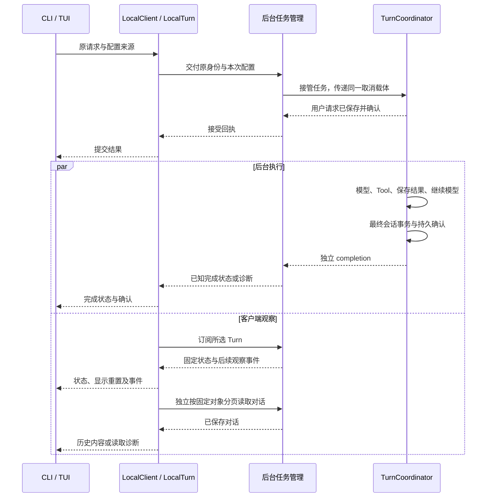
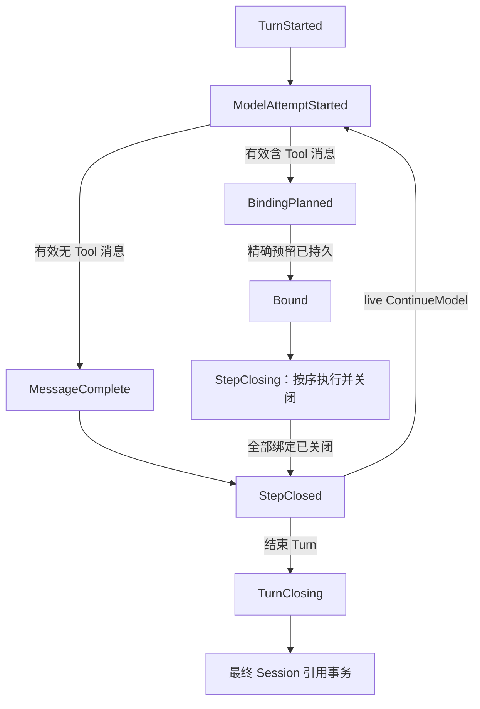
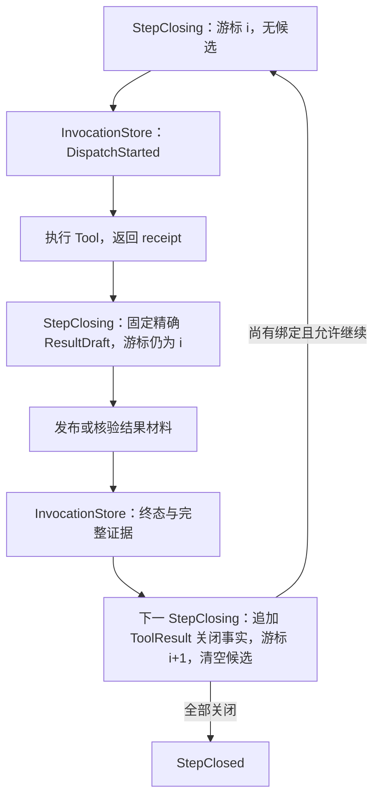
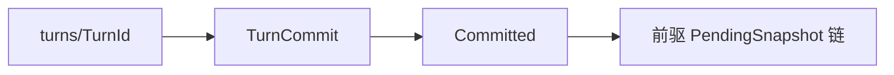

# 会话与 Turn

> 类型：架构合同
> 上位依据：[项目宪章](../governance/charter.md)、[宿主平台](platform.md)

## 目的与范围

用户向一个会话提交任务，后台接受后驱动模型、执行模型选择的 Tool、保存调用结果，再把结果交给模型继续回答。用户可以同时观察进度，也可以关闭终端，稍后重新连接查询状态和读取已保存结果。

本合同说明一次任务如何被接受、执行和保存，以及用户中途离开、取消任务或后台重启后如何继续处理。

以下以“读取工作区文件并解释内容”为贯穿场景：用户提出问题，模型选择 `observe.workspace` 读取文件，然后依据返回内容给出解释。工具的具体能力由 [LANCET 合同](lancet.md)和[工作区观察接口](workspace.md#观察接口与边界)说明。

## 模型与职责

### 会话、Turn 与历史

Session（会话）保存用户的一段持续对话，以 `SessionId` 标识，并关联用户工作的项目。用户可以在同一会话中连续提出任务，读取此前保存的对话。

后台接受一次用户任务后，形成一个 Turn。本文场景中的用户问题、读取文件的工具调用和最终解释都属于同一 Turn。客户端在提交前保留 `TurnId`，连同 SessionId 找回同一次请求。

对话由有序消息组成。消息按顺序保存文字、模型推理内容（reasoning）、工具调用请求（ToolCall）或调用结果（ToolResult）。ToolCall 说明要使用哪个工具和参数；ToolResult 记录执行结果与返回内容的可用情况。一次工具调用以 `InvocationId` 标识，一个 Turn 可以包含多次调用。

一个模型步骤取得一条完整有效的模型消息，并关闭其中的工具调用，再决定继续请求模型还是结束 Turn。请求失败时，同一步骤可以有多次尝试，最多接受一个完整有效的模型消息。完整消息保存后可再次提供给模型；正在到达的流式文字用于显示生成进度。

尚未完成的任务由 PendingTurn 保存进度，关闭后的任务由 TurnCommit 保存结果。会话历史组织这些已提交结果，用户可以选择其中的对话位置继续工作。具体存储结构见[会话存储与并发](#会话存储与并发)。

### 组件与接口

LocalClient 用 `LocalTurn` 组织本客户端一次提交或观察交互。LocalTurn 是这次交互的具体句柄，保留原请求身份和已收到的事实，管理交付、在途取消、观察与历史异步读取；它不是第二个持久 Turn，也不拥有后台执行。前端持有句柄并消费更新，后台的 Owner 与 TurnCoordinator 分别监督操作和推进持久执行。

| 场景中的角色 | 负责的工作与交接 |
| --- | --- |
| 前端 CLI / TUI | 接收输入、选择操作，保留请求身份并提供配置来源；发起提交、观察或取消意图，渲染结构化更新并决定何时退出 |
| 客户端库 LocalClient / LocalTurn | 按需取得配置并完整交付原请求，衔接接受回执与观察，管理在途取消及固定历史异步读取，向前端分别交付状态、内容和诊断 |
| 后台入口 serve | 接收本地连接，维护后台实例及连接资源，将请求交给 Backend |
| 后台任务管理 Backend / Owner | Backend 管理准入、查询及本进程完成信息；Owner 监督已接管操作。实际带配置的操作从准备起持有同一取消载体，直至执行核心独立收尾或给出明确诊断，前端退出不改变其责任 |
| 执行协调 TurnCoordinator | 推进一次 Turn：请求模型、组织工具调用、保存结果，最后关闭任务 |
| 模型驱动 ModelStepDriver / LLM | 接收对话和本次配置，请求模型，将响应交回 TurnCoordinator |
| 工具执行 LANCET | 接收已绑定的工具调用，按权限执行，向 TurnCoordinator 返回执行结果、返回内容及证据 |

前端负责用户交互，LocalClient 负责操作交付与持续观察，后台负责任务生命周期，TurnCoordinator 负责持久执行流程。[实现模块与公开操作](#实现模块与公开操作)进一步说明各 crate、存储入口和操作接口。

## 从提交到结果可见

1. **提交任务。** CLI/TUI 收到“读取文件并解释”的输入，保留 SessionId、TurnId、原始输入和工作区，将请求与配置来源交给 `LocalClient::start_turn_with`，持有返回的 LocalTurn。找回已有请求和忙时处理见[请求身份与确认](#请求身份与确认)。
2. **准备并交付配置。** LocalClient 仅在新执行需要配置时调用前端提供的加载闭包，取得冻结的模型选择、系统提示、工具策略和连接材料，以原请求身份交付。Backend 实际接管带配置操作时建立贯穿准备与执行的取消载体，随后核验配置并交给执行核心。字段和来源见[执行配置冻结](#执行配置冻结)。
3. **确认接受。** 执行核心核对请求身份、项目绑定和输入，保存用户消息及冻结配置。必要的持久确认完成后，后台返回接受回执，由 LocalTurn 交给前端显示；后台承担后续执行与关闭责任。精确接受条件见[请求接受](#请求接受)。
4. **同时观察进度。** LocalTurn 从原目标开始观察，并在接受回执到达后衔接相应 Turn 的固定视图与后续事件。它先交付状态，独立读取已保存对话；前端消费更新并渲染，后台同时继续执行。交接方式见[观察与重连](#观察与重连)。
5. **请求模型。** TurnCoordinator 先保存此次模型尝试的开始记录，再把已有对话、本次模型参数和启用工具交给 ModelStepDriver。驱动器通过 LLM 连接请求模型；在本例中，模型返回读取文件的工具调用。
6. **绑定并执行工具。** TurnCoordinator 核验完整调用消息，为调用分配 InvocationId 并保存精确绑定计划。调用库确认预留后，LANCET 保存分发开始记录，按权限读取文件，返回执行结果、内容和证据。绑定与分发的详细顺序见[绑定与逐调用关闭](#绑定与逐调用关闭)。
7. **保存调用结果。** TurnCoordinator 保存返回内容、执行终态和必要证据，将关闭后的 ToolResult 加入对话。此后模型可以使用这次文件读取结果；候选、材料和关闭进度的持久顺序由[逐调用关闭](#绑定与逐调用关闭)和[结果材料](#resultdraft-与关闭材料)规定。
8. **继续生成回答。** 本步骤的调用全部关闭后，TurnCoordinator 按步骤决定继续模型。ModelStepDriver 接收带有 ToolResult 的更新对话，模型据文件内容生成解释。
9. **保存最终结果。** 模型给出完整回答后，协调层保存消息和结束决定，记录此时项目的文件历史位置（checkpoint），并把整次 Turn 的关闭结果发布到会话历史。工作区与会话的协调、最终事务见[Turn 最终发布](#turn-最终发布)。
10. **取得结果。** 执行核心返回独立完成结果，Backend 保存本进程已知的完成确认或诊断。LocalTurn 及时交付完成事实，正文读取另行返回；前端分别显示任务结果、确认和内容。此前离开的用户也可通过只读观察句柄找到同一 Turn 的结果。

下图只表示接管后的执行与观察可以重叠，持久阶段的精确顺序由后文定义：

### 用户读到的几种事实

在上述文件读取场景中，以下数据分别回答不同问题：

| 数据 | 具体用途与依据 |
| --- | --- |
| 已保存对话 | 用户问题、完整模型消息和已关闭 ToolResult，供重连读取及下一次模型请求使用；来自固定 TurnCommit 或已验证 pending 日志 |
| 临时流式文字 | 模型正在生成的解释片段，用于即时显示；事件可能丢失，尚未形成完整消息的片段不作为持久对话 |
| Invocation outcome | 文件读取调用是 Succeeded、Failed、Cancelled 等哪种执行结果，由 InvocationStore 的持久终态确定 |
| 结果材料 | 供模型使用的 ToolContent，例如读取返回的内容；材料可能可用，也可能因超限或发布失败不可用，详见 [ResultDraft](#resultdraft-与关闭材料) |
| Turn outcome | 整次请求关闭为 Completed、Failed、Cancelled 或 Interrupted，保存在 TurnCommit；完成关闭不限定为业务成功 |
| 接受/完成确认 | 执行核心确认对应对象与引用已完成要求的持久屏障，经独立回执交付；Backend 的已知确认和错误在本进程保留 |

例如，Tool 已执行成功而完整材料超过保存上限时，执行 outcome 仍为 Succeeded，模型得到的是材料不可用的关闭结果。若只是观察中丢了一条 finished 事件，缺少的是显示进度，调用终态和已保存材料仍按各自存储核验。前端读取材料失败时，保留已经取得的 outcome 和确认，单独报告内容未能加载。

## 实现模块与公开操作

以下将前面的角色对应到代码模块，展开调用入口和内部协作。`lattice-api` 负责跨存储协调，把调用事实、[项目 checkpoint](workspace.md#turn-checkpoint)和[存储发布](storage.md#对象引用与持久化)接入 Turn；适用边界见[范围与禁止事项](#范围与禁止事项)。

| 模块 | 具体职责 |
| --- | --- |
| `lattice-api::local::LocalClient` / `LocalTurn` | `client.rs` 封装连接、共同惰性握手及固定历史读取；`operation.rs` 的具体 LocalTurn 管理提交、控制回执、订阅、正文任务与退出交接，前端消费界面无关的 LocalUpdate |
| `lattice-api::local::serve` | 持有实例锁和 socket、接收并核验连接、管理连接任务；实例退出时释放资源 |
| `Backend` / `Owner` | Backend 管理准入、领域存储句柄及本进程完成记录；Owner 持有已接管操作的内存身份、取消标志、回执和监督信息。任务脱离请求连接运行，监督者等待执行核心收尾后才移除 Owner |
| `lattice-api::SessionApi` | 创建、严格打开、列表、状态、日志、分支、checkout、reset、diff 及固定读取的领域入口，向后台返回会话事实和对话内容 |
| `lattice-api::TurnCoordinator` 及执行核心 | 唯一持久 Turn 协调者，持有全 Turn 执行锁，核验冻结输入，推进模型循环、绑定、调用、材料关闭与最终发布；跨库 I/O 通过窄领域接口完成 |
| `lattice-agent::ModelStepDriver` | 接收冻结请求和对话历史，驱动一次 provider 请求，向协调层返回类型化尝试结果，并发送非阻塞观察回调 |
| `lattice-llm` | 使用本 Turn 的模型连接材料，完成 provider wire 请求、流事件适配和对话投影 |
| `lattice-conversation` | 维护有序消息、ToolCall typestate、关闭结果、双摘要、尝试诊断和 usage 等纯数据 |
| `lattice-session` | 保存会话状态、分支图、TurnCommit、PendingTurn、ResultDraft 和固定视图；纯 reducer 接收协调层投影的调用事实，给出关闭或候选修订决策 |

公开操作按用户要完成的工作划分：

| 用途与操作 | 输入及前提 | 输出与效果 |
| --- | --- | --- |
| 查看会话：`open`、`list`、status、log、diff | 会话身份及相应历史位置 | 读取已核验的会话或固定历史视图 |
| 查看一个 Turn：`observe`、`LocalTurn::next/reconnect` | SessionId、所选 TurnId 与历史范围 | 返回只读 LocalTurn；未指定 Turn 时优先选 active，否则选 head 对应 Turn，空会话交付空历史；重连继续原观察目标 |
| 提交或找回请求：`start_turn_with` | 原请求身份、输入、规范工作区、历史范围及一次性配置加载闭包 | 返回 LocalTurn，完整交付提交并衔接观察；首轮无配置探测直接返回 Existing 或 Busy 时不加载配置；发现其他崩溃遗留 Turn 时先关闭，再返回 NeedsConfiguration，最多加载一次配置并继续本次新输入。后续准入仍可能因并发变化返回 Existing 或 Busy；新请求的回执与观察保持本次身份 |
| 读取已固定内容：`read_history` | 已取得的 SessionObservation 与 `HistoryScope` | SelectedTurn 读取所选 Turn，包括 reset 后的永久 pin；Session 遍历固定 head 的可达历史、去重并保留 merge 顺序，再读取固定 active journal；不二次 query |
| 请求取消：`LocalTurn::cancel`，或独立命令的 `LocalClient::cancel` | 原目标 SessionId / TurnId | 句柄同步登记意图并管理在途回执；独立命令返回后台接管结果，持久关闭结果另行查询 |
| 修改会话：创建及引用/状态操作 | 创建输入，或会话身份和变更目标 | 由后台经 SessionApi 执行；checkout、branch、reset、set-agent 和 rewind 先自动关闭崩溃遗留 Turn，再执行原操作，受会话锁和严格存储验证约束 |
| 停止后台：`stop` | 当前本地后台 | 关闭新准入并等待已接管操作收尾，返回停止时已知状态 |

`LocalTurn::next` 交付 LocalUpdate，取消一次等待不会丢失已接收更新或半帧；已完成后句柄仍可显式重连。普通退出使用 `detach` 取得最后已知提交、取消、状态和读取诊断，或由 Drop 停止本地后续工作；两者都不新增取消。

`LocalTurn::turn_id` 给出提交、观察与取消共用的身份；未指定目标的观察句柄在首次选择完成前返回 None。固定 view 还可同时包含所请求的旧结果与另一个 active Turn，不能据此改写旧句柄身份。前端选择不同活动目标时调用新的 `observe`，原句柄仍独立交接其控制事实；对同一观察目标重连则继续使用原句柄及其已知确认。

公开类型与方法见[本地连接与读取](../../crates/lattice-api/src/local/client.rs)、[LocalTurn](../../crates/lattice-api/src/local/operation.rs)和[结果类型](../../crates/lattice-api/src/local/types.rs)，命令用法见[验证操作指南](../development/validation-guide.md#后台与重连操作)。`RewindCoordinator` 独立协调显式文件恢复，遵循工作区合同。

### 低层接口与提交握手

`query`、`subscribe`、固定对象分页接口继续提供只读操作；一次性 query 返回的 view 可直接交给 `read_history`。`submit`、`lookup_or_recover` 与 `submit_with` 是可能写入的提交接口，不能用作只读重连。前端的持续交互使用上表的具体句柄，握手、订阅切点与控制交接由客户端库维护。

无配置探测允许旧请求找回、Busy 和旧 Turn 关闭先于新凭据加载发生。`NeedsConfiguration` 请求新执行输入，不进入 PendingTurn 的持久阶段；共同惰性握手在库内消费它，最多调用一次加载闭包，并在配置发送关口再次检查本地放弃。`submit_with` 与 `start_turn_with` 复用该握手，前者的闭包仍可借用且不要求 Send/'static，后者为独立任务持有 Send/'static 的闭包和 future。

## Turn 的接受与模型步骤

### 请求接受

执行核心持有 SessionExecutionLock 后核对身份、项目绑定与存储。新接受还验证用户消息、工具目录及执行限制。`TurnStartedFacts` 保存用户消息、TurnId、SessionId、ProjectStoreKey、父对话 tip、`FrozenTurnConfig` 和接受时间；最终发布以该父 tip 为 CAS 前提。用户消息为 User 角色的 text parts，大小规则见[输入与传输限制](#输入与传输限制)。

| 接受时停在哪里 | 已知事实 | 后台责任与用户下一步 |
| --- | --- | --- |
| 输入、绑定、配置等在发布前被拒绝，且可证明未发布 | 尚未建立已接受 Turn，也未发送 provider 请求 | 返回类型化拒绝；前端保留输入供用户修正 |
| 发布返回错误，引用可能已可见，必要屏障尚未确认 | 接受确认未知，可能已有原候选 | 后台保留实际事实；前端保存原身份，查询或显式重发同请求核验，停止新的 provider 启动 |
| TurnStarted 已确认持久发布 | 请求已接受，原用户消息及冻结事实已保存 | 后台执行并关闭原 Turn；之后的失败、取消、崩溃走相应关闭路径 |

### 执行配置冻结

提交端在需要新执行时读取配置来源。冻结将“以后再读某路径或环境变量”变成“这次 Turn 使用的确定值”，避免同后台的并发 Turn 相互改变配置。工作区 `.env` 的信任边界、唯一 loader 和优先级继续由 [CLI 环境边界](../../crates/lattice-cli/AGENTS.md#环境与输出边界)维护。

`FrozenConfiguration` 是仅用于私有 IPC 的提交输入，含有效 `profile_toml`、已经加载的 `system_prompt` 和 `ConnectionMaterial`。后台将它转换为执行所需的 profile 和本 Turn 的 LlmConnection。`FrozenTurnConfig` 则是协调层在接受时构造并写入 TurnStarted 的非秘密执行事实，供日志验证、结果投影和恢复使用。

| 字段类别 | 来源 | 冻结时点 | 接收/持有者 | 是否持久化 | 用途 |
| --- | --- | --- | --- | --- | --- |
| `FrozenConfiguration.profile_toml` | 提交端加载的 AgentProfile；策略文件解析所得有效工作区、网络和观察限制填回具体字段，清除待重读的 `lancet.policy` 引用 | 新执行配置提交前 | 后台转换为 LoadedAgentProfile，交执行核心 | IPC 容器本身不保存；非秘密内容进入下述执行快照 | 固定 Agent/model 选择、LLM 重试与超时、启用工具及能力策略 |
| `FrozenConfiguration.system_prompt` | 提交端依 profile 加载后的实际文本 | 同上 | 后台执行核心及模型请求 | 文本进入 FrozenTurnConfig 及 profile 快照 | 固定本 Turn 的系统指令，执行时使用已加载内容 |
| `ConnectionMaterial.alias/provider/provider_model/base_url` | 提交端 ModelRouter 按模型选择及有效 endpoint 来源解析 | 同上 | 本 Turn 的 LlmConnection | 连接材料不持久化；执行模型和 provider 标识另存于 FrozenTurnConfig | 路由到确定 provider、实际模型和 endpoint；后台校验模型 alias 与 profile 一致 |
| `ConnectionMaterial.api_key` | 提交端按既有优先级读取的有效凭据值 | 同上 | 私有 IPC、后台本 Turn 的 LlmConnection | 否 | 认证 provider 请求 |
| `ConnectionMaterial.roots_der` | 提交端读取的实际 Linux TLS 根证书内容，或显式提供的 DER 内容 | 同上 | provider 连接与本 Turn 的 Tool Host 信任配置 | 否 | 验证 TLS 连接；传递证书内容而非要求后台重读证书路径 |
| `FrozenTurnConfig.agent_name/model/provider/system_prompt` | 已核验提交输入及模型解析结果 | 发布 TurnStarted 前 | TurnCoordinator、会话日志及投影 | 是 | 标明此次执行身份、模型与系统指令 |
| `FrozenTurnConfig.profile_snapshot_json/policy_snapshot_json` | 有效 profile 与 system prompt 的快照、有效 LANCET 配置的快照 | 同上 | TurnCoordinator、会话日志 | 是，非秘密 JSON | 固定配置与策略事实，参与配置摘要和恢复核验 |
| `FrozenTurnConfig.catalog` | 本次运行时的启用工具目录 | 同上 | 模型投影、绑定验证、会话日志 | 是 | 保存运行时构建身份、按工具名排序的 entries 及摘要；entry 含名称、Descriptor 身份、描述、规范输入 schema |
| `FrozenTurnConfig.limits` | profile 超时、每步尝试数及代码定义的步骤上限 | 同上 | 执行核心、会话日志 | 秒数与计数持久化，单调时钟 deadline 不持久化 | 限制后续 provider/Tool 启动，并解释尝试预算 |

类型与转换来源为[私有冻结输入](../../crates/lattice-api/src/local/config.rs)、[连接材料](../../crates/lattice-llm/src/connection.rs)、[持久冻结事实](../../crates/lattice-session/src/pending/config.rs)和[接受接线](../../crates/lattice-api/src/turn/live.rs)。目录保存中立契约，provider wire 投影由 LLM 层按请求生成。

#### 配置安全边界

后台按 Turn 消费显式冻结输入，不切换共享环境、cwd 或稍后重读凭据/策略路径来改变已接受配置。凭据和 TLS 材料只在内存及私有 IPC 流转，不进入持久记录、公开 DTO、Debug、错误回显或日志。

provider 与 Tool Host 共享本次冻结的 TLS 根内容，各 Turn 独立构造信任配置。坏材料在接受前拒绝；空根集合拒绝 TLS 证书，不回退到后台平台根。Tool 网络继续遵守 [LANCET 逐跳授权与地址固定](lancet.md#网络获取)。

### 模型请求与执行预算

一次 provider 请求以 `ModelAttemptKey` 标识，包含 TurnId、模型步骤序号和该步骤的尝试序号。协调层每次先持久发布 `ModelAttemptStarted`，再让 ModelStepDriver 打开和消费流。

| 尝试结果 | 保存什么及下一动作 |
| --- | --- |
| opening 失败，尚无任何流事件，适配器判为可重试且预算尚有剩余 | 写 ModelAttemptFailed，按冻结策略退避，再发布下一尝试序号 |
| opening 失败且不可重试或尝试预算耗尽 | 写 ModelAttemptFailed，按模型请求失败关闭 |
| 已收到任何流事件后发生错误、取消或超时，执行核心仍能收尾 | 写 ModelAttemptInterrupted，进入关闭 |
| 进程突然退出，尝试结束事实未保存 | 重开根据已持久阶段关闭；只有 ModelAttemptStarted 时按进程中断处理，见“自动关闭崩溃遗留任务” |
| 收到完整有效消息 | 无 Tool 时发布 MessageComplete；有 Tool 时进入 BindingPlanned |
| 完整输出的批次校验失败 | 写 ModelAttemptRejected，保存类型化拒绝原因并关闭 |

模型步骤上限为 32，profile 不能放宽。每步尝试数由 profile 冻结，最多 11 次，重试不额外消耗模型步骤。达到步骤上限时保留此前已关闭消息和 ToolResult，以类型化失败关闭 Turn。

流组装按 UTF-8 字节持续计量：

| 对象 | 协议上限 |
| --- | --- |
| 单 ToolCall 参数 | 1 MiB |
| 助手正文 | 2 MiB |
| reasoning | 2 MiB |
| 一次 ModelAttempt 总量 | 16 MiB |

超限立即停止消费，保存有界诊断并记录 `OutputLimitExceeded`。这些是对话协议与组装器的限制，计量类型在 [`lattice-conversation`](../../crates/lattice-conversation/src/lib.rs)，不能解释为容量或延迟的测量结论。单 ToolCall 参数上限与 LANCET 单文件工作区写入上限 `MAX_WORKSPACE_WRITE_BYTES`（1 MiB）一致：写入内容随参数传入，超过该大小的调用无法成功执行。正文、reasoning 与单次尝试总量的出处为 [ADR 0005](../adr/0005-durable-turn-invocation-and-private-git-stores.md)模型尝试部分；ADR 记录的 8 MiB 参数上限已由本节取代。

Turn 的单调时钟 deadline 在 TurnStarted 发布后开始，限制后续 provider 请求与 Tool 分发。必要的 Invocation 终态、Step 和 Turn 持久化由独立收尾预算保护；重开仅关闭，不重建剩余执行时间。每次尝试分别保存 provider 给出的 `Option<TokenUsage>`，缺失表示未知；失败、中断和重试尝试的已知 usage 也保留，Turn 汇总派生为 Complete 或 Partial。

## 对话数据与模型投影

### 有序消息与 ToolCall

`NativeMessage<ToolCallState>` 用有序 `MessagePart` 保存消息。`UnboundToolCall` 表示模型生成、待绑定的调用，`BoundToolCall` 表示协调层已经分配身份的调用；绑定保留原片段顺序。`ModelMessageAddress` 定位 Session/Turn 中的模型步骤，`ToolCallAddress` 再定位消息中的片段序号。

Tool 参数通过协议 canonical JSON 生成规范对象和摘要。有效调用要求参数为一个 JSON 对象，ToolCall 完整且无重复；单次完整响应最多 32 个 ToolCall。任一个调用无效或数量超限时拒绝整个尝试。完整 reasoning 参与持久对话及语义摘要；中断尝试的部分文本、reasoning 和调用数据保留为有界诊断。

#### 对话与投影边界

空串、数组、标量、畸形 JSON 不能作为 Tool 参数对象。拒绝尝试不产生可执行绑定或 InvocationId，也不把该尝试的助手正文作为成功消息；中断尝试的部分文本、reasoning 和调用数据只作诊断，不进入已提交对话。超限批次不截断为可执行批次。这些限制让持久绑定始终对应一条完整有效消息。

### 语义与回放

- `semantic_digest` 覆盖 provider-neutral 文本、完整 reasoning、规范 Tool 语义及顺序，供绑定使用。
- `replay_state_digest` 覆盖 provider 来源、真实 provider call ID 和片段级不透明回放状态。

同 provider 可使用原回放材料；跨 provider 由适配层生成中立语义投影，去除来源 reasoning、provider call ID 和回放状态。绑定摘要始终从实际保存的原消息计算。不透明回放材料逐片段原样保留，单片段上限 64 KiB；即使片段正文为空，也保留其回放状态。

类型和编码由 [`lattice-conversation`](../../crates/lattice-conversation/src/lib.rs) 维护。provider Tool Call ID 仅是 provider 协议材料，不参与会话绑定或执行身份分配；跨 provider 投影不伪造目标 provider 身份材料，会话层重导出不另立持久序列化形状。

## PendingTurn 与结果关闭

### 日志与阶段

后台每保存一次进度，就写入一个不可变 PendingSnapshot，再以 CAS 将 `active-turn` 从已核验前驱推进到它。快照含身份、前驱、累积 `post_user_transcript` 和当前阶段，载荷前驱须与 Git 父关系一致，链根连接接受时冻结的父对话 tip。

`post_user_transcript` 是用户消息之后唯一的累积对话来源，每条日志边推导并校验其精确变化。StepClosing 保存有序绑定、关闭游标、关闭事实和当前候选，消息正文由快照统一承载。live 与 reopen 使用同一日志推导的 TurnCommit 候选基础。

| 阶段 | 保存的进展及用途 |
| --- | --- |
| TurnStarted | 已接受请求及冻结事实，建立关闭责任 |
| ModelAttemptStarted | 即将发送的模型请求身份 |
| ModelAttemptFailed、ModelAttemptInterrupted、ModelAttemptRejected | 失败、中断或完整输出拒绝及尝试事实 |
| MessageComplete | 完整有效且不含 ToolCall 的消息，可据此关闭步骤 |
| BindingPlanned | 含 ToolCall 的完整消息与精确候选绑定计划一起发布 |
| Bound | 整个精确计划已在 InvocationStore 持久预留 |
| StepClosing | 逐个绑定的结果关闭进度 |
| StepClosed | 步骤已关闭，保存继续模型或结束 Turn 的决定 |
| TurnClosing | 精确 TurnCommit 与最终日志候选，包含 checkpoint 和全部时间字段 |
| Committed | 最终不可变日志对象，由最终 TurnCommit 引用 |

下图表示 live 正常路径的持久阶段，省略重试、候选修订及失败分支。工具执行和结果持久化发生在 StepClosing 内：

### 绑定与逐调用关闭

模型的完整 Tool 消息到达后，TurnCoordinator 为每个调用生成候选 InvocationId。该身份随后贯穿绑定、执行、取消、结果关闭和审计。一批调用的 `PlanKey` 标识精确绑定计划的所有者，绑定包含 Session/Turn/消息/片段地址、方法、Descriptor 身份和规范参数摘要，顺序与原消息一致。

请求身份的跨 Session 范围已由项目所有者裁决：`PlanKey` 完整身份为 SessionId + TurnId + 模型步骤序号，即一次“工具调用批次”预留键包含所属 Session，项目级调用账本据此区分不同 Session 的同 TurnId 计划（对应代码中的 `PlanKey`/`BindingPlan`）。键的 Session 必须与每个绑定的真实 Session 一致，精确绑定核验不弱化。本轮 schema 变更不做旧格式兼容：旧调用账本与旧 pending 日志分别在版本/形状边界以明确错误拒绝，真实历史数据保持不动。以下候选碰撞规则处理 InvocationId，与计划键作用域互补。

协调层把消息与精确计划一起发布为 BindingPlanned，再调用 InvocationStore 的批量预留接口，整个计划确认持久后进入 Bound。全部绑定预留后，先发布 `closure_cursor = 0`、无关闭事实和结果候选的 StepClosing，再分发第一个调用。每次只处理最低未关闭序号。

下图展开一个绑定的正常关闭。每个持久发布节点确认后才推进；固定候选与推进游标是两次独立日志迁移：

InvocationStore 的预留、分发、终态及停止条件由 [LANCET 调用流程](lancet.md#调用身份与执行流程)维护。协调层固定 ledger 视图，投影为会话 reducer 使用的 InvocationFactsSnapshot，保留 PlanKey 所有者和精确候选集合。当前调用终态与完整证据、游标推进快照都确认持久后，才允许后续分发。live 与 reopen 从有序持久调用事实通过同一 `derive_tool_batch_control` 得出批次控制，保留各自是否允许继续模型的条件。

#### 候选与事实校验边界

| 条件 | 允许的处理及原因 |
| --- | --- |
| BindingPlanned 中候选身份发生干净碰撞，且可证明原精确计划未预留 | 受约束地 CAS 修订候选；保持消息、方法、Descriptor、参数和顺序，只替换候选身份及派生绑定摘要 |
| 计划或候选发布结果不确定 | 核验原精确候选，不另分配身份，避免一次发布被解释为另一调用 |
| Bound 阶段出现不同计划或身份冲突 | 按损坏拒绝；Bound 的成立前提已是整个精确计划持久预留 |
| 调用事实缺失、额外、部分预留或归属不一致 | 拒绝该投影/计划，不能过滤掉不匹配记录后继续 |

含 ToolCall 的消息与绑定计划共同发布，不经独立的 MessageComplete 窗口。候选修订返回 `CandidateRevisionRequest`，保留原精确计划、所属 Session/Turn 和碰撞候选供 CAS 核验；它不含 TurnOutcome，Turn 在修订期间仍未关闭。

### ResultDraft 与关闭材料

Tool 返回后，协调层规范化 ToolContent，计算完整长度、摘要和 ResultDraft 候选，先固定候选，再发布材料。ResultDraft 只保存内容与绑定关系；执行 outcome 来自 InvocationStore 终态。发布重试沿用候选的精确规范字节和对象身份。

| 材料状态 | 处理 |
| --- | --- |
| Durable | 核验与持久终态中的摘要、长度一致后，生成含内容的 ToolResult |
| CleanAbsent | 保留真实执行 outcome，材料记为 `Unavailable(DraftPublicationFailed)` |
| Uncertain | 在有限预算内重核精确候选；身份或摘要不符报损坏 |
| 内容超过 65,536 字节 | 不写 draft、不截断；保留完整摘要与长度，材料记为 OutputTooLarge |

ToolResult 分别保存执行 outcome 与材料可用性。执行成功而材料不可用时，关闭结果据实表达缺失；需要大输出的 Tool 通过自身接口提供分页、游标或摘要。材料正文、临时 receipt 或显示事件均不能推翻已保存终态。

FinalizeBudget 从执行器返回后开始，覆盖实际锁等待、不确定 draft 复核、终态与证据发布及重试等待，与 Turn deadline 分开。当前为 60 秒，首次立即尝试；可重试的持久化失败按 25 毫秒起步、上限 1 秒的指数退避处理。预算到期停止发起新尝试，不异步强行取消已进行的内核持久化；损坏及身份/摘要不符直接停止。

预算耦合为 `lock_wait_gate + 2 * full_finalize_gate + backoff_cap <= FinalizeBudget`。诊断阈值唯一来源是 [qualification manifest](../../benchmarks/invocation-store/qualification-contract-v2.json)，使用方式见 [InvocationStore 诊断指南](../development/invocation-store-diagnostics.md)。阈值不可独立放宽，旧样本不构成产品时限保证。锁使用[存储锁机制](storage.md#锁与并发语义)，无需另设按 ProjectStoreKey 的 admission-control 队列。

终态与证据未能在预算内确认持久时，停在当前 StepClosing，向调用方报告持久性失败和恢复需求。此时后续绑定不分发，StepClosed、TurnCommit 和永久 Turn pin 均不发布。

## Turn 最终发布

StepClosed 的决定为 FinishTurn、ContinueModel、FailTurn、CancelTurn 或 InterruptTurn。live 执行核心按 ContinueModel 启动下一步，其余决定进入最终关闭。TurnOutcome 为 Completed、Failed、Cancelled 或 Interrupted，原因类型化；ClosureOrigin 标明 Live 或 Reconciled。

协调层从已验证日志生成候选基础，取得共享 WorkspaceOperationLock，读取[项目全局 checkpoint](workspace.md#turn-checkpoint)，持锁通过 TurnClosing 和最终会话事务。每个完成 Turn 都读取该值，包括没有写文件的 Turn；checkpoint 可以包含同项目其他 Session 已记录的变更。读取或身份校验失败时停止关闭，不构造空 checkpoint。

TurnClosing 固定精确候选及全部时间字段。最终在一次 `sessions.git` 引用事务中推进当前分支或 detached state、创建 `turns/<TurnId>` pin、按需更新 SessionState、删除 active-turn，并同步更新派生校验投影。事务前提失败时整组不发布；其他错误按[存储失败分类](storage.md#失败分类与恢复责任)核验实际引用。发布后持久性不确定时，继续确认同一候选。

箭头表示最终对象引用；Committed 由 TurnCommit 引用，不单独发布到 active-turn，也不反向包含 TurnCommit OID：

重开已固定的 TurnClosing 时，当前权威 checkpoint 必须与候选匹配。不匹配则报错，既不重采样替换 checkpoint，也不重读时钟构造另一提交。会话事务提供本库的原子发布；工作区历史、InvocationStore 和 SessionStore 各自发布，所以读取可能见到跨库中间状态。最终完成以各阶段事实与屏障为依据，已发生的文件效果由工作区合同处理。

## 重开、取消与未完成状态

### 请求身份与确认

同一 `(SessionId, TurnId)`、原始用户输入和项目绑定用于找回原 Turn；身份相同而输入或绑定不同返回 Conflict。新 TurnId 表示独立请求，即使文本相同。接受时原子核验 active-turn 与永久 pin，checkout/reset 后旧 TurnId 仍被占用。计划键的跨 Session 作用域见[绑定与逐调用关闭](#绑定与逐调用关闭)。

| 提交时找到的事实 | 后台与前端动作 |
| --- | --- |
| 同请求由当前 Owner 接管 | 共享正在进行的接受结果 |
| 同 Session 有不同请求正在执行 | 非阻塞返回 Busy；前端保留未提交输入，由用户稍后发送 |
| 同请求仍 pending，能够取得执行所有权 | 核验原输入和绑定，确认原接受；这次找回保持 pending，不推进模型或结果关闭 |
| 同请求已有永久 pin | 核验精确最终候选，完成必要确认屏障，返回原结果 |
| 发现其他旧 pending，能够取得独占权 | 先按 closure-only 规则关闭旧 Turn，再继续本次新输入；关闭失败则提交失败，不接受新输入 |

显式同请求重试沿用原候选、时间和冻结配置。无法确认时返回错误与未知状态，前端保留原 TurnId；重连读取使用 query/subscribe，可能补屏障或关闭旧 Turn 的 `lookup_or_recover` 只用于提交流程。

执行核心分别给出接受结果、完成结果和观察事件。`stream_turn`、`run_turn` 复用该核心，收集事件之外仍须取得独立 completion。Backend 在 Owner 退场后保存本进程已知的完成确认或错误；恢复取得执行锁并核验旧 Turn 后确定诊断归属。旧 Turn 仍 pending 时，新订阅者取得该已知恢复错误；已关闭的固定结果由后台重新核验（见下段），旧错误缓存不阻止修复后的再次核验。未经核验的请求冲突不覆盖原 Turn 的诊断。

Backend 重启后内存确认丢失，但观察已关闭结果不再要求用户重发原请求。用户读取结果、后台核验、前端显示按此顺序成立：订阅固定 pin 的已关闭 Turn 时，后台按 session+turn 核验 TurnCommit 及其关联数据，拒绝同 Turn active-turn 异常，并在短仓库写锁内补足 pending 引用 fsync 屏障，核验通过才交付完成确认。该核验不经执行锁，不等待同 Session 其他 Turn 的生命周期，也不关闭、取消或重放它们；无 Owner 的 pending 等待下一次新提交或写操作自动关闭，不由观察触发。真实存储错误按具体失败诊断交付，不以“缓存空/锁忙”要求重试。可读 pin、TurnStarted/TurnCommitted 观察事件或流结束本身仍不是确认回执；请求找回保证不扩展为 Tool exactly-once。

LocalTurn 将固定结果、观察阶段和完成确认分别交付。`ObservationPhase::Live` 表示当前切点已核验观察 Owner，NoOwner 表示该切点没有观察 Owner；它们不判定取消资格。Finished 表示独立后台完成回执，可能携带仍 pending 的视图或真实完成失败。

可读 Committed 只证明结果可见。原提交回执尚在等待时，仅可见 pin 不结束该等待，独立 Finished 才可先于接受回执交付完成。已取得的 `(TurnId, commit_id)` 确认由同一句柄保留，重连后的未知确认不抹去它。

LTLOCAL2 当前没有独立的“仅可见”字段，也没有单独的“仅可见”完成状态：无 Owner 的 Committed 订阅先由后台核验并补屏障，成功即 Finished 携带确认，失败即 Finished 携带真实存储诊断。可读 pin、TurnStarted/TurnCommitted 观察事件或流结束本身仍不是确认回执；已完成事实、确认与正文读取分别推进。

### 观察与重连

普通退出释放客户端和观察连接，后台继续执行。重新连接时，前端调用 `observe` 或句柄的 `reconnect`；LocalTurn 选定 Session/Turn，维护只读订阅、固定状态与历史读取。query/subscribe 和后台启动均不自动恢复旧 pending。

“固定视图”把一次读取选定的对话位置和未完成进度记下来。head OID 指向要遍历的已提交历史，pending journal OID 指向 active-turn 在切点处的不可变进度快照。LocalClient 按同 Session 的固定 TurnCommit 或 journal OID 分页读取；pending 对话由已验证的用户消息和累积 `post_user_transcript` 组成。读取期间的新发布不会混入本次对话。

1. Backend 先登记观察通道，再固定 state、head、active-turn 和所请求永久 pin。事件游标以后台 epoch 区分进程生命周期，以 sequence 表示顺序；序号在首次可能丢弃前分配，固定后的切点采用核心源序号。
2. LocalTurn 先交付 State 及该切点的 Reset，再独立推进 Event 和 History。State 分别携带观察阶段、完成确认和诊断；History 只替换持久区域，同切点已经交付的新文字和工具事件继续保留。前端按更新动作渲染，无需比较 OID、游标或读取代次。
3. 序号跳跃、队列溢出、末尾事件缺失或 epoch 改变时，后台给出 Gap；客户端本地显示队列丢事件也产生缺口与重新固定动作。LocalTurn 使旧切点临时观察失效，管理重固定、旧连接退场和后续只读订阅，前端保留缺口提示。
4. 新固定视图取代旧正文读取时，LocalTurn 终止并收割旧任务。旧成功不再交付，已发生的失败带原 view、读取对象与 `stale=true` 交付为诊断；新的正文挂起或失败也不遮蔽已收到的 Finished、outcome 和确认。后续正文读取成功后清除尚未解决的读取错误，中间失败仍保留为提示。CLI 按最终固定结果、完成错误和最终正文读取结果选择退出码；最终仍读不到正文或核验发现数据损坏时退出 1，不因已知 Completed 而忽略失败。

切点后未见 ModelStarted 就收到 TokenDelta 时，LocalTurn 给出 `TextAction::StartIncomplete`。前端在持久前缀之外显示当前模型段的新后缀，并提示前文可能缺失；随后真正的 ModelStarted 开始正常新段，ModelFinished 结束当前段。重载取回已保存消息，不补造缺失 token 或模型尝试身份。工具按 InvocationId 与来源配对，显示规则见 [TUI 对话记录与工具显示](tui.md#对话记录与工具显示)。

#### 观察边界

观察回调非阻塞，慢读、断连及 idle timeout 只结束或降级观察，不中止执行和必要持久收尾。领域只读与后台存储屏障分开：query 保持纯只读；subscribe 不做领域写入——不补投影、不恢复 pending、不请求模型、不分发 Tool、不公开冻结配置——但对无 Owner 的已关闭固定结果完成后台存储屏障：核验固定 pin 并 fsync pending 引用，不生成新候选也不发布引用（见[请求身份与确认](#请求身份与确认)）。

单页和 IPC 帧有界，UTF-8 分页保持字符完整，传输上限不能拒绝原本合法的整 Turn 记录。当前每页仍读取或解析单个 Turn/pending blob，内存成本为 O(single Turn blob)，多页会重复解析；有界 wire 不代表固定内存或流式 Git 读取。固定视图类型见 [`view.rs`](../../crates/lattice-session/src/git_graph/view.rs)。

### 取消与退出

用户选择取消后，前端调用 LocalTurn 的 `cancel`，同步登记原 SessionId / TurnId 的意图。LocalTurn 停止本客户端尚未发送的后续配置，并独立处理在途提交、取消回执及观察；慢正文和 UI 更新队列不承担控制状态。独立 `session cancel` 则直接取得后台接管结果。

#### 后台接管与责任区间

Backend 以实际接管的操作确定取消资格。新建带完整配置的 Submit Owner 时，即在工作区 I/O、配置核验和执行核心创建前建立取消载体，向核心传递同一载体。取消的目标查找、资格核对和置位与 Owner 移除在同一准入临界区完成；监督者持有独立 completion，等待必要收尾后才移除 Owner。

| 判定点的事实 | 动作与回执含义 |
| --- | --- |
| 原目标的带配置操作已被实际接管 | 置位同一取消载体并返回 true；重复请求幂等，后台独立处理至完成或明确诊断，连接退出不撤销责任 |
| 无配置请求共享了上述操作 | 仍可返回 true；资格来自被共享的实际操作，不取决于来访连接是否带配置 |
| 独立无配置探测、确认、会话写操作，或配置仍由连接持有并等待探测结束 | 不接管新执行取消；false 仅表示判定点未接管，不证明没有后台工作或后来不会接受同身份请求 |
| 没有可接管取消的对应操作 | 查询原持久事实后返回 false，查询错误仍返回错误；崩溃遗留 pending 在后续新提交或写操作前自动关闭 |
| 请求传输失败或回执丢失、超时 | 客户端报告 Unknown，保留原身份及其他已知事实 |

操作明确拒绝、可确认未建立 Turn 且监督退场后，新一轮同身份准入不继承旧取消，包括早已到达、此时才重新准入的连接。未知发布、已有 pending 或 pin 仍按原候选与持久事实核验，不归入这类明确拒绝。

#### 客户端意图与退出交接

LocalTurn 将取消显示为 Pending、Taken、NotTaken、Unknown 或 Moot，分别表示等待回执、已接管、判定点未接管、回执未知及无需继续交接。原目标尚未关闭、取消尚未接管且无在途 Cancel 时，首次 false 或传输未知与同目标接受/owned 观察证据结合，最多触发一次补发；两种回执先后顺序共用该额度。

true 后由后台履行责任，不自动补发；再次明确取消可开始新额度，旧在途回执不充当新意图回执。后台明确拒绝本次操作或原目标已关闭时结束后续补发，已知 Taken 与真实结果分别保留；新请求取消不转给自动关闭的旧 Turn。

`NotSubmitted` 只说明本客户端放弃后续配置发送的位置。CLI 的 `not_sent` 对应配置冻结中放弃，`not_accepted` 对应收到 NeedsConfiguration 后放弃；记录形状保持，含义限定于本客户端。已经发出的探测可能共享其他连接的执行，因此晚到的本地未提交结果不撤销已知接受、Taken 或完成事实。

首次取消时若提交仍在途，LocalTurn 按[回执等待预算](#输入与传输限制)等待；到期交付 SubmissionUnknown，以原身份重新固定只读观察，并保留原提交任务接收迟到回执。后续 Live 仍可观察，独立 Finished 与正文读取继续推进。未知交接后，原 Submit 的本地传输失败只补非终结诊断；后台错误回执与本地配置加载失败仍各按其真实来源处理，不纳入此分支。

普通退出或 Drop 不新增 Cancel，也不声称已发请求未执行。已有取消意图时，`detach` 使用同一控制状态和补发额度有限交接，返回最后已知事实；Taken 后无需等待正文或 Turn 关闭。等待超时保持未知，不承诺后台完成或阻塞配置工作在该窗口内结束。

取消的具体 `LocalError` 由 LocalTurn 保存在原目标、当前用户意图的 `DetachReport.cancel_error` 中，与 Cancel 更新使用同一来源，不依赖前端消费队列。同意图补发等待、窗口到期或 Moot 保留最近已知错误；新的明确用户意图以及 true/false 成功回执清除旧诊断，旧代在途回执不写入新意图。该字段不是永久错误日志，也不改变 Taken、未接管或未知的语义。前端交接旧句柄时按报告分别显示原提交/取消身份、实际观察对象的完成确认及诊断，不把它们作为新句柄的状态或回执。

#### 取消的效果与持久边界

取消控制本身在内存中，true 确认的是当前操作接管，不保证迟到取消改写已决定结果或必得持久 Cancelled。执行核心随后保存的取消原因、Invocation 终态和 StepClosed 决定才是崩溃后可用事实。调用关闭区分未分发、已确认取消和执行不确定，已有终态保持原值。以取消为主因的 Turn 关闭为 Cancelled，已关闭消息、调用事实和已发生效果保留；取消不回滚文件。崩溃窗口的顶层分类见下节。

### 自动关闭崩溃遗留任务

用户发送新消息，或执行 checkout、branch、reset、set-agent、rewind 时，Backend 先取得该 Session 的操作准入。若存在其他崩溃遗留 pending，执行核心非阻塞取得独占 SessionExecutionLock，核对 Session/项目绑定并严格打开相关库。TurnCoordinator 固定并验证 PendingSnapshot 和 Invocation 事实，把它们交给纯 reducer；reducer 返回关闭计划或候选修订请求，协调层执行跨库 I/O，再发布最终结果。

旧 Turn 成功关闭后，后台继续用户原本的操作。新提交按需加载配置并接受、执行本次输入；回执、观察事件、诊断和取消身份归属新 Turn，旧关闭结果按原 TurnId 查询。关闭失败时返回现有错误及诊断，本次新输入或写操作停止。关闭本身无需当前 profile、provider 凭据或 Component 组成。

同一 Session 正在执行操作时，新写操作在后台准入阶段返回 Busy；只有取得执行所有权后才协调遗留日志。同请求重试仍按[请求身份与确认](#请求身份与确认)找回原事实。后台启动和只读查询、观察保持原有边界，自动关闭由上述新提交或写操作触发。

这种关闭称为 closure-only：它依据已保存事实完成旧 Turn，不重新请求旧任务的 provider 或执行 Tool。已发生效果与可用材料继续保留；仅留在进程内 receipt、尚未持久保存的内容无法保证找回。

| 重开时的持久状态 | 关闭方向 |
| --- | --- |
| TurnStarted，尚无模型尝试 | Interrupted，原因 ProcessInterruptedBeforeModelAttempt |
| ModelAttemptStarted 未完成 | Interrupted，原因 ProcessInterruptedDuringModelAttempt |
| 可重试 ModelAttemptFailed，预算未耗尽，停在重试间隙 | Interrupted，原因 ProcessInterruptedDuringModelRetry；关闭而非恢复重试 |
| 不可重试或尝试预算已耗尽的 ModelAttemptFailed | Failed，原因 ModelRequestFailed |
| ModelAttemptInterrupted 或 ModelAttemptRejected | 取消原因关闭为 Cancelled(UserCancelled)；其他持久类型化中断或拒绝原因按原类型关闭 |
| 无 Tool 的 MessageComplete | 使用已持久完整消息关闭步骤并完成 Turn |
| BindingPlanned，精确计划未预留 | 用相同候选做仅关闭用途的预留；新确认的干净身份碰撞经受约束的候选修订处理 |
| BindingPlanned，计划已精确预留 | 发布 Bound 并继续关闭；部分或不同预留按损坏拒绝 |
| Bound | 核验整个精确预留，建立初始 StepClosing，再逐项关闭 |
| Reserved，尚无 DispatchStarted | 发布 NotExecuted(BeforeDispatch)，生成关闭结果 |
| DispatchStarted，无可靠终态 | 可写时保守关闭为 Indeterminate(MayHaveOccurred) |
| 已有终态或处于 StepClosing | 保留终态，从最低未关闭序号继续，核验已关闭项与调用终态一致 |
| StepClosed(ContinueModel) | Interrupted，原因 WhileAwaitingModelContinuation |
| StepClosed 已决定结束 | 使用所记录 outcome 进入 TurnClosing |
| TurnClosing 或精确最终候选已存在 | 核验候选及前提，幂等完成最终会话事务 |

下列持久窗口说明用户可见结果，均由上述恢复者关闭；“单调用”例子假定没有更早的取消或不确定调用控制整个批次：

| 崩溃时已经保存什么 | 恢复使用的事实与结果 |
| --- | --- |
| 仅内存取消意图，日志停在 TurnStarted | 用户消息仍在，取消意图随进程消失；以 ProcessInterruptedBeforeModelAttempt 中断关闭 |
| ModelAttemptStarted，尚无结束事实 | 完整历史及此前关闭结果保留；当前尝试按 ProcessInterruptedDuringModelAttempt 关闭，未完成流式片段不作为成功消息 |
| ModelAttemptInterrupted(Cancelled)，尚无 StepClosed | 取消原因已经持久化，是与 live 路径一致的持久事实：恢复与 live 同样以 Cancelled(UserCancelled) 顶层关闭并记录 CancelTurn，不再产生 Interrupted(ModelAttempt(Cancelled))。其他中断原因保持 Interrupted 透传 |
| StepClosed(CancelTurn) | 使用已记录取消决定，关闭为 Cancelled，保留先前消息、终态和效果 |
| 无 Tool 的 MessageComplete | 使用完整消息完成 Turn，即使进程退出前还有未持久化的取消意图 |
| 单调用仅 Reserved | 关闭为 NotExecuted(BeforeDispatch)，Turn 以 ProcessInterruptedDuringStepClosing 中断 |
| 单调用已有 DispatchStarted，尚无终态 | 保守记录 Indeterminate(MayHaveOccurred)，Turn 以 InvocationMayHaveOccurred 中断；不依据缺少结果推定文件未改变 |
| 单调用已有 Succeeded 终态，材料不可用，仍在 StepClosing | 保留成功终态和材料不可用事实，推进 ToolResult 关闭；Turn 以 ProcessInterruptedDuringStepClosing 中断，不重新取得材料或执行 Tool |
| TurnClosing 已固定 | 沿用 outcome、checkpoint、时间和精确候选；前提仍匹配时完成最终事务，否则保留候选并报错 |

重开获得新的有限发布预算。存储仍不可写或预算耗尽时，停在已经确认的日志进度，保留 pending 或实际已发布候选，返回 RecoveryRequired 或确认未知；再次恢复继续核验该停点。恢复后的 Turn 可以以有序 ToolResult 结束，后续 provider 所需的关闭框架由适配层明确生成，不存为模型原话。

### 停止后台

正常 stop 原子关闭新准入，等待已接管的准备、接受、执行及必要持久收尾，包含异常任务的监督排空。等待期间查询和取消继续可用。排空以后台操作收尾为条件，无须观察者读完流。

收尾未确认时保留实际 pending 或候选，返回已知恢复需求/确认未知。后台状态中的 `unconfirmed_operations` 是本进程未确认操作计数，不是持久 pending 数量；连接中断也不能证明后台已停止。实例锁与 socket 清理由[存储后台边界](storage.md#本地后台与访问边界)维护。

## 会话存储与并发

### 会话历史与项目绑定

Session 永久绑定产品组合层提供的 `ProjectStoreKey`，执行请求的规范工作区必须与该绑定一致。提交端保留规范 SessionId，输入或显示中的缩写由公开 API 解析。

Session History 是 Turn 与 Tool transcript 的 Git 风格图。分支指向对话历史，当前 head 是用户选定的对话位置，可以附着在分支或处于 detached 状态。读取历史沿该位置的可达父链取得消息，包含 merge 侧消息。checkout、branch、reset 移动会话引用；同时恢复本地文件须使用[显式 Rewind](workspace.md#显式-rewind)。

PendingTurn 保存尚未关闭的持久进度，TurnCommit 是不可变的关闭结果。TurnId 关联用户请求，TurnCommit 的 Git OID 寻址精确提交对象。

### 权威引用

会话事实位于全局 `sessions.git` 的会话命名空间：

| 引用 | 权威事实 |
| --- | --- |
| `refs/lattice/sessions/<SessionId>/state` | 不可变 SessionState：项目绑定、标签、活动 Agent、创建信息及 head 选择器 |
| `refs/lattice/sessions/<SessionId>/heads/<BranchName>` | 可移动的对话分支 |
| `refs/lattice/sessions/<SessionId>/active-turn` | 当前 PendingTurn 的唯一可变入口，目标载荷包含 TurnId |
| `refs/lattice/sessions/<SessionId>/turns/<TurnId>` | 已提交 Turn 的一次创建、永久保留 pin |

SessionState 通过上述引用关系定位活动 Turn，不重复保存它；仓库顶层 HEAD 和可变 sidecar 不参与会话权威。永久 pin 使已提交请求在移动分支或 reset 后仍可找回，保留不依赖 reflog。

创建与打开分别执行：首次创建仅由获准会话创建路径发起，严格打开核验既有库及完整会话事实后返回句柄。公开读取固定引用或对象视图，避免混合不同时间的引用。strict-open 的无关会话损坏拒绝、完整 active-turn 和永久 pin 身份核验继续由[会话局部约束](../../crates/lattice-session/AGENTS.md#局部约束)承接。

`refs/lattice/session-validation/<SessionId>` 是与当前会话 ref 集合认证对应的派生校验投影。投影不匹配或不可用时，完整验证该会话对象后才能返回句柄；会话变更通过同一内核事务更新领域 ref 和投影。

#### 存储校验边界

打开不因缺失或损坏而初始化、修复，也不写派生投影。Session 存储构造器生成存在且可读取的 bare repository 配置，不配置远端，因而不由远端配置产生 `refs/lattice/**` 的 push/fetch refspec。配置验证归会话存储所有者，按语义检查，不能以全文件出现该文本为由拒绝其他无关配置。

### 操作锁与发布锁

| 操作与执行者 | 锁和范围 | 持有期及忙时处理 |
| --- | --- | --- |
| 执行核心的 live Turn | 独占 SessionExecutionLock | 覆盖整个 Turn；新执行非阻塞获取，同 Session 不同请求忙时拒绝，不排队 |
| 恢复任务 | 独占 SessionExecutionLock | 覆盖整个重开协调；非阻塞获取，忙时拒绝 |
| 会话状态或引用变更 | 独占 SessionExecutionLock | 覆盖该写操作；与 live Turn、恢复互斥 |
| 公开 status、Turn query/subscribe 的固定捕获 | 短仓库锁 | 固定 state、head、active-turn 和所请求 pin 后释放，随后读取不可变对象并核验关系，不等待 live Turn 排空 |
| open、list、log、diff | 各自快照读取及必要仓库锁 | strict-open 在仓库锁内完成跨引用完整性验证；忙不报成损坏 |
| 后台准入 | Backend 短临界区 | 只管理接管权，释放后才执行 provider、存储或整段 Turn |
| 工作区访问与 Turn checkpoint | 项目 WorkspaceOperationLock | 按[工作区操作锁](workspace.md#操作锁)覆盖相应操作；checkpoint 从读取至最终会话事务持共享锁 |
| 单库发布 | 该 repository write lock | 覆盖旧 tip、对象、引用事务及屏障，遵循[存储锁机制](storage.md#锁与并发语义) |

status 使用固定短仓库视图，这是 R1 对原语义的替代：R1 前的版本要求 status 取得非阻塞共享执行锁，独占者存在时返回 SessionBusy；本文不把两者视为等义整理。

不同 Session 的执行锁独立，同项目不同 Session 的模型执行可以重叠。共享工作区按操作协调，而非按整个 Turn 排队。涉及多类锁时依次取得 SessionExecutionLock、WorkspaceOperationLock、至多一个 repository write lock；显式重入、FIFO 的适用范围和释放规则由存储合同维护。

### 范围与禁止事项

| 对象与条件 | 边界、理由及可采用流程 |
| --- | --- |
| 前端与观察连接 | 不持有后台执行生命周期，释放观察不取消任务；需要取消时发送原身份 cancel，需要停止时显式 stop |
| Turn 持久协调 | Backend/Owner 只接管和监督，不建立第二个持久 Turn 状态机；产品执行和最终发布经 TurnCoordinator 与 PendingTurn |
| 已接受请求 | 不删除或强制丢弃后当作未发生，不另建请求账本或持久双写；保留原身份，经同请求确认或 closure-only 关闭 |
| 模型/Tool 重试 | 流事件后中断不自动重试模型；重开不请求 provider、不重执行 Tool，避免重复外部效果 |
| 已固定绑定、结果与最终候选 | 不用新身份、新配置、新时间或新 checkpoint 覆盖不确定发布；核验精确候选，损坏则停止 |
| 对话与会话领域 | conversation 不持有存储、运行时、HTTP 客户端或身份生成器；session 只接收组合层提供的项目绑定，不从进程 cwd 推导，也不读取 InvocationStore，由 API 投影固定调用事实 |
| 文件与跨库效果 | 会话 checkout/reset 不修改文件，取消/超时/断连不推定效果未发生，也不提供跨库事务或回滚；文件恢复走独立 Rewind，PendingTurn 不作为其崩溃日志 |
| 锁与阻塞操作 | 不同时持有两把仓库写锁，不持仓库锁反向取操作锁或升级共享锁；阻塞 Git/fs 经 spawn_blocking 等边界，不跨 await 持仓库写锁，操作锁期限保持不变 |
| 部署与数据能力 | 本地 Linux 后台与现有 Git 持久化范围内工作；远程服务、HA、新数据库、真实数据重建和逐 token 重放不属于本合同的后台修订 |

### 输入与传输限制

下表分别列出既有协议上限和当前本地实现的资源上限。MiB/KiB 按二进制字节计量；列出的大小边界包含等于上限，超过才拒绝。没有容量或延迟测量足以证明这些数值的充分性，不把常量当作性能保证；新增本地上限的充分性仍待裁决。

| 对象/场景 | 度量、限制与触发行为 | 来源与证据范围 |
| --- | --- | --- |
| 新用户输入 | User 消息全部 text parts 的 UTF-8 字节之和，最多 2 MiB，即 2,097,152 字节；超一字节在接受前拒绝 | 既有协议；`MAX_USER_INPUT_BYTES`、TurnStartedFacts::validate 位于[持久配置类型](../../crates/lattice-session/src/pending/config.rs)。源码解释为对齐助手正文上限，非测量结果 |
| 工具目录快照 | 运行时构建身份与按工具名排序 entries 的规范 JSON，最多 1 MiB，即 1,048,576 字节；新快照超限拒绝，已存快照不合法时报 JournalCorruption | 同文件 `MAX_CATALOG_SNAPSHOT_BYTES`、ToolCatalogSnapshot::new/validate/canonicalize；ADR 0005 请求接受协议。计量对象不是文件目录或 provider wire |
| 私有冻结 profile | system prompt 最多 2 MiB，Agent 名 128 字节，模型名 4,096 字节；schema_version 为 1，策略已解析；max_retries ≤ 10，退避初始/最大值均 ≤ 60,000 毫秒且最大值不小于初始值，显式 timeout 为 1–3,600 秒；无效输入返回 BadRequest | [FrozenConfiguration::validate_profile](../../crates/lattice-api/src/local/config.rs)，当前输入校验。未设置 Turn timeout 时[接受接线](../../crates/lattice-api/src/turn/live.rs)使用 300 秒，与观察 idle 分开 |
| 连接材料 | api_key ≤ 16,384 字节且非空、无控制字节；alias/provider_model 各 ≤ 4,096 字节，base_url ≤ 8,192 字节；根证书 ≤ 1,024 个、单个 DER ≤ 65,536 字节、DER 总量 ≤ 4 MiB；URL/证书等校验失败在接受前拒绝 | [LlmConnection::new/from_transport](../../crates/lattice-llm/src/connection.rs)，当前实现限制；URL 禁止凭据、query、fragment 并通过 provider 网络策略校验 |
| IPC 帧 | 单帧 JSON payload 最多 16 MiB，不含 8 字节 magic 和 4 字节长度头；零长度或超限读取拒绝，编码超限拒绝 | [ipc.rs](../../crates/lattice-api/src/local/ipc.rs) 的 MAX_FRAME、read/write；合法大对话由分页传输 |
| IPC 等待 | 单帧 socket 写入最多 5 秒，超时返回传输错误和回执可能未知；后台首请求整帧读取最多 10 秒，超时结束该连接处理 | 同文件 WRITE_TIMEOUT 和 [server.rs::connection](../../crates/lattice-api/src/local/server.rs)，不是 Turn 总时限 |
| 后台资源槽 | 同时处理连接最多 64，满时关闭新接入连接；订阅许可最多 32，不足返回 Busy；已接管 Owner 最多 32，准入不足返回 Busy；每 Owner 广播通道容量 64 条事件，丢失按 Gap 处理 | server.rs 的 serve、Backend::new/claim/subscribe、Owner::new。限制各自对象，订阅额度为查询/取消留连接空间，不承诺延迟 |
| 客户端观察与正文 idle | 300 秒无观察进度时终止当前观察及剩余正文读取，分别交付连接/读取诊断，保留已知完成；每次建连及收到观察更新重置期限 | [STREAM_IDLE_TIMEOUT_SECS](../../crates/lattice-api/src/turn/execute.rs) 与 [LocalTurn](../../crates/lattice-api/src/local/operation.rs)；与后台执行及收尾预算独立 |
| 客户端取消回执 | 每次 Cancel 最多等待 5 秒，超时为 Unknown；一次补发条件由[客户端意图与退出交接](#客户端意图与退出交接)限定 | LocalTurn 的 drive_cancel；两个前端共用 |
| 首次取消时提交仍在途 | 从首次取消起等待提交回执 5 秒，到期交付 SubmissionUnknown 并重新固定同身份只读观察，原提交任务继续接收迟到回执 | LocalTurn 的 run / handoff_submission；不是普通提交总时限，也不自动重发请求 |
| 取消后的退出交接 | detach 最多使用 5 秒交接控制回执，Taken 可提前返回；同一取消意图已完成上述未知交接且无在途 Cancel 时，不再空等第二个窗口 | LocalTurn 的 detach / run；普通退出不新增取消。这些是客户端等待预算，不承诺后台完成、阻塞配置 I/O 或 runtime shutdown 在五秒内结束 |

模型流限制见[模型请求与执行预算](#模型请求与执行预算)，结果材料和持久收尾限制见 [ResultDraft 与关闭材料](#resultdraft-与关闭材料)。帧、页和字段校验提供有界传输，不提供有界解析内存的额外保证。

## 验证与承接

| 检查对象 | 入口 |
| --- | --- |
| 对话顺序、批次校验、语义与回放摘要 | `cargo test -p lattice-conversation` |
| 单次尝试、流中断和资源计量 | `cargo test -p lattice-agent` |
| 会话图、CAS 日志、候选与重开 reducer | `cargo test -p lattice-session` |
| live/reopen 协调、checkpoint、取消和事件收集 | `cargo test -p lattice-api` |
| LocalTurn 交付、回执次序、固定读取、完成与正文解耦 | API 的 `local::client_tests` 与后台取消局部测试；两端实际消费分别由 CLI IPC、TUI run_loop 及必要外部场景验证，按[测试分工](../development/testing.md#后台与重连场景)选择 |
| 真实二进制的失败与恢复路径 | 按[测试工程合同](../development/testing.md)选择相关 Direct-Local 及显式崩溃场景 |

纯文档修订静态核对职责、流程、条款承接、数值来源、引用和差异；语义审阅须能复述提交、并行观察、结果取得及恢复停点，链接检查不能代替它。实际测试和未验证范围记录在对应任务中。

Schema、摘要或阶段迁移修改须检查已存记录、完整前驱链、调用方与恢复路径。版本化载荷与类型分别由 [PendingTurn 合同类型](../../crates/lattice-session/src/pending/contract.rs)、[绑定](../../crates/lattice-session/src/pending/binding.rs)、[结果材料](../../crates/lattice-session/src/pending/draft.rs)和[关闭类型](../../crates/lattice-session/src/pending/outcome.rs)维护。

R1 前协议中有序对话、会话权威、尝试与预算、精确候选、累积 transcript、ResultDraft、重开和最终发布条款在本文相应章节承接。背景取舍见 [ADR 0005](../adr/0005-durable-turn-invocation-and-private-git-stores.md)，未迁入的局部细则继续由[会话](../../crates/lattice-session/AGENTS.md)、[API](../../crates/lattice-api/AGENTS.md)、[对话](../../crates/lattice-conversation/AGENTS.md)和 [Agent](../../crates/lattice-agent/AGENTS.md)入口承接。旧性能活动保留在历史证据中，现行诊断入口为 [InvocationStore 诊断指南](../development/invocation-store-diagnostics.md)。
