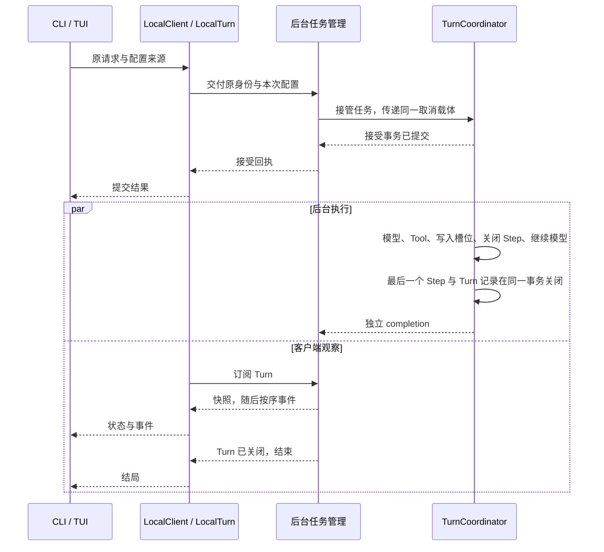
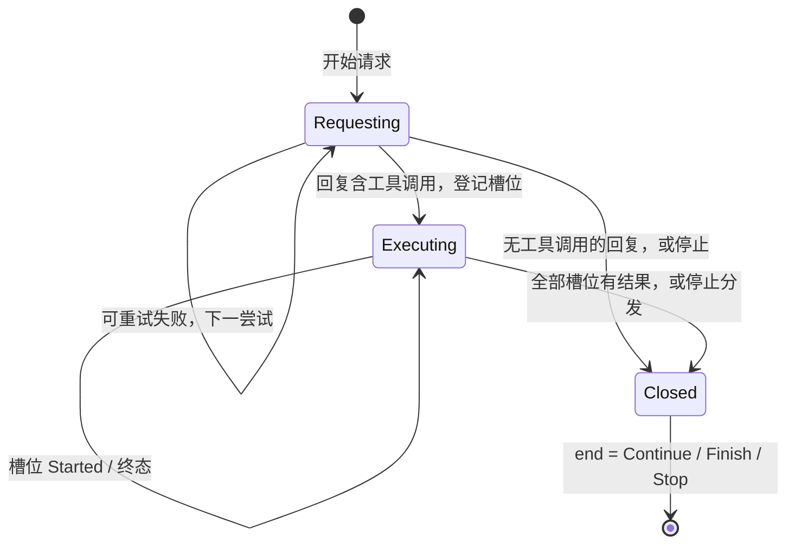

# 会话与 Turn

> 类型：架构合同
> 上位依据：[项目宪章](../governance/charter.md)、[宿主平台](platform.md)
> 决策记录：[ADR 0006](../adr/0006-tree-session-and-global-redb-store.md)

## 目的与范围

用户向一个会话提交任务，后台接受后驱动模型、执行模型选择的 Tool、保存调用结果，再把结果交给模型继续回答。用户可以同时观察进度，也可以关闭终端，稍后重新连接查询状态和读取已保存的对话；需要从较早的位置换一种说法继续时，把会话退回树上的某个节点再发送。

本合同说明一次任务如何被接受、执行和保存，会话历史如何组织成树，以及用户中途离开、取消任务或后台重启后如何继续处理。

以下以“读取工作区文件并解释内容”为贯穿场景：用户提出问题，模型选择 `observe.workspace` 读取文件，然后依据返回内容给出解释。工具的具体能力由 [LANCET 合同](lancet.md)和[工作区观察接口](workspace.md#观察接口与边界)说明。

## 模型与职责

### 会话、Turn 与会话树

Session（会话）保存用户的一段持续对话，以 `SessionId` 标识，永久绑定用户工作的项目。Session 记录只保存身份、项目绑定、当前位置、进行中的 Turn 与时间。

后台接受一次用户任务后，形成一个 Turn。本文场景中的用户问题、读取文件的工具调用和最终解释都属于同一 Turn。客户端在提交前生成 `TurnId`（UUID v4），用它找回同一次请求。

会话历史是一棵只追加的树，节点有两种：

- **UserMessage**：一条用户输入。
- **Step**：一次完整的模型回复，连同它发出的全部 `(ToolCall, ToolResult)` 对。没有工具调用的回复是 0 对的 Step。本例中，第一个 Step 是“请求读取文件”的回复及其读取结果，第二个 Step 是最终解释。

每个节点记录父节点和所属 `turn_id`。节点身份 NodeId 是每个 Session 内单调递增的 `u64`，写入节点时分配，父节点序号恒小于子节点；跨 Session 引用写作 `(SessionId, seq)`，用户可以直接输入序号。**当前位置**是 Session 记录中的一个 NodeId：新节点以当前位置为父，写入后当前位置前移到新节点。连续两个 UserMessage 是合法结构，例如取消了一个尚未产生 Step 的 Turn 后再发送。

Step 节点只在全部调用都有结果后才写入树，结果包括[调用槽位](#调用槽位)中的类型化终态。所以树上任何时刻都不存在有调用、无结果的节点。

消息内容由有序片段组成：文字、模型推理内容（reasoning）、工具调用请求（ToolCall）或调用结果（ToolResult）。ToolCall 说明要使用哪个工具和参数；ToolResult 记录执行结果与返回内容。一次工具调用以 `InvocationId` 标识，一个 Step 可以包含多次调用，一个 Turn 可以包含多个 Step。

Turn 与 Step 的执行进度和结局分三层记录：

| 层 | 键 | 内容 | 写入与修改 |
| --- | --- | --- | --- |
| 树节点 | `(SessionId, seq)` | UserMessage 或 Step 的对话内容、父节点、`turn_id` | 只追加 |
| Step 记录 | `(TurnId, 步骤序号)` | `attempts`：每次 provider 请求的终态、usage 与诊断；`end`：`Continue(node)`、`Finish(node)` 或 `Stop { node: Option<NodeId>, cause }` | 进行中的 Step 记录称为 ActiveStep，就地更新；关闭后不再修改 |
| Turn 记录 | `TurnId` | Session、用户节点、原始输入、冻结配置、开始时间；关闭时补 `outcome`、`reason`、`notice`、WorkspaceHistory checkpoint、usage 汇总、结束时间与末节点 | 接受时创建，关闭时补全，之后不再修改 |

Session 不保存“当前 agent”。agent 是 Turn 冻结配置的一部分，当前 agent 即当前位置所属 Turn 的 agent；提交时显式指定 agent 可以覆盖它。退回旧节点后，当前 agent 自然回到当时的 agent。

### 组件与接口

LocalClient 用 `LocalTurn` 组织本客户端一次提交或观察交互。LocalTurn 是这次交互的具体句柄，保留原请求身份和已收到的事实，管理交付、在途取消、观察与历史读取；它不是第二个持久 Turn，也不拥有后台执行。前端持有句柄并消费更新，后台的 Owner 与 TurnCoordinator 分别监督操作和推进持久执行。

| 场景中的角色 | 负责的工作与交接 |
| --- | --- |
| 前端 CLI / TUI | 接收输入、选择操作，保留请求身份并提供配置来源；发起提交、观察、退回或取消意图，渲染结构化更新并决定何时退出 |
| 客户端库 LocalClient / LocalTurn | 按需取得配置并完整交付原请求，衔接接受回执与观察，管理在途取消及历史读取，向前端分别交付状态、内容和诊断 |
| 后台入口 serve | 接收本地连接，维护后台实例及连接资源，将请求交给 Backend |
| 后台任务管理 Backend / Owner | Backend 管理准入、查询及本进程诊断；Owner 监督已接管操作，并持有该 Turn 的内存观察状态。实际带配置的操作从准备起持有同一取消载体，直至执行核心独立收尾或给出明确诊断，前端退出不改变其责任 |
| 执行协调 TurnCoordinator | 推进一次 Turn：请求模型、组织工具调用、把每一步进度写入会话库，最后关闭 Step 与 Turn |
| 模型驱动 ModelStepDriver / LLM | 接收对话和本次配置，请求模型，将响应交回 TurnCoordinator |
| 工具执行 LANCET | 接收已登记的工具调用，按权限执行，向 TurnCoordinator 返回执行结果、返回内容及证据 |
| 会话库 `lattice-session` | 保存 Session、会话树、Step 记录、Turn 记录与调用槽位；每次状态变化是一个事务 |

前端负责用户交互，LocalClient 负责操作交付与持续观察，后台负责任务生命周期，TurnCoordinator 负责持久执行流程，会话库负责事实的保存与一致性。[实现模块与公开操作](#实现模块与公开操作)进一步说明各 crate 和操作接口。

## 从提交到结果可见

1. **提交任务。** CLI/TUI 收到“读取文件并解释”的输入，保留 TurnId、原始输入和工作区；向已有 Session 提交时同时保留 SessionId，新会话则留空。请求与配置来源交给 `LocalClient::start_turn_with`，前端持有返回的 LocalTurn。找回已有请求和忙时处理见[请求身份与找回](#请求身份与找回)。
2. **准备并交付配置。** LocalClient 仅在新执行需要配置时调用前端提供的加载闭包，取得冻结的模型选择、系统提示、工具策略和连接材料，以原请求身份交付。Backend 实际接管带配置操作时建立贯穿准备与执行的取消载体，随后核验配置并交给执行核心。字段和来源见[执行配置冻结](#执行配置冻结)。
3. **确认接受。** 执行核心核对请求身份、项目绑定和输入，在一个事务中写入 UserMessage 节点和未关闭的 Turn 记录，并把 Session 的当前位置与进行中 Turn 指向它们；新会话的 Session 记录也在这个事务中创建。事务提交后，后台返回接受回执，由 LocalTurn 交给前端显示；后台承担后续执行与关闭责任。精确接受条件见[请求接受](#请求接受)。
4. **同时观察进度。** LocalTurn 订阅该 Turn，先得到快照，再按序接收后续事件；前端消费更新并渲染，后台同时继续执行。衔接方式见[观察与重连](#观察与重连)。
5. **请求模型。** TurnCoordinator 写入 ActiveStep，状态为 `Requesting { attempt }`，再把当前位置的对话、本次模型参数和启用工具交给 ModelStepDriver。驱动器通过 LLM 连接请求模型；在本例中，模型返回读取文件的工具调用。
6. **登记并执行工具。** TurnCoordinator 核验完整回复，在一个事务中把回复记入 ActiveStep、为每个调用建立槽位并分配 InvocationId。执行某个调用前，先提交该槽位的 `Started`；LANCET 随后按权限读取文件，返回执行结果、内容和证据。详细顺序见[调用槽位](#调用槽位)。
7. **保存调用结果。** TurnCoordinator 把执行终态、结果载荷和证据写入该槽位。
8. **关闭 Step 并继续。** 全部槽位都有结果后，TurnCoordinator 在一个事务中写入 Step 节点、以 `Continue` 关闭 Step 记录、清除 ActiveStep、把当前位置前移到新节点，然后开始下一步骤。ModelStepDriver 接收带有 ToolResult 的对话，模型据文件内容生成解释。
9. **关闭 Turn。** 模型给出不含工具调用的完整回答后，协调层读取此时项目的文件历史位置（checkpoint），在一个事务中写入最后的 Step 节点、以 `Finish` 关闭 Step 记录，并补全 Turn 记录、清除 Session 的进行中 Turn。见[关闭 Step 与 Turn](#关闭-step-与-turn)。
10. **取得结果。** 观察者读到最新事件且 Turn 记录已关闭时收到结束。LocalTurn 交付结局，前端显示；此前离开的用户也可以重新连接，读到同一 Turn 记录。

下图只表示接管后的执行与观察可以重叠，持久步骤的精确顺序由后文定义：



### 用户读到的几种事实

在上述文件读取场景中，以下数据分别回答不同问题：

| 数据 | 具体用途与依据 |
| --- | --- |
| 会话树 | 用户消息、完整模型回复及其调用结果，供重连读取及下一次模型请求使用；来自会话库中已写入的节点 |
| 当前尝试的段列表 | 模型正在生成的正文与 reasoning，用于即时显示；只保存在后台内存，Step 关闭后由 Step 节点取代，不进入历史 |
| 调用 outcome | 文件读取调用是 Succeeded、Failed、Cancelled 等哪种执行结果，由调用槽位中的终态确定 |
| 结果载荷 | 调用的返回内容，例如读取到的文件内容；供模型使用的文字由 provider 投影从载荷派生，详见[调用槽位](#调用槽位) |
| Turn 结局 | 整次请求关闭为 Completed、Failed 或 Cancelled，连同面向用户的说明 notice 保存在 Turn 记录；完成关闭不限定为业务成功 |

已关闭的 Turn 记录能读到，就已经持久，不另有“完成确认”。例如 Tool 已执行成功而返回内容超过保存上限时，outcome 仍为 Succeeded，模型得到的是内容不可用的结果；前端读取历史失败时，保留已经取得的结局，单独报告内容未能加载。

## 实现模块与公开操作

以下将前面的角色对应到代码模块，展开调用入口和内部协作。`lattice-api` 负责跨领域协调，把 LANCET 执行结果、[项目 checkpoint](workspace.md#turn-checkpoint) 和会话库写入接入 Turn；适用边界见[范围与禁止事项](#范围与禁止事项)。

| 模块 | 具体职责 |
| --- | --- |
| `lattice-api::local::LocalClient` / `LocalTurn` | `client.rs` 封装连接、共同惰性握手及历史读取；`operation.rs` 的具体 LocalTurn 管理提交、控制回执、订阅、历史读取任务与退出交接，前端消费界面无关的 LocalUpdate |
| `lattice-api::local::serve` | 持有实例锁和 socket、接收并核验连接、管理连接任务；实例退出时释放资源 |
| `Backend` / `Owner` | Backend 管理准入、会话库句柄及本进程诊断；Owner 持有已接管操作的内存身份、取消标志、回执、监督信息和内存观察状态。任务脱离请求连接运行，监督者等待执行核心收尾后才移除 Owner |
| `lattice-api::SessionApi` | 列表、日志、退回及历史读取的领域入口，向后台返回会话事实和对话内容 |
| `lattice-api::TurnCoordinator` 及执行核心 | 唯一持久 Turn 协调者，持有全 Turn 执行锁，核验冻结输入，推进模型循环、调用执行、Step 与 Turn 关闭；会话库写入经 `lattice-session` 的领域接口完成 |
| `lattice-agent::ModelStepDriver` | 接收冻结请求和对话历史，驱动一次 provider 请求，向协调层返回类型化尝试结果，并发送非阻塞观察回调 |
| `lattice-llm` | 使用本 Turn 的模型连接材料，完成 provider wire 请求、流事件适配和对话投影 |
| `lattice-conversation` | 维护有序消息、ToolCall typestate、调用结果、双摘要、尝试诊断和 usage 等纯数据 |
| `lattice-session` | 拥有全局会话库 `lattice.redb`：Session、会话树、Step 记录、Turn 记录、调用槽位、InvocationId 索引与调用变更日志；提供带类型的事务操作、自动关闭规划和操作员只读查询 |

公开操作按用户要完成的工作划分：

| 用途与操作 | 输入及前提 | 输出与效果 |
| --- | --- | --- |
| 查看会话：`list`、`log` | 无，或 SessionId | `list` 每行给出 SessionId、项目绑定、当前节点序号、节点数、是否有进行中 Turn 与更新时间；`log` 先给出当前位置、当前 agent 与进行中 Turn，再以树形列出全部节点（含不在当前分叉上的节点），标出当前位置，并在每个 Turn 的首节点注明 TurnId、结局与 notice |
| 查看一个 Turn：`observe`、`LocalTurn::next/reconnect` | SessionId 与所选 TurnId | 返回只读 LocalTurn；未指定 Turn 时优先选进行中的 Turn，否则选当前位置所属 Turn，空会话交付空历史；重连继续原观察目标 |
| 提交或找回请求：`start_turn_with` | 原请求身份（TurnId，已有会话时含 SessionId）、输入、规范工作区及一次性配置加载闭包；新会话必须指定 agent | 返回 LocalTurn，完整交付提交并衔接观察；首轮无配置探测直接返回已有 Turn 或 Busy 时不加载配置；发现崩溃遗留 Turn 时先关闭，再返回 NeedsConfiguration，最多加载一次配置并继续本次新输入。后续准入仍可能因并发变化返回已有 Turn 或 Busy |
| 读取对话：`read_history` | 已取得的观察快照 | 观察目标是所选 Turn 时，读取从根到该 Turn 在快照中最后一个节点的路径，不受之后的 `rewind` 或分叉影响；没有 Turn 的空会话读取从根到当前位置的路径。页面只包含快照已有的节点 |
| 退回：`rewind` | SessionId 与目标 NodeId | 把当前位置移到树上任意已有节点；之后的提交从那里分叉，原分支保留在树上。不修改工作区文件 |
| 请求取消：`LocalTurn::cancel`，或独立命令的 `LocalClient::cancel` | 原目标 SessionId / TurnId | 句柄同步登记意图并管理在途回执；独立命令返回后台接管结果，持久结局另行查询 |
| 停止后台：`stop` | 当前本地后台 | 关闭新准入并等待已接管操作收尾，返回停止时已知状态 |

CLI 的 `lattice session` 子命令为 `send`、`rewind`、`list`、`log`、`turn` 和 `cancel`，顶层 `lattice run` 是 `session send` 的别名。`session send` 不带 `--session` 时创建新 Session：项目绑定从当前目录解析，`--agent` 必填；带 `--session` 时向已有 Session 提交，`--agent` 可选。`session turn` 查看单个 Turn 的详情，`--follow` 用于断线后继续观察。TUI 不带 Session 启动时，在首次提交时创建 Session。

`LocalTurn::next` 交付 LocalUpdate，取消一次等待不会丢失已接收更新或半帧；已完成后句柄仍可显式重连。普通退出使用 `detach` 取得最后已知提交、取消、状态和读取诊断，或由 Drop 停止本地后续工作；两者都不新增取消。

`LocalTurn::turn_id` 给出提交、观察与取消共用的身份；未指定目标的观察句柄在首次选择完成前返回 None。前端选择不同活动目标时调用新的 `observe`，原句柄仍独立交接其控制事实；对同一观察目标重连则继续使用原句柄。

公开类型与方法见[本地连接与读取](../../crates/lattice-api/src/local/client.rs)、[LocalTurn](../../crates/lattice-api/src/local/operation.rs)和[结果类型](../../crates/lattice-api/src/local/types.rs)，命令用法见[验证操作指南](../development/validation-guide.md#后台与重连操作)。

### 低层接口与提交握手

`query`、`subscribe` 和历史分页接口提供只读操作；query 返回的快照可直接交给 `read_history`。`submit` 与 `submit_with` 是可能写入的提交接口：它们可能关闭崩溃遗留 Turn，不能用作只读重连。前端的持续交互使用上表的具体句柄，握手、订阅与控制交接由客户端库维护。

无配置探测允许旧请求找回、Busy 和崩溃遗留 Turn 的关闭先于新凭据加载发生。`NeedsConfiguration` 请求新执行输入，此时尚未接受新 Turn；共同惰性握手在库内消费它，最多调用一次加载闭包，并在配置发送关口再次检查本地放弃。`submit_with` 与 `start_turn_with` 复用该握手，前者的闭包仍可借用且不要求 Send/'static，后者为独立任务持有 Send/'static 的闭包和 future。

## Turn 的接受与模型步骤

### 请求接受

执行核心持有 SessionExecutionLock 后核对身份、项目绑定与输入；新接受还验证用户消息、工具目录及执行限制。接受事务写入以下事实：

- UserMessage 节点，父节点为 Session 当前位置（新会话为无父的根节点）。
- 未关闭的 Turn 记录：TurnId、SessionId、用户节点、原始输入、项目绑定、`FrozenTurnConfig` 和接受时间。
- Session 记录的当前位置指向新节点，进行中 Turn 指向该 TurnId；新会话的 Session 记录在同一事务创建。

这个事务提交是请求接受的持久边界。用户消息为 User 角色的 text parts，大小规则见[输入与传输限制](#输入与传输限制)。

| 接受时停在哪里 | 已知事实 | 后台责任与用户下一步 |
| --- | --- | --- |
| 输入、绑定、配置等在事务前被拒绝 | 尚未建立 Turn，也未发送 provider 请求 | 返回类型化拒绝；前端保留输入供用户修正 |
| 事务 `commit` 返回错误 | 接受结果未知：事务要么完整生效，要么完全未生效 | 后台按[事务失败](#事务与一致性)关闭并重开会话库，不启动 provider；前端保存原 TurnId，用同一 TurnId 重发找回 |
| 事务已提交 | 请求已接受，原用户消息及冻结事实已保存 | 后台执行并关闭原 Turn；之后的失败、取消、崩溃走相应关闭路径 |

### 执行配置冻结

提交端在需要新执行时读取配置来源。冻结将“以后再读某路径或环境变量”变成“这次 Turn 使用的确定值”，避免同后台的并发 Turn 相互改变配置。工作区 `.env` 的信任边界、唯一 loader 和优先级继续由 [CLI 环境边界](../../crates/lattice-cli/AGENTS.md#环境与输出边界)维护。

`FrozenConfiguration` 是仅用于私有 IPC 的提交输入，含有效 `profile_toml`、已经加载的 `system_prompt` 和 `ConnectionMaterial`。后台将它转换为执行所需的 profile 和本 Turn 的 LlmConnection。`FrozenTurnConfig` 则是协调层在接受时构造并写入 Turn 记录的非秘密执行事实，供执行、结果投影、`log` 显示和当前 agent 判定使用。

| 字段类别 | 来源 | 冻结时点 | 接收/持有者 | 是否持久化 | 用途 |
| --- | --- | --- | --- | --- | --- |
| `FrozenConfiguration.profile_toml` | 提交端加载的 AgentProfile；策略文件解析所得有效工作区、网络和观察限制填回具体字段，清除待重读的 `lancet.policy` 引用 | 新执行配置提交前 | 后台转换为 LoadedAgentProfile，交执行核心 | IPC 容器本身不保存；非秘密内容进入下述执行快照 | 固定 Agent/model 选择、LLM 重试与超时、启用工具及能力策略 |
| `FrozenConfiguration.system_prompt` | 提交端依 profile 加载后的实际文本 | 同上 | 后台执行核心及模型请求 | 文本进入 FrozenTurnConfig 及 profile 快照 | 固定本 Turn 的系统指令，执行时使用已加载内容 |
| `ConnectionMaterial.alias/provider/provider_model/base_url` | 提交端 ModelRouter 按模型选择及有效 endpoint 来源解析 | 同上 | 本 Turn 的 LlmConnection | 连接材料不持久化；执行模型和 provider 标识另存于 FrozenTurnConfig | 路由到确定 provider、实际模型和 endpoint；后台校验模型 alias 与 profile 一致 |
| `ConnectionMaterial.api_key` | 提交端按既有优先级读取的有效凭据值 | 同上 | 私有 IPC、后台本 Turn 的 LlmConnection | 否 | 认证 provider 请求 |
| `ConnectionMaterial.roots_der` | 提交端读取的实际 Linux TLS 根证书内容，或显式提供的 DER 内容 | 同上 | provider 连接与本 Turn 的 Tool Host 信任配置 | 否 | 验证 TLS 连接；传递证书内容而非要求后台重读证书路径 |
| `FrozenTurnConfig.agent_name/model/provider/system_prompt` | 已核验提交输入及模型解析结果 | 接受事务前 | TurnCoordinator、Turn 记录及投影 | 是 | 标明此次执行身份、模型与系统指令；当前 agent 由此判定 |
| `FrozenTurnConfig.profile_snapshot_json/policy_snapshot_json` | 有效 profile 与 system prompt 的快照、有效 LANCET 配置的快照 | 同上 | TurnCoordinator、Turn 记录 | 是，非秘密 JSON | 固定配置与策略事实，参与配置摘要 |
| `FrozenTurnConfig.catalog` | 本次运行时的启用工具目录 | 同上 | 模型投影、调用登记验证、Turn 记录 | 是 | 保存运行时构建身份、按工具名排序的 entries 及摘要；entry 含名称、Descriptor 身份、描述、规范输入 schema |
| `FrozenTurnConfig.limits` | profile 超时、每步尝试数及代码定义的步骤上限 | 同上 | 执行核心、Turn 记录 | 秒数与计数持久化，单调时钟 deadline 不持久化 | 限制后续 provider/Tool 启动，并解释尝试预算 |

类型与转换来源为[私有冻结输入](../../crates/lattice-api/src/local/config.rs)、[连接材料](../../crates/lattice-llm/src/connection.rs)和[接受接线](../../crates/lattice-api/src/turn/live.rs)；持久冻结事实的类型由 `lattice-session` 维护。目录保存中立契约，provider wire 投影由 LLM 层按请求生成。

#### 配置安全边界

后台按 Turn 消费显式冻结输入，不切换共享环境、cwd 或稍后重读凭据/策略路径来改变已接受配置。凭据和 TLS 材料只在内存及私有 IPC 流转，不进入持久记录、公开 DTO、Debug、错误回显或日志。

provider 与 Tool Host 共享本次冻结的 TLS 根内容，各 Turn 独立构造信任配置。坏材料在接受前拒绝；空根集合拒绝 TLS 证书，不回退到后台平台根。Tool 网络继续遵守 [LANCET 逐跳授权与地址固定](lancet.md#网络获取)。

### 模型请求与执行预算

一次 provider 请求以 `ModelAttemptKey` 标识，包含 TurnId、步骤序号和该步骤的尝试序号。协调层每次先把 ActiveStep 置为 `Requesting { attempt }` 并提交，再让 ModelStepDriver 打开和消费流。请求结束时，在 ActiveStep 的 `attempts` 中追加该尝试的终态：

```text
AttemptEnd = Completed { step }
           | Stopped { cause, diagnostic }

cause = ProviderError { retryable }
      | Cancelled
      | Deadline
      | OutputLimit
      | InvalidBatch
      | ProcessExit
```

| 尝试结果 | 保存什么及下一动作 |
| --- | --- |
| `Stopped { ProviderError { retryable: true } }`，该步骤尝试预算未尽 | 追加终态，按冻结策略退避，再以下一尝试序号请求。已收到多少流内容不影响重试资格 |
| `Stopped`，原因不可重试，或可重试但该步骤尝试预算已尽 | 追加终态，以 `Stop` 关闭 Step 与 Turn，`cause` 取自该尝试 |
| `Completed`，回复无工具调用 | 尝试终态与 Step 节点、`Finish` 及 Turn 关闭在同一事务写入，见[关闭 Step 与 Turn](#关闭-step-与-turn) |
| `Completed`，回复含工具调用 | 尝试终态与完整回复、调用槽位在同一事务写入，进入[调用槽位](#调用槽位)的执行 |
| 完整输出的批次校验失败 | 追加 `Stopped { InvalidBatch }`，整批拒绝、不重试，以 `Stop` 关闭 |
| 进程突然退出，尝试终态未保存 | 后台下次写操作前[自动关闭](#自动关闭崩溃遗留任务)，按 `Stopped { ProcessExit }` 记录 |

流式阶段没有副作用，工具只在完整回复后执行，所以重发一段半截回复只花费 token 与时间；半截文字只作有界诊断。实时观察者可能先看到一段部分文字，随后看到新尝试从头开始，前端按尝试边界处理。`Deadline`（Turn 墙钟上限）与 `OutputLimit`（单次回复字节上限）沿用现有门禁，只作为原因记录；它们的数值与粒度由 [#222](https://github.com/Skyline10124/lattice/issues/222) 另行裁决。

模型步骤上限为 32，profile 不能放宽。每步尝试数由 profile 冻结，最多 11 次，重试不额外消耗模型步骤。达到步骤上限时保留此前已写入的节点，以步骤级原因 `Stop` 关闭 Turn。

流组装按 UTF-8 字节持续计量：

| 对象 | 协议上限 |
| --- | --- |
| 单 ToolCall 参数 | 1 MiB |
| 助手正文 | 2 MiB |
| reasoning | 2 MiB |
| 一次尝试总量 | 16 MiB |

超限立即停止消费，保存有界诊断并记录 `OutputLimit`。这些是对话协议与组装器的限制，计量类型在 [`lattice-conversation`](../../crates/lattice-conversation/src/lib.rs)，不能解释为容量或延迟的测量结论。单 ToolCall 参数上限与 LANCET 单文件工作区写入上限 `MAX_WORKSPACE_WRITE_BYTES`（1 MiB）一致：写入内容随参数传入，超过该大小的调用无法成功执行。

Turn 的单调时钟 deadline 在接受事务提交后开始，限制后续 provider 请求与 Tool 分发。槽位终态、Step 关闭与 Turn 关闭等必要写入不受 Turn deadline 约束；重开仅关闭，不重建剩余执行时间。每次尝试分别保存 provider 给出的 `Option<TokenUsage>`，缺失表示未知；失败与重试尝试的已知 usage 也保留，Turn 汇总派生为 Complete 或 Partial。

## 对话数据与模型投影

### 有序消息与 ToolCall

`NativeMessage<ToolCallState>` 用有序 `MessagePart` 保存消息。`UnboundToolCall` 表示模型生成、待登记的调用，`BoundToolCall` 表示协调层已经分配 InvocationId 的调用；登记保留原片段顺序。

助手消息的 parts 按到达顺序保存正文、reasoning 与工具调用的交错：相邻同类内容合并为一段，工具调用排在它首次出现的位置。各 provider 的流解析器都按此生成 parts。Chat Completions 这类只有一个正文字段和一个 reasoning 字段的请求格式，由 provider 投影在发请求时合并同类内容，同一 provider 的回放不受影响。

Tool 参数通过协议 canonical JSON 生成规范对象和摘要。有效调用要求参数为一个 JSON 对象，ToolCall 完整且无重复；单次完整响应最多 32 个 ToolCall。任一个调用无效或数量超限时拒绝整个尝试。完整 reasoning 参与持久对话及语义摘要；停止尝试的部分文本、reasoning 和调用数据保留为有界诊断。

#### 对话与投影边界

空串、数组、标量、畸形 JSON 不能作为 Tool 参数对象。拒绝尝试不产生可执行调用或 InvocationId，也不把该尝试的助手正文作为成功消息；停止尝试的部分内容只作诊断，不进入会话树。超限批次不截断为可执行批次。这些限制让每个调用槽位始终对应一条完整有效回复。

### 语义与回放

- `semantic_digest` 覆盖 provider-neutral 文本、完整 reasoning、规范 Tool 语义及顺序。
- `replay_state_digest` 覆盖 provider 来源、真实 provider call ID 和片段级不透明回放状态。

同 provider 可使用原回放材料；跨 provider 由适配层生成中立语义投影，去除来源 reasoning、provider call ID 和回放状态，切回原 provider 时使用树中保存的原消息。不透明回放材料逐片段原样保留，单片段上限 64 KiB；即使片段正文为空，也保留其回放状态。连续两个 UserMessage 由投影按适配器要求合并或原样传递。

类型和编码由 [`lattice-conversation`](../../crates/lattice-conversation/src/lib.rs) 维护。provider Tool Call ID 仅是 provider 协议材料，不参与会话登记或执行身份分配；跨 provider 投影不伪造目标 provider 身份材料。发给模型的对话是当前位置从根到该节点的路径，provider 投影是纯函数，不在请求时扫描或补齐缺失结果。

## Step 执行与结果保存

### ActiveStep 与事务序列

每个 Step 在进行中由 ActiveStep 表示。同一 Session 最多一条 ActiveStep，且仅在 Turn 进行中存在。“只追加不改写”约束树与已关闭记录，不约束 ActiveStep。

每一步状态变化是一个会话库事务，事务内不等待模型、Tool 或网络：

| 事务 | 写入内容 | 之后的状态 |
| --- | --- | --- |
| 开始请求 | ActiveStep 置为 `Requesting { attempt }` | 等待 provider |
| 尝试停止 | 在 `attempts` 追加 `Stopped`；不再重试时同一事务关闭 Step 与 Turn | 重试或关闭 |
| 登记调用 | 在 `attempts` 追加 `Completed`，写入完整回复、各调用槽位、InvocationId 索引 | 执行中 |
| 调用开始 | 一个槽位标记 `Started` | 等待 LANCET 返回 |
| 调用结束 | 一个槽位的终态、结果载荷与证据 | 下一调用或关闭 Step |
| 关闭 Step | Step 节点、Step 记录的 `end`、清除 ActiveStep、前移当前位置；无工具调用的回复同时追加 `Completed`；最后一个 Step 同时关闭 Turn | 下一 Step 或 Turn 结束 |

`Completed` 不单独提交：它总与登记调用或关闭 Step 在同一事务写入，所以不存在“完整回复已保存、尚未登记也未关闭”的持久状态。



不变量：

- 一个 Turn 只有最后一个 Step 记录的 `end` 不是 `Continue`；这个值定义了“最后一个”，各 Step 记录形状一致。
- 一个 Turn 至少有一个 Step 记录。尚未开始请求就关闭的 Turn（例如在第一次请求前取消，或进程在接受后立即退出），写入一条没有尝试、`end = Stop { node: None, cause }` 的 Step 记录。
- `TurnOutcome` 由最后一个 Step 的 `end` 派生，与 Turn 记录在同一事务写入，来源唯一。

### 调用槽位

模型回复含工具调用时，登记事务为每个调用建立槽位并分配 InvocationId。该身份随后贯穿执行、取消、结果保存和审计。InvocationId 在同一事务插入全局索引；键冲突时放弃该事务，重新生成后重试。登记记录每个调用的 Session/Turn/步骤/片段地址、方法、Descriptor 身份和规范参数摘要，顺序与原回复一致。

同一回复的调用按片段顺序逐个执行，每次只处理最低序号的未完成槽位：

1. 提交该槽位的 `Started`。这是“可能已执行”的保守边界：它不证明 Tool 已开始或外部效果已发生，但越过它之后不能仅凭没有结果推定未执行。
2. 把调用交给 LANCET 执行，取得执行结果、载荷与 Cell 证据。
3. 提交该槽位的终态、载荷与证据。

确定的 `Succeeded`、`Failed` 或 `Rejected` 终态允许继续下一调用；取消、未执行或效果不确定时停止后续分发，余下槽位写入类型化终态后关闭 Step。live 执行与自动关闭从有序槽位终态通过同一规则得出批次控制，崩溃时机不改变 Turn 结局。Rejected 之后是否继续请求模型、混合批次如何执行，由 [#220](https://github.com/Skyline10124/lattice/issues/220) 另行裁决，不改变槽位形态。

槽位保存 `ToolResultOutcome` 的一种，以及按 outcome 确定形状的载荷：

| outcome | 载荷 |
| --- | --- |
| Succeeded | 完整 JSON value |
| Failed | 结构化 CepError |
| Rejected、Cancelled、NotExecuted、Indeterminate | 类型化原因 |

- Succeeded 载荷的规范 JSON 超过 65,536 字节时，不保存正文、不截断，保留完整摘要与长度，ToolResult 标明内容不可用（OutputTooLarge）；outcome 仍为 Succeeded。需要大输出的 Tool 通过自身接口提供分页、游标或摘要。
- 发给模型的结果文字不存储，由 provider 投影从载荷派生。取消或关闭时补写的终态使用按终态类型固定的最小文案，#220 定下统一反馈后对齐。
- result Cell 的形态不在本合同冻结。库中的值带格式版本，[#117](https://github.com/Skyline10124/lattice/issues/117) 定下后作为新增字段加入 Succeeded 载荷。
- 取消或停止时，未完成的调用写入类型化终态，不伪造成功输出：未 Started 的为 NotExecuted 或 Cancelled，已 Started 无结果的为 Indeterminate。已有终态保持原值。
- Tool 执行返回后，终态写入属于必要收尾，不受 Turn deadline 约束。写入失败按[事务失败](#事务与一致性)处理，后续调用不分发。

LANCET 的执行、准入与证据由 [LANCET 调用流程](lancet.md#调用身份与执行流程)维护。

### 关闭 Step 与 Turn

全部槽位有结果，或协调器决定停止后，协调层在一个事务中写入 Step 节点、Step 记录的 `end`、清除 ActiveStep 并前移当前位置。`end` 的取值：

- `Continue(node)`：协调器决定继续请求模型，随后开始下一 Step。
- `Finish(node)`：模型给出无工具调用的完整回答。
- `Stop { node, cause }`：因取消、错误、效果不确定或步骤上限停止。`cause` 取自最后一次尝试的原因，或步骤级原因：调用效果不确定、模型步骤上限。已有完整回复时 `node` 指向写入的 Step 节点，没有时为 None。

`Finish` 或 `Stop` 的 Step 是 Turn 的最后一个 Step，同一事务补全 Turn 记录并清除 Session 的进行中 Turn：

```text
TurnOutcome = Completed | Failed { reason } | Cancelled
```

- `Finish` 得到 Completed；`Stop { cause: Cancelled }` 得到 Cancelled；其他 `Stop` 得到 Failed。
- `notice = Option<{ level, text }>` 在写入时按结局定级：Failed 为 Error，Cancelled 为 Info，Completed 无 notice。`text` 由最后一个 Step 的 `Stop` 原因决定：`ProviderError` 取产生该原因的那次尝试的诊断，即 provider 错误原文，经现有脱敏并截断到 `MAX_PROVIDER_ERROR_CHARS`（2048 字符）；其他原因（含 Cancelled、ProcessExit、调用效果不确定、模型步骤上限）使用按原因固定、由代码定义的文案。先前已被重试取代的失败尝试不作为 notice 来源。实时 `TurnFailed` 事件携带同一对象。
- 公开读取投影为 `TurnSummary { outcome, notice }`，内部 `reason` 不导出给前端。

关闭 Turn 前，协调层取得共享 WorkspaceOperationLock，读取[项目全局 checkpoint](workspace.md#turn-checkpoint)，持锁直到关闭事务提交。每个完成 Turn 都读取该值，包括没有写文件的 Turn；checkpoint 可以包含同项目其他 Session 已记录的变更。读取或身份校验失败时停止关闭，不构造空 checkpoint；Turn 保持进行中，由后续自动关闭处理。事务提交前进程退出时，checkpoint 没有保存，自动关闭时重新读取。

会话库事务提供本库的原子提交；工作区历史与会话库各自提交，所以读取可能见到跨库中间状态，例如文件已记入工作区历史而 Turn 尚未关闭。已发生的文件效果由工作区合同处理。

## 重开、取消与未完成状态

### 请求身份与找回

同一 TurnId、原始用户输入和项目绑定用于找回原 Turn；向已有 Session 提交时还核对 SessionId。身份相同而输入、绑定或 Session 不同返回 Conflict。新 TurnId 表示独立请求，即使文本相同。Turn 记录按 TurnId 全局查找，所以不带 SessionId 的首次提交在确认不明后，用同一 TurnId 重发会找到原请求及其 Session，不会多建 Session。退回操作不释放已用的 TurnId。

| 提交时找到的事实 | 后台与前端动作 |
| --- | --- |
| 同请求由当前 Owner 接管 | 共享正在进行的接受结果 |
| 同 Session 有不同请求由 Owner 执行 | 非阻塞返回 Busy；前端保留未提交输入，由用户稍后发送 |
| 同 TurnId 的 Turn 记录已存在 | 核验原输入、绑定和 Session，返回原 Turn；Turn 已关闭时返回其结局，仍在进行时衔接观察 |
| Session 有无 Owner 的进行中 Turn（崩溃遗留） | 先按 closure-only 规则关闭旧 Turn，再继续本次新输入；关闭失败则提交失败，不接受新输入 |

“接受结果未知”只有一种真实来源：接受事务是否提交尚不清楚，例如回执丢失或 `commit` 返回错误。前端保留原 TurnId，查询或用同一请求重发找回；重连读取使用 query/subscribe。请求找回保证不扩展为 Tool exactly-once。

执行核心分别给出接受结果、完成结果和观察事件；`stream_turn`、`run_turn` 复用该核心，收集事件之外仍须取得独立 completion。Backend 在 Owner 退场后保存本进程已知的执行诊断，例如因会话库写入失败未能关闭 Turn；未经核验的请求冲突不覆盖原 Turn 的诊断。

### 观察与重连

普通退出释放客户端和观察连接，后台继续执行。重新连接时，前端调用 `observe` 或句柄的 `reconnect`，LocalTurn 选定 Session/Turn 并维护只读订阅与历史读取。query/subscribe 和后台启动都不关闭崩溃遗留 Turn。

实时观察由两部分构成：会话库中的持久快照，和 Owner 为每个进行中 Turn 保留的内存观察状态。两者在最后一个已关闭的 Step 处衔接。

- **内存观察状态**：每个进行中的 Turn 保留两样东西，在同一把锁下更新，共用一个事件序号。
  - **事件窗口**：最近的固定条数事件，当前为 64 条。窗口大小只影响慢订阅者多久重新同步一次，不影响正确性。
  - **当前尝试的段列表**：当前模型尝试已发出的正文与 reasoning delta，按到达顺序记为 `(类型, 文字)` 段，相邻同类合并。它等于一个一直连着的订阅者按序拼出的结果。新尝试开始时清空，Step 关闭后由会话库中的 Step 节点取代，Turn 关闭后释放。
- **订阅**：订阅者带游标读取，游标由后台 epoch 与事件序号组成。游标仍在窗口内时，从游标之后逐条继续。新订阅、游标已落出窗口或 epoch 已改变的订阅者，先得到快照，再从快照的序号起接窗口中的事件。快照包含：Session 记录、Turn 记录、已写入的节点、ActiveStep 与各槽位状态，加上段列表及其序号。读得慢只会多重新同步一次，不会丢内容。
- **快照切点**：会话库与内存观察状态按固定顺序衔接。
  - Owner 先提交会话库事务，再在观察锁内更新段列表并追加对应事件，例如新尝试开始时清空段列表、Step 关闭后追加 Step 关闭事件。
  - 快照在观察锁内开启会话库读事务，并复制段列表与序号。这样，序号之前各事件对应的提交必定在读事务中可见；读事务还可能多含一次刚提交、事件尚未追加的提交。
  - 段列表标注所属步骤序号与尝试序号。快照的会话库部分已显示该尝试结束或该 Step 已关闭时，客户端丢弃这份段列表，以会话库中的记录为准。之后到达的同一关闭事件按步骤序号与节点身份幂等应用，不重复显示。
- **结束**：Turn 关闭事件是该 Turn 的最后一个事件，在关闭事务提交后追加。订阅者读到它，或得到的快照已显示 Turn 关闭时，才收到结束。结束不会早于最后一个事件交付。Turn 关闭后 Owner 释放内存观察状态，此后的订阅只从会话库取得快照并直接结束。
- **后台重启**：内存观察状态随进程消失，进行中的 Turn 由之后的写操作[自动关闭](#自动关闭崩溃遗留任务)。客户端重连后用新快照重建，Turn 记录说明结局；丢失的只有当时正在生成的半截文字，它本就只作诊断。
- **客户端本地丢弃**：客户端自己的显示队列丢弃事件时，按已交付的最后游标重新订阅。

一致性要求：当前尝试的段列表与最终 Step 节点的正文/reasoning parts，合并相邻同类后序列相同，Step 关闭时显示不跳变。段列表只用于显示，不进历史、不发给 provider。

LocalTurn 先交付状态与快照对应的重置，再独立推进事件和历史读取。历史读取按节点序号分页，只读取快照已有的节点：树只追加、已写入的节点不再修改，所以跨页读取得到的是同一时刻的对话。新快照取代旧历史读取时，LocalTurn 终止旧任务，已发生的读取失败作为诊断交付；新的读取挂起或失败不遮蔽已收到的结局。CLI 按最终结局、执行诊断和最终历史读取结果选择退出码；最终仍读不到内容或核验发现数据损坏时退出 1，不因已知 Completed 而忽略失败。工具按 InvocationId 配对显示，规则见 [TUI 对话记录与工具显示](tui.md#对话记录与工具显示)。

#### 观察边界

观察回调非阻塞，慢读、断连及 idle timeout 只结束或降级观察，不中止执行和必要持久收尾。query 与 subscribe 只读：不写会话库、不关闭遗留 Turn、不请求模型、不分发 Tool、不公开冻结配置中的秘密。

单页和 IPC 帧有界，UTF-8 分页保持字符完整，传输上限不能拒绝原本合法的整 Turn 记录。有界帧不代表固定内存：单个节点在读取时整体解码。

### 取消与退出

用户选择取消后，前端调用 LocalTurn 的 `cancel`，同步登记原 SessionId / TurnId 的意图。LocalTurn 停止本客户端尚未发送的后续配置，并独立处理在途提交、取消回执及观察；慢读取和 UI 更新队列不承担控制状态。独立 `session cancel` 则直接取得后台接管结果。

#### 后台接管与责任区间

Backend 以实际接管的操作确定取消资格。新建带完整配置的 Submit Owner 时，即在工作区 I/O、配置核验和执行核心创建前建立取消载体，向核心传递同一载体。取消的目标查找、资格核对和置位与 Owner 移除在同一准入临界区完成；监督者持有独立 completion，等待必要收尾后才移除 Owner。

| 判定点的事实 | 动作与回执含义 |
| --- | --- |
| 原目标的带配置操作已被实际接管 | 置位同一取消载体并返回 true；重复请求幂等，后台独立处理至完成或明确诊断，连接退出不撤销责任 |
| 无配置请求共享了上述操作 | 仍可返回 true；资格来自被共享的实际操作，不取决于来访连接是否带配置 |
| 独立无配置探测、会话写操作，或配置仍由连接持有并等待探测结束 | 不接管新执行取消；false 仅表示判定点未接管，不证明没有后台工作或后来不会接受同身份请求 |
| 没有可接管取消的对应操作 | 查询原持久事实后返回 false，查询错误仍返回错误；崩溃遗留 Turn 在后续写操作前自动关闭 |
| 请求传输失败或回执丢失、超时 | 客户端报告 Unknown，保留原身份及其他已知事实 |

操作明确拒绝、可确认未建立 Turn 且监督退场后，新一轮同身份准入不继承旧取消，包括早已到达、此时才重新准入的连接。接受结果未知或 Turn 记录已存在时，仍按原 Turn 记录核验，不归入这类明确拒绝。

#### 客户端意图与退出交接

LocalTurn 将取消显示为 Pending、Taken、NotTaken、Unknown 或 Moot，分别表示等待回执、已接管、判定点未接管、回执未知及无需继续交接。原目标尚未关闭、取消尚未接管且无在途 Cancel 时，首次 false 或传输未知与同目标接受/owned 观察证据结合，最多触发一次补发；两种回执先后顺序共用该额度。

true 后由后台履行责任，不自动补发；再次明确取消可开始新额度，旧在途回执不充当新意图回执。后台明确拒绝本次操作或原目标已关闭时结束后续补发，已知 Taken 与真实结果分别保留；新请求取消不转给自动关闭的旧 Turn。

`NotSubmitted` 只说明本客户端放弃后续配置发送的位置。CLI 的 `not_sent` 对应配置冻结中放弃，`not_accepted` 对应收到 NeedsConfiguration 后放弃；记录形状保持，含义限定于本客户端。已经发出的探测可能共享其他连接的执行，因此晚到的本地未提交结果不撤销已知接受、Taken 或完成事实。

首次取消时若提交仍在途，LocalTurn 按[回执等待预算](#输入与传输限制)等待；到期交付 SubmissionUnknown，以原身份重新订阅只读观察，并保留原提交任务接收迟到回执。后续观察与历史读取继续推进。未知交接后，原 Submit 的本地传输失败只补非终结诊断；后台错误回执与本地配置加载失败仍各按其真实来源处理，不纳入此分支。

普通退出或 Drop 不新增 Cancel，也不声称已发请求未执行。已有取消意图时，`detach` 使用同一控制状态和补发额度有限交接，返回最后已知事实；Taken 后无需等待历史读取或 Turn 关闭。等待超时保持未知，不承诺后台完成或阻塞配置工作在该窗口内结束。

取消的具体 `LocalError` 由 LocalTurn 保存在原目标、当前用户意图的 `DetachReport.cancel_error` 中，与 Cancel 更新使用同一来源，不依赖前端消费队列。同意图补发等待、窗口到期或 Moot 保留最近已知错误；新的明确用户意图以及 true/false 成功回执清除旧诊断，旧代在途回执不写入新意图。该字段不是永久错误日志，也不改变 Taken、未接管或未知的语义。前端交接旧句柄时按报告分别显示原提交/取消身份、实际观察对象的结局及诊断，不把它们作为新句柄的状态或回执。

#### 取消的效果与持久边界

取消控制本身在内存中，true 确认的是当前操作接管，不保证迟到取消改写已决定的结果。执行核心随后写入的尝试终态、槽位终态和 Step `end` 才是崩溃后可用的事实。以取消为主因关闭的 Step 以 `Stop { cause: Cancelled }` 结束，Turn 结局为 Cancelled；已写入的节点、调用终态和已发生的效果保留，取消不回滚文件。

取消或失败后，Session 当前位置停在该 Turn 最后写入的节点，已完成的步骤进入之后的上下文。用户取消通常是为了换种说法继续，已完成的工具结果仍有用；需要丢弃时，退回到该用户消息之前的节点再发送。

### 自动关闭崩溃遗留任务

用户向某个 Session 提交新请求或执行 `rewind` 时，Backend 先取得该 Session 的操作准入。若该 Session 有无 Owner 的进行中 Turn，执行核心非阻塞取得独占 SessionExecutionLock，核对 Session/项目绑定，读取 Turn 记录与 ActiveStep，由 `lattice-session` 规划关闭，再取得共享 WorkspaceOperationLock 读取 checkpoint，在一个事务中写入全部关闭事实。

这种关闭称为 closure-only：它依据已保存事实完成旧 Turn，不请求 provider、不执行 Tool，也不需要当前 profile、provider 凭据或 Component 组成。已发生效果与已保存的结果继续保留；仅留在进程内、尚未写入的结果无法找回。

旧 Turn 成功关闭后，后台继续用户原本的操作。新提交按需加载配置并接受、执行本次输入；回执、观察事件、诊断和取消身份归属新 Turn，旧关闭结果按原 TurnId 查询。关闭失败时返回错误及诊断，本次新输入或退回停止。同一 Session 正在由 Owner 执行时，新写操作在后台准入阶段返回 Busy。后台启动和只读查询、观察不触发自动关闭。

| 关闭时的持久状态 | 写入的关闭事实 | 结局 |
| --- | --- | --- |
| Turn 已接受，尚无 Step 记录 | 一条无尝试的 Step 记录，`Stop { None, ProcessExit }` | Failed |
| ActiveStep 为 `Requesting`，尝试尚无终态 | 追加 `Stopped { ProcessExit }`，`Stop { None, ProcessExit }` | Failed |
| ActiveStep 处于重试间隙：最后尝试为可重试终态，且该步骤尝试预算未尽 | `Stop { None, ProcessExit }`，不恢复重试 | Failed |
| ActiveStep 最后尝试为不可重试终态，或为可重试终态但尝试预算已尽，Step 尚未关闭 | `Stop { None, cause }`，`cause` 取自该尝试 | 按原因：Cancelled 或 Failed |
| 执行中，存在未 Started 的槽位 | 该槽位写 NotExecuted | 见下两行 |
| 执行中，存在已 Started 无终态的槽位 | 该槽位写 Indeterminate；不依据缺少结果推定文件未改变 | 见下一行 |
| 执行中，各槽位已有终态或已按上两行补写 | 写入 Step 节点，`Stop { Some(node), cause }`，`cause` 按下文规则推导 | Cancelled 或 Failed |
| 最后一个 Step 以 `Continue` 关闭，下一 Step 尚未开始 | 一条无尝试的 Step 记录，`Stop { None, ProcessExit }` | Failed |
| Turn 记录已关闭 | 无需处理 | 原结局 |

表中“执行中”的各行同时适用：先补写各槽位终态，再写 Step 节点与 `end`。`cause` 与 live 执行使用同一批次控制规则，按片段顺序取第一个导致停止分发的终态（已持久的或刚补写的）：取消类终态得到 Cancelled，Indeterminate 得到调用效果不确定；都没有时为 ProcessExit。所以已写入的取消终态在崩溃后仍关闭为 Cancelled，与未崩溃时一致。关闭事务提交前出错时，Turn 保持原状，再次触发时重新规划；会话库不可写时返回错误与恢复需求。

### 停止后台

正常 stop 原子关闭新准入，等待已接管的准备、接受、执行及必要持久收尾，包含异常任务的监督排空。等待期间查询和取消继续可用。排空以后台操作收尾为条件，无须观察者读完流。

收尾未完成时，Turn 保持进行中，由之后的写操作自动关闭；后台返回已知的恢复需求。后台状态中的 `unconfirmed_operations` 是本进程未完成收尾的操作计数，不是持久进行中 Turn 的数量；连接中断也不能证明后台已停止。实例锁与 socket 清理由[存储后台边界](storage.md#本地后台与访问边界)维护。

## 会话存储与并发

### 会话库与项目绑定

会话事实全部位于全局会话库 [`lattice.redb`](storage.md#私有状态根)，由 `lattice-session` 维护表定义、值格式版本与业务不变量。库中的记录集合为：

| 记录 | 键 | 权威事实 |
| --- | --- | --- |
| Session | SessionId | 项目绑定、当前位置、进行中 Turn、创建与更新时间 |
| 树节点 | `(SessionId, seq)` | UserMessage 或 Step 的内容、父节点、`turn_id` |
| Turn 记录 | TurnId | 见[三层记录](#会话turn-与会话树) |
| Step 记录与 ActiveStep | `(TurnId, 步骤序号)` | 尝试、`end`；进行中时含完整回复与调用槽位 |
| InvocationId 索引 | InvocationId | 调用所属的 Session、Turn、步骤与片段 |
| 调用变更日志 | 全局单调变更序号 | 每次槽位状态变化的有序记录，供 `audit --tail` 使用 |

Session 永久绑定产品组合层提供的 `ProjectStoreKey`，执行请求的规范工作区必须与该绑定一致。提交端保留规范 SessionId，输入或显示中的缩写由公开 API 解析。操作员查询按项目绑定过滤，接口见 [LANCET 操作员接口](lancet.md#操作员接口)。

会话库只在创建新 Session 的提交路径上首次创建；打开不初始化、不修复。发现旧版会话库或调用库时打开失败并指出路径，由人删除或存档。创建、打开与格式版本规则由[存储合同](storage.md#会话库)维护。

### 事务与一致性

每一步状态变化是一个写事务，使用 `Durability::Immediate`：`commit` 返回时事务已持久，已提交的事务对之后开始的读事务可见，读者不会看到尚未持久的提交；使用条件见[存储合同](storage.md#会话库)。一个事务内的多条记录一起生效或一起不生效，所以跨记录的关系，如“Step 节点与 Step 记录的 `end`”“最后一个 Step 与 Turn 结局”，在任何读事务中都成立。

- 写事务内只做会话库读写，不等待模型、Tool、网络或其他锁；阻塞的库操作在 `spawn_blocking` 等阻塞执行边界内完成，不跨 await 持有写事务。
- 读者用读事务取得一致快照，不需要锁。
- **事务失败**：redb 的 `commit` 错误分两类。`TransactionPoisoned` 表示事务已回滚、库仍可开始新事务，但引起它的存储错误可能仍在库中；其他错误表示事务可能已持久、不能当作已回滚，库随后拒绝新的写事务。本项目的策略对两类一律保守处理：后台停止在该库上的全部写入，进行中的 Turn 不再启动 provider 或 Tool，后台关闭并重新打开会话库，以读到的记录为准；仍未关闭的 Turn 按崩溃遗留任务自动关闭。

### 操作锁

| 操作与执行者 | 锁和范围 | 持有期及忙时处理 |
| --- | --- | --- |
| 执行核心的 live Turn | 独占 SessionExecutionLock | 覆盖整个 Turn；新执行非阻塞获取，同 Session 不同请求忙时拒绝，不排队 |
| 自动关闭 | 独占 SessionExecutionLock | 覆盖整个关闭；非阻塞获取，忙时拒绝 |
| `rewind` | 独占 SessionExecutionLock | 覆盖该写操作；与 live Turn、自动关闭互斥 |
| `list`、`log`、query/subscribe 的快照 | 会话库读事务 | 不取操作锁，不等待 live Turn 排空 |
| 后台准入 | Backend 短临界区 | 只管理接管权，释放后才执行 provider、存储或整段 Turn |
| 工作区访问与 Turn checkpoint | 项目 WorkspaceOperationLock | 按[工作区操作锁](workspace.md#操作锁)覆盖相应操作；checkpoint 从读取至关闭事务提交持共享锁 |
| 会话库写入 | 该库的写事务 | 库保证同一时刻只有一个写事务；覆盖一步状态变化 |

不同 Session 的执行锁独立，同项目不同 Session 的模型执行可以重叠。共享工作区按操作协调，而非按整个 Turn 排队。涉及多类锁时依次取得 SessionExecutionLock、WorkspaceOperationLock，最后是会话库写事务或至多一个 repository write lock，两者不同时持有；锁序与释放规则由[存储合同](storage.md#锁与并发语义)维护。

### 范围与禁止事项

| 对象与条件 | 边界、理由及可采用流程 |
| --- | --- |
| 前端与观察连接 | 不持有后台执行生命周期，释放观察不取消任务；需要取消时发送原身份 cancel，需要停止时显式 stop |
| Turn 持久协调 | Backend/Owner 只接管和监督，不建立第二个持久 Turn 状态机；产品执行和关闭经 TurnCoordinator 与会话库 |
| 已接受请求 | 不删除或当作未发生，不另建请求账本或持久双写；保留原身份，经同请求找回或 closure-only 关闭 |
| 模型/Tool 重试 | 模型只按原因与尝试预算重试；自动关闭不请求 provider、不重执行 Tool，避免重复外部效果 |
| 已写入的节点与已关闭记录 | 不修改、不删除；退回只移动当前位置 |
| 对话与会话领域 | conversation 不持有存储、运行时、HTTP 客户端或身份生成器；session 只接收组合层提供的项目绑定，不从进程 cwd 推导 |
| 文件与跨库效果 | 退回不修改文件，取消/超时/断连不推定效果未发生，也不提供跨库事务或回滚；文件恢复不在本合同提供 |
| 锁与阻塞操作 | 不同时持有会话库写事务与仓库写锁，不持写事务或仓库锁反向取操作锁或升级共享锁；写事务内不等待外部操作 |
| 部署与数据能力 | 本地 Linux 后台与本地持久化范围内工作；远程服务、HA、多进程访问会话库、真实数据迁移和逐 token 持久化不属于本合同 |

### 输入与传输限制

下表分别列出既有协议上限和当前本地实现的资源上限。MiB/KiB 按二进制字节计量；列出的大小边界包含等于上限，超过才拒绝。没有容量或延迟测量足以证明这些数值的充分性，不把常量当作性能保证；新增本地上限的充分性仍待裁决。

| 对象/场景 | 度量、限制与触发行为 | 来源与证据范围 |
| --- | --- | --- |
| 新用户输入 | User 消息全部 text parts 的 UTF-8 字节之和，最多 2 MiB，即 2,097,152 字节；超一字节在接受前拒绝 | 既有协议；`lattice-session` 的 `MAX_USER_INPUT_BYTES`。源码解释为对齐助手正文上限，非测量结果 |
| 工具目录快照 | 运行时构建身份与按工具名排序 entries 的规范 JSON，最多 1 MiB，即 1,048,576 字节；新快照超限拒绝，已存快照不合法时报损坏 | `lattice-session` 的 `MAX_CATALOG_SNAPSHOT_BYTES`；ADR 0005 请求接受协议。计量对象不是文件目录或 provider wire |
| 调用结果载荷 | Succeeded 载荷规范 JSON 最多 65,536 字节；超过时不保存正文，记录摘要与长度，内容不可用 | `lattice-session` 的 `MAX_TOOL_CONTENT_BYTES`；见[调用槽位](#调用槽位) |
| 私有冻结 profile | system prompt 最多 2 MiB，Agent 名 128 字节，模型名 4,096 字节；schema_version 为 1，策略已解析；max_retries ≤ 10，退避初始/最大值均 ≤ 60,000 毫秒且最大值不小于初始值，显式 timeout 为 1–3,600 秒；无效输入返回 BadRequest | [FrozenConfiguration::validate_profile](../../crates/lattice-api/src/local/config.rs)，当前输入校验。未设置 Turn timeout 时[接受接线](../../crates/lattice-api/src/turn/live.rs)使用 300 秒，与观察 idle 分开 |
| 连接材料 | api_key ≤ 16,384 字节且非空、无控制字节；alias/provider_model 各 ≤ 4,096 字节，base_url ≤ 8,192 字节；根证书 ≤ 1,024 个、单个 DER ≤ 65,536 字节、DER 总量 ≤ 4 MiB；URL/证书等校验失败在接受前拒绝 | [LlmConnection::new/from_transport](../../crates/lattice-llm/src/connection.rs)，当前实现限制；URL 禁止凭据、query、fragment 并通过 provider 网络策略校验 |
| IPC 帧 | 单帧 JSON payload 最多 16 MiB，不含 8 字节 magic 和 4 字节长度头；零长度或超限读取拒绝，编码超限拒绝 | [ipc.rs](../../crates/lattice-api/src/local/ipc.rs) 的 MAX_FRAME、read/write；合法大对话由分页传输 |
| IPC 等待 | 单帧 socket 写入最多 5 秒，超时返回传输错误和回执可能未知；后台首请求整帧读取最多 10 秒，超时结束该连接处理 | 同文件 WRITE_TIMEOUT 和 [server.rs::connection](../../crates/lattice-api/src/local/server.rs)，不是 Turn 总时限 |
| 后台资源槽 | 同时处理连接最多 64，满时关闭新接入连接；订阅许可最多 32，不足返回 Busy；已接管 Owner 最多 32，准入不足返回 Busy | server.rs 的 serve、Backend::new/claim/subscribe、Owner::new。限制各自对象，订阅额度为查询/取消留连接空间，不承诺延迟 |
| 内存观察状态 | 每个进行中 Turn 一个 64 条的事件窗口，加当前尝试的段列表；段列表受助手正文与 reasoning 上限约束，至多约 4 MiB；同时进行的 Turn 受 Owner 上限约束 | 见[观察与重连](#观察与重连)；段列表是 provider 解析器已有累积文字的一份拷贝 |
| 客户端观察与读取 idle | 300 秒无观察进度时终止当前观察及剩余历史读取，分别交付连接/读取诊断，保留已知结局；每次建连及收到观察更新重置期限 | [STREAM_IDLE_TIMEOUT_SECS](../../crates/lattice-api/src/turn/execute.rs) 与 [LocalTurn](../../crates/lattice-api/src/local/operation.rs)；与后台执行及收尾独立 |
| 客户端取消回执 | 每次 Cancel 最多等待 5 秒，超时为 Unknown；一次补发条件由[客户端意图与退出交接](#客户端意图与退出交接)限定 | LocalTurn 的 drive_cancel；两个前端共用 |
| 首次取消时提交仍在途 | 从首次取消起等待提交回执 5 秒，到期交付 SubmissionUnknown 并以同身份重新订阅只读观察，原提交任务继续接收迟到回执 | LocalTurn 的 run / handoff_submission；不是普通提交总时限，也不自动重发请求 |
| 取消后的退出交接 | detach 最多使用 5 秒交接控制回执，Taken 可提前返回；同一取消意图已完成上述未知交接且无在途 Cancel 时，不再空等第二个窗口 | LocalTurn 的 detach / run；普通退出不新增取消。这些是客户端等待预算，不承诺后台完成、阻塞配置 I/O 或 runtime shutdown 在五秒内结束 |

模型流限制见[模型请求与执行预算](#模型请求与执行预算)。帧、页和字段校验提供有界传输，不提供有界解析内存的额外保证。

## 验证与承接

| 检查对象 | 入口 |
| --- | --- |
| 对话顺序、批次校验、语义与回放摘要 | `cargo test -p lattice-conversation` |
| 流解析的到达顺序与 provider 投影 | `cargo test -p lattice-llm` |
| 单次尝试、流中断和资源计量 | `cargo test -p lattice-agent` |
| 会话库表编码、值版本、旧库拒绝与关闭规划 | `cargo test -p lattice-session`；隔离测试先列出全部失败方式 |
| 提交、多步 Turn、取消、退回分叉、崩溃后自动关闭与观察 | 真实二进制与真实状态根上的 E2E 场景，按[测试工程合同](../development/testing.md#后台与重连场景)选择 |

E2E 崩溃场景在每个提交点 SIGKILL 后重开，核验：树中不存在有调用无结果的节点；一个 Turn 只有最后一个 Step 的 `end` 不是 `Continue`；Turn 记录与最后一个 Step 一致；有 Owner 执行的进行中 Turn 存在时 `send` 与 `rewind` 返回 Busy。观察场景核验中途新建订阅、落出窗口的慢订阅者、最后事件与 Turn 关闭同时就绪三种情况下，客户端拼出的内容与关闭后从会话库重读的一致，并核验上文的段列表一致性。

纯文档修订静态核对职责、流程、条款承接、数值来源、引用和差异；语义审阅须能复述提交、并行观察、结果取得、退回分叉及自动关闭，链接检查不能代替它。实际测试和未验证范围记录在对应任务中。

记录格式或事务序列修改须检查已存记录、调用方与自动关闭路径。背景取舍见 [ADR 0006](../adr/0006-tree-session-and-global-redb-store.md) 与其未取代的 [ADR 0005](../adr/0005-durable-turn-invocation-and-private-git-stores.md) 部分；未迁入的局部细则继续由[会话](../../crates/lattice-session/AGENTS.md)、[API](../../crates/lattice-api/AGENTS.md)、[对话](../../crates/lattice-conversation/AGENTS.md)和 [Agent](../../crates/lattice-agent/AGENTS.md)入口承接。
