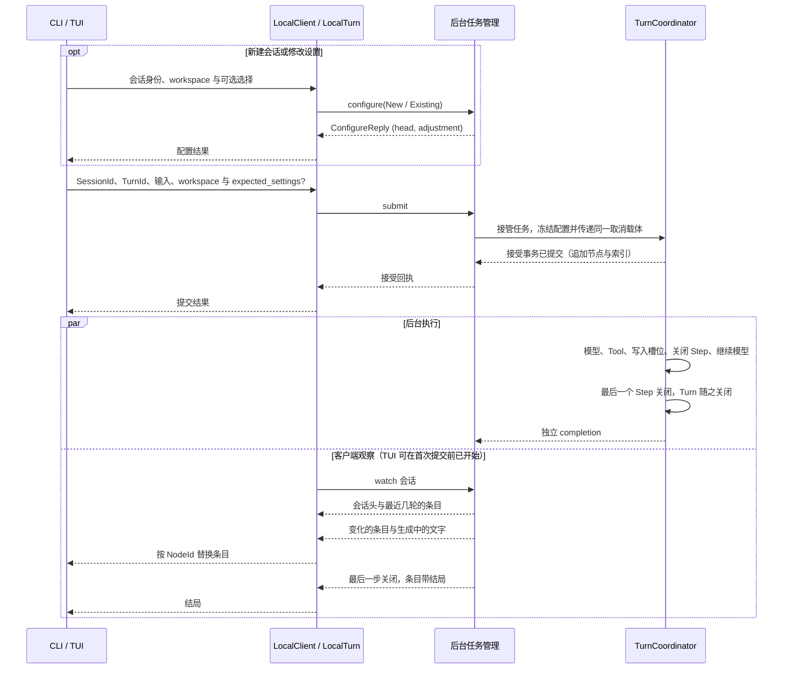

# 从提交到结果可见

> 所属领域：[会话与 Turn](README.md)

1. **配置会话。** 新建会话时，前端生成 SessionId 并发送 `configure(New)`（指定 agent，以及可选的模型与推理档位），后台创建[草稿会话](concurrency.md#会话状态与草稿清理)、写入初始会话设置并返回会话头与档位调整结果；已有会话需要修改 agent、模型或推理档位时发送 `configure(Existing)` 更新会话设置。规则见[会话设置](settings.md)。TUI 在会话创建后、首次提交之前即可开始 `watch` 观察该会话。
2. **提交任务。** CLI/TUI 收到用户输入，生成 TurnId，保留原始输入和规范工作区，携带已有会话的 SessionId 与可选的设置版本 `expected_settings` 经 LocalClient 提交一次，持有返回的 LocalTurn。身份规则、忙时处理与接受结果不明时的找回见[请求身份与找回](recovery.md#请求身份与找回)。
3. **冻结配置。** Backend 实际接管提交时建立贯穿准备与执行的取消载体，核对设置版本，从当前会话设置读取 agent 快照、系统提示、模型与档位，检查 provider、模型与凭据可用，并在接受事务前经 `ToolExecutor::open_turn` 打开本轮工具目录（生产默认 `NoTools` 为空目录），冻结本轮配置交给执行核心。字段和来源见[执行配置冻结](acceptance.md#执行配置冻结)。
4. **确认接受。** 执行核心核对请求身份、项目绑定、设置版本和输入，在一个事务中追加 UserMessage 节点、TurnId 索引和预留的第 0 步（配置表中还没有这份配置时一并写入），并把 Session 的当前位置移到预留的 Step。事务提交后，后台返回接受回执，由 LocalTurn 交给前端显示；后台承担后续执行与关闭责任。精确接受条件见[请求接受](acceptance.md#请求接受)。
5. **同时观察进度。** 前端以 `watch` 观察这个会话（TUI 可在首次提交前已建立观察）：先得到会话头与最近几轮的对话条目，之后接收变化的条目与生成中的文字；前端按 NodeId 替换条目并渲染，后台同时继续执行。见[观察与重连](recovery.md#观察与重连)。
6. **请求模型。** TurnCoordinator 把预留的 Step 推进到 `Requesting` 并记下第一次尝试，再把当前位置的对话、本次模型参数和本轮冻结的工具目录交给 ModelStepDriver（`NoTools` 下不发送工具定义）。驱动器通过 LLM 连接请求模型；纯对话场景下模型直接给出完整回答并进入第 10 步，注入非空工具目录的场景下模型可返回工具调用并进入第 7～9 步。
7. **登记并执行工具。** TurnCoordinator 核验完整回复（含检查工具名均在本轮冻结目录中），在一个事务中把回复写入这个 Step 节点、为每个调用建立槽位并分配 InvocationId，槽位停在 `Registered`，此时的结论是 NotExecuted。执行某个调用前先检查取消与本轮 deadline，再把该槽位推进到 `Started` 并提交，随后调用 `TurnTools::execute` 传入取消标志与同一 deadline，取得 `ToolOutcome`。详细顺序见[调用槽位](steps.md#调用槽位)。
8. **保存调用结果。** 执行器返回非 `Deadline` 结果时，TurnCoordinator 将 `ToolOutcome` 映射为 `ToolReply`，把该槽位推进到 `Terminal` 并写入结局与载荷；返回 `Deadline` 时不补写 `Terminal`，直接以 `Stop { Deadline }` 关闭 Step。
9. **关闭 Step 并继续。** 全部槽位都已返回后，TurnCoordinator 在一个事务中以 `Continue` 关闭这个 Step、预留下一个 Step，并把当前位置前移到它，然后开始下一步骤。ModelStepDriver 接收带有 ToolResult 的对话，模型结合调用结果继续生成回答。
10. **关闭 Turn。** 模型给出不含工具调用的完整回答后，协调层在一个事务中把回复写入 Step 节点并以 `Finish` 关闭它。这个 Step 为本轮终点，无需继续预留下一步，Turn 随之关闭。见[关闭 Step 与 Turn](steps.md#关闭-step-与-turn)。
11. **取得结果。** 最后一个 Step 关闭后，视图推送它的新值，条目带有这一轮的 `TurnSummary`，前端显示结局；此前离开的用户也可以重新打开会话，从同一批节点读到同一结局。

下图表示配置、提交及接管后的执行与观察关系（TUI 在首次提交前即可开始 `watch`），持久步骤的精确顺序由后文定义：

## 用户读到的几种事实

以下数据分别回答不同问题：

| 数据 | 具体用途与依据 |
| --- | --- |
| 会话树 | 用户消息、各次模型请求、完整模型回复及其调用结果，供重连读取及下一次模型请求使用；来自会话库中已写入的节点 |
| 当前尝试的段列表 | 模型正在生成的正文与 reasoning，经视图作为生成中的文字推送，用于即时显示；只保存在后台内存，完整回复写入 Step 节点后交由节点承载，不进入历史 |
| 调用 outcome | 一次工具调用是 Succeeded、Failed、NotExecuted 还是 Indeterminate，由调用槽位中的结果确定 |
| 结果载荷 | 调用的返回内容（成功 JSON、结构化 `ToolError` 或不确定原因）；供模型使用的文字由 provider 投影从载荷派生，详见[调用槽位](steps.md#调用槽位) |
| Turn 结局 | 整次请求是 Completed、Failed 还是 Cancelled，连同面向用户的说明 notice，由最后一个 Step 的结束方式得出；完成关闭不限定为业务成功 |

已关闭的 Step 能读到，就已经持久，不另有“完成确认”。例如 Tool 已执行成功而返回内容超过保存上限时，outcome 仍为 Succeeded，模型得到的是内容不可用的结果；前端读取历史失败时，保留已经取得的结局，单独报告内容未能加载。
