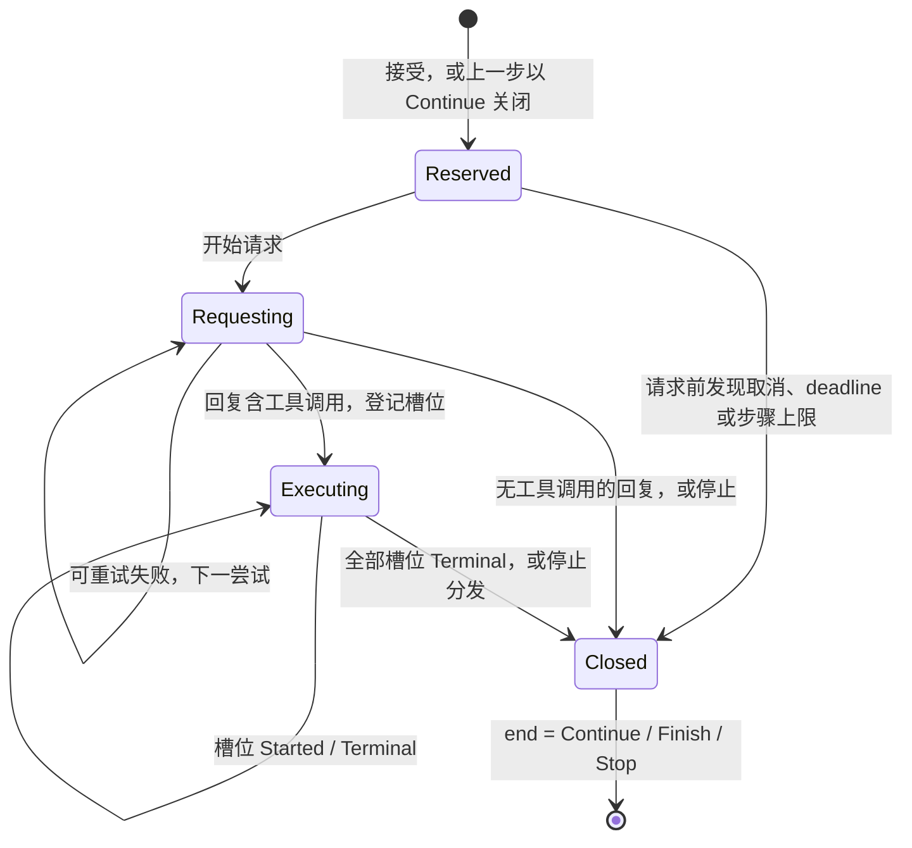

# Step 执行与结果保存

> 所属领域：[会话与 Turn](README.md)

## Step 节点与事务序列

Step 节点保存这一步的全部内容：

| 部分 | 内容 |
| --- | --- |
| `progress` | 这一步最后到达的阶段；`Closed` 带结束方式 `end` |
| 尝试 | 按尝试序号排列的各次模型请求：来源（协议与 provider `id`）、用量、`usage_kind`、费用结果 `cost` 与 `progress`，`Ended` 带终态与诊断；失败后安排了重试的尝试另有等待时长 |
| 回复 | 完整模型回复；还没有完整回复时为空 |
| 槽位 | 回复中每个工具调用一个，顺序与回复一致：调用的身份与 `progress`，`Terminal` 带结构化工具结果 |
| 推进时间 | 最后一次推进这一步的时间 |

```text
StepEnd = Continue | Finish | Stop { cause }
```

每次推进是一个会话库事务，事务内不等待模型、工具执行器或网络。事务写入到达的阶段，最后一个阶段连同实际结果一起写入，并更新推进时间：

| 事务 | 写入内容 | 之后的状态 |
| --- | --- | --- |
| 接受 | UserMessage 节点、TurnId 索引、配置表中尚无的配置、预留的第 0 步 | Step `Reserved` |
| 开始请求 | Step 推进到 `Requesting`；新增一次尝试，`Sent` | 等待 provider |
| 尝试停止 | 该尝试推进到 `Ended`，带实际终态与诊断；安排重试时同一事务写入等待时长，不再重试时同一事务关闭 Step | 重试或关闭 |
| 登记调用 | 该尝试推进到 `Ended`，终态为 `Completed`；写入完整回复；每个调用一个槽位，`Registered`；写入 InvocationId 索引；Step 推进到 `Executing` | `Executing` |
| 调用开始 | 一个槽位推进到 `Started` | 等待执行器返回 |
| 调用返回 | 一个槽位推进到 `Terminal`，带工具结局与载荷 | 下一调用或关闭 Step |
| 关闭 Step | Step 推进到 `Closed`，带实际的结束方式 `end`；无工具调用的回复同时写入 `Completed` 与回复；`end` 为 `Continue` 时同一事务预留下一个 Step 并前移当前位置 | 下一 Step 或 Turn 结束 |

`Completed` 不单独提交：它总与登记调用或关闭 Step 在同一事务写入，所以不存在“完整回复已保存、尚未登记也未关闭”的持久状态。



图中 `Closed` 之前的每个状态，都可能是执行者消失时 Step 停下的位置；Step 此后留在该状态。

不变量：

- 同一 Turn 的节点序号连续：UserMessage 之后依次是第 0 步、第 1 步，以此类推。执行这一轮的协调层独占该 Session 的执行锁，期间没有其他操作向这个 Session 写入节点。
- 一个 Turn 中，除最后一个 Step 外，每个 Step 都以 `Continue` 关闭，且之后有同一事务预留的下一个 Step。
- 一个 Session 中可改写的节点至多一个，即序号最大的节点，且它是未关闭的 Step。

读取校验按这些关系核对节点。结论由 `progress` 给出，只有这一份，读取直接使用。未关闭的 Step 是合法状态，校验不把它当作损坏，也不修改它。

## 调用槽位

模型回复含工具调用时，登记事务为每个调用建立槽位并分配 InvocationId。该身份随后贯穿执行、取消与结果保存。InvocationId 在同一事务插入全局索引；键冲突时放弃该事务，重新生成后重试。登记记录每个调用的 Session/Turn/步骤/片段地址、方法、不透明工具身份 `tool_identity` 和规范参数摘要（`InvocationBinding`，见 [ADR 0009](../../adr/0009-remove-legacy-lancet-tool-executor.md#4-会话库升版与存储收敛)），顺序与原回复一致。

同一回复的调用按片段顺序逐个执行，每次只处理最低序号的未返回槽位：

1. 把该槽位推进到 `Started` 并提交。从这时起，它停下时的结论是 `Indeterminate(NoResult)`。这是“可能已执行”的保守边界：它不证明执行器已开始或外部效果已发生，但越过它之后不能仅凭没有结果推定未执行。
2. 把已提交的 `StartedInvocation`、工具名、参数、取消标志与本轮 deadline 交给 `TurnTools::execute` 执行，取得 [`ToolOutcome`](../../../crates/lattice-api/src/lib.rs)。
3. 执行器因调用期到达本轮 deadline 返回 `ToolOutcome::Deadline` 时，协调层不调用 `finish_invocation` 补写槽位终态，直接以 `Stop { Deadline }` 关闭 Step（[ADR 0009](../../adr/0009-remove-legacy-lancet-tool-executor.md#2-工具执行收窄为-toolexecutor)）；其余四种返回由协调层映射为 [`ToolReply`](../../../crates/lattice-session/src/store/types.rs)，推进该槽位到 `Terminal` 并提交，写入结局与载荷。

每个槽位任何时刻都有 `ToolResultOutcome` 的一种结局，以及按结局确定形状的载荷：`Terminal` 的槽位保存它们，其他阶段由阶段确定。结局与[模型尝试](acceptance.md#模型请求与执行预算)一样分两维：结局是结束形状，说明执行器给出了什么；原因放在载荷的 `ToolError` 或 `IndeterminateCause` 里。判定只看两件事：槽位到达了哪个阶段，以及执行器返回了什么。

| 结局 | 槽位的阶段 | 判定依据 | 载荷 | 外部效果 |
| --- | --- | --- | --- | --- |
| Succeeded | `Terminal` | 执行器返回 `ToolOutcome::Succeeded(value)` | 完整 JSON value（超限时保存摘要与长度） | 可能已发生 |
| Failed | `Terminal` | 执行器返回 `ToolOutcome::Failed(ToolError)` | 结构化 `ToolError { code, message }`，错误码与消息原样保存 | 可能已发生 |
| NotExecuted | `Registered` | 调用尚未交给执行器；Step 在它开始之前停止时，它一直停在这里 | 无 | 保证没有 |
| Indeterminate | `Started`，或 `Terminal` | 越过 `Started` 后没有取得确定结果 | `IndeterminateCause`，见下文 | 未知 |

协调层把非 `Deadline` 的 `ToolOutcome` 映射为 `ToolReply`，再由 [`prepare_terminal`](../../../crates/lattice-session/src/store/close.rs) 构造槽位终态：`ToolOutcome::Succeeded` → `ToolReply::Succeeded` → Succeeded（按 65,536 字节边界分成 `Json` 或 `OutputTooLarge`），`ToolOutcome::Failed(ToolError)` → `ToolReply::Failed(ToolError)` → `Failed(ToolError)`，`ToolOutcome::Cancelled` → `ToolReply::Cancelled` → `Indeterminate(Cancelled)`，`ToolOutcome::Indeterminate` → `ToolReply::Indeterminate` → `Indeterminate(Reported)`（[ADR 0009](../../adr/0009-remove-legacy-lancet-tool-executor.md#2-工具执行收窄为-toolexecutor)）。

Indeterminate 的原因 `IndeterminateCause` 有三种：

- `NoResult`：槽位停在 `Started`，还没有取得结果。它是这个阶段的结论；Step 停止、调用期到达本轮 deadline 或进程退出时仍在这个阶段的槽位，结果就是它。`Started` 已提交、交给执行器之前发现取消或 Deadline 也属于这种情况：越过 `Started` 后不能再证明未执行。
- `Cancelled`：执行器返回取消（`ToolOutcome::Cancelled`，经 `ToolReply::Cancelled` 写入），即交出后被取消。
- `Reported`：执行器报告结果不确定（`ToolOutcome::Indeterminate`，经 `ToolReply::Indeterminate` 写入）。

NotExecuted 不带原因。停止原因沿 Turn → Step → 槽位的嵌套只从下往上传：为什么停只在 Step 的 `end.cause` 中记录一次，不抄到每个未执行的槽位，推导规则见[执行中 Step 的停止原因](#执行中-step-的停止原因)。

`Terminal` 中的 Succeeded 与 Failed 是执行器给出的确定结果，允许继续下一调用；`Terminal` 中的 Indeterminate 停止后续分发（[`stops_batch`](../../../crates/lattice-session/src/store/close.rs)），之后的槽位留在 `Registered`，结果为 NotExecuted。所以一个槽位越过 `Registered` 时，它之前的槽位都已返回 Succeeded 或 Failed。批次控制只由有序的槽位结果得出，执行者在哪个时刻消失不改变 Turn 结局。

载荷还遵循：

- Succeeded 载荷的规范 JSON 超过 65,536 字节时，不保存正文、不截断，保留完整摘要与长度，ToolResult 标明内容不可用（OutputTooLarge）；outcome 仍为 Succeeded。需要大输出的 Tool 通过自身接口提供分页、游标或摘要。
- 发给模型的结果文字不存储，由 provider 投影从载荷派生。Failed 投影为 `{"error":{"code":...,"message":...}}`（`message` 按字符边界限制在 4,096 字节内），模型可据此修正参数；NotExecuted 与 Indeterminate 使用固定的最小文案 `{"outcome":"not_executed"}` 与 `{"outcome":"indeterminate","cause":"no_result|cancelled|reported"}`。provider 的错误标记（Anthropic `is_error`、Gemini `error`）只用于 Failed。

停止与收尾的写入：

- 停止分发或关闭 Step 时不为槽位补写。没有返回的槽位，结果由所在阶段确定：`Registered` 为 NotExecuted，`Started` 为 `Indeterminate(NoResult)`。已返回的结果保持原值，不伪造成功输出，也不依据缺少结果推定文件未改变。
- 执行器返回非 `Deadline` 结果后，写入它的结果属于必要收尾，不受 Turn deadline 约束。写入失败按[事务失败](concurrency.md#事务与一致性)处理，后续调用不分发。

## 关闭 Step 与 Turn

全部槽位已返回，或协调器决定停止后，协调层在一个事务中把 Step 推进到 `Closed`，带上实际的结束方式 `end`：

- `Continue`：协调器决定继续请求模型。同一事务预留下一个 Step，并把当前位置前移到它。
- `Finish`：模型给出无工具调用的完整回答。
- `Stop { cause }`：因取消、错误、调用效果不确定（`InvocationIndeterminate`）、Deadline 或步骤上限停止。`cause` 是实际导致停止的原因：
  - 没有完整回复、因某次尝试不再重试而停止：取该尝试的原因。
  - 没有完整回复、在尝试之前或两次尝试之间（重试退避中）收到取消或 Turn deadline 已到：取 Cancelled 或 Deadline，不开始新尝试，也不沿用先前尝试的原因。
  - 有完整回复、执行调用期间停止：按[执行中 Step 的停止原因](#执行中-step-的停止原因)推导。
  - 预留的 Step 的序号达到模型步骤上限：步骤上限，不开始请求。

Step 没有到达 `Closed` 时，它的结束方式是所在阶段的结论：`Stop`，原因为 ProcessExit 或由槽位结果推出。它说明执行者此刻消失时这一步如何结束。

以 `Finish` 或 `Stop` 关闭的 Step 是 Turn 的最后一个 Step，Turn 随它关闭，不另写记录。Turn 的结局从最后一个 Step 的结束方式得出；最后一个 Step 尚未关闭时，用它所在阶段的结论：

```text
TurnOutcome = Completed | Failed { reason } | Cancelled
```

- `Finish` 得到 Completed；`Stop { cause: Cancelled }` 得到 Cancelled；其他 `Stop` 得到 Failed。
- `notice = Option<{ level, text }>` 按结局定级：Failed 为 Error，Cancelled 为 Info，Completed 无 notice。`text` 由最后一个 Step 的 `Stop` 原因决定：`ProviderError` 取产生该原因的那次尝试的诊断，先经现有脱敏。HTTP 错误的诊断是一行文字：状态码，加上从 Anthropic、OpenAI、Gemini 错误信封解析出的类型或代码与消息，例如 `HTTP 429 rate_limit_exceeded: …`；正文不是这些格式时取开头一段；类型、代码与消息中的控制字符和空白都折成单个空格，流内错误事件的诊断同样处理；有建议等待时在末尾注明。生成时整行最多 `MAX_DIAGNOSTIC_CHARS`（256 字符），超长以 `…` 截断；provider 请求 ID 只写日志。其他原因（含 Cancelled、ProcessExit、Deadline、调用效果不确定、模型步骤上限）使用按原因固定、由代码定义的文案。尝试诊断的存储上限是 `MAX_PROVIDER_ERROR_CHARS`（2048 字符）。先前已被重试取代的失败尝试不作为 Turn 结局 notice 的来源。notice 不另存，每次读取用同一规则从节点得出，最后一个 Step 条目的 `TurnSummary` 带同一对象；实时观察与重新打开会话看到的是同一种条目，所以显示同一句。
- `level` 取 Info、Warn 或 Error，由后端给出，前端按它呈现，不从其他字段推断等级。Turn 结局的 notice 只取 Info 或 Error；Warn 只用于[重试提示](acceptance.md#模型请求与执行预算)。
- 公开读取投影为 `TurnSummary { outcome, notice, progress }`，其中不含内部 `reason`。`progress` 取最后一个 Step 的 `progress`，读者据此解读 `outcome`：
  - `Closed`：这一轮已经结束，`outcome` 是最终结局。
  - 未关闭，后台持有这一轮的 Owner：仍在执行，`outcome` 只说明此刻停下会得到什么，前端按进行中显示。
  - 未关闭，没有 Owner：执行者已消失，这一轮停在这一步，`outcome` 就是它的结局，见[执行者消失后的 Turn](recovery.md#执行者消失后的-turn)。
- Step 节点保留各次尝试与 `end` 的原因，随视图、历史查询和 `session turn` 提供，供诊断与查询使用；前端的对话显示只依据 `TurnSummary` 与后端给出的 notice 给出文字和等级，不从 `end` 或尝试的原因推导。
- Turn 的 usage 汇总由各次尝试的 usage 得出。Turn 的结束时间是最后一个 Step 关闭时的推进时间；未关闭时，最后一个 Step 的推进时间说明它最后一次有进展是什么时候。
- 尝试的 `usage` 保存五项可选计数，`usage_kind` 保存请求结束时按[用量与价格表的比对](../llm/usage.md#用量与价格表的比对)得出的完整性判定，`cost` 独立保存可选的 `CostEstimate { usd, exact }`。开始请求时 `usage_kind` 为 `partial`，用量与费用未知；停止、登记调用或完成回复时原样接收请求网关的结果，与实际进度同事务保存。没有收到终态的 `Sent` 尝试与执行者消失后的尝试保留 `partial`、未知费用；读取不补写旧尝试，也不重新判定或估价。
- 汇总携带 `attempts` 与 `partial_attempts`，后者统计 `usage_kind=partial` 的尝试。五项计数各有 `known`（已报告计数的小计）、`complete` 与 `overflowed`，小计为可选整数；`complete` 表示没有未报告的尝试且未溢出，只看计数本身，与该项有没有单价无关；费用汇总有 `known`、`unknown_attempts` 与 `overflowed`，`cost.known` 为可选 `{usd, exact}`，`cost.unknown_attempts` 统计费用未知的尝试数。有尝试而某项全未知时其小计为 null，明确的零保留为 0；没有尝试时是空和 0，费用为 `{usd:0, exact:true}`，由 `attempts=0` 区别于未知请求。`Sent` 也计入尝试，Reserved 没有尝试。
- 整体 `kind` 仅在 `partial_attempts=0` 且所有指标均未溢出时为 `complete`，否则为 `partial`；某项计数或费用未报告本身不决定 `kind`。整数小计溢出饱和到 `u64::MAX`，金额小计溢出饱和到有限的 `f64::MAX`，同时设置该项溢出标记；原始尝试不变。
- 费用合计规则见[费用估算](../llm/usage.md#费用估算)。

关闭 Step 只写会话库；会话的建立、推进与关闭均不创建或读写工作区历史库，也不取得工作区操作锁。

会话库事务提供本库的原子提交；已发生的工作区外部效果不在会话库事务内回滚。

### 执行中 Step 的停止原因

停在 `Executing` 的 Step，结束方式是 `Stop { cause }`，`cause` 由槽位结果和外部停止共同决定（[`step_stop_cause`](../../../crates/lattice-session/src/store/close.rs)）。外部停止是协调层在两次分发之间发现的取消或 Turn deadline，只随关闭事务写入；Step 仍在 `Executing` 时没有外部停止，按 ProcessExit 计。推导顺序：

1. 按片段顺序找第一个由槽位自身决定停止的结果：`Indeterminate(Cancelled)` 得到 `Cancelled`，`Indeterminate(Reported)` 得到 `InvocationIndeterminate { invocation_id }`。
2. 找不到时，取外部停止：`Cancelled`、`Deadline` 或 `ProcessExit`。NotExecuted 与 `Indeterminate(NoResult)` 自身不带原因，由这一步说明它们为什么停下。
3. 所有槽位都已返回确定结果（均为 Succeeded 或 Failed）时，`Stop` 的原因只能是 ProcessExit；正常情况下关闭事务随后以 `Continue` 关闭该 Step。这时发现的取消、Deadline 或步骤上限，先以 `Continue` 关闭该 Step，再把同一事务预留的下一个 Step 以 `Stop { cause }` 关闭。

这条规则用在两处：读取 `Executing` 的 Step 时，由它得出这一步的结论；关闭事务因槽位或外部停止而关闭 Step 时，由它得出写入的 `cause`。已关闭的 Step 带着关闭时写下的结束方式，读取直接使用。所以执行者何时消失不改变结局：进程在某个槽位推进到 `Started` 之前或之后退出，该槽位分别停在 NotExecuted 或 `Indeterminate(NoResult)`，Step 原因都是 ProcessExit。
