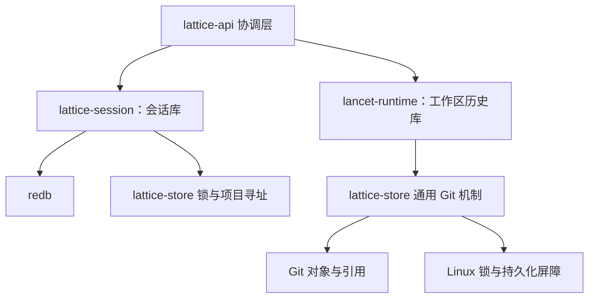

# 私有存储与持久化

> 类型：架构合同
> 上位依据：[项目宪章](../governance/charter.md)、[宿主平台](platform.md)
> 决策记录：[ADR 0006](../adr/0006-tree-session-and-global-redb-store.md)

## 目的与范围

本合同规定私有状态寻址、两类领域存储的归属、会话库的使用条件、通用 Git 内核、创建与打开、发布、锁和持久性验证边界。

私有状态只有两类存储：

- **会话库** `lattice.redb`：全局一份，保存 Session、会话树、Step 与 Turn 记录和调用槽位，由 `lattice-session` 维护。
- **工作区历史库** `workspace-history.git`：每项目一份，保存项目全局文件历史与 checkpoint，由 `lancet-runtime` 维护，经 `lattice-store` 的通用 Git 机制发布。

会话记录与事务序列见[会话合同](session.md)，调用执行与证据见 [LANCET 合同](lancet.md)和 [Cell 合同](cell.md)，文件安装与工作区历史见[工作区合同](workspace.md)。

## 状态布局与身份

### 私有状态根

可变私有存储位于 XDG state root 下，不使用配置目录或项目 `.git`。`XDG_STATE_HOME` 为绝对路径时采用该值，否则使用绝对 `HOME` 下的 `.local/state`；两者均不可用时返回 `MissingStateRoot`。

| 相对 `<state-root>/lattice/` 的位置 | 归属与作用 |
| --- | --- |
| `lattice.redb` | `lattice-session`，全局会话库 |
| `projects/<ProjectStoreKey>/workspace-history.git` | `lancet-runtime`，项目级变更历史与 checkpoint |
| `locks/sessions/<SessionId>.lock` | 会话操作锁 |
| `locks/projects/<ProjectStoreKey>/workspace.lock` | 项目工作区操作锁 |

旧版的 `sessions.git` 与 `projects/<ProjectStoreKey>/invocations.git` 不迁移，也不只读保留。打开会话库时发现它们，打开失败并在错误中列出路径，由人删除或存档；旧 raw OID 输入一律无效。

各存储位于 Local Workspace 外部。删除工作区或退回会话位置不级联删除其他领域的私有状态。配置私有状态位置时应核对其与工作区的实际关系，XDG 路径解析本身不提供包含关系隔离。

### 本地后台与访问边界

同一有效用户在同一规范状态根下共用一个本地后台，`STATE_ROOT` 指上述 XDG 状态根。后台使已接受任务在终端关闭后继续运行，其他客户端仍可连接查询或观察。后台可同时服务多个项目和 Session；Session 的项目绑定保持不变。

| 控制资源 | 作用与生命周期 |
| --- | --- |
| `<state-root>/lattice/local/owner.lock` | 后台终身持有其非阻塞独占 flock，排除同作用域的第二个后台；内核在进程退出后释放锁 |
| `local/api.sock` | 供本机客户端建立 Unix socket 连接，由实例锁持有者绑定和清理 |
| 后台 epoch | 标识一次后台生命周期，用于判定观察连续性；随进程重启改变 |
| 会话库句柄、Owner 和内存观察状态 | 后台持有并用于执行、控制和回答请求；持久业务事实在会话库和各项目工作区历史库中 |

后台生命周期依次为：

1. 首次使用时，客户端可自动启动当前 `lattice` 的后台主体，以独立进程组运行并脱离终端 stdio。
2. `serve` 取得实例锁，核验本地目录与 socket；需要处理残留 socket 时，仅清理本用户、身份未变化且已失效的对象，再绑定服务地址。
3. 通信双方完成身份和协议检查后，Backend 接管请求，并通过领域接口打开存储、管理独立任务。最后一个客户端断开后，后台继续运行。
4. 显式 stop 关闭新准入并等待已接管操作收尾，具体查询、取消和排空责任见[停止后台](session.md#停止后台)。
5. 后台正常退出时由实例锁持有者清理自己的 socket 并释放资源。锁文件可以留存，是否持锁以 flock 为准；异常退出留下的 socket 由下一持锁者按第 2 步核验处理。

请求接受、执行进度与请求身份由会话库的 Turn 记录保存，见[请求身份与找回](session.md#请求身份与找回)。进程控制资源不构成业务状态库；后台启动保持领域库原样，崩溃遗留的进行中 Turn 在该 Session 的后续写操作前[自动关闭](session.md#自动关闭崩溃遗留任务)。

#### 本地访问与所有权边界

- 本地目录及 socket 核验类型、所有者和私有权限，通信双方均核对 Linux peer UID。IPC 限于本机 Unix socket；身份检查或版本不兼容时拒绝连接，不开放远程入口。
- 只有实例锁持有者可绑定、替换或清理 socket，也只有它打开会话库。不按 PID、mtime、连接数或超时抢占所有权，也不终止身份或协议不兼容的已有后台；客户端报告错误，交由用户处理。
- 版本化帧、长度检查和有界队列限制请求与观察资源。实现入口为[本地 IPC](../../crates/lattice-api/src/local/ipc.rs)，具体计量及超限行为见[输入与传输限制](session.md#输入与传输限制)。
- 后台启动不创建或修复缺失领域库，也不自动关闭进行中 Turn。常驻句柄继续遵守各领域的身份、严格打开和发布规则，不增加第二份请求状态库。
- 单例锁只排除第二个后台，不串行化各 Session 的 Turn。短准入管理与领域锁分开，常驻持库不改变[锁序与持有期限](#锁与并发语义)。

### ProjectStoreKey

ProjectStoreKey 是完整规范工作区路径的存储地址。推导规则由 [`key.rs`](../../crates/lattice-store/src/key.rs)维护：

```text
canonical_root = canonicalize(full Local Workspace root)
path_bytes = Linux OsStrExt bytes of canonical_root
ProjectStoreKey = lower_hex(SHA256(
    "lattice-project-store-key-v1\0" || u64_be(len(path_bytes)) || path_bytes
))
```

键使用 64 个小写十六进制字符，不要求路径为 UTF-8。profile 的 `[lancet.project_root].root` 是策略范围，不参与寻址。

同一规范路径使用同一命名空间，项目移动到其他路径后得到不同键，无关项目复用原路径会看到既有命名空间。该规则不使用内容指纹、Git remote、inode 或 generation 注册表识别项目。Session 永久绑定一个键，路径迁移后创建新 Session，不自动 relink。会话库是全局的，项目键只作为 Session 的绑定字段和工作区历史库的目录地址。

## 会话库

### 使用条件与持久性

会话库使用嵌入式事务库 redb，由后台进程独占打开。它提供的保证与本项目依赖的使用条件如下：

| 条件 | 要求与理由 |
| --- | --- |
| 版本 | redb ≥ 4.3.0。4.2.0 存在已知恢复缺陷：`check_integrity()` 修复过的库在提交后不久崩溃，恢复时可能静默回退该提交；4.3.0 已修复 |
| 后端 | 持久化文件后端。内存后端的同步不履行持久化语义 |
| 打开模式 | 默认独占写模式，不启用 `experimental-multiprocess`。该模式下读者直接读文件头，可能早于最后一次同步看到新提交 |
| 持久性 | 所有写事务使用 `Durability::Immediate`，不使用 `Durability::None`。`None` 提交先对读者可见而不保证持久 |

满足上述条件时：

- **原子性**：一个写事务内的全部记录变更一起生效或一起不生效。
- **持久性**：`commit` 返回成功时事务已持久。redb 先写入新根并完成最后一次 `sync_data`，之后才替换读者使用的共享头。
- **可见性**：读事务只看到已提交且已持久的状态，并在整个读事务中保持同一快照。提交可能在 `commit` 返回前就对新读事务可见，此时数据已持久。
- **单写者**：同一时刻只有一个写事务；另一写者等待。
- **提交失败**：`commit` 返回 `TransactionPoisoned` 时事务已回滚，库仍可开始新事务，但引起它的存储错误不因回滚而修复；其他错误时事务可能已持久，不能当作已回滚，库随后拒绝新的写事务，须关闭并重新打开。会话领域对两类采用同一保守策略，见[事务与一致性](session.md#事务与一致性)。

redb 打开时对库文件取独占锁，另一进程打开得到 `DatabaseAlreadyOpen`。平台不支持文件锁时 redb 只告警并继续，所以单进程持有仍由后台实例锁保证，不依赖 redb 的锁。

这些保证依据 redb 4.2.0 与 4.3.0 源码核对的提交与可见顺序。它不是对磁盘、文件系统或掉电持久性的资格化；进程崩溃测试与成功的同步返回都不能单独作为真实硬件掉电恢复的实验结论。

### 身份、版本与打开

会话库保存一张元信息表，记录库格式版本；各记录的值带格式版本。表定义、值格式及其演化由 `lattice-session` 维护。

| 打开时的状态 | 处理 |
| --- | --- |
| 发现旧版 `sessions.git` 或 `invocations.git` | 拒绝打开，错误列出路径 |
| 库文件不存在 | 返回未初始化；是否创建由调用路径决定，见[首次创建](#首次创建) |
| 不是 redb 库、元信息缺失或格式版本不符 | 拒绝打开并报告损坏或版本不兼容 |
| 记录无法解码或违反业务不变量 | 领域返回类型化损坏，停止受影响路径 |

打开不初始化、不修复我们自己的记录，不回退旧路径，也不替换为空库。redb 在异常退出后打开时执行的自身崩溃恢复属于库的提交协议，不是记录修复。不符合当前格式的库需要另行获准处理。

### 首次创建

会话库只在创建新 Session 的提交路径上首次创建；该路径同时创建或验证所属项目的工作区历史库，再执行接受事务。其他操作遇到库文件不存在时返回未初始化，不创建。

创建按以下顺序执行：

1. 对实际父目录执行[能力探测](#能力探测)，取得父目录中的目标专属 create lock。
2. 若目标已存在，严格打开并验证其身份，不再初始化。
3. 在同一父目录建立临时库文件，写入元信息与空表，提交并同步。
4. 通过 `renameat2(RENAME_NOREPLACE)` 发布目标名称，同步父目录，再打开并核验已发布身份。

发布前失败时目标尚未发布，临时文件可能残留；后续创建者在持有 create lock 且目标仍不存在时清理遗留临时文件。名称发布成功后父目录同步失败，目标已可见但持久性未确认，重试应验证原目标并重做父目录同步，不能删除后重新创建。

## 工作区历史库与 Git 内核

### 职责分工

`lattice-store` 为工作区历史库提供通用 Git 机制，不依赖其他项目 crate。它提供 canonical bytes、不可变 blob/tree/commit、窄对象读取、引用 CAS、多引用事务、保留 pin、Linux 锁、首次创建与同步屏障，也提供上文的 ProjectStoreKey 推导与操作锁。

领域封装决定仓库文件名、引用命名空间、记录类型、schema、对象关系及迁移。内核不提供通用业务 `put/get`、原始 gix Repository getter、全存储注册表、可插拔后端或跨库事务。



图示为领域协作与机制依赖，省略 `lancet-api` 等公开接口层。TurnCoordinator 经领域接口协调两库；一个领域的失败可以保留另一领域已经完成的变化。

### 仓库身份与版本

每个 Git 仓库以 `refs/lattice/meta` 指向含规范 `meta.json` 的不可变 commit。身份包含：

- 内核维护的 `repository_format_version`。
- 领域提供的 `store_kind` 与 `store_schema_version`。
- 带 ProjectStoreKey 的 `Project` scope。

内核核对记录与领域提供的 ExpectedMeta，项目仓库的 scope 必须与其目录地址一致。具体编码和校验由 [`meta.rs`](../../crates/lattice-store/src/meta.rs)维护，领域 schema 版本不由内核集中解释。

当前没有 StoreInstanceId，不承诺识别“整个仓库被删除，再在同一位置放入另一份 schema 合法仓库”的替换。正常打开仍须检查身份及领域事实，不能将已有记录指向的缺失仓库当作可重建空库。

### 不可变数据与读取

对象身份由精确字节决定。canonical JSON、对象构造和摘要算法分别遵循所属数据契约；写 commit 的时间由调用方明确提供，内核不引入当前时钟。恢复需要复用的候选必须由领域保存精确身份及构造材料。

普通读者固定 ref OID 后读取不可变对象。需要同时核验多个可变引用时，领域提供相应锁或固定视图，不能从各次独立读取推定跨引用一致性。

仓库内写操作通过同一标准 write lock 串行化，领域在持锁范围内完成旧 tip 读取、对象创建、CAS 或引用事务及屏障。公开机制接口的锁前提由领域封装遵守，不以对象句柄内部互斥代替完整发布范围。

### 打开

StoreRepo 严格打开既有 bare Git 仓库，核对元信息和 loose-object 目录拓扑。领域封装继续核验记录、引用关系与业务不变量。成功打开内核句柄不等于所有领域对象已通过验证。

| 状态 | 处理 |
| --- | --- |
| 目标不存在 | 内核返回 `NotInitialized`；既有 Session 所绑定项目的仓库缺失由产品层作为异常处理 |
| 目标类型、bare 仓库形态、身份或版本不符 | 拒绝打开并报告相应损坏 |
| loose-object fanout 缺失、为符号链接或不是目录 | 拒绝打开，不补目录 |
| 领域记录、对象、引用关系无效 | 领域返回类型化损坏或读取错误 |

打开不初始化、不修复、不隔离搬走旧库、不回退旧路径，也不替换为空库。不符合当前格式的旧仓库需要另行获准处理，调用 create 不能覆盖已有损坏目标。

### 仓库首次创建

产品首次创建工作区历史库由创建新 Session 的提交路径发起，在会话库接受事务之前完成。隔离测试可在明确的自有目录调用创建接口。

创建按以下顺序执行：

1. 准备并同步目标父目录，取得父目录中的目标专属 create lock。
2. 若目标已存在，严格验证其身份并同步父目录，不再调用初始化回调。
3. 对实际发布父目录执行能力探测，在同父目录建立临时 bare 仓库。
4. 预建 `objects/00` 至 `objects/ff`，写入元信息及领域初始对象、引用，完成整个临时仓库的同步。
5. 通过 `renameat2(RENAME_NOREPLACE)` 发布目标名称，同步父目录，再打开并核验已发布身份。

create lock 与 repository write lock 不重叠。并发创建者按同一目标锁串行；后到者验证已发布仓库，不覆盖获胜者。

发布前失败时目标仓库尚未由本次创建发布，但父目录、create lock 或临时目录可能已经存在。当前实现尽力清理未发布临时目录；后续创建者在目标仍不存在且持有目标 create lock 时，清理该目标命名空间下的遗留创建临时目录。名称发布成功后父目录同步失败，目标已可见但持久性未确认，重试应验证原目标并重做必要屏障，不能删除后重新创建。create lock 文件留存不表示锁仍被持有；是否持锁由内核 flock 决定。

首次创建临时目录位于私有状态目录，与用户工作区文件变更的辅助资源不同。进程崩溃后的残留、清理失败诊断及私有目录被外部修改时的安全边界应分别核验，不能从“创建失败”推断所有辅助效果已撤销。

### 发布顺序

内核将对象写入与引用发布分开，CAS 是可达状态的发布边界。一次标准写入的顺序如下：


`cas_ref`、`delete_ref` 与 `ref_transaction` 在编辑引用前同步 pending objects，编辑后同步相关引用及目录。对象屏障失败时不继续发布新引用；引用前提不符返回 CasConflict。已写对象可以留为不可达对象。

多引用事务用于同一仓库的一组带前提更新与删除。任一前提失败时整组不发布。需要一致观察整组状态的读者仍使用领域规定的锁或固定视图；普通多次 ref 读取不能因此视为原子快照。任意 I/O 故障后的可见状态须实际核验，不承诺跨仓库回滚。

### 屏障覆盖

首次创建预建并同步完整 fanout，使稳态对象发布只同步新对象文件及其所在的二位前缀目录，不再同步顶层 `objects/`。严格打开验证这一前提，不在运行时懒建缺少的 fanout。

引用屏障同步引用文件及可能受影响的祖先目录，删除引用时同步存活父目录。仅同步引用的屏障不触及对象命名空间。

`fsync_pending` 仅在屏障成功后移除待同步对象记录。`cas_ref` 成功已包含对象与引用屏障，调用方不重复追加一次 `fsync_pending`。精确重试若识别已发布候选而跳过 CAS，仍须执行引用屏障，不能把当前可读等同于持久确认。

### 失败分类与恢复责任

| 失败位置或类别 | 已知边界与后续处理 |
| --- | --- |
| InvalidInput | 内核接口前提或输入不合法，不等同于仓库损坏 |
| Busy 或锁系统调用失败 | 尚未取得所需锁，不能继续受保护操作 |
| 写对象或对象屏障失败 | 本次引用编辑尚未开始；保留必要候选及错误，由领域决定重试或停止 |
| CAS 前提冲突 | 不强制覆盖新 tip，重新读取并核验领域事实 |
| 引用编辑返回其他 I/O 或 Git 错误 | 不推定整组引用未变，核验目标引用与精确候选 |
| 引用编辑成功、后置屏障失败 | 引用可能已公开可见，持久性未确认；错误不能抹去发布事实 |
| Corruption、身份或摘要不符 | 停止受影响路径，不用重试、初始化或降级读取隐藏损坏 |
| MissingPrimitive | 目标位置缺少必要机制，拒绝相应能力，不以较弱实现替代 |

StoreError 保留操作与底层原因，但不是所有变更效果的完整领域报告。调用者须结合发布阶段和固定候选分类。有限重试预算、已发布候选的识别及恢复需求由相应领域接口承担。

CAS 的相同目标重试不授权修改身份。当前 `MustNotExist` 对完全相同目标可按幂等成功处理，不同目标仍是冲突；领域还须验证绑定或对象内容等同关系。

阻塞的 Git/文件系统持久化在 `spawn_blocking` 等阻塞执行边界内完成；不得跨 await 持有 repository write lock。该要求不缩短领域操作锁覆盖的期限。

## 锁与并发语义

操作锁覆盖领域操作，会话库写事务覆盖一步会话状态变化，仓库锁覆盖单个 Git 仓库的发布。需要多类锁的操作遵循以下顺序，仅取得本次操作需要的锁：

```text
SessionExecutionLock（会话绑定操作）
  → WorkspaceOperationLock（访问或一致采样项目工作区）
    → 会话库写事务，或至多一个 repository write lock
```

不持有会话库写事务或仓库锁反向取得操作锁，不升级共享锁，不同时持有会话库写事务与仓库写锁，也不同时持有两个仓库写锁。会话库写事务内不等待模型、Tool、网络或其他锁，不跨 await 持有。[会话合同](session.md#操作锁)维护会话操作的持有期限，[工作区合同](workspace.md#操作锁)维护观察、变更与 Turn checkpoint 的项目锁范围。操作员查询只用会话库读事务，不取得这两种操作锁。

| 锁类别 | 同进程语义 |
| --- | --- |
| 操作锁 | 无已有 guard 的获取是独立操作；共享可并存，独占与其他操作冲突。合法嵌套显式通过现有 `FlockGuard::reenter` |
| create 与 repository write lock | 严格互斥，不可重入；阻塞等待者按票号 FIFO，非阻塞获取不得插队 |
| 会话库写事务 | 由 redb 保证同一时刻只有一个；写者等待时间取决于其他写事务的长度，所以每个写事务只覆盖一步状态变化 |

进程级 registry 只仲裁本进程的持有和等待关系，跨进程互斥由 Linux flock 实现。FIFO 保证限定于同进程严格锁等待者，不扩展为跨进程调度顺序或固定等待时限。

guard 是显式持有凭据，不由线程 ID 或任务 ID 推定所有权。最后一个 guard 释放 OS 锁，进程退出由内核释放；没有基于 PID、mtime、心跳或超时的抢锁协议。

同一锁必须由一致的 StateLayout 路径寻址，不通过符号链接或多种拼写把同一锁文件注册为不同锁。锁不会阻止未遵循协议的外部写者；用户文件的路径安全、前提验证和冲突处理由工作区领域负责。

## 保留、索引与演化

会话树与已关闭的 Step、Turn 记录只追加、不删除；本阶段没有清理、压缩或备份机制。全部会话集中在一个库文件，文件损坏影响所有 Session；redb 自身提供崩溃恢复与完整性检查。

会话库中的 InvocationId 索引与调用变更日志是派生记录，与其权威记录在同一写事务中更新，不另设修复流程；两者不一致视为损坏。

工作区历史库的已确认状态由领域 ref 或明确的 retention pin 保持可达，不能依赖 reflog 保留。通用 pin 位于 `refs/lattice/retained/<oid>`；领域负责决定何时 pin、何时可释放。释放 pin 不等于立即删除对象。当前不运行自动 GC、repack、maintenance、级联删除或历史改写，不为处理损坏自动重新初始化，不向外部 remote 添加 `refs/lattice/**` 推送规则。工作区历史不是整项目备份。

会话库格式、Git 内核格式与各领域 schema 分别演化。格式、目录拓扑、事务序列或屏障变化须核验既有数据的打开、可达性及各领域写入接口，破坏性处理须先说明影响并获授权。历史性能与故障证据按[测试工程的证据保留要求](../development/testing.md#脱敏与完整性)处理。

## 位置能力与验证

### 能力探测

能力按实际发布位置验证，不由文件系统名称或一次主机检查代替。检查覆盖同挂载点的 sibling publication、`renameat2(RENAME_NOREPLACE)`、文件与目录 fsync、本地 flock，以及最小仓库的创建、发布、重开与身份校验。会话库和工作区历史库的首次创建都对实际父目录执行这些探测。

严格打开只验证已有存储，不自动运行创建型探测。诊断入口 `lattice-store-probe` 会建立目录及临时仓库，属于有副作用的验证，应在明确允许的位置运行。

ADR 0005 规定 Arch Linux/Btrfs 为完整正确性、故障注入及性能维护环境；Rocky/ext4 使用预构建轻量探测进行补充核验。其他位置通过同样探测可以按 Unverified 运行，不因此扩大平台维护承诺。

SIGKILL 后重开证明相应进程崩溃场景；注入屏障失败验证调用顺序与错误分类。文件系统探测、进程崩溃测试和成功 fsync 返回均不能单独作为真实硬件掉电恢复的实验结论。redb 是被使用的成熟库，不做性能资格化；自有代码验证记录层的正确性。

### 验证入口与承接

| 检查对象 | 入口 |
| --- | --- |
| 会话库打开、创建、版本与旧库拒绝 | `cargo test -p lattice-session`；隔离测试先列出全部失败方式 |
| 会话库的崩溃与重开 | 真实二进制与真实状态根上的 E2E 场景，按[测试工程合同](../development/testing.md)选择 |
| 寻址、Git 仓库身份、严格打开、首次创建、锁及屏障 | `cargo test -p lattice-store` |
| 内核静态检查 | `cargo clippy -p lattice-store --all-targets -- -D warnings` |
| 依赖边界 | `cargo tree -p lattice-store --edges normal`、`cargo xtask lancet-boundary` |
| 工作区历史发布、重试与可达性 | 按影响选择 `lancet-runtime` 及协调层测试 |
| 实际存储位置能力 | 在获准目录运行预构建的 `lattice-store-probe` |

纯文档修订核对接口责任、发布顺序、锁范围、来源、状态及图示。修改内核或会话库接线时先检查直接故障窗口，再验证使用该机制的领域，执行资源和被测产物按[测试工程合同](../development/testing.md)处理。

承接来源为 ADR 0005 的项目寻址、通用内核、操作锁和位置能力部分，以及 [ADR 0006](../adr/0006-tree-session-and-global-redb-store.md) 的存储布局与会话库使用条件。机制接口与实现核对位置为 [`repo.rs`](../../crates/lattice-store/src/repo.rs)、[`durability.rs`](../../crates/lattice-store/src/durability.rs)、[`lock.rs`](../../crates/lattice-store/src/lock.rs)及 [`probe.rs`](../../crates/lattice-store/src/probe.rs)。

局部指引中“操作锁可重入”的概括按当前显式 guard 语义展开，不迁入旧的自动嵌套假设。创建残留的完整报告、跨位置能力覆盖及多引用发布中断的诊断范围仍需核验。
