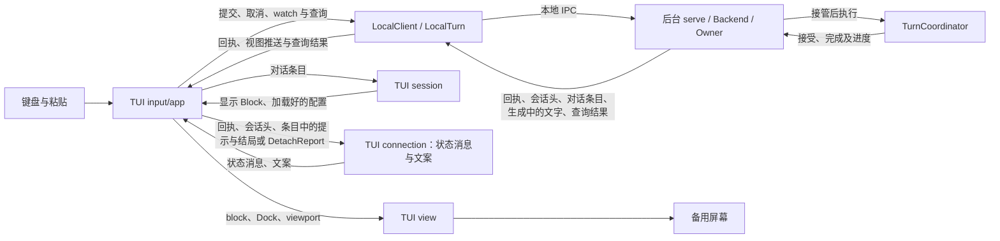

# TUI 交互与视觉

> 类型：架构合同
> 上位依据：[项目宪章](../governance/charter.md)、[宿主平台](platform.md)
> 修订记录：Markdown 渲染、代码高亮与终端能力，以及标题线、Dock 与输入区、statusline、浏览光标、评论与排队的修订，随 PR #232 合并，2026-10-02 由维护者批准生效。按 [ADR 0008](../adr/0008-backend-api-commands-view-queries.md) 修订会话内容的来源、轮次序号、请求身份、找回与取消。

## 目的与范围

用户在全屏 TUI 中编辑任务、查看已保存对话并观察后台进度。任务接受后，关闭界面仍可让后台继续工作；重新打开会话可以读取结果、继续观察或请求取消。

任务运行时，用户可以继续输入后续任务，TUI 把它们排队，本轮完成后依次发送。用户也可以把光标移进对话记录，对助手回答逐段写评论；评论随下一条消息发给模型，并保存在这条消息里，重新打开会话后仍显示在原位。

本合同规定这些操作的接线、键盘交互、布局、状态呈现与配色，由 `lattice-tui` 维护。CLI 解析由 `lattice-cli` 负责；会话、Turn 执行及持久关闭由[会话合同](session.md)维护，工具执行事实由 [LANCET](lancet.md#结果证据与失败处理)维护。本文沿“输入任务、模型调用工具、读取回答”的场景说明界面如何使用这些结果。

## 职责与显示模型

### 持久对话与临时文字

Session 是持续对话的容器，Turn 是一次已接受任务。会话树中的 UserMessage 与 Step 节点组成持久对话内容，可在重连后读取，也供后续模型请求使用。Step 节点包含一次完整模型回复及其全部 `(ToolCall, ToolResult)` 对；ToolResult 表达执行 outcome 与返回内容。整次 Turn 的结局由最后一个 Step 节点得出，TUI 读到的是后台随这个 Step 的条目给出的 `TurnSummary`。主定义见[用户读到的几种事实](session.md#用户读到的几种事实)。

TUI 以 `watch` 观察当前会话。视图先给出会话头与当前路径上最近 10 轮的对话条目，之后推送变化的条目与生成中的文字；更早的轮在往上翻时用历史查询取得。精确关系见[观察与重连](session.md#观察与重连)。

- **会话头**：当前位置、当前 agent、当前位置所属那一轮有没有 Owner，以及后台已知的这一轮执行诊断。
- **对话条目**：一个条目就是一个节点，以 NodeId 标识，同一节点的新值整条替换旧值。UserMessage 条目带这一轮的轮次序号，节点上记有 agent 名、模型与 provider；Step 条目带各尝试、槽位与这一步的结论，以及各尝试的重试提示；本轮最后一步的条目另带这一轮的 `TurnSummary`。
- **生成中的文字**：当前尝试正在生成的正文与 reasoning，标明所属节点与尝试。

生成中的文字是临时的，TUI 用它显示当前进度。它只存在于后台内存、视图推送和界面内存中，显示在所属 Step 条目的位置。条目显示该尝试已 `Ended` 时，文字由条目取代：尝试完成时改为显示条目中的完整回复，二者合并相邻同类后内容一致，显示不跳变；尝试停止时半截文字只作诊断，不再显示。TUI 按有序消息生成用户、助手、工具和状态 block；reasoning 的持久保存归会话领域，当前界面不单独展示 reasoning 片段。布局中的“正文宽度”则专指字符单元宽度，见[布局](#布局)。

对话记录中的条目与状态消息按出现的先后排列，已经显示的内容不重排。状态消息是对话记录中的状态 block，例如连接提示、提交与取消回执，它们不属于任何节点，定义见[状态消息与等级](#状态消息与等级)；重试提示与 Turn 结局属于 Step 条目，随条目显示。TUI 按以下规则组织显示：

- 同一 NodeId 的新值原位替换旧值；新条目接在对话记录末尾。
- 本客户端提交时，末尾先显示这条输入的 USER 块；同一 TurnId 的 UserMessage 条目到达时原位取代它。未被接受的提交保留这个块。
- 状态消息出现时接在末尾，之后不移动。
- 视图翻到对话记录顶部而第 1 轮尚未装入时，app 用历史查询取更早的轮，`before` 为已装入的最早一轮的 UserMessage 的 NodeId。取到的轮插在这一轮之前，视图仍停在原来看到的内容上：以屏幕上插入点之后的第一行为准，启动横幅与插入点之前的状态消息随之移到屏幕之外。查询失败时显示一条 Warn，下次翻到顶部时重新查询。
- 新视图的初始条目到达时（打开会话或重连），以及会话头标明路径已替换时，TUI 丢弃此前的条目及其生成中的文字，新的条目接在末尾。状态消息与未被接受的 USER 块保留。

“末尾”指排队区域之前，排队消息始终在对话记录最后，见[排队](#排队)。例如，第 2 步执行中出现的连接提示留在第 2 步之后；第 2 步关闭时它的条目原位更新，第 3 步的条目接在这条提示之后。

### 状态消息与等级

状态消息告诉用户某个时刻发生了什么：一次重试、一条回执、连接中断或一轮的结局。每条消息携带等级、文字和可选的所属 Turn；文字可以多行，一件事只生成一条消息。消息不记录自己显示在哪里，是否暂驻由 [Dock](#dock-组件) 按等级决定。

等级取 Info、Warn、Error，来源只有两处：

- 后端给出的消息沿用后端的等级。重试提示取 Step 条目中该提示的等级；Turn 结局取 `TurnSummary` 中 notice 的等级，Completed 没有 notice，按 Info。
- TUI 自己产生的消息由 `connection` 生成文字并定级，`app` 只负责推入：

| 等级 | 含义 | 消息 |
| --- | --- | --- |
| Error | 用户要做的事没有做成，或界面确定出错 | 请求被拒绝或回执失败；按 TurnId 查询为 NotFound，提交确定未被接受，输入保留；会话头中的执行诊断；取消请求出错；收到不应出现的回执 |
| Warn | 结果不确定，或有内容丢失 | 接受确认未知；提交结果未知；后台未接管本次取消；取消确认未知；更早的轮读取失败；观察中断（连接结束、有 Owner 执行时长时间无推送、连接出错）；这一轮的执行者已消失；评论因锚点不在当前路径而被丢弃 |
| Info | 符合预期的进展 | 按 TurnId 查到已接受的请求；提交在发出前取消；已请求取消、后台已接管取消、取消交接已结束；旧句柄的交接 |

取消状态与取消请求的诊断合为一条 Error；提交结果未知与它的诊断合为一条 Warn。

只有新到的消息才交给 Dock。新视图的初始条目和历史查询取得的条目中已有的重试提示与结局不是新消息：它们直接进入对话记录，不暂驻，等级与颜色不变。此后的推送使 Step 条目多出的重试提示，以及使这一轮由未结束变为结束的结局，才是新到的消息。重试提示以所属节点与尝试为身份，结局以 TurnId 为身份；它们暂驻 Dock 期间，条目中不重复显示，释放后显示在条目中的原位，所属条目已被丢弃时不再出现。

对话记录中的颜色同样取[配色](#配色与终端约定)表的前景角色：Info 与释放后的 Warn 使用 DimMeta，Error 使用 ToolErr。Turn 结局另带结局符号，文字为 `turn <TurnId>` 加“完成”“失败”或“已取消”，有 notice 时后接其文字，完成使用 ToolOk。重试提示写明第几次请求失败与等待的毫秒数，后接后端给出的文字。后端给出的文字原样显示。

启动横幅与帮助面板不是状态消息。启动横幅固定在对话记录最上方，写出名称与 `/help`、`/quit`、`/reconnect` 三条命令，使用 DimMeta；它不参与上面的位置规则，插入更早的轮或丢弃条目后仍在最上方，打开较长的会话时需要翻到顶部才能看到。帮助面板见[面板](#面板)。

### 组件接线

CLI 调用 `lattice_tui::run`，TUI 经 `ratatui`/`crossterm` 使用备用屏幕与 raw 键盘输入。下表区分前端模块、本地客户端和后台，描述当前责任归属：

LocalTurn 是本客户端一次提交的具体句柄，处理接受回执、取消意图与退出交接；它不是第二个持久 Turn，也不拥有后台执行。会话内容不经它交付，由 `watch` 视图与查询给出。其主定义见[会话组件与接口](session.md#组件与接口)。

| 部分 | 职责与交接 |
| --- | --- |
| TUI `session` | 经后台打开已有会话，加载提交配置；将对话条目转换为显示 Block，取用 UserMessage 条目上的轮次序号，并解析用户消息中的评论元素 |
| TUI `connection` | 把提交与取消回执、连接与查询情况、会话头中的执行者状态与执行诊断、条目中的重试提示和 Turn 结局转为[状态消息](#状态消息与等级)并定级；把 DetachReport 转为退出报告文案 |
| TUI `input` | 管理多行缓冲、光标、粘贴、键位和输入历史 |
| TUI `app` 应用事件循环 | 持有 LocalTurn 与当前会话的视图，发起提交、`watch`、历史查询、按 TurnId 的查询或取消意图，消费视图推送；按 NodeId 维护对话条目的显示，维护焦点、排队与评论草稿，处理键盘、退出及重绘 |
| TUI `view` | 从 Block、输入和状态统一计算布局、折行、viewport、Dock 与 statusline，绘制终端字符单元 |
| `lattice-api::local::LocalClient` / `LocalTurn` | LocalClient 连接后台，转交视图与查询，超过单帧的消息由连接层分帧与拼回；LocalTurn 交付提交，管理取消回执与退出交接 |
| 后台 `serve` / Backend / Owner | serve 持本地实例与连接，Backend 管准入、存储与各观察者的视图推送；Owner 监督独立操作，实际带配置的操作从准备起持同一取消载体直至独立收尾 |
| 后台 TurnCoordinator | 唯一持久 Turn 协调者，推进模型、工具、结果保存和最终关闭，向 Backend 返回完成结果 |

TUI 对话记录使用扁平 Block 序列，说话人分组由渲染顺序确定。共享渲染归 TUI，显示数据不新增嵌套 Turn 容器。前端只维护呈现与操作选择；提交与取消的交接由 LocalTurn 维护，条目的推送由后台的视图维护。



连线表示调用或数据传递，不表示持久事务。后台执行与前端读取、绘制可以并行。

### 启动、提交与运行

1. 给定 `TuiOptions.session_id` 时打开已有会话；未给定时须指定 Agent，TUI 在启动前加载并校验其配置，问题在交互界面启动前返回，说明与提交时相同，见[配置拒绝的原因](session.md#配置拒绝的原因)，工具目录则在首次提交时由后台核对；会话在首次提交时由后台在接受事务中创建。打开已有会话及重连读取持久事实，无需当前 profile/provider 凭据。
2. 打开已有会话时，TUI 对它开始 `watch` 后进入交互循环。会话头先到即可绘制，最近 10 轮的条目随后显示。新会话直接显示输入区，首次提交被接受后开始 `watch`。
3. 用户在输入区编辑任务，按 Enter 提交。输入为空且没有评论草稿时不提交；正在运行时按 Enter 把输入放入排队，见[排队](#排队)。正在运行指本客户端的提交尚未得到结果，或会话头说明当前位置那一轮有 Owner 且这一轮尚未结束。TUI 在发请求前生成 TurnId，保留它与原始输入，不单独显示 TurnId；提交结果未知时的提示带该 TurnId。向已有会话提交时写明追加 `Existing(SessionId)`；新会话在首次提交时生成 SessionId 并写明新建 `New(SessionId)`。确认被接受之前，之后的提交沿用同一 SessionId 与 `New`：会话若实际已由上一次提交建立，后台返回 Conflict：会话已存在，TUI 据此按 TurnId 找回上一次提交，不会建出第二个会话。确认被接受后改为 `Existing`。键位和粘贴条件见[键盘](#键盘)。
4. session 加载这次提交的配置，app 把原请求、身份与配置经 LocalClient 提交一次，持有返回的 LocalTurn。配置加载失败时显示错误，输入保留。字段和来源见[执行配置冻结](session.md#执行配置冻结)。
5. LocalTurn 交付后台接受结果，后台同时继续模型与工具执行。后台接受时助手段标题线随即出现，见[标题线](#标题线)，不另写接受行；接受确认未知等其余结果照常显示，找回见[连接、结局与重载](#连接结局与重载)。Busy 或其他拒绝时保留输入并显示拒绝。保留输入指：输入区为空时把这次提交的原文放回输入区；输入区已有草稿时不覆盖，原文已在提交时记入输入历史，按 Ctrl+↑ 找回，状态消息写明这一点。提交所带的评论照常恢复为草稿。结果不明之后才确定未被接受时同样处理；旧句柄的交接报告只生成状态消息，不归还输入。上一轮的执行者已消失时，旧 Turn 停在已写入的进度，后台直接接受并执行本次输入，TUI 的回执属于本次请求。排队自动发送的一条按「排队」处理。
6. 应用循环消费视图推送。会话头更新 phase、agent 与执行者状态；对话条目按[持久对话与临时文字](#持久对话与临时文字)的规则替换或接在末尾；生成中的文字更新所属 Step 的临时显示；工具按 InvocationId 显示在所属 Step 条目内。每次界面变化由应用循环安排重绘。
7. 后台写入 Step 节点与调用结果，视图推送它们的新值。最后一步关闭后，它的条目带有这一轮的 `TurnSummary`，TUI 显示结局。结局与连接按下一节分别呈现。

### 连接、结局与重载

用户需要知道任务如何结束、自己是否仍在观察，以及内容是否已读到。界面按各自依据更新这些信息：

| 用户要知道什么 | 依据与正常动作 |
| --- | --- |
| 任务的结局 | 本轮最后一个 Step 条目带的 `TurnSummary` 给出 Completed、Failed 或 Cancelled 与 notice。这一轮结束时显示实际结局与说明：最后一步的 `progress` 为 `Closed`，或者它未关闭且会话头说明没有 Owner。实时观察与重新打开会话看到的是同一种条目，每一轮的末尾都显示它的结局 |
| 请求是否已被接受 | 接受回执表明接受事务已提交。回执未知时由 LocalTurn 按 TurnId 查询找回，见[请求身份与找回](session.md#请求身份与找回)；视图中出现该 TurnId 的 UserMessage 条目，同样说明已接受。已关闭的 Step 条目可读即已持久，不另有完成确认 |
| 是否还在观察 | 视图连接表明当前观察情况；断连、EOF，或有 Owner 执行时长时间没有推送，显示观察中断和重连入口。会话空闲时没有推送是正常的 |
| 更早的轮是否读到 | 历史查询成功后插入更早的轮；失败时显示一条 Warn，下次翻到顶部时重新查询 |

连接错误或查询失败只影响相应显示与诊断，已显示的条目与已知结局继续保留。具体分类见[请求身份与找回](session.md#请求身份与找回)。

`/reconnect` 重新开始 `watch`。新视图的初始条目到达时，TUI 按[持久对话与临时文字](#持久对话与临时文字)的规则丢弃此前的条目，按新条目显示；开视图之前已被接受、仍在等会话头确认的那一轮不在这些条目里时，不再等它，按新的会话头判断是否正在运行；生成中的文字从当前尝试已生成的全部文字开始，不缺前文。重连失败时已显示的内容保留。Dock 中暂驻的 Warn 与 Error 不随条目丢弃而消失，继续暂驻到用户释放。

模型尝试重试时，新尝试的文字从头开始。失败的尝试在 Step 条目中显示为 `Ended`，它的生成中文字随之移除；条目中的这次尝试带有重试提示，等级取自条目。不再重试的失败没有重试提示，只由 Turn 结局显示一次。尝试规则见[模型请求与执行预算](session.md#模型请求与执行预算)。

观察 idle 由客户端判定，唯一常量为 `lattice_api::STREAM_IDLE_TIMEOUT_SECS`，只在会话头说明当前位置那一轮有 Owner 执行时计时，触发条件和范围见[输入与传输限制](session.md#输入与传输限制)。超时、断连或 EOF 按连接诊断呈现，仍在运行的工具按观察未知显示；用户可用 `/reconnect` 重新观察。

### 取消、退出与恢复提示

用户请求取消时，取消的是会话头所示正在执行的那一轮，按它的 TurnId 进行。这一轮由本客户端提交时，app 调用它的 LocalTurn 的 `cancel` 并继续消费视图推送；TUI 分别显示等待、已接管、未接管、未知或交接结束。这一轮由其他客户端提交时，例如 CLI 的 `session send`，app 以 `LocalClient::cancel` 按它的 TurnId 取消，显示后台的接管结果。false 不表示没有后台工作，接管区间和拒绝后新准入的语义见[会话取消规则](session.md#取消与退出)。取消发生在提交发出之前时，这次提交不再发出，TUI 按未被接受处理，以一条 Info 说明。

app 发起新的提交时换用新的 LocalTurn。旧句柄通过自己的 `detach` 异步交付报告，新的提交与取消不等待旧回执。报告只生成带原身份的 Info 级状态消息，包括旧接管、具体取消错误与提交诊断；其中已由同一客户端实时交付过的回执不再重述。报告不应用到新句柄的取消状态。退出时继续消费已经开始的报告交接，具体等待与诊断清除规则归[LocalTurn](session.md#客户端意图与退出交接)，TUI 不另行计时、收割控制请求或补发。

首次取消后的提交等待到期时，TUI 显示提交结果未知，视图照常推进；LocalTurn 继续等迟到的回执，提交连接断开后按 TurnId 查询找回。交接后迟到的本地提交传输诊断并入提交结果未知的 Warn 消息，不还原已提交输入、不终止观察或撤销已知结局；后台错误回执仍按其结果显示。

Ctrl+D、`/quit` 和普通退出只断开前端。第二次 Ctrl+C 退出保留第一次的取消意图；应用先复原终端，再将同一句柄交给 `detach`，由 connection 格式化其最后已知事实。键位成立条件见[键盘](#键盘)，共同回执预算及未知后的处理见[客户端意图与退出交接](session.md#客户端意图与退出交接)。

会话头说明当前位置那一轮有没有 Owner。这一轮尚未结束而有 Owner 时，按正在运行的轮次显示，不另写提示。最后一步未关闭而没有 Owner 时，执行者已经消失，这一轮停在已写入的进度：新视图开始或会话头变为这一状态时，TUI 以一条 Warn 提示用户，用户可以直接发送新消息或退回。CLI 的 `session send` 与 `session rewind` 同样直接进行，用法见[操作指南](../development/validation-guide.md#执行者消失后继续)。已写入的节点、调用结果和文件效果保留，旧任务的模型或工具不会重放。只有内存中的取消意图时，结局为 Failed（进程退出）；已写入的取消原因给出 Cancelled，精确规则见[执行者消失后的 Turn](session.md#执行者消失后的-turn)。

#### 观察与控制边界

- 视图推送使用穷举匹配，不以兜底分支吞掉新增种类；生成中的文字用于进度显示，不能代替接受回执或对话条目。
- `watch` 与查询保持只读，不关闭旧 Turn，也不重新接受 prompt。接受回执仍未知时按 TurnId 查询找回，见[原请求重试配方](../development/validation-guide.md#提交与找回)；以新的 TurnId 发送同一输入是另一次请求，不是找回。
- 前端不拥有后台执行生命周期，慢读和重绘不得阻塞后台必要收尾；取消不回滚已发生效果。已接管取消的处理义务不因前端退出而消失。

## 布局

### 水平与垂直分配

尺寸以终端字符单元为单位。右侧栏宽度固定为 40 列，列间空隙 `gap = 1`。左列不留边距，正文、标题线与输入区都从左列第一列开始。

| 条件或尺寸 | 规则 |
| --- | --- |
| 侧栏可见 | `frame_w >= frame_h × 3` 且 `frame_w - 40 - 1 >= 72` |
| 侧栏可见时 | `left_w = frame_w - 40 - gap`，`content_w = left_w` |
| 侧栏隐藏时 | `left_w = frame_w`，`content_w = frame_w` |
| statusline | 左列最后一行，侧栏可见与否都存在 |
| Dock | 高度由栈顶模块决定，最多 `max(frame_h - 1 - 对话记录行数, (frame_h - 1) / 2)` 行，其中除法向下取整、减法饱和 |
| 对话记录可用高度 | `frame_h - 1 - dock_h`；内容不足时只占内容行数 |

所有尺寸减法使用饱和运算，极小终端不得下溢或 panic。渲染以实际分配高度为准，不假定对话记录至少有一行。
`Dock::height()` 统一提供 Dock 高度；渲染、viewport 行数、输入折行和光标定位使用同一 `content_w`。正文宽度不另设上限。

`176 × 50` 显示侧栏，左列与正文宽均为 135；`115 × 47`、`85 × 47`、`56 × 47` 不满足比例条件，`80 × 24` 分栏后正文不足 72 列，均隐藏侧栏。

左列由上至下为对话记录、[Dock](#dock-与输入区) 与 [statusline](#statusline)。对话记录与 Dock 共享 statusline 之上的高度：Dock 紧贴对话记录最后一个可见行之下，内容不足可用高度时 Dock 随内容上移，其下到 statusline 之间留空；内容填满后 Dock 停在 statusline 之上。statusline 始终在左列最后一行。停在底部时输入区看起来就是对话的最后一段；向上翻看时，Dock 与 statusline 留在原位。侧栏全高，gap 保持空列。界面不画边框。

### 侧栏

侧栏保留显示条件、宽度与 navy-11 底色，暂不显示内容。侧栏承载的信息留待以后确定；原先在侧栏中的身份、phase、翻页与键位提示改由 statusline 显示。

### statusline

statusline 是独立组件，不属于 Dock。它占左列最后一行，使用 navy-11 底色；左侧显示 session、agent、模型与提供商，右侧显示提示、上下文用量与 phase。

| 字段 | 来源 | 尚未取得时 |
| --- | --- | --- |
| session | 当前 SessionId 的前 8 个字符；新会话在首个请求被接受前尚未建立 | 显示 `未接受` |
| agent | 会话头中的当前 agent | 始终存在 |
| 模型、提供商 | 当前路径上最近一个 UserMessage 条目记下的模型与 provider；提供商显示其稳定标识 `openai`、`anthropic` 或 `gemini` | 不显示 |
| 上下文用量 | 当前路径上最近一次带 usage 的尝试中该次请求的 `total_tokens`，显示为 `上下文 12.3k`，不足 1000 时显示整数 | 不显示 |
| phase | `idle`、`stream`、`cancel`；观察连接中断时附加 ` · offline` | 始终存在 |
| 翻看提示 | 不跟随时显示 `↓ N 行`，N 为视图下方的对话记录行数 | 跟随时不显示 |
| 退出提示 | 第一次 Ctrl+C 后两秒内显示 `Ctrl+C to quit` | 过期不显示 |
| 换行键提示 | 焦点在输入区或编辑器时显示 `S-Enter 换行` 或 `Alt+Enter 换行`，按启动时的键盘增强探测结果选择 | 其他焦点不显示 |

Turn 的 usage 汇总是整轮所有模型请求的累加值，不代表上下文大小，因此不用于上下文字段。重新打开会话后，模型、提供商与上下文用量随初始条目出现。statusline 只使用会话头与条目中已有的字段，不为显示新增后台接口。

空间不足时先省略换行键提示，再省略退出提示；仍不足时，其余字段按显示宽度从宽到窄依次省略，等宽时按上下文用量、提供商、模型、session、agent、翻看提示、phase 的先后。只剩一个字段时不再省略，按显示宽度裁剪。退出提示过期须触发重绘，不能因界面空闲而残留。

## 对话记录与工具显示

### 标题线

每段消息以一条标题线开头，正文从下一行开始。标题线从左列起点画到左列右缘，形如 `── USER ─────── #3 ──`：`─` 与右端状态使用 DimMeta，标题加粗并使用下表的前景角色。除对话记录第一行外，标题线上方空一行。

| 段落 | 标题 | 标题色 | 右端状态 |
| --- | --- | --- | --- |
| 已发送的用户消息 | `USER` | User | 轮次序号，如 `#3` |
| 助手段 | 当时回答的 agent 名，按原样显示 | Assistant | 同一轮的轮次序号 |
| 排队消息 | `USER` | User | 见[排队](#排队) |
| 评论 | 卡片内 ` COMMENT ` 标签，卡片从锚点元素的正文起点开始 | 标签底色见[配色](#配色与终端约定) | 见[评论](#评论) |
| 输入区、面板、Warn、Error | 见 [Dock 与输入区](#dock-与输入区) | | |

右端有多项状态时用 ` · ` 连接，轮次或评论编号总在最右。空间不足时从最左一项开始省略，仍不足时截断标题。

一个助手段只显示一次标题线，在这一轮第一个 Step 条目之前；Step 条目与它上方最近的 USER 块不属于同一轮时（例如另一客户端那一轮的 Step 接在本客户端未被接受的 USER 块之后），在它之前按所属那一轮另显示一条标题线；本客户端的提交在后台接受时（接受回执，或按 TurnId 查到已接受）即显示，不等条目到达。未被接受的提交不显示助手标题线。状态消息不带标题线，也不触发标题线。右端的轮次序号随 UserMessage 条目到达，见[轮次序号](#轮次序号)。工具行与状态行留在助手段内，不另加空行。

### 轮次序号

轮次序号是 Turn 在从根到 Session 当前位置的路径上的位置，帮助用户在翻看时分辨各轮消息，并区分已发送的 USER 与底部的输入区。这条路径正是视图与历史查询给出、也是后续模型请求使用的对话，序号因此与模型看到的顺序一致。

- 序号由后台在 UserMessage 条目上给出：这条 UserMessage 的祖先中 UserMessage 的个数加一，从 1 开始。session 把条目转换为 Block 时取用它，不自己计数，也不从显示块推算。
- 本客户端刚提交、UserMessage 条目尚未到达的一轮还没有序号：它的 USER 块与助手段标题线右端暂不写序号，条目到达时补上。排队消息没有序号。
- 序号不是 Turn 的持久身份。退回会话位置后再发送，新分支上的 Turn 可能与旧分支上的 Turn 得到相同序号；持久身份仍是 TurnId。

### 正文与工具行

对话记录除评论锚点与评论卡片外不自行填色，左列透出终端背景。用户与助手消息的文字按 [Markdown 正文](#markdown-正文)渲染，用户消息开头的评论元素显示为标记，见[评论](#评论)；工具行和状态行保持纯文本。正文按 `content_w` 折行；翻页停止跟随，`Ctrl+End` 回到底部并恢复跟随，焦点在对话记录时的光标规则见[浏览光标](#浏览光标)。

| 工具显示状态 | 呈现 |
| --- | --- |
| 运行中 | 一行，使用 `DimMeta` 与运行提示 |
| 成功 | 一行折叠，显示工具名和结果字节数 |
| 失败 | 展开并显示错误摘要 |
| 观察未知 | 使用 `DimMeta`，明确尚未取得结果 |
| 内容不可用 | 使用 `DimMeta`，保留执行 outcome 并提示返回内容不可用 |

`▸`、`▾` 为状态指示，不是交互控件。不增加展开键或鼠标处理。指示占工具行前两列，工具行的续行与失败时的错误摘要缩进两列，与指示之后的文字对齐。
工具行按条目中的调用与槽位字段渲染，不按工具名添加专用逻辑。调用 ID 用于把调用与槽位对应，默认隐藏；排障显示时可截断为 `#<id>`，不能当作操作名。
结果长度按字节显示，例如 `1204 B`，不写为字符数，也不添加千分位。没有条目提供的参数、hash 或操作字段不臆造显示。

### Markdown 正文

用户和模型常用 Markdown 组织回答，其中的代码、diff 和表格以纯文本显示时难以阅读。TUI 在渲染时解析 `User` 与 `Assistant` 块的文字，Block 仍保存原始文本，解析结果只用于显示。

解析采用 [GitHub Flavored Markdown](https://github.github.com/gfm/)，即 CommonMark 加表格、任务列表、删除线和扩展自动链接。原始 HTML 按原文显示。段落内的软换行显示为换行，逐行书写的文字和粘贴内容保持原有分行。相邻的块级元素之间空一行；紧凑列表的同一项内，文字与其后的嵌套内容之间不空行。

| 元素 | 呈现 |
| --- | --- |
| 标题 | 独占一行，终端粗体 |
| 强调、加粗、删除线 | 终端斜体、粗体、删除线属性 |
| 行内代码 | 保留两侧反引号，文字使用正文色，不加背景 |
| 列表与任务列表 | 保留缩进层级；无序项显示 `•`，有序项显示原序号；任务项以 `☐` 或 `☑` 代替 `•`，有序任务项保留序号 |
| 引用 | 每个视觉行前加 `▎` 并使用 `DimMeta` |
| 链接 | 显示为 `文字 (URL)`，URL 使用 `DimMeta`；文字与 URL 相同时只显示一次 |
| 分隔线 | 显示为 8 列 `─` 短线，使用 `DimMeta`；不铺满正文宽度，避免与标题线混淆 |
| 代码块 | 见下文 |
| 表格 | 见下文 |

代码块不填底色，用左侧的角线和竖线标出范围，装饰线使用 `DimMeta`：

```text
┌ rust
│ fn load(path: &str) -> Option<u32> {
│     let name = "config.toml";
│     Some(limit)
│ }
└
```

- 首行显示 `┌` 与围栏信息串的第一个词作为语言，未标注语言时只显示 `┌`；末行显示 `└`。首末行都不画横线，避免与标题线混淆。围栏行本身不显示。
- 代码行前加 `│ `，占两列；折行产生的续行改加 `┆ `，与源文中的真实换行区分。
- 可识别的语言按[代码高亮配色](#代码高亮配色)着色；未标注或无法识别的语言使用正文色。
- `diff` 按行首字符着色：`+` 行用 `ToolOk`，`-` 行用 `ToolErr`，`@@` 块头及 `---`/`+++` 文件头用 `DimMeta`，其余行用正文色。保留 `+`/`-` 前缀，不给行铺底色。

流式输出中尚未闭合的代码块，按已收到的内容显示为代码块，暂不显示 `└`，收到闭合围栏后补上。

表格画上下框线，用 `│` 分隔列、表头下画一条分隔线，框线使用 `DimMeta`。一行表格的宽度为各列内容宽之和加 `3 × 列数 + 1`。列宽按下列规则分配：

1. 每列的自然宽度取该列最长单元格的显示宽度；总宽不超过 `content_w` 时按自然宽度绘制。
2. 超出时，可用内容宽度为 `content_w - (3 × 列数 + 1)`。自然宽度不超过平均份额的列保持原宽，剩余宽度在其他列之间按自然宽度比例分配。
3. 每列至少 2 个字符单元宽，保证能放下一个宽字符。单元格内容在本列宽度内折行。
4. 按下限仍放不下时，超出 `content_w` 的部分在右边界截断。

正文、表格单元格、代码块以及工具行和状态行使用同一折行规则，宽度分别是各自的可用宽度：

1. 在空白处断行，词不从中间切开；中文等不以空格分词的文字可在字符之间断行。
2. 单个词宽于整行时，如长 URL 或长字符串，按字符断开。
3. 代码块保留行首缩进，续行对齐到原行的缩进位置。
4. 显示文字中的制表符在渲染前统一展开为空格，制表位每 4 列一个，从所在源行的行首计算；Markdown 源文在解析前展开。

复制使用终端自带的选择，得到的是屏幕上的显示文字，包含折行和装饰符号；当前不提供 Markdown 原文复制。

### 按调用身份显示工具

工具调用与结果都在 Step 条目里：回复中的每个 ToolCall 对应一个调用槽位，二者以 InvocationId 对应。[session](../../crates/lattice-tui/src/session.rs) 把 Step 条目转换为 Block 时，每个调用生成一个工具块，同 ID 只显示一块；条目的新值到达时，这个 Step 的工具块按新值原位更新。

| 槽位 | 显示状态 |
| --- | --- |
| `Registered` 或 `Started`，这一轮仍在执行 | 运行中 |
| `Registered` 或 `Started`，这一轮已结束 | 按会话库给出的结论显示：NotExecuted 或 `Indeterminate(NoResult)` |
| `Terminal` | 按其中真实 outcome 与内容可用性显示成功、失败或内容不可用，包括 Succeeded 且内容不可用的组合 |
| 观察中断时仍在运行 | 观察未知，重新 `watch` 后按新的条目显示 |

工具显示不改变消息顺序，也不建立执行事实存储。

### 工具结果与返回内容

调用与它的槽位在同一个 Step 条目中，工具块总有对应的槽位。槽位尚未到达 `Terminal` 时，调用可能仍在执行，也可能这一轮已经结束、调用停在这个阶段；TUI 按会话头与 `progress` 区分，见上表。观察中断后 TUI 不知道之后的进展，重新 `watch` 即可从新的条目取得槽位状态。

| 层次 | 保存什么、由谁解释 |
| --- | --- |
| 持久执行事实 | 调用槽位保存执行 outcome、载荷和证据；是否成功、失败、取消或不确定依 [LANCET 终态](lancet.md#结果证据与失败处理)核验 |
| 供模型使用的结果 | Step 节点中的 ToolResult 保留执行 outcome 与内容可用性；TUI 读取视图与历史查询给出的 Step 条目，按调用身份更新工具块 |
| 界面观察 | 视图推送的 Step 条目与生成中的文字用于显示进度；重新 `watch` 后按新的条目重建 |

完整返回内容确实可能不可用：内容超过保存上限时保留完整摘要和长度而不保存截断内容，精确规则见[调用槽位](session.md#调用槽位)。后台崩溃前只留在内存、尚未写入槽位的结果无法找回，该调用停在 `Started`，结果为 Indeterminate。上述情形与“TUI 此次查询失败或观察中断”分开报告，后者可以重试，不能据此断定存储中没有内容。

#### 显示诊断边界

这一轮结束时仍停在 `Registered` 或 `Started` 的槽位，按会话库给出的结论显示，TUI 不另行推断或改写。仅观察中断时按[连接中断](#连接结局与重载)显示观察未知。

返回内容不可用时明确标示并保留 outcome，不因缺少内容将执行成功改成失败。

## Dock 与输入区

### Dock 组件

Dock 是承载模块的公共组件，位于对话记录与 statusline 之间。外壳负责模块栈、区域分配、高度夹紧与按键路由；模块负责标题线内容、所需行数、绘制、光标位置与按键解释。模块通过返回意图请求 app 执行提交、排队、释放消息或关闭面板，不直接调用 LocalTurn。

输入区是常驻栈底模块，其上可以有一个[面板](#面板)和一条 [Warn 或 Error 消息](#warn-与-error-模块)，Dock 只显示栈顶模块。能出现的栈只有四种：

| 栈（自底向上） | 如何出现 | 如何离开 |
| --- | --- | --- |
| 输入区 | 默认 | — |
| 输入区、面板 | 在输入区执行 `/help` | Esc 关闭面板 |
| 输入区、消息 | Warn 或 Error 消息到来 | Space 释放消息 |
| 输入区、面板、消息 | 面板显示时 Warn 或 Error 消息到来 | Space 释放消息后露出面板，再按 Esc |

栈顶是面板或消息时输入区不可达，所以不会在消息之上再打开面板，也不会重复打开面板。

- 状态消息推入时由 Dock 按等级决定是否暂驻：Warn 与 Error 暂驻，Info 直接进入对话记录。Dock 自己记录暂驻的是哪一条消息以及面板是否打开，消息本身不带显示位置。
- 模块高度为上方空行、标题线与内容行之和，内容行至少 1 行，模块本身不设上限。总高按[布局](#水平与垂直分配)中的 Dock 上限夹紧：对话记录短时 Dock 可占满其下到 statusline 之间的全部空间，对话记录长时最多占一半。输入区超出部分在模块内部滚动，面板、Warn 与 Error 超出部分截断。
- 按键先经 app 处理保留键：PageUp、PageDown、Ctrl+End、Ctrl+C 与 Ctrl+D。其余按键交给焦点所在组件；焦点在 Dock 时交给栈顶模块。

### 输入区

输入区以 `── USER ──` 标题线开头，右端平时为空，有以下状态时依次写出：

| 状态 | 右端内容 |
| --- | --- |
| 当前 Turn 运行中 | `Enter 排队` |
| 排队已达上限 | `排队已满` |
| 输入超过可见行数 | `↑ n 行 · ↓ n 行`，只写有隐藏内容的一侧 |
| 有评论草稿 | `n 条评论待发送` |

- 输入区不显示提示符；每个视觉行都从正文起点开始。输入按字符折行，光标定位使用同一折行结果。
- 可见行数由 [Dock 组件](#dock-组件)的高度上限决定，不另设行数上限。超出时在输入区内部滚动，保持光标可见。
- 焦点在输入区时，终端光标定位在输入位置。输入为空时只显示光标，不显示占位文字。

### Warn 与 Error 模块

新到的 Warn 与 Error 级[状态消息](#状态消息与等级)暂驻在 Dock：WARN 显示结果不确定或有内容丢失的提示，例如重试；ERROR 显示错误，包括本进程看着结束的 Turn 的失败结局；Info 与随初始条目或历史查询装入的旧结局直接进入对话记录。标题线为 `── WARN ──` 或 `── ERROR ──`，右端写 `Space 关闭`。标题的颜色取[配色](#配色与终端约定)表中的前景角色：WARN 用 Warn，ERROR 用 ToolErr。ToolErr 是界面通用的错误红色，名字来自它最初的用途，不限于工具。内容行数由 [Dock 组件](#dock-组件)的高度上限决定，不另设行数上限；超出部分截断，不增加只读滚动或展开。

Warn 与 Error 只占据 Dock，不改变焦点。新 Warn 或 Error 到来时，将旧状态释放回对话记录，新状态占据 Dock。无修饰 Space 在输入区或浏览光标下释放当前状态，焦点不变，按键被消费；对话记录中的评论或排队编辑器照常输入，包括 Space 与可打印字符，退出编辑后再用 Space 释放。状态不定时消失；暂驻 Dock 时不在对话记录重复显示，释放后在原位置出现一次：状态消息回到它出现时的位置，重试提示与结局回到所属条目中。

焦点在 Dock 时，Warn 与 Error 模块只处理 Space，其余按键一律忽略，包括普通输入、编辑、粘贴、提交与 ↑；不修改不可见的输入缓冲，也不进入浏览光标。保留键继续按条件执行。焦点在对话记录时，按键仍由对话记录处理，见[浏览光标](#浏览光标)。

### 面板

面板显示一条 slash 命令的输出，当前只有 `/help`。在输入区执行 `/help` 或 `/?` 后，Dock 显示帮助面板：标题线为 `── HELP ──`，标题与内容使用 Assistant，右端写 `Esc 关闭`。面板不是状态消息，内容不进入对话记录；关闭后直接消失，再次执行命令重新打开。内容行数由 [Dock 组件](#dock-组件)的高度上限决定，超出部分截断，不增加滚动。

面板在栈顶时只处理 Esc，其余按键一律忽略，不修改不可见的输入缓冲，也不进入浏览光标；保留键继续按条件执行。面板显示期间到来的 Warn 或 Error 压在面板之上，释放后面板重新显示。

## 浏览光标

焦点可以离开输入区进入对话记录，用户借此定位要评论的内容、编辑排队消息或在评论与引用之间跳转。浏览光标就是终端光标，按显示格移动；宽字符占两格，光标只停在字符起点。

- **进入与离开：**在输入区首行按 ↑，光标移到对话记录最后一个视觉行；在对话记录最后一行按 ↓ 回到输入区。不在编辑时，Esc 在任何位置都只回到输入区。在对话记录中输入可打印字符或粘贴时被忽略，焦点不动，避免误输入；评论或排队编辑器中照常输入。Dock 被 Warn 或 Error 占据时，本节所说“回到输入区”指焦点回到 Dock。
- **移动：**↑ ↓ 按视觉行移动，← → 按字符移动，Home 与 End 到行首行尾。光标可以停在标题线、空行、工具行、状态消息和启动横幅上。目标行在屏幕外时视图滚动一行跟上光标。
- **跟随：**焦点进入对话记录即暂停跟随，新内容流入时视图与光标不动，statusline 显示翻看提示；回到输入区或按 `Ctrl+End` 恢复跟随。
- **翻页：**PageUp、PageDown 与 Ctrl+End 只滚动视图。焦点在对话记录时，光标保持原列；滚出屏幕时移到屏幕上最近的一行。焦点在输入区时，翻页不移动光标。
- **Warn 与 Error：**浏览时有 Warn 或 Error 进入 Dock，焦点、光标与视图都不动，也不阻断对话记录中的按键：移动、翻页、Enter、Delete 与 Esc 照常执行，下一次按键不必是 Space。Space 释放它后焦点仍留在对话记录。只有焦点在 Dock 时才只处理 Space，见 [Warn 与 Error 模块](#warn-与-error-模块)。
- **锚定：**光标记为所在 Block 与其中的显示位置。生成中的文字追加、条目替换或插入更早的轮后按同一 Block 重新定位；Block 已不存在时，移到最近的 Block 开头。

Enter 与 Delete 的效果取决于光标位置；不在编辑时 Esc 一律回到输入区：

| 光标位置 | Enter | Delete |
| --- | --- | --- |
| 已关闭 Turn 的助手正文 | 进入 comment 模式，写新评论 | 无动作 |
| 已发送的评论 | 跳到发出它的 USER 消息中的 `[COMMENT n]` | 无动作 |
| USER 消息中的 `[COMMENT n]` | 跳到对应评论 | 无动作 |
| 评论草稿 | 重新编辑 | 删除这条草稿 |
| 排队消息 | 进入编辑 | 删除这条排队 |
| 其他位置 | 无动作 | 无动作 |

## 评论

### 撰写与发送

1. 光标停在已关闭 Turn 的助手正文上，按 Enter。评论锚定到光标所在的 Markdown 块级元素：段落、标题、列表项、代码块中的一行或表格的一行。可评论的文字来自 Step 条目中的回复；生成中的文字和进行中 Turn 的文字不可评论。
2. 锚点元素下方展开评论编辑器，即草稿状态的评论卡片（见[显示与重载](#显示与重载)），标签行右端写 `草稿 · Enter 保存 · Esc 放弃 · #n`。编辑器按卡片内宽度折行，使用输入区相同的换行键。
3. Enter 保存草稿，光标回到锚点元素。草稿留在原位，可以继续为其他位置写评论。编号在整个会话内连续，新评论取当前路径、草稿与排队消息所带评论中的最大编号加一。文字为空或只有空白时，Enter 删除这条草稿。
4. 新写的评论按 Esc 丢弃这条草稿；重新编辑已保存的草稿时按 Esc 放弃本次修改，恢复原文，草稿保留。不在编辑时光标停在草稿上按 Delete 删除这条草稿；此时 Esc 只回到输入区，不删除草稿。
5. 用户在输入区按 Enter 时，全部草稿按创建顺序与输入文字组成同一条消息提交；输入为空时只发送评论。运行中提交时，草稿随这条消息一起进入排队。输入历史只记录输入区的文字，不含评论元素；只含评论的消息不写输入历史。
6. 带评论的提交未被后台接受时，它的 USER 块与不带评论时一样保留在对话记录中，含 `[COMMENT n]` 标记。手动提交的评论恢复为草稿，自动发送的连同评论回到队首；锚点下只显示草稿或排队那一份。被拒块的标记按 Enter 跳到同编号的草稿或排队评论；它已被丢弃时不跳转。

草稿只保存在本客户端内存中，退出时未发送的草稿丢失。

### 消息格式

评论写在用户消息开头，模型读到的就是这段文本。每条评论是一个由开始与结束标签包住的元素，评论文字可以有多段。各元素依次排列，元素之间空一行；用户正文不为空时，在最后一个元素之后空一行写出：

```text
<lattice-comment n="1" turn="<TurnId>" step="2" part="0" range="118..160">
<quote>
• 终端宽度至少是高度的 3 倍
</quote>
这里的 3 倍是写死的吗？

能不能配置？
</lattice-comment>

另外折行规则也说明一下
```

| 部分 | 含义 |
| --- | --- |
| 开始标签 | 独占一行。`n` 是评论编号；`turn` 与 `step` 是被评论 Step 的 StepKey，即 TurnId 与该 Turn 内的 Step 序号；`part` 是该 Step 助手回复中的片段序号；`range` 是片段文字中锚点元素的 UTF-8 字节范围 |
| `<quote>` 段 | `<quote>` 与 `</quote>` 各独占一行，之间是该范围的原文，不加前缀 |
| 评论文字 | `</quote>` 之后、结束标签之前的文字，保留换行与空行 |
| 结束标签 | `</lattice-comment>`，独占一行 |

原文或评论文字中整行恰为若干 `\` 加 `</quote>` 或 `</lattice-comment>` 时，写出时在行首多加一个 `\`，解析时去掉一个；其余文字原样写出。消息开头连续的完整评论元素都按评论解析。

Step 节点写入后不再改变，所以 StepKey、片段序号与字节范围共同构成稳定的锚点。

### 显示与重载

- session 把条目转换为 Block 时解析用户消息开头的评论元素。格式不符的内容按普通 Markdown 显示，其中的 HTML 标签与注释按原文显示。
- 用户消息中的评论元素显示为 `[COMMENT n]` 标记，标记使用 User 色，以空格分隔排在用户正文第一行之前。
- 评论显示为锚点元素下方的卡片，与上方内容之间空一行。卡片横向从锚点元素的正文起点铺评论卡片底色到左列右缘，左右各留两列内边距（字符单元高约为宽的两倍，使左右留白与上下各一行接近）。正文起点是锚点元素文字所在的第一列，不含它前面的列表符号、引用线与代码块或表格的左框线：顶层段落与标题从左列第一列开始；列表项从 `• ` 之后开始；引用从 `▎ ` 之后开始；代码块中的一行与表格的一行从左框线 `│ ` 之后开始；嵌套时逐层累加，例如引用中的列表项从 `▎ • ` 之后开始。左列右缘是左列最后一列，卡片不进入 gap 与侧栏。原文不匹配的评论没有锚点，卡片从左列第一列开始。卡片自上而下为：上边距一行；标签行，左侧是 ` COMMENT ` 标签（两端各留一格，标签底色、Assistant 前景、加粗），右端以 DimMeta 写状态与编号，各项以 ` · ` 分隔，放不下时从最左一项起省略；空行一行；评论正文；下边距一行。已发送的评论右端只写 `#n`，只读。
- 锚点元素下挂着草稿（含正在写的新评论）、排队或已发送评论时，该元素始终铺评论锚点底色：每个视觉行从元素正文起点铺到文字结束处，列表符号、引用线、代码块与表格的行首框线等前缀和行尾空白不铺，文字前景色不变。原文不匹配的评论没有锚点，不铺底色。
- 条目装入时按开始标签的属性找到锚点 Step、片段与范围，取出原文与 `<quote>` 段比较。一致时挂到锚点；不一致或锚点 Step 不在当前路径上时，评论显示在发出它的 USER 消息下方，右端写 `原文不匹配 · #n`。评论与标记之间的跳转同样指向这个位置。
- 草稿或排队消息所带评论的锚点 Step 不在当前路径上时，例如 Session 当前位置被 CLI `session rewind` 移动，草稿被丢弃，TUI 以一条 Warn 写明丢弃的编号。排队消息所带的评论按同样规则丢弃，排队消息本身保留；没有文字、只带这些评论的排队消息一并删除。

## 排队

- 当前 Turn 运行中，在输入区按 Enter，输入与评论草稿作为一条排队消息进入队列，输入区清空。队列最多 5 条；已满时不入队，输入保留，输入区右端显示 `排队已满`。
- 排队消息按入队顺序显示在对话记录末尾的临时区域，每条一段：标题 `── USER ──`，正文使用 DimMeta，右端写 `排队`。光标停在上面时右端加 `Enter 编辑 · Delete 删除`，编辑中改为 `Enter 完成编辑`。
- 光标停在排队消息上按 Enter 进入原地编辑，再按 Enter 结束编辑；编辑中按 Esc 放弃本次修改，恢复原文。不在编辑时按 Delete 删除这条排队，Esc 只回到输入区。编辑期间暂停自动发送。
- 当前 Turn 以 Completed 结果关闭后，app 按[启动、提交与运行](#启动提交与运行)的提交流程发送队首一条，这一条离开队列，成为新的当前 Turn；它完成后再发送下一条。
- 当前 Turn 以 Failed 或 Cancelled 结束，观察连接中断，提交结果未知，或自动发送收到 Busy 时，队列暂停，各排队消息右端改为 `暂停`。输入区为空且没有评论草稿时按 Enter，恢复发送。Dock 显示 WARN、ERROR 或帮助面板时 Enter 不起作用：先按 Space 关掉消息，或按 Esc 关掉面板，回到输入区后再按 Enter。
- 自动发送的一条未被后台接受时，包括 Busy、在发出前取消或其他拒绝回执，它原样放回队首，队列暂停；不写入输入区。提交结果未知时不放回，避免重复提交。在后台确认接受或提交结果未知之前，这条仍占用队列名额，队列永远不超过 5 条。
- 队列暂停且当前空闲时，输入区有内容按 Enter 直接提交这条输入，队列仍保持暂停。编辑排队消息期间当前 Turn 以 Completed 关闭时，结束编辑后再发送队首。编辑后文字为空或只有空白时，不带评论的排队消息被 Enter 删除，带评论的保留为只发送评论的消息。
- 排队消息所带的评论仍以卡片显示在锚点元素下方，右端写 `排队 · #n`，只读；排队消息正文第一行之前显示 `[COMMENT n]` 标记，两者之间按 Enter 互相跳转。编辑排队消息只修改文字；删除排队消息时它所带的评论一起删除。队首发送后，这些评论按已发送评论显示。
- 队列只存在于本客户端内存，不是后台状态。退出时排队内容按顺序写入输入历史，只写输入文字，所带评论与未发送草稿一样丢弃；不自动发送；输入历史的纯文本行格式把换行写成空格。重新打开会话后不恢复队列。

## 键盘

| 输入 | 条件 | 行为 |
| --- | --- | --- |
| Enter | 输入区，空闲 | 提交输入与评论草稿，两者皆空时不提交；队列暂停时恢复发送 |
| Enter | 输入区，Turn 运行中 | 放入排队 |
| Enter | 对话记录 | 按[浏览光标](#浏览光标)中的位置表执行 |
| Enter | 编辑评论或排队消息 | 保存草稿或结束编辑 |
| Alt+Enter | 输入区或编辑器 | 换行 |
| Shift+Enter | 输入区或编辑器，且 kitty keyboard protocol 可用 | 换行 |
| 可打印字符、bracketed paste | 输入区或编辑器 | 插入；粘贴原样插入，保留换行，不提交 |
| 可打印字符、bracketed paste | 对话记录 | 忽略，焦点不动 |
| Backspace、Delete | 输入区或编辑器 | 删除 |
| Delete | 对话记录 | 按[浏览光标](#浏览光标)中的位置表执行 |
| ←、→、Home、End | 输入区、编辑器或对话记录 | 行内光标移动 |
| ↑ | 输入区，不在首行 | 光标上移 |
| ↑ | 输入区，在首行 | 进入对话记录 |
| ↓ | 输入区，不在末行 | 光标下移 |
| ↑、↓ | 对话记录 | 按视觉行移动；在最后一行按 ↓ 回到输入区 |
| Ctrl+↑、Ctrl+↓ | 输入区 | 上一条、下一条输入历史 |
| PageUp、PageDown | 全局 | 滚动视图；对话记录中的光标限制在屏幕内 |
| Ctrl+End | 全局 | 回到底部并恢复跟随 |
| Esc | 输入区 | 清空输入 |
| Esc | Dock 栈顶是面板 | 关闭面板 |
| Esc | 对话记录，不在编辑 | 回到输入区 |
| Esc | 编辑评论草稿、编辑排队消息 | 放弃草稿、放弃本次修改 |
| 无修饰 Space | WARN/ERROR 显示时，输入区或浏览光标 | 释放状态，焦点不变，不进入缓冲；编辑器中照常插入空格 |
| Ctrl+C | 第一次 | Turn 运行中请求协作取消；空闲时清空输入；两秒内再次按下则退出 |
| Ctrl+D | 输入区，缓冲为空 | 退出 |

启动时探测一次 keyboard enhancement 支持，换行键提示与探测结果一致。

输入历史尽力保存到 `<session_dir>/repl_history.txt`，沿用纯文本行格式。raw 模式下 Ctrl+C 作为 KeyEvent 处理，不另起系统信号 watcher。应用循环按上述键位发出动作，后台取消与前端退出的交接见[取消、退出与恢复提示](#取消退出与恢复提示)。

## 配色与终端约定

TUI 面向支持真彩色和 UTF-8 的深色终端，直接使用下列 hex 与 Unicode 符号，不检测终端能力，也不提供命名色或 ASCII 降级显示。[Cassette Futurism 配色资产](../reference/cassette-futurism-palette.md)提供参考色表，TUI 实际用色由本节约定。

| 前景角色 | Token | Hex | 用途 |
| --- | --- | --- | --- |
| User | iris-7 | `#8695e3` | USER 标题、`[COMMENT n]` 标记、stream phase |
| Assistant | cream-2 | `#f5f3ef` | agent 标题、正文、输入、评论正文、Warn 正文和面板的标题与内容 |
| ToolOk | cyan-7 | `#2ab0b0` | 成功勾号、diff 新增行 |
| ToolErr | signal-red-9 | `#cb2b31` | 失败符号、错误摘要、Error 级状态消息、cancel phase、ERROR 标题和 diff 删除行 |
| Warn | amber-7 | `#d38926` | WARN 标题 |
| DimMeta | warm-gray-8 | `#857f78` | 状态、工具名、字节数、标题线与右端状态、排队消息正文、statusline 文字、Info 与释放后的 Warn 状态消息、启动横幅及 Markdown 的引用、链接 URL、分隔线、表格框线、代码块装饰线和 diff 头 |

| 填充面 | Token | Hex | 文字 |
| --- | --- | --- | --- |
| 侧栏 | navy-11 | `#2c4267` | 暂无文字 |
| statusline | navy-11 | `#2c4267` | DimMeta，phase 按前景角色变化 |
| 评论锚点 | iris-12 | `#1f254b` | 文字保留原前景色 |
| 评论卡片 | warm-gray-12 | `#2b2825` | 正文 Assistant，右端状态 DimMeta |
| COMMENT 标签 | iris-9 | `#5965ca` | Assistant 前景、加粗 |

正文默认使用 Assistant；成功、失败符号与工具元信息分别着色。界面角色中 amber 只用于 WARN 标题。前景角色限于上表六种，左列除评论锚点与评论卡片外不铺背景色。

焦点所在处使用终端光标。启动时把光标设为闪烁块状，退出时恢复终端默认形状；不绘制软光标，也不设置光标颜色。终端实际背景由用户环境提供，`navy-12` 只是原视觉方案的背景参考。

### 代码高亮配色

代码块的语法高亮独立于上述界面角色，可以使用配色资产中的全部颜色。高亮只标出少数帮助阅读结构的成分，其余代码使用正文色：

| 语法成分 | Token | Hex |
| --- | --- | --- |
| 正文：关键字、变量、函数调用、类型引用及未归类成分 | cream-2 | `#f5f3ef` |
| 字符串 | cyan-6 | `#68c6c6` |
| 常量：数字、布尔值与内建常量 | purple-6 | `#c1a6e3` |
| 定义：函数、类型、模块等声明处的名称 | iris-6 | `#a2b0f2` |
| 注释 | amber-6 | `#e4a65f` |
| 标点 | warm-gray-7 | `#a09a94` |

代码高亮不使用 signal-red，红色保留给错误与 diff 删除行。

围栏信息串的第一个词按语法名或文件扩展名匹配语言，忽略大小写，如 `rust`、`rs`、`ts`、`yml`、`sh`；`diff` 始终按 [Markdown 正文](#markdown-正文)中的行首规则着色。同一代码块按行序连续解析，跨行的块注释和多行字符串保持各自颜色。引号、注释符号和转义序列随所属的字符串或注释着色，不按标点处理；函数调用与类型引用不按定义着色。

## 功能边界

TUI 只操作当前会话，不提供会话选择器、会话树视图或退回操作；退回会话位置经 CLI `session rewind`。共享渲染不反向依赖 `lattice-cli`；存储与执行经公开 API 接入。
当前界面不提供鼠标及滚轮、交互式工具卡片、reasoning 折叠、token 面板、搜索、可检索或选择命令的命令面板、主题或浅色适配。
不增加 shell 模式、插件运行时、会话分享、语音、多 Agent 侧线程、弹层、模态或 toast。评论编辑器与排队编辑在对话记录中原地展开，帮助面板、Warn 与 Error 在 Dock 内替换输入区，都不属于弹层或模态。保留规定的侧栏显示条件，不增加动态侧栏宽度或其他布局模式。
评论只作用于已关闭 Turn 的助手文字，已发送的评论只读，不提供修改或删除。排队与评论草稿只存在于本客户端，不新增后台状态或接口。

## 验证与承接

| 检查对象 | 入口与关注点 |
| --- | --- |
| 键位、折行、Dock 模块栈与高度、状态释放、布局、statusline 字段与省略、标题线与轮次序号、浏览光标移动与翻页夹紧、评论格式解析与降级、排队上限与暂停、Markdown 元素、代码块边框与续行、表格列宽与代码高亮分类 | `cargo test -p lattice-tui` |
| 视图推送的消费：条目按 NodeId 原位替换与接在末尾、新视图开始与路径替换时丢弃旧条目、往上翻时插入更早的轮、生成中的文字由条目取代、重试提示与结局按是否新到进入 Dock 或对话记录；接受未知时的查询找回与取消交接 | TUI 的 `app_loop_tests` / `connection_tests`；共同控制、视图与查询协议由 API 局部测试保护 |
| CLI 接线 | CLI 表面变化时检查 `cargo test -p lattice-cli` |
| 实际终端入口 | 按测试工程的[被测二进制要求](../development/testing.md#被测二进制)准备 lattice-cli，运行 harness 的 `pty_tui_smoke` |
| 交互与配色 | 真彩色终端下的界面与代码高亮配色、超宽及极小终端、错误确认、翻页、浏览光标、评论与排队编辑、块状光标形状与恢复的人工检查 |

自动化与人工检查分工见[测试工程合同](../development/testing.md)，运行配方见[验证操作指南](../development/validation-guide.md)。颜色辨识与终端行为需实机核验，不能仅由布局计算通过推定体验合格。

- [TUI 局部指引](../../crates/lattice-tui/AGENTS.md)：公开 API 边界、键位、输入历史与验证入口。
- [ADR 0005](../adr/0005-durable-turn-invocation-and-private-git-stores.md)：取消和失败的持久状态由 Turn 协议决定。旧指引“取消后照常 commit”的概括不作为 TUI 保证。

布局公式、尺寸示例、键位条件与配色表沿用 R1 前的版本，是界面设计参数；它们不构成实机可读性验证。DimMeta 在 navy-11 上的可读性仍需人工核验。

文件与目录按渲染职责组织，不固定文件数量或源码行数上限；公开 API 边界与共享渲染归属保持不变；Block 为轮次序号、评论与排队增加的字段只服务显示，不改变持久对话。组织调整不授权新增工具卡片或其他功能。R1 前的 TUI 职责由本文承接；历史过程说明留在任务记录中。
