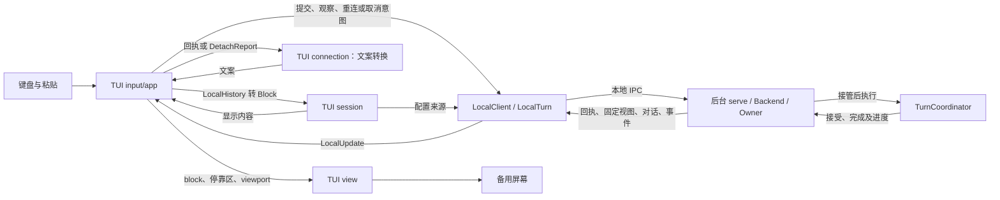

# TUI 交互与视觉

> 类型：架构合同
> 上位依据：[项目宪章](../governance/charter.md)、[宿主平台](platform.md)
> 修订状态：本工作分支的后台接线、历史重载、连接与取消呈现修订待人类批准；生效前[原有效版本](https://github.com/Skyline10124/lattice/blob/0e20dc090dce79330e06276da8255e9f4fb8cc39/docs/architecture/tui.md)继续适用。

## 目的与范围

用户在全屏 TUI 中编辑任务、查看已保存对话并观察后台进度。任务接受后，关闭界面仍可让后台继续工作；重新打开会话可以读取结果、继续观察或请求取消。

本合同规定这些操作的接线、键盘交互、布局、状态呈现与配色，由 `lattice-tui` 维护。CLI 解析由 `lattice-cli` 负责；会话、Turn 执行及持久关闭由[会话合同](session.md)维护，工具执行事实由 [LANCET](lancet.md#结果证据与失败处理)维护。本文沿“输入任务、模型调用工具、读取回答”的场景说明界面如何使用这些结果。

## 职责与显示模型

### 持久对话与临时文字

Session 是持续对话的容器，Turn 是一次已接受任务。用户消息、完整模型消息和已关闭的 ToolResult 组成持久对话内容，可在重连后读取，也供后续模型请求使用。ToolResult 是一次工具调用的关闭结果，分别表达执行 outcome 与结果材料可用性；TurnCommit 则是保存整次 Turn 关闭结果的不可变对象。主定义见[用户读到的几种事实](session.md#用户读到的几种事实)。

临时流式文字是模型正在生成的文字片段，TUI 用它显示当前进度。完整消息保存前，这些片段可能只存在于观察事件和界面内存中。TUI 按有序消息生成用户、助手、工具和状态 block；reasoning 的持久保存归会话领域，当前界面不单独展示 reasoning 片段。布局中的“正文宽度”则专指字符单元宽度，见[布局](#布局)。

后台为每次读取选定历史和进展版本，称为固定视图：

| 固定位置 | 界面读到什么及用途 |
| --- | --- |
| head | 用户当前选定的对话历史位置；沿可达父链读取已提交 Turn，包括 merge 侧消息 |
| pending journal | 未完成 Turn 在该切点已保存的用户消息和累积对话，包含已保存模型消息及已关闭工具结果 |

head 和 journal 的 OID 是这些不可变对象的 Git 地址。后台固定它们后，即使执行继续保存进度，TUI 的这一轮读取仍指向同一版本。`active-turn` 是后台寻找当前未完成进度的入口，TUI 使用后台给出的 journal 地址读取。精确关系见[会话固定视图](session.md#观察与重连)。

`Gap` 是观察事件不连续的通知，例如队列丢失了一段事件。它提醒界面重新读取已保存对话，并向用户保留缺口提示；它不表示持久对话损坏。布局表中的 `gap = 1` 只是列间空隙。

### 组件接线

CLI 调用 `lattice_tui::run`，TUI 经 `ratatui`/`crossterm` 使用备用屏幕与 raw 键盘输入。下表区分前端模块、本地客户端和后台，描述当前责任归属：

LocalTurn 是本客户端一次提交或观察交互的具体句柄，管理交付和更新；它不是第二个持久 Turn，也不拥有后台执行。其主定义见[会话组件与接口](session.md#组件与接口)。

| 部分 | 职责与交接 |
| --- | --- |
| TUI `session` | 经后台打开或创建会话，按需加载提交配置，将 LocalHistory 和消息转换为显示 Block；固定历史的读取与分页归 LocalClient |
| TUI `connection` | 将提交、取消回执与 DetachReport 转为显示文案 |
| TUI `input` | 管理多行缓冲、光标、粘贴、键位和输入历史 |
| TUI `app` 应用事件循环 | 持有 LocalTurn，发起提交、观察、重连或取消意图，消费 LocalUpdate；维护显示区域与工具来源配对，处理键盘、退出及重绘 |
| TUI `view` | 从 Block、输入和状态统一计算布局、折行、viewport 与停靠区，绘制终端字符单元 |
| `lattice-api::local::LocalClient` / `LocalTurn` | 组织交付、在途取消、订阅和历史异步读取，分别返回状态、内容与诊断 |
| 后台 `serve` / Backend / Owner | serve 持本地实例与连接，Backend 管准入与存储；Owner 监督独立操作，实际带配置的操作从准备起持同一取消载体直至独立收尾 |
| 后台 TurnCoordinator | 唯一持久 Turn 协调者，推进模型、工具、结果保存和最终关闭，向 Backend 返回完成结果 |

TUI 对话记录使用扁平 Block 序列，说话人分组由渲染顺序确定。共享渲染归 TUI，显示数据不新增嵌套 Turn 容器。前端只维护呈现与操作选择，提交、控制和观察顺序由 LocalTurn 维护。

连线表示调用或数据传递，不表示持久事务。后台执行与前端读取、绘制可以并行。

### 启动、提交与运行

1. 给定 `TuiOptions.session_id` 时打开已有会话；未给定时使用 Agent 和显式项目分支创建会话。新会话的配置问题在交互界面启动前返回。打开已有会话及重连读取持久事实，无需当前 profile/provider 凭据。
2. TUI 调用 `LocalClient::observe`，以 Session 历史范围取得 LocalTurn 后进入交互循环。客户端优先选择活动 Turn，否则选择 head 对应 Turn；状态先到即可绘制，固定历史异步加载。没有历史的新会话显示输入区。
3. 用户在 PROMPT 编辑任务，按 Enter 提交。空白输入不提交；正在运行时不发送新的普通 prompt。TUI 在发请求前保留并显示 TurnId，同时保留原始输入；SessionId 与 TurnId 一起用于找回请求。键位和粘贴条件见[键盘与历史](#键盘与历史)。
4. app 将原请求与 session 提供的配置加载闭包交给 `start_turn_with`，持有返回的 LocalTurn。客户端在新执行确需配置时调用该闭包并以同一身份交付；TUI 提供来源，不处理探测回执或订阅切点。字段和来源见[执行配置冻结](session.md#执行配置冻结)。
5. LocalTurn 交付后台接受结果并衔接观察，后台同时继续模型与工具执行。TUI 显示接受或找回结果；Busy 时保留输入并显示拒绝。新提交遇到崩溃遗留 Turn 时，后台先关闭旧 Turn，再接受并执行本次输入，TUI 的回执与观察属于本次请求。
6. 应用循环消费 LocalUpdate。State 更新状态与确认，Reset 清理旧切点临时区域，History 替换持久内容，Event 更新新文字和工具进度；工具按 InvocationId 与来源配对。每次界面变化由应用循环安排重绘。
7. 后台保存完整消息、工具结果和 Turn 关闭结果。LocalTurn 先交付独立完成，TUI 显示结果并保留句柄接收最终正文；History 到达后替换持久区域。执行 outcome、确认、连接及正文加载按下一节分别呈现。

### 连接、确认与重载

用户需要知道任务如何结束、后台是否确认保存、自己是否仍在观察，以及内容是否已读到。界面按各自依据更新这些信息：

| 用户要知道什么 | 依据与正常动作 |
| --- | --- |
| 任务的执行结果 | 固定 TurnCommit 给出 TurnId、commit 和类型化 outcome，例如 Completed、Failed、Cancelled、Interrupted；显示实际结果及原因 |
| 接受或完成是否确认 | 独立回执确认对应持久发布及所需屏障。已关闭结果的重连观察由后台按 session+turn 核验固定 pin 并补屏障后交付确认；核验通过即确认，无需重发原请求；核验失败按真实存储诊断报告，不把“仅可见”当成完成状态 |
| 是否还在观察 | 连接与后续事件表明当前观察情况；断连、EOF 或 idle 时显示观察中断和重连入口 |
| 持久对话是否读到 | 固定对象读取成功后替换显示；失败时标明此次内容未验证，并提供重载入口。后来读取成功按新正文显示，旧失败只作为带原对象的历史提示；退出报告不再把已解决的读取错误说成当前正文不可用 |

界面先显示已取得的 TurnId、commit、outcome 与确认，再处理内容替换。内容挂起、读取失败或连接错误只影响相应显示与诊断，已知结果继续保留。原请求提交回执仍在等待时，可读 pin 仅显示结果可见，不作为独立 Finished 或接受回执；具体分类由[共同客户端](session.md#请求身份与确认)提供。

`/reconnect` 在目标未变时请求 LocalTurn 重新固定只读视图。若当前视图已显示另一 active Turn，用户再次 `/reconnect` 选择该活动目标，app 用 `observe` 创建新的只读句柄；重新打开已有 Session 也创建新观察句柄。Snapshot、Gap 或重连引起的 Reset 清除旧切点临时文字和工具观察，保留缺口提示。后续 History 只替换持久区域，保留同切点已收到的新 token；历史 I/O 和读取代次由 LocalTurn 管理。

`TextAction::StartIncomplete` 使 TUI 在持久区域之外建立临时助手块，显示当前模型段的新后缀并提示前文可能缺失。真正 ModelStarted 开始正常新段，ModelFinished 结束当前段；缺失旧 token 不补造，已保存前缀保持一次。客户端接续顺序见[观察与重连](session.md#观察与重连)。

Turn 观察与正文 idle 由 LocalTurn 管理，唯一常量为 `lattice_api::STREAM_IDLE_TIMEOUT_SECS`，触发条件和范围见[输入与传输限制](session.md#输入与传输限制)。超时、断连或 EOF 按连接/读取诊断呈现，未配对工具按观察未知显示；用户可重连读取。

### 取消、退出与恢复提示

用户请求取消时，app 调用当前 LocalTurn 的 `cancel` 并继续消费更新。TUI 分别显示等待、已接管、未接管、未知或交接结束；NotSubmitted 提示本客户端停止后续配置，保留已有的接管与完成显示。false 不表示没有后台工作，接管区间和拒绝后新准入的语义见[会话取消规则](session.md#取消与退出)。

视图显示的 active 目标与现有句柄不同时，新 Esc 或首次 Ctrl+C 先选择该目标的只读观察句柄，再登记新取消意图。app 用句柄提供的 `turn_id` 核对提交、观察与取消共用的目标，不只比较最后的 view。选择新目标不提交输入、不加载配置，也不将旧意图自动转移。
旧句柄通过自己的 `detach` 异步交付报告，切换后的取消与观察不等待旧正文或旧回执。报告只生成带原身份的历史 Notice，包括旧接管、具体取消错误、提交诊断及对应观察对象的完成确认；不应用到新目标的 State 或取消状态。退出时继续消费已经开始的报告交接，具体等待与诊断清除规则归[LocalTurn](session.md#客户端意图与退出交接)，TUI 不另行计时、收割控制请求或补发。

首次取消后的提交等待到期时，TUI 显示 SubmissionUnknown，继续观察同一请求。交接后迟到的本地提交传输诊断只增加 Notice，不还原已提交输入、不终止 Live 或撤销 Finished；后台错误回执及配置加载错误仍按各自结果显示。

Ctrl+D、`/quit` 和普通退出只断开前端。第二次 Ctrl+C 退出保留第一次的取消意图；应用先复原终端，再将同一句柄交给 `detach`，由 connection 格式化其最后已知事实。键位成立条件见[键盘与历史](#键盘与历史)，共同回执预算及未知后的处理见[客户端意图与退出交接](session.md#客户端意图与退出交接)。

重连看到 pending 时，先区分后台仍在运行与当前没有 live Owner。TUI 提示用户：发送新消息前，后台会自动关闭崩溃遗留任务，再继续本次输入；CLI 的会话写操作也先完成旧 Turn 关闭，用法见[操作指南](../development/validation-guide.md#关闭崩溃遗留的-turn)。关闭依据持久事实保留已关闭消息、调用结果和文件效果，不重放旧任务的模型或工具。只有内存取消意图时，重启后按对应进程中断关闭；已保存取消原因与已保存 CancelTurn 均关闭为 Cancelled(UserCancelled)，其他中断原因保持原分类，精确窗口见[自动关闭崩溃遗留任务](session.md#自动关闭崩溃遗留任务)。

#### 观察与控制边界

- Turn 事件使用穷举匹配，不以兜底分支吞掉新增事件；事件用于进度显示，不能代替接受、完成回执或持久 Invocation 终态。
- 单次查询保持纯只读、不恢复旧 Turn，也不重新接受 prompt；重连走订阅，可由后台对无 Owner 的已关闭结果核验并补持久屏障。接受回执仍未知时保留原身份，按[原请求重试配方](../development/validation-guide.md#提交与找回)处理；不同输入不是确认操作。
- 前端不拥有后台执行生命周期，慢读和重绘不得阻塞后台必要收尾；取消不回滚已发生效果。已接管取消的处理义务不因前端退出而消失。

## 布局

### 水平与垂直分配

尺寸以终端字符单元为单位。右侧栏宽度固定为 40 列，列间空隙 `gap = 1`，左列 `gutter = 2` 用于状态指示，不计入正文宽度。

| 条件或尺寸 | 规则 |
| --- | --- |
| 侧栏可见 | `frame_w >= frame_h × 3` 且 `frame_w - 40 - 1 - 2 >= 72` |
| 侧栏可见时 | `left_w = frame_w - 40 - gap`，`content_w = left_w - gutter` |
| 侧栏隐藏时 | `left_w = frame_w`，`content_w = frame_w - gutter` |
| 停靠区 | 一行分隔轨及 1 至 5 行内容，总高 2 至 6 行 |
| 底部状态行 | 侧栏隐藏时一行，可见时不存在 |
| 对话记录高度 | `frame_h - (dock_h + bottom_h)` |

所有尺寸减法使用饱和运算，极小终端不得下溢或 panic。渲染以实际分配高度为准，不假定对话记录至少有一行。
`Dock::height()` 统一提供停靠区高度；渲染、viewport 行数、输入折行和光标定位使用同一 `content_w`。正文宽度不另设上限。

`176 × 50` 显示侧栏，左列与正文宽分别为 135、133；`115 × 47`、`85 × 47`、`56 × 47` 不满足比例条件，`80 × 24` 分栏后正文不足 72 列，均隐藏侧栏。

左列由上至下为对话记录、停靠区及按条件出现的底部状态行。侧栏全高，gap 保持空列，侧栏有一列左内边距。界面不画边框。

### 侧栏与底部状态行

侧栏顶部显示 session ID、agent、空行和 phase；phase 使用 `idle`、`stream`、`commit`、`cancel`。身份信息超宽截断。
底部显示换行键提示、不跟随时的 `[scroll]`，以及第一次 Ctrl+C 后两秒内的 `Ctrl+C to quit`。
换行键与 `newline` 分行显示，kitty 协议可用时使用 `S-Enter`，否则使用 `Alt+Enter`。

侧栏隐藏时，底部状态行整宽显示 `session_id · agent · phase · [scroll]? · 换行键提示`，不带 PROMPT tag。空间不足时先移除键位提示，再截断 session ID、agent，优先保留 phase 和 `[scroll]`，最后按显示宽度裁剪。
Ctrl+C 提示在两秒内替代最低优先级的换行提示，过期须触发重绘，不能因界面空闲而残留。

## 对话记录与工具显示

说话人独占一行，用户显示 `user`，助手显示当前 agent 名；正文从下一行开始。用户块开始新的显示分组，回合间空一行，工具行留在助手段内不另加空行。
一个助手段只显示一次 agent 名：用户块后首次出现助手正文、工具或终态状态时显示，直到下一个用户块再重置。独立 `Notice` 不触发或重置该状态。

对话记录为纯文本，左列透出终端背景，不自行填色。正文按 `content_w` 折行；翻页停止跟随，`Ctrl+End` 回到底部并恢复跟随。

| 工具显示状态 | 呈现 |
| --- | --- |
| 运行中 | 一行，使用 `DimMeta` 与运行提示 |
| 成功 | 一行折叠，显示工具名和结果字节数 |
| 失败 | 展开并显示错误摘要 |
| 观察未知 | 使用 `DimMeta`，明确尚未取得结果 |
| 材料不可用 | 使用 `DimMeta`，保留执行 outcome 并提示结果材料不可用 |

`▸`、`▾` 为状态指示，不是交互控件；ASCII 回退使用 `>`、`v`。不增加展开键或鼠标处理。
工具行按事件字段渲染，不按工具名添加专用逻辑。调用 ID 用于 started/finished 配对，默认隐藏；排障显示时可截断为 `#<id>`，不能当作操作名。
`output_len` 按字节显示，例如 `1204 B`，不写为字符数，也不添加千分位。没有事件提供的参数、hash 或操作字段不臆造显示。

### 按调用身份合并工具显示

[app](../../crates/lattice-tui/src/app.rs) 按 InvocationId 配对历史和当前切点事件，并用 `ToolSource` 保留来源；[session](../../crates/lattice-tui/src/session.rs) 的消息转换给出历史来源。事件中的 started/finished 即使先于历史返回，也立即建立或更新同 ID 的工具块；未见 started 的 finished 仍显示其 name、ok、output_len 和 error_summary。

| 来源 | 历史到达或事件更新时的呈现 |
| --- | --- |
| HistoryCall | 仅保存 ToolCall，尚无 ToolResult；与同切点同 ID 的 Event 合并到原历史位置，同 ID 只显示一块 |
| Event | 当前切点的临时进度；历史尚未包含该调用时留在临时区域，不作为持久执行成功 |
| HistoryResult | 持久 ToolResult 的真实 outcome 与材料可用性优先于事件提示，包括 Succeeded 且材料 Unavailable 的组合 |

Reset 使旧切点的 Event 失效，也撤销已经移入历史位置的旧事件覆盖；后续固定 ToolResult 接管显示。同切点 History 只替换持久区域，保留新文字及仍有效的工具进度。工具配对不改变消息顺序，也不建立执行事实存储。

### 未配对工具块与结果材料

工具块未配对表示界面尚未把同一调用的开始和结束材料对应起来。有两条可达路径：TUI 已收到 started，但 finished 在有损观察通道中丢失；或者固定 pending 对话已经保存 ToolCall，协调层尚未关闭该调用、追加 ToolResult。前者需要重新读取持久结果，后者可能仍在正常执行。

| 层次 | 保存什么、由谁解释 |
| --- | --- |
| 持久执行事实 | InvocationStore 保存调用的执行 outcome 和证据；是否成功、失败、取消或不确定依 [LANCET 终态](lancet.md#结果证据与失败处理)核验 |
| 供模型使用的结果 | Session 的 ToolResult 保留执行 outcome 与材料可用性；TUI 读取这些已保存消息，按调用身份更新工具块 |
| 界面观察 | started/finished 事件与临时块用于显示进度，丢事件时保留缺口，重新读取相应固定对话 |

完整工具材料确实可能不可用。ToolContent 超过保存上限时保留完整摘要和长度而不保存截断内容；结果草稿发布失败且可证明不存在时，关闭结果标明材料不可用。发布是否成功仍不确定时，由协调层在收尾预算内核验；终态与证据未能确认则停在 pending。精确状态、上限和后续责任见 [ResultDraft 与关闭材料](session.md#resultdraft-与关闭材料)。后台崩溃前只留在内存 receipt 的内容，也无法保证恢复。上述情形与“TUI 此次读取失败”分开报告，后者仍可重载，不能据此断定存储中没有材料。

#### 显示诊断边界

已知 Turn 终态到达时，仍未配对完成的 Running 工具块显示失败，注明终态原因及显示结果缺失，例如 `turn ended before tool completion`。这是原有的显示诊断，不是对 Invocation 执行失败的判定；是否改变该显示规则仍待裁决。仅观察流结束时按[连接中断](#连接确认与重载)显示未知。

持久重载按 ToolResult 中真实 outcome 与材料可用性呈现。结果材料不可用时明确标示并保留 outcome，不因缺少内容将执行成功改成失败，也不承诺全部输出都能在崩溃后找回。

## 停靠区与输入

### 停靠区状态

停靠区具有互斥的 `PROMPT`、`WARN`、`ERROR` 状态。PROMPT 显示输入，WARN 显示需要注意的警告，例如 `LlmRetry`，ERROR 显示错误；INFO 直接进入对话记录。

分隔轨上的 tag 与输入正文起点对齐，占六列：PROMPT 六字符，WARN 补两列，ERROR 补一列。分隔轨以 `─` 填充，非 UTF-8 时回退 `-`；WARN/ERROR 显示 `SPACE → PROMPT`。正文放在轨下，不把完整错误摘要塞进轨内。

内容高度为 1 至 5 个视觉行。Prompt 超高时内部滚动以保持光标可见；Warn/Error 超高只显示前五行，不增加只读滚动或展开。
输入提示符 `>` 只出现在第一行，续行不带前缀，并与第一行输入正文对齐。

新 Warn/Error 到来时，将旧停靠状态释放回对话记录，新状态占据停靠区。无修饰 Space 释放当前状态并回到 Prompt，按键被消费。状态不定时消失；暂驻时不在对话记录重复显示，释放后在原时间位置出现一次。

### 键盘与历史

| 输入 | 条件 | 行为 |
| --- | --- | --- |
| Enter | Prompt 可编辑 | 提交 |
| Alt+Enter | Prompt 可编辑 | 换行 |
| Shift+Enter | Prompt 可编辑且 kitty keyboard protocol 可用 | 换行 |
| 可打印字符 | Prompt 可编辑 | 插入 |
| bracketed paste | Prompt 可编辑 | 原样插入，保留换行，不提交 |
| Backspace、Delete | Prompt 可编辑 | 删除 |
| 左右方向键、Home、End | Prompt 可编辑 | 行内光标移动 |
| 上方向键 | 不在首行 | 光标上移 |
| 上方向键 | 在首行 | 历史上一条 |
| 下方向键 | 不在末行 | 光标下移 |
| 下方向键 | 在末行 | 历史下一条 |
| PageUp、PageDown | 全局 | 对话记录翻页 |
| Ctrl+End | 全局 | 回底部并恢复跟随 |
| 无修饰 Space | WARN/ERROR | 释放状态回 Prompt，不进入缓冲 |
| Esc | Turn 运行中 | 请求协作取消 |
| Esc | 空闲 | 清空输入 |
| Ctrl+C | 第一次 | 同 Esc；两秒内再次按下则退出 |
| Ctrl+D | 缓冲为空 | 退出 |

WARN/ERROR 显示时屏蔽普通输入、编辑、粘贴与提交，不修改不可见的输入缓冲；全局翻页、取消和退出行为继续按条件执行。
启动时探测一次 keyboard enhancement 支持，提示文案与探测结果一致。

输入历史尽力保存到 `<session_dir>/repl_history.txt`，沿用纯文本行格式。raw 模式下 Ctrl+C 作为 KeyEvent 处理，不另起系统信号 watcher。应用循环按上述键位发出动作，后台取消与前端退出的交接见[取消、退出与恢复提示](#取消退出与恢复提示)。

## 配色与终端约定

支持深色终端。真彩色使用下列 hex，其他终端使用命名色回退，不探测 terminfo 或 256 色模式。[Cassette Futurism 配色资产](../reference/cassette-futurism-palette.md)提供参考色表，TUI 实际用色由本节的角色和填充面约定。

| 前景角色 | Token | Hex | 命名色回退 | 用途 |
| --- | --- | --- | --- | --- |
| User | iris-7 | `#8695e3` | LightBlue | user 标题、输入提示符、stream phase |
| Assistant | cream-2 | `#f5f3ef` | White | agent 名、正文、输入、tag 文字和 Warn 正文 |
| ToolOk | cyan-7 | `#2ab0b0` | Cyan | 成功勾号 |
| ToolErr | signal-red-9 | `#cb2b31` | Red | 失败符号、错误摘要、TurnFailed、cancel phase 和 Error 正文 |
| DimMeta | warm-gray-8 | `#857f78` | DarkGray | 状态、工具名、字节数、分隔轨和快捷键提示 |

| 填充面 | Token | Hex | 命名色回退 | 文字 |
| --- | --- | --- | --- | --- |
| 侧栏与底部状态行 | navy-11 | `#2c4267` | Blue | DimMeta，phase 按前景角色变化 |
| PROMPT tag | iris-9 | `#5965ca` | LightBlue | Assistant |
| WARN tag | amber-9 | `#9f6200` | Yellow | Assistant |
| ERROR tag | signal-red-9 | `#cb2b31` | Red | Assistant |

正文默认使用 Assistant；成功、失败符号与工具元信息分别着色。amber 只用于 WARN tag 填充，不扩散到其他区域；不增加第六种前景角色或左列背景。终端实际背景由用户环境提供，`navy-12` 只是原视觉方案的背景参考。

## 功能边界

TUI 只操作当前会话，不提供会话选择器、分支或时间线视图。共享渲染不反向依赖 `lattice-cli`；存储与执行经公开 API 接入。
当前界面不提供鼠标及滚轮、Markdown 与语法高亮、交互式工具卡片、reasoning 折叠、token 面板、搜索、命令面板、主题或浅色适配。
不增加 shell 模式、插件运行时、会话分享、语音、多 Agent 侧线程、弹层、模态或 toast。保留规定的侧栏显示条件，不增加动态侧栏宽度或其他布局模式。
光标使用终端已有能力，不绘制软光标或控制形状与颜色；模式 tag 限于 PROMPT/WARN/ERROR。

## 验证与承接

| 检查对象 | 入口与关注点 |
| --- | --- |
| 键位、折行、停靠区、状态释放与布局 | `cargo test -p lattice-tui` |
| LocalTurn 消费、完成先于正文、重连新后缀与工具来源合并 | TUI 的 `app_loop_tests` / `connection_tests`；共同控制与读取协议由 API 局部测试保护 |
| CLI 接线 | CLI 表面变化时检查 `cargo test -p lattice-cli` |
| 实际终端入口 | 按测试工程的[被测二进制要求](../development/testing.md#被测二进制)准备 lattice-cli，运行 harness 的 `pty_tui_smoke` |
| 交互与配色 | 真彩色和命名色回退、超宽及极小终端、错误确认、翻页与光标的人工检查 |

自动化与人工检查分工见[测试工程合同](../development/testing.md)，运行配方见[验证操作指南](../development/validation-guide.md)。颜色辨识与终端行为需实机核验，不能仅由布局计算通过推定体验合格。

- [TUI 局部指引](../../crates/lattice-tui/AGENTS.md)：公开 API 边界、键位、输入历史与验证入口。
- [ADR 0005](../adr/0005-durable-turn-invocation-and-private-git-stores.md)：取消和失败的持久状态由 Turn 协议决定。旧指引“取消后照常 commit”的概括不作为 TUI 保证。

布局公式、尺寸示例、键位条件与配色表沿用原有效版本，是界面设计参数；它们不构成实机可读性验证。DimMeta 在 navy-11 上的可读性仍需人工核验；难读时是否将 session/agent 主值改用 Assistant，仍待审查。

文件与目录按渲染职责组织，不固定文件数量或源码行数上限；公开 API 边界、共享渲染归属与 block 数据契约保持不变。组织调整不授权新增工具卡片或其他功能。后台相关修订的效力依文件头限定，原有效职责继续由本文承接；历史过程说明留在任务记录中。
