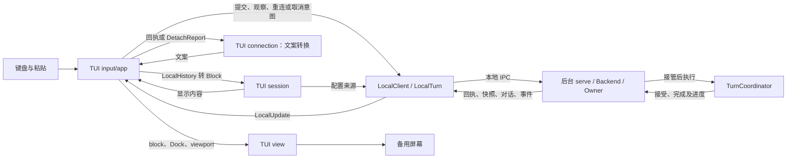

# TUI 交互与视觉

> 类型：架构合同
> 上位依据：[项目宪章](../governance/charter.md)、[宿主平台](platform.md)
> 修订状态：本工作分支的 Markdown 渲染、代码高亮与终端能力修订，以及标题线、Dock 与输入区、statusline、浏览光标、评论与排队修订待人类批准；生效前[原有效版本](https://github.com/Skyline10124/lattice/blob/c566eca7cc8912f336f8bb7ef13c022ff6d559df/docs/architecture/tui.md)继续适用。

## 目的与范围

用户在全屏 TUI 中编辑任务、查看已保存对话并观察后台进度。任务接受后，关闭界面仍可让后台继续工作；重新打开会话可以读取结果、继续观察或请求取消。

任务运行时，用户可以继续输入后续任务，TUI 把它们排队，本轮完成后依次发送。用户也可以把光标移进对话记录，对助手回答逐段写评论；评论随下一条消息发给模型，并保存在这条消息里，重新打开会话后仍显示在原位。

本合同规定这些操作的接线、键盘交互、布局、状态呈现与配色，由 `lattice-tui` 维护。CLI 解析由 `lattice-cli` 负责；会话、Turn 执行及持久关闭由[会话合同](session.md)维护，工具执行事实由 [LANCET](lancet.md#结果证据与失败处理)维护。本文沿“输入任务、模型调用工具、读取回答”的场景说明界面如何使用这些结果。

## 职责与显示模型

### 持久对话与临时文字

Session 是持续对话的容器，Turn 是一次已接受任务。会话树中的 UserMessage 与 Step 节点组成持久对话内容，可在重连后读取，也供后续模型请求使用。Step 节点包含一次完整模型回复及其全部 `(ToolCall, ToolResult)` 对；ToolResult 表达执行 outcome 与返回内容。Turn 记录保存整次 Turn 的结局，TUI 读到的是 `TurnSummary { outcome, notice }`。主定义见[用户读到的几种事实](session.md#用户读到的几种事实)。

临时流式文字是模型正在生成的正文与 reasoning，TUI 用它显示当前进度。尝试进行中，它只存在于后台的段列表、观察事件和界面内存中；尝试完成且回复含工具调用时，完整回复同时保存在 ActiveStep 中，段列表继续有效到 Step 关闭。TUI 保留已显示的临时文字，直到对应 Step 节点的正文实际装入后原位替换，历史读取挂起或失败时不清除它。TUI 按有序消息生成用户、助手、工具和状态 block；reasoning 的持久保存归会话领域，当前界面不单独展示 reasoning 片段。布局中的“正文宽度”则专指字符单元宽度，见[布局](#布局)。

装入持久对话时，状态提示保持出现的时间顺序：先出现的启动说明留在对应 Turn 之前，不会把最终回答挤到后面。状态提示是对话记录中的状态 block，例如启动说明、连接与重试提示、`/help` 输出和 Turn 结局，它们不属于任何节点；临时文字与工具进度则属于某个 Step 或某次提交的 UserMessage。History 读到一段从根到 Session 当前位置的持久对话后，TUI 按以下规则组织显示：

- 新读到的 UserMessage 与 Step 节点取代原有持久区域。
- 已装入节点对应的临时文字与工具进度由这些节点取代；尚未装入的节点的临时文字与工具进度按原顺序接在持久内容之后。
- 每条状态提示跟随原显示中紧接在它之后的节点，放在该节点之前：该节点已装入，提示进入持久内容；该节点尚未装入，提示随它留在持久内容之后；它之后没有节点的，留在末尾。已不在新路径上的旧节点不计。同一条提示在显示中只保留一份。

例如，刚启动 TUI 就提交时，启动说明留在这次 Turn 之前，Turn 关闭后读到的最终回答仍在对话末尾；打开已有会话时，启动说明出现在读到的已有历史之后。

观察开始或重新同步时，后台交付一份快照：Session 当前位置、所观察 Turn 的记录、已写入的节点、进行中 Step 的状态（含已登记的完整回复与槽位状态），以及当前尝试的段列表，并附带事件序号。之后的事件从该序号继续。TUI 按快照读取从根到 Session 当前位置的路径；树只追加，快照之后写入的节点不会混入这一轮读取。精确关系见[观察与重连](session.md#观察与重连)。

### 组件接线

CLI 调用 `lattice_tui::run`，TUI 经 `ratatui`/`crossterm` 使用备用屏幕与 raw 键盘输入。下表区分前端模块、本地客户端和后台，描述当前责任归属：

LocalTurn 是本客户端一次提交或观察交互的具体句柄，管理交付和更新；它不是第二个持久 Turn，也不拥有后台执行。其主定义见[会话组件与接口](session.md#组件与接口)。

| 部分 | 职责与交接 |
| --- | --- |
| TUI `session` | 经后台打开已有会话，按需加载提交配置，将 LocalHistory 和消息转换为显示 Block，写入轮次序号并解析用户消息中的评论元素；历史的读取与分页归 LocalClient |
| TUI `connection` | 将提交、取消回执与 DetachReport 转为显示文案 |
| TUI `input` | 管理多行缓冲、光标、粘贴、键位和输入历史 |
| TUI `app` 应用事件循环 | 持有 LocalTurn，发起提交、观察、重连或取消意图，消费 LocalUpdate；维护显示区域、工具来源配对、焦点、排队与评论草稿，处理键盘、退出及重绘 |
| TUI `view` | 从 Block、输入和状态统一计算布局、折行、viewport、Dock 与 statusline，绘制终端字符单元 |
| `lattice-api::local::LocalClient` / `LocalTurn` | 组织交付、在途取消、订阅和历史异步读取，分别返回状态、内容与诊断 |
| 后台 `serve` / Backend / Owner | serve 持本地实例与连接，Backend 管准入与存储；Owner 监督独立操作，实际带配置的操作从准备起持同一取消载体直至独立收尾 |
| 后台 TurnCoordinator | 唯一持久 Turn 协调者，推进模型、工具、结果保存和最终关闭，向 Backend 返回完成结果 |

TUI 对话记录使用扁平 Block 序列，说话人分组由渲染顺序确定。共享渲染归 TUI，显示数据不新增嵌套 Turn 容器。前端只维护呈现与操作选择，提交、控制和观察顺序由 LocalTurn 维护。



连线表示调用或数据传递，不表示持久事务。后台执行与前端读取、绘制可以并行。

### 启动、提交与运行

1. 给定 `TuiOptions.session_id` 时打开已有会话；未给定时须指定 Agent，TUI 在启动前加载并校验其配置，问题在交互界面启动前返回；会话在首次提交时由后台在接受事务中创建。打开已有会话及重连读取持久事实，无需当前 profile/provider 凭据。
2. 打开已有会话时，TUI 调用 `LocalClient::observe` 取得 LocalTurn 后进入交互循环。客户端优先选择进行中的 Turn，否则选择当前位置所属 Turn；状态先到即可绘制，历史异步加载。新会话直接显示输入区。
3. 用户在输入区编辑任务，按 Enter 提交。输入为空且没有评论草稿时不提交；正在运行时按 Enter 把输入放入排队，见[排队](#排队)。打开已有会话后、首次历史装入前不提交，输入保留，原因见[轮次序号](#轮次序号)。TUI 在发请求前保留 TurnId 与原始输入，不单独显示 TurnId；TurnId 用于找回请求，新会话的首次提交尚无 SessionId，提交结果未知时的提示带该 TurnId。键位和粘贴条件见[键盘](#键盘)。
4. app 将原请求与 session 提供的配置加载闭包交给 `start_turn_with`，持有返回的 LocalTurn。客户端在新执行确需配置时调用该闭包并以同一身份交付；TUI 提供来源，不处理探测回执或订阅切点。字段和来源见[执行配置冻结](session.md#执行配置冻结)。
5. LocalTurn 交付后台接受结果并衔接观察，后台同时继续模型与工具执行。后台接受时助手段标题线随即出现，见[标题线](#标题线)，不另写接受行；找回、接受确认未知等其余结果照常显示。Busy 时保留输入并显示拒绝。新提交遇到崩溃遗留 Turn 时，后台先关闭旧 Turn，再接受并执行本次输入，TUI 的回执与观察属于本次请求。排队自动发送的一条按「排队」处理。
6. 应用循环消费 LocalUpdate。State 更新状态与结局，Reset 按快照重建临时区域，History 替换持久内容（临时内容与状态提示的位置见[持久对话与临时文字](#持久对话与临时文字)），Event 更新新文字和工具进度；工具按 InvocationId 与来源配对。每次界面变化由应用循环安排重绘。
7. 后台写入 Step 节点、调用结果和 Turn 记录。LocalTurn 交付结局，TUI 显示结果并保留句柄接收最终历史；History 到达后替换持久区域。结局、连接及历史加载按下一节分别呈现。

### 连接、结局与重载

用户需要知道任务如何结束、自己是否仍在观察，以及内容是否已读到。界面按各自依据更新这些信息：

| 用户要知道什么 | 依据与正常动作 |
| --- | --- |
| 任务的结局 | Turn 记录的 `TurnSummary` 给出 Completed、Failed 或 Cancelled 与 notice；显示实际结局与说明。实时 `TurnFailed` 携带同一 notice，重载前后显示一致 |
| 请求是否已被接受 | 接受回执表明接受事务已提交；回执未知时保留原 TurnId，用同一身份找回。已关闭的 Turn 记录可读即已持久，不另有完成确认 |
| 是否还在观察 | 连接与后续事件表明当前观察情况；断连、EOF 或 idle 时显示观察中断和重连入口 |
| 持久对话是否读到 | 历史读取成功后替换显示；失败时标明此次内容未验证，并提供重载入口。后来读取成功按新内容显示，旧失败只作为历史提示；退出报告不再把已解决的读取错误说成当前内容不可用 |

界面先显示已取得的 TurnId 与结局，再处理内容替换。内容挂起、读取失败或连接错误只影响相应显示与诊断，已知结果继续保留。具体分类由[共同客户端](session.md#请求身份与找回)提供。

`/reconnect` 在目标未变时请求 LocalTurn 重新订阅。若当前快照显示另一进行中的 Turn，用户再次 `/reconnect` 选择该目标，app 用 `observe` 创建新的只读句柄；重新打开已有 Session 也创建新观察句柄。快照或重连引起的 Reset 按新快照重建临时文字与工具观察：段列表给出当前尝试已生成的全部文字，不缺前文。后续 History 只替换持久区域；历史 I/O 和读取代次由 LocalTurn 管理。Dock 中暂驻的 Warn 与 Error 不随 History 消失，继续暂驻到用户释放；释放后作为状态提示按上述位置规则出现。

模型尝试重试时，新尝试的文字从头开始；TUI 按尝试边界结束旧的临时助手块，显示新尝试的文字。Step 关闭后，临时块由 History 中的 Step 节点取代，二者合并相邻同类后内容一致。客户端接续顺序见[观察与重连](session.md#观察与重连)。

Turn 观察与历史读取 idle 由 LocalTurn 管理，唯一常量为 `lattice_api::STREAM_IDLE_TIMEOUT_SECS`，触发条件和范围见[输入与传输限制](session.md#输入与传输限制)。超时、断连或 EOF 按连接/读取诊断呈现，未配对工具按观察未知显示；用户可重连读取。

### 取消、退出与恢复提示

用户请求取消时，app 调用当前 LocalTurn 的 `cancel` 并继续消费更新。TUI 分别显示等待、已接管、未接管、未知或交接结束；NotSubmitted 提示本客户端停止后续配置，保留已有的接管与完成显示。false 不表示没有后台工作，接管区间和拒绝后新准入的语义见[会话取消规则](session.md#取消与退出)。

视图显示的 active 目标与现有句柄不同时，首次 Ctrl+C 先选择该目标的只读观察句柄，再登记新取消意图。app 用句柄提供的 `turn_id` 核对提交、观察与取消共用的目标，不只比较最后的 view。选择新目标不提交输入、不加载配置，也不将旧意图自动转移。
旧句柄通过自己的 `detach` 异步交付报告，切换后的取消与观察不等待旧历史或旧回执。报告只生成带原身份的历史 Notice，包括旧接管、具体取消错误、提交诊断及对应观察对象的结局；其中已由同一客户端实时交付过的接受回执与结局不再重述。报告不应用到新目标的 State 或取消状态。退出时继续消费已经开始的报告交接，具体等待与诊断清除规则归[LocalTurn](session.md#客户端意图与退出交接)，TUI 不另行计时、收割控制请求或补发。

首次取消后的提交等待到期时，TUI 显示 SubmissionUnknown，继续观察同一请求。交接后迟到的本地提交传输诊断只增加 Notice，不还原已提交输入、不终止观察或撤销已知结局；后台错误回执及配置加载错误仍按各自结果显示。

Ctrl+D、`/quit` 和普通退出只断开前端。第二次 Ctrl+C 退出保留第一次的取消意图；应用先复原终端，再将同一句柄交给 `detach`，由 connection 格式化其最后已知事实。键位成立条件见[键盘](#键盘)，共同回执预算及未知后的处理见[客户端意图与退出交接](session.md#客户端意图与退出交接)。

重连看到进行中的 Turn 时，先区分后台仍在运行与当前没有 live Owner。前者按正在运行的轮次显示，不另写提示；后者 TUI 提示用户：发送新消息前，后台会自动关闭崩溃遗留任务，再继续本次输入；CLI 的 `session send` 与 `session rewind` 也先完成旧 Turn 关闭，用法见[操作指南](../development/validation-guide.md#关闭崩溃遗留的-turn)。关闭依据已保存事实保留已写入的节点、调用结果和文件效果，不重放旧任务的模型或工具。只有内存取消意图时，重启后按进程退出关闭为 Failed；已写入的取消原因关闭为 Cancelled，精确规则见[自动关闭崩溃遗留任务](session.md#自动关闭崩溃遗留任务)。

#### 观察与控制边界

- Turn 事件使用穷举匹配，不以兜底分支吞掉新增事件；事件用于进度显示，不能代替接受回执、Turn 记录或槽位终态。
- 单次查询与订阅保持只读，不关闭旧 Turn，也不重新接受 prompt。接受回执仍未知时保留原身份，按[原请求重试配方](../development/validation-guide.md#提交与找回)处理；不同输入不是找回操作。
- 前端不拥有后台执行生命周期，慢读和重绘不得阻塞后台必要收尾；取消不回滚已发生效果。已接管取消的处理义务不因前端退出而消失。

## 布局

### 水平与垂直分配

尺寸以终端字符单元为单位。右侧栏宽度固定为 40 列，列间空隙 `gap = 1`。左列不留边距，正文、标题线与输入区都从左列第一列开始。

| 条件或尺寸 | 规则 |
| --- | --- |
| 侧栏可见 | `frame_w >= frame_h × 3` 且 `frame_w - 40 - 1 >= 72` |
| 侧栏可见时 | `left_w = frame_w - 40 - gap`，`content_w = left_w` |
| 侧栏隐藏时 | `left_w = frame_w`，`content_w = frame_w` |
| statusline | 左列最后一行，侧栏可见与否都存在 |
| Dock | 高度由栈顶模块决定，最多 `(frame_h - 1) / 2` 行，向下取整 |
| 对话记录高度 | `frame_h - 1 - dock_h` |

所有尺寸减法使用饱和运算，极小终端不得下溢或 panic。渲染以实际分配高度为准，不假定对话记录至少有一行。
`Dock::height()` 统一提供 Dock 高度；渲染、viewport 行数、输入折行和光标定位使用同一 `content_w`。正文宽度不另设上限。

`176 × 50` 显示侧栏，左列与正文宽均为 135；`115 × 47`、`85 × 47`、`56 × 47` 不满足比例条件，`80 × 24` 分栏后正文不足 72 列，均隐藏侧栏。

左列由上至下为对话记录、[Dock](#dock-与输入区) 与 [statusline](#statusline)。Dock 紧贴对话记录下方，停在底部时输入区看起来就是对话的最后一段；向上翻看时，Dock 与 statusline 留在原位。侧栏全高，gap 保持空列。界面不画边框。

### 侧栏

侧栏保留显示条件、宽度与 navy-11 底色，暂不显示内容。侧栏承载的信息留待以后确定；原先在侧栏中的身份、phase、翻页与键位提示改由 statusline 显示。

### statusline

statusline 是独立组件，不属于 Dock。它占左列最后一行，使用 navy-11 底色；左侧显示 session、agent、模型与提供商，右侧显示提示、上下文用量与 phase。

| 字段 | 来源 | 尚未取得时 |
| --- | --- | --- |
| session | 当前 SessionId 的前 8 个字符；新会话在首个请求被接受前没有身份 | 显示 `未接受` |
| agent | 会话当前的 active agent | 始终存在 |
| 模型、提供商 | 最近一次 `ModelStarted` 事件的 `model` 与 `provider`；提供商显示其稳定标识 `openai`、`anthropic` 或 `gemini`。本次打开尚无该事件时不显示 | 不显示 |
| 上下文用量 | 最近一次 `ModelFinished` 事件中该次请求的 `total_tokens`，显示为 `上下文 12.3k`，不足 1000 时显示整数 | 不显示 |
| phase | `idle`、`stream`、`cancel`；观察连接中断时附加 ` · offline` | 始终存在 |
| 翻看提示 | 不跟随时显示 `↓ N 行`，N 为视图下方的对话记录行数 | 跟随时不显示 |
| 退出提示 | 第一次 Ctrl+C 后两秒内显示 `Ctrl+C to quit` | 过期不显示 |
| 换行键提示 | 焦点在输入区或编辑器时显示 `S-Enter 换行` 或 `Alt+Enter 换行`，按启动时的键盘增强探测结果选择 | 其他焦点不显示 |

Turn 记录保存的 token 用量是整轮所有模型请求的累加值，不代表上下文大小，因此不用于上下文字段；历史节点与 Turn 记录也不保存模型名。重新打开会话后，模型与提供商在下一次模型请求开始时出现，上下文用量在该请求结束时出现。statusline 只使用上述已有的事件字段，不为显示新增后台接口。

空间不足时先省略换行键提示，再省略退出提示；仍不足时，其余字段按显示宽度从宽到窄依次省略，等宽时按上下文用量、提供商、模型、session、agent、翻看提示、phase 的先后。只剩一个字段时不再省略，按显示宽度裁剪。退出提示过期须触发重绘，不能因界面空闲而残留。

## 对话记录与工具显示

### 标题线

每段消息以一条标题线开头，正文从下一行开始。标题线从左列起点画到左列右缘，形如 `── USER ─────── #3 ──`：`─` 与右端状态使用 DimMeta，标题加粗并使用下表的前景角色。除对话记录第一行外，标题线上方空一行。

| 段落 | 标题 | 标题色 | 右端状态 |
| --- | --- | --- | --- |
| 已发送的用户消息 | `USER` | User | 轮次序号，如 `#3` |
| 助手段 | 当时回答的 agent 名，按原样显示 | Assistant | 同一轮的轮次序号 |
| 排队消息 | `USER` | User | 见[排队](#排队) |
| 评论 | `COMMENT`，缩进到锚点元素的正文下 | User | 见[评论](#评论) |
| 输入区、Warn、Error | 见 [Dock 与输入区](#dock-与输入区) | | |

右端有多项状态时用 ` · ` 连接，轮次或评论编号总在最右。空间不足时从最左一项开始省略，仍不足时截断标题。

一个助手段只显示一次标题线：后台接受该轮（Accepted，或找回仍在运行的同一请求）或观察到该轮正在运行（Live）时显示，此前尚未显示时由首次出现的助手正文、工具或结局显示，直到下一个用户块再重置。未被接受的提交不显示助手标题线。独立 `Notice` 以及序号未知的结局保持暗色文字，不带标题线，也不触发或重置该状态，见[轮次序号](#轮次序号)。工具行与状态行留在助手段内，不另加空行。

### 轮次序号

轮次序号是 Turn 在从根到 Session 当前位置的路径上的位置，帮助用户在翻看时分辨各轮消息，并区分已发送的 USER 与底部的输入区。这条路径正是 History 读到、也是后续模型请求使用的对话，序号因此与模型看到的顺序一致。

- 路径上的 UserMessage 节点从根起排列，每个 UserMessage 开始一轮。路径上 Turn 的序号是其 UserMessage 在这个列表中的位置，从 1 开始。
- 本客户端刚提交、UserMessage 尚未装入的 Turn，序号为最近一次装入的路径上 UserMessage 数加一。打开已有会话后、首次历史装入前这个数未知，此时不提交新消息，输入保留；新会话没有历史，首轮序号为 1。排队消息没有序号。
- 所观察 Turn 的 UserMessage 尚未装入时序号暂时未知，助手段标题线在历史装入后与该轮的 USER 一起出现。UserMessage 不在路径上时，例如 Session 当前位置已被移到别处，序号未知；它的结局按独立状态行显示，不触发助手段标题线。
- session 把历史转换为 Block 时写入序号，不从显示块计数推算。
- 序号不是 Turn 的持久身份。退回会话位置后再发送，新分支上的 Turn 可能与旧分支上的 Turn 得到相同序号；持久身份仍是 TurnId。

### 正文与工具行

对话记录不自行填色，左列透出终端背景。用户与助手消息的文字按 [Markdown 正文](#markdown-正文)渲染，用户消息开头的评论元素显示为标记，见[评论](#评论)；工具行和状态行保持纯文本。正文按 `content_w` 折行；翻页停止跟随，`Ctrl+End` 回到底部并恢复跟随，焦点在对话记录时的光标规则见[浏览光标](#浏览光标)。

| 工具显示状态 | 呈现 |
| --- | --- |
| 运行中 | 一行，使用 `DimMeta` 与运行提示 |
| 成功 | 一行折叠，显示工具名和结果字节数 |
| 失败 | 展开并显示错误摘要 |
| 观察未知 | 使用 `DimMeta`，明确尚未取得结果 |
| 内容不可用 | 使用 `DimMeta`，保留执行 outcome 并提示返回内容不可用 |

`▸`、`▾` 为状态指示，不是交互控件。不增加展开键或鼠标处理。指示占工具行前两列，工具行的续行与失败时的错误摘要缩进两列，与指示之后的文字对齐。
工具行按事件字段渲染，不按工具名添加专用逻辑。调用 ID 用于 started/finished 配对，默认隐藏；排障显示时可截断为 `#<id>`，不能当作操作名。
`output_len` 按字节显示，例如 `1204 B`，不写为字符数，也不添加千分位。没有事件提供的参数、hash 或操作字段不臆造显示。

### Markdown 正文

用户和模型常用 Markdown 组织回答，其中的代码、diff 和表格以纯文本显示时难以阅读。TUI 在渲染时解析 `User` 与 `Assistant` 块的文字，Block 仍保存原始文本，解析结果只用于显示。

解析采用 [GitHub Flavored Markdown](https://github.github.com/gfm/)，即 CommonMark 加表格、任务列表、删除线和扩展自动链接。原始 HTML 按原文显示。段落内的软换行显示为换行，逐行书写的文字和粘贴内容保持原有分行。相邻的块级元素之间空一行；紧凑列表的同一项内，文字与其后的嵌套内容之间不空行。

| 元素 | 呈现 |
| --- | --- |
| 标题 | 独占一行，终端粗体 |
| 强调、加粗、删除线 | 终端斜体、粗体、删除线属性 |
| 行内代码 | 保留两侧反引号，文字使用正文色，不加背景 |
| 列表与任务列表 | 保留缩进层级；无序项显示 `•`，有序项显示原序号；任务项以 `☐` 或 `☑` 代替 `•`，有序任务项保留序号 |
| 引用 | 每个视觉行前加 `▎` 并使用 `DimMeta` |
| 链接 | 显示为 `文字 (URL)`，URL 使用 `DimMeta`；文字与 URL 相同时只显示一次 |
| 分隔线 | 显示为 8 列 `─` 短线，使用 `DimMeta`；不铺满正文宽度，避免与标题线混淆 |
| 代码块 | 见下文 |
| 表格 | 见下文 |

代码块不填底色，用左侧的角线和竖线标出范围，装饰线使用 `DimMeta`：

```text
┌ rust
│ fn load(path: &str) -> Option<u32> {
│     let name = "config.toml";
│     Some(limit)
│ }
└
```

- 首行显示 `┌` 与围栏信息串的第一个词作为语言，未标注语言时只显示 `┌`；末行显示 `└`。首末行都不画横线，避免与标题线混淆。围栏行本身不显示。
- 代码行前加 `│ `，占两列；折行产生的续行改加 `┆ `，与源文中的真实换行区分。
- 可识别的语言按[代码高亮配色](#代码高亮配色)着色；未标注或无法识别的语言使用正文色。
- `diff` 按行首字符着色：`+` 行用 `ToolOk`，`-` 行用 `ToolErr`，`@@` 块头及 `---`/`+++` 文件头用 `DimMeta`，其余行用正文色。保留 `+`/`-` 前缀，不给行铺底色。

流式输出中尚未闭合的代码块，按已收到的内容显示为代码块，暂不显示 `└`，收到闭合围栏后补上。

表格画上下框线，用 `│` 分隔列、表头下画一条分隔线，框线使用 `DimMeta`。一行表格的宽度为各列内容宽之和加 `3 × 列数 + 1`。列宽按下列规则分配：

1. 每列的自然宽度取该列最长单元格的显示宽度；总宽不超过 `content_w` 时按自然宽度绘制。
2. 超出时，可用内容宽度为 `content_w - (3 × 列数 + 1)`。自然宽度不超过平均份额的列保持原宽，剩余宽度在其他列之间按自然宽度比例分配。
3. 每列至少 2 个字符单元宽，保证能放下一个宽字符。单元格内容在本列宽度内折行。
4. 按下限仍放不下时，超出 `content_w` 的部分在右边界截断。

正文、表格单元格、代码块以及工具行和状态行使用同一折行规则，宽度分别是各自的可用宽度：

1. 在空白处断行，词不从中间切开；中文等不以空格分词的文字可在字符之间断行。
2. 单个词宽于整行时，如长 URL 或长字符串，按字符断开。
3. 代码块保留行首缩进，续行对齐到原行的缩进位置。
4. 显示文字中的制表符在渲染前统一展开为空格，制表位每 4 列一个，从所在源行的行首计算；Markdown 源文在解析前展开。

复制使用终端自带的选择，得到的是屏幕上的显示文字，包含折行和装饰符号；当前不提供 Markdown 原文复制。

### 按调用身份合并工具显示

[app](../../crates/lattice-tui/src/app.rs) 按 InvocationId 配对历史、快照与当前事件，并用 `ToolSource` 保留来源；[session](../../crates/lattice-tui/src/session.rs) 的消息转换给出历史来源。事件中的 started/finished 即使先于历史返回，也立即建立或更新同 ID 的工具块；未见 started 的 finished 仍显示其 name、ok、output_len 和 error_summary。

| 来源 | 历史到达或事件更新时的呈现 |
| --- | --- |
| 进行中的槽位 | 快照中已登记但尚无终态的调用；与同 ID 的 Event 合并到原位置，同 ID 只显示一块 |
| Event | 当前订阅的临时进度；快照尚未包含该调用时留在临时区域，不作为持久执行成功 |
| 历史节点或槽位终态 | Step 节点中的 ToolResult 或快照里已有终态的槽位，其真实 outcome 与内容可用性优先于事件提示，包括 Succeeded 且内容不可用的组合 |

Reset 使旧订阅的 Event 失效，工具块按新快照重建。History 只替换持久区域，保留新文字及仍有效的工具进度。工具配对不改变消息顺序，也不建立执行事实存储。

### 未配对工具块与返回内容

工具块未配对表示界面尚未把同一调用的开始和结果对应起来。会话树上的 Step 节点总是成对包含调用与结果，所以未配对只来自进行中的 Step：槽位已登记或已 Started，调用仍在执行；或者订阅中断，界面尚未收到后续事件。前者可能仍在正常执行，后者重连即可从新快照取得槽位状态。

| 层次 | 保存什么、由谁解释 |
| --- | --- |
| 持久执行事实 | 调用槽位保存执行 outcome、载荷和证据；是否成功、失败、取消或不确定依 [LANCET 终态](lancet.md#结果证据与失败处理)核验 |
| 供模型使用的结果 | Step 节点中的 ToolResult 保留执行 outcome 与内容可用性；TUI 读取这些已保存节点，按调用身份更新工具块 |
| 界面观察 | started/finished 事件与临时块用于显示进度；重连后按新快照重建 |

完整返回内容确实可能不可用：内容超过保存上限时保留完整摘要和长度而不保存截断内容，精确规则见[调用槽位](session.md#调用槽位)。后台崩溃前只留在内存、尚未写入槽位的结果无法找回，该调用由自动关闭记为 Indeterminate。上述情形与“TUI 此次读取失败”分开报告，后者仍可重载，不能据此断定存储中没有内容。

#### 显示诊断边界

已知 Turn 结局到达时，仍未配对完成的 Running 工具块显示失败，注明结局原因及显示结果缺失，例如 `turn ended before tool completion`。这是原有的显示诊断，不是对调用执行失败的判定；重载后由 Step 节点中的真实终态取代。是否改变该显示规则仍待裁决。仅观察流结束时按[连接中断](#连接结局与重载)显示未知。

持久重载按 ToolResult 中真实 outcome 与内容可用性呈现。返回内容不可用时明确标示并保留 outcome，不因缺少内容将执行成功改成失败。

## Dock 与输入区

### Dock 组件

Dock 是承载模块的公共组件，位于对话记录与 statusline 之间。外壳负责模块栈、区域分配、高度夹紧与按键路由；模块负责标题线内容、所需行数、绘制、光标位置与按键解释。模块通过返回意图请求 app 执行提交、排队或释放状态，不直接调用 LocalTurn。

- 输入区是常驻栈底模块。Warn 与 Error 模块压在其上，Dock 只显示栈顶模块。
- 模块高度为上方空行、标题线与内容行之和。内容行上限由模块决定：输入区 10 行，Warn 与 Error 5 行。总高再按[布局](#水平与垂直分配)中的 Dock 上限夹紧，超出部分在模块内部滚动。
- 按键先经 app 处理保留键：PageUp、PageDown、Ctrl+End、Ctrl+C 与 Ctrl+D。其余按键交给焦点所在组件；焦点在 Dock 时交给栈顶模块。

### 输入区

输入区以 `── USER ──` 标题线开头，右端平时为空，有以下状态时依次写出：

| 状态 | 右端内容 |
| --- | --- |
| 当前 Turn 运行中 | `Enter 排队` |
| 排队已达上限 | `排队已满` |
| 输入超过可见行数 | `↑ n 行 · ↓ n 行`，只写有隐藏内容的一侧 |
| 有评论草稿 | `n 条评论待发送` |

- 输入区不显示提示符；每个视觉行都从正文起点开始。输入按字符折行，光标定位使用同一折行结果。
- 最多显示 10 个视觉行。超出时在输入区内部滚动，保持光标可见。
- 焦点在输入区时，终端光标定位在输入位置。输入为空时只显示光标，不显示占位文字。

### Warn 与 Error 模块

WARN 显示需要注意的警告，例如 `LlmRetry`；ERROR 显示错误；INFO 直接进入对话记录。标题线为 `── WARN ──` 或 `── ERROR ──`，标题分别使用 Warn 与 ToolErr，右端写 `Space 关闭`。内容最多 5 个视觉行，超高只显示前五行，不增加只读滚动或展开。

Warn 与 Error 只占据 Dock，不改变焦点。新 Warn 或 Error 到来时，将旧状态释放回对话记录，新状态占据 Dock。无修饰 Space 在输入区或浏览光标下释放当前状态，焦点不变，按键被消费；对话记录中的评论或排队编辑器照常输入，包括 Space 与可打印字符，退出编辑后再用 Space 释放。状态不定时消失；暂驻 Dock 时不在对话记录重复显示，释放后在原时间位置出现一次。

焦点在 Dock 时，Warn 与 Error 模块只处理 Space，其余按键一律忽略，包括普通输入、编辑、粘贴、提交与 ↑；不修改不可见的输入缓冲，也不进入浏览光标。保留键继续按条件执行。焦点在对话记录时，按键仍由对话记录处理，见[浏览光标](#浏览光标)。

## 浏览光标

焦点可以离开输入区进入对话记录，用户借此定位要评论的内容、编辑排队消息或在评论与引用之间跳转。浏览光标就是终端光标，按显示格移动；宽字符占两格，光标只停在字符起点。

- **进入与离开：**在输入区首行按 ↑，光标移到对话记录最后一个视觉行；在对话记录最后一行按 ↓ 回到输入区。Esc 在一般位置回到输入区。在对话记录中输入可打印字符或粘贴时，焦点回到输入区并插入。Dock 被 Warn 或 Error 占据时，本节所说“回到输入区”指焦点回到 Dock；可打印字符与粘贴被忽略，焦点不动。
- **移动：**↑ ↓ 按视觉行移动，← → 按字符移动，Home 与 End 到行首行尾。光标可以停在标题线、空行、工具行和 Notice 上。目标行在屏幕外时视图滚动一行跟上光标。
- **跟随：**焦点进入对话记录即暂停跟随，新内容流入时视图与光标不动，statusline 显示翻看提示；回到输入区或按 `Ctrl+End` 恢复跟随。
- **翻页：**PageUp、PageDown 与 Ctrl+End 只滚动视图。焦点在对话记录时，光标保持原列；滚出屏幕时移到屏幕上最近的一行。焦点在输入区时，翻页不移动光标。
- **Warn 与 Error：**浏览时有 Warn 或 Error 进入 Dock，焦点、光标与视图都不动；Space 释放它后焦点仍留在对话记录。
- **锚定：**光标记为所在 Block 与其中的显示位置。流式追加或 History 替换后按同一 Block 重新定位；Block 已不存在时，移到最近的 Block 开头。

Enter 与 Esc 的效果取决于光标位置：

| 光标位置 | Enter | Esc |
| --- | --- | --- |
| 已关闭 Turn 的助手正文 | 进入 comment 模式，写新评论 | 回到输入区 |
| 已发送的评论 | 跳到发出它的 USER 消息中的 `[COMMENT n]` | 回到输入区 |
| USER 消息中的 `[COMMENT n]` | 跳到对应评论 | 回到输入区 |
| 评论草稿 | 重新编辑 | 放弃这条草稿 |
| 排队消息 | 进入编辑 | 删除这条排队 |
| 其他位置 | 无动作 | 回到输入区 |

## 评论

### 撰写与发送

1. 光标停在已关闭 Turn 的助手正文上，按 Enter。评论锚定到光标所在的 Markdown 块级元素：段落、标题、列表项、代码块中的一行或表格的一行。可评论的文字来自 History 装入的 Step 节点；流式输出和进行中 Turn 的文字不可评论。
2. 锚点元素下方展开评论编辑器，缩进到正文起点之后两列。标题线为 `── COMMENT ──`，右端写 `草稿 · Enter 保存 · Esc 放弃 · #n`。编辑器使用输入区相同的换行键。
3. Enter 保存草稿，光标回到锚点元素。草稿留在原位，可以继续为其他位置写评论。编号在整个会话内连续，新评论取当前历史、草稿与排队消息所带评论中的最大编号加一。文字为空或只有空白时，Enter 删除这条草稿。
4. 新写的评论按 Esc 丢弃这条草稿；重新编辑已保存的草稿时按 Esc 放弃本次修改，恢复原文，草稿保留。不在编辑时光标停在草稿上按 Esc 删除这条草稿。
5. 用户在输入区按 Enter 时，全部草稿按创建顺序与输入文字组成同一条消息提交；输入为空时只发送评论。运行中提交时，草稿随这条消息一起进入排队。输入历史只记录输入区的文字，不含评论元素；只含评论的消息不写输入历史。
6. 带评论的提交未被后台接受时，它的 USER 块与不带评论时一样保留在对话记录中，含 `[COMMENT n]` 标记。手动提交的评论恢复为草稿，自动发送的连同评论回到队首；锚点下只显示草稿或排队那一份。被拒块的标记按 Enter 跳到同编号的草稿或排队评论；它已被丢弃时不跳转。

草稿只保存在本客户端内存中，退出时未发送的草稿丢失。

### 消息格式

评论写在用户消息开头，模型读到的就是这段文本。每条评论是一个由开始与结束标签包住的元素，评论文字可以有多段。各元素依次排列，元素之间空一行；用户正文不为空时，在最后一个元素之后空一行写出：

```text
<lattice-comment n="1" turn="<TurnId>" step="2" part="0" range="118..160">
<quote>
• 终端宽度至少是高度的 3 倍
</quote>
这里的 3 倍是写死的吗？

能不能配置？
</lattice-comment>

另外折行规则也说明一下
```

| 部分 | 含义 |
| --- | --- |
| 开始标签 | 独占一行。`n` 是评论编号；`turn` 与 `step` 是被评论 Step 的 StepKey，即 TurnId 与该 Turn 内的 Step 序号；`part` 是该 Step 助手回复中的片段序号；`range` 是片段文字中锚点元素的 UTF-8 字节范围 |
| `<quote>` 段 | `<quote>` 与 `</quote>` 各独占一行，之间是该范围的原文，不加前缀 |
| 评论文字 | `</quote>` 之后、结束标签之前的文字，保留换行与空行 |
| 结束标签 | `</lattice-comment>`，独占一行 |

原文或评论文字中整行恰为若干 `\` 加 `</quote>` 或 `</lattice-comment>` 时，写出时在行首多加一个 `\`，解析时去掉一个；其余文字原样写出。消息开头连续的完整评论元素都按评论解析。

Step 节点写入后不再改变，所以 StepKey、片段序号与字节范围共同构成稳定的锚点。

### 显示与重载

- session 把历史转换为 Block 时解析用户消息开头的评论元素。格式不符的内容按普通 Markdown 显示，其中的 HTML 标签与注释按原文显示。
- 用户消息中的评论元素显示为 `[COMMENT n]` 标记，标记使用 User 色，以空格分隔排在用户正文第一行之前。
- 已发送的评论显示在锚点元素下方，标题线为 `── COMMENT ──`，右端写评论编号 `#n`，正文为评论文字。已发送评论只读。
- 重载时按开始标签的属性找到锚点 Step、片段与范围，取出原文与 `<quote>` 段比较。一致时挂到锚点；不一致或锚点 Step 不在当前路径上时，评论显示在发出它的 USER 消息下方，右端写 `原文不匹配 · #n`。评论与标记之间的跳转同样指向这个位置。
- 草稿或排队消息所带评论的锚点 Step 不在当前路径上时，例如 Session 当前位置被 CLI `session rewind` 移动后历史重载，草稿被丢弃，对话记录中留一条 Notice 写明丢弃的编号。排队消息所带的评论按同样规则丢弃，排队消息本身保留；没有文字、只带这些评论的排队消息一并删除。

## 排队

- 当前 Turn 运行中，在输入区按 Enter，输入与评论草稿作为一条排队消息进入队列，输入区清空。队列最多 5 条；已满时不入队，输入保留，输入区右端显示 `排队已满`。
- 排队消息按入队顺序显示在对话记录末尾的临时区域，每条一段：标题 `── USER ──`，正文使用 DimMeta，右端写 `排队`。光标停在上面时右端加 `Enter 编辑 · Esc 删除`，编辑中改为 `Enter 完成编辑`。
- 光标停在排队消息上按 Enter 进入原地编辑，再按 Enter 结束编辑；编辑中按 Esc 放弃本次修改，恢复原文。按 Esc 删除这条排队。编辑期间暂停自动发送。
- 当前 Turn 以 Completed 结果关闭后，app 按[启动、提交与运行](#启动提交与运行)的提交流程发送队首一条，这一条离开队列，成为新的当前 Turn；它完成后再发送下一条。
- 当前 Turn 以 Failed 或 Cancelled 结束，观察连接中断，提交结果未知，或自动发送收到 Busy 时，队列暂停，各排队消息右端改为 `暂停`。输入区为空且没有评论草稿时按 Enter，恢复发送。
- 自动发送的一条未被后台接受时，包括 Busy、未提交或其他拒绝回执，它原样放回队首，队列暂停；不写入输入区。提交结果未知时不放回，避免重复提交。在后台确认接受或提交结果未知之前，这条仍占用队列名额，队列永远不超过 5 条。
- 队列暂停且当前空闲时，输入区有内容按 Enter 直接提交这条输入，队列仍保持暂停。编辑排队消息期间当前 Turn 以 Completed 关闭时，结束编辑后再发送队首。编辑后文字为空或只有空白时，不带评论的排队消息被 Enter 删除，带评论的保留为只发送评论的消息。
- 排队消息所带的评论仍显示在锚点元素下方，标题线 `── COMMENT ──`，右端写 `排队 · #n`，只读；排队消息正文第一行之前显示 `[COMMENT n]` 标记，两者之间按 Enter 互相跳转。编辑排队消息只修改文字；删除排队消息时它所带的评论一起删除。队首发送后，这些评论按已发送评论显示。
- 队列只存在于本客户端内存，不是后台状态。退出时排队内容按顺序写入输入历史，只写输入文字，所带评论与未发送草稿一样丢弃；不自动发送；输入历史的纯文本行格式把换行写成空格。重新打开会话后不恢复队列。

## 键盘

| 输入 | 条件 | 行为 |
| --- | --- | --- |
| Enter | 输入区，空闲 | 提交输入与评论草稿，两者皆空时不提交；队列暂停时恢复发送 |
| Enter | 输入区，Turn 运行中 | 放入排队 |
| Enter | 对话记录 | 按[浏览光标](#浏览光标)中的位置表执行 |
| Enter | 编辑评论或排队消息 | 保存草稿或结束编辑 |
| Alt+Enter | 输入区或编辑器 | 换行 |
| Shift+Enter | 输入区或编辑器，且 kitty keyboard protocol 可用 | 换行 |
| 可打印字符、bracketed paste | 输入区或编辑器 | 插入；粘贴原样插入，保留换行，不提交 |
| 可打印字符、bracketed paste | 对话记录 | 回到输入区并插入；Dock 被 Warn 或 Error 占据时忽略 |
| Backspace、Delete | 输入区或编辑器 | 删除 |
| ←、→、Home、End | 输入区、编辑器或对话记录 | 行内光标移动 |
| ↑ | 输入区，不在首行 | 光标上移 |
| ↑ | 输入区，在首行 | 进入对话记录 |
| ↓ | 输入区，不在末行 | 光标下移 |
| ↑、↓ | 对话记录 | 按视觉行移动；在最后一行按 ↓ 回到输入区 |
| Ctrl+↑、Ctrl+↓ | 输入区 | 上一条、下一条输入历史 |
| PageUp、PageDown | 全局 | 滚动视图；对话记录中的光标限制在屏幕内 |
| Ctrl+End | 全局 | 回到底部并恢复跟随 |
| Esc | 输入区 | 清空输入 |
| Esc | 对话记录 | 按[浏览光标](#浏览光标)中的位置表执行 |
| Esc | 编辑评论草稿、编辑排队消息 | 放弃草稿、放弃本次修改 |
| 无修饰 Space | WARN/ERROR 显示时，输入区或浏览光标 | 释放状态，焦点不变，不进入缓冲；编辑器中照常插入空格 |
| Ctrl+C | 第一次 | Turn 运行中请求协作取消；空闲时清空输入；两秒内再次按下则退出 |
| Ctrl+D | 输入区，缓冲为空 | 退出 |

启动时探测一次 keyboard enhancement 支持，换行键提示与探测结果一致。

输入历史尽力保存到 `<session_dir>/repl_history.txt`，沿用纯文本行格式。raw 模式下 Ctrl+C 作为 KeyEvent 处理，不另起系统信号 watcher。应用循环按上述键位发出动作，后台取消与前端退出的交接见[取消、退出与恢复提示](#取消退出与恢复提示)。

## 配色与终端约定

TUI 面向支持真彩色和 UTF-8 的深色终端，直接使用下列 hex 与 Unicode 符号，不检测终端能力，也不提供命名色或 ASCII 降级显示。[Cassette Futurism 配色资产](../reference/cassette-futurism-palette.md)提供参考色表，TUI 实际用色由本节约定。

| 前景角色 | Token | Hex | 用途 |
| --- | --- | --- | --- |
| User | iris-7 | `#8695e3` | USER 与 COMMENT 标题、`[COMMENT n]` 标记、stream phase |
| Assistant | cream-2 | `#f5f3ef` | agent 标题、正文、输入、评论正文和 Warn 正文 |
| ToolOk | cyan-7 | `#2ab0b0` | 成功勾号、diff 新增行 |
| ToolErr | signal-red-9 | `#cb2b31` | 失败符号、错误摘要、TurnFailed、cancel phase、ERROR 标题、Error 正文和 diff 删除行 |
| Warn | amber-7 | `#d38926` | WARN 标题 |
| DimMeta | warm-gray-8 | `#857f78` | 状态、工具名、字节数、标题线与右端状态、排队消息正文、statusline 文字、Notice 及 Markdown 的引用、链接 URL、分隔线、表格框线、代码块装饰线和 diff 头 |

| 填充面 | Token | Hex | 文字 |
| --- | --- | --- | --- |
| 侧栏 | navy-11 | `#2c4267` | 暂无文字 |
| statusline | navy-11 | `#2c4267` | DimMeta，phase 按前景角色变化 |

正文默认使用 Assistant；成功、失败符号与工具元信息分别着色。界面角色中 amber 只用于 WARN 标题。前景角色限于上表六种，左列不铺背景色。

焦点所在处使用终端光标。启动时把光标设为闪烁块状，退出时恢复终端默认形状；不绘制软光标，也不设置光标颜色。终端实际背景由用户环境提供，`navy-12` 只是原视觉方案的背景参考。

### 代码高亮配色

代码块的语法高亮独立于上述界面角色，可以使用配色资产中的全部颜色。高亮只标出少数帮助阅读结构的成分，其余代码使用正文色：

| 语法成分 | Token | Hex |
| --- | --- | --- |
| 正文：关键字、变量、函数调用、类型引用及未归类成分 | cream-2 | `#f5f3ef` |
| 字符串 | cyan-6 | `#68c6c6` |
| 常量：数字、布尔值与内建常量 | purple-6 | `#c1a6e3` |
| 定义：函数、类型、模块等声明处的名称 | iris-6 | `#a2b0f2` |
| 注释 | amber-6 | `#e4a65f` |
| 标点 | warm-gray-7 | `#a09a94` |

代码高亮不使用 signal-red，红色保留给错误与 diff 删除行。

围栏信息串的第一个词按语法名或文件扩展名匹配语言，忽略大小写，如 `rust`、`rs`、`ts`、`yml`、`sh`；`diff` 始终按 [Markdown 正文](#markdown-正文)中的行首规则着色。同一代码块按行序连续解析，跨行的块注释和多行字符串保持各自颜色。引号、注释符号和转义序列随所属的字符串或注释着色，不按标点处理；函数调用与类型引用不按定义着色。

## 功能边界

TUI 只操作当前会话，不提供会话选择器、会话树视图或退回操作；退回会话位置经 CLI `session rewind`。共享渲染不反向依赖 `lattice-cli`；存储与执行经公开 API 接入。
当前界面不提供鼠标及滚轮、交互式工具卡片、reasoning 折叠、token 面板、搜索、命令面板、主题或浅色适配。
不增加 shell 模式、插件运行时、会话分享、语音、多 Agent 侧线程、弹层、模态或 toast。评论编辑器与排队编辑在对话记录中原地展开，Warn 与 Error 在 Dock 内替换输入区，都不属于弹层或模态。保留规定的侧栏显示条件，不增加动态侧栏宽度或其他布局模式。
评论只作用于已关闭 Turn 的助手文字，已发送的评论只读，不提供修改或删除。排队与评论草稿只存在于本客户端，不新增后台状态或接口。

## 验证与承接

| 检查对象 | 入口与关注点 |
| --- | --- |
| 键位、折行、Dock 模块栈与高度、状态释放、布局、statusline 字段与省略、标题线与轮次序号、浏览光标移动与翻页夹紧、评论格式解析与降级、排队上限与暂停、Markdown 元素、代码块边框与续行、表格列宽与代码高亮分类 | `cargo test -p lattice-tui` |
| LocalTurn 消费、完成先于正文、重连新后缀与工具来源合并 | TUI 的 `app_loop_tests` / `connection_tests`；共同控制与读取协议由 API 局部测试保护 |
| CLI 接线 | CLI 表面变化时检查 `cargo test -p lattice-cli` |
| 实际终端入口 | 按测试工程的[被测二进制要求](../development/testing.md#被测二进制)准备 lattice-cli，运行 harness 的 `pty_tui_smoke` |
| 交互与配色 | 真彩色终端下的界面与代码高亮配色、超宽及极小终端、错误确认、翻页、浏览光标、评论与排队编辑、块状光标形状与恢复的人工检查 |

自动化与人工检查分工见[测试工程合同](../development/testing.md)，运行配方见[验证操作指南](../development/validation-guide.md)。颜色辨识与终端行为需实机核验，不能仅由布局计算通过推定体验合格。

- [TUI 局部指引](../../crates/lattice-tui/AGENTS.md)：公开 API 边界、键位、输入历史与验证入口。
- [ADR 0005](../adr/0005-durable-turn-invocation-and-private-git-stores.md)：取消和失败的持久状态由 Turn 协议决定。旧指引“取消后照常 commit”的概括不作为 TUI 保证。

布局公式、尺寸示例、键位条件与配色表沿用 R1 前的版本，是界面设计参数；它们不构成实机可读性验证。DimMeta 在 navy-11 上的可读性仍需人工核验。

文件与目录按渲染职责组织，不固定文件数量或源码行数上限；公开 API 边界与共享渲染归属保持不变；Block 为轮次序号、评论与排队增加的字段只服务显示，不改变持久对话。组织调整不授权新增工具卡片或其他功能。R1 前的 TUI 职责由本文承接；历史过程说明留在任务记录中。
