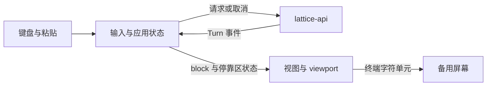

# TUI 交互与视觉

> 类型：架构合同
> 上位依据：[项目宪章](../governance/charter.md)、[宿主平台](platform.md)

## 目的与范围

本合同规定全屏 TUI 的产品接线、键盘交互、布局、状态呈现与配色。维护归属为 `lattice-tui`；CLI 解析由 `lattice-cli` 负责，会话与 Turn 执行通过公开 `lattice-api` 接口完成。

本文为承接草案，旧 [TUI 规格](../specs/2026-08-31-issue182-tui-cassette-futurism-spec.md)和[局部指引](../../crates/lattice-tui/AGENTS.md)尚未切换。TUI 通过[会话公开接口](session.md#组件与接口)观察和操作当前会话；调用持久终态与重开规则由 LANCET、会话领域维护。

## 职责与显示模型

CLI 调用 `lattice_tui::run`，TUI 经 `ratatui`/`crossterm` 使用备用屏幕与 raw 键盘输入。会话、profile 和 provider 配置问题在交互界面启动前明确返回。

给定 `TuiOptions.session_id` 时打开指定会话，未给定时创建会话。界面操作当前会话，不提供会话选择器、分支或时间线视图。

| 部分 | 职责 |
| --- | --- |
| 启动与会话准备 | 打开或创建会话、加载 profile、准备公开 API 请求 |
| 输入与历史 | 多行缓冲、光标、粘贴、键位和历史浏览 |
| 应用事件循环 | 接收键盘及 Turn 事件、维护界面状态、请求取消与触发重绘 |
| 视图 | 统一计算布局、折行、viewport、停靠区和状态信息 |

对话记录使用扁平 block 序列。说话人分组由渲染顺序确定，不为显示新增嵌套 Turn 容器。共享渲染由 TUI 侧维护，不能反向依赖 `lattice-cli`。

图中连线表示事件或显示数据传递，持久化由 API 所属领域处理。

## 布局

### 水平与垂直分配

尺寸以终端字符单元为单位。右侧栏宽度固定为 40 列，列间空隙 `gap = 1`，左列 `gutter = 2` 用于状态指示，不计入正文宽度。

| 条件或尺寸 | 规则 |
| --- | --- |
| 侧栏可见 | `frame_w >= frame_h × 3` 且 `frame_w - 40 - 1 - 2 >= 72` |
| 侧栏可见时 | `left_w = frame_w - 40 - gap`，`content_w = left_w - gutter` |
| 侧栏隐藏时 | `left_w = frame_w`，`content_w = frame_w - gutter` |
| 停靠区 | 一行分隔轨及 1 至 5 行内容，总高 2 至 6 行 |
| 底部状态行 | 侧栏隐藏时一行，可见时不存在 |
| 对话记录高度 | `frame_h - (dock_h + bottom_h)` |

所有尺寸减法使用饱和运算，极小终端不得下溢或 panic。渲染以实际分配高度为准，不假定对话记录至少有一行。
`Dock::height()` 统一提供停靠区高度；渲染、viewport 行数、输入折行和光标定位使用同一 `content_w`。正文宽度不另设上限。

`176 × 50` 显示侧栏，左列与正文宽分别为 135、133；`115 × 47`、`85 × 47`、`56 × 47` 不满足比例条件，`80 × 24` 分栏后正文不足 72 列，均隐藏侧栏。

左列由上至下为对话记录、停靠区及按条件出现的底部状态行。侧栏全高，gap 保持空列，侧栏有一列左内边距。界面不画边框。

### 侧栏与底部状态行

侧栏顶部显示 session ID、agent、空行和 phase；phase 使用 `idle`、`stream`、`commit`、`cancel`。身份信息超宽截断。
底部显示换行键提示、不跟随时的 `[scroll]`，以及第一次 Ctrl+C 后两秒内的 `Ctrl+C to quit`。
换行键与 `newline` 分行显示，kitty 协议可用时使用 `S-Enter`，否则使用 `Alt+Enter`。

侧栏隐藏时，底部状态行整宽显示 `session_id · agent · phase · [scroll]? · 换行键提示`，不带 PROMPT tag。空间不足时先移除键位提示，再截断 session ID、agent，优先保留 phase 和 `[scroll]`，最后按显示宽度裁剪。
Ctrl+C 提示在两秒内替代最低优先级的换行提示，过期须触发重绘，不能因界面空闲而残留。

## 对话记录与工具显示

说话人独占一行，用户显示 `user`，助手显示当前 agent 名；正文从下一行开始。用户块开始新的显示分组，回合间空一行，工具行留在助手段内不另加空行。
一个助手段只显示一次 agent 名：用户块后首次出现助手正文、工具或终态状态时显示，直到下一个用户块再重置。独立 `Notice` 不触发或重置该状态。

对话记录为纯文本，左列透出终端背景，不自行填色。正文按 `content_w` 折行；翻页停止跟随，`Ctrl+End` 回到底部并恢复跟随。

| 工具显示状态 | 呈现 |
| --- | --- |
| 运行中 | 一行，使用 `DimMeta` 与运行提示 |
| 成功 | 一行折叠，显示工具名和结果字节数 |
| 失败 | 展开并显示错误摘要 |

`▸`、`▾` 为状态指示，不是交互控件；ASCII 回退使用 `>`、`v`。不增加展开键或鼠标处理。
工具行按事件字段渲染，不按工具名添加专用逻辑。调用 ID 用于 started/finished 配对，默认隐藏；排障显示时可截断为 `#<id>`，不能当作操作名。
`output_len` 按字节显示，例如 `1204 B`，不写为字符数，也不添加千分位。没有事件提供的参数、hash 或操作字段不臆造显示。

收到 Turn 终态或事件流结束时，仍未配对完成的 Running 工具块显示为失败并注明取消、终态原因或 `turn ended before tool completion`。这表示界面未获得完整显示结果，Invocation 的执行 outcome 仍以 [LANCET 持久事实](lancet.md#结果证据与失败处理)为准。

## 停靠区与输入

### 停靠区状态

停靠区具有互斥的 `PROMPT`、`WARN`、`ERROR` 状态。PROMPT 显示输入，WARN 显示需要注意的警告，例如 `LlmRetry`，ERROR 显示错误；INFO 直接进入对话记录。

分隔轨上的 tag 与输入正文起点对齐，占六列：PROMPT 六字符，WARN 补两列，ERROR 补一列。分隔轨以 `─` 填充，非 UTF-8 时回退 `-`；WARN/ERROR 显示 `SPACE → PROMPT`。正文放在轨下，不把完整错误摘要塞进轨内。

内容高度为 1 至 5 个视觉行。Prompt 超高时内部滚动以保持光标可见；Warn/Error 超高只显示前五行，不增加只读滚动或展开。
输入提示符 `>` 只出现在第一行，续行不带前缀，并与第一行输入正文对齐。

新 Warn/Error 到来时，将旧停靠状态释放回对话记录，新状态占据停靠区。无修饰 Space 释放当前状态并回到 Prompt，按键被消费。状态不定时消失；暂驻时不在对话记录重复显示，释放后在原时间位置出现一次。

### 键盘与历史

| 输入 | 条件 | 行为 |
| --- | --- | --- |
| Enter | Prompt 可编辑 | 提交 |
| Alt+Enter | Prompt 可编辑 | 换行 |
| Shift+Enter | Prompt 可编辑且 kitty keyboard protocol 可用 | 换行 |
| 可打印字符 | Prompt 可编辑 | 插入 |
| bracketed paste | Prompt 可编辑 | 原样插入，保留换行，不提交 |
| Backspace、Delete | Prompt 可编辑 | 删除 |
| 左右方向键、Home、End | Prompt 可编辑 | 行内光标移动 |
| 上方向键 | 不在首行 | 光标上移 |
| 上方向键 | 在首行 | 历史上一条 |
| 下方向键 | 不在末行 | 光标下移 |
| 下方向键 | 在末行 | 历史下一条 |
| PageUp、PageDown | 全局 | 对话记录翻页 |
| Ctrl+End | 全局 | 回底部并恢复跟随 |
| 无修饰 Space | WARN/ERROR | 释放状态回 Prompt，不进入缓冲 |
| Esc | Turn 运行中 | 请求协作取消 |
| Esc | 空闲 | 清空输入 |
| Ctrl+C | 第一次 | 同 Esc；两秒内再次按下则退出 |
| Ctrl+D | 缓冲为空 | 退出 |

WARN/ERROR 显示时屏蔽普通输入、编辑、粘贴与提交，不修改不可见的输入缓冲；全局翻页、取消和退出行为继续按条件执行。
启动时探测一次 keyboard enhancement 支持，提示文案与探测结果一致。

输入历史尽力保存到 `<session_dir>/repl_history.txt`，沿用纯文本行格式。协作取消通过 API 的 `cancel_flag` 发出；raw 模式下 Ctrl+C 作为 KeyEvent 处理，不另起系统信号 watcher。取消后的 Turn 提交或 pending 状态按[会话取消与关闭规则](session.md#重开取消与未完成状态)处理，TUI 展示 API 返回的结果。

## 配色与终端约定

支持深色终端。真彩色使用下列 hex，其他终端使用命名色回退，不探测 terminfo 或 256 色模式。[Cassette Futurism 配色资产](../reference/cassette-futurism-palette.md)提供参考色表，TUI 实际用色由本节的角色和填充面约定。

| 前景角色 | Token | Hex | 命名色回退 | 用途 |
| --- | --- | --- | --- | --- |
| User | iris-7 | `#8695e3` | LightBlue | user 标题、输入提示符、stream phase |
| Assistant | cream-2 | `#f5f3ef` | White | agent 名、正文、输入、tag 文字和 Warn 正文 |
| ToolOk | cyan-7 | `#2ab0b0` | Cyan | 成功勾号 |
| ToolErr | signal-red-9 | `#cb2b31` | Red | 失败符号、错误摘要、TurnFailed、cancel phase 和 Error 正文 |
| DimMeta | warm-gray-8 | `#857f78` | DarkGray | 状态、工具名、字节数、分隔轨和快捷键提示 |

| 填充面 | Token | Hex | 命名色回退 | 文字 |
| --- | --- | --- | --- | --- |
| 侧栏与底部状态行 | navy-11 | `#2c4267` | Blue | DimMeta，phase 按前景角色变化 |
| PROMPT tag | iris-9 | `#5965ca` | LightBlue | Assistant |
| WARN tag | amber-9 | `#9f6200` | Yellow | Assistant |
| ERROR tag | signal-red-9 | `#cb2b31` | Red | Assistant |

正文默认使用 Assistant；成功、失败符号与工具元信息分别着色。amber 只用于 WARN tag 填充，不扩散到其他区域；不增加第六种前景角色或左列背景。终端实际背景由用户环境提供，`navy-12` 只是原视觉方案的背景参考。

## 功能边界

当前界面不提供鼠标及滚轮、Markdown 与语法高亮、交互式工具卡片、reasoning 折叠、token 面板、搜索、命令面板、主题或浅色适配。
不增加 shell 模式、插件运行时、会话分享、语音、多 Agent 侧线程、弹层、模态或 toast。保留规定的侧栏显示条件，不增加动态侧栏宽度或其他布局模式。
光标使用终端已有能力，不绘制软光标或控制形状与颜色；模式 tag 限于 PROMPT/WARN/ERROR。

## 验证与承接

| 检查对象 | 入口与关注点 |
| --- | --- |
| 键位、折行、停靠区、状态释放与布局 | `cargo test -p lattice-tui` |
| CLI 接线 | CLI 表面变化时检查 `cargo test -p lattice-cli` |
| 实际终端入口 | 按测试工程的[被测二进制要求](../contract/testing.md#被测二进制)准备 lattice-cli，运行 harness 的 `pty_tui_smoke` |
| 交互与配色 | 真彩色和命名色回退、超宽及极小终端、错误确认、翻页与光标的人工检查 |

自动化与人工检查分工见[测试工程草案](../contract/testing.md)，具体运行指南仍见[旧测试文档](../TESTING.md)。颜色辨识与终端行为需实机核验，不能仅由布局计算通过推定体验合格。

- [TUI 旧规格](../specs/2026-08-31-issue182-tui-cassette-futurism-spec.md)：固定侧栏、统一停靠区、说话人分组、工具状态和配色。
- [TUI 局部指引](../../crates/lattice-tui/AGENTS.md)：公开 API 边界、键位、输入历史与验证入口。
- [ADR 0005](../adr/0005-durable-turn-invocation-and-private-git-stores.md)：取消和失败的持久状态由 Turn 协议决定。旧指引“取消后照常 commit”的概括不作为 TUI 保证。

旧规格的 `ToolErr` 表格有列顺序错位，本文按局部指引和同页配色说明承接为 signal-red-9、`#cb2b31`、Red。
DimMeta 在 navy-11 上的可读性仍需人工核验；旧规格提出难读时将 session/agent 主值改用 Assistant，是否启用该调整留待审查，不自行改色。
绑定 Issue 的目录冻结与卡片实施顺序留在原记录，未在本文宣布解除。旧入口的替换范围及其剩余条款在合同批准时一并核对。
