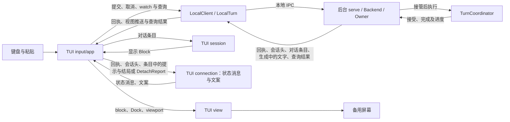

# TUI 交互与视觉

> 类型：架构合同
> 上位依据：[项目宪章](../../governance/charter.md)、[宿主平台](../platform.md)
> 修订记录：Markdown 渲染、代码高亮与终端能力，以及标题线、Dock 与输入区、statusline、浏览光标、评论与排队的修订，随 PR #232 合并，2026-10-02 由维护者批准生效。按 [ADR 0008](../../adr/0008-backend-api-commands-view-queries.md) 修订会话内容的来源、轮次序号、请求身份、找回与取消。按 [ADR 0010](../../adr/0010-protocol-adapters-and-configured-providers.md) 修订：TUI 不再加载 profile，新增 `/model`、`/effort` 与可交互的选择面板，statusline 显示下一次提交将使用的模型与档位及本轮用量。

## 目的与范围

用户在全屏 TUI 中编辑任务、查看已保存对话并观察后台进度。任务接受后，关闭界面仍可让后台继续工作；重新打开会话可以读取结果、继续观察或请求取消。

任务运行时，用户可以继续输入后续任务，TUI 把它们排队，本轮完成后依次发送。用户也可以把光标移进对话记录，对助手回答逐段写评论；评论随下一条消息发给模型，并保存在这条消息里，重新打开会话后仍显示在原位。

本合同规定这些操作的接线、键盘交互、布局、状态呈现与配色，由 `lattice-tui` 维护。CLI 解析由 `lattice-cli` 负责；会话、Turn 执行及持久关闭由[会话合同](../session/README.md)维护，工具执行事实由 [LANCET](../lancet.md#结果证据与失败处理)维护。本文沿“输入任务、模型调用工具、读取回答”的场景说明界面如何使用这些结果。

## 职责与显示模型

### 持久对话与临时文字

Session 是持续对话的容器，Turn 是一次已接受任务。会话树中的 UserMessage 与 Step 节点组成持久对话内容，可在重连后读取，也供后续模型请求使用。Step 节点包含一次完整模型回复及其全部 `(ToolCall, ToolResult)` 对；ToolResult 表达执行 outcome 与返回内容。整次 Turn 的结局由最后一个 Step 节点得出，TUI 读到的是后台随这个 Step 的条目给出的 `TurnSummary`。主定义见[用户读到的几种事实](../session/flow.md#用户读到的几种事实)。

TUI 以 `watch` 观察当前会话。视图先给出会话头与当前路径上最近 10 轮的对话条目，之后推送变化的条目与生成中的文字；更早的轮在往上翻时用历史查询取得。精确关系见[观察与重连](../session/recovery.md#观察与重连)。

- **会话头**：当前位置、当前 agent、当前位置所属那一轮有没有 Owner，以及后台已知的这一轮执行诊断。
- **对话条目**：一个条目就是一个节点，以 NodeId 标识，同一节点的新值整条替换旧值。UserMessage 条目带这一轮的轮次序号，节点上记有 agent 名、模型与 provider；Step 条目带各尝试、槽位与这一步的结论，以及各尝试的重试提示；本轮最后一步的条目另带这一轮的 `TurnSummary`。
- **生成中的文字**：当前尝试正在生成的正文与 reasoning，标明所属节点与尝试。

生成中的文字是临时的，TUI 用它显示当前进度。它只存在于后台内存、视图推送和界面内存中，显示在所属 Step 条目的位置。条目显示该尝试已 `Ended` 时，文字由条目取代：尝试完成时改为显示条目中的完整回复，二者合并相邻同类后内容一致，显示不跳变；尝试停止时半截文字作废，不再显示。TUI 按有序消息生成用户、助手、工具和状态 block；reasoning 的持久保存归会话领域，当前界面不单独展示 reasoning 片段。布局中的“正文宽度”则专指字符单元宽度，见[布局](layout.md#布局)。

对话记录中的条目与状态消息按出现的先后排列，已经显示的内容不重排。状态消息是对话记录中的状态 block，例如连接提示、提交与取消回执，它们不属于任何节点，定义见[状态消息与等级](#状态消息与等级)；重试提示与 Turn 结局属于 Step 条目，随条目显示。TUI 按以下规则组织显示：

- 同一 NodeId 的新值原位替换旧值；新条目接在对话记录末尾。
- 本客户端提交时，末尾先显示这条输入的 USER 块；同一 TurnId 的 UserMessage 条目到达时原位取代它。未被接受的提交保留这个块。
- 状态消息出现时接在末尾，之后不移动。
- 视图翻到对话记录顶部而第 1 轮尚未装入时，app 用历史查询取更早的轮，`before` 为已装入的最早一轮的 UserMessage 的 NodeId。取到的轮插在这一轮之前，视图仍停在原来看到的内容上：以屏幕上插入点之后的第一行为准，启动横幅与插入点之前的状态消息随之移到屏幕之外。查询失败时显示一条 Warn，下次翻到顶部时重新查询。
- 新视图的初始条目到达时（打开会话或重连），以及会话头标明路径已替换时，TUI 丢弃此前的条目及其生成中的文字，新的条目接在末尾。状态消息与未被接受的 USER 块保留。

“末尾”指排队区域之前，排队消息始终在对话记录最后，见[排队](interaction.md#排队)。例如，第 2 步执行中出现的连接提示留在第 2 步之后；第 2 步关闭时它的条目原位更新，第 3 步的条目接在这条提示之后。

### 状态消息与等级

状态消息告诉用户某个时刻发生了什么：一次重试、一条回执、连接中断或一轮的结局。每条消息携带等级、文字和可选的所属 Turn；文字可以多行，一件事只生成一条消息。消息不记录自己显示在哪里，是否暂驻由 [Dock](dock.md#dock-组件) 按等级决定。

等级取 Info、Warn、Error，来源只有两处：

- 后端给出的消息沿用后端的等级。重试提示取 Step 条目中该提示的等级；Turn 结局取 `TurnSummary` 中 notice 的等级，Completed 没有 notice，按 Info。
- TUI 自己产生的消息由 `connection` 生成文字并定级，`app` 只负责推入：

| 等级 | 含义 | 消息 |
| --- | --- | --- |
| Error | 用户要做的事没有做成，或界面确定出错 | 请求被拒绝或回执失败；按 TurnId 查询为 NotFound，提交确定未被接受；会话头中的执行诊断；取消请求出错；收到不应出现的回执 |
| Warn | 结果不确定，或有内容丢失 | 接受确认未知；提交结果未知；后台未接管本次取消；取消确认未知；更早的轮读取失败；观察中断（连接结束、有 Owner 执行时长时间无推送、连接出错）；这一轮的执行者已消失；评论因锚点不在当前路径而被丢弃 |
| Info | 符合预期的进展 | 按 TurnId 查到已接受的请求；提交在发出前取消；已请求取消、后台已接管取消、取消交接已结束；旧句柄的交接 |

取消状态与取消请求的诊断合为一条 Error；提交结果未知与它的诊断合为一条 Warn。

只有新到的消息才交给 Dock。新视图的初始条目和历史查询取得的条目中已有的重试提示与结局不是新消息：它们直接进入对话记录，不暂驻，等级与颜色不变。此后的推送使 Step 条目多出的重试提示，以及使这一轮由未结束变为结束的结局，才是新到的消息。重试提示以所属节点与尝试为身份，结局以 TurnId 为身份；它们暂驻 Dock 期间，条目中不重复显示，释放后显示在条目中的原位，所属条目已被丢弃时不再出现。

对话记录中的颜色同样取[配色](palette.md#配色与终端约定)表的前景角色：Info 与释放后的 Warn 使用 DimMeta，Error 使用 ToolErr。Turn 结局另带结局符号，文字为 `turn <TurnId>` 加“完成”“失败”或“已取消”，有 notice 时后接其文字，完成使用 ToolOk。重试提示写明第几次请求失败与等待的毫秒数，后接后端给出的文字。后端给出的文字原样显示。

启动横幅与帮助面板不是状态消息。启动横幅固定在对话记录最上方，写出名称与 `/help`、`/model`、`/effort`、`/quit`、`/reconnect` 五条命令，使用 DimMeta；它不参与上面的位置规则，插入更早的轮或丢弃条目后仍在最上方，打开较长的会话时需要翻到顶部才能看到。帮助面板见[面板](dock.md#面板)。

### 组件接线

CLI 调用 `lattice_tui::run`，TUI 经 `ratatui`/`crossterm` 使用备用屏幕与 raw 键盘输入。下表区分前端模块、本地客户端和后台，描述当前责任归属：

LocalTurn 是本客户端一次提交的具体句柄，处理接受回执、取消意图与退出交接；它不是第二个持久 Turn，也不拥有后台执行。会话内容不经它交付，由 `watch` 视图与查询给出。其主定义见[会话组件与接口](../session/README.md#组件与接口)。

| 部分 | 职责与交接 |
| --- | --- |
| TUI `session` | 经后台打开已有会话；将对话条目转换为显示 Block，取用 UserMessage 条目上的轮次序号，并解析用户消息中的评论元素 |
| TUI `connection` | 把提交与取消回执、连接与查询情况、会话头中的执行者状态与执行诊断、条目中的重试提示和 Turn 结局转为[状态消息](#状态消息与等级)并定级；把 DetachReport 转为退出报告文案 |
| TUI `input` | 管理多行缓冲、光标、粘贴、键位和输入历史 |
| TUI `app` 应用事件循环 | 持有 LocalTurn 与当前会话的视图，发起提交、`watch`、历史查询、模型候选查询、按 TurnId 的查询或取消意图，消费视图推送；按 NodeId 维护对话条目的显示，维护焦点、排队、评论草稿与未提交的模型和档位选择，处理键盘、退出及重绘 |
| TUI `view` | 从 Block、输入和状态统一计算布局、折行、viewport、Dock 与 statusline，绘制终端字符单元 |
| `lattice-api::local::LocalClient` / `LocalTurn` | LocalClient 连接后台，转交视图与查询，超过单帧的消息由连接层分帧与拼回；LocalTurn 交付提交，管理取消回执与退出交接 |
| 后台 `serve` / Backend / Owner | serve 持本地实例与连接，Backend 管准入、存储与各观察者的视图推送；Owner 监督独立操作，实际带配置的操作从准备起持同一取消载体直至独立收尾 |
| 后台 TurnCoordinator | 唯一持久 Turn 协调者，推进模型、工具、结果保存和最终关闭，向 Backend 返回完成结果 |

TUI 对话记录使用扁平 Block 序列，说话人分组由渲染顺序确定。共享渲染归 TUI，显示数据不新增嵌套 Turn 容器。前端只维护呈现与操作选择；提交与取消的交接由 LocalTurn 维护，条目的推送由后台的视图维护。

连线表示调用或数据传递，不表示持久事务。后台执行与前端读取、绘制可以并行。

### 启动、提交与运行

1. 给定 `TuiOptions.session_id` 时打开已有会话；未给定时须指定 Agent，会话在首次提交时由后台在接受事务中创建。TUI 不读取 profile、provider 配置或凭据；配置问题在首次提交时由后台拒绝，说明见[配置拒绝的原因](../session/acceptance.md#配置拒绝的原因)。打开已有会话及重连读取持久事实，不需要当前的 profile 或凭据。
2. 打开已有会话时，TUI 对它开始 `watch` 后进入交互循环。会话头先到即可绘制，最近 10 轮的条目随后显示。新会话直接显示输入区，首次提交被接受后开始 `watch`。
3. 用户在输入区编辑任务，按 Enter 提交。输入为空且没有评论草稿时不提交；正在运行时按 Enter 把输入放入排队，见[排队](interaction.md#排队)。正在运行指本客户端的提交尚未得到结果，或会话头说明当前位置那一轮有 Owner 且这一轮尚未结束。TUI 在发请求前生成 TurnId，保留它与原始输入，不单独显示 TurnId；提交结果未知时的提示带该 TurnId。向已有会话提交时写明追加 `Existing(SessionId)`；新会话在首次提交时生成 SessionId 并写明新建 `New(SessionId)`。确认被接受之前，之后的提交沿用同一 SessionId 与 `New`：会话若实际已由上一次提交建立，后台返回 Conflict：会话已存在，TUI 据此按 TurnId 找回上一次提交，不会建出第二个会话。确认被接受后改为 `Existing`。键位和粘贴条件见[键盘](interaction.md#键盘)。
4. app 把原请求、身份与选择经 LocalClient 提交一次，持有返回的 LocalTurn。选择包括启动时指定的 Agent（新会话的首次提交）和未提交的 `/model`、`/effort` 选择，见[选择面板](dock.md#选择面板)。后台按配置错误拒绝时显示错误，输入保留。配置的来源见[执行配置冻结](../session/acceptance.md#执行配置冻结)。
5. LocalTurn 交付后台接受结果，后台同时继续模型与工具执行。后台接受时助手段标题线随即出现，见[标题线](transcript.md#标题线)，不另写接受行；接受确认未知等其余结果照常显示，找回见[连接、结局与重载](#连接结局与重载)。Busy 或其他拒绝时保留输入并显示拒绝。保留输入指：输入区为空时把这次提交的原文放回输入区；输入区已有草稿时不覆盖，原文已在提交时记入输入历史，按 Ctrl+↑ 找回，状态消息写明这一点。提交所带的评论照常恢复为草稿。结果不明之后才确定未被接受时同样处理；这次提交已有过确定结果、没有可归还的输入时，状态消息只说明未被接受。旧句柄的交接报告只生成状态消息，不归还输入。上一轮的执行者已消失时，旧 Turn 停在已写入的进度，后台直接接受并执行本次输入，TUI 的回执属于本次请求。排队自动发送的一条按「排队」处理。
6. 应用循环消费视图推送。会话头更新 phase、agent 与执行者状态；对话条目按[持久对话与临时文字](#持久对话与临时文字)的规则替换或接在末尾；生成中的文字更新所属 Step 的临时显示；工具按 InvocationId 显示在所属 Step 条目内。每次界面变化由应用循环安排重绘。
7. 后台写入 Step 节点与调用结果，视图推送它们的新值。最后一步关闭后，它的条目带有这一轮的 `TurnSummary`，TUI 显示结局。结局与连接按下一节分别呈现。

### 连接、结局与重载

用户需要知道任务如何结束、自己是否仍在观察，以及内容是否已读到。界面按各自依据更新这些信息：

| 用户要知道什么 | 依据与正常动作 |
| --- | --- |
| 任务的结局 | 本轮最后一个 Step 条目带的 `TurnSummary` 给出 Completed、Failed 或 Cancelled 与 notice。这一轮结束时显示实际结局与说明：最后一步的 `progress` 为 `Closed`，或者它未关闭且会话头说明没有 Owner。实时观察与重新打开会话看到的是同一种条目，每一轮的末尾都显示它的结局 |
| 请求是否已被接受 | 接受回执表明接受事务已提交。回执未知时由 LocalTurn 按 TurnId 查询找回，见[请求身份与找回](../session/recovery.md#请求身份与找回)；视图中出现该 TurnId 的 UserMessage 条目，同样说明已接受。已关闭的 Step 条目可读即已持久，不另有完成确认 |
| 是否还在观察 | 视图连接表明当前观察情况；断连、EOF，或有 Owner 执行时长时间没有推送，显示观察中断和重连入口。会话空闲时没有推送是正常的 |
| 更早的轮是否读到 | 历史查询成功后插入更早的轮；失败时显示一条 Warn，下次翻到顶部时重新查询 |

连接错误或查询失败只影响相应显示与诊断，已显示的条目与已知结局继续保留。具体分类见[请求身份与找回](../session/recovery.md#请求身份与找回)。

`/reconnect` 重新开始 `watch`。新视图的初始条目到达时，TUI 按[持久对话与临时文字](#持久对话与临时文字)的规则丢弃此前的条目，按新条目显示；开视图之前已被接受、仍在等会话头确认的那一轮不在这些条目里时，不再等它，按新的会话头判断是否正在运行；生成中的文字从当前尝试已生成的全部文字开始，不缺前文。重连失败时已显示的内容保留。Dock 中暂驻的 Warn 与 Error 不随条目丢弃而消失，继续暂驻到用户释放。

模型尝试重试时，新尝试的文字从头开始。失败的尝试在 Step 条目中显示为 `Ended`，它的生成中文字随之移除；条目中的这次尝试带有重试提示，等级取自条目。不再重试的失败没有重试提示，只由 Turn 结局显示一次。尝试规则见[模型请求与执行预算](../session/acceptance.md#模型请求与执行预算)。

观察 idle 由客户端判定，唯一常量为 `lattice_api::STREAM_IDLE_TIMEOUT_SECS`，只在会话头说明当前位置那一轮有 Owner 执行时计时，触发条件和范围见[输入与传输限制](../session/concurrency.md#输入与传输限制)。超时、断连或 EOF 按连接诊断呈现，仍在运行的工具按观察未知显示；用户可用 `/reconnect` 重新观察。

### 取消、退出与恢复提示

用户请求取消时，取消的是会话头所示正在执行的那一轮，按它的 TurnId 进行。这一轮由本客户端提交时，app 调用它的 LocalTurn 的 `cancel` 并继续消费视图推送；TUI 分别显示等待、已接管、未接管、未知或交接结束。这一轮由其他客户端提交时，例如 CLI 的 `session send`，app 以 `LocalClient::cancel` 按它的 TurnId 取消，显示后台的接管结果。false 不表示没有后台工作，接管区间和拒绝后新准入的语义见[会话取消规则](../session/recovery.md#取消与退出)。取消发生在提交发出之前时，这次提交不再发出，TUI 按未被接受处理，以一条 Info 说明。

app 发起新的提交时换用新的 LocalTurn。旧句柄通过自己的 `detach` 异步交付报告，新的提交与取消不等待旧回执。报告只生成带原身份的 Info 级状态消息，包括旧接管、具体取消错误与提交诊断；其中已由同一客户端实时交付过的回执不再重述。报告不应用到新句柄的取消状态。退出时继续消费已经开始的报告交接，具体等待与诊断清除规则归[LocalTurn](../session/recovery.md#客户端意图与退出交接)，TUI 不另行计时、收割控制请求或补发。

首次取消后的提交等待到期时，TUI 显示提交结果未知，视图照常推进；LocalTurn 继续等迟到的回执，提交连接断开后按 TurnId 查询找回。交接后迟到的本地提交传输诊断并入提交结果未知的 Warn 消息，不还原已提交输入、不终止观察或撤销已知结局；后台错误回执仍按其结果显示。

Ctrl+D、`/quit` 和普通退出只断开前端。第二次 Ctrl+C 退出保留第一次的取消意图；应用先复原终端，再将同一句柄交给 `detach`，由 connection 格式化其最后已知事实。键位成立条件见[键盘](interaction.md#键盘)，共同回执预算及未知后的处理见[客户端意图与退出交接](../session/recovery.md#客户端意图与退出交接)。

会话头说明当前位置那一轮有没有 Owner。这一轮尚未结束而有 Owner 时，按正在运行的轮次显示，不另写提示。最后一步未关闭而没有 Owner 时，执行者已经消失，这一轮停在已写入的进度：新视图开始或会话头变为这一状态时，TUI 以一条 Warn 提示用户，用户可以直接发送新消息或退回。CLI 的 `session send` 与 `session rewind` 同样直接进行，用法见[操作指南](../../development/validation-guide.md#执行者消失后继续)。已写入的节点、调用结果和文件效果保留，旧任务的模型或工具不会重放。只有内存中的取消意图时，结局为 Failed（进程退出）；已写入的取消原因给出 Cancelled，精确规则见[执行者消失后的 Turn](../session/recovery.md#执行者消失后的-turn)。

#### 观察与控制边界

- 视图推送使用穷举匹配，不以兜底分支吞掉新增种类；生成中的文字用于进度显示，不能代替接受回执或对话条目。
- `watch` 与查询保持只读，不关闭旧 Turn，也不重新接受 prompt。接受回执仍未知时按 TurnId 查询找回，见[原请求重试配方](../../development/validation-guide.md#提交与找回)；以新的 TurnId 发送同一输入是另一次请求，不是找回。
- 前端不拥有后台执行生命周期，慢读和重绘不得阻塞后台必要收尾；取消不回滚已发生效果。已接管取消的处理义务不因前端退出而消失。

## 文件索引

| 文件 | 内容 |
| --- | --- |
| [layout.md](layout.md) | 水平与垂直分配、侧栏与 statusline |
| [transcript.md](transcript.md) | 对话记录标题线、轮次序号、Markdown 正文与按调用身份显示工具 |
| [dock.md](dock.md) | Dock 组件、输入区、Warn 与 Error 模块，以及帮助面板与选择面板 |
| [interaction.md](interaction.md) | 浏览光标、评论、排队与键盘映射 |
| [palette.md](palette.md) | 界面前景与填充面配色、终端约定及代码高亮配色 |

## 功能边界

TUI 只操作当前会话，不提供会话选择器、会话树视图或退回操作；退回会话位置经 CLI `session rewind`。共享渲染不反向依赖 `lattice-cli`；存储与执行经公开 API 接入。
当前界面不提供鼠标及滚轮、交互式工具卡片、reasoning 折叠、token 面板、搜索、可检索或选择命令的命令面板、主题或浅色适配。
不增加 shell 模式、插件运行时、会话分享、语音、多 Agent 侧线程、弹层、模态或 toast。评论编辑器与排队编辑在对话记录中原地展开，帮助面板、选择面板、Warn 与 Error 在 Dock 内替换输入区，都不属于弹层或模态。保留规定的侧栏显示条件，不增加动态侧栏宽度或其他布局模式。
评论只作用于已关闭 Turn 的助手文字，已发送的评论只读，不提供修改或删除。排队与评论草稿只存在于本客户端，不新增后台状态或接口。

## 验证与承接

| 检查对象 | 入口与关注点 |
| --- | --- |
| 键位、折行、Dock 模块栈与高度、状态释放、选择面板的过滤、移动、选定与取消及换模型时的档位显示、布局、statusline 字段与省略、标题线与轮次序号、浏览光标移动与翻页夹紧、评论格式解析与降级、排队上限与暂停、Markdown 元素、代码块边框与续行、表格列宽与代码高亮分类 | `cargo test -p lattice-tui` |
| 视图推送的消费：条目按 NodeId 原位替换与接在末尾、新视图开始与路径替换时丢弃旧条目、往上翻时插入更早的轮、生成中的文字由条目取代、重试提示与结局按是否新到进入 Dock 或对话记录；接受未知时的查询找回与取消交接 | TUI 的 `app_loop_tests` / `connection_tests`；共同控制、视图与查询协议由 API 局部测试保护 |
| CLI 接线 | CLI 表面变化时检查 `cargo test -p lattice-cli` |
| 实际终端入口 | 按测试工程的[被测二进制要求](../../development/testing.md#被测二进制)准备 lattice-cli，运行 harness 的 `pty_tui_smoke`；其中用 `/model`、`/effort` 选择后提交、核对 fake provider 收到的请求带所选模型与档位，以及选择面板的过滤与取消 |
| 交互与配色 | 真彩色终端下的界面与代码高亮配色、超宽及极小终端、错误确认、翻页、浏览光标、评论与排队编辑、块状光标形状与恢复的人工检查 |

自动化与人工检查分工见[测试工程合同](../../development/testing.md)，运行配方见[验证操作指南](../../development/validation-guide.md)。颜色辨识与终端行为需实机核验，不能仅由布局计算通过推定体验合格。

- [TUI 局部指引](../../../crates/lattice-tui/AGENTS.md)：公开 API 边界、键位、输入历史与验证入口。
- [ADR 0005](../../adr/0005-durable-turn-invocation-and-private-git-stores.md)：取消和失败的持久状态由 Turn 协议决定。旧指引“取消后照常 commit”的概括不作为 TUI 保证。

布局公式、尺寸示例、键位条件与配色表沿用 R1 前的版本，是界面设计参数；它们不构成实机可读性验证。DimMeta 在 navy-11 上的可读性仍需人工核验。

文件与目录按渲染职责组织，不固定文件数量或源码行数上限；公开 API 边界与共享渲染归属保持不变；Block 为轮次序号、评论与排队增加的字段只服务显示，不改变持久对话。组织调整不授权新增工具卡片或其他功能。R1 前的 TUI 职责由本文承接；历史过程说明留在任务记录中。
