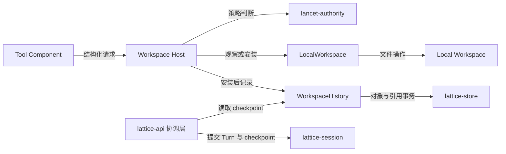

# 本地工作区与变更历史

> 类型：架构合同
> 上位依据：[项目宪章](../governance/charter.md)、[宿主平台](platform.md)

## 目的与范围

本合同规定 LATTICE 对本地工作区的观察、文件变更、私有变更历史及显式 Rewind 的职责、接口和行为边界。
维护归属为 `lancet-runtime` 的工作区与历史模块；策略、会话协调和通用存储机制分别由对应领域负责。
工具目录、完整调用生命周期、会话图模型和存储内核的内部协议不在本文展开。

本文为待审查的承接草案。现行依据及生效前需核对的内容见文末，旧入口尚未切换。

## 模型与职责

### 工作区、内容身份与历史

- **Local Workspace** 是规范化项目根下的当前文件树，是观察和变更的文件事实来源。用户和其他进程可以同时修改它。
- **Policy-Visible Workspace** 是读取策略允许观察的当前路径集合，由本地状态过滤而来，不复制文件，也不建立跨调用快照。
- **Local Revision** 标识一次观察所依据的文件内容。编辑携带该内容身份作为 Mutation Precondition；创建的前提是目标仍不存在。
- **Workspace History** 保存 LATTICE 已安装变更的前后内容与关联身份，以私有 Git 对象和引用表达。记录范围限于 LATTICE 触及的路径，不收集整个项目的外部修改。
- **Session History** 保存会话及工具交互。已完成 Turn 通过项目级 `WorkspaceHistoryCheckpoint` 与工作区历史关联，普通会话指针移动不恢复本地文件。

完整术语入口暂为根 [CONTEXT.md](../../CONTEXT.md)。其中无变更 Turn 的 checkpoint 表述按本文“Turn 完成边界”承接，不沿用无条件继承旧 OID 的写法。

### 组件接口

| 组件 | 工作区相关职责 |
| --- | --- |
| `lancet-authority` | 路径可见性、系统路径排除、Guard 与 Cell 策略判断 |
| `lancet-runtime` | Tool Host 工作区接口、具体路径解析、观察、安装、历史记录、恢复执行与 Rewind 审计 |
| `lancet-api` | 组合运行时，提供工作区 Rewind 的规划与执行接口，并验证所持操作锁与目标存储的绑定 |
| `lattice-api` | 将 profile 转为策略；协调 Turn checkpoint 与显式 Rewind 的会话侧操作 |
| `lattice-session` | 保存 Turn checkpoint，执行会话状态和引用事务 |
| `lattice-store` | 提供领域中立的私有 Git 对象、引用、锁与持久化机制 |

生产 Tool 通过 Host 的结构化接口访问工作区。输入数据不解释为 shell 语法；Tool 不接收可绕过策略的文件系统或存储句柄。
Host 内部的 `LocalWorkspace` 封装路径解析、前提核验和安装，`WorkspaceHistory` 负责记录与规划，不直接写本地工作区。

下图表示组件间的调用或数据传递，连线不表示事务边界：

### 私有存储与数据关系

工作区历史按项目寻址，保存在 Local Workspace 和用户项目 `.git` 之外的 `projects/<ProjectStoreKey>/workspace-history.git`。
私有历史操作不修改用户 Git 的对象、引用、索引或 HEAD。生产打开路径严格核验存储；创建由新建会话的组合路径负责，不把缺失存储当成空历史。

- Git blob 保存内容，tree 表达相关路径的前后状态，commit 表达顺序及父子关系，`refs/lattice/workspace-history/current` 指向当前记录的变更。
- 变更记录关联 `InvocationId`、`TurnId`、效果序号、方法、路径及前后内容身份。关联信息不决定 Invocation 的终态。
- 父 tree 必须与安装器实际观察到的变更前内容相符。当前记录机制在需要时插入 baseline commit，使外部修改后的真实前态也可恢复；baseline 不作为一次 Tool 变更。
- Rewind 移走当前 tip 前保留被放弃的历史，使原有 OID 继续可解析。恢复通过移动引用选择历史状态，不追加补偿变更 commit。
- Rewind 审计使用同一私有库中的独立追加链，记录路径、内容身份、OID 和处理结果，不写文件正文；它与 Workspace History 的变更链、InvocationStore 分别承担不同职责。

## 路径与观察

### 路径策略

工作区请求使用 UTF-8 项目相对路径，在规范化项目根下逐段解析。路径逃逸、不安全的符号链接访问以及系统路径排除在 Host 执行文件操作前拒绝。
系统路径排除覆盖用户 Git 管理状态、LATTICE 私有状态和项目根之外的路径，profile 不得放宽。

读取可见性的优先级为：

1. 系统路径排除。
2. 显式读取拒绝。
3. 显式包含被忽略路径。
4. 默认选择已跟踪及未被忽略的文件。

`read`、`list`、`grep`、`find` 对文件内容、路径名称与搜索结果应用相同规则。
隐藏路径对 guest 表现为不存在，隐藏原因留在 Host 证据中。
写入策略使用独立的拒绝规则，不能从读取可见性推导写权限；每次 Host 操作还须满足所准入 Cell 的通道、作用域及效果要求。

### 观察接口与边界

Host 负责计算可见内容、内容身份、遍历限制和截断结果，并计入本次 Turn 的观察预算。
文件读取的 `content_hash` 是后续编辑的 `expected_hash` 来源，调用方原样传回，最终核验由 Host 完成。

单次观察受字节、行、目录深度、条目或匹配数量等相应上限约束。截断与超限应明确返回；长遍历检查取消信号并返回相应的类型化结果。
操作之间可以看到新的外部修改，不承诺多个读取结果属于同一个全局文件系统快照。

## 文件变更

### 请求与安装

`mutate.create` 安装一个新文件，目标存在时拒绝覆盖；`mutate.edit` 对已有文件生成最终内容，并携带所依据的内容身份。
Host 负责写入大小限制、路径与策略核验、取消检查及最终 Mutation Precondition 核验。
本地文件变更模块统一负责内容准备、目标安装或删除、持久化、辅助资源清理及效果报告，供 Host 变更与 Rewind 共用。历史记录与会话协调由调用方所属领域负责，依据模块返回的实际效果继续处理。

正常路径依次为：

1. 校验结构化请求，解析目标路径，核对权限与操作限制。
2. 取得项目独占操作锁，在当前本地状态上核验创建或编辑前提。
3. 在 Host 安装边界核验相关前提和取消状态，在目标目录准备完整内容并完成要求的文件同步。
4. 以不覆盖已有目标的方式创建，或以原子名称替换方式安装编辑结果，并同步父目录。
5. 记录私有变更历史和 Host 已观察效果，返回安装结果。

原子可见性限定于单个目标路径的安装：通过该目标名称不会读到安装过程中的半写入内容。
成功安装立即改变 Local Workspace；随后 Tool、模型或 Turn 失败，不自动撤销这次变更。
文件安装、工作区历史发布和 Invocation 终态发布不是同一笔事务。

### 效果报告与辅助资源清理

文件变更结果分别表达目标是否已改变、持久性是否已确认，以及辅助资源的清理结果；无法确认的事实标为未知。错误保留发生阶段和原因，已安装或已删除的事实不因后续同步、清理失败而丢失。

模块在结束操作前清理不再需要的临时名称。操作失败时，对本次新建的父目录按从内到外的顺序尽力恢复原样：

- 清理前核验资源仍属于本次操作。仅移除可确认未被外部使用的辅助资源；目录须为空，原有目录和外部新增内容保持不变。
- 清理失败保留原始错误，并报告已知残留和无法确认的清理结果。
- 已安装的目标内容不作为辅助资源回滚。后续恢复须重新核验当前状态，避免覆盖外部写入。

Rewind 撤销文件创建时按同一规则尽力清理原操作新建的目录；历史须保留辨认这些目录所需的来源信息。无法核验归属或安全清理条件时保留目录，并报告原因。

### 失败与后续处理

| 阶段或情形 | 文件与历史事实 | 处理边界 |
| --- | --- | --- |
| 路径、权限或大小校验拒绝 | 尚未安装目标文件，不追加变更历史 | 返回类型化拒绝及相应证据 |
| 创建目标已存在、编辑内容身份过期或语义编辑需要重新规划 | 不安装本次候选内容 | 返回 `ReplanRequired`；Agent 重新观察并发起新调用，不自动合并或重放旧调用 |
| 最终安装前取消或 I/O 失败 | 本次目标文件安装未发生，可能已有辅助资源 | 返回对应错误，按辅助资源清理规则尽力恢复并报告残留 |
| 名称安装完成，父目录同步失败 | 目标已经变化，安装持久性尚未确认 | 保留安装事实，继续尝试历史记录并记录已安装效果；不报告完整成功 |
| 安装后历史发布失败 | 本地安装事实仍成立，历史发布未能确认成功 | 返回结果不确定的错误及已观察效果，不通过扫描历史猜测成功终态 |

当前 Host 将历史错误映射为 `OutcomeIndeterminate`；父目录同步失败且历史记录成功时返回 `ExecutionFailed`。
这些错误属于工作区 Host 层，完整调用的终态与重开协调仍由调用生命周期规则处理。

调用方不得仅凭错误、超时或取消推定文件未改变。安装后的失败需要核验实际文件与持久引用；本文不将重新执行 Tool 作为补救方式。

## 并发与 Turn 完成边界

### 操作锁

`WorkspaceOperationLock` 按项目设置，是参与该协议的 LATTICE 操作之间的协调锁：

- 观察持共享锁，覆盖一次有界操作。
- 变更在内容身份与前提核验前取得独占锁，持有至安装和历史发布结束。
- Rewind 由协调层持独占锁，覆盖规划、预检、恢复、历史引用移动、会话引用尝试和审计追加。下层验证持锁凭据，不重复获取同一锁。
- Turn 完成时持共享锁，覆盖读取当前历史 checkpoint 至会话 Turn 与引用事务完成。

会话绑定操作的锁序为 `SessionExecutionLock → WorkspaceOperationLock → 至多一个存储库写锁`。
不得在持有存储库锁时反向取得操作锁，不升级共享锁，也不同时持有两个存储库写锁。

非 LATTICE 写者不受该操作锁控制。外部进程仍可能在最后一次前提核验与安装之间或安装后写入；原子安装和内容身份核验不提供外部写者串行化，也不提供整个 Turn 的快照隔离。

### Turn checkpoint

每个完成的 Turn 保存项目全局 `WorkspaceHistoryCheckpoint = Empty | Oid(ObjectId)`。
该值在完成边界读取，可包含同一项目其他 Session 已记录的变更。即使本 Turn 未写文件，也读取当时的项目 checkpoint；读取失败不得转换为 `Empty`。

共享操作锁保证 checkpoint 读取与 Turn 发布之间没有新的 LATTICE 变更插入。
它不冻结外部文件修改，也不把 checkpoint 变成所有本地文件的快照。

## 显式 Rewind

### 范围与流程

用户选择当前会话可达的目标 Turn。协调层核验会话、项目绑定及目标 checkpoint，然后从项目当前历史向目标 checkpoint 规划全局变更后缀。
该范围可能包含其他 Session 的后续变更，不按当前 Session 过滤。会话侧只移动所选择会话的引用。

1. 持会话执行锁核对目标属于当前会话且从当前 HEAD 可达。无法确定目标历史身份时拒绝，不猜测为空历史。
2. 取得项目独占操作锁，验证规划覆盖反向范围中的全部变更路径。
3. 对所有受影响路径预检，将当前内容或路径状态与历史记录的后态比较。
4. 全部预检通过后，经安全路径解析与安装接口逐路径恢复前态，原先不存在的文件恢复为不存在。
5. 文件恢复成功后保留被放弃的历史 tip，并移动工作区历史引用。
6. 保留被放弃的会话 head，移动所选会话引用，追加本次 Rewind 审计结果。

完整成功意味着恢复、工作区历史引用、所选会话引用和成功审计均已完成。
无关外部修改保留；对受影响路径检测到分歧时，不强制覆盖或跳过冲突路径。

### 冲突、部分完成与恢复

| 情形 | 已知状态与处理 |
| --- | --- |
| 目标无效、项目绑定不符或规划不完整 | 在恢复前拒绝 |
| 预检发现内容变化、缺失、类型变化或无法读取 | 返回路径级冲突；本地恢复不执行，工作区历史 `current` 和会话引用不移动，可追加冲突审计 |
| 逐路径恢复中发生 I/O 失败 | 可能已有路径恢复；停止后续恢复，报告和审计保留已知部分状态 |
| 恢复完成，工作区历史引用发布未确认持久成功 | 文件已经恢复，会话引用移动尚未执行；报告失败，引用现状须重新核验 |
| 工作区侧完成，会话引用发布失败 | 文件和工作区历史已经改变；报告会话侧失败并记录已知状态，不将其当成完整成功 |
| 审计追加失败 | 前序动作可能已完成；返回审计发布失败和可核验的部分状态，不盲目重新执行恢复 |

Rewind 按共用文件变更模块报告的实际效果记录进度与审计。失败路径本身已发生的安装或删除也须记录，持久性未确认和清理残留分别保留，不仅收集返回成功的路径。

冲突拒绝发生在全路径预检阶段；恢复阶段的逐路径安装不构成多文件事务。
项目操作锁只排除其他遵循该锁的 LATTICE 操作，不能消除外部写者在预检后修改文件的竞争窗口。

当前协调实现可在两个权威引用均已指向目标时核验最近成功审计，重放原结果或补充无操作完成记录，不重复恢复文件。
这不是覆盖任意崩溃位置的恢复协议。独立 Rewind 不使用 PendingTurn 作为崩溃日志；扩展为新的持久恢复协议需要另行裁决。

## 验证与承接

### 验证入口

按变更影响选择检查，不将以下命令作为每次文档修订的必跑集合：

| 检查对象 | 入口 |
| --- | --- |
| 可见性、观察限制与 Host 证据 | `cargo test -p lancet-runtime --lib host_workspace::` |
| 前提、安装、历史错误及安装后同步失败 | `cargo test -p lancet-runtime --lib host_mutate::` |
| 私有历史及恢复规划 | `cargo test -p lancet-runtime --lib history::` |
| Turn 与项目历史关联 | `cargo test -p lattice-api --test workspace_history_acceptance` |
| 显式恢复、冲突、引用及审计边界 | `cargo test -p lattice-api --test rewind_acceptance` |

外部二进制场景和构建要求参照 [测试与验证](../TESTING.md)。测试结果与未验证范围记录在对应任务中。

### 现行依据与拟承接范围

- [CONTEXT.md](../../CONTEXT.md)：工作区、内容身份、前提、历史及 Rewind 相关术语的规则部分。术语入口保留；无变更 Turn 的 OID 表述待批准切换时同步。
- [LANCET 运行时](../LANCET.md#local-workspace)：观察、变更与工作区历史的边界；工具目录、网络及完整调用协议继续由原领域承接。
- [ADR 0003](../adr/0003-lancet-operates-directly-on-local-workspace.md)：Direct-Local、路径策略、单路径安装与 Rewind 的设计依据；组件归属结合 [ADR 0004](../adr/0004-build-closed-wasm-tool-catalog.md) 的修订读取。
- [ADR 0005](../adr/0005-durable-turn-invocation-and-private-git-stores.md)：项目私有存储、锁序、全局 checkpoint、历史与 Invocation 终态的关系及 Rewind 范围。
- [lancet-runtime 局部指引](../../crates/lancet-runtime/AGENTS.md)、[lancet-api 局部指引](../../crates/lancet-api/AGENTS.md)、[lattice-api 局部指引](../../crates/lattice-api/AGENTS.md)：现有职责、操作锁与安装后失败要求。

### 生效前核对项

- 本文的统一文件变更职责、效果报告与辅助资源清理要求属于本轮设计补充，尚未完成实现与故障验证。需核验父目录来源记录、清理安全条件及残留报告；进程突然退出后的残留发现与处理边界仍待确认。
- 现有 Rewind 恢复安装在名称替换后同步失败时丢失已安装信息，失败路径未加入已恢复列表；删除路径在 `unlinkat` 后直接返回。需按效果报告要求修正接口衔接，并确认安装、删除及新建目录的持久化范围与验证方式。
- 部分恢复、引用已发布但持久性未确认、安装后历史失败等情形，仍需核验诊断与后续处理的完整边界。

上述核对涉及 [本地安装](../../crates/lancet-runtime/src/workspace/local.rs)、[Host 变更](../../crates/lancet-runtime/src/host_mutate.rs)、[恢复执行](../../crates/lancet-runtime/src/workspace/rewind.rs)及[会话协调](../../crates/lattice-api/src/rewind.rs)。源码用于核验实现事实，不自行改变规范要求。
