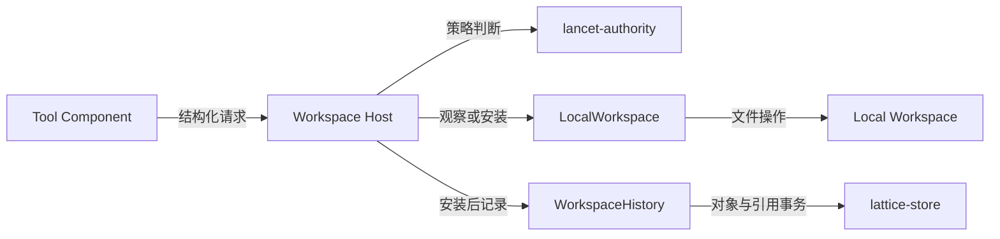

# 本地工作区与变更历史

> 类型：架构合同
> 上位依据：[项目宪章](../governance/charter.md)、[宿主平台](platform.md)

## 目的与范围

本合同规定 LATTICE 对本地工作区的观察、文件变更与私有变更历史的职责、接口和行为边界。
维护归属为 `lancet-runtime` 的工作区与历史模块。[Cell 合同](cell.md#准入与操作授权)维护能力准入与操作授权，[会话合同](session.md)维护会话树、执行者消失后的 Turn 与会话退回，[存储合同](storage.md)维护私有库布局、锁和发布机制；本文规定工作区操作如何使用这些机制。工具组成与执行入口见 [LANCET 合同](lancet.md)。

本文承接范围及仍需核验的实现问题见文末。

## 模型与职责

### 工作区、内容身份与历史

- **Local Workspace** 是规范化项目根下的当前文件树，是观察和变更的文件事实来源。用户和其他进程可以同时修改它。
- **Policy-Visible Workspace** 是读取策略允许观察的当前路径集合，由本地状态过滤而来，不复制文件，也不建立跨调用快照。
- **Local Revision** 标识一次观察所依据的文件内容。编辑携带该内容身份作为 Mutation Precondition；创建的前提是目标仍不存在。
- **Workspace History** 保存 LATTICE 已安装变更的前后内容与关联身份，以私有 Git 对象和引用表达。记录范围限于 LATTICE 触及的路径，不收集整个项目的外部修改。
- **会话树**保存会话及工具交互。会话与工作区历史的关联由历史一侧承载：每条变更记录带 `TurnId` 与 `InvocationId`，会话树不保存工作区历史位置。会话退回只移动会话当前位置，不恢复本地文件。

术语入口为[领域术语表](../reference/glossary.md)，会话树的精确模型由[会话合同](session.md#会话turn-与会话树)承接。

### 组件接口

| 组件 | 工作区相关职责 |
| --- | --- |
| `lancet-authority` | 路径可见性、系统路径排除、Guard 与 Cell 策略判断 |
| `lancet-runtime` | Tool Host 工作区接口、具体路径解析、观察、安装与历史记录 |
| `lancet-api` | 组合运行时，提供工作区历史库定位 |
| `lattice-api` | 将 profile 转为策略 |
| `lattice-store` | 提供领域中立的私有 Git 对象、引用、锁与持久化机制 |

生产 Tool 通过 Host 的结构化接口访问工作区。输入数据不解释为 shell 语法；Tool 不接收可绕过策略的文件系统或存储句柄。
Host 内部的 `LocalWorkspace` 封装路径解析、前提核验和安装，`WorkspaceHistory` 负责记录与规划，不直接写本地工作区。

下图表示组件间的调用或数据传递，连线不表示事务边界：

### 私有存储与数据关系

工作区历史使用[私有状态布局](storage.md#私有状态根)中的项目级 `workspace-history.git`，不修改用户 Git 的对象、引用、索引或 HEAD。生产路径遵循[严格打开](storage.md#打开)与[首次创建](storage.md#仓库首次创建)，由工作区领域继续核验历史事实，不把缺失存储当成空历史。

- Git blob 保存内容，tree 表达相关路径的前后状态，commit 表达顺序及父子关系，`refs/lattice/workspace-history/current` 指向当前记录的变更。
- 变更记录关联 `InvocationId`、`TurnId`、效果序号、方法、路径及前后内容身份。关联信息不决定 Invocation 的终态。
- 父 tree 必须与安装器实际观察到的变更前内容相符。当前记录机制在需要时插入 baseline commit，使外部修改后的真实前态也可恢复；baseline 不作为一次 Tool 变更。
- 历史只追加：`current` 只随新记录的变更前进，已记录的提交始终是 `current` 的祖先。按 `TurnId` 或 `InvocationId` 可以从 `current` 向前找到对应的变更提交。当前不提供恢复文件的操作；历史保留前后内容与关联身份，将来另行裁决的恢复设计从中推导位置。

## 路径与观察

### 路径策略

工作区请求使用 UTF-8 项目相对路径。Host 打开规范化项目根的目录句柄，从该句柄以 `openat2(RESOLVE_BENEATH | RESOLVE_NO_SYMLINKS)` 一次解析并打开目标或其父目录：路径中任一段是符号链接，或解析会离开项目根，都在打开时拒绝。之后的读取、列举、遍历与写入只作用于所得句柄，或该句柄下的单段名称。系统路径排除在 Host 执行文件操作前拒绝。
系统路径排除覆盖用户 Git 管理状态、LATTICE 私有状态和项目根之外的路径，profile 不得放宽。

读取可见性的优先级为：

1. 系统路径排除。
2. 显式读取拒绝。
3. 显式包含被忽略路径。
4. 默认选择已跟踪及未被忽略的文件。

`read`、`list`、`grep`、`find` 对文件内容、路径名称与搜索结果应用相同规则。
隐藏路径对 guest 表现为不存在，隐藏原因留在 Host 证据中。
写入策略使用独立的拒绝规则，不能从读取可见性推导写权限；每次 Host 操作还须满足所准入 Cell 的通道、作用域及效果要求。

### 观察接口与边界

Host 负责计算可见内容、内容身份、遍历限制和截断结果，并计入本次 Turn 的观察预算。
文件读取的 `content_hash` 是后续编辑的 `expected_hash` 来源，调用方原样传回，最终核验由 Host 完成。

单次观察受字节、行、目录深度、条目或匹配数量等相应上限约束。截断与超限应明确返回；长遍历检查取消信号并返回相应的类型化结果。
操作之间可以看到新的外部修改，不承诺多个读取结果属于同一个全局文件系统快照。

## 文件变更

### 请求与安装

`mutate__create` 安装一个新文件，目标存在时拒绝覆盖；`mutate__edit` 对已有文件生成最终内容，并携带所依据的内容身份。
Host 负责写入大小限制、路径与策略核验、取消检查及最终 Mutation Precondition 核验。
语义编辑使用 replace/insert 和可选的 occurrence 选择。匹配缺失、歧义及指定 occurrence 不存在保留可供重新规划的诊断；空匹配文本、非法 occurrence 属于输入验证错误。操作成功应用后依次拒绝 no-op、trailing newline 状态改变，以及向已有空文件插入内容；传输格式变化不得丢失这些行为或诊断。共享语义与参数用法见[工具开发指南](../development/tool-development.md#语义编辑)。Host 在安装前执行 WriteLimits 字节限制，不信任 guest 已校验的声明。
本地文件变更模块统一负责内容准备、目标安装、持久化、辅助资源清理及效果报告，供 Host 变更使用。历史记录与会话协调由调用方所属领域负责，依据模块返回的实际效果继续处理。

正常路径依次为：

1. 校验结构化请求，解析目标路径，核对权限与操作限制。
2. 取得项目独占操作锁，在当前本地状态上核验创建或编辑前提。
3. 在 Host 安装边界核验相关前提和取消状态，在目标目录准备完整内容并完成要求的文件同步。
4. 以不覆盖已有目标的方式创建，或以原子名称替换方式安装编辑结果，并同步父目录。
5. 记录私有变更历史和 Host 已观察效果，返回安装结果。

原子可见性限定于单个目标路径的安装：通过该目标名称不会读到安装过程中的半写入内容。
成功安装立即改变 Local Workspace；随后 Tool、模型或 Turn 失败，不自动撤销这次变更。
文件安装、工作区历史发布和 Invocation 终态发布不是同一笔事务。

### 效果报告与辅助资源清理

文件变更结果分别表达目标是否已改变、持久性是否已确认，以及辅助资源的清理结果；无法确认的事实标为未知。错误保留发生阶段和原因，已安装或已删除的事实不因后续同步、清理失败而丢失。

模块在结束操作前清理不再需要的临时名称。操作失败时，对本次新建的父目录按从内到外的顺序尽力恢复原样：

- 清理前核验资源仍属于本次操作。仅移除可确认未被外部使用的辅助资源；目录须为空，原有目录和外部新增内容保持不变。
- 清理失败保留原始错误，并报告已知残留和无法确认的清理结果。
- 已安装的目标内容不作为辅助资源回滚。后续恢复须重新核验当前状态，避免覆盖外部写入。

### 失败与后续处理

| 阶段或情形 | 文件与历史事实 | 处理边界 |
| --- | --- | --- |
| 路径、权限或大小校验拒绝 | 尚未安装目标文件，不追加变更历史 | 返回类型化拒绝及相应证据 |
| 创建目标已存在、编辑内容身份过期或语义编辑需要重新规划 | 不安装本次候选内容 | 返回 `ReplanRequired`；Agent 重新观察并发起新调用，不自动合并或重放旧调用 |
| 最终安装前取消或 I/O 失败 | 本次目标文件安装未发生，可能已有辅助资源 | 返回对应错误，按辅助资源清理规则尽力恢复并报告残留 |
| 名称安装完成，父目录同步失败 | 目标已经变化，安装持久性尚未确认 | 保留安装事实，继续尝试历史记录并记录已安装效果；不报告完整成功 |
| 安装后历史发布失败 | 本地安装事实仍成立，历史发布未能确认成功 | 返回结果不确定的错误及已观察效果，不通过扫描历史猜测成功终态 |

当前 Host 将历史错误映射为 `OutcomeIndeterminate`；父目录同步失败且历史记录成功时返回 `ExecutionFailed`。
这些错误属于工作区 Host 层；[调用结果](lancet.md#结果证据与失败处理)与[会话合同](session.md#重开取消与未完成状态)分别决定调用槽位和 Turn 的关闭方式。

调用方不得仅凭错误、超时或取消推定文件未改变。安装后的失败需要核验实际文件与持久引用；本文不将重新执行 Tool 作为补救方式。

## 并发边界

### 操作锁

`WorkspaceOperationLock` 按项目设置，是参与该协议的 LATTICE 操作之间的协调锁：

- 观察持共享锁，覆盖一次有界操作。
- 变更在内容身份与前提核验前取得独占锁，持有至安装和历史发布结束。

持锁凭据、获取顺序及互斥规则遵循[存储锁机制](storage.md#锁与并发语义)。会话绑定操作先按[会话锁范围](session.md#操作锁)取得 SessionExecutionLock，再按上述期限持有项目锁。关闭 Step 与 Turn 不取得该锁，也不访问工作区历史库。

非 LATTICE 写者不受该操作锁控制。外部进程仍可能在最后一次前提核验与安装之间或安装后写入；原子安装和内容身份核验不提供外部写者串行化，也不提供整个 Turn 的快照隔离。

### 路径包含

`openat2` 保证每次解析与打开时，对象位于项目根下，且路径中没有符号链接。打开之后，对象可能被外部进程移出项目根；此时 LATTICE 访问的仍是这个原本在根内的对象：读取不到其他对象，写入也只落在外部进程本就能写的位置，因此不构成越权访问，只会造成证据记录的路径与对象实际位置不一致。此边界接受。

## 验证与承接

### 验证入口

按变更影响选择检查，不将以下命令作为每次文档修订的必跑集合：

| 检查对象 | 入口 |
| --- | --- |
| 可见性、观察限制与 Host 证据 | `cargo test -p lancet-runtime --lib host_workspace::` |
| 前提、安装、历史错误及安装后同步失败 | `cargo test -p lancet-runtime --lib host_mutate::` |
| 私有历史记录与读取 | `cargo test -p lancet-runtime --lib history::` |
| 变更记录与 Turn/调用身份的关联 | `cargo test -p lattice-api --test workspace_history_acceptance` |

验证分层与[被测二进制要求](../development/testing.md#被测二进制)由测试工程合同维护，运行配方见[验证操作指南](../development/validation-guide.md)。测试结果与未验证范围记录在对应任务中。

### 来源与承接范围

- [领域术语表](../reference/glossary.md)：保留工作区、内容身份、前提及历史的简短定义与关键区别，完整规则由本文维护。
- 观察、变更、语义编辑与工作区历史由本文维护；操作资料见[工具开发指南](../development/tool-development.md)。
- [ADR 0003](../adr/0003-lancet-operates-directly-on-local-workspace.md)：Direct-Local、路径策略与单路径安装的设计依据；组件归属结合 [ADR 0004](../adr/0004-build-closed-wasm-tool-catalog.md) 的修订读取。其中的文件 Rewind 已由 ADR 0006 取消。
- [ADR 0005](../adr/0005-durable-turn-invocation-and-private-git-stores.md)：项目工作区历史库与锁序的依据；会话、调用存储、全局 checkpoint 与 Rewind 部分已由 ADR 0006 取代。
- [ADR 0006](../adr/0006-tree-session-and-global-redb-store.md)：会话退回只移动对话位置、取消文件 Rewind 与 Turn checkpoint 的依据。文件恢复如需提供，另行裁决。
- [lancet-runtime 局部指引](../../crates/lancet-runtime/AGENTS.md)、[lancet-api 局部指引](../../crates/lancet-api/AGENTS.md)、[lattice-api 局部指引](../../crates/lattice-api/AGENTS.md)：现有职责、操作锁与安装后失败要求。

现行规则以本文及对应合同为准，旧实施计划与根记录保留为历史证据，局部入口另行整理。

### 实现与验证待办

- 本文的统一文件变更职责、效果报告与辅助资源清理要求属于本轮设计补充，尚未完成实现与故障验证。需核验父目录来源记录、清理安全条件及残留报告；进程突然退出后的残留发现与处理边界仍待确认。
- 安装后历史失败、引用已发布但持久性未确认等情形，仍需核验诊断与后续处理的完整边界。
- grep 返回载荷的聚合限制，以及 symlink 列举行为的差异，尚未在本轮复验。

上述核对涉及[本地安装](../../crates/lancet-runtime/src/workspace/local.rs)与[Host 变更](../../crates/lancet-runtime/src/host_mutate.rs)。源码用于核验实现事实，不自行改变规范要求。
