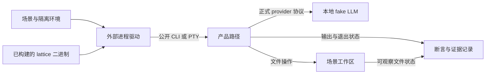

# 测试工程

> 类型：工程合同
> 上位依据：[项目宪章](../governance/charter.md)、[宿主平台](../architecture/platform.md)

## 目的与范围

本合同规定测试分层、外部二进制验证、场景隔离、执行资源和失败证据的要求。产品 crate 维护局部不变量，`lattice-system-harness` 维护外部系统测试，`xtask` 维护验证与发布证据入口。

本文件为承接草案，旧 [测试与验证](../TESTING.md) 尚未退役。工具安装、日常操作配方与历史验证记录暂留旧文档；根 [Agent 工作指引](../../AGENTS.md#开发与测试纪律) 继续维护按风险选择最小充分验证集的通用纪律。

## 测试分层与归属

| 层次 | 负责的断言 | 入口 |
| --- | --- | --- |
| crate 局部不变量 | 解析、错误映射、纯逻辑、类型关系与组件内部边界 | `src/` 中的测试模块、同目录测试文件及 crate 的 `tests/` |
| 快速二进制黑盒 | CLI 帮助、配置、环境隔离和子命令输出 | harness 的 `fast_*` 及对应驱动测试 |
| Direct-Local 产品场景 | 真实 Turn、观察与变更、调用、取消、重开、操作员读取及 TUI 接线 | harness 的 `direct_*`、`direct_local_turn`、`pty_tui_smoke` |
| 人工体验检查 | 交互感受、可读性与操作体验 | 人类操作与评审 |

产品行为通过构建出的 `lattice` 二进制及正式配置进入真实产品路径。新增产品场景归入外部 harness；产品 crate 内测试集中保护局部契约。
`lattice-api/tests/` 中既有的兼容、Rewind 和历史验收保留为明确例外，不作为新增产品场景放入产品 crate 的依据。

人工检查补充自动化无法判定的体验，不作为功能唯一的正确性门禁。rollout 是组合自动验证与产物身份的发布证据流程，不是第五层测试或人工体验检查。

新增测试应有独立失败信号。测试价值、重复场景、墓碑测试和注释纪律按 [Agent 工作指引](../../AGENTS.md#测试与注释) 执行。过滤执行须确认实际匹配并运行了目标测试，零测试通过不能作为所请求验证的成功。

## 外部 harness 的边界

### 产品接入与观察

`lattice-system-harness` 不依赖产品 crate，通过 `LATTICE_BIN` 获得被测产品。通用系统、序列化、临时目录、PTY 和 Git 库可以作为依赖，依赖边界由 `cargo xtask harness-boundary` 检查。

会话与调用状态通过公开 CLI 读取。既有工作区历史场景为验证私有 Git 历史，使用通用 Git 库检查对象与引用；这不授权 harness 导入产品实现或扩大为任意私有状态读取接口。
未通过公开接口暴露的内部数据关系由对应库测试保护。

fake LLM 使用正式的 `OPENAI_COMPATIBLE_*` 配置接入。场景不增加隐藏产品参数、测试专用 provider 或绕过真实调用流程的产品分支。

下图表示场景驱动与观察的关系：

### 被测二进制

测试前须构建与当前验证对象相符的 `lattice`。`LATTICE_BIN` 指向测试进程可解析的真实文件；驱动在创建场景子进程前将其规范化为绝对路径，后续切换场景工作目录不改变目标。
缺少变量、路径不存在或不能规范化均为验证失败，不回退搜索 PATH 中的其他二进制。

绝对路径是推荐传递方式，不是驱动对输入形式的强制限制。相对路径按测试进程的工作目录解析，不能假定它相对于仓库根。
调用者须核对二进制来源、构建配置和所测工作区；文件存在与路径规范化本身不能证明二进制未过期。

`xtask ci` 仅在 `LATTICE_BIN` 未设置时补入当前仓库的 debug 路径。worktree 或切换分支后仍继承旧值时，应显式指向当前产物或在该次命令中取消旧值。具体构建命令参照旧测试文档，宿主与 Source Tool guest 产物分别构建，不将 guest 当作 Linux 宿主二进制。

### 场景隔离

每个场景持有独立的临时项目、HOME/XDG 和会话状态，使用操作系统分配的端口。场景项目的 `.env` 默认为空；环境注入专项测试只写入本场景构造的数据。

`git` 与 `lattice` 子进程均从 `env_clear()` 后的明确允许列表启动，不继承开发者 HOME、Git 配置、凭据或无关 provider 环境。
需要测试变量不存在时，移除变量；将值设为空仍表示变量已定义，不能代替不存在状态。

场景内部并发与取消通过 `ResponseGate` 等可控制事件及有界等待同步。通用驱动可以共享，特定场景的夹具和断言保持在本场景；不靠全局串行执行掩盖隔离或竞争问题。

## 执行与资源边界

### 超时与进程生命周期

Direct-Local 场景同时限制单命令和整个场景耗时。每次启动命令使用 `min(step_timeout, remaining_total)`，累计步骤不能绕过场景总预算。
当前默认边界由 `ScenarioSpec` 及场景配置维护：普通 Direct-Local 为每命令 30 秒、场景 180 秒，PTY smoke 为每命令 120 秒、场景 300 秒。修改边界须说明适用场景与原因，不以放宽超时掩盖停滞。
这些是测试驱动的等待上限。产品内部的 [Turn deadline](../architecture/session.md#模型请求与执行预算)与 [FinalizeBudget](../architecture/session.md#resultdraft-与关闭材料)由会话合同维护；驱动超时不能据此推定产品尚未发生效果或已经完成持久关闭。

子进程在 Linux 独立进程组中运行。超时和受控中断保留已收集的 stdout/stderr，回收直接子进程并清理整个进程组；清理失败、存活进程和输出不完整均进入诊断。
Direct-Local 不依赖虚拟机、守护进程或容器镜像。已选场景的环境故障作为失败报告，不以跳过当作通过。

编译并发、重型验证数量和重复运行遵循根指引。超时后的重试先确认旧验证进程已退出，不启动重叠测试来替代结果核验。

### 验证集与显式 feature

普通验证包含默认启用的快速、Direct-Local 和 PTY 场景。`release_operator` 使用 `release-operator` feature；崩溃屏障目标使用 `crash-barriers` feature，未启用不代表已运行。
选用故障注入场景时，被测二进制和测试目标须具备所需配置，不能用普通产物冒充带屏障的故障验证。

本地选择局部验证与远程门禁分别处理。报告列明测试目标、feature、构建模式和实际结果，不能将普通套件通过推广为所有显式 feature 均已验证。

## 失败证据

### 报告与持久化

快速断言与 Direct 场景使用共同的失败报告，分别保留：

1. 排序去重的秘密泄露位置。
2. 原始断言失败。
3. 仅含安全元数据的命令诊断。
4. 按发生顺序保留的独立证据错误。

目录占用、清理、写入或扫描失败不能覆盖原始断言。命令诊断先于 bundle I/O 形成，使持久化失败时仍能报告退出、超时、清理和输出完整性信息。

失败 bundle 写入 `LATTICE_HARNESS_FAILURE_DIR` 指定的根目录；未设置时使用 harness crate 下的 `target/harness-failures/`。路径应独立于场景子进程工作目录，产物留在忽略的运行目录中。

场景名称必须是单个普通路径分量，拒绝空名、绝对路径、`.`、`..`、NUL、多分量及保留名称 `.claims`。
写者在清理旧产物前取得 `<base>/.claims/<scenario>.lock` 的 Linux 非阻塞独占锁，持有至持久化与扫描结束；同名并发写者立即失败，锁文件不删除。
活跃 `ScenarioEvidence` 从构造起持有该占用权，嵌套记录器使用不同场景名称。

### 脱敏与完整性

原始 stdout/stderr 仅在测试进程中供解析和断言使用；输出错误与持久副本先做字面脱敏。报告不包含匹配到的秘密正文或宿主绝对产物路径。

递归字节扫描先记录泄露位置，再修改副本；遍历、读取、重写、符号链接和特殊文件错误分别保留，并继续检查可达的其他条目。泄露位置使用安全的 bundle 相对路径。
工作区失败快照将符号链接本身作为叶子记录，不跟随其目标。

bundle 包含脱敏的命令摘要、输出、场景环境和必要工作区前后差异。多命令场景分别保留命令证据；成功场景不写失败 bundle，旧产物清理必须在持有场景占用锁之后进行。

已保留为历史证据的性能或故障 bundle 不随阈值、算法、实现或后续裁决重写。需要重评时另记来源与结论，保留原始样本、环境、来源和结果；本节的运行目录清理不授权处理这些历史证据。

## CI 与发布证据

CI 编排通过 Cargo、公开 xtask 入口或已构建二进制调用验证，不另建测试或发布门禁 shell 包装层，不恢复已退役的隔离测试通道。
格式、lint、生成物一致性、依赖边界、行为测试分别提供各自的失败信号，不互相替代。

| 入口 | 职责 |
| --- | --- |
| `.github/workflows/ci.yml` | 普通 PR 与 main push 验证，使用明确的 debug 二进制 |
| `.github/workflows/full-gate.yml` | 手动或定时的完整验证、release rollout 与 Component 可复现性证据 |
| `cargo xtask ci` | 本地验证编排，控制编译并发和每 crate 测试超时 |
| `cargo xtask rollout --channel alpha` | 对锁定 release 构建记录产物身份、验证步骤与发布证据 |

rollout 只在全部必需步骤实际通过时通过。失败、阻塞或跳过都不能算通过，测试步骤须有非零通过测试数。步骤结果逐步保存，未执行步骤保持阻塞，失败证据与产物身份关联到对应构建。
发布证据的生成不代替人类批准、合并或发布授权。

Component 可复现性检查中，仅产物摘要漂移按既有约定为警告；guest 构建、Component 编码、验证、imports 或 WIT 不符合要求仍是失败。不能将整个 `tool-build --verify` 步骤都解释为非阻塞。

固定工具链与 encoder 版本从 `rust-toolchain.toml`、相关构建入口及 manifest 读取，安装操作参照开发指南。`.githooks/pre-commit` 负责阻止误暂存忽略文件，不承担测试执行。

## 验证与承接

纯文档修订核对测试归属、被测产物、默认与 feature 场景范围、失败语义、引用和示例。修改驱动或证据机制时，先验证超时、清理、脱敏与报告的直接边界，再选必要的外部产品场景。

- [旧测试文档](../TESTING.md)：测试分层、二进制解析、夹具、超时、失败证据和 rollout 要求。操作配方、安装说明和历史材料本轮不迁出。
- [harness 局部指引](../../crates/lattice-system-harness/AGENTS.md)：外部依赖、场景隔离、进程组、证据占用及显式 feature 场景。
- [场景定义](../../crates/lattice-system-harness/src/scenario.rs)、[进程驱动](../../crates/lattice-system-harness/src/driver.rs)及 [harness manifest](../../crates/lattice-system-harness/Cargo.toml)：核验实际预算、二进制解析与目标启用条件。
- [普通 CI](../../.github/workflows/ci.yml)、[完整验证](../../.github/workflows/full-gate.yml)、[本地验证入口](../../xtask/src/ci.rs)与 [rollout](../../xtask/src/rollout.rs)：核验实际编排、构建与证据行为。

旧文档中将 rollout 称为“layer 4”及“所有场景均在普通 CI 运行”的概括不作为新定义；本合同分别描述人工检查、发布证据和 feature 场景。旧文档还存在步骤列表与解释文字不一致的问题，实际顺序以经核验的工作流和 xtask 为实现事实，不在本轮调整 CI。
[Bundle 安装与活动版本切换](../architecture/lancet.md#bundle-安装设计)尚未实现，其验证不属于现有默认产品矩阵的覆盖。合同生效时再按范围切换旧入口和局部引用。
