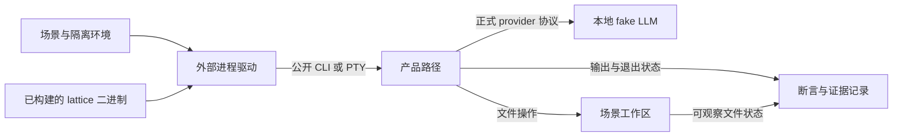

# 测试工程

> 类型：工程合同
> 上位依据：[项目宪章](../governance/charter.md)、[宿主平台](../architecture/platform.md)
> 修订状态：本工作分支的自有产品后台、跨进程场景与清理职责修订待人类批准；生效前[原有效版本](https://github.com/Skyline10124/lattice/blob/0e20dc090dce79330e06276da8255e9f4fb8cc39/docs/development/testing.md)继续适用。

## 目的与范围

本合同规定测试分层、外部二进制验证、场景隔离、执行资源和失败证据的要求。产品 crate 维护局部不变量，`lattice-system-harness` 维护外部系统测试，`xtask` 维护验证与发布证据入口。

[验证操作指南](validation-guide.md)维护工具安装、日常运行与证据查看；根 [Agent 工作指引](../../AGENTS.md#开发与测试纪律)继续维护按风险选择最小充分验证集的通用纪律。

## 测试分层与归属

| 层次 | 负责的断言 | 入口 |
| --- | --- | --- |
| crate 局部不变量 | 解析、错误映射、纯逻辑、类型关系与组件内部边界 | `src/` 中的测试模块、同目录测试文件及 crate 的 `tests/` |
| 快速二进制黑盒 | CLI 帮助、配置、环境隔离和子命令输出 | harness 的 `fast_*` 及对应驱动测试 |
| Direct-Local 产品场景 | 真实 Turn、观察与变更、调用、取消、重开、操作员读取及 TUI 接线 | harness 的 `direct_*`、`direct_local_turn`、`pty_tui_smoke` |
| 人工体验检查 | 交互感受、可读性与操作体验 | 人类操作与评审 |

产品行为通过构建出的 `lattice` 二进制及正式配置进入真实产品路径。新增产品场景归入外部 harness；产品 crate 内测试集中保护局部契约。
`lattice-api/tests/` 中既有的兼容、Rewind 和历史验收保留为明确例外，不作为新增产品场景放入产品 crate 的依据。

人工检查补充自动化无法判定的体验，不作为功能唯一的正确性门禁。rollout 是组合自动验证与产物身份的发布证据流程，不是第五层测试或人工体验检查。

新增测试应有独立失败信号。测试价值、重复场景、墓碑测试和注释纪律按 [Agent 工作指引](../../AGENTS.md#测试与注释) 执行。过滤执行须确认实际匹配并运行了目标测试，零测试通过不能作为所请求验证的成功。

测试场景和夹具应反映真实使用：正常操作、读写失败、断线、崩溃等普通故障，以及用户配置、模型响应和其他外部输入。模拟组件应遵循真实组件可产生的状态与消息时序，使失败信号对应实际风险，而非仅由夹具制造的内部矛盾。
断言依据对应合同核对具体语义，分别判断任务结局、接受或完成确认、观察与正文读取结果。同属失败或文案相近不表示语义相同；例如提交确认暂时未知不能单独证明任务失败。这样才能在精简实现时保护真实行为，而不固化测试自造的行为。

## 外部 harness 的边界

### 产品接入与观察

`lattice-system-harness` 不依赖产品 crate，通过 `LATTICE_BIN` 获得被测产品。通用系统、序列化、临时目录、PTY 和 Git 库可以作为依赖，依赖边界由 `cargo xtask harness-boundary` 检查。

会话与调用状态通过公开 CLI 读取；本地请求回执及订阅边界可通过公开 Local IPC 验证，不导入产品类型或直接调用进程内实现。既有工作区历史场景为验证私有 Git 历史，使用通用 Git 库检查对象与引用；这不授权 harness 导入产品实现或扩大为任意私有状态读取接口。
未通过公开接口暴露的内部对象关系、引用事务与 fsync 故障由对应库测试保护。

fake LLM 使用正式的 `OPENAI_COMPATIBLE_*` 配置接入。场景不增加隐藏产品参数、测试专用 provider 或绕过真实调用流程的产品分支。

下图表示场景驱动与观察的关系：

### 被测二进制

测试前须构建与当前验证对象相符的 `lattice`。`LATTICE_BIN` 指向测试进程可解析的真实文件；驱动在创建场景子进程前将其规范化为绝对路径，后续切换场景工作目录不改变目标。
缺少变量、路径不存在或不能规范化均为验证失败，不回退搜索 PATH 中的其他二进制。

绝对路径是推荐传递方式，不是驱动对输入形式的强制限制。相对路径按测试进程的工作目录解析，不能假定它相对于仓库根。
调用者须核对二进制来源、构建配置和所测工作区；文件存在与路径规范化本身不能证明二进制未过期。

`xtask ci` 仅在 `LATTICE_BIN` 未设置时补入当前仓库的 debug 路径。worktree 或切换分支后仍继承旧值时，应显式指向当前产物或在该次命令中取消旧值。具体构建命令见[验证操作指南](validation-guide.md#安装与构建产物)，宿主与 Source Tool guest 产物分别构建，不将 guest 当作 Linux 宿主二进制。

### 场景隔离

每个场景持有独立的临时项目、HOME/XDG 和会话状态，使用操作系统分配的端口。场景项目的 `.env` 默认为空；环境注入专项测试只写入本场景构造的数据。

`git` 与 `lattice` 子进程均从 `env_clear()` 后的明确允许列表启动，不继承开发者 HOME、Git 配置、凭据或无关 provider 环境。
需要测试变量不存在时，移除变量；将值设为空仍表示变量已定义，不能代替不存在状态。

场景内部并发与取消通过 `ResponseGate` 等可控制事件及有界等待同步。通用驱动可以共享，特定场景的夹具和断言保持在本场景；不靠全局串行执行掩盖隔离或竞争问题。

### Fake provider 的确定性边界

fake provider 只接受单连接单个 `POST /chat/completions HTTP/1.1`，请求头使用 CRLF，Host 非空且恰好一个，Content-Type 恰好一个且为 application/json；名称大小写不敏感，拒绝控制字符与折叠。Content-Length 须为单个非负十进制字段，拒绝 Transfer-Encoding、重复/冲突长度及非法 UTF-8，不使用 lossy 转换。合法 UTF-8 的非 JSON body 保留为诊断，不虚构有效模型请求。

headers 连同终止符上限 16,384 bytes，body 声明上限 1,048,576 bytes；在扩大缓冲或分配 body 前校验，读写使用固定两秒 deadline。拒绝响应使用不回显输入的固定 ASCII body。响应头使用 CRLF 和按字节计数的 Content-Length，发送一次后关闭连接；不承诺检测未来 keep-alive/pipelining 字节，不扩展通用 HTTP 服务。

验证后的 request capture、Sequence 选择/推进与到达通知在同一临界区发生，gate 只控制交付，不重排脚本归属。超出 Sequence 重复最后一项，空 Sequence 产生 IllegalResponse。request/stall/release/shutdown 采用有界握手；shutdown 唤醒 accept、取消 gate，确认线程完成后才 join，Drop 不作无界等待。保留首个 fixture failure，捕获已不可能时提早报告，shutdown 在有界清理后返回该错误；不另建 health 或 failure 订阅接口。实际接口和固定响应维护于 [`fake_llm.rs`](../../crates/lattice-system-harness/src/fake_llm.rs)。

## 执行与资源边界

### 超时与进程生命周期

Direct-Local 场景同时限制单命令和整个场景耗时。每次启动命令使用 `min(step_timeout, remaining_total)`，累计步骤不能绕过场景总预算。
当前默认边界由 `ScenarioSpec` 及场景配置维护：普通 Direct-Local 为每命令 30 秒、场景 180 秒，PTY smoke 为每命令 120 秒、场景 300 秒。修改边界须说明适用场景与原因，不以放宽超时掩盖停滞。
这些是测试驱动的等待上限。产品内部的 [Turn deadline](../architecture/session.md#模型请求与执行预算)与 [FinalizeBudget](../architecture/session.md#resultdraft-与关闭材料)由会话合同维护；驱动超时不能据此推定产品尚未发生效果或已经完成持久关闭。

前端子进程在 Linux 独立进程组中运行。超时和受控中断保留已收集的 stdout/stderr，回收直接子进程并清理该进程组；清理失败、存活进程和输出不完整均进入诊断。产品后台使用另一独立进程组，由场景单独持有清理责任。

Direct-Local 使用场景自有的产品后台，可以通过正式入口自动启动或显式启动；不依赖开发者已运行的后台、虚拟机或容器镜像。本条修订原“不依赖守护进程”的范围，隔离与清理要求覆盖所有可能自启后台的 fast、Direct 和 PTY 场景。已选场景的环境故障作为失败报告，不以跳过当作通过。

场景在首次可能自启后台之前登记当前产物与自有状态根。结束时先请求正常 stop，等待接管任务及必要收尾，再核验自有后台进程组已退出；异常时仅对核验了产物、参数、状态根及组归属的自有进程组强制清理。清理早于临时状态删除，失败时保留诊断及所需状态，不能覆盖原始断言。不能仅凭 PID 或后台组首领消失推定整个组已退出。

`CommandOutcome` 是命令结果的唯一完整模型，分别保留观察到的 exit/signal、按序发生的 harness interventions、所有清理错误、存活 PID 和 stdout/stderr 的 EOF 完整性。exact clean exit 要求匹配的退出码、无干预、无强制清理、无清理错误或存活者，且两条输出流完整；不能用信号、缺失状态或单纯 exit 0 代替。摘要与 Debug 只含安全元数据，不从信号推定产品 panic。清理 SIGKILL 的 ESRCH 仅在立即复核进程组为空后可忽略，不能推广到请求的 SIGINT。

命令预算从 spawn 开始，provider request、stall、release 与最终 wait 共用剩余预算，不能在 wait 时重新计时。PTY raw 模式提交使用回车 `\r`；输出排空按 deadline 限制等待，不能等阻塞 read 返回后才检查超时。

编译并发、重型验证数量和重复运行遵循根指引。超时后的重试先确认旧验证进程已退出，不启动重叠测试来替代结果核验。

### 后台与重连场景

这些场景检验同一条提交链上的不同边界：提交端按需提供配置，后台接管执行，前端独立读取与观察。正常协作见[从提交到结果可见](../architecture/session.md#从提交到结果可见)；测试不负责另立提交协议。`Gap` 指观察事件不连续的通知，收到后用后台重新固定的历史/进度版本读取持久对话，见[观察与重连](../architecture/session.md#观察与重连)。

共同交付、双向取消回执交接、固定历史与完成分类由 API 的具体交互句柄 [LocalTurn](../architecture/session.md#组件与接口) 局部测试保护。CLI IPC 回归核验真实信号、记录与退出选择；TUI run_loop 回归核验按键、完成先于正文、新后缀及按 InvocationId/来源配对的绘制。局部测试控制真实接口的回执、读取和调度窗口；前端实际入口仍需下面的外部场景核验。

以下按目标、准备、操作、观察、断言、清理组织场景要求。共同准备遵循[被测二进制](#被测二进制)和[场景隔离](#场景隔离)，共同清理遵循[超时与进程生命周期](#超时与进程生命周期)。每个场景记录自己的 gate、进程对象及实际命中窗口；入口已有测试不代表以下全部要求已经覆盖或通过。

#### 接受后断开前端

1. 目标：验证后台接受的任务不随 CLI/TUI 退出而结束。
2. 准备：在自有状态根创建 Session，保存请求身份，以 provider gate 控制接受后的执行进展。
3. 操作：确认接受后真正结束前端，再释放 gate；另起客户端用原 TurnId 查询结果。
4. 观察：分别记录前端退出与输出 EOF、后台存活和最终固定结果。
5. 断言：后台完成原请求，结果与预期脚本相符，provider/Tool 调用次数未因新客户端连接增加。只结束前端进程组，不以同时杀后台冒充断连。
6. 清理：新查询客户端结束后，对仍在运行的自有后台执行共同清理，再处理临时状态。

#### 接受回执丢失后找回

1. 目标：验证回执丢失时使用原身份找回同一 Turn。
2. 准备：保存 SessionId、TurnId、原始输入与工作区，设置公开 IPC 的可控制未读回执窗口。
3. 操作：在该窗口断开提交连接，以同一身份和输入重试；分别覆盖后台持续运行和后台重启后的找回。
4. 观察：保留未读回执窗口证据、接受/找回结果、固定 Turn 结果以及 provider 请求计数。
5. 断言：重试不增加模型循环或工具执行；输入或绑定不同按合同拒绝。同请求 pending 找回仅确认原接受，关闭另走恢复。原提交回执尚未返回时，可读 pin 不能使前端提前结束确认等待；真正独立 Finished 可以先行交付，包括带完成失败的情况。仅在 provider 收到请求后杀前端不足以证明回执丢失。
6. 清理：先让在途提交及回执驱动退场，再分别核验前后台清理和证据完整性。

#### 同会话排他与跨会话并发

1. 目标：验证同 Session 忙时拒绝新请求，同项目不同 Session 的模型执行可以重叠。
2. 准备：在同项目创建两个 Session，以独立 gate 识别各自 provider 请求。
3. 操作：保持第一个 Turn 在途，向同 Session 发送另一请求，同时向第二个 Session 提交任务。
4. 观察：读取 Busy 回执，并在释放第一个 gate 前确认第二个 provider 请求已经到达。
5. 断言：同 Session 的新请求未接受，输入可供稍后发送；跨 Session 重叠由到达事件证明，不能从耗时猜测。共享工作区仍按操作锁协调。
6. 清理：释放所有 gate，分别保存每个请求结果，再停止共用的自有后台。

#### 固定对话、观察缺口与读取失败

1. 目标：验证已保存对话、临时文字、执行 outcome 和完成确认各自的显示与失败边界。
2. 准备：脚本包含可区分的用户/模型消息和工具结果，设置 pending、已关闭及当前模型段切点；分别控制慢订阅、Gap、断连、idle、内容失败或挂起，以及 ToolCall 历史迟于同 ID finished 的窗口。
3. 操作：读取 pending 与已关闭 Turn；在模型段中途重连后继续发送新文字；使观察缺失后重载；分别令内容读取返回错误或保持等待，再交付独立完成。工具场景先交事件，后放行历史读取。
4. 观察：记录固定对象地址、snapshot/transcript、Gap/连接诊断、新文字、工具身份与显示来源，以及独立完成回执。
5. 断言：Gap 有提示，新切点清除旧临时显示，同切点 History 保留新后缀，持久前缀不重复，缺失旧 token 不补造。工具按 InvocationId 合并且持久 ToolResult 优先于事件。慢读不挡 Finished，读取错误或挂起不撤销 outcome/确认；旧读取成功不覆盖新视图，已发生错误仍保留原对象。后台执行不受慢读或断连影响。未公开的内部交接窗口由局部测试核验，不以末尾事件必达判成功。
6. 清理：解除读取/订阅 gate，关闭观察者；确认后台收尾，按共同规则保留未完整输出和清理诊断。

#### 取消接管后退出

1. 目标：验证后台接管的取消意图在前端立即退出后仍被处理。
2. 准备：保存原身份，分别控制独立探测、配置尚在连接中、后台实际接管配置后的准备及执行窗口；明确区分可证明未建立任务的配置拒绝与未知发布。
3. 操作：单次取消获 true 后立即退出前端，放行后台直至独立收尾；另覆盖无配置共享真实操作、明确拒绝且监督退场后的同身份新准入，以及本客户端停止配置而另一连接已接受的交错。
4. 观察：记录接管/未接管/确认未知回执、前端退出、后续固定结果和已发生效果；保留请求及诊断的真实归属。
5. 断言：依[取消规则](../architecture/session.md#取消与退出)核验实际操作的接管资格、同载体独立收尾及拒绝后新准入。未提交只断言本客户端后续配置未发送，不能据此否定其他连接已接受或已接管。取消不抹去先前终态或文件效果，true 不等于持久 Cancelled。局部测试分别保护两种回执次序的一次补发、true 不补发、五秒未知交接后继续观察及迟到传输诊断，后台错误与配置加载失败单独对照。
6. 清理：让后台完成必要收尾；确认未知时保留身份与诊断，按共同清理规则处理，不能为清理改写原失败。

#### 停止后台与排空

1. 目标：验证 stop 关闭新准入，等待已接管工作及必要持久收尾。
2. 准备：用 gate 保持已接管操作在途，另备查询、取消和新提交客户端。
3. 操作：发起 stop，在等待期间查询或取消原请求，并尝试新提交；然后释放 gate。
4. 观察：记录准入关闭、已有请求状态、stop 回执及自有后台进程组退出。
5. 断言：新工作拒绝，原工作仍可查询和取消，stop 等待其收尾；未确认操作数按本进程口径解释。连接中断或组首领退出都不能证明整个后台已退出。
6. 清理：核验整个自有后台组已空，异常只在已核验归属后强制清理；随后处理状态目录。

#### 后台崩溃与显式恢复

1. 目标：验证重连只读，恢复仅依据持久事实关闭旧 Turn，保留已发生效果和可用结果。
2. 准备：使用显式崩溃 feature 和匹配的产品二进制，在持久阶段设置屏障；核验后台身份与命中记录。
3. 操作：命中屏障后中断后台，保留前端独立退出证据；新客户端先查询，再显式 recover。
4. 观察：对照[恢复阶段与取消窗口](../architecture/session.md#显式恢复流程)记录日志停点、公开 outcome/原因、provider/Tool 调用次数和文件效果。
5. 断言：查询不恢复，recover 不重新请求模型或分发工具；已保存消息、终态和可用材料保留，写入仍失败时保留 pending 或实际候选及恢复诊断。仅内存取消、已持久取消原因、已记录 CancelTurn 分别核验：已持久取消原因与已记录 CancelTurn 关闭为 Cancelled(UserCancelled)，仅内存取消仍按对应中断关闭；非取消中断原因保持 Interrupted 透传，不统一猜成 Cancelled。
6. 清理：同时检查崩溃前后自有进程组及 stdout/stderr EOF；必要状态和原始失败进入证据后，才按共同规则清理。

#### 并发配置与 TLS 隔离

1. 目标：验证同后台各 Turn 使用提交端冻结的独立 endpoint、策略和 TLS 信任材料。
2. 准备：配置可区分的 provider/策略，准备可信根与不匹配根，使用正式配置入口和真实 TLS 握手。
3. 操作：并发提交不同 Session，在冻结后改变来源；分别提交无效根、有效根及跨根请求。
4. 观察：记录实际到达的 endpoint、策略允许/拒绝、接受结果与握手结果，证据保持脱敏。
5. 断言：冻结后源变化不改变已接管输入，各 Turn 配置互不污染；无效根在接受前拒绝，有效根握手成功，跨根拒绝。HTTP 场景不能替代 TLS 验证。
6. 清理：关闭自有 provider、gate 和产品进程，按证据合同处理临时凭据与状态，不将秘密写入报告。

外部入口为 `direct_background`、相关 `pty_tui_smoke` 与显式崩溃目标，产品内部交接由相应 crate 局部测试保护。实际覆盖、未覆盖窗口、构建身份、失败与待裁决项留在任务交接或验证证据中，不以场景规格代替执行结果。

### 验证集与显式 feature

普通验证包含默认启用的快速、Direct-Local 和 PTY 场景。`release_operator` 使用 `release-operator` feature；崩溃屏障目标使用 `crash-barriers` feature，未启用不代表已运行。
选用故障注入场景时，被测二进制和测试目标须具备所需配置，不能用普通产物冒充带屏障的故障验证。

本地选择局部验证与远程门禁分别处理。报告列明测试目标、feature、构建模式和实际结果，不能将普通套件通过推广为所有显式 feature 均已验证。

## 失败证据

### 报告与持久化

快速断言与 Direct 场景使用共同的失败报告，分别保留：

1. 排序去重的秘密泄露位置。
2. 原始断言失败。
3. 仅含安全元数据的命令诊断。
4. 按发生顺序保留的独立证据错误。

目录占用、清理、写入或扫描失败不能覆盖原始断言。命令诊断先于 bundle I/O 形成，使持久化失败时仍能报告退出、超时、清理和输出完整性信息。

失败 bundle 写入 `LATTICE_HARNESS_FAILURE_DIR` 指定的根目录；未设置时使用 harness crate 下的 `target/harness-failures/`。路径应独立于场景子进程工作目录，产物留在忽略的运行目录中。

场景名称必须是单个普通路径分量，拒绝空名、绝对路径、`.`、`..`、NUL、多分量及保留名称 `.claims`。
写者在清理旧产物前取得 `<base>/.claims/<scenario>.lock` 的 Linux 非阻塞独占锁，持有至持久化与扫描结束；同名并发写者立即失败，锁文件不删除。
活跃 `ScenarioEvidence` 从构造起持有该占用权，嵌套记录器使用不同场景名称。

### 脱敏与完整性

原始 stdout/stderr 仅在测试进程中供解析和断言使用；输出错误与持久副本先做字面脱敏。报告不包含匹配到的秘密正文或宿主绝对产物路径。

递归字节扫描先记录泄露位置，再修改副本；遍历、读取、重写、符号链接和特殊文件错误分别保留，并继续检查可达的其他条目。泄露位置使用安全的 bundle 相对路径。
工作区失败快照将符号链接本身作为叶子记录，不跟随其目标。

bundle 包含脱敏的命令摘要、输出、场景环境和必要工作区前后差异。多命令场景分别保留命令证据；成功场景不写失败 bundle，旧产物清理必须在持有场景占用锁之后进行。

已保留为历史证据的性能或故障 bundle 不随阈值、算法、实现或后续裁决重写。需要重评时另记来源与结论，保留原始样本、环境、来源和结果；本节的运行目录清理不授权处理这些历史证据。

## CI 与发布证据

CI 编排通过 Cargo、公开 xtask 入口或已构建二进制调用验证，不另建测试或发布门禁 shell 包装层，不恢复已退役的隔离测试通道。
格式、lint、生成物一致性、依赖边界、行为测试分别提供各自的失败信号，不互相替代。

| 入口 | 职责 |
| --- | --- |
| `.github/workflows/ci.yml` | 普通 PR 与 main push 验证，使用明确的 debug 二进制 |
| `.github/workflows/full-gate.yml` | 手动或定时的完整验证、release rollout 与 Component 可复现性证据 |
| `cargo xtask ci` | 本地验证编排，控制编译并发和每 crate 测试超时 |
| `cargo xtask rollout --channel alpha` | 对锁定 release 构建记录产物身份、验证步骤与发布证据 |

rollout 只在全部必需步骤实际通过时通过。失败、阻塞或跳过都不能算通过，测试步骤须有非零通过测试数。步骤结果逐步保存，未执行步骤保持阻塞，失败证据与产物身份关联到对应构建。
发布证据的生成不代替人类批准、合并或发布授权。

Component 可复现性检查中，仅产物摘要漂移按既有约定为警告；guest 构建、Component 编码、验证、imports 或 WIT 不符合要求仍是失败。不能将整个 `tool-build --verify` 步骤都解释为非阻塞。跨机可复现证据不自动触发硬门升级，硬门升级须另行提案并获人类批准。

固定工具链与 encoder 版本从 `rust-toolchain.toml`、相关构建入口及 manifest 读取，安装操作参照开发指南。`.githooks/pre-commit` 负责阻止误暂存忽略文件，不承担测试执行。

## 验证与承接

纯文档修订核对测试归属、被测产物、默认与 feature 场景范围、失败语义、引用和示例。修改驱动或证据机制时，先验证超时、清理、脱敏与报告的直接边界，再选必要的外部产品场景。

- 原 `docs/TESTING.md` 的分层、二进制解析、夹具、超时、失败证据与 rollout 要求由本文承接；操作资料已迁入[验证操作指南](validation-guide.md)。
- #185/#186/#192 的命令结果、fake provider 和失败证据规则由本文承接，原验证状态不因文档迁移改变。
- [harness 局部指引](../../crates/lattice-system-harness/AGENTS.md)：外部依赖、场景隔离、进程组、证据占用及显式 feature 场景。
- [场景定义](../../crates/lattice-system-harness/src/scenario.rs)、[进程驱动](../../crates/lattice-system-harness/src/driver.rs)及 [harness manifest](../../crates/lattice-system-harness/Cargo.toml)：核验实际预算、二进制解析与目标启用条件。
- [普通 CI](../../.github/workflows/ci.yml)、[完整验证](../../.github/workflows/full-gate.yml)、[本地验证入口](../../xtask/src/ci.rs)与 [rollout](../../xtask/src/rollout.rs)：核验实际编排、构建与证据行为。

[Bundle 安装与活动版本切换](../architecture/lancet.md#bundle-安装设计)尚未实现，其验证不属于现有默认产品矩阵的覆盖。本文后台相关修订的效力依文件头限定，未迁入的局部细则继续由相应入口承接。
