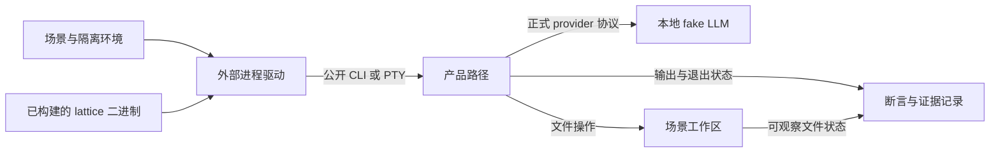

# 测试工程

> 类型：工程合同
> 上位依据：[项目宪章](../governance/charter.md)、[宿主平台](../architecture/platform.md)

## 目的与范围

本合同规定测试分层、外部二进制验证、场景隔离、执行资源和失败证据的要求。产品 crate 维护局部不变量，`lattice-system-harness` 维护外部系统测试，`xtask` 维护验证与发布证据入口。

[验证操作指南](validation-guide.md)维护工具安装、日常运行与证据查看；根 [Agent 工作指引](../../AGENTS.md#开发与测试纪律)继续维护按风险选择最小充分验证集的通用纪律。

## 测试分层与归属

| 层次 | 负责的断言 | 入口 |
| --- | --- | --- |
| crate 局部不变量 | E2E 难以稳定触发的独立失败信号：协议编解码与错误映射的边界输入、安全策略的拒绝路径、存储格式与损坏校验、存储层的模拟提交错误，以及纯算法 | `src/` 中的测试模块、同目录测试文件及 crate 的 `tests/` |
| 快速二进制黑盒 | CLI 帮助、配置、环境隔离和子命令输出 | harness 的 `fast_*` 及对应驱动测试 |
| Direct-Local 产品场景 | 真实 Turn、观察与变更、调用、取消、退回分叉、崩溃重开与执行者消失后的结局、操作员读取及 TUI 接线 | harness 的 `direct_*`（含崩溃屏障目标 `direct_crash_barriers`）、`pty_tui_smoke` |
| 人工体验检查 | 交互感受、可读性与操作体验 | 人类操作与评审 |

产品行为通过构建出的 `lattice` 二进制及正式配置进入真实产品路径。新增产品场景归入外部 harness；产品 crate 内测试只保护上表列出的局部信号。
`lattice-api/tests/` 只保留进程内的精确错误属性与私有持久数据断言，例如变更拒绝的错误码与可重试性、回执中的变更证据、工作区历史记录的修改前内容、首次接受时冻结的私有数据。这些断言需要直接读取类型化错误或私有记录，E2E 难以等价构造。这是明确例外，不作为把新增产品场景放入产品 crate 的依据。

人工检查补充自动化无法判定的体验，不作为功能唯一的正确性门禁。rollout 是组合自动验证与产物身份的发布证据流程，不是第五层测试或人工体验检查。

新增测试应有独立失败信号。测试价值、重复场景、墓碑测试和注释纪律按 [Agent 工作指引](../../AGENTS.md#测试与注释) 执行。过滤执行须确认实际匹配并运行了目标测试，零测试通过不能作为所请求验证的成功。

测试场景和夹具应反映真实使用：正常操作、读写失败、断线、崩溃等普通故障，以及用户配置、模型响应和其他外部输入。模拟组件应遵循真实组件可产生的状态与消息时序，使失败信号对应实际风险，而非仅由夹具制造的内部矛盾。
断言依据对应合同核对具体语义，分别判断任务结局、接受回执、观察与历史查询结果。同属失败或文案相近不表示语义相同；例如接受结果暂时未知不能单独证明任务失败。这样才能在精简实现时保护真实行为，而不固化测试自造的行为。

### 选择测试层

测试以覆盖全部关键路径为目标，不追求行覆盖率，用尽量少的测试代码达成覆盖：

1. 关键路径默认由构建出的二进制上的复杂场景覆盖。场景选中等以上复杂度的组合，例如多步 Turn 中途崩溃后重开、取消后退回再分叉，而不是最简单的成功路径。
2. 新增 crate 内测试前，先写出它要防的全部失败方式，并说明为什么 E2E 触发不了或触发不稳定。
3. 已由 E2E 覆盖的行为不再新增 crate 内测试。

### 故障注入

崩溃、调度交错和模拟错误统一使用 `test-crash-barriers` 产品 feature 插桩，钩子只在该 feature 下编译，普通产物不含这些分支。场景通过 harness 的 `crash-barriers` feature 启用对应目标。插桩分三类：

- 提交后停点：会话库事务提交后写出停点标记并停住，由场景核对标记后以 SIGKILL 中断后台。
- 调度窗口：只暂停某一个异步任务，后台其余部分照常服务，用于构造并发交错。
- 模拟错误：让会话库提交返回指定错误。

新增崩溃点沿用现有停点机制。

## 外部 harness 的边界

### 产品接入与观察

`lattice-system-harness` 不依赖产品 crate，通过 `LATTICE_BIN` 获得被测产品。通用系统、序列化、临时目录、PTY 和 Git 库可以作为依赖，依赖边界由 `cargo xtask harness-boundary` 检查。

会话与调用状态通过公开 CLI 读取；本地请求回执及视图边界可通过公开 Local IPC 验证，不导入产品类型或直接调用进程内实现。既有工作区历史场景为验证私有 Git 历史，使用通用 Git 库检查对象与引用；这不授权 harness 导入产品实现或扩大为任意私有状态读取接口。
未通过公开接口暴露的内部对象关系、引用事务与 fsync 故障由对应库测试保护。

fake LLM 经正式的配置入口接入：场景在自己的 HOME 下写 `~/.lattice/providers.toml`，把所测 provider 的 `base_url` 指向 fake LLM，或新增一个使用所测协议的 provider；key 经 `lattice auth set` 从标准输入录入。fake LLM 按请求路由生成[模型接入合同](../architecture/llm.md#端点与认证)中五种协议的流式响应。`chatgpt` 的 endpoint 不能由配置改写，harness 不覆盖 SIWC，它的验证见[模型接入合同](../architecture/llm.md#验证与承接)。场景不增加隐藏产品参数、测试专用 provider 或绕过真实调用流程的产品分支。

场景 HOME 中的 `providers.toml` 默认写入 `[metadata] auto_refresh = false`，后台不自动从 models.dev 拉取元数据；场景使用内置快照或场景写入的元数据缓存。拉取与写缓存由 `lattice-llm` 局部测试对本地服务验证；触发时机、共享与开关由 `lattice-api` 局部测试验证。

下图表示场景驱动与观察的关系：

### 被测二进制

测试前须构建与当前验证对象相符的 `lattice`。`LATTICE_BIN` 指向测试进程可解析的真实文件；驱动在创建场景子进程前将其规范化为绝对路径，后续切换场景工作目录不改变目标。
缺少变量、路径不存在或不能规范化均为验证失败，不回退搜索 PATH 中的其他二进制。

绝对路径是推荐传递方式，不是驱动对输入形式的强制限制。相对路径按测试进程的工作目录解析，不能假定它相对于仓库根。
调用者须核对二进制来源、构建配置和所测工作区；文件存在与路径规范化本身不能证明二进制未过期。

`xtask ci` 仅在 `LATTICE_BIN` 未设置时补入当前仓库的 debug 路径。worktree 或切换分支后仍继承旧值时，应显式指向当前产物或在该次命令中取消旧值。具体构建命令见[验证操作指南](validation-guide.md#安装与构建产物)，宿主与 Source Tool guest 产物分别构建，不将 guest 当作 Linux 宿主二进制。

### 场景隔离

每个场景持有独立的临时项目、HOME/XDG 和会话状态，使用操作系统分配的端口。产品不读取场景项目的 `.env`；配置来源的负向测试在场景项目中写入 `.env` 与 `providers.toml`，确认它们不起作用。

`git` 与 `lattice` 子进程均从 `env_clear()` 后的明确允许列表启动，不继承开发者 HOME、Git 配置、凭据或无关 provider 环境。
需要测试变量不存在时，移除变量；将值设为空仍表示变量已定义，不能代替不存在状态。

场景内部并发与取消通过 `ResponseGate` 等可控制事件及有界等待同步。通用驱动可以共享，特定场景的夹具和断言保持在本场景；不靠全局串行执行掩盖隔离或竞争问题。

### Fake provider 的确定性边界

fake provider 与官方 provider 一样使用 TLS + HTTP/2：ALPN 只提供 `h2`，证书由 harness 生成的临时 CA 签发，场景默认经 `SSL_CERT_FILE`/`SSL_CERT_DIR` 只信任该 CA；后台从启动环境继承这两个变量，见[配置来源与后台启动](../architecture/session.md#配置来源与后台启动)。明文 HTTP/1.1 只保留给本地 provider 场景，只支持完整的流式响应与 HTTP 错误响应。传输层故障在 HTTP/2 上构造：流在结束事件前正常结束、`RST_STREAM(INTERNAL_ERROR)`、响应事件之后 `GOAWAY(NO_ERROR)`、最后流号小于在途请求的 `GOAWAY`，以及 `REFUSED_STREAM`。

fake provider 唯一的客户端是被测产品，因此只做取出路由、凭据与 body 所需的最少解析，不防御畸形或恶意 HTTP。它对场景只承担三项保证：

1. 计数准确：只有发往五种协议模型端点的请求进入 request capture；其他请求得到错误响应并记为 fixture failure，不被静默接受。工具定义按真实 provider 的规则核对：Chat Completions、Responses 与 Anthropic Messages 的参数 schema 顶层不是 `type: object`，或带 `oneOf`、`anyOf`、`allOf`、`enum`、`not`；generateContent 的 `parameters` 任意层级出现 `additionalProperties`、`const`、`contains`、`minContains`；Interactions 的规则在实现时按官方文档核对后写入本条。违反时返回 400 并记为 fixture failure，该请求不进入 capture。非 JSON body 保留为诊断，不虚构有效模型请求。对端放弃流或连接、客户端在 TLS 握手中拒绝证书都属于对端行为，不记为 fixture failure；握手被拒的次数可以查询。
2. 回复确定：request capture、Sequence 选择/推进与到达通知在同一临界区发生，gate 只控制交付，不重排脚本归属。超出 Sequence 重复最后一项，空 Sequence 产生 IllegalResponse。
3. 失败有界：request/stall/release/shutdown 采用有界握手；shutdown 发出停止信号（同时中止停在握手或读请求中的连接任务）、取消 gate，等待在途任务结束后才 join 服务线程；超时返回错误但保留线程，再次调用或 Drop 继续有界等待，不作无界等待。空闲的 HTTP/1.1 连接五秒后关闭。保留首个 fixture failure，捕获已不可能时提早报告，shutdown 在有界清理后返回该错误；不另建 health 或 failure 订阅接口。

实际接口和固定响应维护于 [`fake_llm.rs`](../../crates/lattice-system-harness/src/fake_llm.rs)。

## 执行与资源边界

### 超时与进程生命周期

Direct-Local 场景同时限制单命令和整个场景耗时。每次启动命令使用 `min(step_timeout, remaining_total)`，累计步骤不能绕过场景总预算。
当前默认边界由 `ScenarioSpec` 及场景配置维护：普通 Direct-Local 为每命令 30 秒、场景 180 秒，PTY smoke 为每命令 120 秒、场景 300 秒。修改边界须说明适用场景与原因，不以放宽超时掩盖停滞。
这些是测试驱动的等待上限。产品内部的 [Turn deadline](../architecture/session.md#模型请求与执行预算)与必要写入由会话合同维护；驱动超时不能据此推定产品尚未发生效果或已经完成持久关闭。

前端子进程在 Linux 独立进程组中运行。超时和受控中断保留已收集的 stdout/stderr，回收直接子进程并清理该进程组；清理失败、存活进程和输出不完整均进入诊断。产品后台使用另一独立进程组，由场景单独持有清理责任。

Direct-Local 使用场景自有的产品后台，可以通过正式入口自动启动或显式启动；不依赖开发者已运行的后台、虚拟机或容器镜像。本条修订原“不依赖守护进程”的范围，隔离与清理要求覆盖所有可能自启后台的 fast、Direct 和 PTY 场景。已选场景的环境故障作为失败报告，不以跳过当作通过。

场景在首次可能自启后台之前登记当前产物与自有状态根。结束时先请求正常 stop，等待接管任务及必要收尾，再核验自有后台进程组已退出；异常时仅对核验了产物、参数、状态根及组归属的自有进程组强制清理。清理早于临时状态删除，失败时保留诊断及所需状态，不能覆盖原始断言。不能仅凭 PID 或后台组首领消失推定整个组已退出。

`CommandOutcome` 是命令结果的唯一完整模型，分别保留观察到的 exit/signal、按序发生的 harness interventions、所有清理错误、存活 PID 和 stdout/stderr 的 EOF 完整性。exact clean exit 要求匹配的退出码、无干预、无强制清理、无清理错误或存活者，且两条输出流完整；不能用信号、缺失状态或单纯 exit 0 代替。摘要与 Debug 只含安全元数据，不从信号推定产品 panic。清理 SIGKILL 的 ESRCH 仅在立即复核进程组为空后可忽略，不能推广到请求的 SIGINT。

命令预算从 spawn 开始，provider request、stall、release 与最终 wait 共用剩余预算，不能在 wait 时重新计时。PTY raw 模式提交使用回车 `\r`；输出排空按 deadline 限制等待，不能等阻塞 read 返回后才检查超时。

编译并发、重型验证数量和重复运行遵循根指引。超时后的重试先确认旧验证进程已退出，不启动重叠测试来替代结果核验。

### 后台与重连场景

这些场景检验同一条提交链上的不同边界：前端提交一次，后台读取配置、接管执行并把每一步写入会话库，前端经视图与查询独立读取与观察。正常协作见[从提交到结果可见](../architecture/session.md#从提交到结果可见)；测试不负责另立提交协议。观察按会话视图进行：会话头、最近几轮的对话条目、之后变化的条目与生成中的文字，见[观察与重连](../architecture/session.md#观察与重连)。

提交、双向取消回执交接与结局分类由 API 的具体交互句柄 [LocalTurn](../architecture/session.md#组件与接口) 局部测试保护。CLI IPC 回归核验真实信号、记录与退出选择；TUI run_loop 回归核验按键、按 NodeId 替换条目、尝试边界及按 InvocationId 配对的绘制。局部测试控制真实接口的回执、读取和调度窗口；前端实际入口仍需下面的外部场景核验。

以下按目标、准备、操作、观察、断言、清理组织场景要求。共同准备遵循[被测二进制](#被测二进制)和[场景隔离](#场景隔离)，共同清理遵循[超时与进程生命周期](#超时与进程生命周期)。每个场景记录自己的 gate、进程对象及实际命中窗口；入口已有测试不代表以下全部要求已经覆盖或通过。涉及会话库状态的场景记录状态摘要、树形 `log`、`audit` 输出与所用参数；这些记录在失败时写入[失败 bundle](#失败证据)，通过时不保留。

#### 接受后断开前端

1. 目标：验证后台接受的任务不随 CLI/TUI 退出而结束。
2. 准备：在自有状态根用不带 `--session` 的 `session send` 创建 Session，保存请求身份，以 provider gate 控制接受后的执行进展。
3. 操作：确认接受后真正结束前端，再释放 gate；另起客户端用原 TurnId 查询结果。
4. 观察：分别记录前端退出与输出 EOF、后台存活和最终的 `session turn` 详情。
5. 断言：后台完成原请求，结果与预期脚本相符，provider/Tool 调用次数未因新客户端连接增加。只结束前端进程组，不以同时杀后台冒充断连。
6. 清理：新查询客户端结束后，对仍在运行的自有后台执行共同清理，再处理临时状态。

#### 接受回执丢失后找回

1. 目标：验证回执丢失时按 TurnId 查询得到确定结果（已接受、在途或 NotFound），且同一身份不会被再次接受。
2. 准备：从第一条 `submit` 记录保存 TurnId 与 SessionId，设置公开 IPC 的可控制未读回执窗口。
3. 操作：在该窗口断开提交连接，按 TurnId 查询；再以同一身份重新提交一次。分别覆盖向已有 Session 提交、不带 `--session` 的首次提交，以及后台持续运行和后台重启后的找回；另覆盖原请求仍在准入时的查询。
4. 观察：保留未读回执窗口证据、查询结果、重新提交的回执、`session turn` 详情、`list` 输出以及 provider 请求计数。
5. 断言：已接受的请求能按 TurnId 查到；原请求仍在准入时查询返回在途，准入结束后返回已接受或 NotFound。以同一身份重新提交返回 Conflict，不增加模型循环或工具执行。不带 `--session` 的首次提交之后只存在一个 Session 与一个 Turn。执行者消失的 Turn 停在已写入的进度，后续写操作直接进行。仅在 provider 收到请求后杀前端不足以证明回执丢失。[请求身份与找回](../architecture/session.md#请求身份与找回)表中的其余各行由局部测试覆盖。
6. 清理：先让在途提交及回执驱动退场，再分别核验前后台清理和证据完整性。

#### 同会话排他与跨会话并发

1. 目标：验证同 Session 忙时拒绝新请求，同项目不同 Session 的模型执行可以重叠。
2. 准备：在同项目创建两个 Session，以独立 gate 识别各自 provider 请求。
3. 操作：保持第一个 Turn 在途，向同 Session 发送另一请求，同时向第二个 Session 提交任务。
4. 观察：读取 Busy 回执，并在释放第一个 gate 前确认第二个 provider 请求已经到达。
5. 断言：同 Session 的新请求未接受，输入可供稍后发送；跨 Session 重叠由到达事件证明，不能从耗时猜测。共享工作区仍按操作锁协调。
6. 清理：释放所有 gate，分别保存每个请求结果，再停止共用的自有后台。

#### 视图、慢观察者与历史查询

1. 目标：验证观察者最后持有的条目与关闭后用历史查询重读的一致，已保存对话、生成中的文字、执行 outcome 与结局各自的显示与失败边界互不掩盖。
2. 准备：多步 Turn 脚本包含可区分的用户/模型消息和工具结果，模型流中正文与 reasoning 交错到达（含 OpenAI 兼容流），并包含一次可重试的尝试失败；分别控制中途开始的观察、放慢的观察者、Turn 关闭与最后一次推送同时就绪、断连、idle，以及空闲时的 `rewind`。
3. 操作：在 Step 中途、模型段中途以及模型已输出说明文字且工具仍在执行时分别开始观察或重连；放慢一个观察者后继续读；用调度 gate 在关闭事务提交后、标记变化前开始推送；Turn 关闭后 `rewind` 到较早的节点。Turn 关闭后用新客户端以历史查询重读同一会话，并跨页取回更早的轮。
4. 观察：记录各观察者收到的会话头、条目与生成中的文字，连接诊断，工具身份，各时刻显示的正文与结局，以及关闭后重读的条目。
5. 断言：各种观察情况下观察者最后持有的条目与重读结果一致，同一节点收到的值不回退；生成中的文字与 Step parts 合并相邻同类后一致，重试的尝试按尝试边界重新开始，重试提示在条目中，实时与重开相同；工具执行中重连仍显示模型已输出的说明文字；慢观察者只少收中间版本、不丢内容；最后一步关闭时观察者已有带 `TurnSummary` 的条目；`rewind` 后会话头标明路径已替换，随后是新路径上的条目。历史查询的页边界只落在 UserMessage 之前，轮次序号与从根数起的结果相同。后台执行不受慢读或断连影响。场景记录推送序列与重读结果。
6. 清理：解除推送 gate，关闭观察者；确认后台收尾，按共同规则保留未完整输出和清理诊断。

#### 退回与分叉

1. 目标：验证 `rewind` 到树上任意节点后提交会从该节点分叉，原分支保留，发给模型的上下文是根到该节点的路径。
2. 准备：一个多步且写过文件的 Turn，一个在工具执行后被取消的 Turn；两个 Turn 使用不同 agent，后一个 Turn 的 agent 因此在 profile 副本中。
3. 操作：`rewind` 到前一 Turn 中部的 Step 节点，先读取对话再 `send`；分叉后用 `session turn` 查看原 Turn；再 `rewind` 回原 Turn 的最后一个节点并读取对话；退回到前一 Turn 后不带 `--agent` 发送；`rewind 0` 后不带 `--agent` 发送一次、再带 `--agent` 改写第一条消息；在一个 Turn 进行中时 `rewind`；`rewind` 到不存在的序号。
4. 观察：记录树形 `log`、当前位置与会话头中的副本摘要、每次读取的对话、fake provider 捕获的请求上下文、原 Turn 的 `session turn` 输出以及工作区文件。
5. 断言：原分支节点仍在 `log` 中，新节点以目标节点为父；每次读取的对话都是根到当时当前位置的路径（退回后、发送前止于目标节点；退回原 Turn 后恢复原对话；`rewind 0` 后为空）；请求的对话部分等于发送前读取的对话加上本次 UserMessage，经所选 provider 的规定投影（系统提示与工具定义单独核对），改写第一条消息的请求对话只含新消息，新消息的父节点为 `0`；`rewind` 不改变 profile 副本，未指定 agent 的发送（包括当前位置为 `0` 时）使用副本中的 agent，而不是目标节点所属 Turn 的 agent；带 `--agent` 的发送按该 agent 重新生成副本；原 Turn 的 `session turn` 仍给出它自己的结局与 Step 节点；工作区文件不变。进行中的 `rewind` 返回 Busy，不存在的序号被拒绝且当前位置不变。场景记录 `log`、对话读取、`session turn` 输出、请求捕获与文件摘要。
6. 清理：按共同规则停止自有后台。

#### 旧库拒绝

1. 目标：验证状态根中存在旧版 `sessions.git` 或 `projects/<key>/invocations.git` 时，会话库打开失败并指出路径。
2. 准备：在自有状态根分别放置两种旧库目录。
3. 操作：执行 `session send`、`session list` 与 `audit`。
4. 观察：记录错误输出、退出状态以及状态根文件列表。
5. 断言：错误列出旧库路径；不创建 `lattice.redb`，不修改旧库，也不请求 provider。
6. 清理：按共同规则处理。

#### 取消接管后退出

1. 目标：验证后台接管的取消意图在前端立即退出后仍被处理。
2. 准备：保存原身份，分别控制后台实际接管提交后的准备及执行窗口；明确区分可证明未建立任务的配置拒绝与未知发布。
3. 操作：单次取消获 true 后立即退出前端，放行后台直至独立收尾；另覆盖明确拒绝且监督退场后同一 TurnId 的重新提交，以及用 `session cancel <SESSION_ID>` 从另一个终端取消正在执行的一轮。
4. 观察：记录接管/未接管/未知回执、前端退出、后续的 `session turn` 详情和已发生效果；保留请求及诊断的真实归属。
5. 断言：依[取消规则](../architecture/session.md#取消与退出)核验实际操作的接管资格、同载体独立收尾及拒绝后的重新提交；`session cancel` 取消的是该会话当时正在执行的一轮，没有时报告无可取消。取消不抹去先前终态或文件效果，true 不等于持久 Cancelled。局部测试分别保护两种回执次序的一次补发、true 不补发、五秒未知交接后提交连接仍在时只等回执、断开后才按 TurnId 查询，以及迟到传输诊断，后台错误单独对照。
6. 清理：让后台完成必要收尾；确认未知时保留身份与诊断，按共同清理规则处理，不能为清理改写原失败。

#### 停止后台与排空

1. 目标：验证 stop 关闭新准入，等待已接管工作及必要持久收尾。
2. 准备：用 gate 保持已接管操作在途，另备查询、取消和新提交客户端。
3. 操作：发起 stop，在等待期间查询或取消原请求，并尝试新提交；然后释放 gate。
4. 观察：记录准入关闭、已有请求状态、stop 回执及自有后台进程组退出。
5. 断言：新工作拒绝，原工作仍可查询和取消，stop 等待其收尾；未确认操作数按本进程口径解释。连接中断或组首领退出都不能证明整个后台已退出。
6. 清理：核验整个自有后台组已空，异常只在已核验归属后强制清理；随后处理状态目录。

#### 后台崩溃与执行者消失

1. 目标：验证后台在任一会话库提交点退出后，重开不经任何写入即可读到这一轮的结局；随后的 `send` 或 `rewind` 直接进行，旧 Turn 的节点保持原样。
2. 准备：使用显式崩溃 feature 和匹配的产品二进制，在每个会话库提交点设置屏障：接受、开始请求、尝试停止（可重试与不可重试）、登记调用、调用开始、调用返回（含取消结果）与关闭 Step；核验后台身份与命中记录。脚本为带多个调用的多步 Turn。
3. 操作：命中屏障后以 SIGKILL 中断后台，保留前端独立退出证据；新客户端先查询，再发送新消息或执行 `rewind`。
4. 观察：对照[执行者消失后的 Turn](../architecture/session.md#执行者消失后的-turn)记录停点、旧 Turn 的 `session turn --json`（其中各 Step、尝试与槽位的 `progress` 及其结论）、旧 Turn 的结局、新请求的接受与结果、provider/Tool 调用次数和文件效果。
5. 断言：查询保持只读；重开后不经任何写入即可读到结局，不重新请求旧任务的模型或分发工具；新消息一次被接受并执行，provider 请求只因新任务增加。每个提交点重开后，每个 Step、尝试和槽位停在崩溃前最后提交的阶段，读出的结论符合[阶段与结论的对照表](../architecture/session.md#预留progress-与结论)；一个 Turn 中除最后一个 Step 外都以 `Continue` 关闭；`TurnSummary` 与最后一个 Step 的结论一致；停在 `Started` 的槽位结果为 Indeterminate。仅内存取消得到 Failed（进程退出），已写入的取消原因得到 Cancelled。发送新消息或退回之后，旧 Turn 的节点不变。场景记录每个提交点的状态摘要、树形 `log`、`session turn --json` 与 `audit` 输出。
6. 清理：同时检查崩溃前后自有进程组及 stdout/stderr EOF；必要状态和原始失败进入证据后，才按共同规则清理。

#### 配置来源与 profile 副本

1. 目标：验证后台从启动时给定的配置目录读取 profile、`providers.toml` 与 `auth.json`，已有会话按 profile 副本执行，各 Turn 的 endpoint、凭据与 TLS 信任互不污染；TLS 信任材料来自后台启动时的 `SSL_CERT_FILE`/`SSL_CERT_DIR`。
2. 准备：场景 HOME 下两个 agent 的 profile；`providers.toml` 中两个指向不同 fake provider 的 provider，其中一个的证书由不受信任的根签发；key 经 `lattice auth set` 从标准输入录入。场景项目中另放一份 `.env` 与 `providers.toml`，写入其他 endpoint 与 key；前端环境中设置各厂商的 API key 变量。
3. 操作：新会话提交后修改 profile 的模型与策略及 `providers.toml` 中该 provider 的 `base_url`，再向同一会话提交，另开新会话提交；在多步 Turn 进行中修改 `base_url`；用 `--model`、`--effort` 提交，再不带选择提交；提交新模型不支持的档位；换到另一 provider 的模型；两个会话并发提交到不同 provider；提交到证书不受信任的 provider；后台运行时，以不同的 `SSL_CERT_FILE` 启动前端提交，再停止后台后由该前端提交；另起一个后台，以不能加载的 `SSL_CERT_FILE` 启动后提交。
4. 观察：记录 fake provider 收到的请求（endpoint、模型、推理参数、认证头是否为录入的 key）、`head` 中的副本摘要、接受结果与握手结果，证据保持脱敏。
5. 断言：已有会话的第二次提交仍用副本中的模型与策略，endpoint 已是修改后的值，新会话使用修改后的 profile；进行中的 Turn 在修改之后的请求发往新的 endpoint；选择写回副本，之后不带选择的提交沿用；不支持的档位在接受前拒绝，副本不变；换 provider 后副本记下新的 provider `id`；并发 Turn 的 endpoint 与凭据互不污染；场景项目中的 `.env`、`providers.toml` 与前端环境变量既不改变 endpoint，也不提供 key；证书不受信任时握手失败，这一轮按 provider 错误结束；后台运行时前端改用的信任材料不生效，停止后台、由新前端自动启动后才生效；信任材料不能加载的后台在接受前拒绝每一次提交。HTTP 场景不能替代 TLS 验证。
6. 清理：关闭自有 provider、gate 和产品进程，按证据合同处理临时凭据与状态，不将秘密写入报告。

外部入口为 `direct_background`、`direct_tree_session`、相关 `pty_tui_smoke` 与崩溃屏障目标 `direct_crash_barriers`。产品内部交接由相应 crate 局部测试保护；必须隔离测试的部分，如会话库表编码、值版本解析与旧库检测，先列出全部失败方式再写实现。实际覆盖、未覆盖窗口、构建身份、失败与待裁决项留在任务交接或验证证据中，不以场景规格代替执行结果。

### 验证集与显式 feature

普通验证包含默认启用的快速、Direct-Local 和 PTY 场景。崩溃屏障目标使用 `crash-barriers` feature，并需要带 `test-crash-barriers` 的被测二进制；普通 CI 在默认测试后构建该二进制并运行它。`release_operator` 使用 `release-operator` feature，普通 CI 不运行。未启用的 feature 目标不代表已运行。
选用故障注入场景时，被测二进制和测试目标须具备所需配置，不能用普通产物冒充带屏障的故障验证。

本地选择局部验证与远程门禁分别处理。报告列明测试目标、feature、构建模式和实际结果，不能将普通套件通过推广为所有显式 feature 均已验证。

## 失败证据

### 报告与持久化

快速断言与 Direct 场景使用共同的失败报告，分别保留：

1. 排序去重的秘密泄露位置。
2. 原始断言失败。
3. 命令诊断：退出、超时、清理与输出完整性等元数据；场景失败时另附每条命令 stdout 与 stderr 的开头（先用与证据文件相同的规则脱敏再截断，每个流至多 2,048 字节，超出部分注明截掉的字节数）及对应完整脱敏副本的路径。
4. 按发生顺序保留的独立证据错误。

目录占用、清理、写入或扫描失败不能覆盖原始断言。命令诊断先于 bundle I/O 形成，使持久化失败时仍能报告退出、超时、清理和输出完整性信息。

失败 bundle 写入 `LATTICE_HARNESS_FAILURE_DIR` 指定的根目录；未设置时使用 harness crate 下的 `target/harness-failures/`。路径应独立于场景子进程工作目录，产物留在忽略的运行目录中。

场景名称必须是单个普通路径分量，拒绝空名、绝对路径、`.`、`..`、NUL、多分量及保留名称 `.claims`。
写者在清理旧产物前取得 `<base>/.claims/<scenario>.lock` 的 Linux 非阻塞独占锁，持有至持久化与扫描结束；同名并发写者立即失败，锁文件不删除。
活跃 `ScenarioEvidence` 从构造起持有该占用权，嵌套记录器使用不同场景名称。

### 脱敏与完整性

原始 stdout/stderr 仅在测试进程中供解析和断言使用；输出错误与持久副本先做字面脱敏。报告不包含匹配到的秘密正文。失败报告只打印到终端（panic 诊断），不写入证据目录；为便于定位，它会打印完整脱敏副本的绝对路径，该路径默认在本地构建目录的 `target/harness-failures/` 下，可用 `LATTICE_HARNESS_FAILURE_DIR` 改到别处，不含秘密。证据目录里的命令文件不含证据路径；`world.txt` 以绝对路径记录场景临时目录（`project_dir`、`home`）。

递归字节扫描先记录泄露位置，再修改副本；遍历、读取、重写、符号链接和特殊文件错误分别保留，并继续检查可达的其他条目。泄露位置使用安全的 bundle 相对路径。
工作区失败快照将符号链接本身作为叶子记录，不跟随其目标。

bundle 包含脱敏的命令摘要、输出、场景环境和必要工作区前后差异。多命令场景分别保留命令证据；成功场景不写失败 bundle，旧产物清理必须在持有场景占用锁之后进行。

已保留为历史证据的性能或故障 bundle 不随阈值、算法、实现或后续裁决重写。需要重评时另记来源与结论，保留原始样本、环境、来源和结果；本节的运行目录清理不授权处理这些历史证据。

## CI 与发布证据

CI 编排通过 Cargo、公开 xtask 入口或已构建二进制调用验证，不另建测试或发布门禁 shell 包装层，不恢复已退役的隔离测试通道。
格式、lint、生成物一致性、依赖边界、行为测试分别提供各自的失败信号，不互相替代。

| 入口 | 职责 |
| --- | --- |
| `.github/workflows/ci.yml` | 普通 PR 与 main push 验证：用明确的 debug 二进制跑默认测试，再用带屏障的二进制跑崩溃屏障目标；只改 Markdown 的 PR 跳过这些步骤 |
| `.github/workflows/full-gate.yml` | 手动或定时的完整验证、release rollout 与 Component 可复现性证据 |
| `cargo xtask ci` | 本地验证编排，控制编译并发和每 crate 测试超时 |
| `cargo xtask rollout --channel alpha` | 对锁定 release 构建记录产物身份、验证步骤与发布证据 |

rollout 只在全部必需步骤实际通过时通过。失败、阻塞或跳过都不能算通过，测试步骤须有非零通过测试数。步骤结果逐步保存，未执行步骤保持阻塞，失败证据与产物身份关联到对应构建。
发布证据的生成不代替人类批准、合并或发布授权。

Component 可复现性检查中，仅产物摘要漂移按既有约定为警告；guest 构建、Component 编码、验证、imports 或 WIT 不符合要求仍是失败。不能将整个 `tool-build --verify` 步骤都解释为非阻塞。跨机可复现证据不自动触发硬门升级，硬门升级须另行提案并获人类批准。

固定工具链与 encoder 版本从 `rust-toolchain.toml`、相关构建入口及 manifest 读取，安装操作参照开发指南。`.githooks/pre-commit` 负责阻止误暂存忽略文件，不承担测试执行。

## 验证与承接

纯文档修订核对测试归属、被测产物、默认与 feature 场景范围、失败语义、引用和示例。修改驱动或证据机制时，先验证超时、清理、脱敏与报告的直接边界，再选必要的外部产品场景。

- 原 `docs/TESTING.md` 的分层、二进制解析、夹具、超时、失败证据与 rollout 要求由本文承接；操作资料已迁入[验证操作指南](validation-guide.md)。
- #185/#186/#192 的命令结果、fake provider 和失败证据规则由本文承接，原验证状态不因文档迁移改变。
- [harness 局部指引](../../crates/lattice-system-harness/AGENTS.md)：外部依赖、场景隔离、进程组、证据占用及显式 feature 场景。
- [场景定义](../../crates/lattice-system-harness/src/scenario.rs)、[进程驱动](../../crates/lattice-system-harness/src/driver.rs)及 [harness manifest](../../crates/lattice-system-harness/Cargo.toml)：核验实际预算、二进制解析与目标启用条件。
- [普通 CI](../../.github/workflows/ci.yml)、[完整验证](../../.github/workflows/full-gate.yml)、[本地验证入口](../../xtask/src/ci.rs)与 [rollout](../../xtask/src/rollout.rs)：核验实际编排、构建与证据行为。

[Bundle 安装与活动版本切换](../architecture/lancet.md#bundle-安装设计)尚未实现，其验证不属于现有默认产品矩阵的覆盖。未迁入的局部细则继续由相应入口承接。
