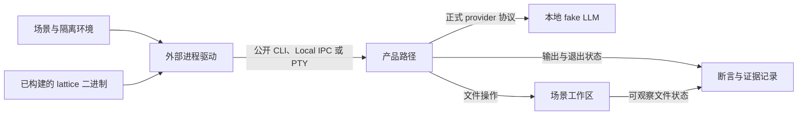

# 测试工程

> 类型：工程合同
> 上位依据：[项目宪章](../governance/charter.md)、[宿主平台](../architecture/platform.md)

本文规定测试的原则：各层验证什么，外部 harness 怎样驱动被测产品，场景的共同规则，以及证据与发布门禁。

| 问题 | 出处 |
| --- | --- |
| 一项行为要不要测试、放在哪一层 | [工程规范](engineering.md#测试) |
| 每个场景要验证什么 | [场景卡片](scenarios/README.md) |
| 动手验证的原则与命令 | [验证操作指南](validation-guide.md) |

## 测试层

| 层 | 验证什么 | 入口 |
| --- | --- | --- |
| crate 单元与集成测试 | 代码结构保证不了的核心业务逻辑与数据流：协议编解码与错误映射、安全策略、存储格式与损坏校验、存储层的模拟提交错误、跨模块的错误属性与私有持久数据，以及算法 | 各 crate `src/` 中的测试模块与 `tests/` |
| 快速二进制黑盒 | CLI 帮助、配置、环境隔离与子命令输出 | harness 的 `fast_*` |
| Direct-Local 产品场景 | 系统整体功能，见[自动场景卡片](scenarios/README.md#自动场景) | harness 的 `direct_*`（含崩溃屏障目标 `direct_crash_barriers`）与 `pty_tui_smoke` |
| 人工体验检查 | 交互感受、可读性与操作体验 | 人类操作与评审 |

- 产品场景经构建出的 `lattice` 二进制与正式配置走真实产品路径；新增产品场景放在外部 harness，并配一张场景卡片。
- 产品场景选中等以上复杂度的组合，例如多步 Turn 中途崩溃后重开，一个场景核对多处结果。
- 场景与夹具按真实使用构造：正常操作，读写失败、断线、崩溃等普通故障，以及用户配置、模型响应与其他外部输入。
- 断言按合同核对具体语义：任务结局、接受回执、观察结果与历史查询分别判断；例如“接受结果暂时未知”与“任务失败”是两种结论。
- 过滤执行测试时，从输出确认目标测试实际运行。

## harness 的原则



| 原则 | 做法 |
| --- | --- |
| 只经公开入口 | harness 经 `LATTICE_BIN` 取得被测产品，经公开 CLI、Local IPC 与 PTY 驱动；它只依赖通用的系统、序列化、临时目录、PTY 与 Git 库，由 `cargo xtask harness-boundary` 检查 |
| 产品只有一条路径 | 场景经正式入口与正式配置驱动产品：fake LLM 经场景 HOME 的 `providers.toml` 与 `lattice auth set` 接入；产品代码中测试与用户走同一流程 |
| 私有状态 | 公开接口之外的内部表编码、引用事务与 fsync 故障，由对应库的测试保护 |
| fake provider 确定 | 使用与官方 provider 相同的协议与 TLS，对场景保证计数准确、回复确定、失败有界，见 [`fake_llm.rs`](../../crates/lattice-system-harness/src/fake_llm.rs) 的模块文档 |
| 元数据 | 场景默认写入 `[metadata] auto_refresh = false`，使用内置快照或场景写入的缓存；拉取与写缓存由 `lattice-llm` 的局部测试验证，触发时机由 `lattice-api` 的局部测试验证 |
| SIWC | `chatgpt` 的 endpoint 由产品固定，harness 场景覆盖其余 provider；SIWC 的验证见[模型接入合同](../architecture/llm/README.md#验证与承接) |

### 被测二进制

```text
LATTICE_BIN 未设置、路径不存在或不能规范化  → 验证失败
否则                                      → 规范化为绝对路径；之后切换场景工作目录，目标不变
```

- 被测二进制与验证对象相符：文件存在与路径规范化证明不了二进制是最新的，调用者核对它的来源、构建配置与所测工作区。
- `xtask ci` 只在 `LATTICE_BIN` 未设置时补入当前仓库的 debug 路径；在 worktree 中显式指向本 worktree 的产物。

### 假工具与故障注入

- 生产二进制不暴露内置工具。需要工具循环的场景配合带 `test-fake-tools` 的被测二进制与 harness 的 `fake-tools` feature，在后台首次启动前经 `ScenarioWorld::set_env("LATTICE_TEST_TOOLS", ...)` 传入逗号分隔的工具名启用假执行器。
- 崩溃、调度交错与模拟错误由产品 feature `test-crash-barriers` 插桩，钩子只在这个 feature 下编译；harness 用 `crash-barriers` feature 启用对应场景。

| 插桩 | 作用 |
| --- | --- |
| 提交后停点 | 会话库事务提交后写出停点标记并停住；场景核对标记后以 SIGKILL 中断后台 |
| 调度窗口 | 暂停一个异步任务，后台其余部分照常服务，用于构造并发交错 |
| 模拟错误 | 让会话库提交返回指定错误 |

新增崩溃点沿用提交后停点机制。

## 场景的共同规则

每张自动场景卡片都按本节准备、计时、清理与留证；卡片只写本场景特有的内容。

### 场景隔离

| 资源 | 做法 |
| --- | --- |
| 项目、HOME/XDG 与会话状态 | 每个场景独占各自的临时目录 |
| 端口 | 由操作系统分配 |
| 子进程环境 | `git` 与 `lattice` 子进程从 `env_clear()` 后的允许列表启动；开发者的 HOME、Git 配置、凭据与 provider 环境留在场景之外 |
| “变量不存在” | 移除变量；设为空值表示变量已定义 |
| 项目中的 `.env` | 产品只从后台启动环境与配置目录取配置；负向场景在场景项目中写入 `.env` 与 `providers.toml`，核对它们不起作用 |
| 并发与取消 | 用 `ResponseGate` 等可控事件与有界等待同步；每个场景自己完成同步，结果与其他场景的执行顺序无关 |
| 夹具与断言 | 通用驱动共享；场景专用的夹具与断言留在该场景 |
| 记录 | 每个场景记录自己的 gate、进程对象与实际命中的窗口；涉及会话库状态的场景记录状态摘要、树形 `log` 与 `session turn` 输出，失败时写入 bundle |

### 超时与进程生命周期

| 场景 | 每条命令 | 整个场景 |
| --- | --- | --- |
| 普通 Direct-Local | 30 秒 | 180 秒 |
| PTY smoke | 120 秒 | 300 秒 |

- 数值由 `ScenarioSpec` 与场景配置维护；修改时写明适用场景与原因，场景停滞时先定位原因。
- 每次启动命令的上限为 `min(step_timeout, remaining_total)`；命令预算从 spawn 开始计时，provider request、stall、release 与最终 wait 共用剩余预算。
- 这些是驱动的等待上限。产品内部的 [Turn deadline](../architecture/session/acceptance.md#模型请求与执行预算) 由会话合同维护；驱动超时之后，产品是否已发生效果、是否已持久关闭，从产品状态读取。
- `direct_failures` 以短 `[llm] timeout_secs` 覆盖产品内部的 Turn deadline：模型流停滞与部分用量后的超时关闭（`direct_failure_profile_deadline_while_stalled_commits_error`、`direct_failure_deadline_after_reported_usage_preserves_cost`），以及 `fake-tools` 下假工具 `block` 在调用期内到达本轮 deadline（`tool_call_deadline_leaves_slot_started_and_stops_turn`：执行器返回 `Deadline`，协调层不补写槽位终态，Step 以 `Stop { Deadline }` 关闭，已进入执行的槽位留在 `Started` 并读出 `Indeterminate(NoResult)`，同一步后续槽位留在 `Registered` 且不执行，Turn 以 `failed` 与提示 `turn deadline exceeded` 结束，随后同一会话的新一轮纯文本提交照常完成）；两次分发之间的 deadline 收尾与崩溃恢复由 `direct_crash_barriers` 的 `dispatch_deadline_tail_is_atomic_and_survives_crash` 覆盖。
- 前端子进程与产品后台各在独立的 Linux 进程组中运行；超时与受控中断保留已收集的输出，回收子进程并清理进程组。命令结果的判定见 [`CommandOutcome`](../../crates/lattice-system-harness/src/driver.rs)。
- PTY raw 模式用回车 `\r` 提交；读取输出时按 deadline 等待，阻塞的 read 同样受超时约束。
- Direct-Local 使用场景自有的后台，经正式入口自动启动或显式启动，与开发者正在运行的后台、虚拟机或容器镜像无关；隔离与清理要求覆盖所有可能自动启动后台的 fast、Direct 与 PTY 场景。已选场景的环境故障按失败报告。

后台的清理顺序：

```text
1. 首次可能自动启动后台之前，登记当前产物与自有状态根
2. 结束时请求正常 stop，等待接管的任务与必要收尾
3. stop 干净返回时，立即核验 socket 已撤下、owner.lock 可以取得（stop 提前返回由单元测试守护）
4. 在有上限的时间窗内等待自有后台进程组退空；超时按失败报告
5. 出现异常时，只对核验了产物、参数、状态根与组归属的自有进程组强制清理
6. 清理完成后再删除临时状态；清理失败时保留诊断与所需状态，原始断言仍是首要失败
```

判断整个组是否退出，以进程组是否退空为准。超时后重试之前，先确认旧验证进程已经退出；编译并发与重型验证的数量按[工程规范](engineering.md#验证)执行。

### 验证集与显式 feature

`xtask ci`、`ci.yml` 与 `full-gate.yml` 均按两轮运行：第一轮构建无测试 feature 的生产二进制，运行全部 crate 默认测试与默认 harness 场景；第二轮先对 `lattice-api`、`lattice-cli`（`test-fake-tools,test-crash-barriers`）及 `lattice-system-harness`（`fake-tools,crash-barriers`）执行 clippy，再用带 `test-fake-tools,test-crash-barriers` 的构建覆盖同一个 `target/debug/lattice`（`LATTICE_BIN` 不变），运行 `lattice-api`（`test-fake-tools,test-crash-barriers`）与 `lattice-system-harness`（`fake-tools,crash-barriers`）的全部目标。

| 验证集 | 内容 | 运行 |
| --- | --- | --- |
| 普通验证 | 默认启用的快速、Direct-Local 与 PTY 场景，配无测试 feature 的 `lattice` 二进制 | 三处 CI 门禁第一轮、`rollout`（release 二进制）；本地按需 |
| 假工具场景 | `lattice-api` 的假执行器测试，以及标有 `#[cfg(feature = "fake-tools")]` 的工具循环场景（需要带 `test-fake-tools` 的被测二进制、harness 的 `fake-tools` feature 与后台启动前设置的 `LATTICE_TEST_TOOLS`） | 三处 CI 门禁第二轮；本地按影响范围构建运行 |
| 崩溃屏障 | `direct_crash_barriers`：需要带 `test-fake-tools,test-crash-barriers` 的被测二进制与 harness 的 `fake-tools,crash-barriers` feature | 三处 CI 门禁第二轮；本地按影响范围构建运行 |

报告列明测试目标、feature、构建模式与实际结果；普通套件的结论只覆盖普通套件。

## 失败证据

- 原始断言始终是首要失败；目录占用、清理、写入或扫描失败作为附加的证据错误记录。
- 命令诊断先于 bundle I/O 形成，持久化失败时报告里仍有退出、超时、清理与输出完整性信息。
- 只有失败的场景写 bundle；bundle 的位置、命名、占用锁与内容见 [`artifacts.rs`](../../crates/lattice-system-harness/src/artifacts.rs) 的模块文档。

### 脱敏与完整性

- 原始 stdout/stderr 只在测试进程中供解析与断言使用；输出错误与持久副本先脱敏，报告中只出现泄露的位置。
- 失败报告只打印到终端，并给出完整脱敏副本的路径。
- 已保留为历史证据的性能或故障 bundle 保持原样；需要重新评估时另记来源与结论。

## CI 与发布证据

- CI 经 Cargo、公开的 xtask 入口或已构建的二进制调用验证；格式、lint、生成物一致性、依赖边界与行为测试各自给出失败信号。

| 入口 | 职责 |
| --- | --- |
| `.github/workflows/ci.yml` | 普通 PR 与 main push 验证：先检查文档链接，再执行两轮验证（含测试 feature 的 clippy）与依赖边界检查；只改 Markdown 的 PR 只运行文档链接检查 |
| `.github/workflows/full-gate.yml` | 手动或定时的完整验证：执行两轮验证（含测试 feature 的 clippy）与 alpha release rollout |
| `cargo xtask docs-check` | 检查 Git 跟踪的 Markdown 文件中相对链接的目标文件与标题锚点 |
| `cargo xtask ci` | 本地两轮验证编排（第二轮覆盖 `target/debug/lattice`），控制编译并发与每个 crate 的测试超时 |
| `cargo xtask rollout --channel alpha` | 对锁定的无测试 feature release 构建记录产物身份、依赖边界与生产形态验证步骤 |

- rollout 在全部必需步骤实际通过时通过：失败、阻塞或跳过都算未通过，测试步骤要有非零的通过数。步骤结果逐步保存，未执行的步骤保持阻塞，失败证据与产物身份关联到对应构建。发布由维护者执行，见[项目宪章](../governance/charter.md)。
- `.githooks/pre-commit` 只阻止误暂存被忽略的文件，测试由上表的入口运行。

## 验证

- 修改驱动或证据机制时，先验证超时、清理、脱敏与报告的直接边界，再选必要的场景卡片。
- 核对实际行为的入口：[harness 局部指引](../../crates/lattice-system-harness/AGENTS.md)、[场景定义](../../crates/lattice-system-harness/src/scenario.rs)、[进程驱动](../../crates/lattice-system-harness/src/driver.rs)、[harness manifest](../../crates/lattice-system-harness/Cargo.toml)、[普通 CI](../../.github/workflows/ci.yml)、[完整验证](../../.github/workflows/full-gate.yml)、[本地验证入口](../../xtask/src/ci.rs)与 [rollout](../../xtask/src/rollout.rs)。
