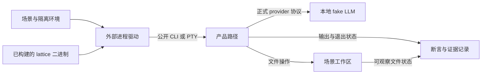

# 测试工程

> 类型：工程合同
> 上位依据：[项目宪章](../governance/charter.md)、[宿主平台](../architecture/platform.md)

本文规定各测试层验证什么，外部 harness 怎样驱动被测产品，场景怎样隔离、计时与清理，以及失败时保留什么证据。

| 问题 | 出处 |
| --- | --- |
| 一项行为要不要测试、放在哪一层 | [工程规范](engineering.md#测试) |
| 安装工具、运行测试、查看证据的命令 | [验证操作指南](validation-guide.md) |
| 各层负责什么，harness、场景与证据的要求 | 本文 |

## 测试层

| 层 | 验证什么 | 入口 |
| --- | --- | --- |
| crate 单元与集成测试 | 代码结构保证不了的核心业务逻辑与数据流：协议编解码与错误映射、安全策略、存储格式与损坏校验、存储层的模拟提交错误、跨模块的错误属性与私有持久数据，以及算法 | 各 crate `src/` 中的测试模块与 `tests/` |
| 快速二进制黑盒 | CLI 帮助、配置、环境隔离与子命令输出 | harness 的 `fast_*` 及对应驱动测试 |
| Direct-Local 产品场景 | 系统整体功能：真实 Turn、观察与变更、调用、取消、退回分叉、崩溃重开与执行者消失后的结局、操作员读取，以及 TUI 接线 | harness 的 `direct_*`（含崩溃屏障目标 `direct_crash_barriers`）与 `pty_tui_smoke` |
| 人工体验检查 | 交互感受、可读性与操作体验 | 人类操作与评审 |

- 产品场景经构建出的 `lattice` 二进制与正式配置走真实产品路径；新增产品场景放在外部 harness。
- 产品场景选中等以上复杂度的组合，例如多步 Turn 中途崩溃后重开、取消后退回再分叉，一个场景核对多处结果。
- 场景与夹具按真实使用构造：正常操作，读写失败、断线、崩溃等普通故障，以及用户配置、模型响应与其他外部输入。
- 断言按合同核对具体语义，任务结局、接受回执、观察结果与历史查询分别判断；例如“接受结果暂时未知”与“任务失败”是两种结论。
- 过滤执行测试时，从输出确认目标测试实际运行。
- 人工检查覆盖自动化判定之外的体验。rollout 是组合自动验证与产物身份的发布证据流程，见 [CI 与发布证据](#ci-与发布证据)。

### 故障注入

崩溃、调度交错与模拟错误由产品 feature `test-crash-barriers` 插桩，钩子只在这个 feature 下编译。harness 用 `crash-barriers` feature 启用对应场景。

| 插桩 | 作用 |
| --- | --- |
| 提交后停点 | 会话库事务提交后写出停点标记并停住；场景核对标记后以 SIGKILL 中断后台 |
| 调度窗口 | 暂停一个异步任务，后台其余部分照常服务，用于构造并发交错 |
| 模拟错误 | 让会话库提交返回指定错误 |

新增崩溃点沿用提交后停点机制。

## 外部 harness



### 产品接入与观察

| 方面 | 做法 |
| --- | --- |
| 依赖 | `lattice-system-harness` 依赖通用的系统、序列化、临时目录、PTY 与 Git 库，经 `LATTICE_BIN` 取得被测产品；依赖边界由 `cargo xtask harness-boundary` 检查 |
| 读取状态 | 会话与调用状态经公开 CLI 读取；本地请求回执与视图边界经公开 Local IPC 验证 |
| 私有 Git 历史 | 工作区历史场景用通用 Git 库检查对象与引用，这项读取只用于验证私有 Git 历史 |
| 内部对象 | 公开接口之外的内部对象关系、引用事务与 fsync 故障，由对应库的测试保护 |
| fake LLM 接入 | 场景在自己的 HOME 下写 `~/.lattice/providers.toml`，把所测 provider 的 `base_url` 指向 fake LLM，或新增一个使用所测协议的 provider；key 经 `lattice auth set` 从标准输入录入 |
| 协议 | fake LLM 按请求路由，生成[五种协议](../architecture/llm/protocols.md#端点与认证)的流式响应 |
| SIWC | `chatgpt` 的 endpoint 由产品固定，harness 场景覆盖其余 provider；SIWC 的验证见[模型接入合同](../architecture/llm/README.md#验证与承接) |
| 元数据 | 场景的 `providers.toml` 默认写入 `[metadata] auto_refresh = false`，场景使用内置快照或场景写入的缓存。拉取与写缓存由 `lattice-llm` 的局部测试对本地服务验证；触发时机、共享与开关由 `lattice-api` 的局部测试验证 |
| 产品路径 | 场景只经正式入口驱动产品；产品代码只有一条调用路径，测试与用户走同一流程 |

### 被测二进制

```text
LATTICE_BIN 未设置、路径不存在或不能规范化  → 验证失败
否则                                      → 规范化为绝对路径；之后切换场景工作目录，目标不变
```

- 测试前构建与当前验证对象相符的 `lattice`。文件存在与路径规范化证明不了二进制是最新的，调用者核对二进制的来源、构建配置与所测工作区。
- 推荐传绝对路径。相对路径按测试进程的工作目录解析，这个目录不一定是仓库根。
- `xtask ci` 只在 `LATTICE_BIN` 未设置时补入当前仓库的 debug 路径。worktree 或切换分支后仍继承旧值时，显式指向当前产物，或在该次命令中取消旧值。
- 构建命令见[验证操作指南](validation-guide.md#安装与构建产物)。宿主与 Source Tool guest 分别构建，场景使用 Linux 宿主二进制。

### 场景隔离

| 资源 | 做法 |
| --- | --- |
| 项目、HOME/XDG 与会话状态 | 每个场景独占各自的临时目录 |
| 端口 | 由操作系统分配 |
| 子进程环境 | `git` 与 `lattice` 子进程从 `env_clear()` 后的允许列表启动；开发者的 HOME、Git 配置、凭据与 provider 环境留在场景之外 |
| “变量不存在” | 移除变量；设为空值表示变量已定义 |
| 项目中的 `.env` | 产品只从后台启动环境与配置目录取配置。配置来源的负向场景在场景项目中写入 `.env` 与 `providers.toml`，核对它们不起作用 |
| 并发与取消 | 用 `ResponseGate` 等可控事件与有界等待同步；每个场景自己完成同步，结果与其他场景的执行顺序无关 |
| 夹具与断言 | 通用驱动共享；某个场景专用的夹具与断言留在该场景 |

### Fake provider 的确定性边界

**传输**

- fake provider 与官方 provider 一样使用 TLS + HTTP/2：ALPN 只提供 `h2`，证书由 harness 生成的临时 CA 签发。场景默认经 `SSL_CERT_FILE`、`SSL_CERT_DIR` 只信任这个 CA；后台从启动环境继承这两个变量，见[配置来源与后台启动](../architecture/session/acceptance.md#配置来源与后台启动)。
- 明文 HTTP/1.1 只用于本地 provider 场景，只支持完整的流式响应与 HTTP 错误响应；空闲的 HTTP/1.1 连接五秒后关闭。
- 传输层故障在 HTTP/2 上构造：流在结束事件前正常结束、`RST_STREAM(INTERNAL_ERROR)`、响应事件之后的 `GOAWAY(NO_ERROR)`、最后流号小于在途请求的 `GOAWAY`，以及 `REFUSED_STREAM`。
- fake provider 唯一的客户端是被测产品，所以它只做取出路由、凭据与 body 所需的最少解析；畸形或恶意的 HTTP 在它的处理范围之外。

**对场景的三项保证**

1. **计数准确**
   - 只有发往五种协议模型端点的请求进入 request capture；其他请求得到错误响应，记为 fixture failure。
   - 工具定义按真实 provider 的规则核对。违反时返回 400，记为 fixture failure，该请求不进入 capture：

     | 协议 | 被拒绝的参数 schema |
     | --- | --- |
     | Chat Completions、Responses、Anthropic Messages | 顶层不是 `type: object`，或带 `oneOf`、`anyOf`、`allOf`、`enum`、`not` |
     | generateContent | `parameters` 的任意层级出现 `additionalProperties`、`const`、`contains`、`minContains` |
     | Interactions | function tool 提供的 `parameters` 不是 JSON 对象。[API 参考](https://ai.google.dev/api/interactions-api)列为忽略的 `minLength`、`maxLength`、`minProperties`、`maxProperties`、`uniqueItems`、`contains`、`minContains`、`maxContains` 照常接受；其他协议的关键词规则不用于这里 |

   - 非 JSON 的 body 保留为诊断，不计为有效的模型请求。
   - 对端放弃流或连接、客户端在 TLS 握手中拒绝证书，属于对端行为，不记为 fixture failure；握手被拒的次数可以查询。
2. **回复确定**
   - request capture、Sequence 的选择与推进、到达通知在同一临界区内发生；gate 只控制交付时机，脚本归属保持不变。
   - 请求数超过 Sequence 长度时重复最后一项；空 Sequence 产生 IllegalResponse。
3. **失败有界**
   - request、stall、release 与 shutdown 都是有界握手。
   - shutdown 发出停止信号，同时中止停在握手或读请求中的连接任务，并取消 gate；等在途任务结束后再 join 服务线程。超时返回错误并保留线程，再次调用或 Drop 时继续有界等待。
   - 保留第一个 fixture failure；捕获已经不可能时提早报告，shutdown 在有界清理后返回这个错误。失败经这一个出口报告。

接口与固定响应维护在 [`fake_llm.rs`](../../crates/lattice-system-harness/src/fake_llm.rs)。

## 执行与资源边界

### 超时与进程生命周期

**时间预算**

| 场景 | 每条命令 | 整个场景 |
| --- | --- | --- |
| 普通 Direct-Local | 30 秒 | 180 秒 |
| PTY smoke | 120 秒 | 300 秒 |

- 数值由 `ScenarioSpec` 与场景配置维护。修改时写明适用的场景与原因；场景停滞时先定位停滞的原因。
- 每次启动命令的上限为 `min(step_timeout, remaining_total)`，即单命令上限与场景剩余预算中较小的一个；累计步骤受场景总预算约束。
- 命令预算从 spawn 开始计时；provider request、stall、release 与最终 wait 共用剩余预算。
- 这些是驱动的等待上限。产品内部的 [Turn deadline](../architecture/session/acceptance.md#模型请求与执行预算) 与必要写入由会话合同维护；驱动超时之后，产品是否已发生效果、是否已持久关闭，从产品状态读取。
- PTY raw 模式用回车 `\r` 提交。读取输出时按 deadline 等待，阻塞的 read 同样受超时约束。

**进程组与后台**

- 前端子进程在 Linux 独立进程组中运行。超时与受控中断保留已收集的 stdout/stderr，回收直接子进程并清理该进程组；清理失败、存活进程与输出不完整都写入诊断。
- 产品后台在另一个独立进程组中，清理由场景负责。
- Direct-Local 使用场景自有的产品后台，经正式入口自动启动或显式启动；场景与开发者正在运行的后台、虚拟机或容器镜像无关。隔离与清理要求覆盖所有可能自动启动后台的 fast、Direct 与 PTY 场景。
- 已选场景的环境故障按失败报告。

后台的清理顺序：

```text
1. 首次可能自动启动后台之前，登记当前产物与自有状态根
2. 结束时请求正常 stop，等待接管的任务与必要收尾
3. stop 干净返回时，立即核验 socket 已撤下、owner.lock 可以取得（stop 提前返回由单元测试守护）
4. 在有上限的时间窗内等待自有后台进程组退空；超时按失败报告
5. 出现异常时，只对核验了产物、参数、状态根与组归属的自有进程组强制清理
6. 清理完成后再删除临时状态；清理失败时保留诊断与所需状态，原始断言仍是首要失败
```

判断整个组是否退出，以进程组是否退空为准；组首领退出或某个 PID 消失只说明该进程结束。

**命令结果**

`CommandOutcome` 是命令结果的唯一完整模型：

| 字段 | 内容 |
| --- | --- |
| 退出 | 观察到的 exit 或 signal |
| 干预 | 按发生顺序记录的 harness 干预 |
| 清理 | 全部清理错误与存活的 PID |
| 输出 | stdout 与 stderr 是否读到 EOF |

- exact clean exit 的条件：退出码匹配，没有干预、强制清理、清理错误或存活进程，两条输出流都完整。信号、缺失状态或单纯的 exit 0 都不满足这个条件。
- 摘要与 Debug 只含安全的元数据；产品是否 panic 不从信号推断。
- 清理时 SIGKILL 遇到 ESRCH，在立即复核进程组为空后可以忽略；这条规则只适用于清理用的 SIGKILL，请求发出的 SIGINT 按原样处理。

**资源**

- 编译并发、重型验证的数量与重复运行，按[工程规范](engineering.md#验证)执行。
- 超时后重试之前，先确认旧验证进程已经退出，再核验结果。

### 后台与重连场景

这些场景检验同一条提交链上的不同边界：前端提交一次，后台读取配置、接管执行并把每一步写入会话库，前端经视图与查询独立读取与观察。正常协作见[从提交到结果可见](../architecture/session/flow.md#从提交到结果可见)，观察见[观察与重连](../architecture/session/recovery.md#观察与重连)；场景按这些合同断言。

局部测试与外部场景的分工：

| 保护对象 | 由谁验证 |
| --- | --- |
| 提交、双向取消回执交接与结局分类 | API 交互句柄 [LocalTurn](../architecture/session/README.md#组件与接口) 的局部测试 |
| CLI IPC：真实信号、记录与退出选择 | CLI 的局部回归测试 |
| TUI run_loop：按键、按 NodeId 替换条目、尝试边界，以及按 InvocationId 配对的绘制 | TUI 的局部回归测试 |
| 前端的实际入口 | 下面的外部场景 |

局部测试控制真实接口的回执、读取与调度窗口。

共同规则：

- 每个场景按目标、准备、操作、观察、断言、清理组织。共同准备见[被测二进制](#被测二进制)与[场景隔离](#场景隔离)，共同清理见[超时与进程生命周期](#超时与进程生命周期)。
- 每个场景记录自己的 gate、进程对象与实际命中的窗口。某个入口已有测试，只说明入口存在；以下要求是否覆盖、是否通过，以执行记录为准。
- 涉及会话库状态的场景，记录状态摘要、树形 `log`、`audit` 输出与所用参数；失败时写入[失败 bundle](#失败证据)，通过时不保留。

#### 接受后断开前端

- **目标：** 后台接受的任务在 CLI/TUI 退出后继续执行。
- **准备：** 在自有状态根用不带 `--session` 的 `session send` 创建 Session，保存请求身份，用 provider gate 控制接受后的执行进展。
- **操作：** 确认接受后结束前端，再释放 gate；另起客户端用原 TurnId 查询结果。
- **观察：** 前端退出与输出 EOF、后台是否存活，以及最终的 `session turn` 详情。
- **断言：** 后台完成原请求，结果与预期脚本相符；provider 与 Tool 的调用次数不因新客户端连接而增加。断连只通过结束前端进程组构造，后台保持运行。
- **清理：** 新查询客户端结束后，对仍在运行的自有后台执行共同清理，再处理临时状态。

#### 接受回执丢失后找回

- **目标：** 回执丢失时，按 TurnId 查询得到确定结果（已接受、在途或 NotFound），同一身份只被接受一次。
- **准备：** 从第一条 `submit` 记录保存 TurnId 与 SessionId，设置公开 IPC 的可控未读回执窗口。
- **操作：** 在该窗口断开提交连接，按 TurnId 查询；再以同一身份重新提交一次。分别覆盖：向已有 Session 提交、不带 `--session` 的首次提交、后台持续运行与后台重启后的找回，以及原请求仍在准入时的查询。
- **观察：** 未读回执窗口的证据、查询结果、重新提交的回执、`session turn` 详情、`list` 输出与 provider 请求计数。
- **断言：**
  - 已接受的请求能按 TurnId 查到；原请求仍在准入时查询返回在途，准入结束后返回已接受或 NotFound。
  - 以同一身份重新提交返回 Conflict，模型循环与工具执行次数不变。
  - 不带 `--session` 的首次提交之后，只有一个 Session 与一个 Turn。
  - 执行者消失的 Turn 停在已写入的进度，后续写操作直接进行。
  - 回执丢失由未读回执窗口证明；provider 收到请求之后才杀前端，证明不了回执丢失。
  - [请求身份与找回](../architecture/session/recovery.md#请求身份与找回)表中的其余各行由局部测试覆盖。
- **清理：** 先让在途提交及回执驱动退场，再分别核验前后台清理与证据完整性。

#### 同会话排他与跨会话并发

- **目标：** 同 Session 忙时拒绝新请求；同项目不同 Session 的模型执行可以重叠。
- **准备：** 在同一项目创建两个 Session，用独立的 gate 识别各自的 provider 请求。
- **操作：** 保持第一个 Turn 在途，向同一 Session 发送另一请求，同时向第二个 Session 提交任务。
- **观察：** 读取 Busy 回执；释放第一个 gate 之前，确认第二个 provider 请求已经到达。
- **断言：** 同 Session 的新请求未被接受，输入保留供稍后发送；跨 Session 的重叠以到达事件为证据，耗时只作参考。共享工作区仍按操作锁协调。
- **清理：** 释放所有 gate，分别保存每个请求的结果，再停止共用的自有后台。

#### 视图、慢观察者与历史查询

- **目标：** 观察者最后持有的条目与关闭后用历史查询重读的一致；已保存的对话、生成中的文字、执行 outcome 与结局，各自的显示与失败边界互相独立。
- **准备：** 多步 Turn 脚本包含可区分的用户与模型消息、工具结果；模型流中正文与 reasoning 交错到达（含 OpenAI 兼容流），并包含一次可重试的尝试失败。分别控制中途开始的观察、放慢的观察者、Turn 关闭与最后一次推送同时就绪、断连、idle，以及空闲时的 `rewind`。
- **操作：** 在 Step 中途、模型段中途，以及模型已输出说明文字而工具仍在执行时，分别开始观察或重连；放慢一个观察者后继续读；用调度 gate 在关闭事务提交后、标记变化前开始推送；Turn 关闭后 `rewind` 到较早的节点。Turn 关闭后用新客户端以历史查询重读同一会话，并跨页取回更早的轮。
- **观察：** 各观察者收到的会话头、条目与生成中的文字，连接诊断，工具身份，各时刻显示的正文与结局，以及关闭后重读的条目。
- **断言：**
  - 各种观察情况下，观察者最后持有的条目与重读结果一致；同一节点收到的值只前进。
  - 生成中的文字与 Step parts 合并相邻同类后一致；重试的尝试按尝试边界重新开始，重试提示在条目中，实时与重开时相同。
  - 工具执行中重连，仍显示模型已输出的说明文字。
  - 慢观察者只少收中间版本，内容完整。
  - 最后一步关闭时，观察者已有带 `TurnSummary` 的条目。
  - `rewind` 后会话头标明路径已替换，随后是新路径上的条目。
  - 历史查询的页边界只落在 UserMessage 之前，轮次序号与从根数起的结果相同。
  - 慢读或断连时后台照常执行。场景记录推送序列与重读结果。
- **清理：** 解除推送 gate，关闭观察者；确认后台收尾，按共同规则保留未完整的输出与清理诊断。

#### 退回与分叉

- **目标：** `rewind` 到树上任意节点后提交，会从该节点分叉，原分支保留；发给模型的上下文是根到该节点的路径。
- **准备：** 一个多步且写过文件的 Turn，一个在工具执行后被取消的 Turn；两个 Turn 使用不同的 agent，后一个 Turn 的 agent 因此在 profile 副本中。
- **操作：**
  - `rewind` 到前一 Turn 中部的 Step 节点，先读取对话再 `send`；分叉后用 `session turn` 查看原 Turn。
  - 再 `rewind` 回原 Turn 的最后一个节点并读取对话。
  - 退回到前一 Turn 后不带 `--agent` 发送。
  - `rewind 0` 后不带 `--agent` 发送一次，再带 `--agent` 改写第一条消息。
  - 在一个 Turn 进行中时 `rewind`；`rewind` 到不存在的序号。
- **观察：** 树形 `log`、当前位置与会话头中的副本摘要、每次读取的对话、fake provider 捕获的请求上下文、原 Turn 的 `session turn` 输出，以及工作区文件。
- **断言：**
  - 原分支的节点仍在 `log` 中，新节点以目标节点为父。
  - 每次读取的对话都是根到当时当前位置的路径：退回后、发送前止于目标节点；退回原 Turn 后恢复原对话；`rewind 0` 后为空。
  - 请求的对话部分等于发送前读取的对话加上本次 UserMessage，经所选 provider 的规定投影；系统提示与工具定义单独核对。改写第一条消息的请求，对话只含新消息，新消息的父节点为 `0`。
  - `rewind` 不改变 profile 副本：未指定 agent 的发送（包括当前位置为 `0` 时）使用副本中的 agent，而不是目标节点所属 Turn 的 agent；带 `--agent` 的发送按该 agent 重新生成副本。
  - 原 Turn 的 `session turn` 仍给出它自己的结局与 Step 节点；工作区文件不变。
  - 进行中的 `rewind` 返回 Busy；不存在的序号被拒绝，当前位置不变。
  - 场景记录 `log`、对话读取、`session turn` 输出、请求捕获与文件摘要。
- **清理：** 按共同规则停止自有后台。

#### 旧库拒绝

- **目标：** 状态根中存在旧版 `sessions.git` 或 `projects/<key>/invocations.git` 时，会话库打开失败并指出路径。
- **准备：** 在自有状态根分别放置两种旧库目录。
- **操作：** 执行 `session send`、`session list` 与 `audit`。
- **观察：** 错误输出、退出状态，以及状态根中的文件列表。
- **断言：** 错误列出旧库路径；状态根中没有新建的 `lattice.redb`，旧库内容不变，provider 没有收到请求。
- **清理：** 按共同规则处理。

#### 取消接管后退出

- **目标：** 后台接管的取消意图，在前端立即退出后仍被处理。
- **准备：** 保存原身份，分别控制后台实际接管提交后的准备与执行窗口；明确区分可以证明未建立任务的配置拒绝与未知发布。
- **操作：** 单次取消得到 true 后立即退出前端，放行后台直至独立收尾。另覆盖：明确拒绝且监督退场后，以同一 TurnId 重新提交；用 `session cancel <SESSION_ID>` 从另一个终端取消正在执行的一轮。
- **观察：** 接管、未接管或未知的回执，前端退出，后续的 `session turn` 详情与已发生的效果；保留请求与诊断的真实归属。
- **断言：**
  - 依[取消规则](../architecture/session/recovery.md#取消与退出)核验实际操作的接管资格、同一载体的独立收尾，以及拒绝后的重新提交。
  - `session cancel` 取消的是该会话当时正在执行的一轮，没有时报告无可取消。
  - 取消保留先前的终态与文件效果；取消回复 true 表示后台接管了取消，持久结局以 `session turn` 查询为准。
  - 局部测试分别保护：两种回执次序下的一次补发、true 时不补发、五秒未知交接后提交连接仍在时只等回执、断开后才按 TurnId 查询，以及迟到的传输诊断；后台错误单独对照。
- **清理：** 让后台完成必要收尾；结果未知时保留身份与诊断，按共同清理规则处理，原始失败保持原样。

#### 停止后台与排空

- **目标：** stop 关闭新准入，等待已接管的工作与必要的持久收尾。
- **准备：** 用 gate 保持已接管的操作在途，另备查询、取消与新提交的客户端；另在回执之后的退场窗口装 gate（listener 关闭前、实例锁释放前的测试钩子）。
- **操作：** 发起 stop，在等待期间查询或取消原请求，并尝试新提交；然后释放 gate。
- **观察：** 准入关闭、已有请求的状态、stop 回执，以及自有后台进程组的退出。
- **断言：**
  - 新工作被拒绝；原工作仍可查询与取消，stop 等待它收尾；未确认操作数按本进程的口径解释。
  - 退场窗口被挡住时 stop 不返回；stop 返回时 `owner.lock` 已可取得、`api.sock` 已撤下。
  - 实例锁始终不放开时，stop 在注入的短期限内以 Stopping 报超时并返回。
  - 后台是否退出，以自有进程组退空为准。
- **清理：** 核验整个自有后台组已空，异常时只在核验归属后强制清理；随后处理状态目录。

#### 后台崩溃与执行者消失

- **目标：** 后台在任一会话库提交点退出后，重开不经任何写入即可读到这一轮的结局；随后的 `send` 或 `rewind` 直接进行，旧 Turn 的节点保持原样。
- **准备：** 使用显式崩溃 feature 与匹配的产品二进制，在每个会话库提交点设置屏障：接受、开始请求、尝试停止（可重试与不可重试）、登记调用、调用开始、调用返回（含取消结果）与关闭 Step；核验后台身份与命中记录。脚本为带多个调用的多步 Turn。
- **操作：** 命中屏障后以 SIGKILL 中断后台，保留前端独立退出的证据；新客户端先查询，再发送新消息或执行 `rewind`。
- **观察：** 对照[执行者消失后的 Turn](../architecture/session/recovery.md#执行者消失后的-turn)，记录停点、旧 Turn 的 `session turn --json`（其中各 Step、尝试与槽位的 `progress` 及其结论）、旧 Turn 的结局、新请求的接受与结果、provider 与 Tool 的调用次数，以及文件效果。
- **断言：**
  - 查询保持只读；重开后不经任何写入即可读到结局，旧任务的模型请求与工具分发次数不变。
  - 新消息被接受一次并执行，provider 请求只因新任务增加。
  - 每个提交点重开后，每个 Step、尝试与槽位停在崩溃前最后提交的阶段，读出的结论符合[阶段与结论的对照表](../architecture/session/README.md#预留progress-与结论)。
  - 一个 Turn 中，除最后一个 Step 外都以 `Continue` 关闭；`TurnSummary` 与最后一个 Step 的结论一致；停在 `Started` 的槽位结果为 Indeterminate。
  - 只在内存中的取消得到 Failed（进程退出）；已写入的取消原因得到 Cancelled。
  - 发送新消息或退回之后，旧 Turn 的节点不变。
  - 场景记录每个提交点的状态摘要、树形 `log`、`session turn --json` 与 `audit` 输出。
- **清理：** 同时检查崩溃前后的自有进程组，以及 stdout/stderr 的 EOF；必要的状态与原始失败进入证据之后，再按共同规则清理。

#### 配置来源与 profile 副本

- **目标：** 后台从启动时给定的配置目录读取 profile、`providers.toml` 与 `auth.json`；已有会话按 profile 副本执行；各 Turn 的 endpoint、凭据与 TLS 信任互不影响；TLS 信任材料来自后台启动时的 `SSL_CERT_FILE`、`SSL_CERT_DIR`。
- **准备：** 场景 HOME 下两个 agent 的 profile；`providers.toml` 中两个指向不同 fake provider 的 provider，其中一个的证书由不受信任的根签发；key 经 `lattice auth set` 从标准输入录入。场景项目中另放一份 `.env` 与 `providers.toml`，写入其他 endpoint 与 key；前端环境中设置各厂商的 API key 变量。
- **操作：**
  - 新会话提交后，修改 profile 的模型与策略，以及 `providers.toml` 中该 provider 的 `base_url`；再向同一会话提交，另开新会话提交。
  - 在多步 Turn 进行中修改 `base_url`。
  - 用 `--model`、`--effort` 提交，再不带选择提交；提交新模型不支持的档位；换到另一 provider 的模型。
  - 两个会话并发提交到不同 provider；提交到证书不受信任的 provider。
  - 后台运行时，以不同的 `SSL_CERT_FILE` 启动前端提交，再停止后台后由该前端提交。
  - 另起一个后台，以不能加载的 `SSL_CERT_FILE` 启动后提交；以只含超过 64 KiB 证书的 `SSL_CERT_FILE` 启动后台，分别向 https 与 http provider 提交。
- **观察：** fake provider 收到的请求（endpoint、模型、推理参数、认证头是否为录入的 key）、`head` 中的副本摘要、接受结果与握手结果；证据保持脱敏。
- **断言：**
  - 已有会话的第二次提交仍用副本中的模型与策略，endpoint 已是修改后的值；新会话使用修改后的 profile。
  - 进行中的 Turn 在修改之后的请求发往新的 endpoint。
  - 选择写回副本，之后不带选择的提交沿用；不支持的档位在接受前被拒绝，副本不变；换 provider 后副本记下新的 provider `id`。
  - 并发 Turn 的 endpoint 与凭据互不影响。
  - 场景项目中的 `.env`、`providers.toml` 与前端环境变量，既不改变 endpoint，也不提供 key。
  - 证书不受信任时握手失败，这一轮按 provider 错误结束。
  - 后台运行时前端改用的信任材料不生效；停止后台、由新前端自动启动之后才生效。
  - 没有可用根证书的后台照常回答查询：https provider 的提交在接受前按配置错误被拒绝，provider 收不到请求；http provider 的提交照常接受并完成。HTTP 场景代替不了 TLS 验证。
- **清理：** 关闭自有的 provider、gate 与产品进程，按证据规则处理临时凭据与状态；报告中只出现凭据的名称。

以上场景的外部入口为 `direct_background`、`direct_tree_session`、相关的 `pty_tui_smoke` 与崩溃屏障目标 `direct_crash_barriers`。产品内部的交接由相应 crate 的单元与集成测试保护，例如会话库表编码、值版本解析与旧库检测。实际覆盖、未覆盖的窗口、构建身份、失败与待决定事项记在任务交接或验证证据中；场景规格描述要验证什么，执行结果以证据为准。

### 验证集与显式 feature

| 验证集 | 内容 | 运行 |
| --- | --- | --- |
| 普通验证 | 默认启用的快速、Direct-Local 与 PTY 场景 | 普通 CI；本地按需 |
| 崩溃屏障 | `direct_crash_barriers`：需要 harness 的 `crash-barriers` feature，以及带 `test-crash-barriers` 的被测二进制 | 普通 CI 在默认测试之后构建该二进制并运行 |
| release_operator | `release-operator` feature | 按需手动运行，普通 CI 之外 |

- 选用故障注入场景时，被测二进制与测试目标都带上所需的 feature。
- 报告列明测试目标、feature、构建模式与实际结果；普通套件的结论只覆盖普通套件。

## 失败证据

### 报告与持久化

快速断言与 Direct 场景使用同一种失败报告，依次保留：

1. 排序去重的秘密泄露位置。
2. 原始断言失败。
3. 命令诊断：退出、超时、清理与输出完整性等元数据。场景失败时，另附每条命令 stdout 与 stderr 的开头（先按证据文件的规则脱敏再截断，每个流最多 2,048 字节，超出部分注明截掉的字节数），以及对应完整脱敏副本的路径。
4. 按发生顺序保留的独立证据错误。

- 命令诊断先于 bundle I/O 形成，所以持久化失败时，报告里仍有退出、超时、清理与输出完整性信息。
- 原始断言始终是首要失败；目录占用、清理、写入或扫描失败，作为附加的证据错误记录。

| 项 | 规则 |
| --- | --- |
| bundle 根目录 | `LATTICE_HARNESS_FAILURE_DIR`；未设置时为 harness crate 下的 `target/harness-failures/`。路径独立于场景子进程的工作目录，产物留在被忽略的运行目录中 |
| 场景名称 | 单个普通路径分量；空名、绝对路径、`.`、`..`、NUL、多分量与保留名称 `.claims` 都被拒绝 |
| 占用锁 | 写者在清理旧产物之前取得 `<base>/.claims/<scenario>.lock` 的 Linux 非阻塞独占锁，持有到持久化与扫描结束；同名的并发写者立即失败；锁文件保留 |
| 嵌套记录 | 活跃的 `ScenarioEvidence` 从构造起持有占用权；嵌套的记录器使用不同的场景名称 |

### 脱敏与完整性

- 原始 stdout/stderr 只在测试进程中供解析与断言使用；输出错误与持久副本先做字面脱敏，报告中只出现泄露的位置。
- 失败报告只打印到终端（panic 诊断）。为便于定位，报告打印完整脱敏副本的绝对路径：默认在本地构建目录的 `target/harness-failures/` 下，可用 `LATTICE_HARNESS_FAILURE_DIR` 改到别处；这个路径不含秘密。
- 证据目录里的命令文件不含证据路径；`world.txt` 以绝对路径记录场景临时目录（`project_dir`、`home`）。
- 递归字节扫描先记录泄露位置，再修改副本。遍历、读取、重写、符号链接与特殊文件的错误分别保留，扫描继续检查其他可达条目；泄露位置使用安全的 bundle 相对路径。
- 工作区失败快照把符号链接本身记为叶子，目标保持原样。
- bundle 包含脱敏的命令摘要、输出、场景环境与必要的工作区前后差异；多命令场景分别保留每条命令的证据。只有失败的场景写 bundle；清理旧产物在持有场景占用锁之后进行。
- 已保留为历史证据的性能或故障 bundle 保持原样，阈值、算法、实现或后续决定改变时也不重写。需要重新评估时，另记来源与结论，并保留原始样本、环境、来源与结果。本节的运行目录清理只处理运行目录。

## CI 与发布证据

- CI 经 Cargo、公开的 xtask 入口或已构建的二进制调用验证。
- 格式、lint、生成物一致性、依赖边界与行为测试各自给出失败信号。

| 入口 | 职责 |
| --- | --- |
| `.github/workflows/ci.yml` | 普通 PR 与 main push 验证：先检查文档链接，再用明确的 debug 二进制跑默认测试，最后用带屏障的二进制跑崩溃屏障目标；只改 Markdown 的 PR 只运行文档链接检查 |
| `.github/workflows/full-gate.yml` | 手动或定时的完整验证、release rollout 与 Component 可复现性证据 |
| `cargo xtask docs-check` | 检查 Git 跟踪的 Markdown 文件中相对链接的目标文件与标题锚点 |
| `cargo xtask ci` | 本地验证编排，控制编译并发与每个 crate 的测试超时 |
| `cargo xtask rollout --channel alpha` | 对锁定的 release 构建记录产物身份、验证步骤与发布证据 |

- rollout 在全部必需步骤实际通过时通过：失败、阻塞或跳过都算未通过，测试步骤要有非零的通过数。步骤结果逐步保存，未执行的步骤保持阻塞，失败证据与产物身份关联到对应的构建。发布由维护者执行，见[项目宪章](../governance/charter.md)。
- Component 可复现性检查中，只有产物摘要漂移按约定为警告；guest 构建、Component 编码、验证、imports 或 WIT 不符合要求都是失败，所以 `tool-build --verify` 整个步骤是阻塞步骤。跨机可复现的证据要升级为硬门禁时，另提提案，由维护者决定。
- 固定的工具链与 encoder 版本从 `rust-toolchain.toml`、相关构建入口与 manifest 读取，安装见[验证操作指南](validation-guide.md#安装与构建产物)。
- `.githooks/pre-commit` 只阻止误暂存被忽略的文件，测试由上表的入口运行。

## 验证

- 修改驱动或证据机制时，先验证超时、清理、脱敏与报告的直接边界，再选必要的外部产品场景。
- 核对实际行为的入口：
  - [harness 局部指引](../../crates/lattice-system-harness/AGENTS.md)。
  - [场景定义](../../crates/lattice-system-harness/src/scenario.rs)、[进程驱动](../../crates/lattice-system-harness/src/driver.rs)与 [harness manifest](../../crates/lattice-system-harness/Cargo.toml)：实际的预算、二进制解析与目标启用条件。
  - [普通 CI](../../.github/workflows/ci.yml)、[完整验证](../../.github/workflows/full-gate.yml)、[本地验证入口](../../xtask/src/ci.rs)与 [rollout](../../xtask/src/rollout.rs)：实际的编排、构建与证据行为。
- [Bundle 安装与活动版本切换](../architecture/lancet.md#bundle-安装设计)尚未实现，它的验证在现有默认产品矩阵之外。
