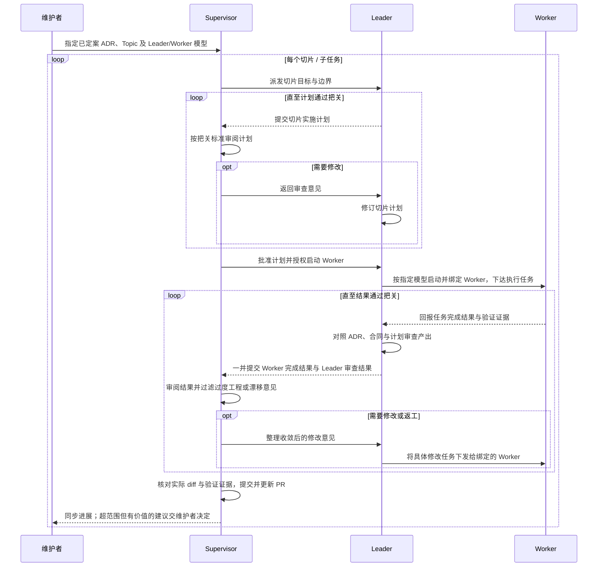

# 协作编码工作流

本文规定 ADR 定案后，围绕单个 Topic 采用多 Agent 协作编码时的角色分工、模型确定、流转顺序、把关标准与上下文隔离规则。权限与委派边界见 [Agent 身份与权限](../governance/agent-permissions.md#委派)，代码与测试标准见[工程规范](engineering.md)，Git 与 PR 流程见 [Git 与 GitHub](../governance/git-operations.md)。

## 角色

| 角色 | 职责范围 | 模型与上下文要求 | 交接对象 |
| --- | --- | --- | --- |
| 维护者 | 定案 ADR、决定 Leader 与 Worker 的模型选择、裁决超范围提案与新路径、验收并合并 | 掌握项目方向与最终决策 | 向 Supervisor 下达 Topic 与模型选择，接收阶段汇报与待决事项 |
| Supervisor | 单个 Topic 的总负责：拆解切片、派发 Leader、把关计划与审查结论、授权启动 Worker、整理返工意见、核对改动并执行提交/PR | 模型由主线程决定；上下文保持全流程最干净，不深陷代码细节与探索噪音，防止长任务目标漂移 | 向上向维护者汇报；向下对接 Leader |
| Leader | 负责单个切片或子任务：研读代码与合同、制定并修订切片计划、获授权后启动并绑定 Worker、审查 Worker 产出并汇总上报、接收 Supervisor 意见驱动 Worker 返工 | 模型由维护者决定；只做规划、审查与调度，不直接编写代码，保持视角客观与上下文精炼 | 向上向 Supervisor 提交计划与结果；向下对接绑定的 Worker |
| Worker | 底层执行者：按绑定 Leader 下达的具体任务编写代码、测试、文档、运行局部验证并执行返工 | 模型由维护者决定；同一任务内保持上下文连续，跨任务必须隔离上下文或经 Supervisor 整理后再转交 | 与启动它的 Leader 绑定，向该 Leader 回报执行结果 |

- 同一工作目录同一时间只有一个写者；提交、推送与 GitHub 写操作由 Supervisor 执行，遵循 [Agent 身份与权限](../governance/agent-permissions.md#委派)。

## 启动前准备

1. 确认对应 ADR 已定案。
2. Supervisor 的模型沿用主线程配置；启动首个切片前，由维护者明确 **Leader** 与 **Worker** 使用的模型。

## 流转

Supervisor 只对接维护者与 Leader；Leader 获授权后自行启动并绑定 Worker，所有计划批准、结果把关与返工口径均经 Supervisor 确认，具体实现与修改始终交由 Worker 完成。



## Supervisor 对 Leader 的把关标准

Leader 提交的**切片计划**与**审查结果**均由 Supervisor 逐项把关，防止 Leader 用力过猛导致计划漂移或节外生枝。

| 检查项 | 通过标准 | 超界时的处理 |
| --- | --- | --- |
| 目标对齐 | 改动严格落在 ADR 决议与当前切片范围内 | 打回 Leader 裁剪超范围步骤，恢复原计划边界 |
| 保证边界 | 只实现原计划和现行合同承诺的性质，不额外加码 | 要求剔除为原计划未承诺事项新增的兜底逻辑 |
| 工程克制 | 直接解决当前切片问题，符合[工程规范 — 范围](engineering.md#范围)与[归属](engineering.md#归属) | 驳回假设性扩展点、多余兼容层与过度防御 |
| 路径唯一 | 沿原计划选定路径推进，不借规划或审查引入第二条路径或顺手优化 | 将该想法移出当前切片 |

```text
for Leader 提交的每项计划条目或审查意见:
    if 属于当前 ADR 与切片目标内的必要改动或真实缺陷:
        采纳（计划阶段纳入批准范围；审查阶段整理交 Leader 驱动 Worker 修改）
    elif 属于原计划之外的优化或更优替代路径:
        从当前切片剥离并搁置，记录后交维护者决定是否另起任务
    else:                                  # 过度兜底、假想抽象或范围漂移
        驳回并反馈给 Leader 修订，保持原计划聚焦
```

即使 Leader 发现的替代路径或额外优化在技术上确实更优，也在当前切片中搁置，交由维护者决定是否采用或另立任务，避免编码中途改道。

## 上下文管理

- **Supervisor**：只持有 Topic 目标、ADR 决议、切片拆分状态、模型配置、已批准的计划摘要与把关结论；大段源码勘察交给 Leader，具体编码与排障细节留在 Worker 侧。
- **Leader**：聚焦单个切片的规划、审查与对绑定 Worker 的任务传达；不直接改写代码，避免实现细节挤占判断空间。
- **Worker**：
  - **任务内绑定且连续**：经 Supervisor 授权后由对应 Leader 启动并与该 Leader 绑定；同一切片内的实现与 Supervisor 审阅后的返工均复用该 Worker。
  - **任务间隔离**：切换到下一个切片或独立子任务时，隔离 Worker 上下文（不直接复用上一任务的 Worker）；确需承接前置背景时，由 Supervisor 提炼最小必要上下文后再转交。

## 范围之外

- ADR 何时设立及审批流程见[项目宪章](../governance/charter.md)与[文档写作](../governance/writing.md#adr-模板)。
- 设计归属、代码可读性、测试判定与验证选型见[工程规范](engineering.md)与[测试工程](testing.md)。
- 分支命名、提交与 PR 格式见 [Git 与 GitHub](../governance/git-operations.md)。
