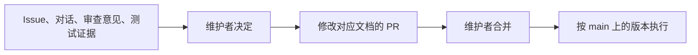

# 项目宪章

本文规定谁对项目作决定、决定怎样成为规则，以及 Agent 在项目中的角色。

## 角色

| 角色 | 职责 |
| --- | --- |
| 维护者 | 项目所有者，作最终决定：项目目标、规则、架构与例外；审查并合并 PR；验收与发布 |
| 受委托的贡献者 | 在维护者委托的范围内指挥和审查 Agent |
| Agent | 分析、设计、实现与验证；以 bot 身份提交改动，交维护者审查 |

## 规则怎样生效

- 规则以维护者合并进 `main` 的文档为准；PR、Issue 和评论是提案与证据。
- 每条规则只写在一个文档里，其他文档链接过去。
- 一次性例外写明适用范围，用完即止。
- 代码、测试结果与文档冲突时，报告冲突和证据，由维护者决定修改实现还是修改规则。

## Agent 的工作原则

- 在任务范围内自主选择实现方式；项目方向、规则与权限由维护者决定。
- 失败、未验证的部分和剩余风险如实报告。
- 交付报告说明完成情况；验收由维护者作出。
